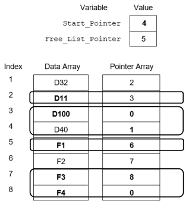
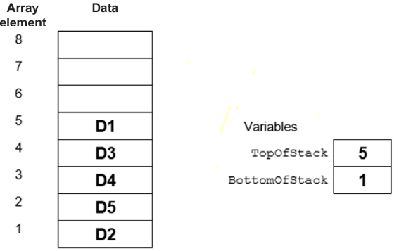
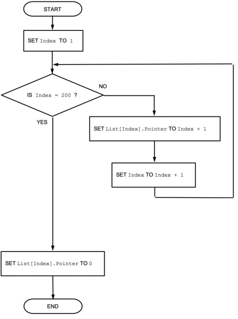

# Mark Schemes — Introduction to Abstract Data Types (ADT)
**10. Data Types & Structures** · Cambridge (CIE) AS computer-science (9618)

## Exam Questions (8 questions)

### Q1
> **[mark-scheme]**
> (i)
> 
> **Two **marks for all five empty boxes correct 
> **One **mark for any three or four empty boxes correct
> 
> | **Identifier** | **Data type** | **Description** |
> |---|---|---|
> | `BasePointer` | `INTEGER` | Points to the bottom of the stack |
> | `TopPointer` | `INTEGER` | Points to the top of the stack |
> | `Stack` | `REAL` | List of decimal numbers stored in the stack |
> 
> (ii)
> 
> **One **mark for each correctly completed line **(Max 5) **
> 
> `CONSTANT MaxSize = 40 `
> `DECLARE BasePointer : INTEGER `
> `DECLARE TopPointer : INTEGER `
> `DECLARE Stack : ARRAY[1:40] OF REAL `
> 
> `// initialisation of stack `
> `PROCEDURE Initialise() `
>         **BasePointer** $\leftarrow$ `1 `
>         **TopPointer** $\leftarrow$ `0` 
> `ENDPROCEDURE `
> 
> `// adding an item to the stack `
> `PROCEDURE Push(NewItem) `
>         **IF TopPointer <** `MaxSize THEN` 
>               **TopPointer **$\leftarrow$** TopPointer + 1 **
>               `Stack[TopPointer] `$\leftarrow$` NewItem `
> `  ENDIF `
> `ENDPROCEDURE`
> **[mark-scheme]**
> **One **mark for linked list and one mark for array **(Max 2)**
> 
> **Linked list **
> MP1    A linked list is a dynamic data structure / not restricted in size 
> MP2   Has greater freedom to expand or contract by adding or removing nodes as necessary 
> MP3  Allows more efficient editing using pointers (instead of moving the data).
> 
> **Array **
> MP4  An array is a static data structure1 generally fixed in size 
> MP5  When the array is full, the stack cannot be extended any further.

### Q2
> **[mark-scheme]**
> 
> 
> **MP1   **D3, D4, D1, D2 and D5 in question order or reversed - in any five consecutive locations 
> **MP2**   `FoQ` value matches index with D3 
> **MP3**  `EoQ` value matches index with D5
> **[mark-scheme]**
> **MP1**  If` NumItems` <u>**is / = 8 **</u>**// (queue) full** then jump to step 6 
> **MP2**  Increment **EndOfQueue **
> **MP3**  If **EndOfQueue = 9** then set `EndOfQueue` to **1 **
> **MP4**  Increment **NumItems **
> 
> **MP5**  Set the **Element** at the index … 
> **MP6**  stored in **EndOfQueue** to **value/data/item** being added
> 
> Mark as follows: 
> Steps 1 to 4: One mark for gaps filled as shown 
> Step 5: One mark for 'element' and one mark for other two terms

### Q3
> **[mark-scheme]**
> (i)
> 
> One mark per point** Max 3 **marks:
> 
> **Decide on scenario and mark accordingly. **
> **Scenario one:**
> 
> - If more than one line is / all lines are stored on the stack (before line(s) are removed)
> - The stack operates as a FILO device // Last item added to stack will be in first item out
> - So **lines in the file** appear out of sequence
> 
> **Scenario two: **
> 
> - Stack is Full
> - Not all lines can be stored on the stack
> - so resulting **file **will not contain **all the original lines **
> 
> **Scenario three: **
> 
> - (All) the data in a line read can’t be stored on the stack
> - Stack elements have not been allocated enough memory
> - so only **part of each line** is stored in the **file**
> 
> **Scenario four: **
> 
> - Stack is empty
> - The stack is being read faster than it is being written to
> - so **blank lines** may be inserted into the **file**
> 
> (ii)
> 
> Queue

### Q4
> **[mark-scheme]**
> 
> 
> Mark as follows:
> 
> - One mark for `Start_Pointer` value
> - One mark each group of row(s):
> - 2
> - 3 and 4
> - 5
> - 7 and 8
> 
> For null pointer: accept 0 / ∅ / an out-of-bound index value less than 1, greater than 8
> **[mark-scheme]**
> One mark per step:
> 
> 1. Assign the data item **D6** to **F1 **
> 2. Set the **pointer **of this node to point to **D11**
> 3. Set Ptr2 to point to **F2**
> 4. Set pointer of **D32** to point to **D6**

### Q5
> **[mark-scheme]**
> 
> 
> **MP1**   all values in the order and location shown 
> **MP2**  `TopOfStack `value is index of element containing D1 
> **MP3**  `BottomOfStack` value is index of element containing D2
> **[mark-scheme]**
> **MP1**   If **TopOfStack = 8 // (stack) full **then return `FALSE`
> 
> **MP2**  Otherwise,** increment** `TopOfStack `
> 
> **MP3  **Use `TopOfStack `as an **index** to the Array
> 
> **MP4  **Set the element at this** index / location / position** to the **value / data / item** being added
> 
> **MP5**  Return **TRUE**

### Q6
> **[mark-scheme]**
> One mark per point:
> 
> 1. The PS contains a null pointer
> 2. The PF points to the first element on the free list
> 3. All the nodes are on the free list

### Q7
> **[mark-scheme]**
> 0 is not a valid <u>array / </u>`List`<u> index</u> value // No 0th element in the array
> **[mark-scheme]**
> 
> 
> Mark as follows: 
> **MP1**   Use of variable as array index **and** initialisation to 1 / to first element of array 
> **MP2**   Loop for 199 / 200 iterations 
> **MP3**   Assign Index+1 to each pointer field in a loop 
> **MP4**   Assign 0 to 200th pointer field
> **[mark-scheme]**
> One mark per step:
> 
> **MP1   **Assign `HeadPointer` to `ThisPointer` / Current Pointer // Identify first node using <u>headpointer</u>
> 
> **MP2**   Loop the following until `ThisPointer `value is 0 (zero) / null <u>pointer</u> reached
> 
> **MP3**   … Output data (field) from array element at index `ThisPointer `// Output data (field) of the current node / array element
> 
> **MP4**   … Assign pointer field from current array element / index / to `ThisPointer `/ Current Pointer // Assign pointer field from current node to` ThisPointer` / Current Pointer

### Q8
> **[mark-scheme]**
> (i)`    `
> 
> `     SP`: 1 
> `OnStack`: 0
> 
> One mark for both correct values
> 
> (ii)
> 
> **MP1**   Unused values cannot be popped / taken off the stack // initialised values would never be used / unused elements cannot be accessed
> 
> **MP2**   ... until a value has first been pushed / written // overwrites previous value
> **[mark-scheme]**
> Example solution:
> 
> `FUNCTION Push(ThisValue : REAL) RETURNS BOOLEAN `
> `   DECLARE ReturnValue : BOOLEAN `
>         `IF` **OnStack = 60 / >59 // SP = 61 / SP > 60** `// SP` **outside the range 1 to 60 **`THEN `
>                `RETURN` **FALSE** `// Stack is already full` 
>         `ENDIF` 
>         **ThisStack[SP]** $\leftarrow$ `ThisValue` 
>         `SP` $\leftarrow$ **SP + 1 **
>         `OnStack `$\leftarrow$` OnStack + 1 `
> `   RETURN TRUE `
> `ENDFUNCTION1 `
> 
> Mark as follows: 
> One mark per gap
