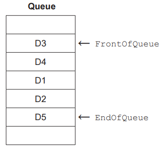
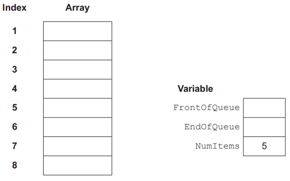
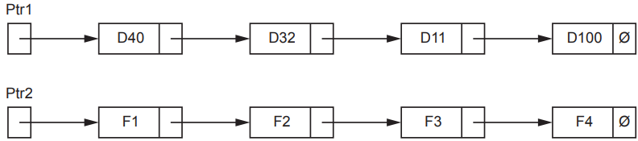
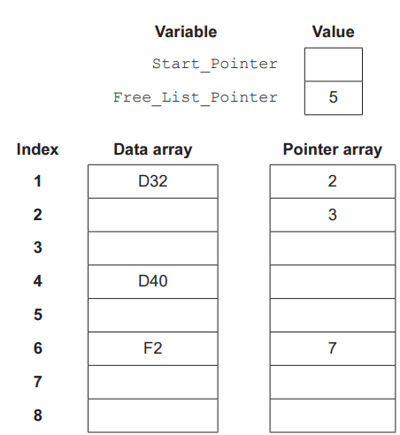
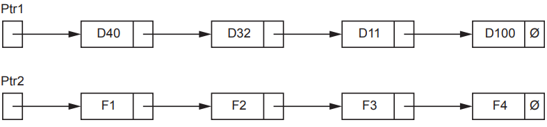
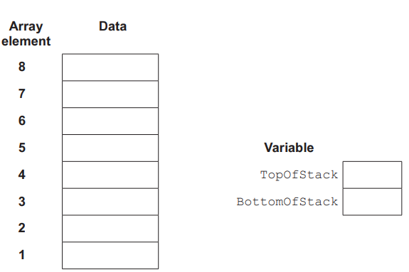

# Exam Questions — Introduction to Abstract Data Types (ADT)
**10. Data Types & Structures** · Cambridge (CIE) AS computer-science (9618)
> Source: [https://www.savemyexams.com/as/computer-science/cie/19/topic-questions/](https://www.savemyexams.com/as/computer-science/cie/19/topic-questions/) · 8 questions across 1 sets

## Exam Questions (8 questions)

### Q1 — medium — 9 marks

**Q1** [7 marks]

A stack Abstract Data Type (ADT) is to be implemented using pseudocode, with procedures to initialise it and to push new items onto the stack.

A 1D array `Stack` stores the contents of the stack.

(i) Study the pseudocode in **part (a)(ii)** and complete the table of identifiers by writing the missing data types and descriptions.

| **Identifier** | **Data type** | **Description** |
|---|---|---|
| `BasePointer` |   |   |
| `TopPointer` |   |   |
| `Stack` | `REAL` |   |

[2]

(ii) Complete the pseudocode.

`CONSTANT MaxSize = 40 `
`DECLARE BasePointer : INTEGER `
`DECLARE TopPointer : INTEGER `
`DECLARE Stack : ARRAY[1:40] OF REAL `

`// initialisation of stack `
`PROCEDURE Initialise() `

`   ...................................................................`$\leftarrow$  `1 .`

`   ...................................................................`$\leftarrow$ `0 `
`ENDPROCEDURE `

`// push an item onto the stack `
`PROCEDURE Push(NewItem : REAL) `

`   ..............................................................MaxSize THEN`

`     .................................................................... `

`     Stack[TopPointer]`$\leftarrow$`..................................................`
`   ENDIF `
`ENDPROCEDURE `

[5]

*Source: November 2023 9618/32 Q9AI,AII*

**Q1** [2 marks]

Justify the use of a linked list instead of an array to implement a stack.

*Source: November 2023 9618/32 Q9B*

### Q2 — medium — 9 marks

**Q2** [3 marks]

The diagram represents a queue Abstract Data Type (ADT).

The organisation of this queue may be summarised as follows:

- The `FrontOfQueue` pointer points to the next data item to be removed.
- The `EndOfQueue` pointer points to the last data item added.

The queue is implemented using three variables and a 1D array of eight elements as shown. The variable `NumItems` stores the number of items in the queue.

The pointer variables store indices (index numbers) of the array.

Complete the diagram to represent the state of the queue as shown above.

*Source: November 2023 9618/23 Q3A*

**Q2** [6 marks]

A module `AddTo()` will add a value to the queue by manipulating the array and variables in part **(a)**.

The queue implementation is circular. When pointers reach the end of the queue, they will ‘wrap around’ to the beginning.

Before a value can be added to the queue, it is necessary to check the queue is not full.

The algorithm to add a value to the queue is expressed in six steps.

Complete the steps.

1. If `NumItems `.............................. then jump to step 6.
2. Increment ................................... .
3. If ................................................. then set `EndOfQueue` to .............................. .
4. Increment ................................... .
5. Set the ............................ at the index stored in ........................... to the ............................ being added.
6. Stop.

*Source: November 2023 9618/23 Q3B*

### Q3 — medium — 3 marks

**Q3** [3 marks]

The program contains a module `GetFile()` which receives text files sent from another computer.

Lines from the file are sent one at a time. Each message contains one line and `ProcessMsg()` from part **(b)** adds each message as it is received onto stack 1.

Module `GetFile()` removes messages from stack 1 and writes the data to a text file.

There is a problem. Under certain circumstances, the received file does not appear as expected.

Assume that while a file is being received `ProcessMsg()` receives only messages containing lines from the file.

(i) Describe the circumstances and explain the problem.

Circumstances ........................................................................................................

Explanation .............................................................................................................

[3]

(ii) Suggest a more appropriate Abstract Data Type that could be used to store the messages that would not have the same problem.

[1]

*Source: November 2023 9618/22 Q8CI,CII*

### Q4 — medium — 9 marks

**Q4** [5 marks]

The diagram represents a linked list Abstract Data Type (ADT).

- Ptr1 is the start pointer. Ptr2 is the free list pointer.
- Labels D40, D32, D11 and D100 represent the data items of nodes in the list.
- Labels F1, F2, F3 and F4 represent the data items of nodes in the free list.
- The symbol Ø represents a null pointer.

The linked list is implemented using two variables and two 1D arrays as shown.

The pointer variables and the elements of the Pointer array store the indices (index numbers) of elements in the Data array.

Complete the diagram to show how the linked list as shown above may be represented using the variables and arrays.

*Source: November 2023 9618/22 Q3A*

**Q4** [4 marks]

The original linked list is to be modified. A new node D6 is inserted between nodes D32 and D11.

The algorithm required is expressed in four steps as shown.

Complete the steps.

1. Assign the data item .................................. to .................................. .
2. Set the .................................. of this node to point to .................................. .
3. Set Ptr2 to point to .................................. .
4. Set pointer of .................................. to point to .................................. .

*Source: November 2023 9618/22 Q3B*

### Q5 — medium — 8 marks

**Q5** [3 marks]

The diagram represents an Abstract Data Type (ADT).

The operation of this stack may be summarised as follows:

- The `TopOfStack` pointer points to the last item added to the stack.
- The `BottomOfStack` pointer points to the first item on the stack.

The stack is implemented using two variables and a 1D array of 8 elements as shown.

The variables are used to reference individual elements of the array, in such a way that:

- the array is filled from the lowest indexed element towards the highest
- all the elements of the array are available for the stack.

Complete the diagram to represent the state of the stack as shown above.

*Source: November 2023 9618/21 Q3A*

**Q5** [5 marks]

A function `Push()` will add a value onto the stack by manipulating the array and variables in **part (a)**.

Before adding a value onto the stack, the algorithm will check that space is available.

If the value is added to the stack, the function will return `TRUE,` otherwise it will return `FALSE.`

The algorithm is expressed in five steps.

Complete the steps.

1. If ........................................................ then return `FALSE`
2. Otherwise .......................................... `TopOfStack `
3. Use `TopOfStack `as an ................................... to the array.
4. Set the element at this ...................................... to the .............................. being added.
5. Return .............................. .

*Source: November 2023 9618/21 Q3B*

### Q6 — medium — 3 marks

**Q6** [3 marks]

The diagram shows an Abstract Data Type (ADT) representation of a linked list after data items have been added.

- PS is the start pointer.
- PF is the free list pointer.
- Labels Df, Dc, Db and Dy represent the data items of nodes in the list.
- Labels Fg, Fh, Fm and Fw represent the data items of nodes in the free list.
- The symbol Ø represents a null pointer.

Describe the linked list immediately after initialisation, before **any** data items are added.

*Source: June 2024 9618/21 Q3A*

### Q7 — medium — 9 marks

**Q7** [1 mark]

The implementation of a linked list uses an integer variable and a 1D array `List` of type `Node`.

Record type `Node` is declared in pseudocode as follows:

`TYPE Node `
`   DECLARE Data : STRING `
`   DECLARE Pointer : INTEGER `
`ENDTYPE `

The array `List` is declared in pseudocode as follows:

`DECLARE List : ARRAY[1:200] OF Node`

The linked list will operate as follows:

- Integer variable `HeadPointer` will store the array index for the first node in the linked list.
- The `Pointer` field of a node contains the index value of the next array element (the next node) in the linked list.
- The value 0 is used as a null pointer.

State why the value 0 has been selected as the null pointer.

*Source: November 2024 9618/23 Q3AI*

**Q7** [4 marks]

The array List will be initialised so that each node points to the following node. The last node will contain a null pointer.

Complete the program flowchart to represent the algorithm for this operation.

*Source: November 2024 9618/23 Q3B*

**Q7** [4 marks]

An algorithm outputs the `Data` field from all nodes in the array `List`. The order the `Data` is output should be the same order it is stored in the linked list.

Describe the algorithm in **four** steps.

Do **not** use pseudocode statements in your answer.

Step 1 ......................................................................................................................

Step 2 .....................................................................................................................

Step 3 .....................................................................................................................

Step 4 .....................................................................................................................

*Source: November 2024 9618/23 Q3C*

### Q8 — medium — 7 marks

**Q8** [3 marks]

A program uses a stack to hold up to 60 numeric values. 
The stack is implemented using two integer variables and a 1D array.

The array is declared in pseudocode as shown:

`DECLARE ThisStack : ARRAY[1:60] OF REAL `

The stack operates as follows:

- Global variable `SP` acts as a stack pointer that points to the next available stack location. The value of `SP` represents an array index.
- Global variable `OnStack` represents the number of values currently on the stack.
- The stack grows upwards from array element index 1.

(i) Give the initial values that should be assigned to the **two** variables.

`SP` ............................................................................................................

`OnStack` ...................................................................................................

[1]

(ii) Explain why it is not necessary to initialise the array elements before the stack is used.

[2]

*Source: November 2024 9618/22 Q3AI,AII*

**Q8** [4 marks]

A function to add a value to `ThisStack` is expressed in pseudocode as shown. The function will return a value to indicate whether the operation was successful or not.

Complete the pseudocode by filling in the gaps.

`FUNCTION Push(ThisValue : REAL) RETURNS BOOLEAN `

`   DECLARE ReturnValue : BOOLEAN `

`   IF ................................................ THEN `

`      RETURN ................................................ // stack is already full `

`   ENDIF `

`   ................................................`$\leftarrow$`ThisValue `

`   SP`$\leftarrow$` ................................................ `

`   OnStack`$\leftarrow$ `OnStack + 1 `

`   RETURN TRUE `

`ENDFUNCTION`

*Source: November 2024 9618/22 Q3B*

