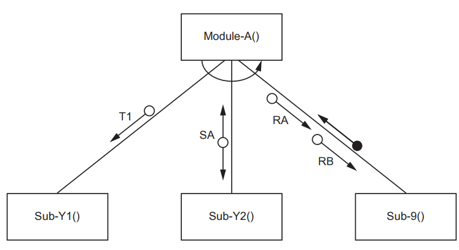
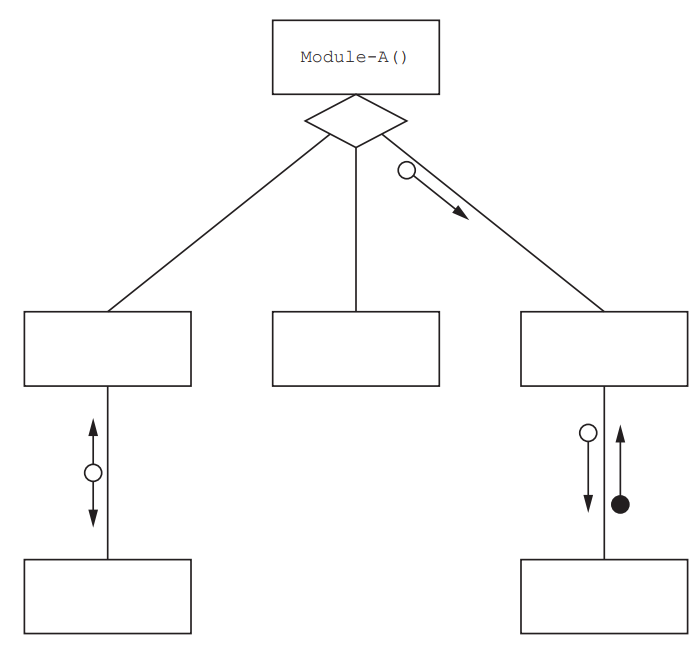
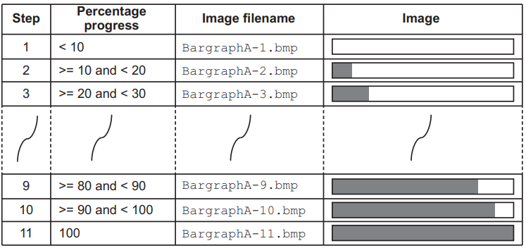
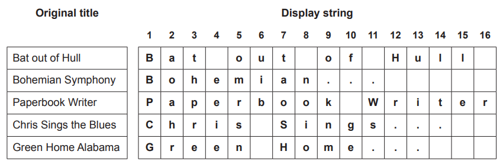
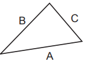
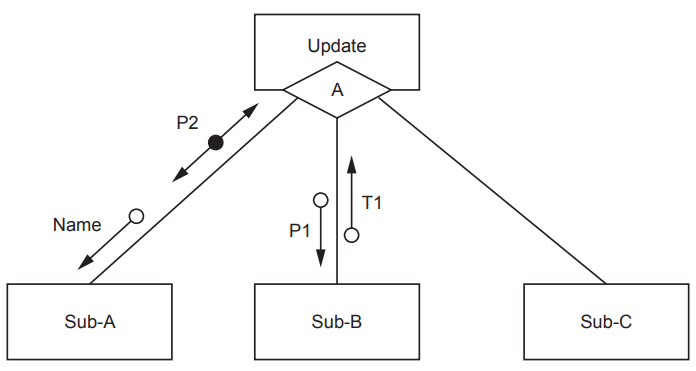
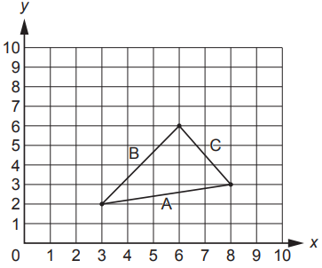
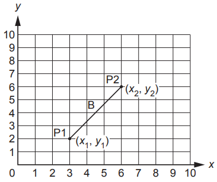
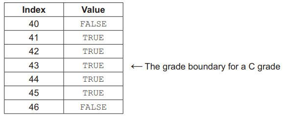

# Exam Questions — Structured Programming
**11. Programming** · Cambridge (CIE) AS computer-science (9618)
> Source: [https://www.savemyexams.com/as/computer-science/cie/19/topic-questions/](https://www.savemyexams.com/as/computer-science/cie/19/topic-questions/) · 27 questions across 1 sets

## Exam Questions (27 questions)

### Q1 — medium — 10 marks

**Q1** [7 marks]

A class of students are developing a program to send data between computers. Many computers are connected together to form a wired network. Serial ports are used to connect one computer to another.

Each computer:

- is assigned a unique three-digit ID
- has three ports, each identified by an integer value
- is connected to between one and three other computers.

Messages are sent between computers as a string of characters organised into fields as shown:

`     <STX><DestinationID><SourceID><Data><ETX>`

| **Field name** | **Description** |
|---|---|
| `STX` | a single character marking the start of the message  (ASCII value 02) |
| `DestinationID` | three numeric characters identifying the destination computer |
| `SourceID` | three numeric characters identifying the source computer |
| `Data` | a variable length string containing the data being sent  (Minimum length is 1 character) |
| `ETX` | a single character marking the end of the message  (ASCII value 03) |

For example, the following message contains the data "Hello Jack" being sent from computer "202" to computer "454":

`<STX>"45420Hello Jack"<ETX>`

Each computer will run a copy of the same program. Each program will contain a global variable `MyID` of type string which contains the unique ID of the computer in which the program is running.

The first two program modules are defined as follows:

| **Module** | **Description** |
|---|---|
| `GetData()`  (already written) | - returns the data field from a message that has been received - If no message is available, the module waits until one has been received. |
| `ReceiveFile()` | - takes a file name as a parameter of type string - creates a text file with the given file name (no checking required) - writes the data field returned by `GetData()` to the file - repeats until the data field is "****", which is not written to the file - outputs a final message giving the total number of characters written to the file, for example:  `132456 characters were written to newfile.txt` |

Two new modules are defined, which will allow two users to exchange messages.

| **Module** | **Description** |
|---|---|
| `Transmit()`  (already written) | - takes two parameters:    - a string representing a message   - an integer representing a port number - transmits the message using the given port |
| `Chat()` | - takes two parameters:    - a string representing a Destination ID   - an integer representing a port number - extracts data from a received message using `GetData()` and outputs it - forms a message using data input by the user and sends it using `Transmit()` - repeats until either the output string or the sent string is `"Bye"` |

Reminders:

- Each program contains a global variable `MyID` of type string which contains the unique ID of the computer in which the program is running.
- Messages are sent between computers as a string of characters organised into fields as shown: `     ` `     <STX><DestinationID><SourceID><Data><ETX>`

Write pseudocode for module `Chat().`

Modules `GetData()` and `Transmit()` must be used.

*Source: November 2023 9618/23 Q8C*

**Q1** [3 marks]

Module `GetData()` returns the data field from a message that has been received. If no message is available, the module waits until one has been received.

Explain the limitation of this on module `Chat()` from part **(c). **

Describe a modification to `GetData()` to address this limitation.

Limitation..........................................................................................................

Modification......................................................................................................

*Source: November 2023 9618/23 Q8D*

### Q2 — medium — 2 marks

**Q2** [2 marks]

A structure chart shows the modular structure of a program:

The structure chart shows that Sub-9() is a function.

A Boolean value is returned by Sub-9() for processing by Module-A().

The original parameter RA is of type integer and RB is of type string.

A record type `MyType` will be defined with three fields to store the values passed between the two modules.

The design is modified and Sub-9() is changed to a procedure.

The procedure will be called with a single parameter of type `MyType. `

Write the pseudocode header for procedure `Sub-9().`

*Source: November 2023 9618/23 Q7BII*

### Q3 — medium — 6 marks

**Q3** [6 marks]

A function `TestNum()` will take a six-digit string as a parameter.

The function will test whether the string meets certain conditions and will return an integer value as follows:

| **Return value** | **Condition** | **Example** |
|---|---|---|
| 1 | The last three digits are the same but non-zero. | "253444" |
| 2 | The last three digits are zero. | "253000" |
| 3 | The first three and last three digits are the same. | "410410" |

The function will return the highest possible value for the given string.

If the string does not meet any of the conditions, zero is returned.

Write pseudocode for function `TestNum().`

Assume that the parameter is valid.

*Source: November 2023 9618/23 Q6*

### Q4 — medium — 6 marks

**Q4** [6 marks]

A procedure `RandList()` will output a sequence of 25 random integers, where each integer is larger than the previous one.

Write pseudocode for procedure `RandList()`.

*Source: November 2023 9618/23 Q4A*

### Q5 — medium — 7 marks

**Q5** [7 marks]

Copies of the same program will run on each computer. The program contains a global variable `MyID` of type string, which contains the unique ID of the computer in which the program is running.

When messages are received, they are placed on one of two stacks. Stack 1 is used for messages that have reached their destination and stack 2 is used for messages that will be forwarded on to another computer.

Additional modules are defined:

| **Module** | **Description** |
|---|---|
| `StackMsg()`  (already written) | - takes two parameters:    - a string representing a message   - an integer representing the stack number - adds the message to the required stack - returns` TRUE `if the message is added to the required stack, otherwise returns `FALSE` |
| `ProcessMsg()` | - takes a message as a parameter of type string - ignores any message with a zero-length data field - extract the `DestinationID` from the message - checks whether the `DestinationID` is this computer or whether the message is to be forwarded - uses `StackMsg()` to add the message to the appropriate stack - outputs an error if the message could not be added to the stack |

Write pseudocode for module `ProcessMsg().`

Module `StackMsg()` must be used.

*Source: November 2023 9618/22 Q8B*

### Q6 — medium — 4 marks

**Q6** [4 marks]

A program contains six modules:

| **Pseudocode module header** |
|---|
| `PROCEDURE Module-A()` |
| `PROCEDURE Module-X(T1 : INTEGER, S2 : REAL)` |
| `PROCEDURE Reset(BYREF Code : INTEGER)` |
| `FUNCTION Restore(OldCode : INTEGER) RETURNS BOOLEAN` |
| `FUNCTION Module-Z(SA : INTEGER) RETURNS INTEGER` |

`Module-X()`  calls `Reset() `
`Module-Y() `calls `Restore()`

*Source: November 2023 9618/22 Q7A*

### Q7 — medium — 2 marks

**Q7** [2 marks]

A procedure `CreateFiles()` will take two parameters:

- a string representing a file name
- an integer representing the number of files to be created.

The procedure will create the number of text files specified.

Each file is given a different name. Each file name is formed by concatenating the file name with a suffix based on the file number. The suffix is always three characters.

For example, the call `CreateFiles("TestData", 3)` would result in the creation of the three files, TestData.001, TestData.002 and TestData.003.

Each file will contain a single line. For example, file TestData.002 would contain the string:

`     This is File TestData.002`

A module `CheckFiles()` will count the number of files produced by `CreateFiles()` in part **(a)**.

`CheckFiles()` will take a string representing a file name and return the number of files found.

(i) Identify the type of module that should be used for `CheckFiles(). `

[1]

(ii) Write the module header for `CheckFiles().`

[1]

*Source: November 2023 9618/22 Q6BI,BII*

### Q8 — medium — 6 marks

**Q8** [6 marks]

A procedure `Count()` will:

1. input a value (all values will be positive integers)
2. count the number of odd values and count the number of even values
3. repeat from step 1 until the value input is 99
4. output the two count values, with a suitable message.

The value 99 must not be counted.

Write pseudocode for the procedure `Count().`

*Source: November 2023 9618/22 Q4A*

### Q9 — medium — 6 marks

**Q9** [6 marks]

A new module has been defined:

| **Module** | **Description** |
|---|---|
| `GetField()` | - takes two parameters:    - a string containing a message   - an integer containing a field number - If the field number is valid (in the range 1 to 3, inclusive), it returns a string containing the required field, otherwise it returns an empty string. |

As a reminder, a message is defined as follows:

`    <STX><DestinationID><SourceID><Data><ETX>`

| **Field number** | **Field name** | **Description** |
|---|---|---|
| Not applicable | `STX` | a single character marking the start of the message (ASCII value 02) |
| 1 | `DestinationID` | three numeric characters that identify the destination computer |
| 2 | `SourceID` | three numeric characters that identify the source computer |
| 3 | `Data` | a variable length string containing the data being sent (Minimum length is 1 character) |
| Not applicable | `ETX` | a single character marking the end of the message (ASCII value 03) |

Write pseudocode for module `GetField().`

*Source: November 2023 9618/21 Q8D*

### Q10 — medium — 9 marks

**Q10** [7 marks]

The pseudocode `OUTPUT` command starts each output on a new line.

A new procedure `MyOutput()` will take a string and a Boolean parameter. 
`MyOutput()` may be called repeatedly and will use concatenation to build a string using a global variable `MyString,` up to a maximum length of 255 characters.

`MyString` will be output in either of these two cases:

1. The Boolean parameter value is `TRUE`
2. The resulting string (after concatenation) would be longer than 255 characters.

If `MyString` is not output, the string is concatenated with `MyString.`

For example, the calls to `MyOutput()` given below would result in the output as shown:

`    MyOutput("Hello ", FALSE) `
`    MyOutput("ginger ", FALSE) `
`    MyOutput("cat", TRUE) `
`    MyOutput("How are you?", TRUE)`

Resulting output:

`    Hello ginger cat `
`    How are you? `

Notes:

- `MyString` is initialised to an empty string before `MyOutput()` is called for the first time.
- No string passed to `MyOutput()` will be longer than 255 characters.

Write pseudocode for `MyOutput().`

*Source: November 2023 9618/21 Q6A*

**Q10** [2 marks]

The design of the procedure given in **part (a)** is modified and `MyString` is changed from a global to a local variable declared in `MyOutput().`

When the modified procedure is converted into program code, it does not work as expected.

Explain why it does not work as expected.

*Source: November 2023 9618/21 Q6B*

### Q11 — medium — 6 marks

**Q11** [6 marks]

A global array is declared in pseudocode as follows:

`    DECLARE Data : ARRAY[1:150] OF STRING `

A function `TooMany() `will:

1. take two parameters: • a string (the search string) • an integer (the maximum value)
2. count the number of strings in the array that exactly match the search string
3. return `TRUE `if the count is greater than the maximum value, otherwise will return `FALSE`

Write pseudocode for the function `TooMany().`

*Source: November 2023 9618/21 Q4A*

### Q12 — medium — 7 marks

**Q12** [7 marks]

A teacher is designing a program to process pseudocode projects written by her students.

The program analyses a student project and extracts information about each module that is defined (each procedure or function). This information is stored in a global 2D array ModInfo of type string.

A module header is the first line of a module definition and starts with either of the keywords PROCEDURE or FUNCTION.

An example of part of the array is given below. Row 10 of the array shows that a procedure header occurs on line 27 and row 11 shows that a function header occurs on line 35. "P" represents a procedure and "F" represents a function

|   | **x = 1** | **x = 2** | **x = 3** |
|---|---|---|---|
| `ModInfo[10, x]` | `"27"` | `"P"` | `"MyProc(Z : CHAR)"` |
| `ModInfo[11, x]` | `"35"` | `"F"` | `"MyFun(Y : CHAR) RETURNS BOOLEAN"` |

The string stored in column 3 is called the module description. This is the module header **without** the keyword.

A valid module header will:

- be at least 13 characters long
- start with the keyword `PROCEDURE` or `FUNCTION`. The keyword may appear in either upper or lower case (or a mix of both) and **must **be followed by a space character.

The teacher has defined the first program module as follows:

| **Module** | **Description** |
|---|---|
| `Header()` | - called with a parameter of type string representing a line of pseudocode - if the line is a valid procedure header, returns a string: `   "P<Module description>"` - if the line is a valid function header, returns a string: `   "F<Module description>"` - otherwise, returns an empty string For example, given the string: `"FUNCTION Zap(X : INTEGER) RETURNS CHAR" ` `Header()`returns the string: `"FZap(X : INTEGER) RETURNS CHAR"` |

Write pseudocode for module `Header().`

*Source: June 2024 9618/23 Q8A*

### Q13 — medium — 3 marks

**Q13** [3 marks]

Seven program modules form part of a program. A description of the relationship between the modules is summarised below. Any return values are stated in the description.

| **Module name** | **Description** |
|---|---|
| Mod-A | calls Mod-B followed by Mod-C |
| Mod-B | - called with parameters Par1 and Par2 - calls either Mod-D or Mod-E, determined when the program runs - returns a Boolean value |
| Mod-C | - called with parameters Par1 and Par3 - Par3 is passed by reference - repeatedly calls Mod-F followed by Mod-G |
| Mod-D | called with parameter Par2 |
| Mod-E | - called with parameter Par3 - returns an integer value |
| Mod-F | called with parameter Par3 |
| Mod-G | - called with parameter Par3 - Par3 is passed by reference |

Parameters in the table are as follows:

- Par1 and Par3 are of type string.
- Par2 is of type integer.

(i) Identify the modules that would be implemented as functions.

[1]

(ii) Modules Mod-F and Mod-G are both called with Par3 as a parameter. 
In the case of Mod-F, the parameter is passed by value. 
In the case of Mod-G, the parameter is passed by reference.

Explain the effect of the **two** different ways of passing the parameter Par3.

[2]

*Source: june 2024 9618/23 Q7AI,AII*

### Q14 — medium — 9 marks

**Q14** [6 marks]

A program displays a progress bar to inform the user of the progress of tasks that take a significant time to complete, such as those involving file transfer operations.

Task progress is divided into 11 steps. Each step represents the amount of progress as a percentage. An image is associated with each step and each image is stored in a different file.

Different progress bar images may be selected. For a given image, files all have the same filename root, with a different suffix.

The table illustrates the process for using the image with filename root `BargraphA`

A procedure `Progress()` will:

- be called with two parameters:

  - an integer representing the percentage progress (0 to 100 inclusive)
  - a string representing the image filename root
- generate the full image filename
- call a procedure `Display()` using the full image filename as the parameter.

Write pseudocode for procedure `Progress().`

*Source: June 2024 9618/23 Q6A*

**Q14** [3 marks]

The definition of procedure `Progress()` is provided here for reference

| A procedure `Progress()` will:  - be called with two parameters:    - an integer representing the percentage progress (0 to 100 inclusive)   - a string representing the image filename root - generate the full image filename - call a procedure `Display()` using the full image filename as the parameter. |
|---|
|   |

`Progress()` will be rewritten and a new module `Progress2()` produced with these requirements:

- an additional parameter of type integer will specify the total number of steps
- the image filename will be returned (procedure `Display()` will **not** be called from within `Progress2()`).

(i) Write pseudocode for the new module header.

[2]

(ii) State **one** benefit of increasing the number of steps.

[1]

*Source: June 2024 9618/23 Q6BI,BII*

### Q15 — medium — 6 marks

**Q15** [6 marks]

A teacher is designing a program to process pseudocode projects written by her students.

Each student project is stored in a text file.

The process is split into a number of stages. Each stage performs a different task and creates a new file.

For example:

| **File name** | **Comment** |
|---|---|
| `MichaelAday_src.txt` | Student project file produced by student Michael Aday |
| `MichaelAday_S1.txt` | File produced by stage 1 |
| `MichaelAday_S2.txt` | File produced by stage 2 |

The teacher has defined the first program module as follows:

| **Module** | **Description** |
|---|---|
| `DeleteSpaces()` | - called with a parameter of type string representing a line of pseudocode from a student’s project file - returns the line after removing any leading space characters  The following example shows a string before and after the leading spaces have been removed:  Before: `" IF X2 > 13 THEN"`  After:        `"IF X2 > 13 THEN"` |

*Source: June 2024 9618/22 Q8B*

### Q16 — medium — 6 marks

**Q16** [6 marks]

A procedure `TwoParts()` will input a sequence of real values, one at a time.

The procedure will:

- process the sequence in two parts
- form a first total by adding the values until the first zero
- form a second total by adding the values after the first zero until the second zero
- output the average of the two totals, together with a suitable message.

Values input in the first part are totalled using global variable `TotalA` and those input in the second part are totalled using global variable `TotalB.`

Write pseudocode for the procedure `TwoParts().`

*Source: June 2024 9618/23 Q4A*

### Q17 — medium — 2 marks

**Q17** [2 marks]

Refer to the [insert](https://cdn.savemyexams.com/uploads/2025/11/32550-9618_w24_in_23.pdf) for the list of pseudocode functions and operators.

A program uses many complex algorithms.

One algorithm is repeated in several places. The code for the algorithm is the same wherever it is used, but the calculations within the algorithm may operate on different data.

The result of each calculation is used by the code that follows it.

It is decided to modify the program and implement the algorithm as a separate module.

(i) State **two** benefits of this modification to the existing program.

[2]

(ii) Describe how the modification would be implemented.

[3]

*Source: June 2024 9618/23 Q1AI,AII*

### Q18 — medium — 7 marks

**Q18** [7 marks]

A music player stores music in a digital form and has a display which shows the track being played.

Up to 16 characters can be displayed. Track titles longer than 16 characters will need to be trimmed as follows:

- Words must be removed from the end of the track title until the resulting title is less than 14 characters.
- When a word is removed, the space in front of that word is also removed.
- Three dots are added to the end of the last word displayed when one or more words have been removed.

The table below shows some examples:

A function `Trim()` will:

- take a string representing the original title
- return the string to be displayed.

Assume:

- Words in the original title are separated by a single space character.
- There are no spaces before the first word or after the last word of the original title.
- The first word of the original title is less than 14 characters.

Write pseudocode for the function `Trim().`

*Source: June 2024 9618/22 Q6A*

### Q19 — medium — 4 marks

**Q19** [4 marks]

A triangle has sides of length A, B and C.

In this example, A is the length of the longest side.

This triangle is said to be right‑angled if the following equation is true:

A × A = (B × B) + (C × C)

A procedure will be written to check whether three lengths represent a right‑angled triangle. The lengths will be input in any sequence.

The procedure `IsRA()` will:

- prompt and input three integer values representing the three lengths
- test whether the three lengths correspond to the sides of a right‑angled triangle
- output a suitable message. The length of the longest side may not be the first value input.

The length of the longest side may **not** be the first value input.

Write pseudocode for the procedure `IsRA().`

*Source: June 2024 9618/22 Q4*

### Q20 — medium — 8 marks

**Q20** [8 marks]

A teacher is designing a program to process pseudocode projects written by her students.

Each student project is stored in a text file.

The process is split into a number of stages. Each stage performs a different task and creates a new file named as shown:

| **File name** | **Comment** |
|---|---|
| `MichaelAday_src.txt` | student project file produced by student Michael Aday |
| `MichaelAday_S1.txt` | file produced by stage 1 |
| `MichaelAday_S2.txt` | file produced by stage 2 |

The teacher has defined the first program module as follows:

| **Module** | **Description** |
|---|---|
| `DeleteComment()` | - called with a parameter of type string representing a line of pseudocode from a student’s project file - returns the line after removing any comments  Note on comments:  A comment starts with two forward slash characters and includes all the remaining characters on the line.  The following example shows a string before and after the comment has been removed:  Before: `IF X2 > 13 THEN  //check if limit exceeded ` After:     `IF X2 > 13 THEN` |

Complete the pseudocode for module `DeleteComment().`

`FUNCTION DeleteComment(Line : STRING) RETURNS STRING`

*Source: June 2024 9618/21 Q8A*

### Q21 — medium — 4 marks

**Q21** [4 marks]

The structure chart illustrates part of the membership program:

Data item notes:

- Name contains the name of a club member
- P1 and T1 are of type real.

Write the pseudocode module headers for Sub-A and Sub-B.

Sub-A...........................................................................................

Sub-B...........................................................................................

*Source: June 2024 9618/21 Q7BII*

### Q22 — medium — 6 marks

**Q22** [6 marks]

Three points on a grid form a triangle with sides of length A, B and C as shown in the example:

A triangle is said to be right-angled if the following test is true (where A is the length of the longest side):

A2 = B2 + C2

A2 means A multiplied by A, for example 32 means 3 × 3 which evaluates to 9

You can calculate A2, B2 and C2 by using the coordinates of the endpoints of each line.

For example, B2 is calculated as follows:

The endpoints, P1 and P2, have the coordinates (3, 2) and (6, 6).

The value B2 is given by the formula:

B2 = (x1 − x2) 2 + (y1 − y2) 2

In this example:

B2 = (3 − 6)2 + (2 − 6)2 
            B2 = (–3)2 + (–4)2 
            B2 = 9 + 16 
            B2 = 25

A function `IsRA()` will:

- take three sets of integers as parameters representing the coordinates of the three endpoints that form a triangle
- return `TRUE` if the endpoints form a right-angled triangle, otherwise return `FALSE`.

In pseudocode, the operator `‘^’` represents an exponent, which is the number of times a value is multiplied by itself. For example, the expression Value2 may be written in pseudocode as `Value ^ 2 `

Complete the pseudocode for the function `IsRA().`

`FUNCTION IsRA(x1, y1, x2, y2, x3, y3 : INTEGER) RETURNS BOOLEAN`

*Source: June 2024 9618/21 Q6A*

### Q23 — medium — 6 marks

**Q23** [6 marks]

A global 1D array `Data` contains 100 elements of type integer.

A function `Check()` will:

- total the element values in odd index locations (1, 3, 5 ... 97, 99)
- total the element values in even index locations (2, 4, 6 ... 98, 100)
- return one of three strings ‘Odd’, ‘Even’ or ‘Same’ to indicate which total is the greater, or whether the totals are the same.

Write pseudocode for the function `Check().`

*Source: June 2024 9618/21 Q4*

### Q24 — medium — 3 marks

**Q24** [3 marks]

The variable names `A, B, C` and  `D` in part **(a)** are **not** good programming practice.

(i) State why these variable names are **not** suitable.

[1]

(ii) Identify **one** problem that these variable names might cause.

[1]

(iii) The choice of suitable variable names is one example of good programming practice.

**Give one** other example.

[1]

*Source: June 2024 9618/21 Q1CI,CII,CIII*

### Q25 — medium — 6 marks

**Q25** [6 marks]

An alternative algorithm to determine if a paper needs to be checked uses a global 1D array `Check`, containing 76 elements of type `BOOLEAN.` The indices of the array are from 0 to 75 (inclusive), corresponding to the range of possible marks.

An element value in `Check` is `TRUE` if the index is within 2 marks of a grade boundary. For example, in the case where the C grade boundary is 43 the corresponding part of the `Check` array would be as follows:

A procedure `GBInitialise()` will initialise the `Check` array using values from the `GB` array.

Note it can be assumed that the maximum grade boundary value for A is 70 and the minimum value for E is 15.

Write pseudocode for the procedure.

*Source: November 2024 9618/23 Q4BII*

### Q26 — medium — 7 marks

**Q26** [6 marks]

A program is being developed to process bank card information.

When a card number is displayed, all the characters except the last four are replaced with the asterisk character '*'.

Card numbers are stored as strings. The strings are between 10 and 20 characters in length.

The function Conceal() will take a string representing a card number and return a modified string.

Example strings:

| **Original string** | **Modified string** |
|---|---|
| "1234567890" | "******7890" |
| "1234567897652" | "*********7652" |
| "1234567890123456" | "************3456" |

The function Conceal() will:

- take a numeric string as a parameter representing the card number
- return a string in which the asterisk character replaces all except the last four characters of the card number parameter.

Write pseudocode for the function Conceal().

*Source: November 2024 9618/22 Q2A*

**Q26** [1 mark]

The requirements have been changed. `Conceal()` will now be written as a procedure which will process 100 card numbers each time it is called.

The card numbers will be stored in a 2D array `CardNumber`. The original string will be stored in column one and the modified string in column two.

The new procedure `Conceal() `will write the modified string to the corresponding element in column two.

The array `CardNumber` is passed as a parameter to the new procedure `Conceal().`

Identify how this parameter should be specified in the new procedure head

*Source: November 2024 9618/22 Q2BII*

### Q27 — medium — 6 marks

**Q27** [6 marks]

A program uses three global integer variables` HH, MM` and `SS` to represent the current time in hours, minutes and seconds using the 24-hour clock notation.

Midnight would be represented as 00:00:00 (`HH:MM:SS`). If the variables `HH, MM` and `SS` contained the values 16, 30 and 10 respectively, then the time would be 16:30:10 or just after 4.30 in the afternoon.

A procedure `Tick() `will be called every second. 
The procedure `Tick() `will:

- update the value in `SS` each time it is called
- update the values in `HH` and `MM` as appropriate
- call a procedure `CheckAlarm()` at the start of each minute
- call a procedure `NewDay()` whenever the time reaches midnight.

Complete the pseudocode for procedure `Tick(). `

`PROCEDURE Tick()`

*Source: November 2024 9618/21 Q2*

