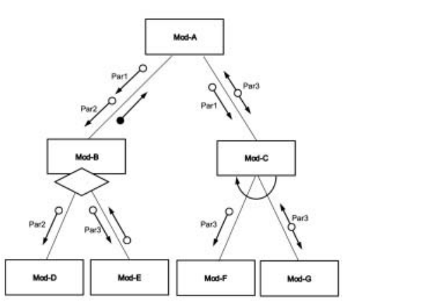
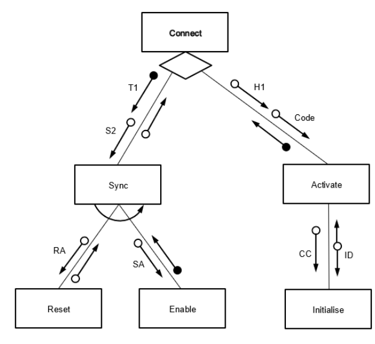
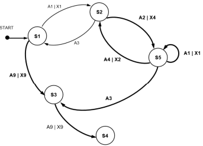

# Mark Schemes — Program Design
**12. Software Development** · Cambridge (CIE) AS computer-science (9618)

## Exam Questions (9 questions)

### Q1
> **[mark-scheme]**
> 
> 
> One mark per bullet:
> 
> 1. All modules correctly labelled and interconnected
> 2. Parameters between Mod-A and Mod-B and return value from Mod-B
> 3. Parameters between Mod-A and Mod-C
> 4. Diamond applied to Mod-B only
> 5. Iteration arrow applied to Mod-C only
> 6. All parameters at lower level and return value

### Q2
> **[mark-scheme]**
> One mark for reason, one for benefit
> 
> Reason: (Program is) easier to design / implement / test / debug / modify
> 
> Benefit: Easier to check that **each stage** works as expected

### Q3
> **[mark-scheme]**
> (i)
> 
> | Input | Output | Next state |
> |---|---|---|
> |   |   | S1 |
> | Input‑A | none | S3 |
> | **Input‑A** | Output‑W | **S3** |
> | **Input‑B** | none | **S2** |
> | Input‑B | **none** | **S5** |
> | Input‑A | **none** | **S2** |
> | **Input‑A** | **Output-X** | S4 |
> 
> One mark per row 3 to 7
> 
> (ii) Input-B, Input-A

### Q4
> **[mark-scheme]**
> Means that `Update `calls (one of) either `Sub-A`, `Sub-B `or `Sub-C `
> 
> One mark for each point:
> 
> - reference to selection / decision / if
> - naming all four modules correctly

### Q5
> **[mark-scheme]**
> One mark for name **and **use
> 
> Mark as follows: 
> Examples include:
> 
> Sub-module: `ScanCard()/ GetID() `
> Use: Read the barcode from the loyalty card / Get the customer ID from the barcode
> 
> Sub-module: `GetPoints() `
> Use: Get the number of points the customer has
> 
> Sub-module:` ExchangePoints() / UpdateCard() `
> Use: Reduce the number of loyalty points
> 
> Sub-module: `GetDiscount() / CalculateDiscount() `
> Use: Calculate the discount
> 
> Sub-module: `CalculatePoints() `
> Use: Calculate points (following a purchase)
> 
> Sub-module: `UpdatePoints() `
> Use: Update total points a customer has (following a purchase)
> 
> Sub-module: `ShowDiscount() `
> Use: Display the discount
> 
> **Max 4 marks**

### Q6
> **[mark-scheme]**
> **MP1 **Data structures // data dictionary // identifier table(s) // validation rules
> 
> **MP2** Data-flow diagram // state-transition diagram
> 
> **MP3 **User interface // Format for the email
> 
> **MP4 **Testing method / Test plan / Test data / Trace tables
> 
> **MP5** Choice of email protocol to be used // Programming language to be used // Development environment
> 
> **MP6 **Use of library routines // program to send the email
> 
> **Max 3 marks**
> **[mark-scheme]**
> 
> 
> **MP1 **Three boxes correctly labelled **and **correct hierarchy
> 
> **MP2 **Parameter **and **return values
> 
> **MP3 **Iteration arrow

### Q7
> **[mark-scheme]**
> 
> 
> One mark per point:
> 
> 1. All module identified in correct hierarchy
> 2. Parameters to both Sync and Activate and return values
> 3. Parameters to both Reset and Enable
> 4. Parameters to Initialise
> 5. Decision diamond
> **[mark-scheme]**
> Explanation:
> 
> Means that Sync repeatedly calls Reset and (then) Enable
> 
> One mark for each point:
> 
> MP1: reference to iteration
> 
> MP2: naming all three modules correctly including correct sequence of calls

### Q8
> **[mark-scheme]**
> Answers include:
> 
> **Reason: **
> 
> - This part of the algorithm performs a specific task // if the check or calculation is changed it is changed only once
> - A (similar) subroutine is already available // Library routine is already available
> - The program is simplified / easier to understand / easier to design / code / test / debug / maintain
> 
> **Max 1 marks for 'Reason' **
> 
> **Avoided: **
> 
> - Unnecessary code duplication
> - Errors caused by differences where several copies of the check and calculation exist
> 
> **Max 1 marks for 'Avoided'**

### Q9
> **[mark-scheme]**
> 
> 
> - **MP1 **    S2 labelled
> - **MP2**   S3, S4 and S5 added
> - **MP3**   Line from S1 to S3
> - **MP4**   All three lines between S2 and S5 (including S5 to S5)
> - **MP5**   Line from S5 to S3 AND from S3 to S4
