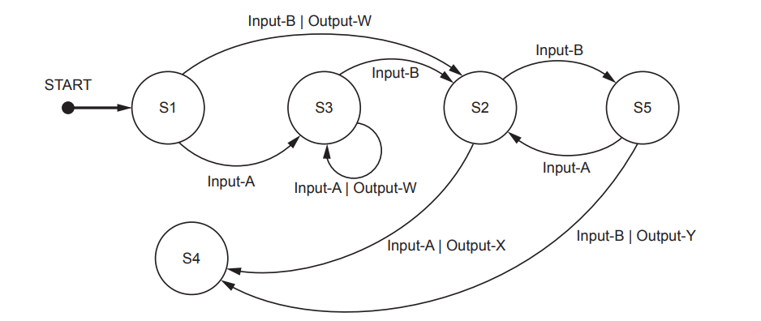
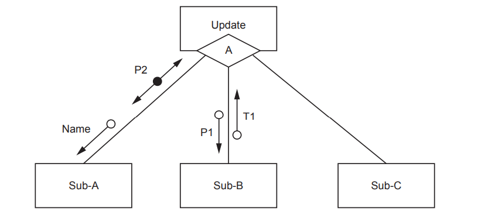
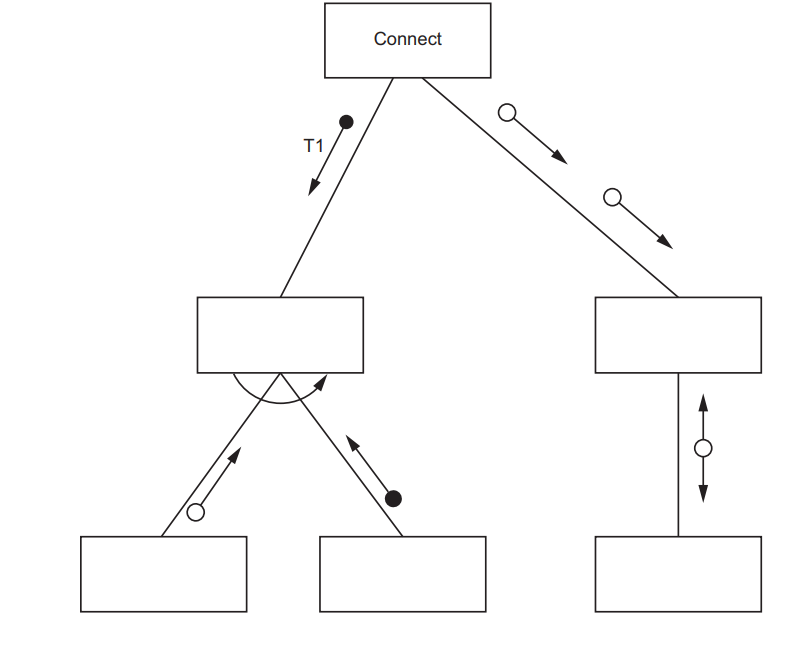
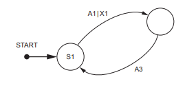

# Exam Questions — Program Design
**12. Software Development** · Cambridge (CIE) AS computer-science (9618)
> Source: [https://www.savemyexams.com/as/computer-science/cie/19/topic-questions/](https://www.savemyexams.com/as/computer-science/cie/19/topic-questions/) · 9 questions across 1 sets

## Exam Questions (9 questions)

### Q1 — medium — 6 marks

**Q1** [6 marks]

Seven program modules form part of a program. A description of the relationship between the modules is summarised below. Any return values are stated in the description.

| Module name | Description |
|---|---|
| Mod-A | calls Mod-B followed by Mod-C |
| Mod-B | • called with parameters Par1 and Par2 • calls either Mod-D or Mod-E, determined when the program runs • returns a Boolean value |
| Mod-C | • called with parameters Par1 and Par3 • Par3 is passed by reference • repeatedly calls Mod-F followed by Mod-G |
| Mod-D | called with parameter Par2 |
| Mod-E | • called with parameter Par3 • returns an integer value |
| Mod-F | called with parameter Par3 |
| Mod-G | • called with parameter Par3 • Par3 is passed by reference |

Parameters in the table are as follows:

- Par1 and Par3 are of type string.
- Par2 is of type integer.

Draw a structure chart to show the relationship between the seven modules and the parameters passed between them.

*Source: June 2024 9618/23 Q7B*

### Q2 — medium — 2 marks

**Q2** [2 marks]

A teacher is designing a program to process pseudocode projects written by her students.

Each student project is stored in a text file.

The process is split into a number of stages. Each stage performs a different task and creates a new file.

For example:

| File name | Comment |
|---|---|
| `MichaelAday_src.txt` | Student project file produced by student Michael Aday |
| `MichaelAday_S1.txt` | File produced by stage 1 |
| `MichaelAday_S2.txt` | File produced by stage 2 |

Suggest a reason why the teacher’s program has been split into a number of stages **and **give the benefit of producing a different file from each stage.

*Source: June 2024 9618/22 Q8A*

### Q3 — medium — 6 marks

**Q3** [6 marks]

A fitness club has a computerised membership system.

The system stores information for each club member: name, home address, email address, mobile phone number, date of birth and exercise preferences.

Many classes are full, and the club creates a waiting list for each class. The club adds details of members who want to join a class that is full to the waiting list for that class.

When the system identifies that a space is available in one of the classes, a new module will send a text message to each member who is on the waiting list.

A different part of the program is represented by the following state‑transition diagram.

(i) Complete the table to show the inputs, outputs and next states.

Assume that the current state for each row is given by the ‘Next state’ on the previous row. For example, the first Input‑A is made when in state S1.

If there is no output for a given transition, then the output cell should contain ‘none’.

The first two rows have been completed.

| Input | Output | Next state |
|---|---|---|
|   |   | S1 |
| Input‑A | none | S3 |
|   | Output‑W |   |
|   | none |   |
| Input‑B |   |   |
| Input‑A |   |   |
|   |   | S4 |

(5)

(ii) Identify the input sequence that will cause the minimum number of state changes in the transition from S1 to S4.

(1)

*Source: June 2024 9618/22 Q7B*

### Q4 — medium — 2 marks

**Q4** [2 marks]

A fitness club has a computerised membership system. The fitness club offers a number of different exercise classes.

The following information is stored for each club member: name, home address, email address, mobile phone number, date of birth and the exercise(s) they are interested in.

The structure chart illustrates part of the membership program:

Data item notes:

- Name contains the name of a club member
- P1 and T1 are of type real.

Explain the meaning of the diamond symbol (labelled with the letter A) in the chart.

*Source: June 2024 9618/21 Q7B(I)*

### Q5 — medium — 4 marks

**Q5** [4 marks]

A coffee shop owner wants to introduce a computerised loyalty card system.

A programmer discusses the details of the system with the shop owner.

The shop will give each customer a loyalty card that displays a unique customer ID as a bar code. A customer will be able to present their card each time they make a purchase. The system will scan the bar code, calculate points, and add them to the customer’s total. When the customer next makes a purchase and presents their card, they will have the option to exchange points for a discount.

The designer decides that this activity will be handled by a new module. Decomposition will be used to break the problem of designing the new module down into sub-problems (sub-modules).

Identify **four **sub-modules that could be used in the design of the new module and describe their use.

*Source: Nov 2024 9618/23 Q7B*

### Q6 — medium — 6 marks

**Q6** [3 marks]

A coffee shop runs a computerised loyalty card system.

Customers are issued with a loyalty card with their name together with a unique customer ID.

Loyalty points are added to their card each time they spend money at the shop.

The following information is stored for each customer: ID, name, home address, email address, mobile phone number, date of birth, number of points, date of last visit and amount of money spent at last visit.

A new module will generate a personalised email message to each loyalty card customer who has not visited the coffee shop in the last three months. The message will include a unique voucher code which can be used to authorise a discount if the customer goes to the shop within the next two weeks.

It is decided to adopt a formal program development life cycle model for the development of the new module.

The analysis of the new module is complete and the project moves on to the design stage. During this stage all the necessary algorithms and module designs will be defined.

State **three other** items that will be defined for the new module during the design stage.

*Source: Nov 2024 9618/22 Q7C*

**Q6** [3 marks]

Part of the coffee shop program contains three program modules as follows:

Module` Init()` has no parameters and returns a Boolean.

Module `Reset()` takes a string as a parameter and returns an Integer.

Module `Check()` repeatedly calls Init() followed by Reset().

Draw a structure chart to represent the relationship between the **three** modules, including all parameters and return values.

*Source: Nov 2024 9618/22 Q7D*

### Q7 — medium — 7 marks

**Q7** [5 marks]

A program contains six modules with headers as follows:

| Pseudocode module header |
|---|
| `PROCEDURE Connect()` |
| `FUNCTION Activate(H1 : STRING, Code : INTEGER) RETURNS BOOLEAN` |
| `FUNCTION Sync(T1 : BOOLEAN, S2 : REAL) RETURNS INTEGER` |
| `PROCEDURE Initialise(BYREF ID : INTEGER, BYVAL CC : INTEGER)` |
| `FUNCTION Reset(RA : STRING) RETURNS INTEGER` |
| `FUNCTION Enable(SA : INTEGER) RETURNS BOOLEAN` |

Module `Connect() `will call either `Activate() `or `Sync()`. This is decided at run-time.

Complete the structure chart for these modules.

*Source: Nov 2024 9618/21 Q7A*

**Q7** [2 marks]

Explain the meaning of the curved arrow symbol used in the diagram in part (a).

*Source: Nov 2024 9618/21 Q7B*

### Q8 — medium — 2 marks

**Q8** [2 marks]

A program includes the following assignment statement:

`Result ← STR_TO_NUM(x) / STR_TO_NUM(y) `

When the program evaluates the expression in the statement, it performs a calculation.

Variable `Result `is of type real and variables `x` and `y` are of type string.

Two checks are required before the calculation is performed:

1. The two strings represent valid numeric values.
2. The numeric value of string `y` is not zero.

The designer considers implementing the** checks and calculation **as a module (a procedure or a function). One reason for this is that the same checks and calculations are performed at several places in the program.

Give **another **reason why this is a suitable approach **and **state what is avoided by this approach.

*Source: Nov 2024 9618/21 Q4B*

### Q9 — medium — 5 marks

**Q9** [5 marks]

An algorithm is represented by a state-transition diagram.

The table shows the inputs, outputs and states for the algorithm:

| **Current state** | **Input** | **Output** | **Next state** |
|---|---|---|---|
| S1 | A1 | X1 | S2 |
| S2 | A3 | none | S1 |
| S2 | A2 | X4 | S5 |
| S5 | A1 | X1 | S5 |
| S5 | A4 | X2 | S2 |
| S5 | A3 | none | S3 |
| S1 | A9 | X9 | S3 |
| S3 | A9 | X9 | S4 |

Complete the state-transition diagram to represent the information given in the table.

*Source: November 2023 9618/21 Q7*

