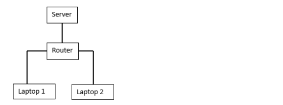

# Mark Schemes — Networks & the Internet
**2. Communication** · Cambridge (CIE) AS computer-science (9618)

## Exam Questions (10 questions)

### Q1
> **[mark-scheme]**
> **One** mark per mark point (**Max 3**)
> 
> MP1 BitTorrent allows the sharing of files between thousands of users who are connected together over the **internet**.
> 
> MP2 It allows **more **users to share files with each other than would be the case with a peer-to-peer network.
> 
> MP3 Users share files **directly **with each other // the users’ computers are acting as peers
> 
> MP4 … no web server / central device is used // all users are of equal status.

### Q2
> **[mark-scheme]**
> (i)** 1 mark** for each bullet point (**max 2**).
> 
> - Courses must be available to anyone who wishes to follow them
> - Courses must be available on the internet
> - Company is willing to share infrastructure with other companies (public)
> - …which is more economic for the company
> 
> (ii) **1 mark** for each bullet point (**max 2** for each disadvantage).
> 
> - There could be a possible loss of control unlike the LAN
> - …because the data is stored on a remote infrastructure / someone else’s infrastructure
> - …reliance on external agency to complete tasks, e.g. backups, security
> - Requires reliable internet connection
> - …to ensure access to the remote data, more likely with LAN
> - Increased recurring costs
> - ...as cloud provider charges must be paid, costs for LAN once only

### Q3
> **[mark-scheme]**
> **1 mark** for each bullet point (**max 2**)
> 
> - Only has four groups of digits // IPv6 has eight groups
> - Uses dotted notation instead of colons
> - Because it is a 32 bit / 4 byte address // IPv6 is 128 bits / 16 bytes
> **[mark-scheme]**
> (i)** 1 mark** for server only connected to router
> 
> **1 mark** for two laptop computers connected only to router
> 
> 
> 
> (ii) **1 mark** for each bullet point (**max 2**)
> 
> - The data from the sending laptop is transmitted to the router
> - The data includes the address of the recipient
> - The router determines the recipient’s destination address
> - …by using a routing table
> - The router transmits the data directly / only to the recipient
> 
> (iii) **1 mark** for each use (**max 2**) and** 1 mark** for corresponding expansion (**max 2**)
> 
> - To improve the security of the LAN
> - …so that devices do not receive unintended data
> - …so that a compromised device does not expose the whole network
> - …so not all devices can access all segments
> - To make network management easier
> - …because faults can be isolated more efficiently
> - …by appropriate example
> - To make the network easier to expand // for better control of network growth
> - …by allowing for a greater range of IP addresses to be available
> - To improve network performance
> - To reduce network congestion
> - …by localising network communications // by dividing data between segments
> - …so that devices are not flooded with data
> - …because data sent between devices on the same subnet stays within the subnet
> **[mark-scheme]**
> **1 mark** for each bullet point (**max 3**)
> 
> - To monitor the communications channel
> - To send data only when there is no data being transmitted / the line is quiet / idle
> - **To detect a collision** and then stop transmissions of further data // transmit a **jamming **signal
> - To calculate a **random **wait time / back-off time
> - ... then retransmit the data after that random wait time
> - Increase **random **time if multiple collisions
> **[mark-scheme]**
> **1 mark** for each highlighted area
> 
> | Type of IP address | Description |
> |---|---|
> | **public IP address** | an IP address that is assigned to a device to allow direct access on the internet |
> | static IP address | **an IP address that is fixed / doesn’t change each time a device re-joins a LAN / network** |
> | **private IP address** | an IP address used for internal LAN communication only |
> | dynamic IP address | **an IP address that may be refreshed / changed each time a **<u>**device re-joins**</u>** a LAN / network** |

### Q4
**1 mark** for each bullet point (**max 3**)

- Receives packets from internet / external network
- Implements a firewall
- Analyses the destination IP address of each packet
- Forwards the packet towards its destination // send packets onto local network or external network
- ...using the routing table
- Maintains / updates the routing
- Allocates <u>private </u>IP addresses
- Finds the most efficient route to the destination
- Changes the packet format for transmission over the next network //
- Network Address Translation (NAT): NAT is a technique used by routers to allow multiple devices in a private local area network (LAN) to share a single public IP address.
> **[mark-scheme]**
> Switch: **1 mark** for each bullet point (**max 1**)
> 
> - To allow two or more devices to communicate with one another
> - To connect individual devices to each other
> - To receive transmissions and **forward **them to their destination
> 
> Wireless Access Point (WAP): **1 mark** for each bullet point (**max 1**)
> 
> - To allow connection of devices (to the central device) **using radio signals** / Wi-Fi
> - To allow the central device to send / receive **radio signals** / Wi-Fi signals
> - To allow wireless enabled devices to connect to a wired network
> 
> Bridge:**1 mark** for each bullet point (**max 1**)
> 
> - To connect two LANs / segments with the **same protocol**
> - To transmit data between two networks with the** same protocol**
> **[mark-scheme]**
> **1 mark** for each bullet point (**max 2**)
> 
> - The students cannot access their files without a reliable internet connection
> - The amount of space for no payment may be limited so students will have to purchase more space if needed
> - The students do not have control over the backup (or security) of their work // the students are dependent on a third party for the (security and) backing up of their work
> **[mark-scheme]**
> **1 mark** for each advantage and **1 mark** for valid corresponding expansion
> 
> - Star topology is more resilient to faults
> - …because there is no single cable, leading to less disruption to teaching
> - Higher performance as there are fewer collisions
> - …because each device in the classroom is only connected to the switch
> - Easier to add new nodes
> - …because each device in the classroom connects directly to the switch
> - Easier to fault find compared to a bus topology

### Q5
> **[mark-scheme]**
> (i)** 1 mark** for:
> 
> Dedicated/bespoke services/storage on a remote server only available to company
> 
> (ii)** 1 mark** each to **max 3**:
> 
> e.g.
> 
> - Not reliant on a third party
> - … gives greater **control **over security/privacy
> - … gives greater **control **over backup
> - Storage can be tailored/scalable to company requirements// an example e.g. the amount of storage accessible/ facilitating the sharing of files
> **[mark-scheme]**
> **1 mark** each:
> 
> - Sending computer transmits packets directly to switch/router/central device
> - Switch/router/central device **checks destination address **of packet and forwards directly to that device
> **[mark-scheme]**
> (i)** 1 mark** each to **max 2**:
> 
> - Jamming signal is transmitted by the **sending device**
> - Transmission is aborted
> - The **sending device** waits a **random** time before trying to send data again ...
> - ... if further collisions occur the wait time is increased
> 
> (ii) **1 mark** each to **max 2**:
> 
> - Random time increased each time so can be infinite waiting
> - May be constant jamming signal so nothing ever sends
> - Certain nodes cannot be prioritised
> - High power consumption
> - Only suitable for short distance network // limited distance
> - Not scalable // more nodes means exponentially longer waiting times
**1 mark** for:

Static means the IP for that device does not change **and** Private means it can only be accessed/seen/used within the LAN

### Q6
> **[mark-scheme]**
> **1 mark** for characteristic
> 
> **1 mark** for description of application to examination software:
> 
> | Thin-client characteristic | Description of use in this software |
> |---|---|
> | Data is not stored on the client computer | Exam papers are stored on the server and not on the examiner’s computer // exam papers are not permanently stored on the examiners’ computers |
> | Client computer is reliant on access to server | Examiners cannot mark if their device cannot access the server / the server ‘goes down’ |
> | Client computer heavily reliant on network/internet connection | The marking software will not operate without network/internet access |
> | Client computer requires few local resources/memory | Examiners can use devices with low resources and the marking software will still function |
> | Client computer performs minimal functions/processes | The marking software transmits requests, the server responds and sends the response to the user |
> **[mark-scheme]**
> (i) **1 mark** each to **max 2**:
> 
> - Receives packets from internet
> - Analyses the destination IP address of each packet
> - Forwards the **packet **towards its destination
> - ... using the routing table
> - Maintains/updates the routing table
> - Finds the most efficient route to the destination
> 
> (ii) **1 mark** each to **max 2**:
> 
> - The PSTN consists of many different types of communication lines
> - … therefore the digital data may need to be converted into a different form/analogue signal
> - Data is transmitted in both directions at the same time // duplex data transmission
> - Using a PSTN the communication passes through different switching centres/ISPs

### Q7
**1 mark** for each correct row:

| Statement | Bus | Star | Mesh |
|---|---|---|---|
| all devices connect to one central device |   | ✔ |   |
| all devices connect to a central cable | ✔ |   |   |
| multiple paths for the packets to travel along |   |   | ✔ |
| robust against damage because if any line fails, the rest of the network retains full functionality |   | ✔ | ✔ |
| most likely to lose data through collisions | ✔ |   |   |
> **[mark-scheme]**
> (i)** 1 mark** for:
> 
> to **be visible** to and accessible by other devices on the internet
> 
> (ii) **1 mark** each:
> 
> - IPv4 has 4 groups of digits whilst IPv6 has 8 groups
> - IPv4 is usually represented in **denary** whilst IPv6 is usually represented in **hexadecimal **
> - IPv4 groups are between 0 and 255 whilst IPv6 is between 0 and FFFF
> - IPv4 is **32** bits whilst IPv6 is **128** bits

### Q8
> **[mark-scheme]**
> **1 mark **each:
> 
> - Identification of server in the bank scenario
> - Description e.g. Receives requests, processes the requests
> - Identification of client in bank scenario
> - Description e.g. Sends request to the server, waits and outputs the response

### Q9
> **[mark-scheme]**
> (i) **1 mark** for:
> 
> Continuous ordered flow of bits over a communication path
> 
> (ii) **1 mark** each to** max 2**:
> 
> - Real-time is direct from source whereas on-demand is prerecorded/downloaded to view later
> - Real-time cannot be re-watched, on-demand can be paused, re-watched etc.
> - Real-time plays continually, on-demand downloads sections/blocks and cannot play until next section is downloaded

### Q10
> **[mark-scheme]**
> **1 mark** for each bullet point (**max 2**)
> 
> - A WAN covers a large geographical area
> - External/public infrastructure is used
> - Non-dedicated hardware
> **[mark-scheme]**
> **1 mark **for correct media **1 mark** for matching description e.g.
> 
> - Fibre optic
> - Transmits data as pulses of light
> - Radio waves / microwaves
> - Transmits electromagnetic waves on different frequencies
> **[mark-scheme]**
> **1 mark** for each bullet point (**max 4**)
> 
> - Data is compressed before transmitting
> - The video and audio are transmitted continuously as a series of bits
> - The video is uploaded to a media server
> - On download, the media server sends the data to a buffer
> - The buffer stores data from server until the receiving device can process it
> - The receiving device receives the bit stream from the buffer
> **[mark-scheme]**
> (i)** 1 mark** for public IP address and** 1 mark** for private IP address:
> 
> Public IP address:
> 
> - So that the router is visible to the Internet/external network/WAN
> 
> Private IP address:
> 
> - So that the router is identified to computers within the LAN
> 
> (ii) **1 mark** for each bullet point (**max 2**)
> 
> - It allows the network to be divided into smaller networks
> - … which reduces traffic in some parts of the network // reduces congestion
> - … because traffic only travels through the parts necessary
> - … which hides the complexity of network
> - … and allows for easier maintenance of the network
