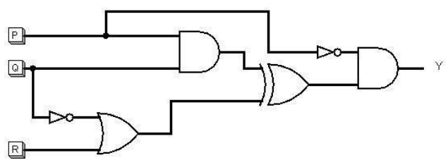
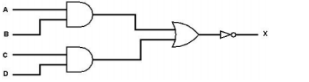
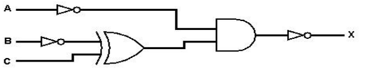
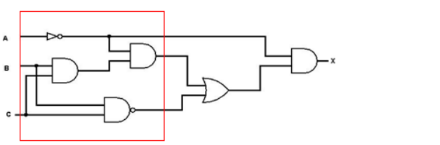

# Mark Schemes — Logic Gates & Logic Circuits
**3. Hardware** · Cambridge (CIE) AS computer-science (9618)

## Exam Questions (12 questions)

### Q1
> **[mark-scheme]**
> **One mark** for every shaded block of rows for column Z correct (**Max 3**)
> 
> | **A** | **B** | **C** | **D** | Z |
> |---|---|---|---|---|
> | 0 | 0 | 0 | 0 | 1 |
> | 0 | 0 | 0 | 1 | 0 |
> | 0 | 0 | 1 | 0 | 1  0  1  0 |
> | 0 | 0 | 1 | 1 |   |
> | 0 | 1 | 0 | 0 |   |
> | 0 | 1 | 0 | 1 |   |
> | 0 | 1 | 1 | 0 | 1 |
> | 0 | 1 | 1 | 1 | 0 |
> | 1 | 0 | 0 | 0 | 1 |
> | 1 | 0 | 0 | 1 | 0  1 |
> | 1 | 0 | 1 | 0 |   |
> | 1 | 0 | 1 | 1 | 0 |
> | 1 | 1 | 0 | 0 | 1 |
> | 1 | 1 | 0 | 1 | 0 |
> | 1 | 1 | 1 | 0 | 0  0 |
> | 1 | 1 | 1 | 1 |   |

### Q2
> **[mark-scheme]**
> **One **mark for working, all five columns P, Q, R, S and T
> 
> **One **mark for first four rows of column Z
> 
> **One **mark for second four rows of column Z
> 
> |   |   |   | **Working space** |   |   |   |   |   |
> |---|---|---|---|---|---|---|---|---|
> | **A** | **B** | **C** | **P** | **Q** | **R** | **S** | **T** | **Z** |
> | **0** | **0** | **0** | 1 | 1 | 1 | 1 | 1 | 0 |
> | **0** | **0** | **1** | 1 | 1 | 0 | 1 | 0 | 1 |
> | **0**  **0** | **1**  **1** | **0**  **1** | 1 | 0 | 1 | 1 | 0 | 1 |
> | 1 | 0 | 0 | 1 | 0 | 1 |   |   |   |
> | **1** | **0** | **0** | 0 | 1 | 1 | 0 | 0 | 0 |
> | **1** | **0** | **1** | 0 | 1 | 0 | 1 | 0 | 1 |
> | **1**  **1** | **1**  **1** | **0**  **1** | 0 | 0 | 1 | 1 | 0 | 1 |
> | 0 | 0 | 0 | 1 | 0 | 1 |   |   |   |

### Q3
> **[mark-scheme]**
> **One **mark for working, all four columns P, Q, R and S
> 
> **One **mark for first four rows of column Z
> 
> **One **mark for second four rows of column Z
> 
> |   |   |   | **Working space** |   |   |   |   |
> |---|---|---|---|---|---|---|---|
> | **A** | **B** | **C** | **P** | **Q** | **R** | **S** | **Z** |
> | 0 | 0 | 0 | 1 | 0 | 0 | 1 | 1 |
> | 0 | 0 | 1 | 1 | 0 | 0 | 1 | 1 |
> | 0 | 1 | 0 | 0 | 0 | 0 | 0 | 0 |
> | 0 | 1 | 1 | 0 | 0 | 0 | 0 | 0 |
> | 1 | 0 | 0 | 1 | 0 | 0 | 0 | 0 |
> | 1 | 0 | 1 | 1 | 0 | 1 | 0 | 1 |
> | 1 | 1 | 0 | 0 | 0 | 0 | 1 | 1 |
> | 1 | 1 | 1 | 0 | 1 | 0 | 1 | 1 |

### Q4
> **[mark-scheme]**
> **1 mark** for each set of highlighted rows
> 
> | **P** | **Q** | **R** | **Y** |
> |---|---|---|---|
> | 0 | 0 | 0 | 1 |
> | 0 | 0 | 1 | 1 |
> | 0 | 1 | 0 | 0 |
> | 0 | 1 | 1 | 1 |
> | **1** | **0** | **0** | **0** |
> | **1** | **0** | **1** | **0** |
> | **1** | **1** | **0** | **0** |
> | **1** | **1** | **1** | **0** |
> **[mark-scheme]**
> **1 mark** for P AND Q and NOT Q OR R
> 
> **1 mark** for NOT gate and AND gate and XOR gate
> 
> 

### Q5
> **[mark-scheme]**
> **1 mark** for each bullet point
> 
> - A NAND B
> - NOT(B XOR C)
> - Final NAND
> 
> X = A NAND B NAND (NOT(B XOR C))
> **[mark-scheme]**
> 1 mark for each set of rows (shaded)
> 
> | **A** | **B** | **C** | **X** |
> |---|---|---|---|
> | 0 | 0 | 0 | **0** |
> | 0 | 0 | 1 | **0** |
> | 0 | 1 | 0 | **1** |
> | 0 | 1 | 1 | **0** |
> | **1** | **0** | **0** | **1** |
> | **1** | **0** | **1** | **1** |
> | **1** | **1** | **0** | **1** |
> | **1** | **1** | **1** | **1** |

### Q6
> **[mark-scheme]**
> **1 mark** for each set of 4 rows (shaded)
> 
> | **A** | **B** | **C** | **X** |
> |---|---|---|---|
> | 0 | 0 | 0 | 1 |
> | 0 | 0 | 1 | 0 |
> | 0 | 1 | 0 | 0 |
> | 0 | 1 | 1 | 0 |
> | **1** | **0** | **0** | **1** |
> | **1** | **0** | **1** | **0** |
> | **1** | **1** | **0** | **1** |
> | **1** | **1** | **1** | **1** |
> **[mark-scheme]**
> **1 mark **for both AND gates
> 
> **1 mark** for NOT gate <u>and </u>OR gate <u>and </u>NOR gate
> 
> 

### Q7
> **[mark-scheme]**
> **1 mark** for each correct line:
> 
> 

### Q8
> **[mark-scheme]**
> **1 mark** for each correct answer:
> 
> *NAND*
> 
> - The output is 0 when both inputs are 1, otherwise the output is 1
> 
> *NOR*
> 
> - The output is 1 when both inputs are 0, otherwise the output is 0
> 
> *XOR*
> 
> - The output is 1 when one of the inputs is 1 and the other input is 0, otherwise the output is 0
> 
> *OR*
> 
> - The output is 0 when both inputs are 0, otherwise the output is 1
> **[mark-scheme]**
> **1 mark** for both AND gates with correct inputs
> 
> **1 mark** for correct OR and NOT gates with correct inputs and no superfluous gates:
> 
> 

### Q9
> **[mark-scheme]**
> **1 mark** for:
> 
> (A XOR B) NOR C
> **[mark-scheme]**
> **1 mark** for NOT B XOR C
> 
> **1 mark** for NOT A and final AND plus NOT
> 
> 

### Q10
> **[mark-scheme]**
> **1 mark** for:
> 
> Output is only 1 if one input is 1 and the other is 0 // Output is only 1 if both inputs are different // Output is only 0 if both inputs are the same
> **[mark-scheme]**
> **1 mark** each:
> 
> - ((**A** NOR **B**) AND (**A** OR **B**))
> - NAND (**B** AND **C**)
> 
> **X** = ((**A** NOR **B**) AND (**A** OR **B**)) NAND (**B** AND **C**)
> **[mark-scheme]**
> **1 mark** for NOT gate, 2 correct AND gates and the NAND gate
> 
> **1 mark** for OR gate and the final AND gate
> 
> 

### Q11
> **[mark-scheme]**
> **1 mark **for each shaded part.
> 
> | A | B | C | X |
> |---|---|---|---|
> | 0 | 0 | 0 | **1** |
> | 0 | 0 | 1 | **1** |
> | 0 | 1 | 0 | **1** |
> | 0 | 1 | 1 | **1** |
> | 1 | 0 | 0 | **1** |
> | 1 | 0 | 1 | **0** |
> | 1 | 1 | 0 | **1** |
> | 1 | 1 | 1 | **1** |
> **[mark-scheme]**
> **1 mark** for (P XOR Q) and (Q OR NOT R)
> 
> **1 mark** for second XOR gate and final NAND gate with appropriate inputs
> 
> 

### Q12
> **[mark-scheme]**
> **1 mark** for each correct expression
> 
> X =** E** AND **A** AND **C**
> 
> Y = **E** AND (**B** OR **C** OR **D**)
