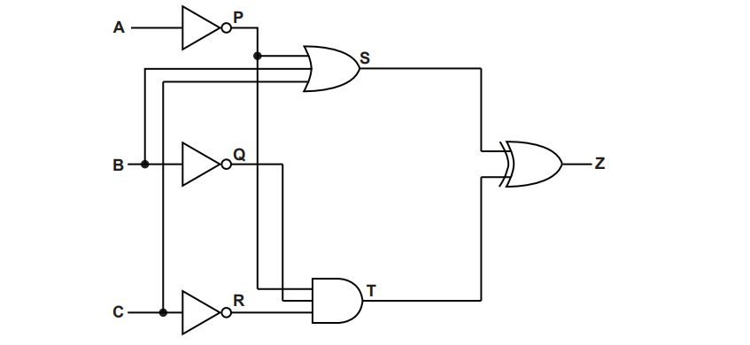
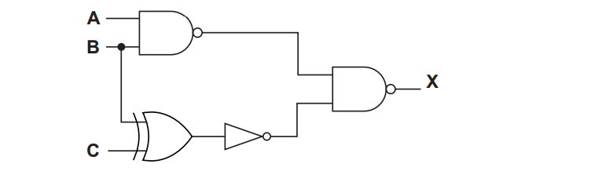
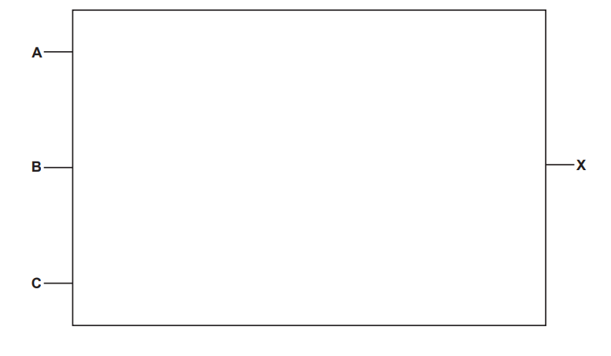
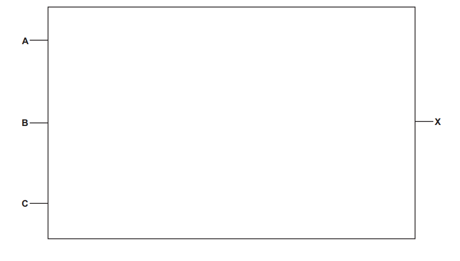
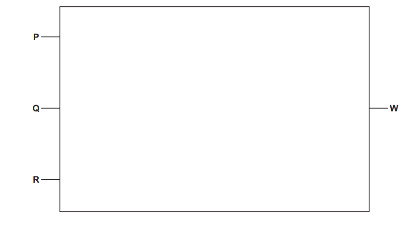

# Exam Questions — Logic Gates & Logic Circuits
**3. Hardware** · Cambridge (CIE) AS computer-science (9618)
> Source: [https://www.savemyexams.com/as/computer-science/cie/19/topic-questions/](https://www.savemyexams.com/as/computer-science/cie/19/topic-questions/) · 12 questions across 1 sets

## Exam Questions (12 questions)

### Q1 — medium — 3 marks

**Q1** [3 marks]

This diagram represents a logic circuit.

Complete the truth table for the given logic circuit.

| **A** | **B** | **C** | **D** | **Working space** | **Z** |
|---|---|---|---|---|---|
| 0 | 0 | 0 | 0 |   |   |
| 0 | 0 | 0 | 1 |   |   |
| 0 | 0 | 1 | 0 |   |   |
| 0 | 0 | 1 | 1 |   |   |
| 0 | 1 | 0 | 0 |   |   |
| 0 | 1 | 0 | 1 |   |   |
| 0 | 1 | 1 | 0 |   |   |
| 0 | 1 | 1 | 1 |   |   |
| 1 | 0 | 0 | 0 |   |   |
| 1 | 0 | 0 | 1 |   |   |
| 1 | 0 | 1 | 0 |   |   |
| 1 | 0 | 1 | 1 |   |   |
| 1 | 1 | 0 | 0 |   |   |
| 1 | 1 | 0 | 1 |   |   |
| 1 | 1 | 1 | 0 |   |   |
| 1 | 1 | 1 | 1 |   |   |

*Source: Nov 2023 9618/33 Q6A*

### Q2 — medium — 3 marks

**Q2** [3 marks]

The diagram shows a logic circuit.

Complete the truth table for the given logic circuit. Show your working.

|   |   |   | **Working space** |   |   |   |   |   |
|---|---|---|---|---|---|---|---|---|
| **A** | **B** | **C** | **P** | **Q** | **R** | **S** | **T** | **Z** |
| 0 | 0 | 0 |   |   |   |   |   |   |
| 0 | 0 | 1 |   |   |   |   |   |   |
| 0 | 1 | 0 |   |   |   |   |   |   |
| 0 | 1 | 1 |   |   |   |   |   |   |
| 1 | 0 | 0 |   |   |   |   |   |   |
| 1 | 0 | 1 |   |   |   |   |   |   |
| 1 | 1 | 0 |   |   |   |   |   |   |
| 1 | 1 | 1 |   |   |   |   |   |   |

*Source: June 2024 9618/32 Q6A*

### Q3 — medium — 3 marks

**Q3** [3 marks]

The diagram shows a logic circuit.

Complete the truth table for the given logic circuit. Show your working.

|   |   |   | **Working space** |   |   |   |   |
|---|---|---|---|---|---|---|---|
| **A** | **B** | **C** | **P** | **Q** | **R** | **S** | **Z** |
| 0 | 0 | 0 |   |   |   |   |   |
| 0 | 0 | 1 |   |   |   |   |   |
| 0 | 1 | 0 |   |   |   |   |   |
| 0 | 1 | 1 |   |   |   |   |   |
| 1 | 0 | 0 |   |   |   |   |   |
| 1 | 0 | 1 |   |   |   |   |   |
| 1 | 1 | 0 |   |   |   |   |   |
| 1 | 1 | 1 |   |   |   |   |   |

*Source: June 2024 9618/31 Q6A*

### Q4 — medium — 4 marks

**Q4** [2 marks]

Complete the truth table for the logic expression:

**Y** = ((**P** AND **Q**) XOR ((NOT **Q**) OR **R**)) AND NOT **P**

| **P** | **Q** | **R** | **Working space** | **Y** |
|---|---|---|---|---|
| 0 | 0 | 0 |   |   |
| 0 | 0 | 1 |   |   |
| 0 | 1 | 0 |   |   |
| 0 | 1 | 1 |   |   |
| 1 | 0 | 0 |   |   |
| 1 | 0 | 1 |   |   |
| 1 | 1 | 0 |   |   |
| 1 | 1 | 1 |   |   |

*Source: Nov 2023 9618/13 Q4A*

**Q4** [2 marks]

Draw a logic circuit for the logic expression:

**Y** = ((**P** AND **Q**) XOR ((NOT **Q**) OR **R**)) AND NOT **P**

*Source: Nov 2023 9618/13 Q4B*

### Q5 — medium — 5 marks

**Q5** [3 marks]

Write the Boolean expression that corresponds to the following logic circuit.

*Source: June 2024 9618/12 Q4A*

**Q5** [2 marks]

Complete the truth table for the logic expression:

**X** = **A** XOR (**B** AND (**A** NAND **B**) AND NOT **C**)

| **A** | **B** | **C** | **Working space** | **X** |
|---|---|---|---|---|
| 0 | 0 | 0 |   |   |
| 0 | 0 | 1 |   |   |
| 0 | 1 | 0 |   |   |
| 0 | 1 | 1 |   |   |
| 1 | 0 | 0 |   |   |
| 1 | 0 | 1 |   |   |
| 1 | 1 | 0 |   |   |
| 1 | 1 | 1 |   |   |

*Source: Nov 2023 9618/12 Q4B*

### Q6 — medium — 4 marks

**Q6** [2 marks]

Complete the truth table for the logic expression:

**X** = NOT (**A** NAND **B**) XOR (NOT** B** AND (**B** NOR **C**))

| A | B | C | Working space | X |
|---|---|---|---|---|
| 0 | 0 | 0 |   |   |
| 0 | 0 | 1 |   |   |
| 0 | 1 | 0 |   |   |
| 0 | 1 | 1 |   |   |
| 1 | 0 | 0 |   |   |
| 1 | 0 | 1 |   |   |
| 1 | 1 | 0 |   |   |
| 1 | 1 | 1 |   |   |

*Source: Nov 2023 9618/11 Q4A*

**Q6** [2 marks]

Draw a logic circuit for the logic expression:

**X** = (**A** AND NOT (**B** OR **C**)) AND (**B** NOR **C**)

*Source: Nov 2023 9618/11 Q4B*

### Q7 — medium — 3 marks

**Q7** [3 marks]

Each of the following truth tables has three inputs (**A**, **B** and** C**) and one output (**X**).

Draw **one **line to match each truth table with its logic expression.

*Source: June 2024 9618/13 Q6*

### Q8 — medium — 6 marks

**Q8** [4 marks]

Describe the operation of each of the following logic gates:

NAND .......................

NOR   ........................

XOR  .........................

OR  ..........................

*Source: June 2024 9618/12 Q1A*

**Q8** [2 marks]

Draw a logic circuit for this logic expression:

**X** = NOT ((**A **AND **B**) OR (**C** AND **D**))

*Source: June 2024 9618/12 Q1B*

### Q9 — medium — 3 marks

**Q9** [1 mark]

Tick (✓) **one **box to identify the correct logic statement for this truth table.

| A | B | C | X |
|---|---|---|---|
| 0 | 0 | 0 | 1 |
| 0 | 0 | 1 | 0 |
| 0 | 1 | 0 | 0 |
| 0 | 1 | 1 | 0 |
| 1 | 0 | 0 | 0 |
| 1 | 0 | 1 | 0 |
| 1 | 1 | 0 | 1 |
| 1 | 1 | 1 | 0 |

☐  NOT (**A** AND **B** AND **C**)

☐  (**A** XOR **B**) NOR **C**

☐  (**A** OR **B** OR **C**) NOR **C**

☐  NOT **A** AND NOT **B** AND NOT **C**

*Source: June 2024 9618/11 Q1A*

**Q9** [2 marks]

Draw a logic circuit for the logic expression:

**X** = NOT (NOT **A** AND (NOT **B** XOR **C**))

*Source: June 2024 9618/11 Q1B*

### Q10 — medium — 5 marks

**Q10** [1 mark]

Describe the operation of a 2-input XOR gate.

*Source: Nov 2024 9618/13 Q1A*

**Q10** [2 marks]

Write the logic expression for the following logic circuit.

*Source: Nov 2024 9618/13 Q1B*

**Q10** [2 marks]

Draw the logic circuit for the logic expression:

**X** = ((NOT **A** AND (**B** AND **C**)) OR (**B** NAND **C**)) AND NOT **A**

*Source: Nov 2024 9618/13 Q1C*

### Q11 — medium — 4 marks

**Q11** [2 marks]

Complete the truth table for the logic expression:

**X** = (**A** XOR **B**) NAND (**A** AND (**B** XOR **C**))

| A | B | C | Workspace | X |
|---|---|---|---|---|
| 0 | 0 | 0 |   |   |
| 0 | 0 | 1 |   |   |
| 0 | 1 | 0 |   |   |
| 0 | 1 | 1 |   |   |
| 1 | 0 | 0 |   |   |
| 1 | 0 | 1 |   |   |
| 1 | 1 | 0 |   |   |
| 1 | 1 | 1 |   |   |

*Source: Nov 2024 9618/12 Q1A*

**Q11** [2 marks]

Draw the logic circuit for the logic expression:

**W** = **P** NAND ((**Q** OR NOT **R**) XOR (**P** XOR **Q**))

*Source: Nov 2024 9618/12 Q1B*

### Q12 — medium — 2 marks

**Q12** [2 marks]

A security system has both a floodlight (very bright light) and an audio alarm.

The data from multiple sensors is analysed and used to:

- turn on the floodlight
- sound the audio alarm.

Sensors can be used to detect:

- if doors are open
- the external daylight level
- if people are detected within a set distance.

The floodlight (X) and audio alarm (Y) operate according to the following criteria:

| Parameter | Description of parameter | Binary value | Condition |
|---|---|---|---|
| **A** | External daylight level | 1 | Low |
| 0 | High |   |   |
| **B** | Front door | 1 | Open |
| 0 | Closed |   |   |
| **C** | Person is within 2 m | 1 | Detected |
| 0 | Not detected |   |   |
| **D** | Back door | 1 | Open |
| 0 | Closed |   |   |
| **E** | Security system | 1 | Switched on |
| 0 | Switched off |   |   |

The floodlight turns on (**X = 1**) if:

- the security system is switched on **and **
- the external daylight level is low **and **
- a person is detected within 2m.

The audio alarm turns on (**Y = 1**) if:

- the security system is switched on **and**
- one **or** more doors are open, or a person is detected within 2m.

Write logic expressions for the security system.

*Source: Nov 2024 9618/11 Q5B*

