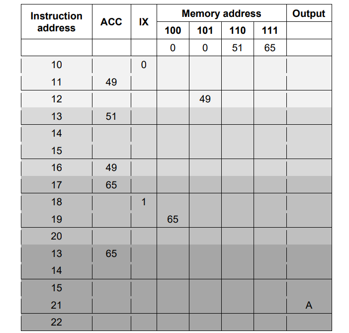

# Mark Schemes — Assembly Language
**4. Processor Fundamentals** · Cambridge (CIE) AS computer-science (9618)

## Exam Questions (7 questions)

### Q1
> **[mark-scheme]**
> **1 mark** for each bullet point
> 
> - `IN `- Input **and **output of data
> - `ADD `- Arithmetic operations
> - `JPE `- Unconditional and conditional instructions
> - `CMI `- Compare instructions
> **[mark-scheme]**
> **1 mark** for each set of shaded rows
> 
> 

### Q2
> **[mark-scheme]**
> **1 mark** for:
> 
> - To create a symbol table
> **[mark-scheme]**
> (i) **1 mark **for each bullet point
> 
> - Data movement: e.g. LDR #50 // STO 201
> - Arithmetic operation: e.g. ADD 100 // INC IX
> - Conditional instruction: e.g. JPE 96
> 
> (ii)** 1 mark** for each bullet point (**max 2**)
> 
> Similarity:
> 
> - both load the contents of an address into the Accumulator
> 
> Difference:
> 
> - direct accesses the address given by the operand whereas indexed adds the contents of IX to the operand and accesses the data at that calculated address
> 
> (iii) **1 mark** for
> 
> - Indirect (addressing)
> - Relative (addressing)

### Q3
> **[mark-scheme]**
> **1 mark **for each correct answer:
> 
> | Program number | Instructions | ACC content |
> |---|---|---|
> | 1 | `LDM #50 ` `INC ACC ` `SUB #1` | **50** |
> | 2 | `LDI 51 ` `ADD 52` | **97** |
> | 3 | `LDR #2 ` `LDX 50 ` `DEC ACC` | **48** |
> | 4 | `LDD 52 ` `SUB 54 ` `INC ACC` | **44** |

### Q4
> **[mark-scheme]**
> **1 mark** for each correct answer:
> 
> | Program number | Instructions | ACC content |
> |---|---|---|
> | 1 | `LDI 15 ` `SUB #1` | **11** |
> | 2 | `LDD 14 ` `ADD 11` | **13** |
> | 3 | `LDM #11 ` `ADD #3 ` `SUB 16` | **2** |
> | 4 | `LDR #2` `LDX 14 ` `ADD #2` | **14** |

### Q5
> **[mark-scheme]**
> **1 mark **for each correct answer:
> 
> | Program number | Instructions | ACC content |
> |---|---|---|
> | 1 | `LDD 20` `ADD #2` | **4** |
> | 2 | `LDX 22` | **5** |
> | 3 | `LDI 25` `INC ACC ` `SUB 22` | **1** |
> | 4 | `LDD 19` `LDM #5` `LDM #25` | **25** |

### Q6
> **[mark-scheme]**
> **1 mark **each:
> 
> |   | Instructions | ACC content |
> |---|---|---|
> | 1 | `LDD 50 ` `ADD #4 ` `ADD 54` | **158** |
> | 2 | `LDI 53 ` `DEC ACC ` `ADD 56` | **99** |
> | 3 | `LDM #55 ` `SUB #5` | **50** |

### Q7
> **[mark-scheme]**
> **1 mark** for each correct content of the ACC (4) 
> **1 mark** for correct IX column
> 
> |   | Instructions | ACC content | IX content |
> |---|---|---|---|
> | 1 | `LDM #19` `DEC ACC` | **18** | **20** |
> | 2 | `LDD 23` `ADD 19` | **40** | **20** |
> | 3 | `LDI 25` `INC ACC` | **5** | **20** |
> | 4 | `LDR #21` `LDX 2` | **15** | **21** |
