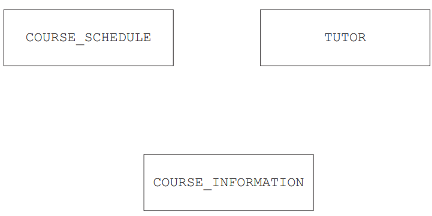

# Exam Questions — Database Concepts
**8. Databases** · Cambridge (CIE) AS computer-science (9618)
> Source: [https://www.savemyexams.com/as/computer-science/cie/19/topic-questions/](https://www.savemyexams.com/as/computer-science/cie/19/topic-questions/) · 9 questions across 1 sets

## Exam Questions (9 questions)

### Q1 — medium — 1 marks

**Q1** [1 mark]

The company uses a database, `COURSES`, to store data about the courses and their tutors.

Each course starts at different times of the year and may have a different tutor. The database has the following structure:

`COURSE_INFORMATION(CourseID, Description, Cost) `

`TUTOR(TutorID, TelephoneNumber, EmailAddress, TutorName) `

`COURSE_SCHEDULE(CourseID, DateStarted, TutorID) `

Complete the entity‑relationship (E‑R) diagram for the database `COURSES`.

*Source: November 2023 9618/13 Q3BI*

### Q2 — medium — 7 marks

**Q2** [3 marks]

State what is meant by the following terms in a relational database model.

Entity .......................................................................................................................

Primary key ..............................................................................................................

Referential integrity .............................................................................................

*Source: November 2023 9618/12 Q2A*

**Q2** [4 marks]

The following database table is not normalised.

| **StudentName** | **DateOfBirth** | **TutorGroup** | **Subject** | **SubjectCode** |
|---|---|---|---|---|
| Yuwei Chen | 01/09/2004 | SMH | English, Maths, Computer Science | EN, MA, CS |
| Claudia Raj | 23/02/2005 | JMB | Maths, Physics, Art | MA, PY, AR |
| Aamil Akram | 24/01/2005 | KMB | Art, Design, English language | AR, DE, EN |
| Areeba Faraz | 21/12/2004 | SMH | English language, Chemistry, Design | EN, CH, DE |

Explain how to modify the table to put it into First Normal Form (1NF).

*Source: November 2023 9618/12 Q2C*

### Q3 — medium — 6 marks

**Q3** [3 marks]

A shop manager has designed a relational database to store customer orders.

The database will have the following tables:

`CUSTOMER(CustomerID, FirstName, LastName, Town) `

`SHOP_ORDER(OrderNo, CustomerID, OrderDate) `

`SUPPLIER(SupplierID, EmailAddress, TelephoneNumber) `

`ITEM(ItemNumber, SupplierID, Description, Price) `

`ORDER_ITEM(ItemNumber, OrderNo, Quantity)`

Complete the entity-relationship (E-R) diagram for the relational database.

*Source: November 2023 9618/11 Q3A*

**Q3** [3 marks]

Identify three advantages of a relational database compared to a file-based approach.

*Source: November 2023 9618/11 Q3B*

### Q4 — medium — 6 marks

**Q4** [1 mark]

A theatre wants to use a database to store data about the shows that are scheduled, their customers and the seats that the customers have booked.

In the theatre:

- Each show can take place on multiple dates.
- Some dates can have more than one performance.
- There are multiple rows of seats.
- Each seat can be individually booked by its row letter and seat number, for example row E seat 2.

Part of the database design includes these tables:

`SHOW(ShowID, Title, Duration) `

`SEAT(SeatID, RowLetter, SeatNumber) `

`PERFORMANCE(PerformanceID, ShowID, ShowDate, StartTime) `

Identify the relationship between the tables `PERFORMANCE` and `SHOW`.

*Source: June 2024 9618/13 Q4A*

**Q4** [5 marks]

Customers give their first name, last name and email address when they are making a booking. One booking can include multiple seats.

Describe the additional tables that will need to be included in the database **and** explain how these tables will be linked within the database.

*Source: June 2024 9618/13 Q4D*

### Q5 — medium — 6 marks

**Q5** [1 mark]

An assessment board wants to store the marks students achieved in exams in a database named `RECORDS`.

Part of the database design includes these two tables:

`EXAM(ExamID, Subject, Level, TotalMarks) `

`EXAM_QUESTION(ExamQuestionID, ExamID, QuestionNumber, Question, MaxMark)`

Identify the relationship between `EXAM` and `EXAM_QUESTION`.

*Source: June 2024 9618/12 Q4A*

**Q5** [5 marks]

The database also needs to store data about the students, the exams the students have taken and the marks the students achieved in each question of each exam.

Describe the additional tables that will need to be included in the database **and** explain how all the tables in the database will be linked.

*Source: June 2024 9618/12 Q4D*

### Q6 — medium — 6 marks

**Q6** [6 marks]

A company is developing a website that will allow users to create an account and then play a quiz every day. The data about the users and the quizzes are stored in a database.

A user must select a unique username and enter a valid email address to create an account. All users must be over the age of 16. A new quiz is given to the users every day. Each quiz is stored in its own text file.

The database stores the filename of each quiz and the date it can be played. The user gets a score for each quiz they complete, which is stored in the database. The scores are used to give each user a rating, for example Gold.

Create a 3-table design for this database normalised to Third Normal Form (3NF).

Give your table design in the format:

`TableName(PrimaryKey, Field1, Field2, …)`

*Source: June 2024 9618/11 Q6A*

### Q7 — medium — 8 marks

**Q7** [2 marks]

A company makes ice cream and sells it to shops.

The ice cream is made in batches: a large quantity of one type and flavour of ice cream that is then split into smaller quantities for sale.

The company’s owner has designed a relational database, `ICECREAM`, to store data about their ice cream and customers.

Some of the tables in the database are given. The database is not normalised.

`BATCH(BatchID, Type, Flavour, Size, SellingPrice, EndDate) `

`CUSTOMER(CustomerID, CompanyName, EmailAddress, TelephoneNumber) `

`SALE(SaleID, BatchID, CustomerID, Quantity, Date)`

Identify **two** foreign keys in the table `SALE` **and** the table that each foreign key references.

Foreign key 1 ........................................................................................

Table name 1 .........................................................................................

Foreign key 2 ........................................................................................

Table name 2........................................................................................

*Source: November 2024 9618/13 Q4A*

**Q7** [4 marks]

The table `BATCH` is not normalised.

Normalise the database table `BATCH`.

Write the table definitions for your new tables.

Identify any primary and foreign keys in your tables.

Do **not** change or include the tables `CUSTOMER` and `SALE`.

*Source: November 2024 9618/13 Q4CII*

**Q7** [2 marks]

Complete the following table by defining each database term.

| **Database term** | **Definition** |
|---|---|
| Entity | ....................................................... |
| Attribute | ....................................................... |

*Source: November 2024 9618/13 Q4D*

### Q8 — medium — 9 marks

**Q8** [3 marks]

A company uses a relational database to store data about its customers, employees and the individual repair jobs that customers have booked.

Explain the benefits of using a relational database instead of a file-based approach.

*Source: November 2024 9618/12 Q6A*

**Q8** [6 marks]

The company decides which employees will work on each repair job. An employee can log into the database to access information about their repair jobs.

The database is normalised and includes these tables:

- ` CUSTOMER` stores personal data about each customer
- `EMPLOYEE `stores personal data about each employee
- `LOGIN_DATA` stores the username and password for each employee
- `JOB` stores the data about each repair job
- `JOB_EMPLOYEE `stores the employees that are working on each repair job.

Identify each relationship between the database tables **and** explain how each relationship can be implemented in the normalised database.

*Source: November 2024 9618/12 Q6B*

### Q9 — medium — 9 marks

**Q9** [3 marks]

A shop repairs electronic devices, for example mobile phones and tablet computers. The shop owner stores the data about the repairs using a file-based approach.

Give **one** limitation of using a file-based approach to store the data **and** explain how a relational database addresses this limitation.

Limitation.......................................................................................................

Explanation.....................................................................................................

*Source: November 2024 9618/11 Q2A*

**Q9** [3 marks]

The shop owner creates a relational database called `FIXIT`.

The database stores data about the customers and the devices for repair.

Some devices need new parts that are ordered from suppliers.

The database `FIXIT `is designed to include the following tables:

`PART(PartID, Description, Price, SupplierID) `

`CUSTOMER(CustomerID, FirstName, LastName, ContactNumber) `

`REPAIR(RepairNumber, StartDate, EndDate, CustomerID, Device) `

`REPAIR_PART(PartID, RepairNumber, Quantity)`

Complete the entity-relationship (E-R) diagram for the given tables.

*Source: November 2024 9618/11 Q2BI*

**Q9** [3 marks]

Complete the table by writing a definition for each of the database terms.

| **Term** | **Definition** |
|---|---|
| Referential integrity | ..................................................... |
| Candidate key | ...................................................... |
| Tuple | ........................................................ |

*Source: November 2024 9618/11 Q3C*

