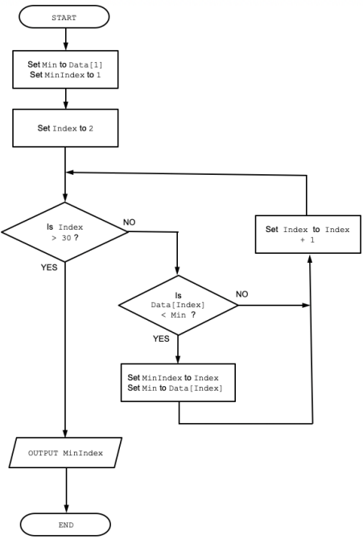
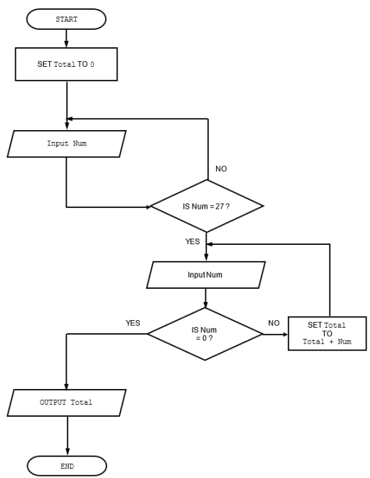
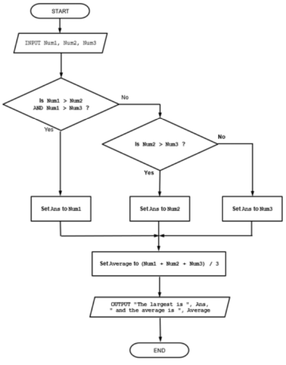

# Mark Schemes — Algorithms
**9. Algorithm Design & Problem-solving** · Cambridge (CIE) AS computer-science (9618)

## Exam Questions (17 questions)

### Q1
> **[mark-scheme]**
> **MP1**   iteration / looping  
> **MP2**  naming all four modules correctly in the correct sequence // e.g. `Module-A` repeatedly calls `Sub-Y1`,then `SubY2` then `Sub-9`

### Q2
> **[mark-scheme]**
> 
> 
> **MP1**   Initialise `Min` to first value in `Data `**and** `MinIndex` to 1 
> **MP2**  Loop through 29 more values (or 30 values in total) 
> **MP3**  Compare element from `Data[]` with `Min`  
> **MP4**  Set new `Min` **AND** save `MinIndex` when element value `<` `Min` **in a loop**  
> **MP5  **Output `MinIndex`

### Q3
> **[mark-scheme]**
> Example Solution
> 
> 
> 
> **One** mark per point:
> 
> 1. Initialise `Total` to zero
> 2. Check for only **first** input of 27 **in a loop** then attempt to sum values
> 3. Loop until 0 input
> 4. Sum values **input** (after input of first 27)** in a loop**
> 5. Output `Total` after a reasonable attempt

### Q4
> **[mark-scheme]**
> **Max 5** marks
> 
> **MP1**    Set total to <u>zero</u> 
> **MP2**   Input a number 
> **MP3**   Check if number greater than 29 and less than 71 
> **MP4  ** … if check is true - add number to total 
> **MP5**   Repeat from step 2 99 times // for a total of 100 iterations 
> **MP6**   Output the total

### Q5
> **[mark-scheme]**
> Two mark for Statement of Problem:
> 
> 1. The functions will return the same value every time they are called
> 2. ... because `Label` / the parameter value does not change within the loop
> 
> Two marks for Solution:
> 
> 3.  Assign `FormatA(Label)` and `FormatB(Label)` to two (local) variables         <u>before</u> the loop
> 
> 4.  Use the (new) variables in place of the function calls / in the loop //       Replace the references to `FormatA()` and `FormatB()`in the `CASE` clauses with     the new variable names

### Q6
> **[mark-scheme]**
> 
> 
> One mark per zone

### Q7
> **[mark-scheme]**
> 
> 
> Mark points
> 
> 1. Condition for selecting one of the input numbers as largest value
> 2. … and assign to `Ans`
> 3. Condition for selecting largest number for all three number input and assigning to `Ans`
> 4. Average calculated using `Num1`, `Num2` and `Num3` and stored in a variable. Reject use of DIV
> 5. Output of `Ans` and average in output symbol / parallelogram
> **[mark-scheme]**
> Example solutions:
> 
> `Flag `$\leftarrow$` GetStat() `
> `WHILE Flag <> TRUE `
> `   FOR Port `$\leftarrow$` 1 TO 3 `
> `      CALL Reset(Port) `
>         `NEXT Port `
>         `Flag `$\leftarrow$` GetStat() `
> `ENDWHILE `
> 
> Alternative:
> 
> `REPEAT `
>         `Flag `$\leftarrow$` GetStat() `
>        `IF Flag <> TRUE THEN `
>                `FOR Port `$\leftarrow$` 1 TO 3 `
>                      `CALL Reset(Port) `
>               `NEXT Port `
>        `ENDIF `
> `UNTIL Flag = TRUE `
> 
> One mark per point:
> 
> 1. (Outer) conditional loop testing `Flag`
> 2. Correct assignment of `Flag` from `GetStat()` **in a loop**
> 3. (Inner) loop checking / counting port // Check if `Port` is different to 4
> 4. … loop for 3 iterations
> 5. a call to `Reset()`**in a loop**

### Q8
| **Pseudocode example** | **Selection** | **Iteration** | **Input/Output** |
|---|---|---|---|
| `FOR Index `$\leftarrow$`1 TO 10 ` `   Data[Index] `$\leftarrow$`0 ` `NEXT Index` |   | **✓** |   |
| `WRITEFILE ThisFile, "****"` |   |   | **✓** |
| `UNTIL Level > 25` |   | **✓** |   |
| `IF Mark > 74 THEN ` `   READFILE OldFile, Data` `ENDIF` | **✓** |   | **✓** |

One mark per row.
> **[mark-scheme]**
> 1 mark for stating a suitable way of documenting:
> 
> - <u>Identifier table </u>
> 1 mark for giving one piece of information that should be recorded. 
> examples include: 
> Explanation of what (each) variable is used for 
> The purpose of (each) variable 
> An example of data values stored // Initialisation value

### Q9
> **[mark-scheme]**
> (i)
> 
> One mark per item **and** justification
> 
> Item: mobile phone number 
> Justification: to send the text message
> 
> Item: name 
> Justification: to personalise the text message
> 
> Item: exercise interest 
> Justification: to determine whether this member would be interested
> 
> (ii)
> 
> Examples include:
> 
> - Add a member to a list of those interested in the new class
> - Remove the member from future SMS messages
> - Read/process Message
> - Identify who from
> 
> One mark for each.
> 
> **Max 2 marks**

### Q10
> **[mark-scheme]**
> ![Spreadsheet with columns titled Count, C, L, Index, Result, Data[1], Data[2], Data[3]. Rows have alphanumeric data and ASCII box outlines.](assets/011-spreadsheet-with-columns-titled-count-c-l-index-.png)
> 
> One mark per zone.

### Q11
> **[mark-scheme]**
> 
> 
> One mark per outlined region:
> 
> 1. Initialise both counts
> 2. Increment `Tries` every time a pair is input
> 3. Compare A > B **and** increment `Count `if TRUE
> 4. Test for Count = 10 (10th time A > B) – MUST include Yes / No labels
> 5. If so output `Tries`, otherwise loop

### Q12
> **[mark-scheme]**
> Loop Solution 
> Example solution:
> 
> `FUNCTION AdjustClock(ThisYear : INTEGER) RETURNS INTEGER`
> `   DECLARE ThisDayNumber, SundayCount : INTEGER `
> `   DECLARE ThisDate : DATE `
> 
> `   ThisDayNumber `$\leftarrow$` 0 `
>          `SundayCount `$\leftarrow$` 0 `
>          `REPEAT `
>                  `ThisDayNumber `$\leftarrow$` ThisDayNumber + 1 `
>                  `ThisDate `$\leftarrow$` SETDATE(ThisDayNumber, 3, ThisYear) `
>                  `IF DAYINDEX(ThisDate) = 1 THEN `
>                          `SundayCount `$\leftarrow$` SundayCount + 1 `
>                  `ENDIF `
>          `UNTIL SundayCount = 3 `
>         `RETURN ThisDayNumber `
> `ENDFUNCTION `
> 
> Mark as follows: 
> **MP1**    Function heading, parameter, ending and return type 
> **MP2   **Declare local integer variable that is used to create a date 
> **MP3**   Loop until 3rd Sunday found 
> **MP4**   Attempt to use both `SETDATE()`** and** `DAYINDEX()`** in a loop** 
> **MP5**   Correctly generate value of type `DATE` using `SETDATE()` **in a loop** 
> **MP6**   Test if value represents a Sunday using `DAYINDEX()` **in a loop** 
> **MP7**   Increment Sunday count **in a loop and** initialised correctly before loop 
> **MP8**   Return day number of **third **Sunday
> 
> **Max 7 marks **
> 
> Non-loop solution 
> Example solution:
> 
> `FUNCTION AdjustClock(ThisYear : INTEGER) RETURNS INTEGER `
> `   DECLARE FirstDayIndex: INTEGER `
> `   DECLARE ThisDate : DATE `
> 
> `   ThisDate `$\leftarrow$` SETDATE(1, 3, ThisYear) `
> `   FirstDayIndex `$\leftarrow$` DAYINDEX(ThisDate) `
> `   IF FirstDayIndex = 1 THEN `
> `      ThirdSunday `$\leftarrow$` FirstDayIndex + 14 //First day is Sunday `
>          `ELSE `
> `      ThirdSunday `$\leftarrow$` 23 – FirstDayIndex // Other days `
>         `ENDIF `
>         `RETURN ThirdSunday `
> `ENDFUNCTION`
> 
> Mark as follows: 
> **MP1**   Function heading, parameter, ending and return type 
> **MP2**   Declare local integer variable that is used to hold a day number 
> **MP4**   Attempt to use both `SETDATE()` **and** `DAYINDEX() `
> **MP5**   Correctly generate value of type `DATE` using `SETDATE()` for first of March / specific day in March 
> **MP6**   Test if date represents a Sunday / specific day using `DAYINDEX()` and calculate third Sunday // Correctly calculate third Sunday for a value returned by `DAYINDEX()`for one day 
> **MP7**   Calculate third Sunday for other six days 
> **MP8**   Return day number of **third **Sunday
> 
> **Max 7 marks**

### Q13
> **[mark-scheme]**
> One mark per highlighted part:
> 
> `FOR Index `$\leftarrow$ `1 TO` <u>**5**</u> 
>         `Lower `$\leftarrow$` GB[Index] - 2 `
>         `Upper `$\leftarrow$ <u>**GB[Index] + 2**</u> `// `<u>**Lower + 4**</u> 
>         `IF Mark` <u>**>= Lower**</u> `AND Mark` <u>**<= Upper**</u> `THEN` 
>  `//IF Mark` <u>**<= Upper **</u>`AND Mark` <u>**>= Lower**</u> `THEN `
>              `OUTPUT "Check this paper" `
> `   ENDIF `
> `NEXT Index`

### Q14
> **[mark-scheme]**
> `DECLARE Count, Total, NextNumber : INTEGER `
> 
> `Total `$\leftarrow$` 0 `
> `FOR  Count `$\leftarrow$` 1 TO 100 `
> `    OUTPUT "Input an integer value"`
> `    INPUT NextNumber `
> `    IF NextNumber > 0 THEN `
> `       Total `$\leftarrow$` Total + NextNumber `
> `    END IF `
> `NEXT Count `
> 
> `OUTPUT Total `
> 
> Mark as follows: 
> **MP1**     Declarations of all variables used 
> **MP2**    Loop for 100 iterations 
> **MP3**    Prompt **and** input a value **in a loop and **
> **MP4**    Test for value > 0 // >=1 **in a loop **
> **MP5**    Sum the Total **in a loop** 
> **MP6**    Output of Total after the **loop**
> 
> **Max 5 marks**

### Q15
> **[mark-scheme]**
> Example solution:
> 
> `PROCEDURE Special() `
> `   DECLARE Index : INTEGER `
> `   DECLARE Filling1, Filling2 : STRING `
> 
> `   REPEAT `
> `      Index `$\leftarrow$` INT(RAND(35)) + 1 `
> `   UNTIL Filling[Index] <> "" `
> 
> `   Filling1 `$\leftarrow$` Filling[Index] `
> 
> `   REPEAT `
> `      Index `$\leftarrow$` INT(RAND(35)) + 1 `
> `   UNTIL Filling[Index] <> "" AND Filling1 <> Filling[Index] `
> 
> `   Filling2 `$\leftarrow$` Filling[Index] `
> 
> `   REPEAT `
> `      Index`$\leftarrow$` INT(RAND(10) + 1) `
> `   UNTIL Bread[Index] <> "" `
> 
> `   OUTPUT "The daily special is ", Filling1, " and ", __ Filling2, "   on ", Bread[Index], " bread." `
> 
> `ENDPROCEDURE `
> 
> Mark as follows: 
> **MP1**   Loop for Filling 1, avoiding unused elements 
> **MP2**  Loop for Filling 2 avoiding unused elements 
> **MP3**  Check Filling 2 is different from Filling 1 – could correctly compare either the indices or the array contents
> 
> **MP4**   Loop for Bread, avoiding unused elements
> 
> **MP5**   Using `RAND(10)` /` RAND(35)` 
> **MP6**   Completely correct use of RAND() - including `INT()`and +1 in all cases
> 
> **MP7**   Correct output -** once only** – following a reasonable attempt at selection of filings and bread
> **[mark-scheme]**
> Answers include:
> 
> **MP1**    For each filling, create a list of <u>acceptable</u> / <u>incompatible</u> fillings/indexes 
> **MP2**   When selecting the second filling, (as well as checking for an unused element) <u>check</u> that the filling / index is / is not on the list
> 
> ALTERNATIVE: 
> **MP1**    Create a list of ‘good’ combinations 
> **MP2**   <u>Randomly select</u> from this list

### Q16
> **[mark-scheme]**
> Example solution:
> 
> `PROCEDURE Timer(Mins, Secs : INTEGER) `
> `   DECLARE WarningTick, EndTick : INTEGER `
> 
> `   EndTick `$\leftarrow$` Tick + 1000 * ((Mins * 60) + Secs) `
> `   WarningTick `$\leftarrow$` EndTick - (30 * 1000) `
> 
> `   REPEAT `
> `      //do nothing `
> `   UNTIL Tick = WarningTick `
> `   OUTPUT "30 seconds to go" `
> 
> `   REPEAT `
> `     //do nothing `
> `   UNTIL Tick = EndTick `
> 
> `   OUTPUT "The time is up!" `
> 
> `ENDPROCEDURE `
> 
> Mark as follows: 
> **MP1** Procedure heading **and** parameters **and** ending 
> **MP2** ‘Attempt’ to calculate ‘total time’/`EndTick` // ‘elapsed time’ // `WarningTick `
> **MP3** Correct calculation of `EndTick` **and** `WarningTick`
> 
> **MP4** **(Design mark) **
> 
> - Two separate loops – checking warning time then the final time, **OR** …
> - Single loop checking the final time with an IF statement to check for warning time, **OR** …
> - Single loop with two IF statements checking the warning time and final time
> 
> **MP5** Completely correct MP4 
> **MP6** Output both messages (must be meaningful and follow successful MP4)

### Q17
> **[mark-scheme]**
> Example answer:
> 
> So that the last three lines of the file are output in the correct **order **
> 
> A mark for mentioning one of:
> 
> - (Ensuring) the lines are **output in correct order**
> - Ordering the last <u>three </u>lines
> - Ordering the lines so they are in the same order as (they occur) <u>in the file </u>
> 
> **Max 1 marks**
