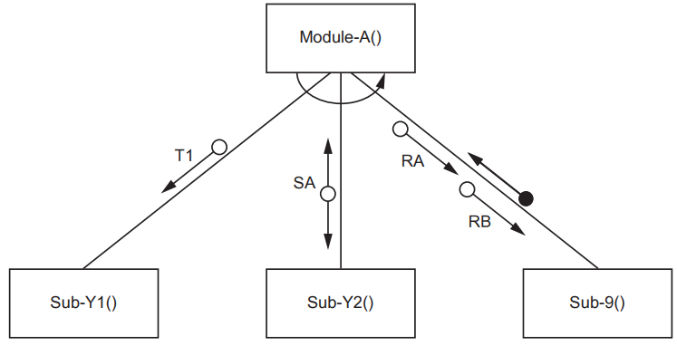
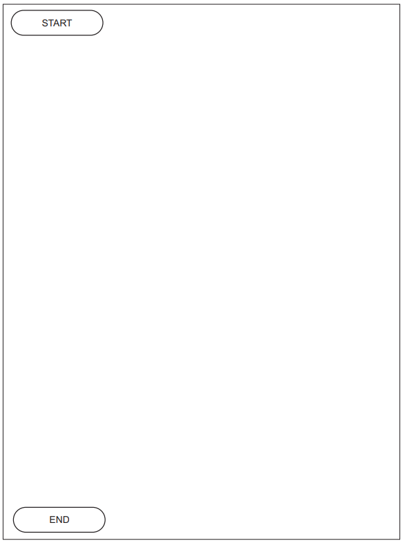
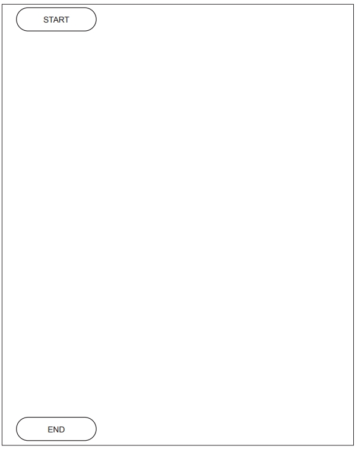
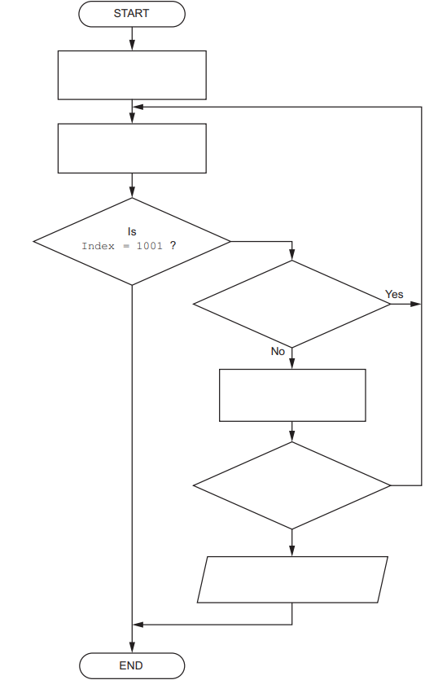
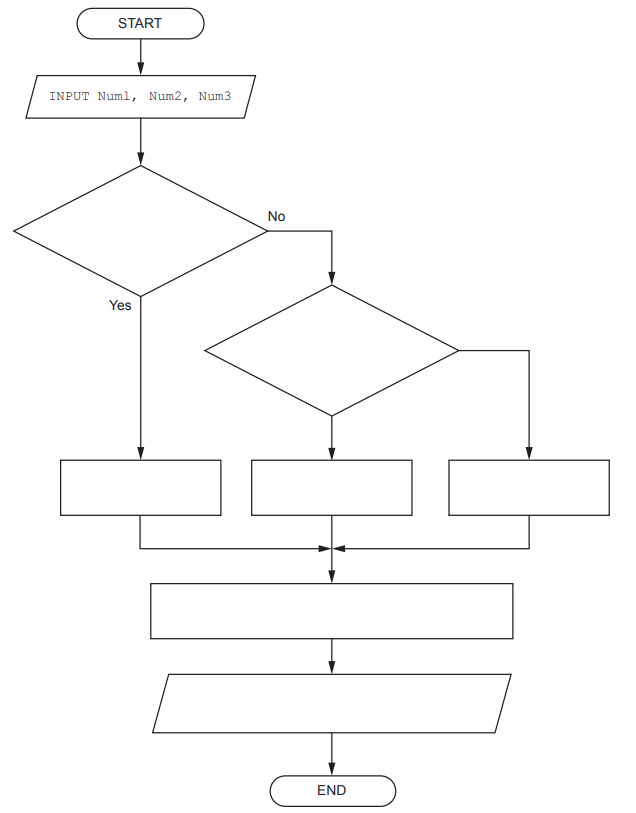
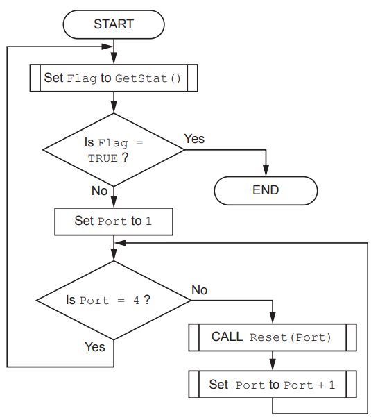
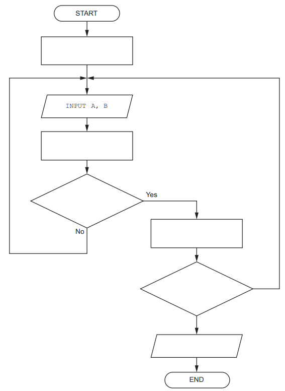

# Exam Questions — Algorithms
**9. Algorithm Design & Problem-solving** · Cambridge (CIE) AS computer-science (9618)
> Source: [https://www.savemyexams.com/as/computer-science/cie/19/topic-questions/](https://www.savemyexams.com/as/computer-science/cie/19/topic-questions/) · 17 questions across 1 sets

## Exam Questions (17 questions)

### Q1 — medium — 2 marks

**Q1** [2 marks]

A structure chart shows the modular structure of a program:

Explain the meaning of the curved arrow symbol which begins and ends at Module-A().

*Source: November 2023 9618/23 Q7A*

### Q2 — medium — 5 marks

**Q2** [5 marks]

`Data` is a 1D array of integers, containing 30 elements. All element values are unique.

An algorithm will output the index of the element with the smallest value.

Draw a program flowchart to represent the algorithm.

*Source: November 2023 9618/23 Q2A*

### Q3 — medium — 5 marks

**Q3** [5 marks]

An algorithm will:

1. input a sequence of integer values, one at a time
2. ignore all values until the value 27 is input, then sum the remaining values in the sequence
3. stop summing values when the value 0 is input and then output the sum of the values.

Draw a program flowchart to represent the algorithm.

*Source: November 2023 9618/22 Q2A*

### Q4 — medium — 5 marks

**Q4** [5 marks]

An algorithm is expressed as follows:

- input 100 numbers, one at a time
- keep a total of all numbers input that have a value between 30 and 70 inclusive and output this total after the last number has been input.

Outline, using stepwise refinement, the five steps for this algorithm which could be used to produce pseudocode.

Do **not** use pseudocode statements in your answer.

Step 1 .....................................................................................................................

Step 2 ....................................................................................................................

Step 3 ....................................................................................................................

Step 4 ....................................................................................................................

Step 5 ....................................................................................................................

*Source: November 2023 9618/21 Q2A*

### Q5 — medium — 4 marks

**Q5** [4 marks]

A program is being designed in pseudocode.

The program contains the following declaration:

`    DECLARE Data : ARRAY[1:1000] OF STRING `

A procedure `ArrayInitialise()` is written to initialise the values in the array:

`    PROCEDURE ArrayInitialise(Label : STRING) `
`       DECLARE `
`       Index : INTEGER Index`$\leftarrow$`1 `
`       WHILE Index <= 1000 `
`          CASE OF (Index MOD 2) `
`             0 : Data[Index]`$\leftarrow$`FormatA(Label) `
`                 Index`$\leftarrow$`Index + 1 `
`             1 : Data[Index]`$\leftarrow$`FormatB(Label) `
`                 Index`$\leftarrow$`Index + 1 `
`          ENDCASE `
`       ENDWHILE `
`    ENDPROCEDURE `

Functions `FormatA()` and `FormatB()` apply fixed format case changes to the parameter string.

The algorithm calls one of the functions `FormatA()` and `FormatB() `each time within the loop.

Explain why this is **not** efficient **and** suggest a more efficient solution.

*Source: June 2024 9618/23 Q5B*

### Q6 — medium — 5 marks

**Q6** [5 marks]

A module `InRange()` will:

- be called with an integer parameter representing an index value of a record in the `Batch` array
- check if the weight of the indexed component is within the acceptable range
- return `TRUE` if the weight is in the range and `FALSE` if it is **not**.

A module `BatchCheck()` will:

- iterate through a batch of 1000 component records
- call module `InRange() `to check each individual component record
- keep a count of the number of components that fail
- output a suitable warning message and immediately stop if the number of failed components exceeds 5.

Complete the program flowchart to represent the algorithm for module BatchCheck().

*Source: June 2024 9618/23 Q3B*

### Q7 — medium — 10 marks

**Q7** [5 marks]

A program is being developed.

An algorithm for part of the program will:

- input three numeric values and assign them to identifiers` Num1`, `Num2` and `Num3 `
- assign the largest value to variable `Ans`
- output a message giving the largest value and the average of the three numeric values.

Assume the values are all different and are input in no particular order.

Complete the program flowchart on page 5 to represent the algorithm.

*Source: June 2024 9618/22 Q2A*

**Q7** [5 marks]

A different part of the program contains an algorithm represented by the following program flowchart:

Write pseudocode for the algorithm.

*Source: June 2024 9618/22 Q2B*

### Q8 — medium — 6 marks

**Q8** [4 marks]

Refer to the** **[insert](https://cdn.savemyexams.com/uploads/2025/11/46562-9618_s24_in_22.pdf) for the list of pseudocode functions and operators.

The following table contains pseudocode examples.

Each example may contain statements that relate to one or more of the following:

- selection
- iteration (repetition)
- input/output.

Complete the table by placing **one or more** ticks (**✓**) in each row.

| **Pseudocode example** | **Selection** | **Iteration** | **Input/Output** |
|---|---|---|---|
| `FOR Index `$\leftarrow$`1 TO 10 ` `   Data[Index] `$\leftarrow$`0 ` `NEXT Index` |   |   |   |
| `WRITEFILE ThisFile, "****"` |   |   |   |
| `UNTIL Level > 25` |   |   |   |
| `IF Mark > 74 THEN ` `   READFILE OldFile, Data` `ENDIF` |   |   |   |

*Source: June 2024 9618/22 Q1A*

**Q8** [2 marks]

Program variables have data types as follows:

| **Variable** | **Data type** |
|---|---|
| `MyChar` | `CHAR` |
| `MyString` | `STRING` |
| `MyInt` | `INTEGER` |

The variables given in part** (b)** are chosen during the design stage of the program development life cycle.

The choices are to be documented to simplify program maintenance.

State a suitable way of documenting the variables **and** give **one** piece of information that should be recorded, in addition to the data type.

*Source: June 2024 9618/22 Q1C*

### Q9 — medium — 5 marks

**Q9** [5 marks]

A fitness club has a computerised membership system. The fitness club offers a number of different exercise classes.

The following information is stored for each club member: name, home address, email address, mobile phone number, date of birth and the exercise(s) they are interested in.

When an exercise class is planned, a new module will send personalised text messages to each member who has expressed an interest in that exercise. Members wishing to join the class send a text message back. Members may decide not to receive future text messages by replying with the message ‘STOP’.

(i) Identify **three** items of information that will be required by the new module. 
Justify your choices with reference to the given scenario.

Item 1 required .........................................................................................................

Justification .............................................................................................................

Item 2 required ........................................................................................................

Justification ............................................................................................................

Item 3 required .......................................................................................................

Justification ............................................................................................................

[3]

(ii) Identify **two** operations that would be required to process data when the new module receives a text message back from a member.

Operation 1 ...........................................................................................................

Operation 2 ............................................................................................................

[2]

*Source: June 2024 9618/21 Q7AII,AIII*

### Q10 — medium — 6 marks

**Q10** [6 marks]

A global 1D array of strings contains three elements which are assigned values as shown:

`Data[1] `$\leftarrow$`"aaaaaa" `
`Data[2] `$\leftarrow$`"bbbbbb" `
`Data[3] `$\leftarrow$`"cccccc" `

Procedure `Process()` manipulates the values in the array.

The procedure is written in pseudocode as follows:

`PROCEDURE Process(Format : STRING) `
`   DECLARE Count, Index, L : INTEGER `
`   DECLARE Result : STRING `
`   DECLARE C : CHAR `

`   Result`$\leftarrow$` "****" `

`   FOR Count 1 TO LENGTH(Format) STEP 2 `
`      C`$\leftarrow$` MID(Format, Count, 1) `
`      L`$\leftarrow$` STR_TO_NUM(MID(Format, Count + 1, 1)) `

`      Index `$\leftarrow$`(Count + 1) DIV 2 `

`      CASE OF C `
`         'X' : Result `$\leftarrow$`TO_UPPER(Data[Index]) `
`         'Y' : Result `$\leftarrow$`TO_LOWER(Data[Index]) `
`         'Z' : Result `$\leftarrow$` "**" & Data[Index] `
`      ENDCASE `

`      Data[Index] `$\leftarrow$`LEFT(Result, L) `
`   NEXT Count `

`ENDPROCEDURE`

Complete the trace table by dry running the procedure when it is called as follows:

`CALL Process("X3Y2W4")`

| **Count** | **C** | **L** | **Index** | **Result** | **Data[1]** | **Data[2]** | **Data[3]** |
|---|---|---|---|---|---|---|---|
|   |   |   |   |   |   |   |   |
|   |   |   |   |   |   |   |   |
|   |   |   |   |   |   |   |   |
|   |   |   |   |   |   |   |   |
|   |   |   |   |   |   |   |   |
|   |   |   |   |   |   |   |   |
|   |   |   |   |   |   |   |   |
|   |   |   |   |   |   |   |   |
|   |   |   |   |   |   |   |   |
|   |   |   |   |   |   |   |   |
|   |   |   |   |   |   |   |   |
|   |   |   |   |   |   |   |   |
|   |   |   |   |   |   |   |   |
|   |   |   |   |   |   |   |   |

*Source: June 2024 9618/21 Q5A*

### Q11 — medium — 5 marks

**Q11** [5 marks]

An algorithm has three steps. It will:

1. repeatedly input a pair of numeric values `A` and `B`
2. count the number of pairs that are input until `A` has been greater than `B` 10 times
3. output the number of pairs that were input.

Complete the program flowchart.

*Source: June 2024 9618/21 Q2A*

### Q12 — medium — 7 marks

**Q12** [7 marks]

In some countries, on the third Sunday in March, daylight saving time begins when clocks move forward by one hour.

A module `AdjustClock()` will take an integer parameter representing a year. The module will return an integer value representing the number of the day in March on which the clocks move forward.

For example, the following line of pseudocode would assign `DayNumber `the value 20:

`DayNumber`$\leftarrow$`AdjustClock(2022) `

Write pseudocode for the function `AdjustClock()`.

Date functions from the **insert** should be used in your solution.

*Source: November 2024 9618/23 Q6*

### Q13 — medium — 4 marks

**Q13** [4 marks]

An examination paper has a maximum of 75 marks. One of five pass grades (A to E) is assigned, depending on the mark obtained. The lowest mark for a given grade is known as the grade boundary.

A program is being written to process examination marks.

The five grade boundaries are stored in a global 1D array `GB` of type `INTEGER`, for example:

| **Index** | **Value** | **Comment** |
|---|---|---|
| 1 | `65` | The minimum mark for an A grade. |
| 2 | `57` | The minimum mark for a B grade. |
| 3 | `43` | The minimum mark for a C grade. |
| 4 | `35` | The minimum mark for a D grade. |
| 5 | `27` | The minimum mark for an E grade. |

Any paper that achieves a mark within 2 marks of a grade boundary must be checked. Using the given table, a paper with 45 marks would need to be checked.

The pseudocode algorithm to determine whether a paper should be checked is as shown. The mark for the paper is stored in variable `Mark`. Global variables Mark, Index, Upper and Lower are declared as integers.

Complete the pseudocode.

`FOR Index `$\leftarrow$` 1 TO ........................................... `

`    Lower `$\leftarrow$` GB[Index] - 2 `

`    Upper `$\leftarrow$` ....................................................... `

`    IF Mark ........................................... AND Mark ........................................... THEN `

`       OUTPUT "Check this paper" `

`    ENDIF `

` NEXT Index`

*Source: November 2024 9618/23 Q4A*

### Q14 — medium — 5 marks

**Q14** [5 marks]

An algorithm will:

1. prompt and input a sequence of 100 integer values, one at a time
2. sum the positive integers
3. output the result of the sum.

Write pseudocode for the algorithm.

Assume the value zero is neither positive nor negative.

You must declare all variables used in the algorithm.

*Source: November 2024 9618/23 Q2A*

### Q15 — medium — 9 marks

**Q15** [7 marks]

A shop sells sandwiches and snacks. The owner chooses a ‘daily special’ sandwich which is displayed on a board outside the shop. Each ‘daily special’ has two different fillings and is made with one type of bread.

The owner wants a program to randomly choose the ‘daily special’ sandwich.

The program designer decides to store the possible sandwich fillings in a 1D array of type string.

The array is declared in pseudocode as follows:

`   DECLARE Filling : ARRAY [1:35] OF STRING `

Each element contains the name of one filling.

An example of the first five elements is as follows:

| **Index** | **Element value** |
|---|---|
| 1 | `"Cheese"` |
| 2 | `"Onion"` |
| 3 | `"Salmon"` |
| 4 | `"Anchovies"` |
| 5 | `"Peanut Butter"` |

A second 1D array stores the possible bread used:

`     DECLARE Bread : ARRAY [1:10] OF STRING `

Each element contains the name of one type of bread.

An example of the first three elements is as follows:

| **Index ** | **Element value** |
|---|---|
| 1 | `"White"` |
| 2 | `"Brown"` |
| 3 | `"Pitta"` |

Both arrays may contain unused elements. The value of these will be an empty string and they may occur anywhere in each array.

A procedure `Special() `will output a message giving the ‘daily special’ sandwich made from **two** randomly selected different fillings and **one** randomly selected bread.

Unused array elements must** not** be used when creating the ‘daily special’ sandwich.

Using the above examples, the output could be:

`     "The daily special is Cheese and Onion on Brown bread."`

Complete the pseudocode for the procedure `Special()`.

Assume that both arrays are global.

`PROCEDURE Special()`

*Source: November 2024 9618/22 Q6A*

**Q15** [2 marks]

The owner decides that some combinations of fillings do not go well together. For example, anchovies and peanut butter.

Describe how the design could be changed to prevent certain combinations being selected.

*Source: November 2024 9618/22 Q6B*

### Q16 — medium — 6 marks

**Q16** [6 marks]

A global integer variable `Tick` is always incremented every millisecond (1000 times per second) regardless of the other programs running.

The value of `Tick` can be read by any program but the value should not be changed.

Assume that the value of `Tick` does not overflow.

As an example, the following pseudocode algorithm would output `"Goodbye" `40 seconds after outputting `"Hello"`.

`    DECLARE Start : INTEGER `

`    OUTPUT "Hello" `
`    Start Tick `

`    REPEAT `
`      //do nothing `
`    UNTIL Tick = Start + 40000 `

`    OUTPUT "Goodbye" `

A program is needed to help a user to time an event such as boiling an egg.

The time taken for the event is known as the elapsed time.

The program contains a procedure `Timer() `which will:

- take two integer values representing an elapsed time in minutes and seconds
- use the value of variable `Tick` to calculate the elapsed time
- output a warning message 30 seconds before the elapsed time is up
- output a final message when the total time has elapsed

For example, to set an alarm for 5 minutes and 45 seconds the program makes the following call:

`    CALL Timer(5, 45) `

When 5 minutes and 15 seconds have elapsed, the program will output:

`    "30 seconds to go" `

When 5 minutes and 45 seconds have elapsed, the program will output:

`    "The time is up!"`

Write pseudocode for the procedure `Timer()`.

*Source: November 2024 9618/22 Q4*

### Q17 — medium — 1 marks

**Q17** [1 mark]

An algorithm will output the **last** three lines from a text file `Result.txt`

The lines need to be output in the same order as they appear in the file.

Assume:

- Three variables` LineX`, `LineY` and `LineZ` will store the three lines. These are of type string and all three variables have been initialised to an empty string.
- The file exists and contains **at least** three lines.

The algorithm to output the lines is expressed in eight steps.

Complete the steps.

1. Open the file ...........................................................................

2. Loop until ...........................................................................

3. ........................................................................... and store in `ThisLine `

4. Assign `LineY `to `LineX`

5. Assign `LineZ` to `LineY`

6. Assign `ThisLine` to `LineZ`

7. After the loop, ...........................................................................

8. Output `LineX, LineY, LineZ`

Explain the purpose of steps 4, 5 and 6 in the algorithm from part **(a)**.

*Source: November 2024 9618/21 Q3B*

