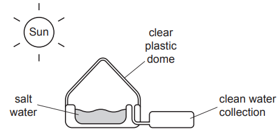
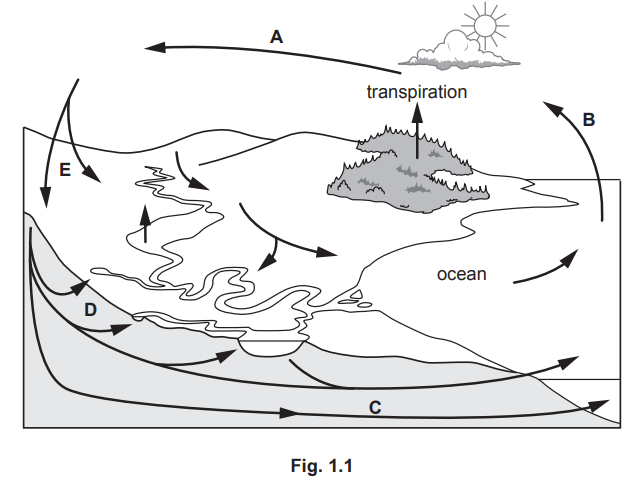

# Exam Questions — 1.4 The Water Cycle
**1. Introduction to Environmental Management** · Cambridge (CIE) AS environmental-management (8291)
> Source: [https://www.savemyexams.com/as/environmental-management/cie/20/topic-questions/](https://www.savemyexams.com/as/environmental-management/cie/20/topic-questions/) · 2 questions across 1 sets

## Exam Questions (2 questions)

### Q1 — medium — 3 marks

**Q1** [3 marks]

Fig. 4.1 shows a solar still. A solar still uses processes in the water cycle to produce drinking water.

**Fig. 4.1**

Use Fig. 4.1 and processes in the water cycle to explain how the solar still can produce drinking water.

*Source: June 2023 Paper 2 Q4C*

### Q2 — medium — 4 marks

**Q2** [4 marks]

Fig. 1.1 represents a simplified water cycle.

**Fig. 1.1**

(i) Identify the letter on Fig. 1.1 that represents:

precipitation ..................................

infiltration. .....................................

[2]

(ii) Describe the role of transpiration in the water cycle.

[2]

*Source: June 2023 Paper 1 Q1AI,AII*

