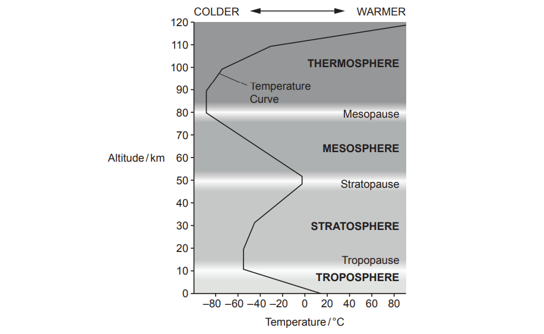

# Exam Questions — 1.5 The Structure & Composition of the Atmosphere
**1. Introduction to Environmental Management** · Cambridge (CIE) AS environmental-management (8291)
> Source: [https://www.savemyexams.com/as/environmental-management/cie/20/topic-questions/](https://www.savemyexams.com/as/environmental-management/cie/20/topic-questions/) · 1 questions across 1 sets

## Exam Questions (1 questions)

### Q1 — medium — 3 marks

**Q1** [1 mark]

Fig. 6.1 shows the structure of the atmosphere.

**Fig.6.1**

Using Fig. 6.1, state the range of altitudes that contain the ozone layer.

*Source: June 2022 Paper 1 Q6A*

**Q1** [2 marks]

Outline the role of the ozone layer.

*Source: June 2022 Paper 1 Q6B*

