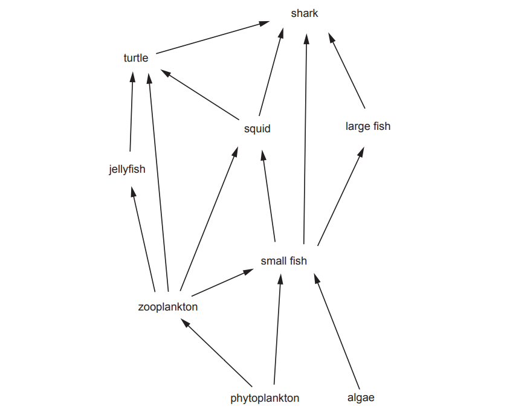

# Exam Questions — 1.6 Ecosystems
**1. Introduction to Environmental Management** · Cambridge (CIE) AS environmental-management (8291)
> Source: [https://www.savemyexams.com/as/environmental-management/cie/20/topic-questions/](https://www.savemyexams.com/as/environmental-management/cie/20/topic-questions/) · 4 questions across 1 sets

## Exam Questions (4 questions)

### Q1 — medium — 7 marks

**Q1** [7 marks]

Scientists on the international space station (ISS) get some of their water from the Water Recovery System (WRS). WRS uses waste water from respiration, sweat and urine and recycles this into drinkable water. It can produce up to 127 litres of recycled drinking water each day and can recycle 93% of the waste water.

Each scientist on the ISS uses 49 litres of water per week for drinking, preparing food and personal hygiene.

(i) On a 60-day ISS mission there are five scientists.

Calculate whether the WRS can provide all of the water the five scientists need. Show your working.

[2]

(ii) One litre of water has a mass of 1kg.

Suggest reasons why the water required by the scientists is **not** transported from Earth to the ISS.

[2]

(iii) Some of the waste water used by the WRS comes from respiration.

Explain the meaning of aerobic respiration

[3]

*Source: June 2023 Paper 2 Q4AI,AII,AIII*

### Q2 — medium — 5 marks

**Q2** [5 marks]

A food chain for the reservoir is shown.

plankton$\rightarrow$ mayfly$\rightarrow$ crayfish$\rightarrow$ trout$\rightarrow$ otter

(i) State the producer in this food chain.

[1]

(ii) State the trophic level of the mayfly.

[1]

(iii) Explain how energy is lost in food chains.

[3]

*Source: June 2023 Paper 2 Q2CI,CII,CIII*

### Q3 — medium — 13 marks

**Q3** [8 marks]

Large areas of the tropical rainforest in Brazil and the forests and brushlands in Australia were destroyed by wild fires in 2019. The destruction had serious effects on the plants and animals in these ecosystems.

(i) Complete the word equation for photosynthesis.

[2]

(ii) Carbon dioxide is a limiting factor in the rate of photosynthesis.

Describe what is meant by the term limiting factor.

[2]

(iii) The combustion of trees by wild fires releases a large amount of carbon dioxide into the atmosphere.

Describe the impact of this increased release of carbon dioxide.

[4]

*Source: June 2022 Paper 1 Q2A (I,II,III)*

**Q3** [5 marks]

Suggest the impact of wild fires on the growth of plants.

Give reasons for your answers.

*Source: June 2022 paper 1  Q2B*

### Q4 — medium — 4 marks

**Q4** [4 marks]

Fig. 1.2 shows a food web for the North Atlantic Ocean.

**Fig. 1.2**

(i)

Identify an organism feeding at more than one trophic level shown in Fig. 1.2.

[1]

(ii)

State the trophic level with the least energy shown in Fig. 1.2.

[1]

(iii)

Suggest **one** effect the plastic pollution in the North Atlantic Ocean could have on the population of squid in the food web shown in Fig. 1.2.

Give a reason for for your answer.

[2]

*Source: June 2022 Paper 1 Q1B(I, II,III)*

