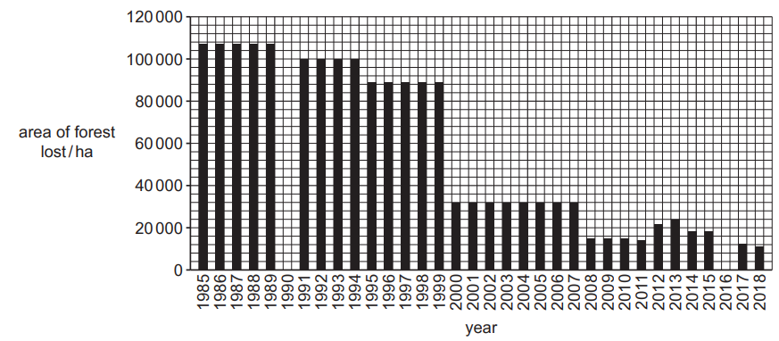
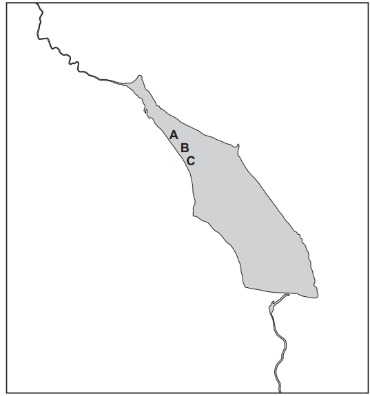
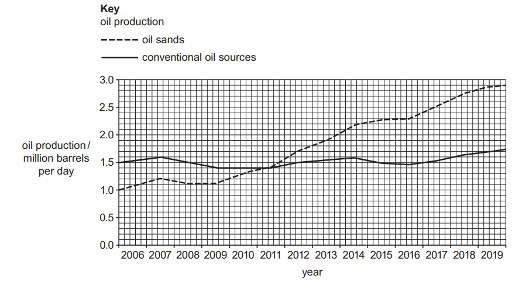
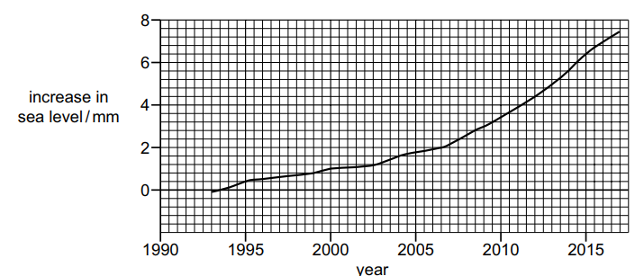
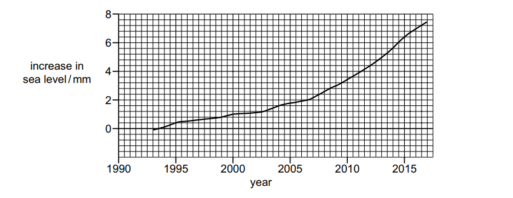

# Exam Questions — 2.1 The Scientific Method
**2. Environmental Research & Data Collection** · Cambridge (CIE) AS environmental-management (8291)
> Source: [https://www.savemyexams.com/as/environmental-management/cie/20/topic-questions/](https://www.savemyexams.com/as/environmental-management/cie/20/topic-questions/) · 7 questions across 1 sets

## Exam Questions (7 questions)

### Q1 — medium — 6 marks

**Q1** [6 marks]

Brazil’s Atlantic forest contains approximately 6000 plant species, 263 amphibian species and 160 species of mammal, which are found nowhere else in the world.

Rio de Janeiro and São Paulo are two of the world’s largest cities. These two cities are within the Atlantic forest.

(i) The bar chart in Fig. 3.1 shows the area of Atlantic forest that is lost each year.

**Fig. 3.1**

Complete Fig. 3.1 by plotting the data in Table 3.1.

**Table 3.1**

| **year** | **area of forest lost/ha** |
|---|---|
| 1990 | 100000 |
| 2016 | 28000 |

[2]

(ii) State the **two** consecutive years which had the greatest difference in the area of forest lost.

between ................................................ and .......................................................

[1]

(iii) Suggest reasons for the loss of Brazil’s Atlantic forest.

[3]

*Source: June 2023 Paper 2 Q3AI,AII,AIII*

### Q2 — medium — 9 marks

**Q2** [9 marks]

Water samples at three locations, **A**, **B** and **C**, in the reservoir were analysed for pH value and sulfate concentration every month for three years. Samples of clean drinking water were also analysed.

Table 2.1 shows the results.

**Table 2.1**

| **water source** | **pH** | **sulfate concentration ** **/mg per litre** |   |   |   |   |
|---|---|---|---|---|---|---|
| min | max | mean | min | max | mean |   |
| **A** | 4.6 | 5.5 | 5.2 | 6.2 | 15.5 | 10.4 |
| **B** | 4.5 | 6.1 | 5.5 | 3.8 | 10.0 | 6.9 |
| **C** | 4.7 | 5.3 | 5.0 | 11.3 | 580.2 | 14.2 |
| **drinking water** | 7.1 | 7.3 | 7.2 | 3.2 | 3.4 | 3.3 |

(i) Calculate the pH range for water source **B**.

range = ......................................................... [1]

(ii) Suggest why the maximum value recorded for sulfate concentration at water source **C** was **not** used to determine the mean value.

[1]

(iii) Use the mean data in Table 2.1 to write a conclusion about the water in the reservoir.

[2]

(iv) The water samples from the reservoir are collected in bottles.

Suggest why each bottle is filled and then emptied with water from the reservoir six times before the final sample is taken.

[1]

(v) The sample bottles are labelled with the:

- initials of the person collecting the sample
- sample location
- date.

Suggest **two** other details that should be recorded to ensure the results are comparable.

[2]

(vi) Fig. 2.1 is a diagram of the Sous reservoir with the three locations, **A**, **B** and **C**, marked.

**Fig. 2.1**

Suggest how the sampling of water from the reservoir can be improved.

[2]

*Source: June 2023 Paper 2 Q2BI,BII,BIII,BIV,BV,BVI*

### Q3 — medium — 7 marks

**Q3** [7 marks]

(i) Fig. 1.3 shows the oil production from oil sands and conventional oil sources in Canada from 2006 to 2019.

**Fig. 1.3**

Use Fig. 1.3 to compare the trends in oil production from oil sands and oil production from conventional oil sources.

[3]

(ii) These oil sands deposits cover 142 200km2. 4800km2 of the oil sands deposits can be mined. The remaining area currently **cannot** be mined.

Calculate the percentage of the oil sands deposits that can be mined. Give your answer to **one **decimal place.

...................................................... % [2]

(iii) Explain how a reliance on fossil fuels, such as oil, can lead to energy insecurity.

[2]

*Source: June 2023 Paper 2 Q1DI,DII,DIII*

### Q4 — medium — 10 marks

**Q4** [10 marks]

Predictions about climate change are based on computer model projections.

Table 4.1 shows data for the percentage difference in warming rates between model projections and observed values between 1975 and 2013.

**Table 4.1**

| **date of model** | **percentage difference in warming rates between model projections and observed values** |
|---|---|
| 1975 | +30 |
| 1981 | –20 |
| 1988 | +30 |
| 1990 | +17 |
| 1995 | –28 |
| 2001 | –14 |
| 2007 | +8 |
| 2013 | +9 |

**Key **
+     model overestimated warming rate 
–     model underestimated warming rate

(i) Plot these data as a bar chart on the grid.

[3]

(ii) Calculate the range for these data.

range = ................................................ [1]

(iii) Comment on the reliability of these computer model projections in predicting the rate of warming between 1975 and 2013.

[2]

(iv) Outline the difficulties in using climate change models.

[4]

*Source: Specimen 2022 Paper 2 Q4AI,AII,AIII,AIV*

### Q5 — medium — 3 marks

**Q5** [3 marks]

The graph in Fig. 2.1 shows the increase in sea level due to ice loss from the Antarctic ice sheet between 1993 and 2017.

**Fig. 2.1**

Describe the trend in sea level between 1993 and 2017, shown in Fig. 2.1.

*Source: Specimen 2022 Paper 2 Q2A*

### Q6 — medium — 1 marks

**Q6** [1 mark]

The graph in Fig. 2.1 shows the increase in sea level due to ice loss from the Antarctic ice sheet between 1993 and 2017.

**Fig. 2.1**

Describe the trend in sea level between 1993 and 2017, shown in Fig. 2.1.

### Q7 — medium — 2 marks

**Q7** [2 marks]

Some information on lead concentrations in soil is shown in Table 1.1.

**Table 1.1**

| Concentration of lead / ppm* | Recommendations |
|---|---|
| < 400 | - Wash hands immediately after gardening - Wash all produce thoroughly |
| 400 to 999 | - Reduce exposure to the soil - Wash hands immediately after gardening - Restrict access of children to the soil - Do not grow leafy vegetables directly in the soil |
| 1000 to 2000 | - Reduce exposure to the soil - Wash hands immediately after gardening - Do not grow food crops in the soil - Do not allow children access to the soil - Keep soil covered |
| > 2000 | - Avoid contact with the soil - Contact your local health department or environmental protection officer |

*ppm = parts per million

A concentration of 400 ppm is the safe soil lead concentration threshold.

The scientist used method **A** and found the soil sample had a lead concentration of 1358 ppm.

Write a conclusion about the lead concentrations in this sample of soil.

In your conclusion include **one **recommendation from the table.

*Source: Specimen Paper 2 Q1D*

