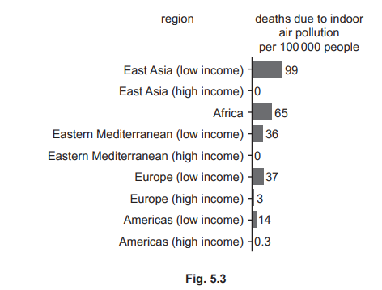
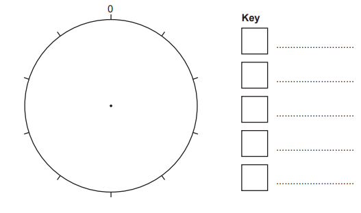
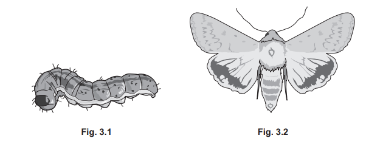
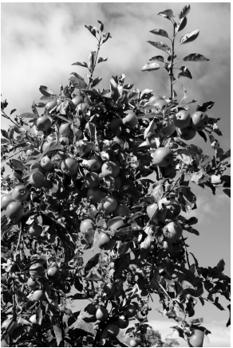
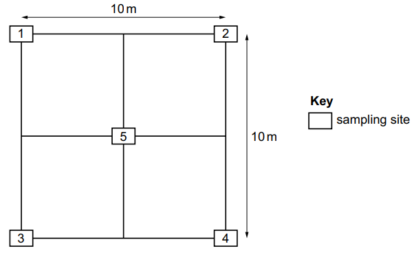

# Exam Questions — 2.4 Data Collection Techniques & Data Analysis
**2. Environmental Research & Data Collection** · Cambridge (CIE) AS environmental-management (8291)
> Source: [https://www.savemyexams.com/as/environmental-management/cie/20/topic-questions/](https://www.savemyexams.com/as/environmental-management/cie/20/topic-questions/) · 5 questions across 1 sets

## Exam Questions (5 questions)

### Q1 — medium — 4 marks

**Q1** [4 marks]

Fig. 5.3 shows the number of deaths (per 100000 people) which are caused by indoor air pollution in different regions for one year.

For each region, the number of deaths due to indoor air pollution per 100000 people was calculated using this formula.

(i) Suggest the benefit of reporting the number of deaths due to indoor air pollution per 100000 people in a region, rather than reporting the total number of deaths due to indoor air pollution in a region.

[1]

(ii) Suggest reasons for the difference in the number of deaths due to indoor air pollution for people on a low income and people on a high income.

[3]

*Source: June 2022 Paper 2 Q5BI,BII*

### Q2 — medium — 5 marks

**Q2** [5 marks]

A student used a questionnaire to ask some people in Ethiopia for their opinion on how forest cover has changed in their local area.

Table 4.1 shows the results of the questionnaire.

**Table 4.1**

| **percentage response** |   |   |   |   |
|---|---|---|---|---|
| **rapidly decreasing** | **gradually decreasing** | **same as before** | **increasing** | **no opinion** |
| 50 | 30 | 10 | 7 | 3 |

(i) Write a suitable conclusion that summarises the main opinion on how forest cover has changed in Ethiopia.

[1]

(ii) Draw a pie chart of the data in Table 4.1. Complete the key

[3]

(iii) Suggest one piece of additional information that is needed to ensure the data in Table 4.1 is reliable.

[1]

*Source: June 2022 Paper 2 Q4BI, BII, BIII*

### Q3 — medium — 12 marks

**Q3** [12 marks]

The corn earworm moth is a species of insect affected by light pollution. The moth will not reproduce if light levels are too high.

Fig. 3.1 shows the corn earworm larva and Fig. 3.2 shows the corn earworm moth.

The corn earworm larvae are a pest of corn, cotton, tomato and tobacco plants.

A farmer uses a light trap to investigate the population of corn earworm moths in three fields, A, B and C.

Each field is sampled for three weeks. The number of corn earworm moths collected each week for three weeks is recorded.

The results are shown in Table 3.1.

**Table 3.1.**

| **number of corn earworm moths collected** |   | **field A** | **field B** | **field C** |
|---|---|---|---|---|
| **week 1** | 16 | 7 | 250 |   |
| **week 2** | 17 | 3 | 235 |   |
| **week 3** | 15 | 2 | 265 |   |
| **average** | 16 | 4 | ............. |   |

(i) Complete Table 3.1 by calculating the mean (average) number of corn earworm moths collected in field C.

[1]

(ii) The farmer uses the data in Table 3.2 to decide whether to spray the fields with insecticide.

| **average weekly number of corn earworm moths** | **spray frequency** |
|---|---|
| > 350 | every 3 days |
| 11–349 | every 4 days |
| 5–10 | every 5 days |
| < 5 | no spray |

Use the data to suggest the spray frequency for fields A and B.

field A

field B

[2]

(iii) Describe two agricultural techniques that control crop pests, other than using insecticide.

[2]

(iv) The farmer selected the three fields out of 50 possible fields for this investigation. Describe a sampling strategy to select the three fields to ensure the investigation is free from bias.

[3]

(v) A sweep net is a way of collecting insects.

Describe the benefits and limitations of using a sweep net to collect insects.

benefits

limitations

[4]

*Source: June 2022 Paper 2 Q3BI,BII,BIII,BIV,BV*

### Q4 — medium — 13 marks

**Q4** [7 marks]

Fig. 3.1 shows some branches of an apple tree.

**Fig. 3.1**

A student used a beating tray to estimate the number of insects on the leaves of an apple tree.

(i) Describe how the student could use the beating tray method to estimate the **total **number of insects in the tree.

[6]

(ii) Describe **one** benefit of using a beating tray as a sampling technique.

[1]

*Source: Specimen 2022 Paper 2 Q3AI,AII*

**Q4** [6 marks]

The codling moth (C. pomonella) is a major pest of apple trees in parts of the USA.

The codling moth larvae eat holes in the apple fruit, which makes the apples unsellable.

A researcher decides to use crowd sourcing to investigate the extent of the codling moth problem in the USA.

The researcher posts a questionnaire online and asks members of the public to record sightings of the adult codling moth or its larvae and any damage to the apple tree or fruit.

(i) Write a suitable questionnaire the researcher could use to obtain the information. The questionnaire should contain four questions.

**Questionnaire on codling moth sightings **

Question 1 .........................................................................................................
Question 2 ........................................................................................................
Question 3 ........................................................................................................
Question 4 .......................................................... ..............................................

[4]

(ii) Suggest **two **limitations of this method of data collection.

[2]

*Source: Specimen 2022 Paper 2 Q3BI,BII*

### Q5 — medium — 3 marks

**Q5** [3 marks]

A soil scientist wants to find out if soil near an e-waste landfill site is contaminated with lead. 

The scientist collects 500 g of soil from five sampling sites. 

Fig. 1.1 shows the location of the five sampling sites.

**Fig 1.1**

The scientist considers two methods, **A** and **B**, for obtaining soil samples for analysis.

**method A **

1. Remove any stones, animals or plant material from each 500 g soil sample.
2. Put 100 g of soil from each of the five soil samples into a large plastic bucket and mix the soil thoroughly.
3. Remove 100 g of mixed soil from the bucket and put in a clean plastic bag.
4. Test this sample of soil for lead.

**method B**

1. Remove any stones, animals or plant material from each 500 g soil sample.
2. Put 100 g of soil from the sample collected at site 1 into a clean plastic bag.
3. Test this sample of soil for lead.
4. Repeat steps 2 and 3 for the other sampling sites.

(i) Suggest **one** advantage of using method **A** compared with method **B.**

[1]

(ii) Suggest **one **limitation of using method **A** compared with method **B. **

[1]

(iii) Suggest **one **reason why plant material is removed from the 500 g soil samples.

[1]

*Source: Specimen  2022 Q1CI,CII,CIII*

