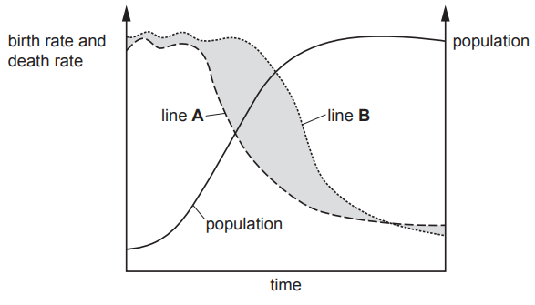
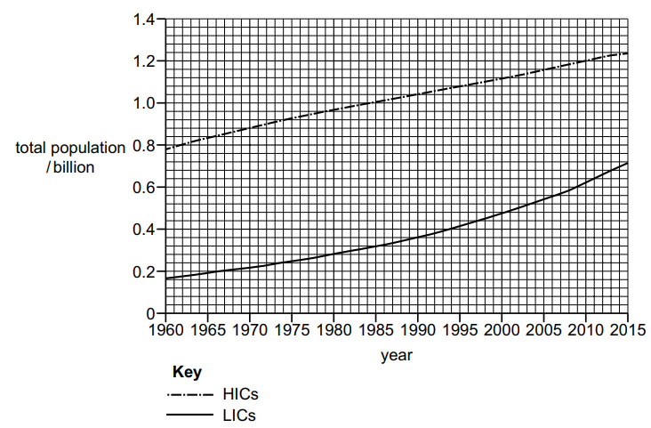
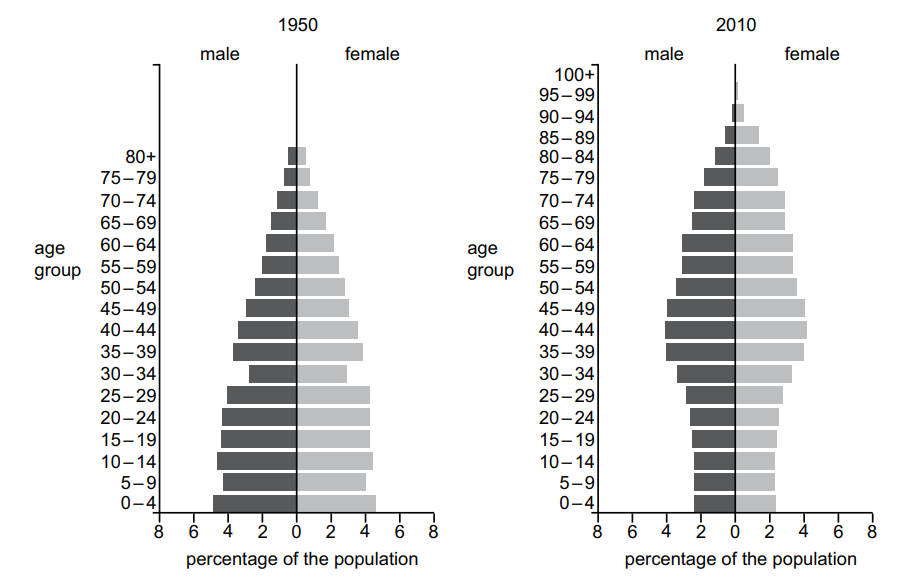

# Exam Questions — 3.1 Human Population Dynamics & Structure
**3. Managing Human Population** · Cambridge (CIE) AS environmental-management (8291)
> Source: [https://www.savemyexams.com/as/environmental-management/cie/20/topic-questions/](https://www.savemyexams.com/as/environmental-management/cie/20/topic-questions/) · 4 questions across 1 sets

## Exam Questions (4 questions)

### Q1 — medium — 3 marks

**Q1** [3 marks]

Light pollution is caused by the use of artificial light. Light pollution has been linked to a rapid decrease in insect populations.

(i) Suggest why the use of artificial light is increasing.

[1]

(ii) Suggest why a decrease in insect populations is of global concern.

[2]

*Source: June 2022 Paper 2 Q3AI,AII*

### Q2 — medium — 7 marks

**Q2** [4 marks]

Fig. 3.1 shows data about birth and death rates and the population of a country.

**Fig. 3.1**

(i) Line **A** and line **B** represent the birth and death rates of the country.

Identify the line that represents the death rate. Use Fig. 3.1 to give reasons for your answer.

[2]

(ii) Birth and death rates cause population change.

Explain **one** other cause of population change.

[2]

*Source: June 2023 Paper 1 Q3AI,AII*

**Q2** [3 marks]

Table 3.1 shows the dependency ratio for the country in 1990 and 2020.

**Table 3.1**

| **dependency ratio in 1990** | **dependency ratio in 2020** |
|---|---|
| 93 | 55 |

Describe **three** changes that could cause the change in dependency ratios shown in Table 3.1.

*Source: June 2023 Paper 1 Q3B*

### Q3 — medium — 4 marks

**Q3** [4 marks]

The graph in Fig. 5.1 shows data for total population of high-income economy countries (HICs) and low-income economy countries (LICs) between 1960 and 2015.

**Fig. 5.1**

(i) The data in Fig. 5.1 show a percentage increase in population of 59% for HICs from 1960 to 2015.

Calculate the percentage increase in population for LICs from 1960 to 2015.

Give your answer to 2 significant figures.

........................................................% [2]

(ii) Use the data to compare the trend in population for LICs and for HICs between 1960 and 2015.

[2]

*Source: Specimen 2022 Paper 2 Q5AI,AII*

### Q4 — medium — 13 marks

**Q4** [8 marks]

Italy is a high-income economy country (HIC) in Europe and Bangladesh is a low-income economy country (LIC) in Asia. Table 1.1 shows population data for Italy and Bangladesh in 1990 and 2010.

Table 1.1

| country | area / km2 | population 1990 | population density 1990 /  people km–2 | population 2010 | population density 2010 /  people km–2 | percentage increase in population density |
|---|---|---|---|---|---|---|
| Bangladesh | 147 630 | 105 983 136 |   | 151 616 777 | 1027.0 | 43.1 |
| Italy | 301 340 | 57 007 577 | 189.2 | 59 588 066 | 197.7 |   |

(i) Calculate the population density of Bangladesh in 1990.

Give the answer to 1 decimal place.

population density 1990 ..................................... people km–2

[2]

(ii) Calculate the percentage increase in population density for Italy.

Give the answer to 3 significant figures.

percentage increase .......................................................%

[2]

(iii) Suggest how social factors can cause the changes in population density in Bangladesh and Italy. Refer to the data in your answer.

[4]

*Source: Specimen 2022 Paper 1 Q1AI, AII, AIII*

**Q4** [5 marks]

Fig. 1.1 shows two population pyramids representing the percentage of the population in different age groups in Italy in 1950 and 2010.

Fig. 1.1

(i) Describe the changes in population distribution using data from Fig. 1.1.

[2]

(ii) Describe the impacts that the changes in (i) could cause.

[3]

*Source: Specimen 2022 Paper 1 Q1BI, BII*

