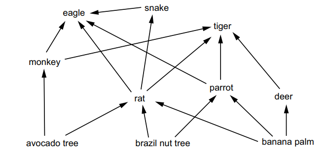
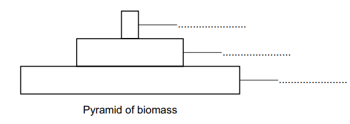

# Exam Questions — 4.1 Ecosystems
**4. Managing Ecosystems & Biodiversity** · Cambridge (CIE) AS environmental-management (8291)
> Source: [https://www.savemyexams.com/as/environmental-management/cie/20/topic-questions/](https://www.savemyexams.com/as/environmental-management/cie/20/topic-questions/) · 2 questions across 1 sets

## Exam Questions (2 questions)

### Q1 — medium — 12 marks

**Q1** [12 marks]

In 2019, a major reforestation programme took place in Ethiopia.

350 million trees were planted over a 12-hour period in July.

(i) Suggest one reason why not all of the 350 million trees planted will grow into mature trees.

[1]

(ii) Suggest one reason why other countries do not have a similar reforestation programme.

[1]

(iii) Explain how reforestation can improve water security in a region.

[3]

(iv) In the past, eucalyptus trees were used to reforest areas of Ethiopia.

Eucalyptus trees are not native to Ethiopia.

Suggest the negative impacts of planting non-native trees.

[3]

(v) Explain how reforestation can help manage climate change.

[4]

*Source: June 2022 Paper 2 Q4CI,CII,CIII,CIV,CV*

### Q2 — medium — 7 marks

**Q2** [5 marks]

Fig. 4.1 is a food web that shows some feeding relationships in a rainforest.

Fig. 4.1

(i) Label the pyramid of biomass using an organism from each trophic level in a food chain within this food web.

[2]

(ii) Explain the shape of the pyramid of biomass shown in (a)(i).

[3]

*Source: Specimen 2022 Paper 1 Q4AI.AII*

**Q2** [2 marks]

Table 4.1 shows data on productivity.

Table 4.1

| type of land | average annual net primary productivity / g m–2 |
|---|---|
| tropical rainforest | 2200 |
| agricultural | 650 |

(i) Tropical rainforest is an example of an ecosystem.

Define ecosystem productivity

[1]

(ii)

Suggest one reason why the productivity of the agricultural land is much smaller than the tropical rainforest.

[1]

*Source: Specimen 2022 Paper 1  Q4BI, BII*

