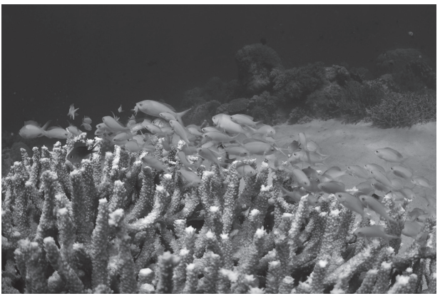
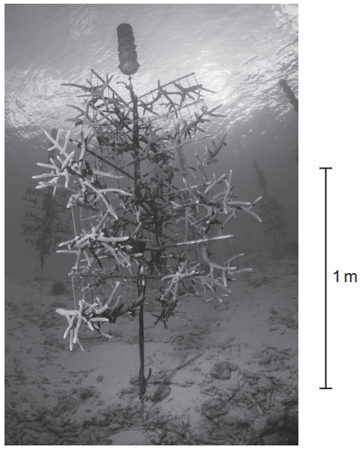

# Exam Questions — 4.2 Managing the Conservation of Biodiversity
**4. Managing Ecosystems & Biodiversity** · Cambridge (CIE) AS environmental-management (8291)
> Source: [https://www.savemyexams.com/as/environmental-management/cie/20/topic-questions/](https://www.savemyexams.com/as/environmental-management/cie/20/topic-questions/) · 4 questions across 1 sets

## Exam Questions (4 questions)

### Q1 — medium — 3 marks

**Q1** [3 marks]

In 2010, the USA and Brazil signed a 5-year debt for nature swap worth \$21 million.

Explain how a debt for nature swap can protect Brazil’s Atlantic forest.

*Source: June 2023 Paper 2 Q3B*

### Q2 — medium — 10 marks

**Q2** [3 marks]

Fig. 2.1 shows staghorn coral in the Atlantic Ocean.

**Fig. 2.1**

One species of staghorn coral, Acropora cervicornis, is classed as critically endangered on the International Union for Conservation of Nature (IUCN) Red List.

Describe the role of the IUCN Red List.

*Source: June 2022 Paper 1 Q2A*

**Q2** [7 marks]

Fig. 2.2 shows a strategy for conserving staghorn corals. Small pieces of coral are attached to a nursery line and allowed to grow until they are large enough to be moved to new areas. The corals then form a new coral reef.

**Fig. 2.2**

(i) Evaluate the use of a coral nursery line as a strategy for conserving staghorn corals.

[4]

(ii) Suggest three other strategies that governments could introduce to conserve staghorn corals.

[3]

*Source: June 2023 Paper 1 Q2CI,CII*

### Q3 — medium — 3 marks

**Q3** [3 marks]

The codling moth is considered an invasive species in China.

(i) State what is meant by invasive species.

[2]

(ii) State one impact of invasive species.

[1]

*Source: Specimen 2022 Paper 2 Q3CI,CII*

### Q4 — medium — 20 marks

**Q4** [20 marks]

‘National parks are an effective method of conserving biodiversity.’

To what extent do you agree with this statement?

Give reasons and include information from relevant examples to support your answer.

*Source: Specimen 2022 Paper 1 Q6*

