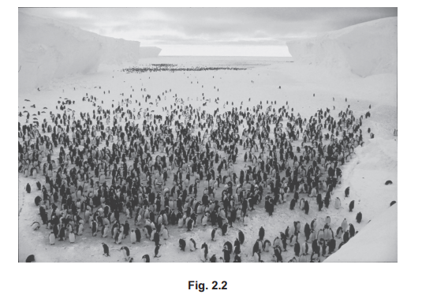
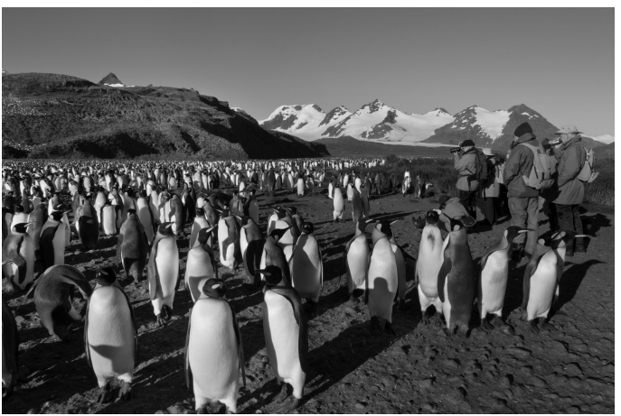
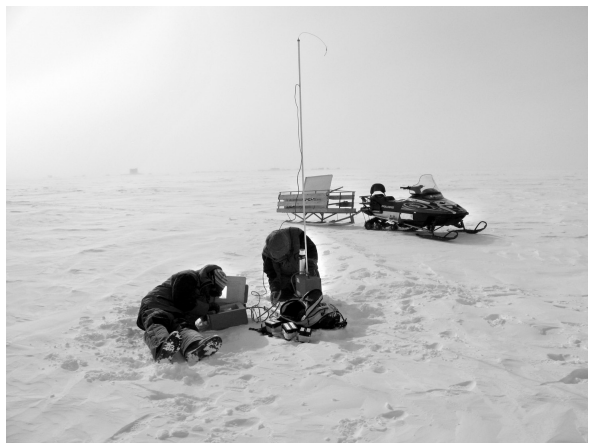
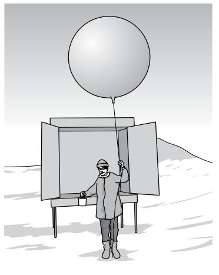
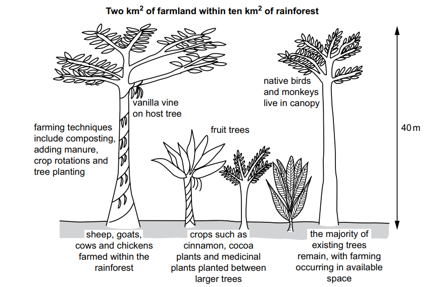

# Exam Questions — 4.3 Impacts of Human Activity on Ecosystems
**4. Managing Ecosystems & Biodiversity** · Cambridge (CIE) AS environmental-management (8291)
> Source: [https://www.savemyexams.com/as/environmental-management/cie/20/topic-questions/](https://www.savemyexams.com/as/environmental-management/cie/20/topic-questions/) · 5 questions across 1 sets

## Exam Questions (5 questions)

### Q1 — medium — 6 marks

**Q1** [3 marks]

Fig. 2.2 shows a penguin colony in Antarctica.

The Antarctic Treaty is an international agreement that protects the Antarctic. Some of the treaty’s aims include:

• protection of the Antarctic environment 
• conservation of plants and animals 
• management of tourism 
• management of protected areas.

(i) All waste, other than sewage and food waste, is removed from Antarctica.

Suggest why sewage and food waste are not removed from Antarctica.

[1]

(ii) Suggest why all other waste is removed from Antarctica.

[2]

*Source: June 2022 Paper 2 Q2BI,BII*

**Q1** [3 marks]

Approximately 30000 tourists visit Antarctica each year.

Describe how tourism can be controlled in protected environments such as Antarctica.

*Source: June 2022 Paper 2 Q2C*

### Q2 — medium — 20 marks

**Q2** [20 marks]

Evaluate the success of strategies to manage the human impacts on a tundra location of your choice.

Give reasons and include information from relevant examples to support your answer.

*Source: June 2022 Paper 1 Q8*

### Q3 — medium — 20 marks

**Q3** [20 marks]

Evaluate the success of strategies for managing the impacts of human activity on Antarctica.

Give reasons and include information from relevant examples to support your answer.

*Source: June 2023 Paper 1 Q6*

### Q4 — medium — 8 marks

**Q4** [8 marks]

The Antarctic Treaty was originally signed by 12 nations in 1959. The treaty has now been signed by 53 nations.

The Antarctic Treaty refers to Antarctica as:

‘… a natural reserve, devoted to peace and science’.

Agreements within the treaty relate to:

- protection of the Antarctic environment
- designation and management of protected areas
- management of tourism
- freedom of scientific investigation
- scientific cooperation.

Figs. 2.2, 2.3 and 2.4 show human activities within the area covered by the Antarctic Treaty.

Fig. 2.2 shows tourists visiting a king penguin colony

**Fig. 2.2**

Fig. 2.3 shows scientists carrying out research in the Antarctic. Researchers use vehicles powered by a fossil fuel to cover the large distances in the Antarctic.

**Fig. 2.3**

Fig. 2.4 shows a meteorologist using a weather balloon. A monitoring device is attached to the balloon, which is released into the atmosphere. The device sends meteorological information back to a computer.

**Fig. 2.4**

(i) Evaluate the success of the Antarctic Treaty in managing the impact of human activity in Antarctica. Refer to evidence from Figs. 2.2, 2.3 and 2.4 in your answer.

[6]

(ii) There are deposits of coal in Antarctica.

Mining is prohibited by the Antarctic Treaty.

Suggest two other reasons why these coal deposits are not mined.

[2]

*Source: Specimen 2022 Paper 2 Q2CI,CII*

### Q5 — medium — 9 marks

**Q5** [9 marks]

A student visits a farm within an area of tropical rainforest. The farm grows a variety of plants.

Fig. 4.2 shows the student’s annotated sketch of the farm.

Fig. 4.2

(i) Explain how the farming strategies in Fig. 4.2 manage the impacts of farming in this tropical rainforest.

[6]

(ii) The student noticed that some of the large trees on the farm have dense, broad leaves that shade the forest floor.

Very few plants grow under these trees.

Explain why

[3]

*Source: Specimen 2022 Paper 1  Q4CI, CII*

