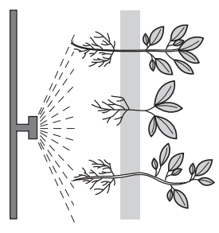
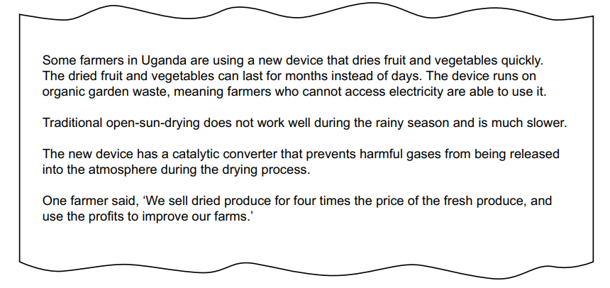

# Exam Questions — 5.1 Food Security
**5. Managing Resources** · Cambridge (CIE) AS environmental-management (8291)
> Source: [https://www.savemyexams.com/as/environmental-management/cie/20/topic-questions/](https://www.savemyexams.com/as/environmental-management/cie/20/topic-questions/) · 3 questions across 1 sets

## Exam Questions (3 questions)

### Q1 — medium — 18 marks

**Q1** [6 marks]

The United Nations estimated that, in 2019, approximately 750 million people experienced severe levels of food insecurity.

(i) Define food insecurity

[2]

(ii) Describe causes of food insecurity.

[4]

*Source: June 2023 Paper 1 Q4AI,AII*

**Q1** [6 marks]

Fig. 4.1 shows aeroponics, an agricultural technique for growing crop plants. Aeroponics is a strategy for improving food security.

The crop plants are grown without soil and have their roots in air. Water is sprayed onto the roots as a fine mist.

**Fig. 4.1**

Suggest benefits and limitations of aeroponics as a strategy for reducing food insecurity.

*Source: June 2023 Paper 1 Q4B*

**Q1** [4 marks]

One other strategy for improving food security is the use of pesticides such as herbicides and fungicides.

Describe how pesticides improve food security.

*Source: June 2023 Paper 1 Q4C*

**Q1** [2 marks]

Many crop plants are annual plants. An annual plant produces a crop in one year and then dies. Perennial plants live for more than two years and produce a crop each year. Plant breeders try to breed perennial crop plants from annual crop plants.

Suggest **two** advantages of perennial crops compared to annual crops.

*Source: June 2023 Paper 1 Q4D*

### Q2 — medium — 2 marks

**Q2** [2 marks]

Food wastage is one reason why there is a global shortage of food.

State two other reasons.

*Source: Specimen 2022 Paper 1 Q2C*

### Q3 — medium — 4 marks

**Q3** [4 marks]

Approximately one third of all food produced for human consumption is wasted.

In many low-income economy countries (LICs) food wastage occurs when food is stored.

Fig. 2.1 is a news report on a method for farmers to reduce food waste in Uganda, an LIC in Africa.

Fig. 2.1

Explain how the device described in Fig. 2.1 provides a sustainable method of food production in Uganda.

*Source: Specimen 2022 Paper 1 Q2A*

