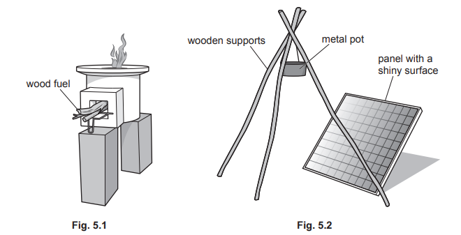
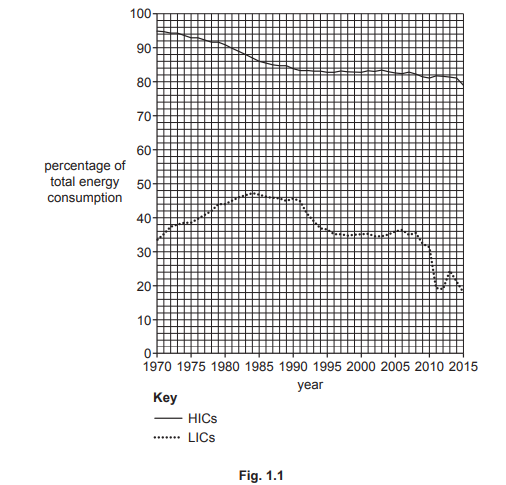
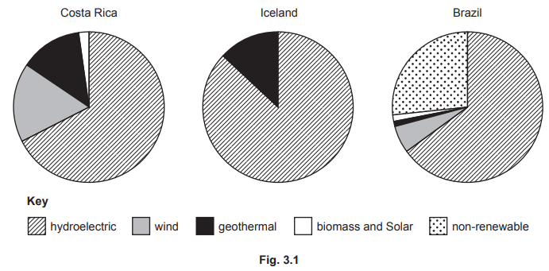
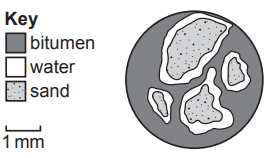
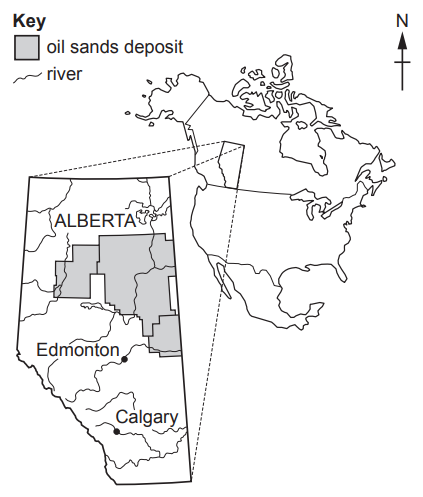
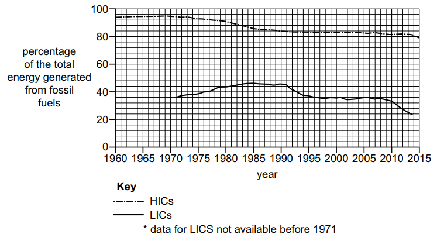
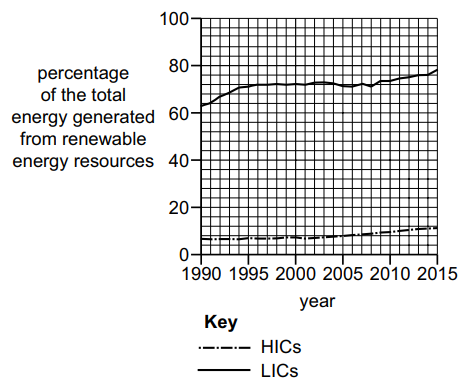
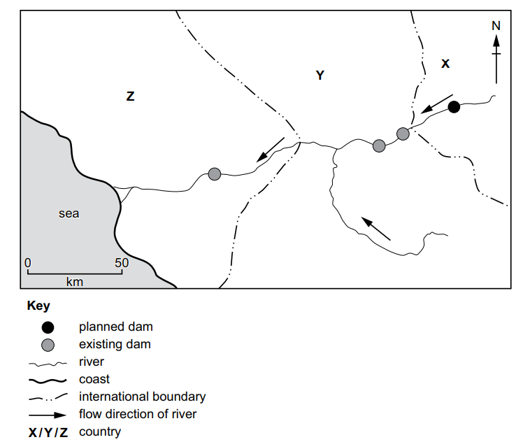

# Exam Questions — 5.2 Energy Resources
**5. Managing Resources** · Cambridge (CIE) AS environmental-management (8291)
> Source: [https://www.savemyexams.com/as/environmental-management/cie/20/topic-questions/](https://www.savemyexams.com/as/environmental-management/cie/20/topic-questions/) · 6 questions across 1 sets

## Exam Questions (6 questions)

### Q1 — medium — 6 marks

**Q1** [6 marks]

A report stated that 3 billion people cook their food using stoves that require open fires.

Wood is a common fuel for the open fire used in these stoves. It takes a family around 20 hours per week to gather enough wood for the stove.

An unventilated open fire produces the same amount of air pollution in one hour as the smoke from 400 cigarettes. Smoke contains particulates.

Fig. 5.1 shows an unventilated wood burning stove.

Fig. 5.2 shows a stove powered by solar energy. Sunlight is reflected onto a metal pot from a panel with a shiny surface.

Suggest the advantages and disadvantages of using a stove powered by solar energy compared with using an unventilated wood burning stove.

*Source: June 2022 Paper 2 Q5A*

### Q2 — medium — 13 marks

**Q2** [7 marks]

In 2020, 83% of homes in the United Kingdom combusted natural gas (methane) for heating.

In January 2020, a blend of 20% hydrogen gas and 80% natural gas was trialled in 100 homes. The trial cost more than \$9 million.

When hydrogen is combusted, it generates heat and water.

It is estimated that switching to 100% hydrogen gas will save 6 million tonnes of carbon dioxide per year from being emitted into the atmosphere.

(i) Explain why alternative fuels to methane are needed.

[3]

(ii) Suggest two reasons why the trial to replace methane might not be extended to the whole of the United Kingdom.

[2]

(iii) Hydrogen can be obtained from methane. This process emits carbon dioxide. 
State two strategies for removing carbon dioxide once it is in the atmosphere.

[2]

*Source: June 2022 Paper 2 Q1AI,AII,AIII*

**Q2** [6 marks]

Fig. 1.1 shows fossil fuel consumption as a percentage of total energy consumption for high-income economy countries (HICs) and low-income economy countries (LICs) between 1970 and 2015.

(i) Compare the trends shown in fossil fuel consumption for HICs and LICs shown in Fig. 1.1.

[4]

(ii) Some countries do not have a supply of fossil fuels. They have to import fossil fuels into their country.

Explain how this can lead to energy insecurity.

[2]

*Source: June 2022 Paper 2 Q1BI,BII*

### Q3 — medium — 6 marks

**Q3** [1 mark]

Fig. 3.1 shows the contribution of different sources of energy to the total amount of electricity generated in three countries.

State the largest source of renewable energy used by the three countries shown in Fig. 3.1.

*Source: June 2022 Paper 1 Q3A*

**Q3** [1 mark]

State one other source of renewable energy other than those shown in Fig. 3.1.

*Source: June 2022 Paper 1 Q3B*

**Q3** [2 marks]

Climate change can result in drought. Explain how droughts can lead to energy insecurity in Brazil.

*Source: June 2022 Paper 1 Q3C*

**Q3** [2 marks]

Suggest why Costa Rica might be described as being more energy secure than Iceland.

*Source: June 2022 Paper 1 Q3D*

### Q4 — medium — 8 marks

**Q4** [2 marks]

Oil sands contain deposits of oil.

Fig. 1.1 is an enlarged sketch of an oil sands sample. Each grain of sand is surrounded by a layer of water and a type of oil called bitumen.

**Fig. 1.1**

Oil is a fossil fuel.

State **two** other fossil fuels.

*Source: June 2023 Paper 2 Q1A*

**Q4** [3 marks]

Fig. 1.2 shows the location of oil sands deposits in Canada. These are some of the largest deposits of oil on Earth.

**Fig. 1.2**

Use Fig. 1.2 to suggest the challenges of exporting oil from these oil sands locations.

Give reasons for your answer.

*Source: June 2023 Paper 2 Q1C*

**Q4** [3 marks]

A pipeline for transporting oil was planned to run from Canada to the USA. Many people objected to the building of this pipeline.

Suggest reasons why some people were in **favour** of building this pipeline.

*Source: June 2023 Paper 2 Q1F*

### Q5 — medium — 8 marks

**Q5** [8 marks]

Fig. 5.2 shows data for the percentage of the total energy generated from fossil fuels for HICs and LICs between 1960* and 2015.

**Fig. 5.2**

Fig. 5.3 shows data for the percentage of the total energy generated from renewable energy resources for HICs and LICs between 1990 and 2015.

**Fig. 5.3**

Explain the trends in the percentage of the total energy generated from fossil fuels and renewable energy resources in HICs and LICs.

Use data from Figs. 5.1, 5.2 and 5.3 to support your answer

*Source: Specimen 2022 Paper 2 Q5B*

### Q6 — medium — 12 marks

**Q6** [6 marks]

(i) Countries need long-term and short-term energy security.

Define:

long-term energy security ................................................................................................

short-term energy security ................................................................................................

[2]

(ii) Energy insecurity impacts low-income economy countries (LICs).

Outline four of these impacts.

[4]

*Source: Specimen 2022 Paper 1 Q3AI, AII*

**Q6** [6 marks]

Fig. 3.1 shows the location of hydroelectric projects in country Y and country Z.

A new dam is planned in country X to meet the increasing energy demands of the country. Country X is a low-income economy country (LIC). Currently, only 22% of the population of country X has access to electricity.

Fig. 3.1

Explain the impacts the new dam could have on the economies of countries X, Y and Z.

Include positive and negative impacts in your answer.

*Source: Specimen 2022 Paper 1  Q3B*

