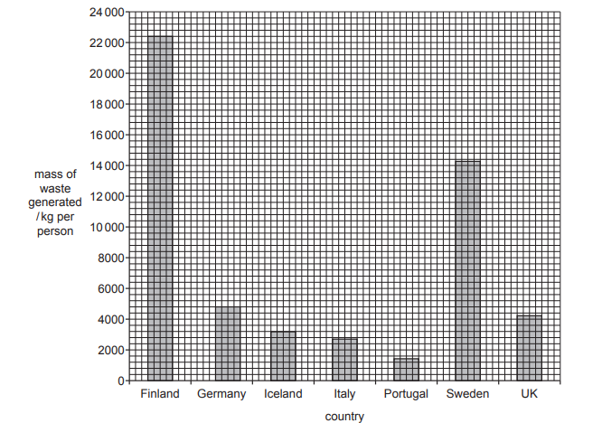
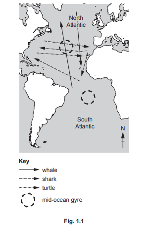
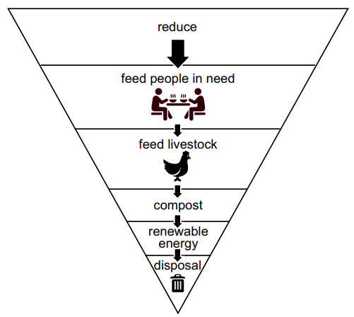

# Exam Questions — 5.3 Waste Management
**5. Managing Resources** · Cambridge (CIE) AS environmental-management (8291)
> Source: [https://www.savemyexams.com/as/environmental-management/cie/20/topic-questions/](https://www.savemyexams.com/as/environmental-management/cie/20/topic-questions/) · 8 questions across 1 sets

## Exam Questions (8 questions)

### Q1 — medium — 3 marks

**Q1** [3 marks]

Fig. 5.4 is a blog about a strategy to manage pollution, called the polluter pays principle.

| The polluter pays principle states that those who produce pollution should pay for the management of preventing damage to human health and to the environment.  In Switzerland, an extra cost is added to waste collection bags with pay-per-bag fees.  In the United States, polluters are required to pay for clean-up of hazardous waste sites. An extra cost is added to vehicles that have a low fuel efficiency. |
|---|

(i) Suggest why the polluter pays principle described in Fig. 5.4 is not always implemented.

[1]

(ii) Suggest why some people are against the polluter pays principle.

[2]

*Source: June 2022 Paper 2 Q5CI, CII*

### Q2 — medium — 13 marks

**Q2** [13 marks]

Fig. 2.1 shows the mass of waste generated per person in seven countries in Europe in 2016.

(i) The average mass of waste generated per person in Europe is 5000kg.

State the number of the countries shown in Fig. 2.1 that generated more than this value.

[1]

(ii) A report stated that in 2016 Germany recycled 65% and Finland recycled 40% of the waste they generated.

Use Fig. 2.1 to calculate:

• the mass of waste recycled in Germany in 2016

......................................... kg per person

• the mass of waste not recycled in Finland in 2016.

......................................... kg per person

[2]

(iii) State two strategies to increase the percentage of waste that is recycled in a country.

[2]

(iv) Incineration is used to dispose of waste.

Suggest benefits and negative impacts of waste incineration.

benefits

negative impacts

[4]

(v) In 2019, more than 1.8 million tonnes of plastic waste were exported from Europe as a waste disposal strategy. Most of this plastic waste went to China and Hong Kong.

Evaluate the impacts of this waste disposal strategy.

[4]

*Source: June 2022 Paper 2 Q2AI,AII,AIII,AIV,AV*

### Q3 — medium — 8 marks

**Q3** [8 marks]

Fig. 1.1 shows the migration routes of three aquatic animals and the position of two midocean gyres. A gyre is a very large system of circulating water which traps plastic waste brought by ocean currents to form polluted areas.

(i) Suggest two possible sources of the plastic pollution found in the mid-ocean gyres.

[2]

(ii) Suggest one way that plastic pollution in the mid-ocean gyres might affect migrating aquatic animal species.

[2]

(iii) Describe two strategies to manage the reduction in plastic waste entering the oceans.

strategy

description

strategy

description

[4]

*Source: June 2022 Paper 1 Q1AI,AII,AIII*

### Q4 — medium — 6 marks

**Q4** [6 marks]

Extracting oil from oil sands uses large volumes of water. The waste water is stored in tailing ponds.

75% of the water in the tailing ponds is recycled back into the extraction process.

(i) Suggest why the water is recycled back into the extraction process.

[3]

(ii) Suggest why some people are concerned about the storage of waste water in tailing ponds.

[3]

*Source: June 2023 Paper 2 Q1BI,BII*

### Q5 — medium — 20 marks

**Q5** [20 marks]

‘Using waste to generate electricity is an effective strategy for reducing the impact of waste disposal.’

To what extent do you agree with this statement?

Give reasons and include information from relevant examples to support your answer.

*Source: June 2023 Paper 1 Q5*

### Q6 — medium — 8 marks

**Q6** [6 marks]

Some high-income economy countries (HICs) export their e-waste to low-income economy countries (LICs).

In 2018, this waste disposal strategy was permitted provided the electronic item can be repaired or reused.

Evaluate the advantages and disadvantages for HICs and LICs of this waste disposal strategy

*Source: Specimen 2022 Paper 2 Q1E*

**Q6** [2 marks]

Describe **two** strategies for reducing the impacts of e-waste.

*Source: Specimen 2022 Paper 2 Q1F*

### Q7 — medium — 2 marks

**Q7** [1 mark]

Electronic waste (e-waste) includes items such as discarded personal computers and electronic components within televisions and computer monitors.

The number of e-waste landfill sites is increasing around the world. Around 50 million tonnes of e-waste were generated worldwide in 2018.

Suggest why the number of e-waste landfill sites is increasing around the world.

*Source: Specimen 2022 Paper 2 Q1A*

**Q7** [1 mark]

People are concerned about leaching of toxic substances from e-waste into soil.

Suggest **one** reason why people are concerned about leaching of toxic substances into soil.

*Source: Specimen 2022 Paper 2 Q1B*

### Q8 — medium — 4 marks

**Q8** [4 marks]

Fig. 2.2 shows how some companies in Europe plan the management of their food waste.

Fig. 2.2

One benefit of this food waste management strategy is that it provides food for people in need.

Explain two other benefits of this management strategy

*Source: Specimen 2022 Paper 1 Q2B*

