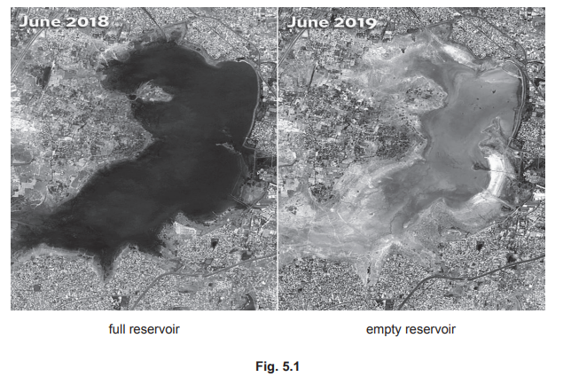

# Exam Questions — 6.1 Global Water Distribution
**6. Managing Water Supplies** · Cambridge (CIE) AS environmental-management (8291)
> Source: [https://www.savemyexams.com/as/environmental-management/cie/20/topic-questions/](https://www.savemyexams.com/as/environmental-management/cie/20/topic-questions/) · 4 questions across 1 sets

## Exam Questions (4 questions)

### Q1 — medium — 8 marks

**Q1** [5 marks]

The WRS uses a process called distillation to remove impurities from the waste water. Electricity is used to break down any organic matter. The process needs very high temperatures and pressures.

Globally, one in three people do not have access to safe drinking water.

Discuss the benefits and limitations of using the WRS to provide safe drinking water to people on Earth.

*Source: June 2023 Paper 2 Q4B*

**Q1** [3 marks]

Explain how a lack of water can lead to malnutrition.

*Source: June 2023 Paper 2 Q4D*

### Q2 — medium — 14 marks

**Q2** [4 marks]

Fig. 5.1 shows the reduction of water in the Puzhal reservoir in the Chennai area, India.

Suggest reasons for the reduction of water in the Puzhal reservoir shown in Fig. 5.1.

*Source: June 2022 Paper 1 Q5A*

**Q2** [2 marks]

Define the term water security.

*Source: June 2022 Paper 1 Q5B*

**Q2** [4 marks]

Describe two impacts of the loss of water security in the Chennai area, India.

*Source: June 2022 Paper 1 Q5C*

**Q2** [4 marks]

Describe two strategies to manage the water security in the Chennai area, India.

*Source: June 2022 Paper 1 Q5D*

### Q3 — medium — 13 marks

**Q3** [3 marks]

The mismanagement of water can affect the global distribution of water causing water insecurity.

State **three** other causes of water insecurity.

*Source: June 2023 Paper 1 Q1B*

**Q3** [4 marks]

The Intergovernmental Hydrological Programme (IHP) is a programme started by the United Nations in 1975. The IHP promotes research into water security and water management.

Describe the benefits and limitations of programmes, like the IHP, on managing global water security.

benefits..........................................................................

limitations.......................................................................

*Source: June 2023 Paper 1 Q1C*

**Q3** [6 marks]

Table 1.1 shows the volume of fresh water removed from ground water or surface sources per person, for two countries in 1970 and 2015.

**Table 1.1**

| **country** | **volume of fresh water removed per person in 1970 /m****3**** per person** | **volume of fresh water removed per person in 2015 /m****3**** per person** | **percentage change** |
|---|---|---|---|
| Denmark | 144.3 | 116.4 | –19.3 |
| South Korea | 470.6 | 605.7 |   |

(i) Calculate the percentage change in the volume of fresh water removed per person for South Korea between 1970 and 2015.

Give your answer to **one** decimal place.

percentage change = ......................................................... [2]

(ii) Suggest reasons for the change in the volume of fresh water removed per person for Denmark between 1970 and 2015.

[4]

*Source: June 2023 Paper 1 Q1DI,DII*

### Q4 — medium — 20 marks

**Q4** [20 marks]

Evaluate the success of strategies to manage water security in a location of your choice.

Give reasons and include information from relevant examples to support your answer.

*Source: Specimen 2022 Paper 1  Q7*

