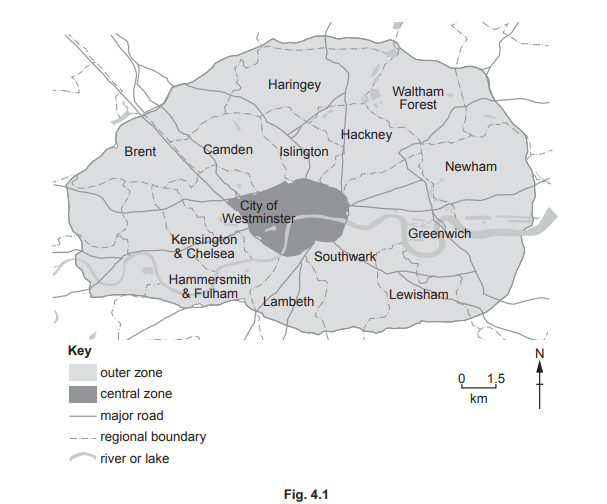

# Exam Questions — 7.3 Managing Air Pollution
**7. Managing the Atmosphere** · Cambridge (CIE) AS environmental-management (8291)
> Source: [https://www.savemyexams.com/as/environmental-management/cie/20/topic-questions/](https://www.savemyexams.com/as/environmental-management/cie/20/topic-questions/) · 2 questions across 1 sets

## Exam Questions (2 questions)

### Q1 — medium — 4 marks

**Q1** [4 marks]

Fig. 4.1 is a map showing the Ultra-Low Emission Zone for London, UK. An Ultra-Low Emission Zone is an area which restricts vehicle access in order to improve air quality

Suggest how an Ultra-Low Emission Zone works as a strategy to manage air pollution.

*Source: June 2022 Paper1 Q4B*

### Q2 — medium — 2 marks

**Q2** [2 marks]

The use of CFCs has been banned in many countries. Some alternative substances to CFCs are greenhouse gases.

Outline two possible problems when new laws on managing atmospheric pollution are introduced.

*Source: Specimen 2022 Paper 1 Q5D*

