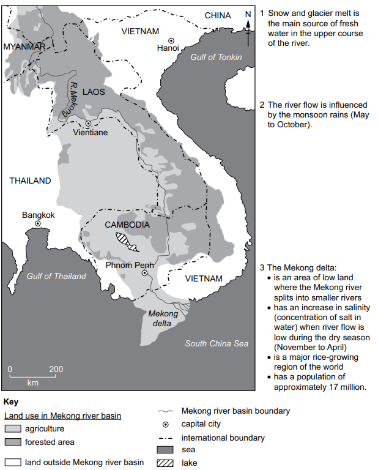
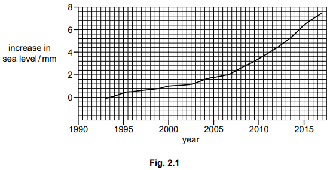

# Exam Questions — 8.2 The Impacts of Climate Change
**8. Managing Climate Change** · Cambridge (CIE) AS environmental-management (8291)
> Source: [https://www.savemyexams.com/as/environmental-management/cie/20/topic-questions/](https://www.savemyexams.com/as/environmental-management/cie/20/topic-questions/) · 3 questions across 1 sets

## Exam Questions (3 questions)

### Q1 — medium — 4 marks

**Q1** [4 marks]

Corals are very sensitive to environmental conditions.

Explain how climate change can decrease the population of staghorn corals.

*Source: June 2023 Paper 1 Q2B*

### Q2 — medium — 6 marks

**Q2** [6 marks]

Fig. 4.1 contains information about the Mekong river basin, which extends over a large area of land in southeast Asia.

**Fig 4.1**

Describe the possible impacts of climate change on the environment and on the people living in the Mekong river basin area.

Use information from the diagram in your answer.

*Source: Specimen 2022 Paper 2 Q4D*

### Q3 — medium — 2 marks

**Q3** [2 marks]

The graph in Fig. 2.1 shows the increase in sea level due to ice loss from the Antarctic ice sheet between 1993 and 2017.

Suggest an explanation for the trend shown by the data.

*Source: Specimen 2022 Paper 2 Q2B*

