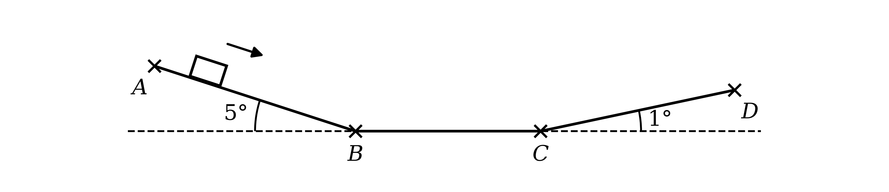

# Exam Questions — Power
**Energy, Work & Power** · Cambridge (CIE) AS maths (9709)
> Source: [https://www.savemyexams.com/as/maths/cie/20/mechanics/topic-questions/](https://www.savemyexams.com/as/maths/cie/20/mechanics/topic-questions/) · 26 questions across 1 sets

## Exam Questions (26 questions)

### Q1 — hard — 8 marks

**Q1** [3 marks]

An ambulance of mass 4500 kg travels at a constant speed of 20 $\text{m s}^{-1}$ along the route shown in the diagram. It moves down a straight road $A B$ inclined at 5° to the horizontal, then along a straight horizontal road $B C$, then up a straight road $C D$ inclined at 1° to the horizontal. On the sloping roads it moves along a line of greatest slope. The resistance to motion is $0 . 2 R$ N, where $R$ N is the normal contact force between the ambulance and the road.

Find the driving force of the engine as the ambulance moves from $A$ to $B$.

**Q1** [5 marks]

Find the power output of the engine as the ambulance moves from $C$ to $D$.

### Q2 — hard — 11 marks

**Q2** [5 marks]

A unicorn of mass 200 kg runs for 10 seconds at a constant speed of 100 $\text{m s}^{-1}$ down a straight canyon inclined at an angle $α$ to the horizontal, along a line of greatest slope from the top to the bottom. The loss in gravitational potential energy of the unicorn is 1200 kJ. The unicorn is working at a constant rate of 2.5 kW.

(i) Show that $\text{sin}  α = 0 . 6$.

(ii) Find the work done by the unicorn against non-gravitational resistances to motion.

**Q2** [6 marks]

At the bottom of the canyon, the unicorn collects six children, who sit on its back. The unicorn then runs back up the same line of greatest slope, working at a constant rate of $P$ kW, which is its maximum power. A constant resistance to motion of 500 N acts on the unicorn and the children. At the instant when the unicorn is running with speed 100 $\text{m s}^{-1}$, its acceleration is 6 $\text{m s}^{-2}$. The maximum speed of the unicorn up the canyon is 185 $\text{m s}^{-1}$.

Find

(i) the combined mass of the children,

(ii) the value of $P$.

### Q3 — very_hard — 8 marks

**Q3** [8 marks]

Two cars move in opposite directions along a line of greatest slope of a straight road inclined at an angle $θ$ to the horizontal, where $\text{cos}  θ = \frac{12}{13}$. Each car can be modelled as a particle of mass 950 kg, and a resistance to motion of magnitude $R$ N acts on each car.

At a particular instant, both cars have an acceleration of 1.2 $\text{m s}^{-2}$ in their own direction of motion. At this instant, the car moving up the road has speed 12 $\text{m s}^{-1}$ and its engine is working at a constant rate of $3 P$ W, and the car moving down the road has speed 36 $\text{m s}^{-1}$ and its engine is working at a constant rate of $P$ W.

Find the value of $R$.

### Q4 — medium — 6 marks

**Q4** [6 marks]

The engine of a car of mass 800 kg has a maximum power of 45 kW. The car travels along a straight horizontal road, and the resistance to its motion is proportional to its speed. The maximum speed of the car on this road is 36 $\text{m s}^{-1}$.

Find the acceleration of the car at the instant when its speed is 25 $\text{m s}^{-1}$ and its engine is working at maximum power.

### Q5 — very_hard — 6 marks

**Q5** [6 marks]

A crate of mass $m$ kg is pulled up a rough ramp inclined at 30° to the horizontal, along a line of greatest slope, by a rope attached to a winch. The rope is parallel to the ramp. The winch works at its maximum power, and a constant frictional force of 3040 N acts on the crate. The crate moves at a constant speed of $v_{1}$$\text{m s}^{-1}$, which is the greatest speed the winch can produce on this ramp.

The same winch then pulls the same crate up a different rough ramp inclined at 45° to the horizontal, along a line of greatest slope, again with the rope parallel to the ramp and the winch working at its maximum power. The constant frictional force on this ramp is 1000 N. The crate moves at a constant speed of $v_{2}$$\text{m s}^{-1}$, which is the greatest speed the winch can produce on this ramp.

There are no other resistances to motion. Given that $v_{2}$ is 5% greater than $v_{1}$, find the value of $m$.

### Q6 — medium — 6 marks

**Q6** [3 marks]

A road train consists of a truck and three trailers joined by light inextensible couplings. When the road train travels with speed $v$$\text{m s}^{-1}$, a resistance to motion of $100 v$ N acts on the truck and a resistance to motion of $20 v$ N acts on each of the three trailers. The maximum speed of the road train on a straight horizontal road is 30 $\text{m s}^{-1}$.

Find the maximum power of the engine.

**Q6** [3 marks]

The road train moves up a hill inclined at 5° to the horizontal, along a line of greatest slope, with the resistances to motion unchanged. The greatest speed of the road train up the hill is 20 $\text{m s}^{-1}$.

Find the total mass of the road train.

### Q7 — hard — 11 marks

**Q7** [6 marks]

A car of mass $3 m$ kg tows a trailer of mass $m$ kg along a straight horizontal road, using a light rigid tow-bar parallel to the road. A constant resistance to motion of $R$ N acts on the trailer, and a resistance to motion of `\left(R + kv\right)` N acts on the car, where $v$$\text{m s}^{-1}$ is the speed of the car and $k$ is a constant.

The greatest speed of the car and trailer on this road is 30 $\text{m s}^{-1}$, reached with the engine working at its maximum power of 48.84 kW. When the engine is working at a constant rate of 21 kW, the car and trailer move at a constant speed of 14 $\text{m s}^{-1}$.

Find

(i) the value of $k$,

(ii) the total resistance to the motion of the car and trailer, in terms of $v$.

**Q7** [5 marks]

The car now tows the trailer up a straight road inclined at an angle $α$ to the horizontal, along a line of greatest slope, where $\text{sin}  α = \frac{1}{19}$. The resistances to motion on the car and on the trailer are unchanged. The engine is working at a constant rate of 45.3 kW, and at the instant when $v = 12$ the acceleration of the car and trailer is 1.1 $\text{m s}^{-2}$.

Find the mass of the car.

### Q8 — medium — 6 marks

**Q8** [3 marks]

A train consists of an engine and five carriages, connected by couplings that can be modelled as light and inextensible. The train moves along a straight horizontal track. A constant resistance to motion of 2800 N acts on the engine and a constant resistance to motion of 500 N acts on each of the five carriages. The maximum speed of the train on the track is 35 $\text{m s}^{-1}$.

Find the maximum power of the engine.

**Q8** [3 marks]

The mass of the engine is 15000 kg and the mass of each carriage is 7000 kg. The engine is working at its maximum power.

Find the acceleration of the train at the instant when its speed is 20 $\text{m s}^{-1}$.

### Q9 — hard — 6 marks

**Q9** [2 marks]

A cyclist and bicycle have a total mass of 120 kg. The resistance to motion is $k v$ N, where $v$$\text{m s}^{-1}$ is the speed of the cyclist and $k$ is a constant. The greatest power that the cyclist can exert is 200 W, and the greatest speed of the cyclist on horizontal ground is 8 $\text{m s}^{-1}$.

Show that $k = 3 . 125$.

**Q9** [4 marks]

The cyclist now rides up a straight path inclined at an angle $α$ to the horizontal, along a line of greatest slope, where $\text{sin}  α = 0 . 1$. The resistance to motion is unchanged.

Find the greatest speed of the cyclist up the path.

### Q10 — medium — 10 marks

**Q10** [3 marks]

A car of mass 850 kg moves up a straight road inclined at an angle $θ$ to the horizontal, along a line of greatest slope, where $\text{sin}  θ = \frac{1}{50}$. The engine of the car is working at a constant rate of 12.1 kW and the car is moving at a constant speed of $v$$\text{m s}^{-1}$. The resistance to motion from non-gravitational forces is $R$ N and acts parallel to the slope.

Justifying your answer, show that

$R = \frac{12100}{v} - 170$

**Q10** [2 marks]

The car later moves down the same road, along the line of greatest slope, at the same constant speed as when it travelled up the road. The resistance to motion from non-gravitational forces is now `\left(R + 300\right)` N and the engine is working at a constant rate of $P$ kW.

Show that

$R = \frac{1000P}{v} - 130$

**Q10** [5 marks]

Given that $P = 11 . 4$, find the values of $v$ and $R$.

### Q11 — medium — 5 marks

**Q11** [5 marks]

A train of mass 90000 kg travels up a straight track inclined at 1.5° to the horizontal, along a line of greatest slope. The engine of the train works at a constant rate of $P$ W, and there is a constant resistance to motion of 2000 N. The maximum speed of the train up the slope is 20 $\text{m s}^{-1}$.

At the top of the slope the track becomes horizontal. The resistance to motion and the rate of working of the engine are unchanged.

Find

(i) the value of $P$,

(ii) the acceleration of the train at the instant when it reaches the horizontal track, travelling at 20 $\text{m s}^{-1}$.

### Q12 — hard — 8 marks

**Q12** [5 marks]

A runner of mass 65 kg works at a constant rate of $P$ W. Any resistance to motion is ignored. At an instant when the runner is moving at 4 $\text{m s}^{-1}$ on horizontal ground, the acceleration of the runner is twice the acceleration at an instant when the runner is moving at 4 $\text{m s}^{-1}$ up a road inclined at 1.5° to the horizontal, along a line of greatest slope.

Find the value of $P$.

**Q12** [3 marks]

The runner, still working at $P$ W, runs up a road inclined at 8° to the horizontal, along a line of greatest slope.

Find the acceleration of the runner at the instant when the speed is 2 $\text{m s}^{-1}$.

### Q13 — hard — 11 marks

**Q13** [5 marks]

A skateboarder moves along a straight horizontal road from the point $A$ to the point $B$ at a constant speed of $v$$\text{m s}^{-1}$, working at a constant rate of 150 W. The journey from $A$ to $B$ takes 2 minutes. The skateboarder and skateboard are modelled as a particle of mass 60 kg, and there is a constant resistance to motion of 40 N.

Find

(i) the value of $v$,

(ii) the work done by the skateboarder in moving from $A$ to $B$, and hence the distance $A B$.

**Q13** [3 marks]

At $B$ the skateboarder stops working and moves freely for 10 m until reaching the point $C$. The resistance to motion is unchanged.

Find the speed of the skateboarder at $C$.

**Q13** [3 marks]

From $C$ the skateboarder works at a constant rate of 200 W for 50 seconds, reaching the point $D$. The speed of the skateboarder at $D$ is the same as the speed at $B$, and the resistance to motion is unchanged.

Find the distance $C D$.

### Q14 — medium — 6 marks

**Q14** [3 marks]

A cyclist travels up a straight road inclined at 5° to the horizontal, along a line of greatest slope. The cyclist works at a constant rate of 300 W, and all resistances to motion can be neglected.

At the instant when the speed of the cyclist is 2 $\text{m s}^{-1}$, the acceleration is 0.5 $\text{m s}^{-2}$.

Find the total mass of the cyclist and the bicycle.

**Q14** [3 marks]

At the top of the hill the cyclist turns round and travels back down the same road, now working at a constant rate of 100 W. Resistances to motion can still be neglected.

Find the acceleration of the cyclist at the instant when the speed is 5 $\text{m s}^{-1}$.

### Q15 — medium — 4 marks

**Q15** [2 marks]

A car of mass 900 kg moves at a constant speed of 24 $\text{m s}^{-1}$ along a straight level road. There is a constant resistance to motion of magnitude 1200 N.

Find, in kW, the rate at which the engine of the car is working.

**Q15** [2 marks]

The rate of working of the engine is increased to 41.2 kW, and the car moves at a new constant speed against a resistance to motion of magnitude 1450 N.

Find the new constant speed of the car.

### Q16 — medium — 7 marks

**Q16** [3 marks]

A motorcycle and its rider have a combined mass of 250 kg and travel along a straight horizontal road. The resistance to motion is $k v$ N, where $v$$\text{m s}^{-1}$ is the speed of the motorcycle and $k$ is a constant.

Show that, when the motorcycle is travelling at a constant speed, the power $P$ W developed by the engine is given by $P = k v^{2}$. Justify your answer.

**Q16** [2 marks]

The greatest speed that the motorcycle can reach is 50 $\text{m s}^{-1}$, and the greatest power that its engine can develop is 30 kW.

Find the value of $k$.

**Q16** [2 marks]

Find the maximum speed of the motorcycle when its engine is working at a constant rate of 12 kW.

### Q17 — medium — 5 marks

**Q17** [5 marks]

A van of mass 3000 kg accelerates from rest to 23 $\text{m s}^{-1}$ in 20 seconds along a straight horizontal road, with a constant driving force.

Find the average power developed by the engine during these 20 seconds in each of the following cases.

(i) All resistances to motion are ignored.

(ii) The work done against resistances to motion is 90000 J.

### Q18 — medium — 5 marks

**Q18** [2 marks]

A bus of mass 2400 kg moves along a straight horizontal road against a constant resistance to motion of 2000 N. The maximum speed of the bus on this road is 30 $\text{m s}^{-1}$.

Find the maximum power of the engine of the bus.

**Q18** [3 marks]

The engine of the bus is working at its maximum power.

Find the acceleration of the bus at the instant when its speed is 10 $\text{m s}^{-1}$.

### Q19 — medium — 6 marks

**Q19** [3 marks]

A go-kart of mass 120 kg moves along a horizontal track against a constant resistance to motion of 410 N. The engine of the go-kart is working at a constant rate of 8 kW.

Write down the acceleration of the go-kart when it is moving at its maximum speed, and hence find this maximum speed.

**Q19** [3 marks]

At the instant when the go-kart is travelling with speed 16 $\text{m s}^{-1}$, find

(i) the driving force of the engine,

(ii) the acceleration of the go-kart.

### Q20 — medium — 6 marks

**Q20** [3 marks]

A tractor of mass 4000 kg travels along a straight horizontal road with its engine working at a constant rate of 81 kW. There is a constant resistance to motion of 1000 N. The tractor is moving with speed 9 $\text{m s}^{-1}$ at the instant that it passes a chicken at the side of the road.

Find the acceleration of the tractor as it passes the chicken.

**Q20** [3 marks]

The tractor is moving with speed $v$$\text{m s}^{-1}$ at the instant that it passes a dog. At this instant the acceleration of the tractor is 1.2 $\text{m s}^{-2}$.

Find the value of $v$, giving your answer correct to 1 decimal place.

### Q21 — medium — 3 marks

**Q21** [3 marks]

The engine of a motorcycle works at its maximum power as the motorcycle moves along a straight horizontal racetrack. There is a constant resistance to motion of 400 N, and the maximum speed of the motorcycle is 60 $\text{m s}^{-1}$.

Find the maximum power of the engine.

### Q22 — medium — 7 marks

**Q22** [2 marks]

A car of mass 700 kg is travelling down a straight road inclined at 8° to the horizontal, along a line of greatest slope. The engine of the car is working at a constant rate of 9 kW and there is a constant resistance to motion of 1300 N.

Draw a diagram to show the forces acting on the car.

**Q22** [3 marks]

At the instant when the car is travelling with speed $v$$\text{m s}^{-1}$, it has acceleration $a$$\text{m s}^{-2}$.

By considering an equation of motion, show that

$a = \frac{90-13v}{7v} + 10 \text{sin}  8 ^{\circ}$

**Q22** [2 marks]

Find the acceleration of the car at the instant when it is travelling at a speed of 10 $\text{m s}^{-1}$.

### Q23 — easy — 6 marks

**Q23** [2 marks]

A lorry of mass 27000 kg travels at a constant speed of 12 $\text{m s}^{-1}$ up a straight road inclined at 8° to the horizontal, along a line of greatest slope. The engine of the lorry is working at a constant rate of 462 kW. The driving force of the lorry is $F$ N and there is a constant resistance to motion of $R$ N.

The diagram shows some of the forces acting on the lorry.

Complete the diagram to show the weight of the lorry, its speed and its acceleration.

**Q23** [2 marks]

Show that $F = 38500$.

**Q23** [2 marks]

Find $R$.

### Q24 — easy — 6 marks

**Q24** [3 marks]

A car travels 100 m along a straight horizontal road at constant speed, taking 25 seconds. The engine of the car exerts a constant driving force of 1300 N in the direction of motion.

(i) Find the work done by the driving force.

(ii) Hence find the power developed by the engine.

**Q24** [3 marks]

By first finding the speed of the car, find the power developed by the engine without using the work done.

### Q25 — easy — 4 marks

**Q25** [2 marks]

A vehicle drives along a straight horizontal road. In a time of 10 seconds, the driving force of its engine does 75000 J of work.

Find the average power developed by the engine during these 10 seconds, giving your answer in kilowatts.

**Q25** [2 marks]

The engine continues to work at the same constant rate.

Find the work done by the engine in the next 1 minute.

### Q26 — medium — 10 marks

**Q26** [3 marks]

A lorry of mass 8000 kg is travelling along a straight horizontal road with its engine working at a constant rate of 44 kW.

By first finding the driving force, find the resistance to the motion of the lorry at the instant when its speed is 11 $\text{m s}^{-1}$ and its acceleration is 0.4 $\text{m s}^{-2}$.

**Q26** [6 marks]

The resistance to motion is constant.

(i) Find the speed of the lorry at the instant when its acceleration is 0.6 $\text{m s}^{-2}$.

(ii) Find the acceleration of the lorry at the instant when its speed is 20 $\text{m s}^{-1}$.

**Q26** [1 mark]

Use your answers to part (b) to describe the relationship between the speed and the acceleration of the lorry while its engine works at a constant rate of 44 kW.
