# Mark Schemes — Newton's Second Law
**Forces & Equilibrium** · Cambridge (CIE) AS maths (9709)

## Exam Questions (31 questions)

### Q1
Draw a force diagram for each object, with the common acceleration $a$$\text{m s}^{-2}$

For $A$, take downwards as positive and apply Newton's second law, $F = m a$

$m_{A} g - T = m_{A} a$

**[M1]**

For $B$, the vertical forces balance, so take the direction towards the pulley as positive

$T - F = m_{B} a$

**[M1 A1]**

Rearrange the equation for $B$ to make $a$ the subject

$a = \frac{T-F}{m_{B}}$

Substitute into the equation for $A$

$m_{A} g - T = \frac{m_{A}(T-F)}{m_{B}}$

**[M1]**

Multiply both sides by $m_{B}$

$m_{A} m_{B} g - m_{B} T = m_{A} T - m_{A} F$

Collect the terms in $T$ on one side

$m_{A} m_{B} g + m_{A} F = ( m_{A} + m_{B} ) T$

Factorise the left-hand side and divide by $( m_{A} + m_{B} )$

$T = \frac{m_{A}}{m_{A}+m_{B}} ( m_{B} g + F )$

**[B1]**

> **[mark-scheme]**
> **M1**: Correct use of Newton's second law for $A$, with all three terms: the weight $m_{A} g$, the tension and $m_{A} a$. Allow sign errors for this mark.
> 
> **M1**: Correct use of Newton's second law for $B$, with all three terms: the tension, the friction and $m_{B} a$. Allow sign errors for this mark.
> 
> **A1**: Both equations correct.
> 
> **M1**: Correct method to eliminate $a$ from the two equations.
> 
> **B1**: The given result, reached from correct working with every step shown.
> 
> Adding the two equations to find $a = \frac{m_{A}g-F}{m_{A}+m_{B}}$ first and substituting into either equation is equally acceptable.
The system is at rest, so the forces on each object balance

For $A$, the tension balances the weight

$T = m_{A} g$

For $B$, the friction balances the tension

$F = T$

**[M1]**

$F = m_{A} g$

**[A1]**

Substitute $F = m_{A} g$ into the expression from part (a)

$T = \frac{m_{A}}{m_{A}+m_{B}} ( m_{B} g + m_{A} g )$

Take out the common factor of $g$ from the bracket

$T = \frac{m_{A}g(m_{A}+m_{B})}{m_{A}+m_{B}} = m_{A} g$

**Final answer:** **This is the same as the tension found from the forces on A, so the expression gives the correct tension**

**[B1]**

> **[mark-scheme]**
> **M1**: Correct use of equilibrium for both objects, with the tension equal to the weight of $A$ and the friction equal to the tension.
> 
> **A1**: $F = m_{A} g$.
> 
> **B1**: Correct substitution into the expression from part (a), simplified to $m_{A} g$, with the conclusion that this matches the tension at rest.
> 
> Using the equations from part (a) with $a = 0$ is equally acceptable for the first two marks.

### Q2
The question does not say which particle moves downwards, so consider each case

Case 1: $B$ moves downwards and $A$ moves upwards

For $B$, take downwards as positive and apply Newton's second law, $F = m a$

$12 g - T = 12 \times 2$

**[M1]**

$T = 120 - 24 = 96$

**[A1]**

For $A$, take upwards as positive

$96 - m g = m \times 2$

**[M1]**

Use $g = 10$ and collect the terms in $m$

$12 m = 96$

$m = 8$

**[A1]**

Case 2: $A$ moves downwards and $B$ moves upwards

For $B$, take upwards as positive

$T - 12 g = 12 \times 2$

$T = 120 + 24 = 144$

For $A$, take downwards as positive

$m g - 144 = m \times 2$

**[M1]**

Use $g = 10$ and collect the terms in $m$

$8 m = 144$

$m = 18$

**[A1]**

> **[mark-scheme]**
> **M1**: Correct use of Newton's second law for $B$ in either case, with all three terms: the tension, the weight $12 g$ and $12 \times 2$. Allow sign errors for this mark.
> 
> **A1**: Correct tension for that case, 96 or 144.
> 
> **M1**: Correct use of Newton's second law for $A$ in the same case, with all three terms: the tension, the weight $m g$ and $2 m$. Allow sign errors for this mark.
> 
> **A1**: The correct value of $m$ for that case, 8 or 18.
> 
> **M1**: Correct equations for both particles in the other case.
> 
> **A1**: The second value of $m$.
> 
> Applying Newton's second law to the whole system in each case, $12 g - m g = ( 12 + m ) \times 2$ and $m g - 12 g = ( m + 12 ) \times 2$, is equally acceptable. A correct system equation earns the M1 and A1 for that case's value of $m$.
From part (a), the tension is 96 N when $B$ moves downwards and 144 N when $A$ moves downwards, so this is case 2

$T = 144$*, so A moves downwards*

**[M1]**

$m = 18$

**[A1]**

> **[mark-scheme]**
> **M1**: Correct identification of the case with a tension of 144 N, from the tensions found in part (a) or by forming the equation for $B$ with $T = 144$.
> 
> **A1**: $m = 18$. Follow through on the values from part (a).

### Q3
Let the rope become slack after the bucket has risen $x$ m, when its speed is $V$$\text{m s}^{-1}$. Take upwards as positive

For the first stage, use $v^{2} = u^{2} + 2 a s$ from rest over $x$ m

$V^{2} = 2 a x$

**[M1]**

For the second stage the acceleration is $- g$, and the bucket comes to rest after a further $( h - x )$ m

$0 = V^{2} - 2 g ( h - x )$

**[M1]**

Both expressions equal $V^{2}$, so equate them to find $x$

$2 a x = 2 g ( h - x )$

$( a + g ) x = g h$

$x = \frac{gh}{a+g}$

Substitute back into $V^{2} = 2 a x$

$V^{2} = \frac{2agh}{a+g}$

**[A1]**

Use $v = u + a t$ for each stage to find the times

$t_{1} = \frac{V}{a}$

$t_{2} = \frac{V}{g}$

**[M1]**

Add the two times

$T = \frac{V}{a} + \frac{V}{g} = \frac{V(a+g)}{ag}$

**[A1]**

Substitute $V = \sqrt{\frac{2agh}{a+g}}$

$T = \sqrt{\frac{2agh}{a+g}} \times \frac{a+g}{ag}$

**[M1]**

Write the factor $\frac{a+g}{ag}$ inside the square root as its square

$T = \sqrt{\frac{2agh}{a+g}\times\frac{(a+g)^{2}}{a^{2}g^{2}}}$

Cancel the common factors of $a$, $g$ and $( a + g )$

$T = \sqrt{\frac{2h(a+g)}{ag}}$

**[B1]**

> **[mark-scheme]**
> **M1**: Correct use of a constant acceleration formula for the first stage, linking the speed when the rope becomes slack to $a$ and the distance.
> 
> **M1**: Correct use of a constant acceleration formula for the second stage, with acceleration $- g$ (or deceleration $g$), final speed zero and the remaining distance.
> 
> **A1**: Correct expression for $V^{2}$ in terms of $a$, $g$ and $h$, or for $x$.
> 
> **M1**: Correct method for the time of each stage.
> 
> **A1**: Correct total time in terms of $V$, $a$ and $g$.
> 
> **M1**: Substitution of the expression for $V$ into the total time.
> 
> **B1**: The given result, reached from correct working with every step shown.
> 
> Other valid routes, such as using $s = \frac{1}{2} ( u + v ) t$ for each stage, earn the corresponding marks.
Substitute $T = 4 . 2$, $h = 30$ and $g = 10$ into the result from part (a), $T = \sqrt{\frac{2h(a+g)}{ag}}$

$4 . 2 = \sqrt{\frac{60(a+10)}{10a}}$

**[M1]**

Square both sides

$17 . 64 = \frac{6(a+10)}{a}$

Multiply by $a$ and collect the terms in $a$

$11 . 64 a = 60$

$a = 5 . 154639 \dots$

**[A1]**

Draw a force diagram for the bucket while the rope is taut

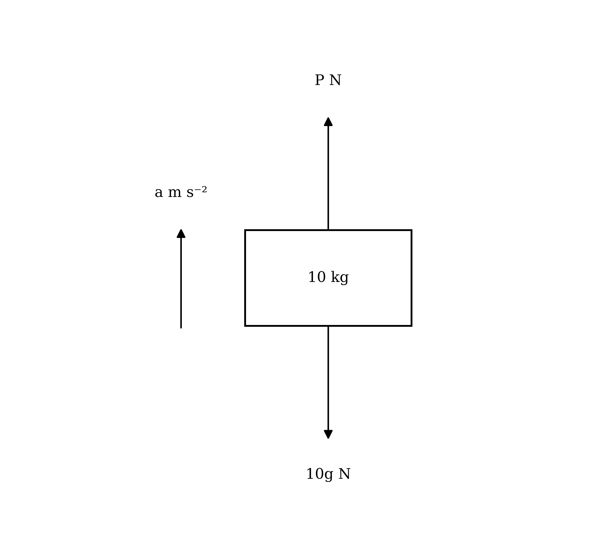

Take upwards as positive and apply Newton's second law, $F = m a$, using the unrounded acceleration

$P - 10 g = 10 \times 5 . 154639 \dots$

**[M1]**

$P = 100 + 51 . 546 \dots$

**Final answer:** $P = 152$** (3 s.f.)**

**[A1]**

> **[mark-scheme]**
> **M1**: Substitution of $T = 4 . 2$, $h = 30$ and $g = 10$ into the given formula.
> 
> **A1**: $a = 5 . 15$, or better. The exact value is $\frac{500}{97}$.
> 
> **M1**: Correct use of Newton's second law for the bucket, with all three terms: the tension, the weight $10 g$ and $10 a$. Allow sign errors for this mark.
> 
> **A1**: Answers which round to 152. Units are not required.

### Q4
Draw a force diagram for each body. Both accelerate downwards at the same rate $a$$\text{m s}^{-2}$

Everything on the rock is known except its acceleration, so start there. Take downwards as positive and apply Newton's second law, $F = m a$

$230 g - 150 - 655 = 230 a$

**[M1]**

Use $g = 10$

$1495 = 230 a$

$a = 6 . 5$

**[A1]**

The buoy also accelerates downwards at 6.5 $\text{m s}^{-2}$, and the rope pulls it downwards. Apply Newton's second law to the buoy, with downwards positive

$10 g + 655 - P = 10 \times 6 . 5$

**[M1 A1]**

$755 - P = 65$

$P = 690$

**[A1]**

> **[mark-scheme]**
> **M1**: Correct use of Newton's second law for the rock, with all four terms: the weight $230 g$, the resistance of 150 N, the tension of 655 N and $230 a$. Allow sign errors for this mark.
> 
> **A1**: $a = 6 . 5$.
> 
> **M1**: Correct use of Newton's second law for the buoy, with all four terms: the weight $10 g$, the tension of 655 N, $P$ and $10 a$. Allow sign errors for this mark.
> 
> **A1**: Correct equation for the buoy, with the tension acting downwards on it.
> 
> **A1**: $P = 690$.
> 
> Applying Newton's second law to the whole system, $240 g - 150 - P = 240 a$, in place of either equation is equally acceptable.

### Q5
To arrive in exactly 3 seconds, use $s = u t + \frac{1}{2} a t^{2}$ with $s = 100$, $u = 1 . 8$ and $t = 3$ to find the acceleration needed

$100 = 1 . 8 \times 3 + \frac{1}{2} \times a \times 3^{2}$

**[M1]**

$100 = 5 . 4 + 4 . 5 a$

$a = 21 . 0222 \dots$

**[A1]**

Draw a force diagram for the crate

Take the direction of motion as positive and apply Newton's second law, $F = m a$, to find the thrust needed for this acceleration

$T - 3200 = 4600 \times 21 . 0222 \dots$

**[M1]**

$T = 99902 . 2 \dots$

**[A1]**

Any greater acceleration needs a greater thrust, so compare this thrust with the limit of 100 kN, which is 100000 N

$99902 . 2 \dots < 100000$

**Final answer:** **The thrust needed is less than 100000 N, so the crate can reach the loading bay within 3 seconds without the rod breaking**

**[A1]**

> **[mark-scheme]**
> **M1**: Correct use of $s = u t + \frac{1}{2} a t^{2}$ with $s = 100$, $u = 1 . 8$ and $t = 3$.
> 
> **A1**: Acceleration which rounds to 21.02.
> 
> **M1**: Correct use of Newton's second law for the crate, with all three terms: the thrust, the resistance of 3200 N and $4600 a$. Allow sign errors for this mark.
> 
> **A1**: Thrust which rounds to 99900.
> 
> **A1**: Correct comparison with 100000 N and the conclusion that it is possible. Enough accuracy must be kept to show the thrust is below the limit.
> 
> Equivalent routes are equally acceptable, for example finding the greatest acceleration the rod allows, $\frac{96800}{4600} = 21 . 04 \dots$, and comparing it with the 21.02 needed, or finding the time to cover 100 m at that greatest acceleration, 2.9985 s, and comparing it with 3 s.

### Q6
With $n$ carriages attached, the tensions in the rods cancel when the whole train is treated as one system. Take the direction of motion as positive and apply Newton's second law, $F = m a$

$20000 - 3000 - 1000 n = ( 10000 + n M ) a$

**[M1]**

Substitute $n = 3$ for the acceleration $a_{3}$ with three carriages

$a_{3} = \frac{14000}{10000+3M}$

**[A1]**

Substitute $n = 4$ for the acceleration $a_{4}$ with four carriages

$a_{4} = \frac{13000}{10000+4M}$

**[A1]**

The rod to the last carriage is the only force pulling that carriage forwards. Draw a force diagram for the last carriage

Apply Newton's second law to the last carriage

$T - 1000 = M a$

$T = 1000 + M a$

**[M1]**

The difference between the two tensions is 437.8 N, and the 1000 N cancels

$M ( a_{3} - a_{4} ) = 437 . 8$

**[M1]**

Substitute the two accelerations

`M\left(\dfrac{14000}{10000 + 3M} - \dfrac{13000}{10000 + 4M}\right) = 437.8`

Multiply both sides by $( 10000 + 3 M ) ( 10000 + 4 M )$

$M ( 14000 ( 10000 + 4 M ) - 13000 ( 10000 + 3 M ) ) = 437 . 8 ( 10000 + 3 M ) ( 10000 + 4 M )$

**[M1]**

Expand both sides

$17000 M^{2} + 10000000 M = 5253 . 6 M^{2} + 30646000 M + 43780000000$

Collect all the terms on one side and divide by 1000

$11 . 7464 M^{2} - 20646 M - 43780000 = 0$

**[A1]**

Solve the quadratic. The mass must be positive, so reject the negative root

$M = 3000 . 008 \dots$

**Final answer:** $M = 3000$** (3 s.f.)**

**[A1]**

> **[mark-scheme]**
> **M1**: Correct use of Newton's second law for the whole train with a general number of carriages, or for three or four carriages directly, with the driving force, all the resistances and the total mass.
> 
> **A1**: Correct acceleration with three carriages, $\frac{14000}{10000+3M}$.
> 
> **A1**: Correct acceleration with four carriages, $\frac{13000}{10000+4M}$.
> 
> **M1**: Correct use of Newton's second law for the last carriage alone, giving the tension as $1000 + M a$.
> 
> **M1**: Correct use of the difference in tensions to form an equation in $M$.
> 
> **M1**: Correct method to clear the fractions and form a polynomial equation.
> 
> **A1**: Correct quadratic equation, in any equivalent form.
> 
> **A1**: $M = 3000$, with the negative root rejected. Answers which round to 3000 are accepted.

### Q7
The rod supports $B$, the light frame and $A$ together, so add their masses

$3 + 0 . 05 = 3 . 05 \text{kg}$

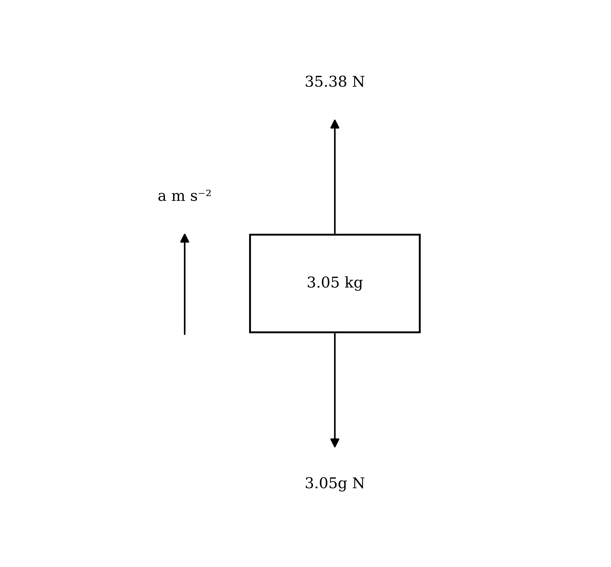

Take upwards as positive and apply Newton's second law, $F = m a$, to this system

$35 . 38 - 3 . 05 g = 3 . 05 a$

**[M1]**

Use $g = 10$

$4 . 88 = 3 . 05 a$

$a = 1 . 6$

**[A1]**

Now draw a force diagram for $A$ on its own

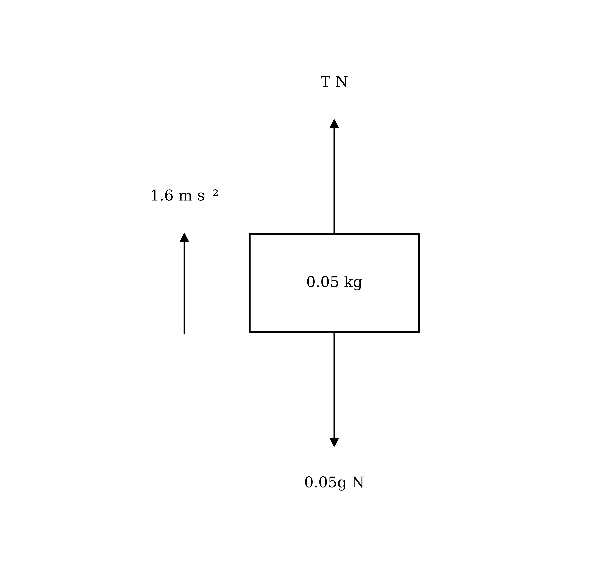

Apply Newton's second law to $A$

$T - 0 . 05 g = 0 . 05 \times 1 . 6$

**[M1]**

$T - 0 . 5 = 0 . 08$

$T = 0 . 58 \text{N}$

**[A1]**

> **[mark-scheme]**
> **M1**: Correct use of Newton's second law for $B$, the frame and $A$ together, with all three terms: the thrust of 35.38 N, the weight $3 . 05 g$ and $3 . 05 a$. Allow sign errors for this mark. Using 3 kg alone does not earn this mark.
> 
> **A1**: $a = 1 . 6$.
> 
> **M1**: Correct use of Newton's second law for $A$, with all three terms: the tension, the weight $0 . 05 g$ and $0 . 05 a$. Allow sign errors for this mark.
> 
> **A1**: 0.58. Units are not required.
The cable supports the lift car and everything inside it, so add all the masses

$250 + 3 . 05 = 253 . 05 \text{kg}$

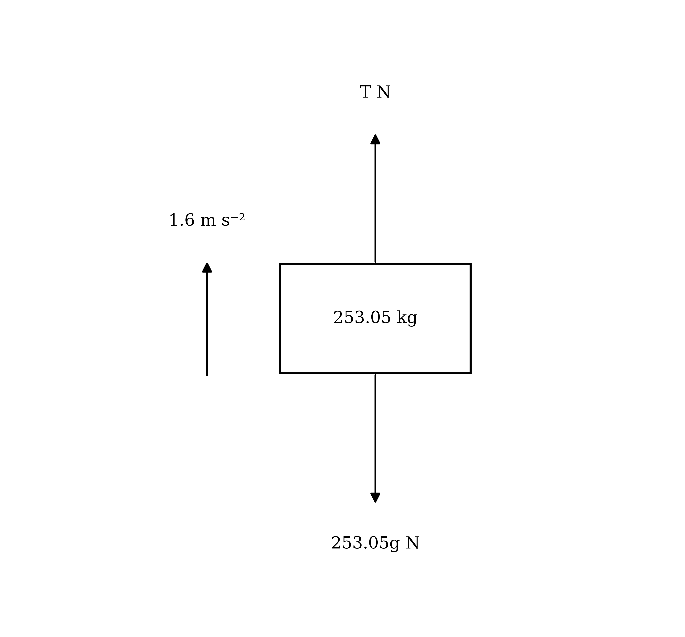

Take upwards as positive and apply Newton's second law, using $a = 1 . 6$ from part (a)

$T - 253 . 05 g = 253 . 05 \times 1 . 6$

**[M1]**

$T = 2530 . 5 + 404 . 88$

$T = 2935 . 38 \text{N}$

**[A1]**

> **[mark-scheme]**
> **M1**: Correct use of Newton's second law for the whole lift car and its contents, with all three terms: the tension, the weight $253 . 05 g$ and $253 . 05 a$. Allow sign errors for this mark. A mass of 250 kg alone does not earn this mark.
> 
> **A1**: 2935.38. Answers which round to 2940 are also accepted. Follow through on the acceleration from part (a). Units are not required.
The lift car starts from rest with constant acceleration, so use $s = u t + \frac{1}{2} a t^{2}$ with $u = 0$, $a = 1 . 6$ and $t = 3$

$s = 0 \times 3 + \frac{1}{2} \times 1 . 6 \times 3^{2}$

**[M1]**

$s = 7 . 2 \text{m}$

**[A1]**

> **[mark-scheme]**
> **M1**: Correct use of $s = u t + \frac{1}{2} a t^{2}$ with $u = 0$, $t = 3$ and the acceleration from part (a).
> 
> **A1**: 7.2. Follow through on the acceleration from part (a). Units are not required.

### Q8
The acceleration is constant, so use $v = u + a t$ with $v = 3$, $u = 0$ and $t = 2$

$3 = 0 + 2 a$

**[M1]**

$a = 1 . 5 \text{m s}^{-2}$

**[A1]**

The contact forces between the crate and the platform cancel when they are treated as one system of mass 1500 kg

Take upwards as positive and apply Newton's second law, $F = m a$, to the system

$T - 1500 g = 1500 \times 1 . 5$

**[M1]**

Use $g = 10$

$T - 15000 = 2250$

$T = 17250 \text{N}$

**[A1]**

> **[mark-scheme]**
> **M1**: Correct use of $v = u + a t$ with $v = 3$, $u = 0$ and $t = 2$.
> 
> **A1**: $a = 1 . 5$.
> 
> **M1**: Correct use of Newton's second law for the system, with all three terms: the thrust, the total weight $1500 g$ and $1500 \times 1 . 5$. Allow sign errors for this mark.
> 
> **A1**: 17250. Answers which round to 17300 are also accepted. Follow through on the acceleration. Units are not required.
Draw a force diagram for the crate on its own. The platform pushes up on it with a normal contact force $R$ N

Take upwards as positive and apply Newton's second law to the crate

$R - 1200 g = 1200 \times 1 . 5$

**[M1]**

Use $g = 10$

$R - 12000 = 1800$

$R = 13800$

**[A1]**

By Newton's third law, the crate pushes on the platform with a force of the same magnitude in the opposite direction

**Final answer:** **13800 N vertically downwards**

**[B1]**

> **[mark-scheme]**
> **M1**: Correct use of Newton's second law for the crate, with all three terms: the contact force, the weight $1200 g$ and $1200 \times 1 . 5$. Allow sign errors for this mark.
> 
> **A1**: 13800 for the force exerted on the crate by the platform.
> 
> **B1**: 13800 N acting vertically downwards, from Newton's third law. The direction is needed for this mark. Follow through on the magnitude.

### Q9
$A$ accelerates downwards and $B$ accelerates upwards, both at 6 $\text{m s}^{-2}$. Draw a force diagram for each particle

Everything on $A$ is known except the tension, so start there. Take downwards as positive and apply Newton's second law, $F = m a$

$3 g - T = 3 \times 6$

**[M1]**

Use $g = 10$

$30 - T = 18$

$T = 12$

**[A1]**

For $B$, take upwards as positive and apply Newton's second law

$12 - m g = m \times 6$

**[M1]**

Use $g = 10$

$12 - 10 m = 6 m$

Collect the terms in $m$

$16 m = 12$

$m = 0 . 75$

**[A1]**

> **[mark-scheme]**
> **M1**: Correct use of Newton's second law for $A$, with all three terms: the tension, the weight $3 g$ and $3 \times 6$. Allow sign errors for this mark.
> 
> **A1**: $T = 12$.
> 
> **M1**: Correct use of Newton's second law for $B$, with all three terms: the tension, the weight $m g$ and $6 m$. Allow sign errors for this mark.
> 
> **A1**: $m = 0 . 75$.
> 
> Applying Newton's second law to the whole system, $3 g - m g = ( 3 + m ) \times 6$, is equally acceptable. A correct system equation earns the first three marks.

### Q10
(i)

Draw a force diagram for the bundle on its own

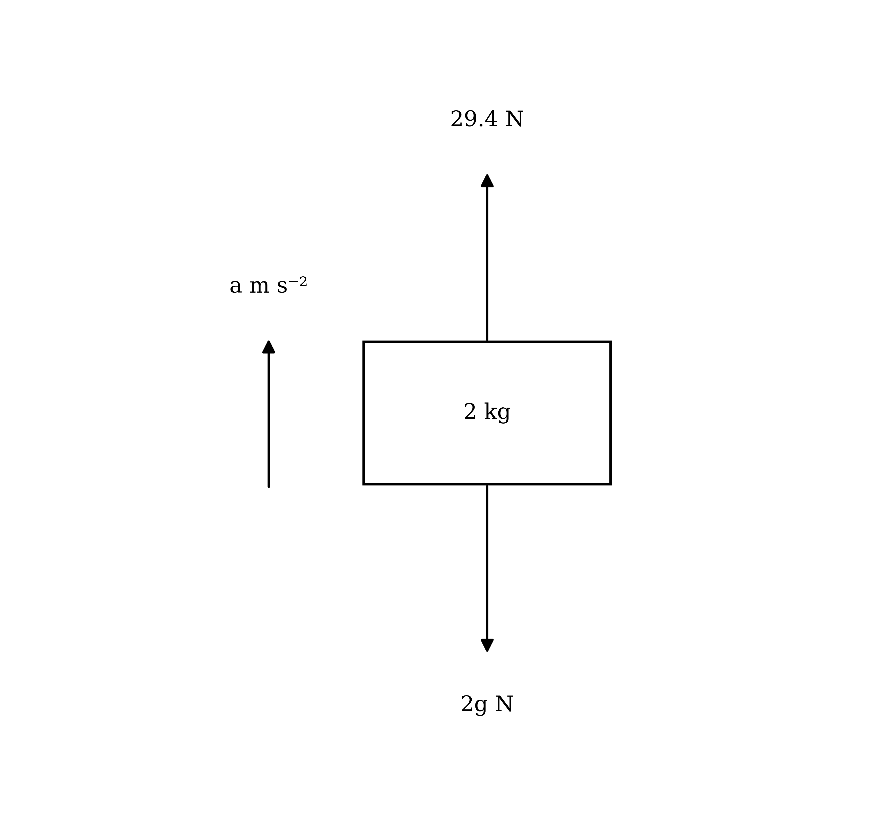

Take upwards as positive and apply Newton's second law, $F = m a$, to the bundle

$29 . 4 - 2 g = 2 a$

**[M1]**

Use $g = 10$

$9 . 4 = 2 a$

$a = 4 . 7 \text{m s}^{-2}$

**[A1]**

(ii)

Treat the balloon and bundle as one system of mass 2.6 kg, since the tension in the cable is internal to it

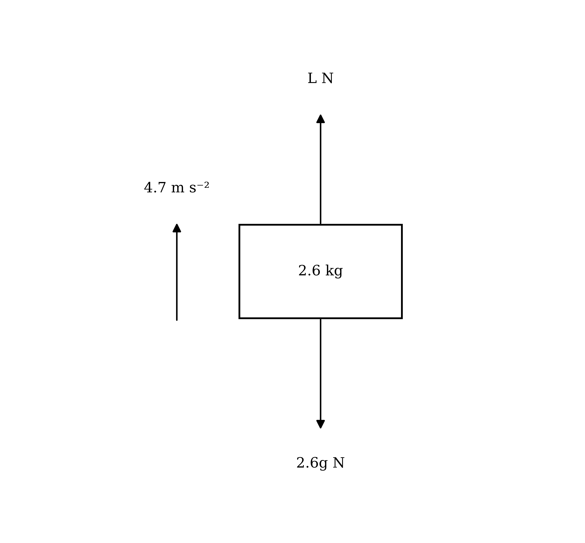

Take upwards as positive and apply Newton's second law to the system

$L - 2 . 6 g = 2 . 6 \times 4 . 7$

**[M1 A1]**

Use $g = 10$

$L - 26 = 12 . 22$

$L = 38 . 22 \text{N}$

**[A1]**

> **[mark-scheme]**
> **M1**: Correct use of Newton's second law for the bundle, with all three terms: the tension of 29.4 N, the weight $2 g$ and $2 a$. Allow sign errors for this mark.
> 
> **A1**: $a = 4 . 7$.
> 
> **M1**: Correct use of Newton's second law for the system, with all three terms: the lift, the total weight $2 . 6 g$ and $2 . 6 \times 4 . 7$, or for the balloon alone with all four terms: the lift, the weight $0 . 6 g$, the tension of 29.4 N and $0 . 6 \times 4 . 7$. Allow sign errors for this mark.
> 
> **A1**: Correct equation, $L - 2 . 6 g = 2 . 6 \times 4 . 7$ or $L - 0 . 6 g - 29 . 4 = 0 . 6 \times 4 . 7$.
> 
> **A1**: 38.22. Answers which round to 38.2 are also accepted. Follow through on the acceleration from part (i). Units are not required.

### Q11
Convert the time to seconds

$t = 3 \times 60 = 180 \text{s}$

The acceleration is constant, so use $v = u + a t$ with $u = 0 . 73$, $v = 2 . 35$ and $t = 180$

$2 . 35 = 0 . 73 + 180 a$

**[M1]**

$1 . 62 = 180 a$

$a = 0 . 009 \text{m s}^{-2}$

**[A1]**

Draw a force diagram for the barge

Convert the mass to kilograms

$2900 \text{tonnes} = 2900000 \text{kg}$

The vertical forces balance, so take the direction of motion as positive and apply Newton's second law, $F = m a$

$T - 5000 = 2900000 \times 0 . 009$

**[M1 A1]**

$T - 5000 = 26100$

$T = 31100 \text{N}$

**[A1]**

> **[mark-scheme]**
> **M1**: Correct use of $v = u + a t$ with $u = 0 . 73$, $v = 2 . 35$ and a time. The time does not need to be in seconds for this mark.
> 
> **A1**: $a = 0 . 009$, from a time of 180 s.
> 
> **M1**: Correct use of Newton's second law for the barge, with all three terms: the tension, the resistance of 5000 N and the mass times the acceleration. Allow sign errors for this mark.
> 
> **A1**: Correct equation, with the mass in kilograms, $T - 5000 = 2900000 \times 0 . 009$ or equivalent.
> 
> **A1**: 31100. Units are not required.

### Q12
The pallet starts from rest with constant acceleration, so use $s = u t + \frac{1}{2} a t^{2}$ with $s = 20$, $u = 0$ and $t = 4$

$20 = 0 \times 4 + \frac{1}{2} \times a \times 4^{2}$

**[M1]**

$20 = 8 a$

$a = 2 . 5 \text{m s}^{-2}$

**[A1]**

Draw a force diagram for the pallet. Each rope has tension $T$ N

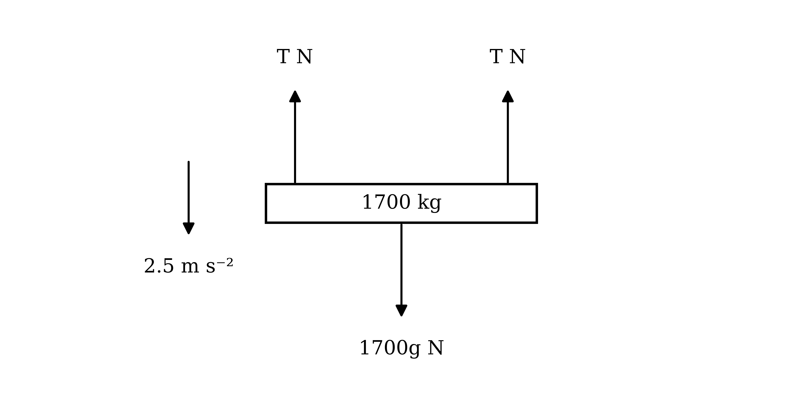

Take downwards as positive and apply Newton's second law, $F = m a$

$1700 g - 2 T = 1700 \times 2 . 5$

**[M1 A1]**

Use $g = 10$

$17000 - 2 T = 4250$

$2 T = 12750$

$T = 6375 \text{N}$

**[A1]**

> **[mark-scheme]**
> **M1**: Correct use of $s = u t + \frac{1}{2} a t^{2}$ with $s = 20$, $u = 0$ and $t = 4$.
> 
> **A1**: $a = 2 . 5$.
> 
> **M1**: Correct use of Newton's second law for the pallet, with all three terms: the total tension, the weight $1700 g$ and $1700 \times 2 . 5$. Allow sign errors for this mark.
> 
> **A1**: Correct equation with both ropes included, $1700 g - 2 T = 1700 \times 2 . 5$ or equivalent. Using a single tension $T$ for both ropes does not earn this mark.
> 
> **A1**: 6375. Answers which round to 6380 are also accepted. Follow through on the acceleration. Units are not required.
Use $s = u t + \frac{1}{2} a t^{2}$ with $s = 30$, $u = 0$ and $t = 4 . 9$ to find the acceleration

$30 = \frac{1}{2} \times a \times 4 . 9^{2}$

$a = 2 . 498958 \dots$

**[M1]**

Draw a force diagram for the pallet, now accelerating upwards

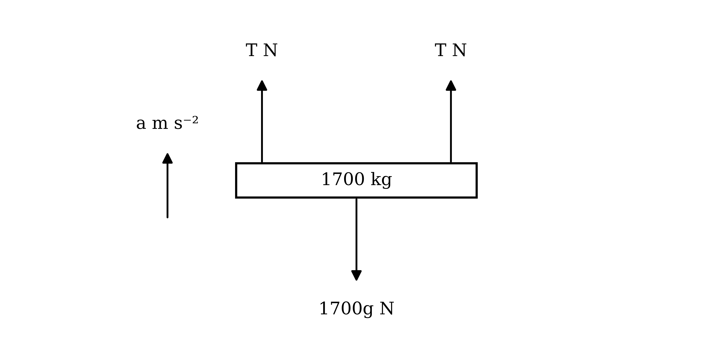

Take upwards as positive and apply Newton's second law, using the unrounded acceleration

$2 T - 1700 g = 1700 \times 2 . 498958 \dots$

**[M1]**

Use $g = 10$

$2 T = 17000 + 4248 . 229 \dots$

$T = 10624 . 11 \dots$

**[A1]**

Convert the safe limit to newtons and compare

$10 . 4 \text{kN} = 10400 \text{N}$

$10624 . 11 \dots > 10400$

**Final answer:** **The tension in each rope is more than 10400 N, so the ropes cannot be used safely with the new motor**

**[A1]**

> **[mark-scheme]**
> **M1**: Correct use of $s = u t + \frac{1}{2} a t^{2}$ with $s = 30$, $u = 0$ and $t = 4 . 9$ to find the acceleration.
> 
> **M1**: Correct use of Newton's second law for the pallet accelerating upwards, with all three terms: the total tension $2 T$, the weight $1700 g$ and $1700 a$. Allow sign errors for this mark.
> 
> **A1**: Tension in each rope which rounds to 10600.
> 
> **A1**: Correct comparison with 10400 N, or 10.4 kN, and the conclusion that the ropes cannot be used safely. Comparing a value with 10.4 without converting does not earn this mark.
> 
> An equivalent comparison, such as the total tension 21248 against the combined limit 20800 N, is equally acceptable.

### Q13
(i)

Take upwards as positive, the direction of the acceleration, and apply Newton's second law, $F = m a$

$P - 7 g = 7 \times 3$

**[M1]**

Use $g = 10$

$P - 70 = 21$

$P = 91$

**[A1]**

(ii)

Take downwards as positive. Both 48 N forces act upwards

$m g - 48 - 48 = m \times 5$

**[M1]**

Use $g = 10$

$10 m - 96 = 5 m$

Collect the terms in $m$

$5 m = 96$

$m = 19 . 2$

**[A1]**

(iii)

Take downwards as positive and apply Newton's second law

$15 g - 150 = 15 a$

**[M1]**

Use $g = 10$

$150 - 150 = 15 a$

$a = 0$

**[A1]**

> **[mark-scheme]**
> **M1**: Correct use of Newton's second law for diagram (i), with all three terms: $P$, the weight $7 g$ and $7 \times 3$. Allow sign errors for this mark.
> 
> **A1**: $P = 91$.
> 
> **M1**: Correct use of Newton's second law for diagram (ii), with all four terms: both 48 N forces, the weight $m g$ and $5 m$. Allow sign errors for this mark.
> 
> **A1**: $m = 19 . 2$.
> 
> **M1**: Correct use of Newton's second law for diagram (iii), with all three terms: the 150 N force, the weight $15 g$ and $15 a$. Allow sign errors for this mark.
> 
> **A1**: $a = 0$.
> 
> Taking the opposite direction as positive gives the same values. Units are not required.

### Q14
The thrust in the rod cancels when the two wagons are treated as one system of mass 22.4 kg

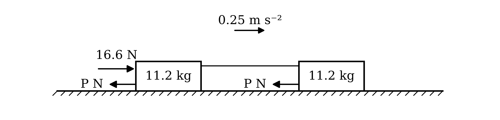

Take the direction of motion as positive and apply Newton's second law, $F = m a$, to the system

$16 . 6 - P - P = 22 . 4 \times 0 . 25$

**[M1 A1]**

$16 . 6 - 2 P = 5 . 6$

$2 P = 11$

$P = 5 . 5$

**[A1]**

> **[mark-scheme]**
> **M1**: Correct use of Newton's second law for the system, with the 16.6 N force, the resistances on both wagons and $22 . 4 \times 0 . 25$. Allow sign errors for this mark.
> 
> **A1**: Correct equation, $16 . 6 - 2 P = 22 . 4 \times 0 . 25$ or equivalent. Including only one resistance does not earn this mark.
> 
> **A1**: $P = 5 . 5$.
> 
> Applying Newton's second law to each wagon separately and eliminating the thrust is equally acceptable.
Draw a force diagram for the front wagon on its own. The rod pushes it forwards

Take the direction of motion as positive and apply Newton's second law to the front wagon, using $P = 5 . 5$ from part (a)

$T - 5 . 5 = 11 . 2 \times 0 . 25$

**[M1]**

$T - 5 . 5 = 2 . 8$

$T = 8 . 3 \text{N}$

**[A1]**

> **[mark-scheme]**
> **M1**: Correct use of Newton's second law for the front wagon, with all three terms: the thrust, the resistance and $11 . 2 \times 0 . 25$. Allow sign errors for this mark.
> 
> **A1**: 8.3. Follow through on the value of $P$ from part (a). Units are not required.
> 
> Applying Newton's second law to the rear wagon instead, $16 . 6 - T - 5 . 5 = 11 . 2 \times 0 . 25$, is equally acceptable.

### Q15
$A$ falls 1 m from rest in 0.8 s with constant acceleration, so use $s = u t + \frac{1}{2} a t^{2}$ with $s = 1$, $u = 0$ and $t = 0 . 8$

$1 = 0 \times 0 . 8 + \frac{1}{2} \times a \times 0 . 8^{2}$

**[M1]**

$1 = 0 . 32 a$

$a = 3 . 125 \text{m s}^{-2}$

**[A1]**

Draw a force diagram for each object

For $A$, take downwards as positive and apply Newton's second law, $F = m a$, to find the tension

$3 . 5 g - T = 3 . 5 \times 3 . 125$

**[M1]**

Use $g = 10$

$35 - T = 10 . 9375$

$T = 24 . 0625$

**[A1]**

For $B$, the vertical forces balance, so take the direction towards the pulley as positive

$24 . 0625 - F = 4 . 5 \times 3 . 125$

**[M1]**

$24 . 0625 - F = 14 . 0625$

$F = 10$

**[A1]**

> **[mark-scheme]**
> **M1**: Correct use of $s = u t + \frac{1}{2} a t^{2}$ with $s = 1$, $u = 0$ and $t = 0 . 8$.
> 
> **A1**: $a = 3 . 125$.
> 
> **M1**: Correct use of Newton's second law for $A$, with all three terms: the tension, the weight $3 . 5 g$ and $3 . 5 \times 3 . 125$. Allow sign errors for this mark.
> 
> **A1**: $T = 24 . 0625$, or answers which round to 24.1.
> 
> **M1**: Correct use of Newton's second law for $B$, with all three terms: the tension, the friction and $4 . 5 \times 3 . 125$. Allow sign errors for this mark.
> 
> **A1**: $F = 10$.
> 
> Applying Newton's second law to the whole system, $3 . 5 g - F = 8 \times 3 . 125$, with all three terms, is equally acceptable and earns both Newton's second law M1 marks. A correct system equation also earns the first A1 of that pair.

### Q16
$B$ is heavier, so it accelerates downwards and $A$ accelerates upwards. Draw a force diagram for each particle

For $B$, take downwards as positive and apply Newton's second law, $F = m a$

$9 g - T = 9 a$

**[M1]**

For $A$, take upwards as positive and apply Newton's second law

$T - 6 g = 6 a$

**[A1]**

Add the two equations to eliminate $T$

$3 g = 15 a$

Use $g = 10$

$30 = 15 a$

$a = 2 \text{m s}^{-2}$

**[A1]**

Substitute $a = 2$ into $T - 6 g = 6 a$

$T - 60 = 12$

$T = 72 \text{N}$

**[A1]**

> **[mark-scheme]**
> **M1**: Correct use of Newton's second law for either particle, with all three terms: the tension, that particle's weight and its mass times $a$. Allow sign errors for this mark.
> 
> **A1**: Both equations correct, $9 g - T = 9 a$ and $T - 6 g = 6 a$, or equivalent.
> 
> **A1**: $a = 2$.
> 
> **A1**: $T = 72$. Follow through on the value of $a$.
> 
> Applying Newton's second law to the whole system, $9 g - 6 g = 15 a$, is equally acceptable for finding $a$. The acceleration and the tension are marked independently. Units are not required.

### Q17
(i)

Take downwards as positive, the direction of the acceleration, and apply Newton's second law, $F = m a$

$4 g - P = 4 \times 2$

**[M1]**

Use $g = 10$

$40 - P = 8$

$P = 32$

**[A1]**

(ii)

Take downwards as positive and apply Newton's second law

$m g - 70 = m \times 6$

**[M1]**

Use $g = 10$

$10 m - 70 = 6 m$

Collect the terms in $m$

$4 m = 70$

$m = 17 . 5$

**[A1]**

(iii)

Take downwards as positive and apply Newton's second law

$10 g - 88 = 10 a$

**[M1]**

Use $g = 10$

$100 - 88 = 10 a$

$a = 1 . 2$

**[A1]**

> **[mark-scheme]**
> **M1**: Correct use of Newton's second law for diagram (i), with all three terms: $P$, the weight $4 g$ and $4 \times 2$. Allow sign errors for this mark.
> 
> **A1**: $P = 32$.
> 
> **M1**: Correct use of Newton's second law for diagram (ii), with all three terms: the 70 N force, the weight $m g$ and $6 m$. Allow sign errors for this mark.
> 
> **A1**: $m = 17 . 5$.
> 
> **M1**: Correct use of Newton's second law for diagram (iii), with all three terms: the 88 N force, the weight $10 g$ and $10 a$. Allow sign errors for this mark.
> 
> **A1**: $a = 1 . 2$.
> 
> Taking upwards as positive gives the same values. Units are not required.

### Q18
Find the total mass of the two blocks

$0 . 7 + 0 . 9 = 1 . 6 \text{kg}$

The scale-pan is light, so treat it with both blocks as one system of mass 1.6 kg

Take upwards as positive and apply Newton's second law, $F = m a$, to the system

$T - 1 . 6 g = 1 . 6 \times 0 . 5$

**[M1 A1]**

Use $g = 10$

$T - 16 = 0 . 8$

$T = 16 . 8 \text{N}$

**[A1]**

> **[mark-scheme]**
> **M1**: Correct use of Newton's second law for the whole system, with all three terms: the tension, the total weight and the total mass times 0.5. Allow sign errors for this mark.
> 
> **A1**: Correct equation, $T - 1 . 6 g = 1 . 6 \times 0 . 5$ or equivalent.
> 
> **A1**: 16.8. Units are not required.
Draw a force diagram for $A$ on its own. $B$ pushes up on $A$ with a normal contact force $R$ N

Take upwards as positive and apply Newton's second law to $A$

$R - 0 . 7 g = 0 . 7 \times 0 . 5$

**[M1]**

Use $g = 10$

$R - 7 = 0 . 35$

$R = 7 . 35 \text{N}$

**[A1]**

> **[mark-scheme]**
> **M1**: Correct use of Newton's second law for $A$, with all three terms: the contact force, the weight $0 . 7 g$ and $0 . 7 \times 0 . 5$. Allow sign errors for this mark.
> 
> **A1**: 7.35. Units are not required.
By Newton's third law, $A$ pushes on $B$ with a force equal in magnitude and opposite in direction to the force from part (b)

**Final answer:** **7.35 N vertically downwards**

**[B1]**

> **[mark-scheme]**
> **B1**: 7.35 N acting vertically downwards. Both the magnitude and the direction are needed. Follow through on the value from part (b).
Draw a force diagram for $B$, with $S$ N from the scale-pan and the 7.35 N from part (c)

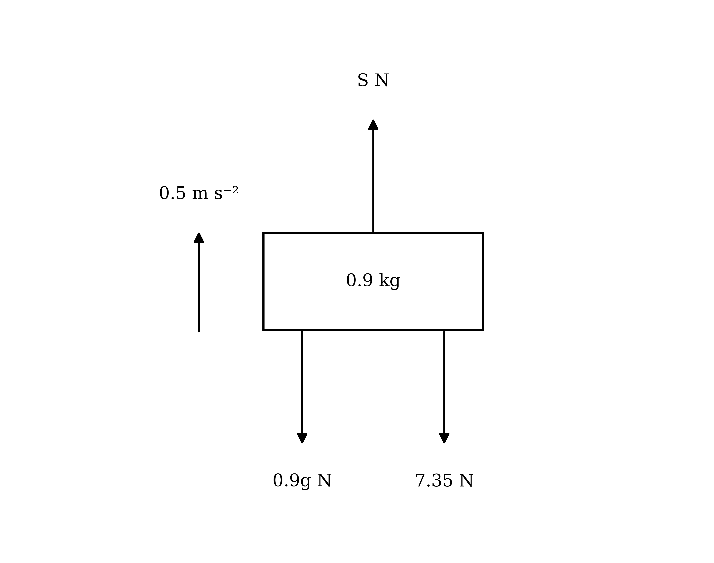

Take upwards as positive and apply Newton's second law to $B$

$S - 0 . 9 g - 7 . 35 = 0 . 9 \times 0 . 5$

**[M1]**

Use $g = 10$

$S - 16 . 35 = 0 . 45$

$S = 16 . 8 \text{N}$

**[A1]**

> **[mark-scheme]**
> **M1**: Correct use of Newton's second law for $B$, with all four terms: the force from the scale-pan, the weight $0 . 9 g$, the force of 7.35 N from $A$ and $0 . 9 \times 0 . 5$. Allow sign errors for this mark. Follow through on the value from part (b).
> 
> **A1**: 16.8. Units are not required.
> 
> Using the fact that the scale-pan is light, so that the force on $B$ equals the tension from part (a), is equally acceptable for both marks.

### Q19
The thrust in the rod cancels when the locomotive and carriage are treated as one system of mass 9000 kg

Take the direction of motion as positive and apply Newton's second law, $F = m a$, to the system

$15000 - 2300 - 1000 = 9000 a$

**[M1 A1]**

$11700 = 9000 a$

$a = 1 . 3 \text{m s}^{-2}$

**[A1]**

> **[mark-scheme]**
> **M1**: Correct use of Newton's second law for the system, with the driving force, both resistances and $9000 a$. Allow sign errors for this mark.
> 
> **A1**: Correct equation, $15000 - 3300 = 9000 a$ or equivalent.
> 
> **A1**: $a = 1 . 3$. Units are not required.
> 
> Applying Newton's second law to the locomotive and to the carriage separately and solving simultaneously is equally acceptable.
Draw a force diagram for the carriage on its own. The rod pushes it in the direction of motion

Take the direction of motion as positive and apply Newton's second law to the carriage, using $a = 1 . 3$ from part (a)

$T - 1000 = 2000 \times 1 . 3$

**[M1]**

$T - 1000 = 2600$

$T = 3600 \text{N}$

**[A1]**

> **[mark-scheme]**
> **M1**: Correct use of Newton's second law for the carriage, with all three terms: the thrust, the resistance of 1000 N and $2000 \times 1 . 3$. Allow sign errors for this mark.
> 
> **A1**: 3600. Follow through on the acceleration from part (a). Units are not required.
> 
> Applying Newton's second law to the locomotive instead, $15000 - T - 2300 = 7000 \times 1 . 3$, is equally acceptable.

### Q20
Treat $A$ and $B$ as one system of mass 20 kg, since the tension acts on each particle in opposite directions and cancels

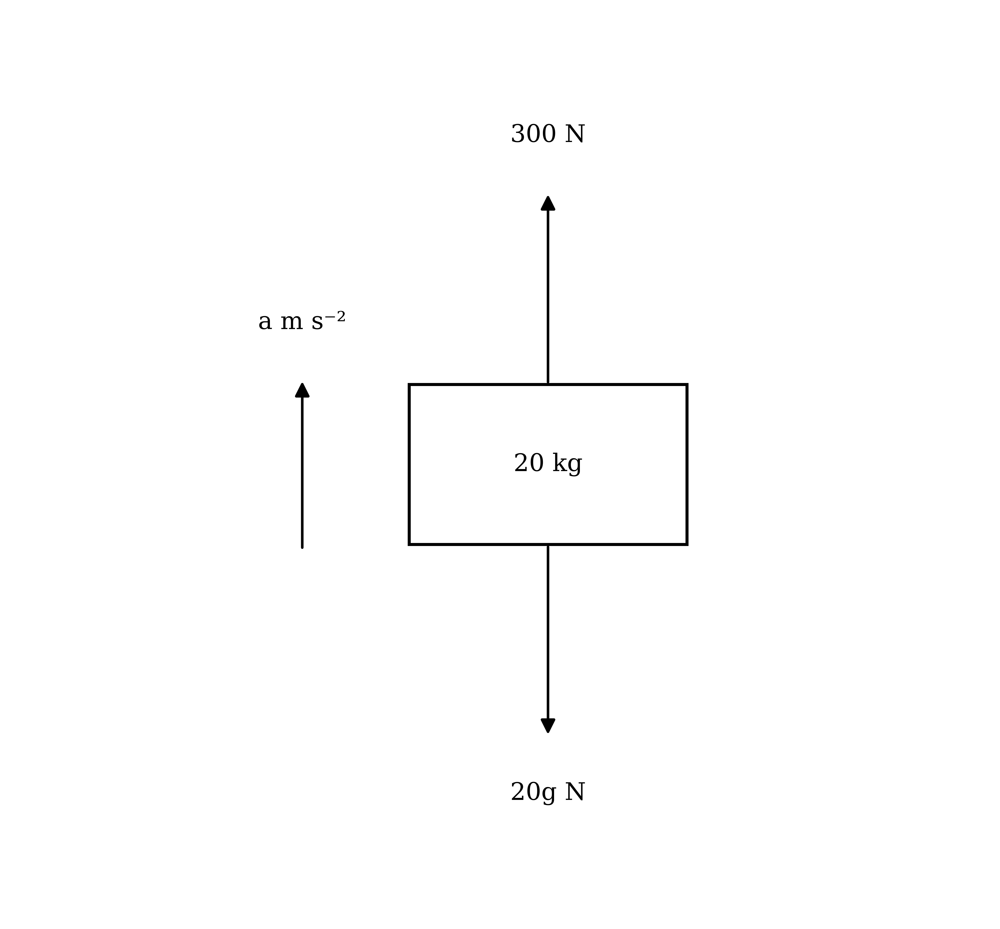

Take upwards as positive and apply Newton's second law, $F = m a$, to the system

$300 - 20 g = 20 a$

**[M1 A1]**

Use $g = 10$

$300 - 200 = 20 a$

$a = 5 \text{m s}^{-2}$

**[A1]**

> **[mark-scheme]**
> **M1**: Correct use of Newton's second law for the system, with all three terms: the 300 N force, the total weight $20 g$ and $20 a$. Allow sign errors for this mark.
> 
> **A1**: Correct equation, $300 - 20 g = 20 a$ or equivalent.
> 
> **A1**: $a = 5$. Units are not required.
> 
> Applying Newton's second law to $A$ and to $B$ separately, $300 - T - 5 g = 5 a$ and $T - 15 g = 15 a$, and solving simultaneously is equally acceptable. In that case the M1 is for either equation with all three of its terms, and the first A1 is for both equations correct.
Draw a force diagram for $B$ on its own

Take upwards as positive and apply Newton's second law to $B$, using $a = 5$ from part (a)

$T - 15 g = 15 \times 5$

**[M1]**

Use $g = 10$

$T - 150 = 75$

$T = 225 \text{N}$

**[A1]**

> **[mark-scheme]**
> **M1**: Correct use of Newton's second law for $B$, with all three terms: the tension, the weight $15 g$ and $15 \times 5$. Allow sign errors for this mark.
> 
> **A1**: 225. Follow through on the acceleration from part (a). Units are not required.
> 
> Applying Newton's second law to $A$ instead, $300 - T - 5 g = 5 \times 5$, is equally acceptable.

### Q21
Draw a force diagram for each object. $A$ accelerates downwards and $B$ accelerates towards the pulley

For $A$, take downwards as positive and apply Newton's second law, $F = m a$

$g - T = a$

**[M1]**

For $B$, the vertical forces balance, so take the direction towards the pulley as positive

$T - 7 . 6 = 2 a$

**[A1]**

Add the two equations to eliminate $T$

$g - 7 . 6 = 3 a$

Use $g = 10$

$10 - 7 . 6 = 3 a$

$a = 0 . 8 \text{m s}^{-2}$

**[A1]**

Substitute $a = 0 . 8$ into $T - 7 . 6 = 2 a$

$T - 7 . 6 = 1 . 6$

$T = 9 . 2 \text{N}$

**[A1]**

> **[mark-scheme]**
> **M1**: Correct use of Newton's second law for either object, with all three of its terms. Allow sign errors for this mark.
> 
> **A1**: Both equations correct, $g - T = a$ and $T - 7 . 6 = 2 a$, or equivalent.
> 
> **A1**: $a = 0 . 8$.
> 
> **A1**: $T = 9 . 2$. Follow through on the value of $a$.
> 
> Applying Newton's second law to the whole system, $g - 7 . 6 = 3 a$, is equally acceptable for finding $a$. Units are not required.
Use $v = u + a t$ with $u = 0$, $a = 0 . 8$ and $t = 1 . 5$ to find the speed of $B$ when $A$ reaches the ground

$v = 0 + 0 . 8 \times 1 . 5 = 1 . 2$

**[M1]**

Once $A$ is on the ground the string is slack, so friction is now the only horizontal force on $B$

Take the direction towards the pulley as positive and apply Newton's second law to $B$

$- 7 . 6 = 2 a$

$a = - 3 . 8$

**[M1]**

Use $v^{2} = u^{2} + 2 a s$ with $v = 0$, $u = 1 . 2$ and $a = - 3 . 8$ to find the distance $B$ would travel before stopping

$0 = 1 . 2^{2} - 2 \times 3 . 8 \times s$

$s = 0 . 18947 \dots \text{m}$

**[M1]**

The distance to the pulley is 14 cm, which is 0.14 m

$0 . 189 \dots > 0 . 14$

**Final answer:** **B reaches the pulley before it comes to rest**

**[A1]**

> **[mark-scheme]**
> **M1**: Correct use of a constant acceleration formula to find the speed of $B$ when $A$ reaches the ground, with the acceleration from part (a).
> 
> **M1**: Correct use of Newton's second law for $B$ with the tension zero, giving a deceleration of 3.8. Allow sign errors for this mark.
> 
> **M1**: Correct use of $v^{2} = u^{2} + 2 a s$ with a final speed of zero, to find the stopping distance.
> 
> **A1**: Stopping distance 0.189 m, or 18.9 cm, compared with 0.14 m or 14 cm, and the conclusion that $B$ reaches the pulley.
> 
> Using the work-energy principle, $\frac{1}{2} \times 2 \times 1 . 2^{2} = 7 . 6 s$, to find the stopping distance is equally acceptable for the second and third M1 marks. Comparing the speed of $B$ after 14 cm with zero is also acceptable.

### Q22
The singer starts from rest with constant acceleration, so use $s = u t + \frac{1}{2} a t^{2}$ with $s = 3$, $u = 0$ and $t = 2$

$3 = 0 \times 2 + \frac{1}{2} \times a \times 2^{2}$

**[M1]**

$3 = 2 a$

$a = 1 . 5 \text{m s}^{-2}$

**[A1]**

> **[mark-scheme]**
> **M1**: Correct use of $s = u t + \frac{1}{2} a t^{2}$ with $s = 3$, $u = 0$ and $t = 2$.
> 
> **A1**: $a = 1 . 5$. Units are not required.
Draw a force diagram for the singer while accelerating upwards

Take upwards as positive and apply Newton's second law, $F = m a$, using $a = 1 . 5$ from part (a)

$T - 54 g = 54 \times 1 . 5$

**[M1]**

Use $g = 10$

$T - 540 = 81$

$T = 621 \text{N}$

**[A1]**

> **[mark-scheme]**
> **M1**: Correct use of Newton's second law for the singer, with all three terms: the tension, the weight $54 g$ and $54 \times 1 . 5$. Allow sign errors for this mark. The weight must include $g$.
> 
> **A1**: 621. Follow through on the acceleration from part (a). Units are not required.
Draw a force diagram for the singer while accelerating downwards

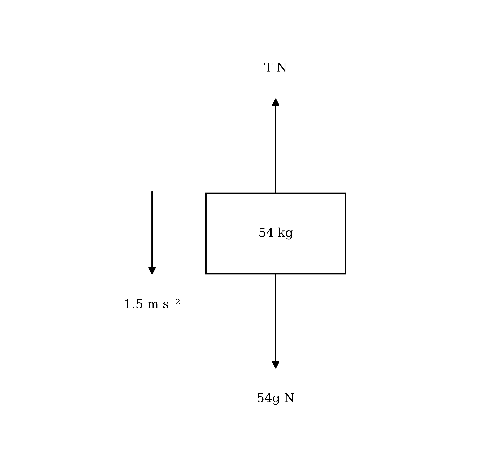

The acceleration is now downwards, so take downwards as positive and apply Newton's second law

$54 g - T = 54 \times 1 . 5$

**[M1]**

Use $g = 10$

$540 - T = 81$

$T = 459 \text{N}$

**[A1]**

> **[mark-scheme]**
> **M1**: Correct use of Newton's second law for the singer with the acceleration downwards, with all three terms: the tension, the weight $54 g$ and $54 \times 1 . 5$. Allow sign errors for this mark. The weight must include $g$.
> 
> **A1**: 459. Follow through on the acceleration from part (a). Units are not required.

### Q23
The cart starts from rest with constant acceleration, so use $v = u + a t$ with $v = 2$, $u = 0$ and $t = 5$

$2 = 0 + 5 a$

**[M1]**

$a = 0 . 4 \text{m s}^{-2}$

**[A1]**

> **[mark-scheme]**
> **M1**: Correct use of $v = u + a t$ with $v = 2$, $u = 0$ and $t = 5$.
> 
> **A1**: $a = 0 . 4$. Units are not required.
Draw a force diagram for the cart

The vertical forces balance, so take the direction of motion as positive and apply Newton's second law, $F = m a$, to the horizontal forces

$T - 2 = 15 \times 0 . 4$

**[M1]**

$T - 2 = 6$

$T = 8 \text{N}$

**[A1]**

> **[mark-scheme]**
> **M1**: Correct use of Newton's second law along the path, with all three terms: the tension, the resistance of 2 N and $15 \times 0 . 4$. Allow sign errors for this mark.
> 
> **A1**: 8. Follow through on the acceleration from part (a). Units are not required.

### Q24
The sled starts from rest with constant acceleration, so use $v = u + a t$ with $v = 1 . 5$, $u = 0$ and $t = 6$

$1 . 5 = 0 + 6 a$

**[M1]**

$a = 0 . 25 \text{m s}^{-2}$

**[A1]**

> **[mark-scheme]**
> **M1**: Correct use of $v = u + a t$ with $v = 1 . 5$, $u = 0$ and $t = 6$.
> 
> **A1**: $a = 0 . 25$. Units are not required.
Draw a force diagram for the sled

The vertical forces balance, so take the direction of motion as positive and apply Newton's second law, $F = m a$, to the horizontal forces

$T - 3 . 2 = 5 . 6 \times 0 . 25$

**[M1]**

$T - 3 . 2 = 1 . 4$

$T = 4 . 6 \text{N}$

**[A1]**

> **[mark-scheme]**
> **M1**: Correct use of Newton's second law along the path, with all three terms: the tension, the resistance of 3.2 N and $5 . 6 \times 0 . 25$. Allow sign errors for this mark.
> 
> **A1**: 4.6. Follow through on the acceleration from part (a). Units are not required.

### Q25
Draw a force diagram for each particle. $A$ accelerates downwards and $B$ accelerates upwards

For $A$, take downwards as positive (its direction of motion) and apply Newton's second law, $F = m a$

$5 g - T = 5 a$

**[B1]**

For $B$, take upwards as positive (its direction of motion) and apply Newton's second law

$T - 3 g = 3 a$

**[B1]**

> **[mark-scheme]**
> **B1**: $5 g - T = 5 a$, or equivalent, for $A$.
> 
> **B1**: $T - 3 g = 3 a$, or equivalent, for $B$.
> 
> Equations with $g = 10$ already substituted, such as $50 - T = 5 a$, or with the opposite direction taken as positive for a particle, are equally acceptable.
Add the two equations, $5 g - T = 5 a$ and $T - 3 g = 3 a$, to eliminate $T$

$5 g - 3 g = 8 a$

**[M1]**

Use $g = 10$

$20 = 8 a$

$a = 2 . 5$

**[A1]**

Substitute $a = 2 . 5$ into $T - 3 g = 3 a$

$T - 30 = 7 . 5$

$T = 37 . 5$

**[A1]**

> **[mark-scheme]**
> **M1**: Correct method to eliminate $T$ (or $a$) from the two equations.
> 
> **A1**: $a = 2 . 5$.
> 
> **A1**: $T = 37 . 5$. Follow through on the value of $a$.
> 
> Units are not required.

### Q26
The thrust in the rod acts on each carriage in opposite directions, so it cancels when the two carriages are treated as one system of mass 6000 kg

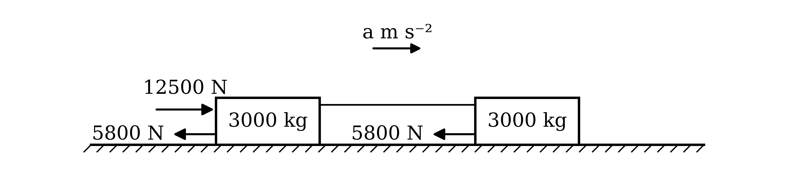

Take the direction of motion as positive and apply Newton's second law, $F = m a$, to the system

$12500 - 5800 - 5800 = 6000 a$

**[M1 A1]**

$900 = 6000 a$

$a = 0 . 15 \text{m s}^{-2}$

**[A1]**

> **[mark-scheme]**
> **M1**: Correct use of Newton's second law for the system, with the 12500 N force, the resistances on both carriages and $6000 a$. Allow sign errors for this mark.
> 
> **A1**: Correct equation, $12500 - 11600 = 6000 a$ or equivalent.
> 
> **A1**: $a = 0 . 15$. Units are not required.
> 
> Applying Newton's second law to each carriage separately and solving the two equations simultaneously is equally acceptable and earns the same marks.
Draw a force diagram for the front carriage on its own. The rod pushes it forwards

Take the direction of motion as positive and apply Newton's second law to the front carriage, using $a = 0 . 15$ from part (a)

$T - 5800 = 3000 \times 0 . 15$

**[M1]**

$T - 5800 = 450$

$T = 6250 \text{N}$

**[A1]**

> **[mark-scheme]**
> **M1**: Correct use of Newton's second law for the front carriage, with all three terms: the thrust, the resistance of 5800 N and $3000 \times 0 . 15$. Allow sign errors for this mark.
> 
> **A1**: 6250. Follow through on the acceleration from part (a). Units are not required.
> 
> Applying Newton's second law to the rear carriage instead, $12500 - T - 5800 = 3000 \times 0 . 15$, is equally acceptable.

### Q27
(i)

Take downwards as positive, the direction of the acceleration, and apply Newton's second law

$10 g - P = 10 \times 7$

**[M1]**

Use $g = 10$

$100 - P = 70$

$P = 30$

**[A1]**

(ii)

Take downwards as positive and apply Newton's second law

$m g - 40 = m \times 2$

**[M1]**

Use $g = 10$

$10 m - 40 = 2 m$

Collect the terms in $m$

$8 m = 40$

$m = 5$

**[A1]**

(iii)

Take downwards as positive and apply Newton's second law

$5 g - 42 = 5 a$

**[M1]**

Use $g = 10$

$50 - 42 = 5 a$

$a = 1 . 6$

**[A1]**

> **[mark-scheme]**
> **M1**: Correct use of Newton's second law for diagram (i), with all three terms: $P$, the weight $10 g$ and $10 \times 7$. Allow sign errors for this mark.
> 
> **A1**: $P = 30$.
> 
> **M1**: Correct use of Newton's second law for diagram (ii), with all three terms: the 40 N force, the weight $m g$ and $2 m$. Allow sign errors for this mark.
> 
> **A1**: $m = 5$.
> 
> **M1**: Correct use of Newton's second law for diagram (iii), with all three terms: the 42 N force, the weight $5 g$ and $5 a$. Allow sign errors for this mark.
> 
> **A1**: $a = 1 . 6$.
> 
> Taking upwards as positive gives the same values. Units are not required.

### Q28
The pallet starts from rest with constant acceleration, so use $s = u t + \frac{1}{2} a t^{2}$ with $s = 18$, $u = 0$ and $t = 10$

$18 = 0 \times 10 + \frac{1}{2} \times a \times 10^{2}$

**[M1]**

$18 = 50 a$

$a = 0 . 36 \text{m s}^{-2}$

**[A1]**

> **[mark-scheme]**
> **M1**: Correct use of $s = u t + \frac{1}{2} a t^{2}$ with $s = 18$, $u = 0$ and $t = 10$.
> 
> **A1**: $a = 0 . 36$. Units are not required.
Draw a force diagram for the pallet while it accelerates upwards

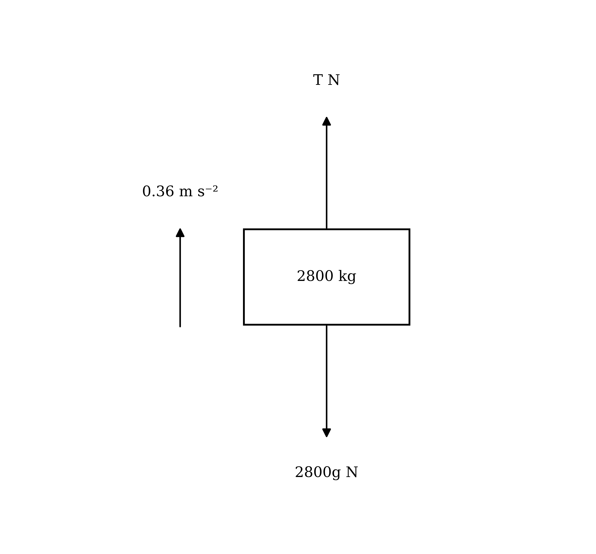

Take upwards as positive and apply Newton's second law, $F = m a$, using $a = 0 . 36$ from part (a)

$T - 2800 g = 2800 \times 0 . 36$

**[M1]**

Use $g = 10$

$T - 28000 = 1008$

$T = 29008 \text{N}$

**[A1]**

> **[mark-scheme]**
> **M1**: Correct use of Newton's second law for the pallet, with all three terms: the tension, the weight $2800 g$ and $2800 \times 0 . 36$. Allow sign errors for this mark. The weight must include $g$.
> 
> **A1**: 29008. Answers which round to 29000 are also accepted. Follow through on the acceleration from part (a). Units are not required.
Draw a force diagram for the pallet while it accelerates downwards

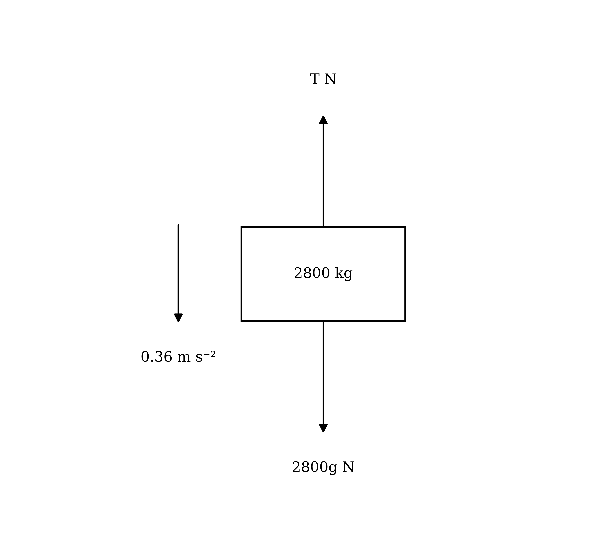

The acceleration is now downwards, so take downwards as positive and apply Newton's second law

$2800 g - T = 2800 \times 0 . 36$

**[M1]**

Use $g = 10$

$28000 - T = 1008$

$T = 26992 \text{N}$

**[A1]**

> **[mark-scheme]**
> **M1**: Correct use of Newton's second law for the pallet with the acceleration downwards, with all three terms: the tension, the weight $2800 g$ and $2800 \times 0 . 36$. Allow sign errors for this mark. The weight must include $g$.
> 
> **A1**: 26992. Answers which round to 27000 are also accepted. Follow through on the acceleration from part (a). Units are not required.

### Q29
The contact forces between the block and the platform cancel when the two are treated as one system of mass 5 kg

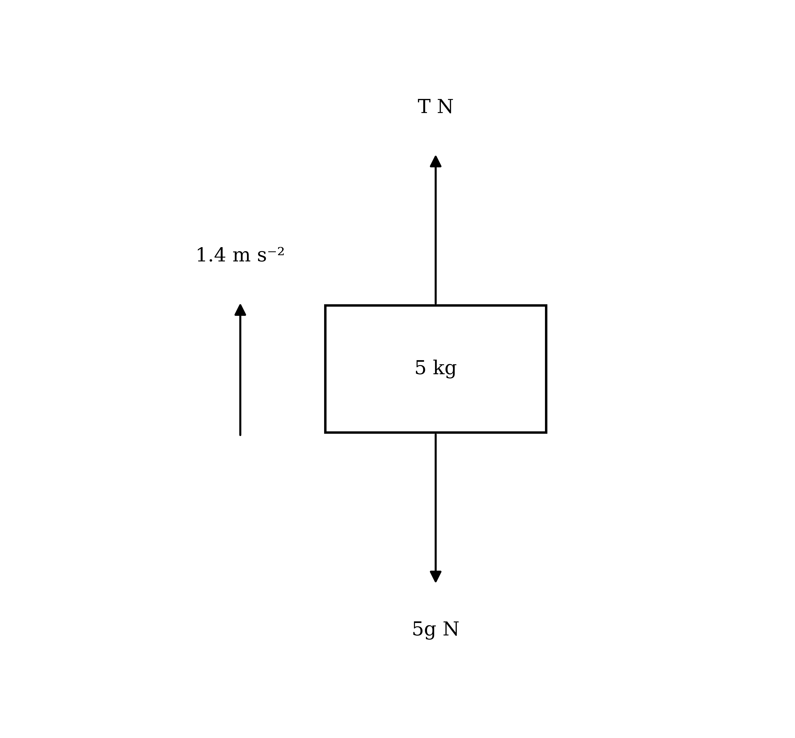

Take upwards as positive and apply Newton's second law, $F = m a$, to the system

$T - 5 g = 5 \times 1 . 4$

**[M1 A1]**

Use $g = 10$

$T - 50 = 7$

$T = 57 \text{N}$

**[A1]**

> **[mark-scheme]**
> **M1**: Correct use of Newton's second law for the system, with all three terms: the thrust, the total weight $5 g$ and $5 \times 1 . 4$. Allow sign errors for this mark.
> 
> **A1**: Correct equation, $T - 5 g = 5 \times 1 . 4$ or equivalent.
> 
> **A1**: 57. Units are not required.
Draw a force diagram for the block on its own. The platform pushes up on it with a normal contact force $R$ N

Take upwards as positive and apply Newton's second law to the block

$R - 4 g = 4 \times 1 . 4$

**[M1]**

Use $g = 10$

$R - 40 = 5 . 6$

$R = 45 . 6 \text{N}$

**[A1]**

> **[mark-scheme]**
> **M1**: Correct use of Newton's second law for the block, with all three terms: the contact force, the weight $4 g$ and $4 \times 1 . 4$. Allow sign errors for this mark.
> 
> **A1**: 45.6. Units are not required.
By Newton's third law, the block pushes on the platform with a force equal in magnitude and opposite in direction to the force from part (b)

**Final answer:** **45.6 N vertically downwards**

**[B1]**

> **[mark-scheme]**
> **B1**: 45.6 N acting vertically downwards. Both the magnitude and the direction are needed. Follow through on the value from part (b).

### Q30
The tension acts on each particle in opposite directions, so it cancels when $A$ and $B$ are treated as one system of mass 10 kg

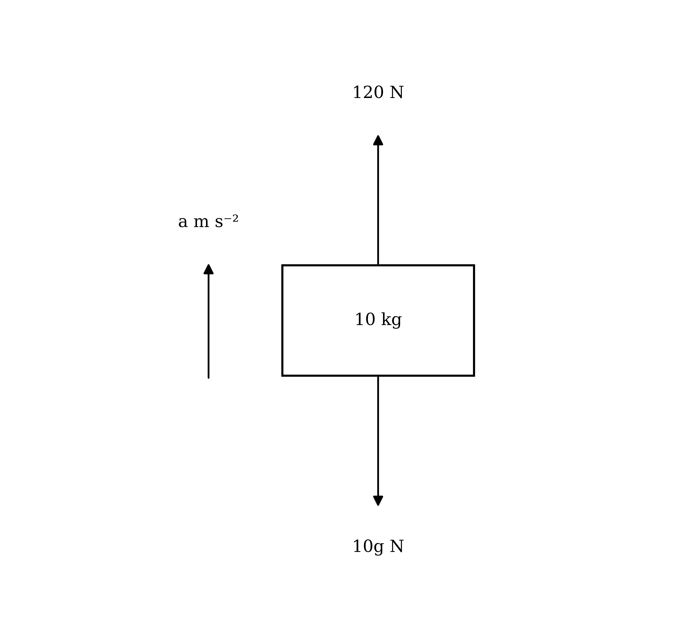

Take upwards as positive and apply Newton's second law, $F = m a$, to the system

$120 - 10 g = 10 a$

**[M1 A1]**

Use $g = 10$

$120 - 100 = 10 a$

$a = 2 \text{m s}^{-2}$

**[A1]**

> **[mark-scheme]**
> **M1**: Correct use of Newton's second law for the system, with all three terms: the 120 N force, the total weight $10 g$ and $10 a$. Allow sign errors for this mark.
> 
> **A1**: Correct equation, $120 - 10 g = 10 a$ or equivalent.
> 
> **A1**: $a = 2$. Units are not required.
> 
> Applying Newton's second law to $A$ and to $B$ separately and solving the two equations simultaneously is equally acceptable and earns the same marks.
Draw a force diagram for $B$ on its own

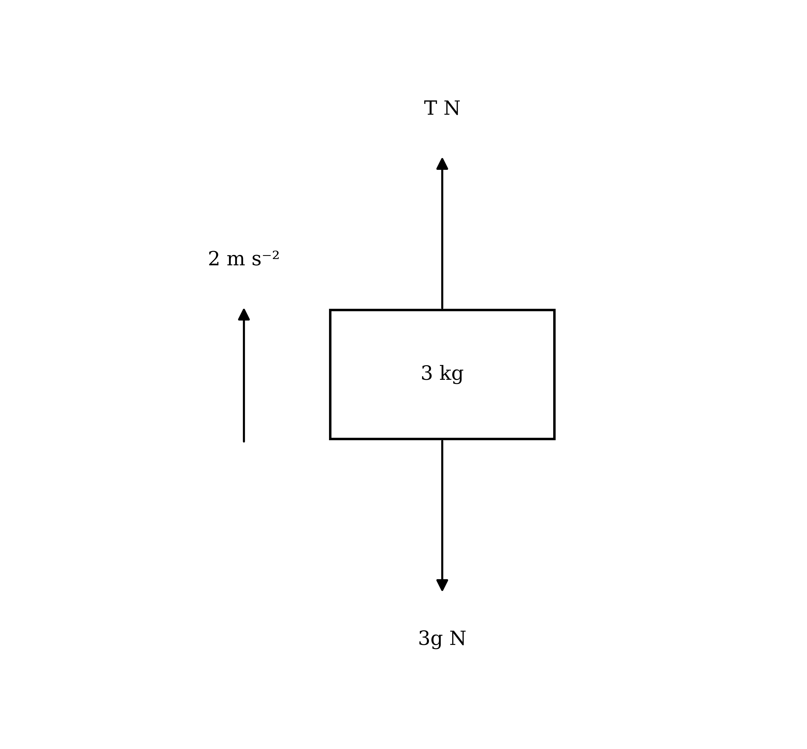

Take upwards as positive and apply Newton's second law to $B$, using $a = 2$ from part (a)

$T - 3 g = 3 \times 2$

**[M1]**

Use $g = 10$

$T - 30 = 6$

$T = 36 \text{N}$

**[A1]**

> **[mark-scheme]**
> **M1**: Correct use of Newton's second law for $B$, with all three terms: the tension, the weight $3 g$ and $3 \times 2$. Allow sign errors for this mark.
> 
> **A1**: 36. Follow through on the acceleration from part (a). Units are not required.
> 
> Applying Newton's second law to $A$ instead, $120 - T - 7 g = 7 \times 2$, is equally acceptable.

### Q31
Draw a force diagram for each object. $A$ accelerates downwards and $B$ accelerates towards the pulley

For $A$, take downwards as positive (its direction of motion) and apply Newton's second law, $F = m a$

$2 g - T = 2 a$

**[B1]**

The vertical forces on $B$ balance, so for $B$ take the direction towards the pulley as positive and apply Newton's second law to the horizontal forces

$T - 15 . 1 = 5 a$

**[B1]**

> **[mark-scheme]**
> **B1**: $2 g - T = 2 a$, or equivalent, for $A$.
> 
> **B1**: $T - 15 . 1 = 5 a$, or equivalent, for $B$.
> 
> Equations with $g = 10$ already substituted, such as $20 - T = 2 a$, or with the opposite direction taken as positive for an object, are equally acceptable.
Add the two equations, $2 g - T = 2 a$ and $T - 15 . 1 = 5 a$, to eliminate $T$

$2 g - 15 . 1 = 7 a$

**[M1]**

Use $g = 10$

$4 . 9 = 7 a$

$a = 0 . 7$

**[A1]**

Substitute $a = 0 . 7$ into $T - 15 . 1 = 5 a$

$T - 15 . 1 = 3 . 5$

$T = 18 . 6$

**[A1]**

> **[mark-scheme]**
> **M1**: Correct method to eliminate $T$ (or $a$) from the two equations.
> 
> **A1**: $a = 0 . 7$.
> 
> **A1**: $T = 18 . 6$. Follow through on the value of $a$.
> 
> Units are not required.
