# Exam Questions — Newton's Second Law
**Forces & Equilibrium** · Cambridge (CIE) AS maths (9709)
> Source: [https://www.savemyexams.com/as/maths/cie/20/mechanics/topic-questions/](https://www.savemyexams.com/as/maths/cie/20/mechanics/topic-questions/) · 31 questions across 1 sets

## Exam Questions (31 questions)

### Q1 — very_hard — 8 marks

**Q1** [5 marks]

A block $B$ of mass $m_{B}$ kg rests on a rough horizontal table. It is attached to one end of a light inextensible string, which passes over a small smooth pulley fixed at the edge of the table. A sphere $A$ of mass $m_{A}$ kg is attached to the other end of the string and hangs vertically. The string between $B$ and the pulley is horizontal, as shown in the diagram.

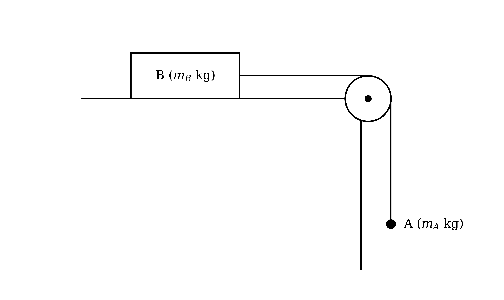

The frictional force on $B$ has constant magnitude $F$ N. The system is released from rest with the string taut.

Given that $A$ moves downwards, show that the tension in the string is $T$ N, where

$T = \frac{m_{A}}{m_{A}+m_{B}} ( m_{B} g + F )$

**Q1** [3 marks]

Given instead that the system remains at rest after it is released, find $F$ in terms of $m_{A}$ and $g$, and verify that the expression for $T$ in part (a) gives the correct tension in this case.

### Q2 — hard — 8 marks

**Q2** [6 marks]

Particles $A$ and $B$, of masses $m$ kg and 12 kg respectively, are attached to the ends of a light inextensible string which passes over a fixed smooth pulley. The particles hang vertically, as shown in the diagram.

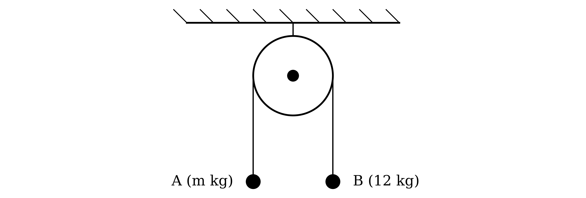

The particles are released from rest with the string taut, and each particle then moves with acceleration of magnitude 2 $\text{m s}^{-2}$.

Find the two possible values of $m$.

**Q2** [2 marks]

Given that the tension in the string is 144 N, find the value of $m$.

### Q3 — very_hard — 11 marks

**Q3** [7 marks]

A bucket is raised from the bottom of a vertical well of depth $h$ m by a light rope, which remains vertical. The bucket is modelled as a particle.

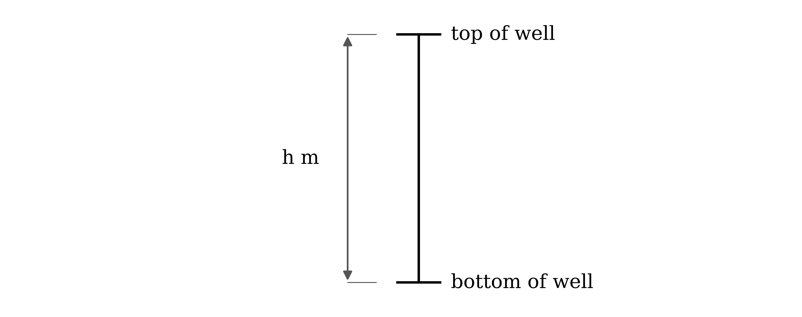

The bucket starts from rest at the bottom of the well. For the first part of the motion the rope is taut, and the bucket moves upwards with constant acceleration $a$$\text{m s}^{-2}$. The rope then becomes slack, and the bucket moves freely under gravity until it comes to instantaneous rest exactly at the top of the well.

Show that the total time taken for the bucket to move from the bottom to the top of the well is $T$ seconds, where

$T = \sqrt{\frac{2h(a+g)}{ag}}$

**Q3** [4 marks]

The rope can withstand a maximum tension of $P$ N. When the rope is used at this maximum tension to raise a bucket of mass 10 kg in the way described, from the bottom of a well of depth 30 m, the bucket reaches the top of the well 4.20 seconds after it starts to move.

Hence find the value of $P$.

### Q4 — hard — 5 marks

**Q4** [5 marks]

A rock of mass 230 kg is attached to a buoy of mass 10 kg by a light inextensible rope. The rock sinks vertically through water, pulling the buoy vertically downwards behind it with the rope taut.

As the rock sinks, a constant resistance of 150 N acts on it. The combined effect of the buoyancy of the buoy and the water resistance on the buoy is modelled as a constant upward force of $P$ N.

Given that the tension in the rope is 655 N, find the value of $P$.

### Q5 — medium — 5 marks

**Q5** [5 marks]

A crate of mass 4600 kg is pushed in a straight line across horizontal ground by a vehicle, which pushes on the crate through a light horizontal rod. A constant resistance to motion of 3200 N acts on the crate. The rod will break if the thrust in it is greater than 100 kN.

At a certain instant the crate is moving at 1.8 $\text{m s}^{-1}$ and is 100 m from a loading bay. The crate is to reach the loading bay within 3 seconds of this instant, with constant acceleration throughout.

Determine whether this is possible without the rod breaking.

### Q6 — very_hard — 8 marks

**Q6** [8 marks]

A locomotive of mass 10000 kg pulls a number of identical carriages along a straight horizontal track. The locomotive and the carriages are connected in a line by light rigid rods, which are parallel to the track. The locomotive's engine produces a driving force of 20000 N, and the resistance to motion of the locomotive is a constant 3000 N. Each carriage has mass $M$ kg, and the resistance to motion of each carriage is a constant 1000 N.

When three carriages are attached, the tension in the rod connecting the last carriage to the carriage in front of it is 437.8 N greater than the tension in the corresponding rod when four carriages are attached.

Find the value of $M$.

### Q7 — hard — 8 marks

**Q7** [4 marks]

A lift car of mass 250 kg is raised vertically by a light inextensible cable attached to its top. Inside the lift car, a horizontal tabletop $B$ of mass 3 kg is supported by a light vertical rod fixed to the floor of the lift car. A light wire frame stands on $B$, and a small sphere $A$ of mass 0.05 kg hangs from the top of the frame by a light vertical string, as shown in the diagram.

The lift car starts from rest and moves upwards with constant acceleration $a$$\text{m s}^{-2}$. The thrust in the rod supporting $B$ is 35.38 N.

Find the tension in the string supporting $A$.

**Q7** [2 marks]

Find the tension in the cable.

**Q7** [2 marks]

Find the distance the lift car rises in the first 3 seconds of its motion.

### Q8 — medium — 7 marks

**Q8** [4 marks]

A hydraulic lift in a warehouse is used to raise a crate of mass 1200 kg, which rests on the horizontal platform of the lift. The platform has mass 300 kg. The lifting force is transmitted to the platform by a light vertical rod, as shown in the diagram.

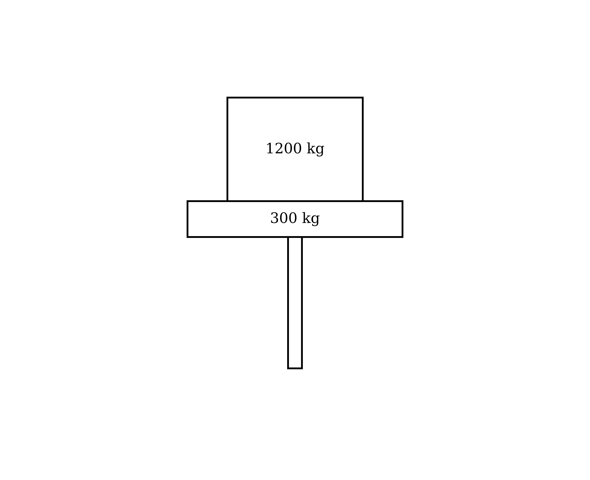

The platform and crate start from rest and move vertically upwards with constant acceleration, reaching a speed of 3 $\text{m s}^{-1}$ after 2 seconds.

Find the thrust in the rod.

**Q8** [3 marks]

Find the magnitude and direction of the force exerted by the crate on the platform.

### Q9 — medium — 4 marks

**Q9** [4 marks]

Particles $A$ and $B$, of masses 3 kg and $m$ kg respectively, are attached to the ends of a light inextensible string which passes over a fixed smooth pulley. The particles hang vertically, as shown in the diagram.

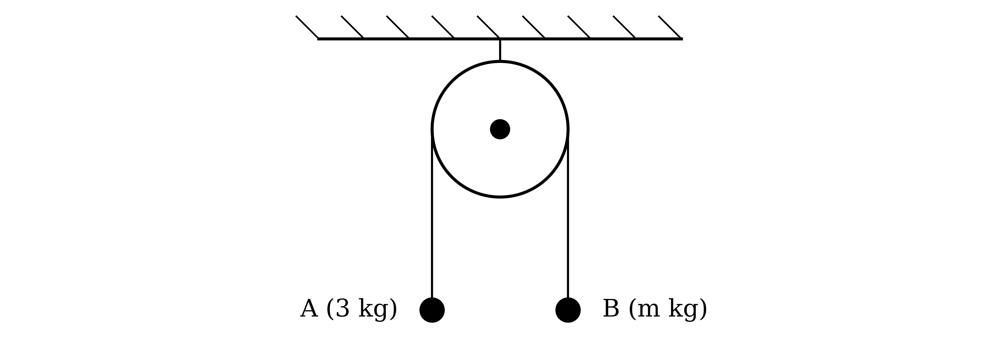

The particles are released from rest with the string taut, and $A$ moves downwards with acceleration 6 $\text{m s}^{-2}$.

Find the value of $m$.

### Q10 — hard — 5 marks

**Q10** [5 marks]

A weather balloon of mass 0.6 kg is attached to a bundle of scientific instruments of mass 2 kg by a light inextensible cable. The balloon is released from rest with the cable taut, and rises vertically with the balloon directly above the bundle. The only forces acting are the weights of the balloon and the bundle, the tension in the cable, and a constant vertical lift force on the balloon.

During the initial period of the ascent the acceleration is constant and the tension in the cable is 29.4 N. Find, for this initial period,

(i) the acceleration of the bundle,

(ii) the magnitude of the lift force on the balloon.

### Q11 — easy — 5 marks

**Q11** [5 marks]

A tugboat pulls a barge across the surface of a harbour using a horizontal towrope. The barge has mass 2900 tonnes, and a constant resistance to motion of 5000 N acts on it. The barge moves in a straight line with constant acceleration, and its speed increases from 0.73 $\text{m s}^{-1}$ to 2.35 $\text{m s}^{-1}$ in 3 minutes.

Find the tension in the towrope while the speed of the barge is increasing.

### Q12 — medium — 9 marks

**Q12** [5 marks]

A company stores cheeses in a deep cave. Loads are moved in and out of the cave by a lift consisting of a horizontal pallet supported by two vertical ropes, and the tensions in the two ropes are always equal. A full pallet of cheeses has a total mass of 1700 kg.

A full pallet is lowered from rest with constant acceleration, and moves 20 m downwards in the first 4 seconds.

Find the acceleration of the pallet and the tension in each rope during these 4 seconds.

**Q12** [4 marks]

Each rope can safely withstand a tension of 10.4 kN.

A new motor is fitted to the lift. With the new motor, a full pallet of mass 1700 kg is raised from rest through a distance of 30 m in 4.9 seconds, with constant acceleration.

Determine whether the ropes can be used safely with the new motor.

### Q13 — easy — 6 marks

**Q13** [6 marks]

In each of the scenarios depicted below, the forces acting on the body cause it to accelerate as shown. The acceleration due to gravity is indicated by $g$.

![Three force diagrams, labelled (i), (ii) and (iii). In (i) a block of mass 7 kg has a force of P N acting vertically upwards and its weight 7g N acting vertically downwards, and its acceleration is 3 m s⁻² upwards. In (ii) a block of mass m kg has two forces of 48 N acting vertically upwards and its weight mg N acting vertically downwards, and its acceleration is 5 m s⁻² downwards. In (iii) a block of mass 15 kg has a force of 150 N acting vertically upwards and its weight 15g N acting vertically downwards, and its acceleration a m s⁻² is downwards.](assets/027-three-force-diagrams-labelled-i-ii-and-iii-in-i-.png)

Find the value of the unknown variable (the acceleration $a$, the mass $m$ or the force $P$) in each case.

### Q14 — medium — 5 marks

**Q14** [3 marks]

A child pushes two toy wagons along a straight horizontal track. The wagons are connected by a light rigid rod which is parallel to the track, and each wagon has mass 11.2 kg. The resistance to motion of each wagon is a constant force of $P$ N.

The child pushes the rear wagon with a constant horizontal force of 16.6 N, and the wagons move forwards with acceleration 0.25 $\text{m s}^{-2}$.

Find the value of $P$.

**Q14** [2 marks]

Find the thrust in the rod.

### Q15 — medium — 6 marks

**Q15** [6 marks]

A block $B$ of mass 4.5 kg rests on a rough horizontal table. It is attached to one end of a light inextensible string, which passes over a small smooth pulley fixed at the edge of the table. A sphere $A$ of mass 3.5 kg is attached to the other end of the string and hangs vertically, 1 m above the ground. The string between $B$ and the pulley is horizontal, as shown in the diagram.

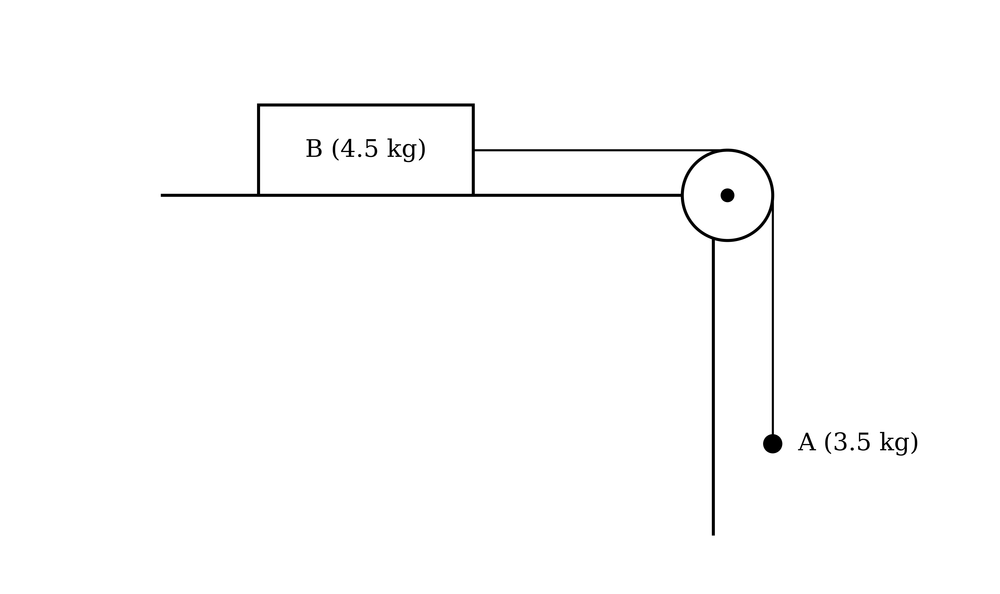

The frictional force on $B$ has constant magnitude $F$ N. The system is released from rest with the string taut, and $A$ reaches the ground 0.8 seconds later.

Find the value of $F$.

### Q16 — medium — 4 marks

**Q16** [4 marks]

Particles $A$ and $B$, of masses 6 kg and 9 kg respectively, are attached to the ends of a light inextensible string which passes over a fixed smooth pulley. The particles hang vertically, as shown in the diagram.

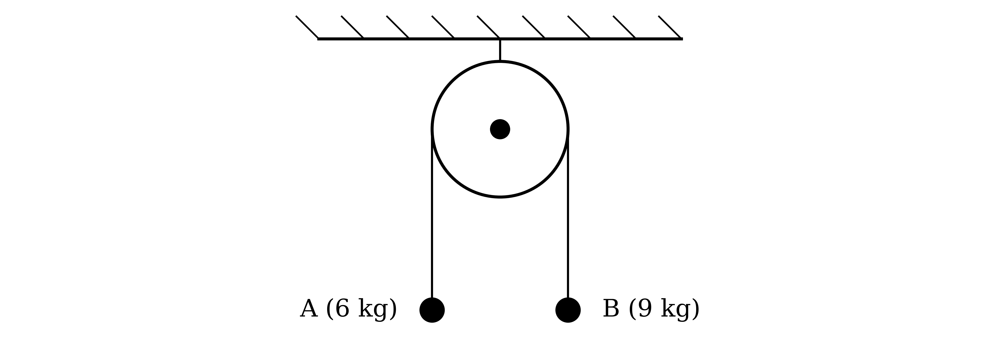

The particles are released from rest with the string taut.

Find the acceleration of the particles and the tension in the string.

### Q17 — easy — 6 marks

**Q17** [6 marks]

In each of the scenarios depicted below, the forces acting on the body cause it to accelerate as shown. The acceleration due to gravity is indicated by $g$.

![Three force diagrams, labelled (i), (ii) and (iii). In (i) a block of mass 4 kg has a force of P N acting vertically upwards and its weight 4g N acting vertically downwards, and its acceleration is 2 m s⁻² downwards. In (ii) a block of mass m kg has a force of 70 N acting vertically upwards and its weight mg N acting vertically downwards, and its acceleration is 6 m s⁻² downwards. In (iii) a block of mass 10 kg has a force of 88 N acting vertically upwards and its weight 10g N acting vertically downwards, and its acceleration a m s⁻² is downwards.](assets/034-three-force-diagrams-labelled-i-ii-and-iii-in-i-.png)

Find the value of the unknown variable (the acceleration $a$, the mass $m$ or the force $P$) in each case.

### Q18 — medium — 8 marks

**Q18** [3 marks]

Two blocks $A$ and $B$, of masses 0.7 kg and 0.9 kg respectively, are placed in a light scale-pan, with $A$ resting on top of $B$, as shown in the diagram. The scale-pan is attached to a light inextensible string, which is vertical.

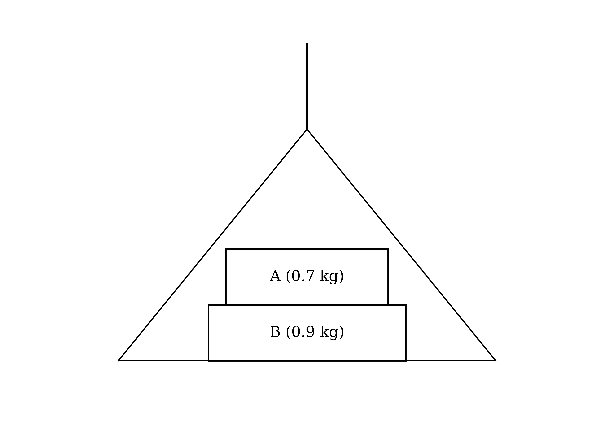

The string raises the scale-pan vertically with acceleration 0.5 $\text{m s}^{-2}$.

Find the tension in the string.

**Q18** [2 marks]

Find the magnitude of the force exerted on $A$ by $B$.

**Q18** [1 mark]

Write down the magnitude and direction of the force exerted on $B$ by $A$.

**Q18** [2 marks]

Find the magnitude of the force exerted on $B$ by the scale-pan.

### Q19 — medium — 5 marks

**Q19** [3 marks]

A locomotive of mass 7000 kg is coupled to a carriage of mass 2000 kg by a light rigid rod, which is parallel to a straight horizontal track. The resistances to motion of the locomotive and the carriage are constant forces of 2300 N and 1000 N respectively.

The locomotive and carriage are initially at rest. The locomotive then moves backwards along the track, pushing the carriage, which is behind it. The engine of the locomotive produces a constant driving force of 15000 N.

Find the acceleration of the locomotive and carriage.

**Q19** [2 marks]

Find the thrust in the rod.

### Q20 — medium — 5 marks

**Q20** [3 marks]

Two particles $A$ and $B$, of masses 5 kg and 15 kg respectively, are connected by a light inextensible string. Particle $B$ hangs vertically below particle $A$. A force of magnitude 300 N acts vertically upwards on $A$, so that the particles move upwards with the string taut.

Find the acceleration of the particles.

**Q20** [2 marks]

Find the tension in the string.

### Q21 — hard — 8 marks

**Q21** [4 marks]

A box $B$ of mass 2 kg rests on a rough horizontal table. It is attached to one end of a light inextensible string, which passes over a small smooth pulley fixed at the edge of the table. A sphere $A$ of mass 1 kg is attached to the other end of the string and hangs vertically. The string between $B$ and the pulley is horizontal, as shown in the diagram.

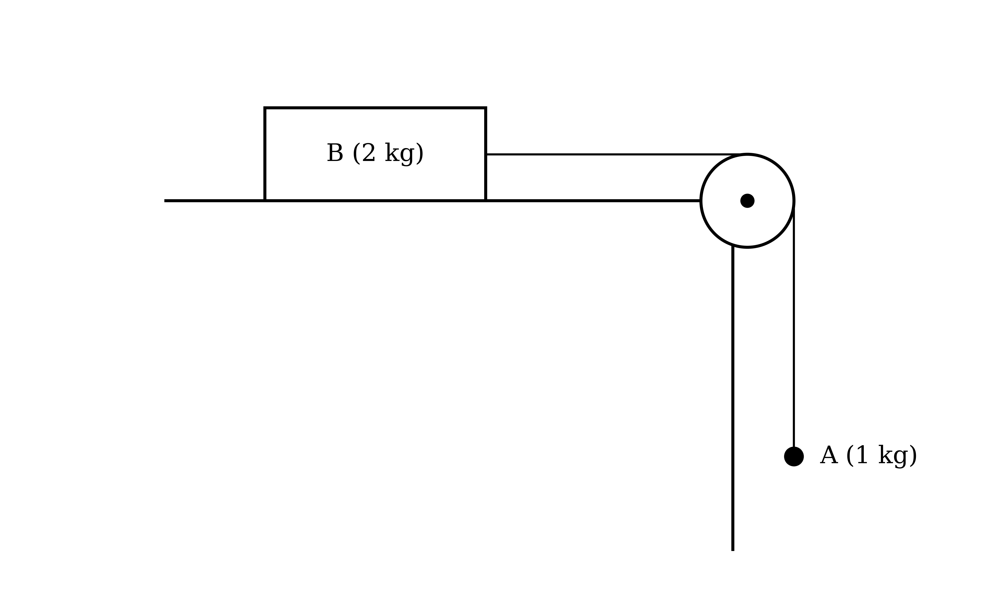

The frictional force on $B$ has constant magnitude 7.6 N. The system is released from rest with the string taut, and $A$ moves downwards.

Find the acceleration of the system and the tension in the string.

**Q21** [4 marks]

$A$ reaches the ground 1.5 seconds after the system is released, and does not rebound. At this instant $B$ is 14 cm from the pulley.

Determine whether $B$ reaches the pulley.

### Q22 — easy — 6 marks

**Q22** [2 marks]

During a stage show, a singer is lifted vertically by a cable attached to a harness. The singer has mass 54 kg and is modelled as a particle. The singer starts from rest on the floor and moves upwards with constant acceleration, reaching a height of 3 m after 2 seconds.

Find the acceleration of the singer.

**Q22** [2 marks]

Find the tension in the cable during the lift.

**Q22** [2 marks]

The singer is later lowered vertically. During the first part of the descent, the singer accelerates downwards with constant acceleration of the same magnitude as in part (a).

Find the tension in the cable during this part of the descent.

### Q23 — easy — 4 marks

**Q23** [2 marks]

A child pulls a cart along a straight horizontal path using a horizontal rope attached to the front of the cart. The cart has mass 15 kg, and a constant resistance to motion of magnitude 2 N acts on it. The cart starts from rest and moves with constant acceleration, reaching a speed of 2 $\text{m s}^{-1}$ after 5 seconds.

Find the acceleration of the cart.

**Q23** [2 marks]

Find the tension in the rope.

### Q24 — easy — 4 marks

**Q24** [2 marks]

A sled of mass 5.6 kg is pulled along a straight horizontal path by a horizontal rope attached to its front. A constant resistance to motion of magnitude 3.2 N acts on the sled. The sled starts from rest and moves with constant acceleration, reaching a speed of 1.5 $\text{m s}^{-1}$ after 6 seconds.

Find the acceleration of the sled.

**Q24** [2 marks]

Find the tension in the rope.

### Q25 — easy — 5 marks

**Q25** [2 marks]

Particles $A$ and $B$, of masses 5 kg and 3 kg respectively, are attached to the ends of a light inextensible string which passes over a fixed smooth pulley. The particles hang vertically, as shown in the diagram.

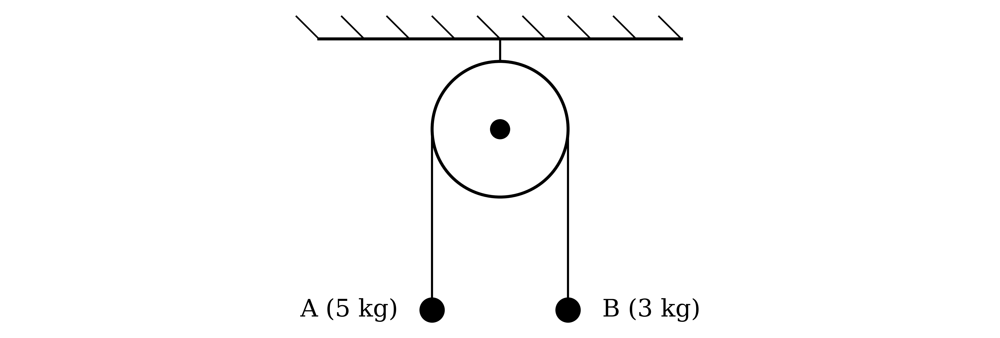

The particles are released from rest with the string taut, and $A$ begins to move downwards. The tension in the string is $T$ N and the magnitude of the acceleration of each particle is $a$$\text{m s}^{-2}$.

Use Newton's second law to write down an equation of motion for $A$ and an equation of motion for $B$.

**Q25** [3 marks]

Hence find the value of $a$ and the value of $T$.

### Q26 — easy — 5 marks

**Q26** [3 marks]

Two railway carriages, each of mass 3000 kg, are at rest on a straight horizontal track. They are connected by a light rigid rod which is parallel to the track. The resistance to motion of each carriage is a constant force of 5800 N.

A constant horizontal force of 12500 N is applied to the rear carriage, pushing both carriages forwards along the track.

By considering the two carriages as a single system, find the acceleration of the carriages.

**Q26** [2 marks]

By considering the front carriage alone, find the thrust in the rod.

### Q27 — easy — 6 marks

**Q27** [6 marks]

Each diagram below shows the forces acting on a block and the direction of its acceleration.

![Three force diagrams, labelled (i), (ii) and (iii). In (i) a block of mass 10 kg has a force of P N acting vertically upwards and its weight 10g N acting vertically downwards, and its acceleration is 7 m s⁻² downwards. In (ii) a block of mass m kg has a force of 40 N acting vertically upwards and its weight mg N acting vertically downwards, and its acceleration is 2 m s⁻² downwards. In (iii) a block of mass 5 kg has a force of 42 N acting vertically upwards and its weight 5g N acting vertically downwards, and its acceleration a m s⁻² is downwards.](assets/054-three-force-diagrams-labelled-i-ii-and-iii-in-i-.png)

Find the value of the unknown quantity (the force $P$, the mass $m$ or the acceleration $a$) in each case.

### Q28 — easy — 6 marks

**Q28** [2 marks]

A crane lifts a pallet of bricks using a vertical cable attached to the pallet. The pallet and bricks have a combined mass of 2800 kg and are initially at rest on the ground. The pallet moves vertically upwards with constant acceleration, and 10 seconds after it starts to move it is 18 m above the ground.

Find the acceleration of the pallet.

**Q28** [2 marks]

Find the tension in the cable while the pallet is accelerating upwards.

**Q28** [2 marks]

The pallet is then lowered vertically. During the first part of the descent, the pallet accelerates downwards with constant acceleration of the same magnitude as in part (a).

Find the tension in the cable during this part of the descent.

### Q29 — easy — 6 marks

**Q29** [3 marks]

A small hydraulic lift in a laboratory is used to raise a block. The block, of mass 4 kg, rests on the horizontal platform of the lift, which has mass 1 kg. The lifting force is transmitted to the platform by a light vertical rod, as shown in the diagram.

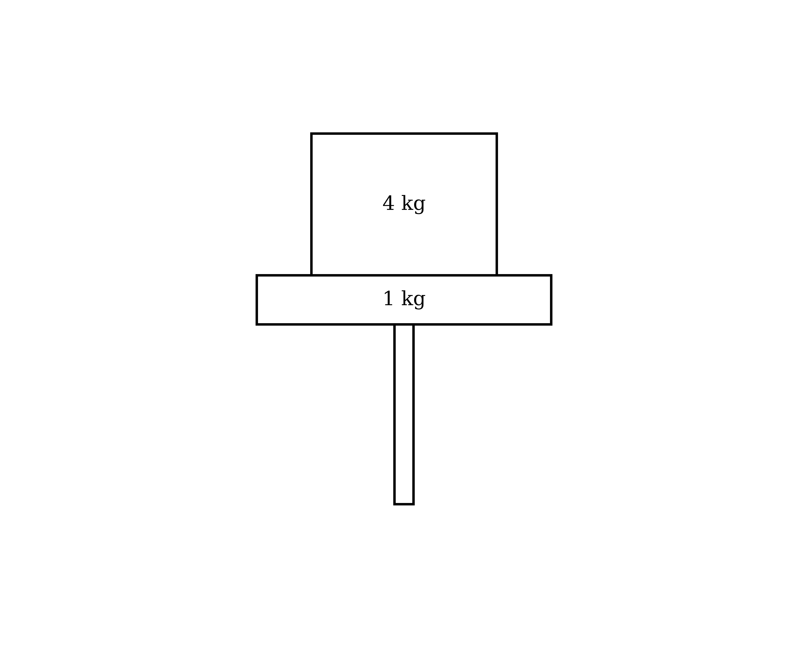

The platform and block move vertically upwards with constant acceleration 1.4 $\text{m s}^{-2}$.

By considering the platform and block as a single system, find the thrust in the rod.

**Q29** [2 marks]

By considering the block alone, find the magnitude of the force exerted on the block by the platform.

**Q29** [1 mark]

Hence write down the magnitude and direction of the force exerted on the platform by the block.

### Q30 — easy — 5 marks

**Q30** [3 marks]

Two particles $A$ and $B$, of masses 7 kg and 3 kg respectively, are connected by a light inextensible string. Particle $B$ hangs vertically below particle $A$. A force of magnitude 120 N acts vertically upwards on $A$, so that the particles move upwards with the string taut.

By considering $A$ and $B$ as a single system, find the acceleration of the particles.

**Q30** [2 marks]

By considering $B$ alone, find the tension in the string.

### Q31 — easy — 5 marks

**Q31** [2 marks]

A box $B$ of mass 5 kg rests on a rough horizontal table. It is attached to one end of a light inextensible string, which passes over a small smooth pulley fixed at the edge of the table. A sphere $A$ of mass 2 kg is attached to the other end of the string and hangs vertically. The string between $B$ and the pulley is horizontal, as shown in the diagram.

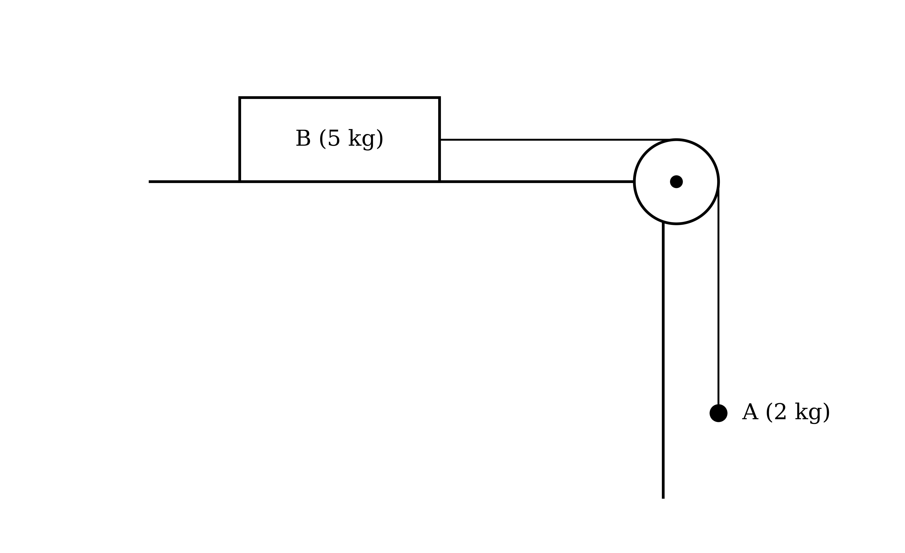

The system is released from rest with the string taut, and $A$ begins to move downwards. The frictional force on $B$ has constant magnitude 15.1 N. The tension in the string is $T$ N and the magnitude of the acceleration of each object is $a$$\text{m s}^{-2}$.

Use Newton's second law to write down an equation of motion for $A$ and an equation of motion for $B$.

**Q31** [3 marks]

Hence find the value of $a$ and the value of $T$.
