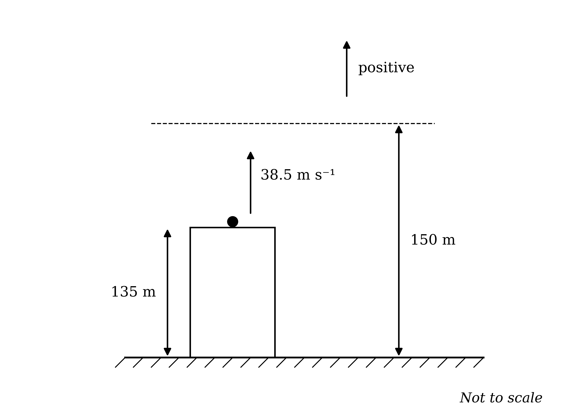
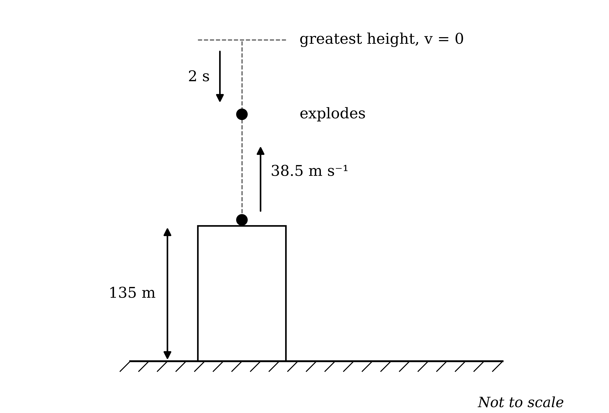
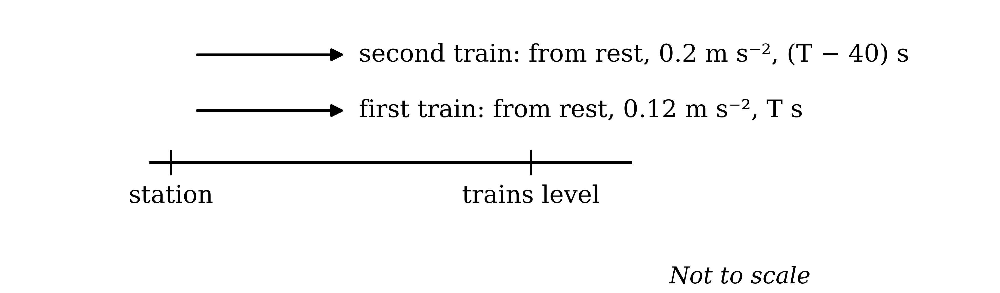
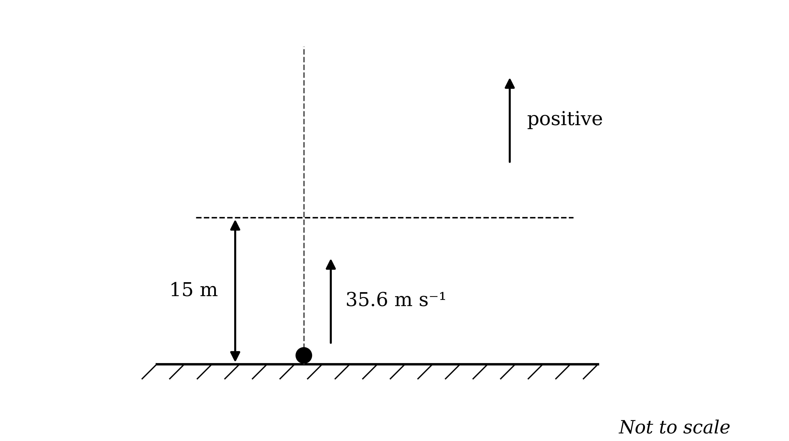
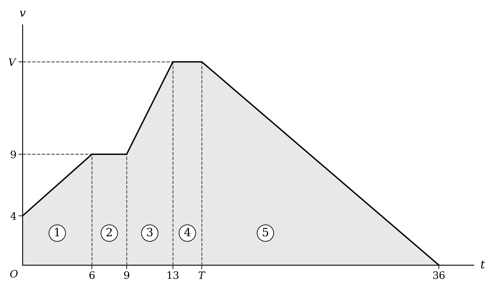
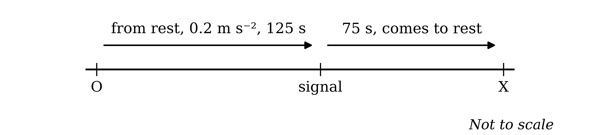
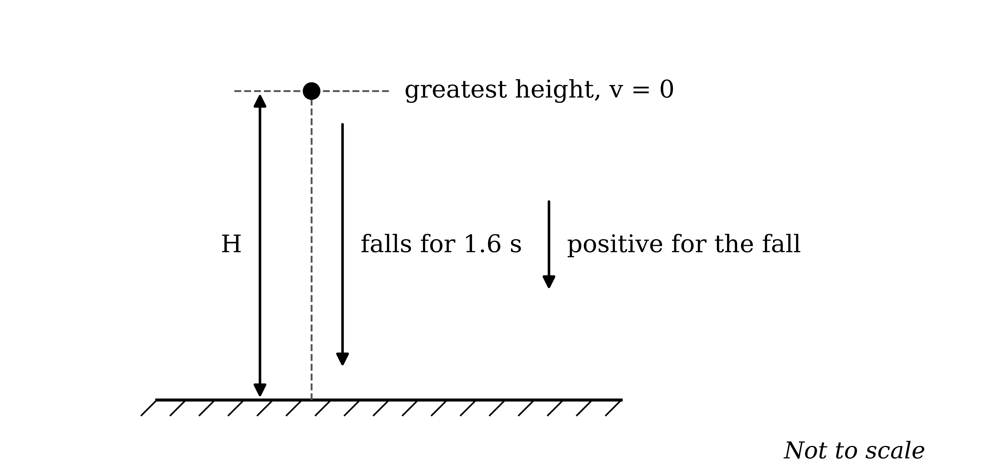
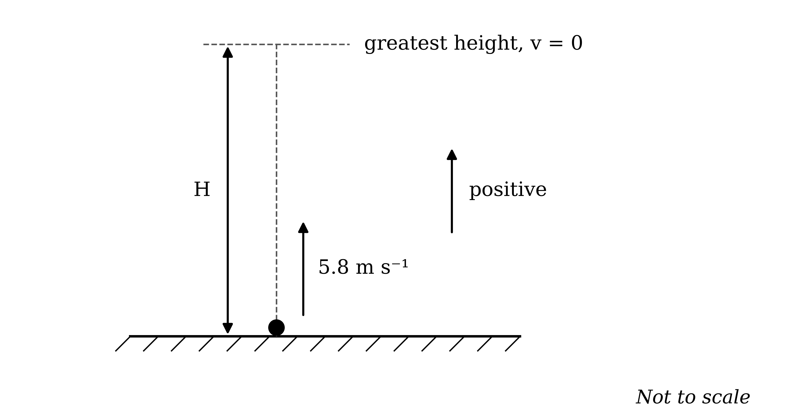
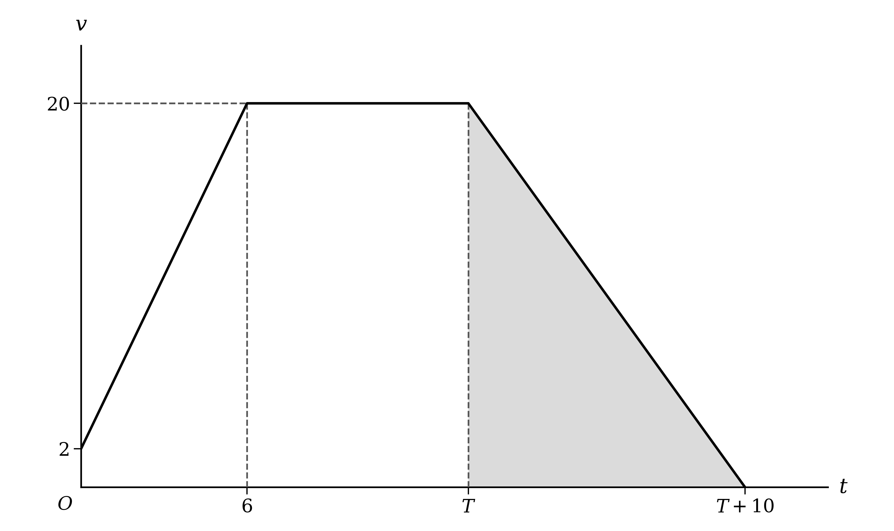
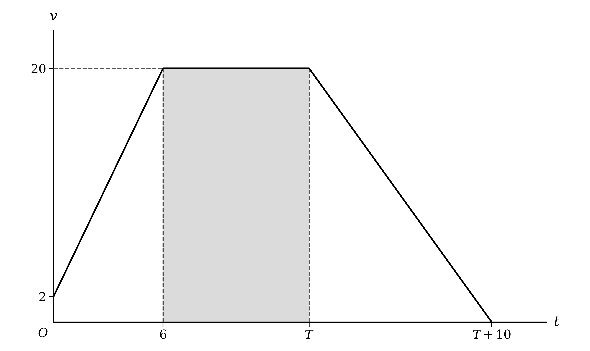

# Mark Schemes — Constant Acceleration
**Kinematics (Straight Line Motion)** · Cambridge (CIE) AS maths (9709)

## Exam Questions (35 questions)

### Q1
Take downwards as positive, so the acceleration is $g = 10 \text{m s}^{-2}$, and use $s = u t + \frac{1}{2} a t^{2}$ with $u = 0 . 3$ and $t = 3 . 2$

$s = 0 . 3 \times 3 . 2 + \frac{1}{2} \times 10 \times 3 . 2^{2}$

**[M1]**

$s = 0 . 96 + 51 . 2 = 52 . 16$

**Final answer:** $52 . 2 \text{m}$** (3 s.f.)**

**[A1]**

> **[mark-scheme]**
> **M1**: Correct use of $s = u t + \frac{1}{2} a t^{2}$ with $u = 0 . 3$, $t = 3 . 2$ and $a = 10$.
> 
> **A1**: Correct height of 52.16, or answers which round to 52.2.

### Q2
Take upwards as positive from the top of the building, so the acceleration is $- 10 \text{m s}^{-2}$. A height of 150 m above the ground is 15 m above the point of projection

Use $s = u t + \frac{1}{2} a t^{2}$ with $s = 15$, $u = 38 . 5$ and $a = - 10$

$15 = 38 . 5 t + \frac{1}{2} \times ( - 10 ) \times t^{2}$

**[M1]**

$5 t^{2} - 38 . 5 t + 15 = 0$

**[A1]**

Solve using the quadratic formula to find the two times at which the firework is 150 m above the ground

$t = \frac{38.5\pm\sqrt{38.5^{2}-4\times5\times15}}{2\times5}$

$t = 0 . 411613 . . . \text{or} t = 7 . 288386 . . .$

The firework is above 150 m between these two times

$7 . 288386 . . . - 0 . 411613 . . . = 6 . 876772 . . .$

**[M1]**

**Final answer:** $6 . 88 \text{s}$** (3 s.f.)**

**[A1]**

> **[mark-scheme]**
> **M1**: Use of $s = u t + \frac{1}{2} a t^{2}$ with $s = 15$, $u = 38 . 5$ and $a = \pm 10$, or an equivalent equation measured from the ground. Allow sign errors.
> 
> **A1**: Correct three-term quadratic, e.g. $5 t^{2} - 38 . 5 t + 15 = 0$.
> 
> **M1**: Solving the quadratic and subtracting the smaller time from the larger.
> 
> **A1**: Correct length of time, or answers which round to 6.88.
> 
> A symmetry method (speed at 150 m, time from there to the greatest height, doubled) earns full marks.
First find the greatest height above the top of the building, where the velocity is zero

Use $v^{2} = u^{2} + 2 a s$ with $u = 38 . 5$, $v = 0$ and $a = - 10$

$0 = 38 . 5^{2} + 2 \times ( - 10 ) \times s$

$s = \frac{1482.25}{20} = 74 . 1125$

**[M1]**

For the fall, take downwards as positive and use $s = u t + \frac{1}{2} a t^{2}$ with $u = 0$, $a = 10$ and $t = 2$

$s = 0 + \frac{1}{2} \times 10 \times 2^{2} = 20$

**[M1]**

Add the height of the building and the rise, then subtract the fall

$135 + 74 . 1125 - 20 = 189 . 1125$

**Final answer:** $189 \text{m}$** (3 s.f.)**

**[A1]**

> **[mark-scheme]**
> **M1**: Correct method for the greatest height reached above the top of the building, or above the ground.
> 
> **M1**: Correct method for the distance fallen in 2 seconds from rest.
> 
> **A1**: Correct height above the ground, or answers which round to 189.
> 
> Finding the time to the greatest height (3.85 s) and using $s = u t + \frac{1}{2} a t^{2}$ with $t = 5 . 85$ from the point of projection is equally acceptable.

### Q3
Between 4 and 12 seconds, $A$ has constant velocity 5. For the first 15 seconds, $B$ accelerates from rest to 8, so its acceleration is the gradient

$a_{B} = \frac{8}{15}$

$T_{1}$ is when $B$ reaches a velocity of 5, so use $v = u + a t$

$5 = 0 + \frac{8}{15} T_{1}$

**[M1]**

$T_{1} = \frac{75}{8} = 9 . 375$

**Final answer:** $T_{1} = 9 . 38$** (3 s.f.)**

**[A1]**

Between 15 and 21 seconds, $A$ accelerates from 5 at 12 seconds to 10 at 21 seconds

$v_{A} = 5 + \frac{5}{9} ( t - 12 )$

**[M1]**

$B$ decelerates from 8 at 15 seconds to 0 at 25 seconds

$v_{B} = 8 - 0 . 8 ( t - 15 )$

**[M1 A1]**

Set the velocities equal at $t = T_{2}$

$5 + \frac{5}{9} ( T_{2} - 12 ) = 8 - 0 . 8 ( T_{2} - 15 )$

**[M1]**

Multiply through by 45

$225 + 25 ( T_{2} - 12 ) = 360 - 36 ( T_{2} - 15 )$

$25 T_{2} - 75 = 900 - 36 T_{2}$

$61 T_{2} = 975$

$T_{2} = 15 . 983606 . . .$

**Final answer:** $T_{2} = 16 . 0$** (3 s.f.)**

**[A1]**

> **[mark-scheme]**
> **M1**: Correct method for $T_{1}$ using the acceleration of $B$ as a gradient, e.g. $\frac{8}{15} T_{1} = 5$.
> 
> **A1**: $T_{1} = 9 . 375$, or answers which round to 9.38.
> 
> **M1**: Correct method for the velocity of $A$ between 12 and 21 seconds, using its acceleration of $\frac{5}{9}$.
> 
> **M1**: Correct method for the velocity of $B$ between 15 and 25 seconds, using its deceleration of 0.8.
> 
> **A1**: Both velocity expressions correct.
> 
> **M1**: Setting the two velocities equal and solving for $T_{2}$.
> 
> **A1**: $T_{2} = 15 . 98 . . .$, or answers which round to 16.0.
> 
> The two answers are marked independently.

### Q4
Work in seconds, so the trains are compared after 600 seconds. Measure distances from $O$, with each train's direction shown

For the first train, use $s = u t + \frac{1}{2} a t^{2}$ with $u = 0$, $a = 0 . 15$ and $t = 600$

$s = \frac{1}{2} \times 0 . 15 \times 600^{2}$

**[M1]**

$s = 27000 \text{m}$

**[A1]**

For the second train from $O$ to the signal, use $v = u + a t$ for the speed at the signal

$v = 0 . 24 \times 210 = 50 . 4$

**[B1]**

Find the distance from $O$ to the signal and from the signal to $X$

$\frac{1}{2} \times 0 . 24 \times 210^{2} = 5292$

$\frac{1}{2} \times ( 50 . 4 + 0 ) \times 60 = 1512$

**[M1]**

$O X = 5292 + 1512 = 6804$

**[A1]**

The second train reaches $X$ after 270 seconds and waits 120 seconds, so it moves back towards $O$ for

$600 - 270 - 120 = 210 \text{s}$

Use $s = u t + \frac{1}{2} a t^{2}$ with $u = 0$, $a = 0 . 08$ and $t = 210$

$s = \frac{1}{2} \times 0 . 08 \times 210^{2} = 1764$

**[M1]**

The second train is still on the $X$ side of $O$, at a distance

$6804 - 1764 = 5040 \text{m}$

The trains are on opposite sides of $O$, so add the distances

$27000 + 5040$

$32040 \text{m}$

**[A1]**

> **[mark-scheme]**
> **M1**: Correct use of $s = u t + \frac{1}{2} a t^{2}$ for the first train with $t = 600$.
> 
> **A1**: Correct distance of 27000 for the first train.
> 
> **B1**: Correct speed of 50.4 at the signal.
> 
> **M1**: Correct method for both stages of the second train's journey from $O$ to $X$, using the speed at the signal found.
> 
> **A1**: Correct distance $O X = 6804$.
> 
> **M1**: Correct use of $s = u t + \frac{1}{2} a t^{2}$ for the return journey from $X$ with $t = 210$.
> 
> **A1**: Correct distance of 32040 m. Accept 32.0 km or 32.04 km with the unit stated.

### Q5
Both trains have been moving for the same time, $T$ seconds, when they pass, and together they have covered the whole 8200 m

Use $s = u t + \frac{1}{2} a t^{2}$ with $u = 0$ for each train

$s_{1} = \frac{1}{2} \times 0 . 2 \times T^{2} = 0 . 1 T^{2}$

$s_{2} = \frac{1}{2} \times 0 . 16 \times T^{2} = 0 . 08 T^{2}$

**[M1 A1]**

The two distances add up to 8200 m

$0 . 1 T^{2} + 0 . 08 T^{2} = 8200$

**[M1]**

$T^{2} = 45555 . 555 . . .$

**[A1]**

The distance from $A$ is the first train's distance

$s_{1} = 0 . 1 \times 45555 . 555 . . . = 4555 . 555 . . .$

**Final answer:** $4560 \text{m}$** (3 s.f.)**

**[A1]**

> **[mark-scheme]**
> **M1**: Use of $s = u t + \frac{1}{2} a t^{2}$ with $u = 0$ for both trains, with the same time for each.
> 
> **A1**: Both expressions correct.
> 
> **M1**: Setting the sum of the two distances equal to 8200, or an equivalent equation in $s_{1}$.
> 
> **A1**: Correct value of T² = 45555.5..., or T = 213.4...
> 
> **A1**: Answers which round to 4560 m. Accept 4.56 km with the unit stated.

### Q6
When the balls collide, they have been moving for the same time, $T$ seconds, and together they have covered the 150 m between them

For the first ball, take upwards as positive, so $a = - 10$, and use $s = u t + \frac{1}{2} a t^{2}$

$s_{1} = 29 . 3 T - 5 T^{2}$

For the second ball, take downwards as positive, so $a = 10$

$s_{2} = 8 . 2 T + 5 T^{2}$

**[M1 A1]**

The distances add up to 150 m

$29 . 3 T - 5 T^{2} + 8 . 2 T + 5 T^{2} = 150$

**[M1]**

$37 . 5 T = 150$

$T = 4 \text{s}$

**[A1]**

The height of the collision is the first ball's displacement at $T = 4$

$s_{1} = 29 . 3 \times 4 - 5 \times 4^{2}$

**[M1]**

$s_{1} = 117 . 2 - 80$

$\text{Height} = 37 . 2 \text{m}$

**[A1]**

> **[exam-tip]**
> The $T^{2}$ terms cancel because both balls have the same acceleration. Relative to each other the balls move as if gravity were switched off, closing the 150 m gap at a constant $29 . 3 + 8 . 2 = 37 . 5 \text{m s}^{-1}$, so the time is simply $150 \div 37 . 5$.

> **[mark-scheme]**
> **M1**: Use of $s = u t + \frac{1}{2} a t^{2}$ for either ball with $a = \pm 10$ and the same time for both. Allow sign errors.
> 
> **A1**: Both displacement expressions correct.
> 
> **M1**: Setting the sum of the two distances equal to 150, or an equivalent equation using heights above the ground.
> 
> **A1**: Correct time of 4.
> 
> **M1**: Substitution of the time found into the first ball's displacement, or into $150 - s_{2}$.
> 
> **A1**: Correct height of 37.2.
> 
> The two answers are marked independently.
(i)

Use $v = u + a t$ with $t = 4$ for each ball, keeping each ball's positive direction from part (a)

$v_{1} = 29 . 3 - 10 \times 4 = - 10 . 7$

$\text{Speed of the first ball} = 10 . 7 \text{m s}^{-1}$

**[B1]**

$v_{2} = 8 . 2 + 10 \times 4 = 48 . 2$

$\text{Speed of the second ball} = 48 . 2 \text{m s}^{-1}$

**[B1]**

(ii)

*Upwards is positive for the first ball and its velocity is negative, so it is moving downwards*

**[B1]**

*Downwards is positive for the second ball and its velocity is positive, so it is moving downwards*

**Final answer:** **Both balls are moving downwards when they collide**

**[B1]**

> **[mark-scheme]**
> **B1**: Correct speed of 10.7 for the first ball. The speed must be positive.
> 
> **B1**: Correct speed of 48.2 for the second ball.
> 
> **B1**: A correct reason why the first ball is moving downwards, e.g. its velocity is negative when upwards is positive, or it reaches its greatest height at 2.93 seconds, before the collision at 4 seconds.
> 
> **B1**: A complete conclusion that both balls are moving downwards, with the second ball's direction justified.

### Q7
The speed at $B$ links the two stages. For $A$ to $B$, use $v^{2} = u^{2} + 2 a s$ with $u = 17 . 2$, $a = 0 . 4$ and $s = 800$

$v^{2} = 17 . 2^{2} + 2 \times 0 . 4 \times 800 = 935 . 84$

**[M1]**

$v = 30 . 591502 . . .$

**[A1]**

Use $v = u + a t$ to find the time from $A$ to $B$

$30 . 591502 . . . = 17 . 2 + 0 . 4 t_{1}$

**[M1]**

$t_{1} = 33 . 478755 . . .$

**[A1]**

For the deceleration, use $v = u + a t$ with $u = 30 . 591502 . . .$, $v = 0$ and $a = - 2 . 75$

$0 = 30 . 591502 . . . - 2 . 75 t_{2}$

**[M1]**

$t_{2} = 11 . 124182 . . .$

Add the two times

$t_{1} + t_{2} = 44 . 602937 . . .$

**Final answer:** $44 . 6 \text{s}$** (1 d.p.)**

**[A1]**

> **[mark-scheme]**
> **M1**: Use of $v^{2} = u^{2} + 2 a s$ from $A$ to $B$ with $u = 17 . 2$, $a = 0 . 4$ and $s = 800$.
> 
> **A1**: Correct speed at $B$ of 30.59..., or $v^{2} = 935 . 84$.
> 
> **M1**: Correct method for the time from $A$ to $B$, e.g. $v = u + a t$ with the speed at $B$ found, or solving $800 = 17 . 2 t + 0 . 2 t^{2}$.
> 
> **A1**: Correct time of 33.47... seconds from $A$ to $B$.
> 
> **M1**: Correct method for the time to come to rest from $B$ with the speed at $B$ found and $a = - 2 . 75$. Allow a sign error in the acceleration.
> 
> **A1**: Answers which round to 44.6. Premature rounding of the speed at $B$ may lose this mark.

### Q8
When the second train catches up, both trains are the same distance from the station. Let $T$ seconds be the time since the first train left, so the second train has been moving for $T - 40$ seconds

For the first train, use $s = u t + \frac{1}{2} a t^{2}$ with $u = 0$, $a = 0 . 12$ and time $T$

$s = \frac{1}{2} \times 0 . 12 \times T^{2}$

For the second train, use the same equation with $a = 0 . 2$ and time $T - 40$

$s = \frac{1}{2} \times 0 . 2 \times ( T - 40 )^{2}$

**[M1 A1]**

Equate the distances

$0 . 06 T^{2} = 0 . 1 ( T - 40 )^{2}$

**[M1]**

$0 . 06 T^{2} = 0 . 1 T^{2} - 8 T + 160$

$T^{2} - 200 T + 4000 = 0$

Solve using the quadratic formula

$T = \frac{200\pm\sqrt{200^{2}-4\times4000}}{2}$

$T = 177 . 459 . . . \text{or} T = 22 . 540 . . .$

The second train has not left the station until $T = 40$, so reject $T = 22 . 540 . . .$

$T = 177 . 459 . . .$

**[A1]**

The time after the second train leaves is 40 seconds less

$T - 40 = 137 . 459 . . .$

**Final answer:** $137 \text{s}$** (3 s.f.)**

**[A1]**

> **[mark-scheme]**
> **M1**: Use of $s = u t + \frac{1}{2} a t^{2}$ with $u = 0$ for both trains, with times differing by 40 seconds.
> 
> **A1**: Both expressions correct.
> 
> **M1**: Equating the two distances and forming a quadratic equation.
> 
> **A1**: $T = 177 . 459 . . .$ with $T = 22 . 540 . . .$ rejected.
> 
> **A1**: Correct time, or answers which round to 137.
> 
> Taking $t$ as the time since the second train left is equally acceptable: $0 . 06 ( t + 40 )^{2} = 0 . 1 t^{2}$ gives $t = 137 . 459 . . .$, with the negative root rejected.
Use the first train's distance with $T = 177 . 459 . . .$

$s = \frac{1}{2} \times 0 . 12 \times 177 . 459 . . .^{2}$

**[M1]**

$s = 1889 . 516 . . . \text{m}$

**Final answer:** $s = 1 . 89 \text{km}$** (3 s.f.)**

**[A1]**

> **[mark-scheme]**
> **M1**: Use of $s = u t + \frac{1}{2} a t^{2}$ for either train with the time from part (a).
> 
> **A1**: Correct distance in kilometres, or answers which round to 1.89. Follow through on the time from part (a).

### Q9
The speed is greatest when the car uses the whole track, 800 m. Use $v^{2} = u^{2} + 2 a s$ with $u = 0$, $a = 1 . 6$ and $s = 800$

$v^{2} = 0 + 2 \times 1 . 6 \times 800$

**[M1]**

$v = \sqrt{2560} = 50 . 596 . . . \text{m s}^{-1}$

**[A1]**

Convert to kilometres per hour by multiplying by 3600 and dividing by 1000

$50 . 596 . . . \times \frac{3600}{1000} = 182 . 147 . . .$

**[M1]**

**Final answer:** $182 \text{km h}^{-1}$** (3 s.f.)**

**[A1]**

> **[mark-scheme]**
> **M1**: Correct use of $v^{2} = u^{2} + 2 a s$ with $u = 0$, $a = 1 . 6$ and $s = 800$.
> 
> **A1**: Correct speed of 50.6 m s⁻¹, or an exact form such as $16 \sqrt{10}$.
> 
> **M1**: Correct conversion of the speed found from m s⁻¹ to km h⁻¹.
> 
> **A1**: Answers which round to 182, in km h⁻¹.
The greatest possible speed comes from the greatest acceleration over the whole 800 m

$a_{\text{max}} = 1 . 2 \times 1 . 4 = 1 . 68$

**[B1]**

Use $v^{2} = u^{2} + 2 a s$ with $u = 0$, $a = 1 . 68$ and $s = 800$

$v^{2} = 0 + 2 \times 1 . 68 \times 800$

$v = \sqrt{2688} = 51 . 845 . . . \text{m s}^{-1}$

**[M1]**

Convert 200 km h⁻¹ to m s⁻¹ to compare

$200 \times \frac{1000}{3600} = 55 . 555 . . . \text{m s}^{-1}$

$51 . 845 . . . < 55 . 555 . . .$

**Final answer:** **The greatest possible speed is less than 200 km h⁻¹, so it is not possible**

**[A1]**

> **[mark-scheme]**
> **B1**: Correct greatest acceleration of 1.68.
> 
> **M1**: Correct use of $v^{2} = u^{2} + 2 a s$ with $u = 0$, $s = 800$ and the greatest acceleration found.
> 
> **A1**: Correct comparison of 51.8 m s⁻¹ with 55.6 m s⁻¹, or of 187 km h⁻¹ with 200 km h⁻¹, and the conclusion that it is not possible.

### Q10
Take upwards as positive, so the acceleration is $- 10 \text{m s}^{-2}$. The particle passes the 15 m level twice, once on the way up and once on the way down

Use $s = u t + \frac{1}{2} a t^{2}$ with $s = 15$, $u = 35 . 6$ and $a = - 10$

$15 = 35 . 6 t + \frac{1}{2} \times ( - 10 ) \times t^{2}$

**[M1]**

$5 t^{2} - 35 . 6 t + 15 = 0$

**[A1]**

Solve using the quadratic formula to find the two times at which the particle is 15 m above the ground

$t = \frac{35.6\pm\sqrt{35.6^{2}-4\times5\times15}}{2\times5}$

$t = 0 . 449758 . . . \text{or} t = 6 . 670241 . . .$

The particle is at least 15 m above the ground between these two times

$6 . 670241 . . . - 0 . 449758 . . . = 6 . 220482 . . .$

**[M1]**

**Final answer:** $6 . 22 \text{s}$** (3 s.f.)**

**[A1]**

> **[mark-scheme]**
> **M1**: Use of $s = u t + \frac{1}{2} a t^{2}$ with $s = 15$, $u = 35 . 6$ and $a = \pm 10$. Allow sign errors.
> 
> **A1**: Correct three-term quadratic, e.g. $5 t^{2} - 35 . 6 t + 15 = 0$.
> 
> **M1**: Solving the quadratic and subtracting the smaller time from the larger.
> 
> **A1**: Correct length of time, or answers which round to 6.22.
> 
> The symmetry method (speed at 15 m, time from 15 m to the highest point, doubled) earns full marks.

### Q11
The velocity is never negative, so each distance is the area under the graph. Split the area into five sections

The final section, from $T$ to 36, is a triangle of height $V$

$\frac{1}{2} V ( 36 - T ) = 150$

**[M1 A1]**

Add the areas of all five sections for the total distance

$\frac{1}{2} ( 4 + 9 ) \times 6 + 9 \times 3 + \frac{1}{2} ( 9 + V ) \times 4 + V ( T - 13 ) + 150 = 309$

**[M1 A1]**

$39 + 27 + 18 + 2 V + V T - 13 V + 150 = 309$

$V T - 11 V = 75$

Rearrange the first equation to the same form

$36 V - V T = 300$

Add the two equations to eliminate $V T$

$25 V = 375$

**[M1]**

$V = 15$

Substitute into $36 V - V T = 300$

$540 - 15 T = 300$

$T = 16 ,  V = 15$

**[A1]**

> **[mark-scheme]**
> **M1**: Use of the area of the final triangle to form an equation in $T$ and $V$.
> 
> **A1**: Correct equation, e.g. $\frac{1}{2} V ( 36 - T ) = 150$.
> 
> **M1**: Use of the total area under the graph, including all five sections, to form a second equation.
> 
> **A1**: Correct second equation in any form.
> 
> **M1**: Solving the two equations simultaneously by any valid method.
> 
> **A1**: Both $T = 16$ and $V = 15$.

### Q12
The speed at $B$ links the two stages. For $A$ to $B$, use $v^{2} = u^{2} + 2 a s$ with $u = 21$, $a = 0 . 2$ and $s = 1500$

$v^{2} = 21^{2} + 2 \times 0 . 2 \times 1500$

**[M1]**

$v^{2} = 1041$

**[A1]**

For the deceleration, use $v^{2} = u^{2} + 2 a s$ again with $u^{2} = 1041$, $v = 0$ and $a = - 3 . 1$

$0 = 1041 + 2 \times ( - 3 . 1 ) \times s$

**[M1]**

$s = \frac{1041}{6.2} = 167 . 903 . . .$

**Final answer:** $s = 168 \text{m}$** (3 s.f.)**

**[A1]**

> **[mark-scheme]**
> **M1**: Use of $v^{2} = u^{2} + 2 a s$ from $A$ to $B$ with $u = 21$, $a = 0 . 2$ and $s = 1500$.
> 
> **A1**: Correct value of $v^{2} = 1041$, or a speed at $B$ of 32.264... Premature rounding of the speed may lose the final mark.
> 
> **M1**: Use of a constant acceleration equation for the deceleration with the speed at $B$ found, $v = 0$ and $a = - 3 . 1$. Allow a sign error in the acceleration.
> 
> **A1**: Correct distance, or answers which round to 168.

### Q13
The journey has two stages, linked by the speed at the signal

Use $v = u + a t$ for the first stage to find the speed at the signal

$v = 0 + 0 . 2 \times 125 = 25$

**[B1]**

For the first stage, use $s = u t + \frac{1}{2} a t^{2}$ with $u = 0$, $a = 0 . 2$ and $t = 125$

$s_{1} = 0 + \frac{1}{2} \times 0 . 2 \times 125^{2}$

**[M1]**

$s_{1} = 1562 . 5$

**[A1]**

The deceleration is not given, so for the second stage use $s = \frac{1}{2} ( u + v ) t$ with $u = 25$, $v = 0$ and $t = 75$

$s_{2} = \frac{1}{2} \times ( 25 + 0 ) \times 75$

**[M1]**

$s_{2} = 937 . 5$

Add the two distances

$O X = 1562 . 5 + 937 . 5$

$O X = 2500 \text{m}$

**[A1]**

> **[mark-scheme]**
> **B1**: Correct speed of 25 at the signal.
> 
> **M1**: Correct use of $s = u t + \frac{1}{2} a t^{2}$ for the first stage with $u = 0$, $a = 0 . 2$ and $t = 125$.
> 
> **A1**: Correct first-stage distance of 1562.5.
> 
> **M1**: Correct method for the second-stage distance with the speed at the signal found, $v = 0$ and $t = 75$, e.g. $s = \frac{1}{2} ( u + v ) t$, or finding the deceleration first.
> 
> **A1**: Correct distance of 2500 m. Accept 2.5 km with the unit stated.
Measure distances from $X$ in the new direction of travel. The train passes back through $O$, which is 2500 m from $X$

Use $s = u t + \frac{1}{2} a t^{2}$ with $u = 0$, $a = 0 . 1$ and $t = 300$ to find the distance from $X$ to the signal

$s = 0 + \frac{1}{2} \times 0 . 1 \times 300^{2} = 4500$

**[M1]**

The signal is 4500 m from $X$ and $O$ is 2500 m from $X$, and $Y$ is a further 850 m on

$O Y = 4500 - 2500 + 850$

**[M1]**

$O Y = 2850 \text{m}$

**[A1]**

> **[mark-scheme]**
> **M1**: Correct use of $s = u t + \frac{1}{2} a t^{2}$ with $u = 0$, $a = 0 . 1$ and $t = 300$.
> 
> **M1**: Correct combination of the distance found, the distance $O X$ from part (a) and 850 m.
> 
> **A1**: Correct distance of 2850 m. Follow through on the distance from part (a). Accept 2.85 km with the unit stated.

### Q14
Little is known about the upward motion, so start with the fall from the greatest height, where the ball is momentarily at rest

Take downwards as positive for the fall, so the acceleration is $10 \text{m s}^{-2}$, and use $s = u t + \frac{1}{2} a t^{2}$ with $u = 0$ and $t = 1 . 6$

$s = 0 + \frac{1}{2} \times 10 \times 1 . 6^{2}$

**[M1]**

$\text{Greatest height} = 12 . 8 \text{m}$

**[A1]**

The motion is symmetrical, so the ball also takes 1.6 seconds to rise to its greatest height. Take upwards as positive and use $v = u + a t$ with $v = 0$, $a = - 10$ and $t = 1 . 6$

$0 = u - 10 \times 1 . 6$

**[M1]**

$u = 16 \text{m s}^{-1}$

**[A1]**

> **[mark-scheme]**
> **M1**: Use of $s = u t + \frac{1}{2} a t^{2}$ for the fall with $u = 0$, $t = 1 . 6$ and $a = \pm 10$.
> 
> **A1**: Correct greatest height of 12.8.
> 
> **M1**: Correct method for the speed of projection, e.g. $v = u + a t$ with $v = 0$ and $t = 1 . 6$ for the rise, or $v^{2} = u^{2} + 2 a s$ with the height found.
> 
> **A1**: Correct speed of 16.
> 
> The two answers are marked independently.

### Q15
The required result does not involve $t$, so make $t$ the subject of $v = u + a t$

$t = \frac{v-u}{a}$

Substitute this into $s = u t + \frac{1}{2} a t^{2}$

`s = u\left(\dfrac{v - u}{a}\right) + \dfrac{1}{2}a\left(\dfrac{v - u}{a}\right)^{2}`

**[M1]**

Expand each term

$s = \frac{uv-u^{2}}{a} + \frac{v^{2}-2uv+u^{2}}{2a}$

**[A1]**

Multiply through by $2 a$ to clear the fractions

$2 a s = 2 u v - 2 u^{2} + v^{2} - 2 u v + u^{2}$

**[M1]**

Collect like terms

$2 a s = v^{2} - u^{2}$

$v^{2} = u^{2} + 2 a s$

**[B1]**

> **[mark-scheme]**
> **M1**: Elimination of $t$ by substituting an expression for $t$ from $v = u + a t$ into $s = u t + \frac{1}{2} a t^{2}$.
> 
> **A1**: Correct expanded expression for $s$ in terms of $u$, $v$ and $a$.
> 
> **M1**: Clearing the fractions, e.g. by multiplying by $2 a$.
> 
> **B1**: The given result reached from correct working with no errors. As the result is given, every step must be shown.

### Q16
Take upwards as positive, so the acceleration is $- 10 \text{m s}^{-2}$, and at the greatest height the velocity is zero

To find the greatest height, use $v^{2} = u^{2} + 2 a s$ with $u = 5 . 8$, $v = 0$ and $a = - 10$

$0 = 5 . 8^{2} + 2 \times ( - 10 ) \times s$

**[M1]**

$20 s = 33 . 64$

$\text{Greatest height} = 1 . 682 \text{m}$

**[A1]**

To find the time, use $v = u + a t$ with $u = 5 . 8$, $v = 0$ and $a = - 10$

$0 = 5 . 8 - 10 t$

**[M1]**

$t = 0 . 58 \text{s}$

**[A1]**

> **[mark-scheme]**
> **M1**: Use of $v^{2} = u^{2} + 2 a s$ with $u = 5 . 8$, $v = 0$ and $a = \pm 10$. Allow sign errors. An energy method is equally acceptable.
> 
> **A1**: Correct greatest height of 1.682, or answers which round to 1.68.
> 
> **M1**: Use of $v = u + a t$ with $u = 5 . 8$, $v = 0$ and $a = \pm 10$, or any other correct constant acceleration equation. Allow sign errors.
> 
> **A1**: Correct time of 0.58.
> 
> The two answers are marked independently.

### Q17
Use $v^{2} = u^{2} + 2 a s$ with $u = 21$, $v = 0$ and $s = 260$

$0 = 21^{2} + 2 \times a \times 260$

**[M1]**

$520 a = - 441$

$a = - 0 . 848076 . . .$

The negative acceleration means the car is slowing down, so the deceleration is the magnitude

**Final answer:** $0 . 848 \text{m s}^{-2}$** (3 s.f.)**

**[A1]**

> **[mark-scheme]**
> **M1**: Correct use of $v^{2} = u^{2} + 2 a s$ with $u = 21$, $v = 0$ and $s = 260$.
> 
> **A1**: Deceleration of 0.848, or answers which round to 0.848. An acceleration of −0.848 is also accepted.

### Q18
(i)

The acceleration is the gradient of the velocity-time graph

*The graph is a straight line, so its gradient is constant*

**Final answer:** **The acceleration is equal to this gradient, so the acceleration is constant**

**[B1]**

(ii)

The displacement is the area under the velocity-time graph, which is a trapezium with parallel sides $u$ and $v$ and width $t$

$s = \frac{1}{2} ( u + v ) \times t$

**[M1]**

$s = \frac{1}{2} t ( u + v )$

**[B1]**

> **[mark-scheme]**
> **B1**: A straight line has a constant gradient, and the gradient of a velocity-time graph is the acceleration. Both points are needed.
> 
> **M1**: Use of the area under the graph as the displacement, with the area found as a trapezium, or as a rectangle of height $u$ plus a triangle of height $v - u$.
> 
> **B1**: The given result reached with the area method seen.

### Q19
Take upwards as positive, so the acceleration is $- 10 \text{m s}^{-2}$, and use $v = u + a t$ with $v = 1 . 2$ and $t = 6$

$1 . 2 = u + ( - 10 ) \times 6$

**[M1 A1]**

$1 . 2 = u - 60$

$u = 61 . 2$

**[A1]**

> **[mark-scheme]**
> **M1**: Use of $v = u + a t$ with $v = \pm 1 . 2$, $t = 6$ and $a = \pm 10$. Allow sign errors.
> 
> **A1**: Correct equation, e.g. $1 . 2 = u - 60$.
> 
> **A1**: Correct value of 61.2.
Use $s = u t + \frac{1}{2} a t^{2}$ with $u = 61 . 2$, $t = 10$ and $a = - 10$

$s = 61 . 2 \times 10 + \frac{1}{2} \times ( - 10 ) \times 10^{2}$

**[M1 A1]**

$s = 612 - 500$

$s = 112 \text{m}$

**[A1]**

> **[mark-scheme]**
> **M1**: Use of $s = u t + \frac{1}{2} a t^{2}$ with $t = 10$, $a = \pm 10$ and the value of $u$ from part (a). Allow sign errors.
> 
> **A1**: Correct expression, e.g. $612 - 500$. Follow through on the value of $u$ from part (a).
> 
> **A1**: Correct displacement of 112. Working in stages from the particle's position at 6 seconds is equally acceptable.

### Q20
The acceleration is the gradient of the velocity-time graph

$a = \frac{20-2}{6}$

**[M1]**

$a = 3 \text{m s}^{-2}$

**[A1]**

> **[mark-scheme]**
> **M1**: Correct method for the gradient of the first section. Accept the use of $v = u + a t$ with $u = 2$, $v = 20$ and $t = 6$.
> 
> **A1**: Correct acceleration of 3.
The displacement is the area under the velocity-time graph, which for the last 10 seconds is a triangle

$s = \frac{1}{2} \times 10 \times 20$

**[M1]**

$s = 100 \text{m}$

**[A1]**

> **[mark-scheme]**
> **M1**: Correct method for the area of the final triangle. Accept the use of $s = \frac{1}{2} ( u + v ) t$ with $u = 20$, $v = 0$ and $t = 10$.
> 
> **A1**: Correct displacement of 100.
The acceleration is zero where the graph is horizontal, from time 6 to time $T$, so the 280 m is the area of the rectangle of height 20

$20 ( T - 6 ) = 280$

**[M1]**

$T - 6 = 14$

$T = 20$

**[A1]**

> **[mark-scheme]**
> **M1**: Correct equation for the area of the rectangle between 6 and $T$, e.g. $20 ( T - 6 ) = 280$. Accept $s = \frac{1}{2} ( u + v ) t$ with $u = v = 20$ and $s = 280$.
> 
> **A1**: Correct value of 20.

### Q21
When train $B$ passes train $A$, both trains are the same distance from the station

Train $B$ leaves 35 seconds after train $A$, so it has been moving for

$85 - 35 = 50 \text{s}$

**[B1]**

The acceleration of train $A$ is unknown, so use train $B$ with $s = u t + \frac{1}{2} a t^{2}$, $u = 0$, $t = 50$ and $a = 1 . 4$

$s = 0 + \frac{1}{2} \times 1 . 4 \times 50^{2}$

**[M1]**

$s = 1750 \text{m}$

**[A1]**

> **[mark-scheme]**
> **B1**: Correct time of 50 seconds for train $B$.
> 
> **M1**: Correct use of $s = u t + \frac{1}{2} a t^{2}$ for train $B$ with $u = 0$, $a = 1 . 4$ and the time found.
> 
> **A1**: Correct distance of 1750 m. Accept 1.75 km with the unit stated.
Train $A$ travels 1750 m from rest in 85 seconds, so use $s = u t + \frac{1}{2} a t^{2}$ with $s = 1750$, $u = 0$ and $t = 85$

$1750 = 0 + \frac{1}{2} \times a \times 85^{2}$

**[M1]**

$a = \frac{3500}{7225} = 0 . 484429 . . .$

**Final answer:** $a = 0 . 484 \text{m s}^{-2}$** (3 s.f.)**

**[A1]**

> **[mark-scheme]**
> **M1**: Correct use of $s = u t + \frac{1}{2} a t^{2}$ with $u = 0$, $t = 85$ and the distance from part (a).
> 
> **A1**: Correct acceleration, or answers which round to 0.484. Follow through on the distance from part (a).

### Q22
For the first stage, from $O$ to the signal, use $s = u t + \frac{1}{2} a t^{2}$ with $u = 0$, $a = 0 . 12$ and $t = 190$

$s_{1} = 0 + \frac{1}{2} \times 0 . 12 \times 190^{2}$

**[M1]**

$s_{1} = 2166$

**[A1]**

The speed at the signal is the initial speed for the second stage, so use $v = u + a t$ for the first stage

$v = 0 + 0 . 12 \times 190 = 22 . 8$

**[B1]**

For the second stage, use $v^{2} = u^{2} + 2 a s$ with $u = 22 . 8$, $v = 0$ and $a = - 0 . 18$

$0 = 22 . 8^{2} + 2 \times ( - 0 . 18 ) \times s_{2}$

**[M1]**

$0 . 36 s_{2} = 519 . 84$

$s_{2} = 1444$

Add the two distances

$O X = 2166 + 1444$

$O X = 3610 \text{m}$

**[A1]**

> **[mark-scheme]**
> **M1**: Correct use of $s = u t + \frac{1}{2} a t^{2}$ for the first stage with $u = 0$, $a = 0 . 12$ and $t = 190$.
> 
> **A1**: Correct first-stage distance of 2166.
> 
> **B1**: Correct speed of 22.8 at the signal.
> 
> **M1**: Correct use of a constant acceleration equation for the second stage with the speed at the signal found, $v = 0$ and $a = - 0 . 18$. Allow a sign error in the acceleration.
> 
> **A1**: Correct distance of 3610 m. Accept 3.61 km with the unit stated.

### Q23
The speed at the wall is greatest when the car uses the whole 750 m, so use $v^{2} = u^{2} + 2 a s$ with $u = 0$, $a = 1 . 5$ and $s = 750$

$v^{2} = 0 + 2 \times 1 . 5 \times 750$

**[M1]**

$v = \sqrt{2250} = 47 . 4341 . . .$

**Final answer:** $v = 47 . 4 \text{m s}^{-1}$** (3 s.f.)**

**[A1]**

> **[mark-scheme]**
> **M1**: Correct use of $v^{2} = u^{2} + 2 a s$ with $u = 0$, $a = 1 . 5$ and $s = 750$.
> 
> **A1**: Correct speed, or answers which round to 47.4.
(i)

Use $v^{2} = u^{2} + 2 a s$ with $u = 0$, $v = 27$ and $a = 1 . 5$

$27^{2} = 0 + 2 \times 1 . 5 \times s$

**[M1]**

$3 s = 729$

$s = 243 \text{m}$

**[A1]**

(ii)

Use $v = u + a t$ with $u = 0$, $v = 27$ and $a = 1 . 5$

$27 = 0 + 1 . 5 t$

**[M1]**

$t = 18 \text{s}$

**[A1]**

> **[mark-scheme]**
> **M1**: Correct use of $v^{2} = u^{2} + 2 a s$ with $u = 0$, $v = 27$ and $a = 1 . 5$.
> 
> **A1**: Correct distance of 243.
> 
> **M1**: Correct use of $v = u + a t$ with $u = 0$, $v = 27$ and $a = 1 . 5$, or any other correct constant acceleration equation.
> 
> **A1**: Correct time of 18.
> 
> The two answers are marked independently.

### Q24
The initial velocity is not given, so use $s = v t - \frac{1}{2} a t^{2}$ with $s = 52 . 44$, $v = 12 . 6$ and $a = 1 . 5$

$52 . 44 = 12 . 6 t - \frac{1}{2} \times 1 . 5 \times t^{2}$

**[M1]**

$0 . 75 t^{2} - 12 . 6 t + 52 . 44 = 0$

Solve the quadratic using the quadratic formula

$t = \frac{12.6\pm\sqrt{12.6^{2}-4\times0.75\times52.44}}{2\times0.75}$

$t = \frac{12.6\pm1.2}{1.5}$

$t = 7 . 6 \text{or} t = 9 . 2$

**[A1]**

To decide which time is valid, find the initial velocity for each using $u = v - a t$

$t = 9 . 2 \text{:} u = 12 . 6 - 1 . 5 \times 9 . 2 = - 1 . 2$

**[M1]**

$t = 7 . 6 \text{:} u = 12 . 6 - 1 . 5 \times 7 . 6 = 1 . 2$

A negative initial velocity means the particle would start by moving the other way and then turn round, so reject $t = 9 . 2$

$t = 7 . 6 \text{s}$

**[A1]**

> **[mark-scheme]**
> **M1**: Correct use of $s = v t - \frac{1}{2} a t^{2}$ with $s = 52 . 44$, $v = 12 . 6$ and $a = 1 . 5$.
> 
> **A1**: Both roots, 7.6 and 9.2.
> 
> **M1**: Correct method to test which root is valid, e.g. finding the initial velocity for a root, or reasoning that the particle must not change direction.
> 
> **A1**: $t = 7 . 6$ with $t = 9 . 2$ rejected.
> 
> Alternative method: $v^{2} = u^{2} + 2 a s$ gives $u^{2} = 1 . 44$ (M1), $u = 1 . 2$ because the particle does not change direction (A1), then $v = u + a t$ with $u = 1 . 2$ (M1) gives $t = 7 . 6$ (A1).

### Q25
Take downwards as positive, so the acceleration is $g = 10 \text{m s}^{-2}$, and use $v = u + a t$ with $u = 0$ and $v = 58 . 8$

$58 . 8 = 0 + 10 t$

**[M1]**

$t = 5 . 88 \text{s}$

**[A1]**

> **[mark-scheme]**
> **M1**: Correct use of $v = u + a t$ with $u = 0$, $v = 58 . 8$ and $a = 10$. Allow a sign error in the acceleration.
> 
> **A1**: Correct time of 5.88 seconds.

### Q26
Take upwards as positive, so the acceleration is $- 10 \text{m s}^{-2}$ and the displacement after 6 seconds is $- 124 . 38$

Use $s = u t + \frac{1}{2} a t^{2}$ with $s = - 124 . 38$, $t = 6$ and $a = - 10$

$- 124 . 38 = 6 u + \frac{1}{2} \times ( - 10 ) \times 6^{2}$

**[M1 A1]**

$- 124 . 38 = 6 u - 180$

$6 u = 55 . 62$

$u = 9 . 27 \text{m s}^{-1}$

**[A1]**

> **[mark-scheme]**
> **M1**: Use of $s = u t + \frac{1}{2} a t^{2}$ with $t = 6$, $s = \pm 124 . 38$ and $a = \pm 10$. Allow sign errors.
> 
> **A1**: Correct equation with consistent signs, e.g. $- 124 . 38 = 6 u - 180$, or $124 . 38 = - 6 u + 180$ taking downwards as positive.
> 
> **A1**: Correct speed of 9.27.

### Q27
To find the initial velocity first, use $s = u t + \frac{1}{2} a t^{2}$ with $s = 30$, $t = 8$ and $a = 0 . 8$

$30 = 8 u + \frac{1}{2} \times 0 . 8 \times 8^{2}$

**[M1]**

$30 = 8 u + 25 . 6$

$u = 0 . 55$

Use $v = u + a t$ to find the final velocity

$v = 0 . 55 + 0 . 8 \times 8$

**[M1]**

$v = 6 . 95 \text{m s}^{-1}$

**[A1]**

> **[exam-tip]**
> You can reach the final velocity in one step with $s = v t - \frac{1}{2} a t^{2}$, which links $s$, $v$, $a$ and $t$ without $u$: $30 = 8 v - 25 . 6$ gives $v = 6 . 95$ straight away.

> **[mark-scheme]**
> **M1**: Correct use of $s = u t + \frac{1}{2} a t^{2}$ with $s = 30$, $t = 8$ and $a = 0 . 8$ to find the initial velocity.
> 
> **M1**: Correct use of $v = u + a t$ with the initial velocity found.
> 
> **A1**: Correct velocity of 6.95.
> 
> Use of $s = v t - \frac{1}{2} a t^{2}$ with $s = 30$, $t = 8$ and $a = 0 . 8$ earns both method marks.

### Q28
The acceleration is not given, so use $s = \frac{1}{2} ( u + v ) t$ with $s = 30 . 75$, $v = 7 . 5$ and $t = 8 . 2$

$30 . 75 = \frac{1}{2} \times ( u + 7 . 5 ) \times 8 . 2$

**[M1]**

$30 . 75 = 4 . 1 ( u + 7 . 5 )$

$u + 7 . 5 = 7 . 5$

**[A1]**

$u = 0$

**Final answer:** **The initial velocity is zero, so the particle was initially at rest**

**[B1]**

> **[mark-scheme]**
> **M1**: Correct use of $s = \frac{1}{2} ( u + v ) t$ with $s = 30 . 75$, $v = 7 . 5$ and $t = 8 . 2$.
> 
> **A1**: Correct simplified equation, e.g. $u + 7 . 5 = 7 . 5$ or $4 . 1 u = 0$.
> 
> **B1**: $u = 0$ with a conclusion that the particle was initially at rest. As the result is given, the working leading to it must be seen.

### Q29
Take downwards as positive, so the acceleration is $g = 10 \text{m s}^{-2}$, and use $v^{2} = u^{2} + 2 a s$ with $u = 0$ and $v = 18 . 8$

$18 . 8^{2} = 0 + 2 \times 10 \times s$

**[M1]**

$353 . 44 = 20 s$

$s = 17 . 672$

**Final answer:** $s = 17 . 7 \text{m}$** (3 s.f.)**

**[A1]**

> **[mark-scheme]**
> **M1**: Correct use of $v^{2} = u^{2} + 2 a s$ with $u = 0$, $v = 18 . 8$ and $a = 10$. An energy method reaching the same value is equally acceptable.
> 
> **A1**: Correct distance, or answers which round to 17.7.

### Q30
The particle starts from rest, so use $v = u + a t$ with $u = 0$, $v = 10 . 35$ and $t = 4 . 5$

$10 . 35 = 0 + 4 . 5 a$

**[M1]**

$a = 2 . 3 \text{m s}^{-2}$

**[A1]**

> **[mark-scheme]**
> **M1**: Correct use of $v = u + a t$ with $u = 0$, $v = 10 . 35$ and $t = 4 . 5$.
> 
> **A1**: Correct acceleration of 2.3.

### Q31
Work in seconds, so $t = 60$, and find the initial velocity using $s = \frac{1}{2} ( u + v ) t$

$1932 = \frac{1}{2} \times ( u + 42 . 7 ) \times 60$

**[M1]**

$u + 42 . 7 = 64 . 4$

$u = 21 . 7$

Use $v = u + a t$ to find the acceleration

$42 . 7 = 21 . 7 + 60 a$

**[M1]**

$a = 0 . 35 \text{m s}^{-2}$

**[A1]**

> **[mark-scheme]**
> **M1**: Correct use of $s = \frac{1}{2} ( u + v ) t$ with $s = 1932$, $v = 42 . 7$ and $t = 60$ to find the initial velocity.
> 
> **M1**: Correct use of $v = u + a t$ with the initial velocity found and $t = 60$.
> 
> **A1**: Correct acceleration of 0.35.
> 
> Use of $s = v t - \frac{1}{2} a t^{2}$ with $s = 1932$, $v = 42 . 7$ and $t = 60$ earns both method marks.

### Q32
Take the initial direction of motion as positive, so the acceleration is $- 0 . 32$, and use $v^{2} = u^{2} + 2 a s$ with $u = 7 . 3$ and $s = 23$

$v^{2} = 7 . 3^{2} + 2 \times ( - 0 . 32 ) \times 23$

**[M1]**

$v^{2} = 38 . 57$

The particle is still moving away from $O$ when it is first 23 m from $O$, so take the positive root

$v = 6 . 21047 . . .$

**Final answer:** $v = 6 . 21 \text{m s}^{-1}$** (3 s.f.)**

**[A1]**

> **[mark-scheme]**
> **M1**: Correct use of $v^{2} = u^{2} + 2 a s$ with $u = 7 . 3$, $s = 23$ and $a = - 0 . 32$. Allow a sign error in the acceleration.
> 
> **A1**: Correct velocity, or answers which round to 6.21.

### Q33
Take upwards as positive, so the acceleration is $- 10 \text{m s}^{-2}$, and use $s = u t + \frac{1}{2} a t^{2}$ with $s = 8 . 5$ and $t = 2 . 4$

$8 . 5 = 2 . 4 u + \frac{1}{2} \times ( - 10 ) \times 2 . 4^{2}$

**[M1 A1]**

$8 . 5 = 2 . 4 u - 28 . 8$

$2 . 4 u = 37 . 3$

$u = 15 . 5416 . . .$

**Final answer:** $u = 15 . 5 \text{m s}^{-1}$** (3 s.f.)**

**[A1]**

> **[mark-scheme]**
> **M1**: Use of $s = u t + \frac{1}{2} a t^{2}$ with $s = 8 . 5$, $t = 2 . 4$ and $a = \pm 10$. Allow sign errors.
> 
> **A1**: Correct equation, e.g. $8 . 5 = 2 . 4 u - 28 . 8$.
> 
> **A1**: Correct speed, or answers which round to 15.5.

### Q34
The acceleration is not needed, so use $s = \frac{1}{2} ( u + v ) t$ with $u = 0$, $v = 7 . 75$ and $t = 3 . 2$

$s = \frac{1}{2} \times ( 0 + 7 . 75 ) \times 3 . 2$

**[M1]**

$s = 12 . 4 \text{m}$

**[A1]**

> **[mark-scheme]**
> **M1**: Correct use of $s = \frac{1}{2} ( u + v ) t$ with $u = 0$, $v = 7 . 75$ and $t = 3 . 2$. Finding the acceleration first and then using another constant acceleration equation is equally acceptable.
> 
> **A1**: Correct displacement of 12.4.

### Q35
Take the initial direction of motion as positive, so the acceleration is $- 2$, and use $s = u t + \frac{1}{2} a t^{2}$ with $u = 5 . 3$ and $t = 7 . 6$

$s = 5 . 3 \times 7 . 6 + \frac{1}{2} \times ( - 2 ) \times 7 . 6^{2}$

**[M1]**

$s = 40 . 28 - 57 . 76$

$s = - 17 . 48$

The displacement is negative, so the particle is on the other side of $O$, and the distance is its magnitude

$\text{Distance} = 17 . 48 \text{m}$

**[A1]**

> **[exam-tip]**
> The distance from $O$ is not the same as the distance travelled. The particle stops after 2.65 seconds, 7.02 m from $O$, and then comes back, so in 7.6 seconds it actually travels $7 . 0225 + 7 . 0225 + 17 . 48 = 31 . 525$ m.

> **[mark-scheme]**
> **M1**: Correct use of $s = u t + \frac{1}{2} a t^{2}$ with $u = 5 . 3$, $t = 7 . 6$ and $a = - 2$. Allow a sign error in the acceleration.
> 
> **A1**: Correct distance of 17.48, or answers which round to 17.5. The distance must be positive; −17.48 does not earn this mark.
