# Exam Questions — Kinematics Graphs
**Kinematics (Straight Line Motion)** · Cambridge (CIE) AS maths (9709)
> Source: [https://www.savemyexams.com/as/maths/cie/20/mechanics/topic-questions/](https://www.savemyexams.com/as/maths/cie/20/mechanics/topic-questions/) · 37 questions across 1 sets

## Exam Questions (37 questions)

### Q1 — easy — 6 marks

**Q1** [6 marks]

A particle moves in a straight line. It starts from rest and moves with constant acceleration $5 \text{m s}^{-2}$ for 4 seconds. It then travels at constant speed for a further 8 seconds. Over the next 3 seconds the velocity of the particle decreases uniformly until the particle comes to rest.

(i) Sketch the velocity-time graph for the motion of the particle.

(ii) Find the total displacement of the particle from its starting position.

### Q2 — easy — 4 marks

**Q2** [4 marks]

The displacement of a particle is shown in the displacement-time graph below. Displacement is measured in metres from its starting position and time is measured in seconds.

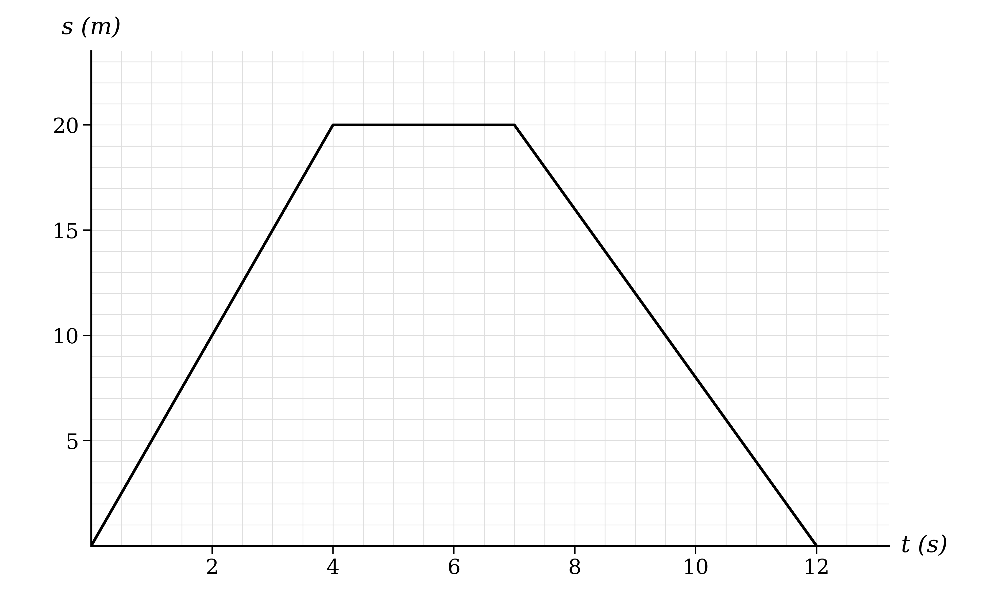

(i) Find the displacement of the particle from its starting position after 3 seconds.

(ii) For how long was the particle stationary?

(iii) Find the velocity of the particle for the last 5 seconds of its motion.

### Q3 — easy — 6 marks

**Q3** [2 marks]

In a bungee run a person runs as far as possible while attached to an elastic rope which is fixed at the point *O*. The displacement-time graph of a participant who attempts four consecutive runs is shown below. Displacement is measured in metres and time is measured in seconds.

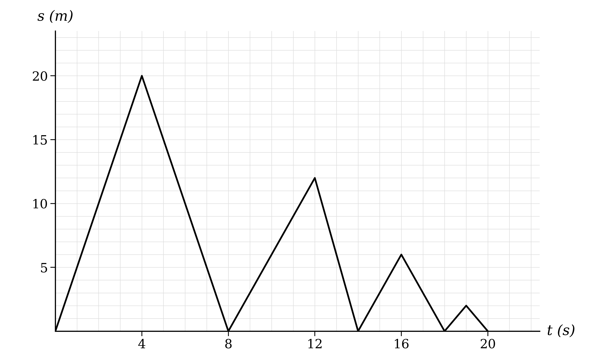

(i) Write down the greatest distance from *O* reached by the participant during the four runs.

(ii) Write down the time at which the participant is furthest from *O* on their third run.

**Q3** [4 marks]

Find the average speed of the participant over the four runs.

### Q4 — medium — 4 marks

**Q4** [4 marks]

The diagram shows part of the velocity-time graph for a particle moving in a straight line. The particle starts from rest and its acceleration during the first *T* seconds is $4 \text{m s}^{-2}$. After *T* seconds the particle has been displaced from its starting position by 18 m.

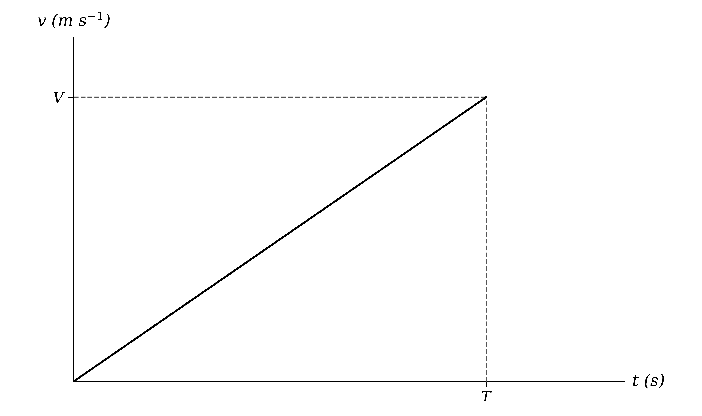

Find the values of *V* and *T*.

### Q5 — easy — 7 marks

**Q5** [3 marks]

The diagram shows the velocity-time graph for a particle moving in a straight line. Time is measured in seconds and velocity is measured in metres per second.

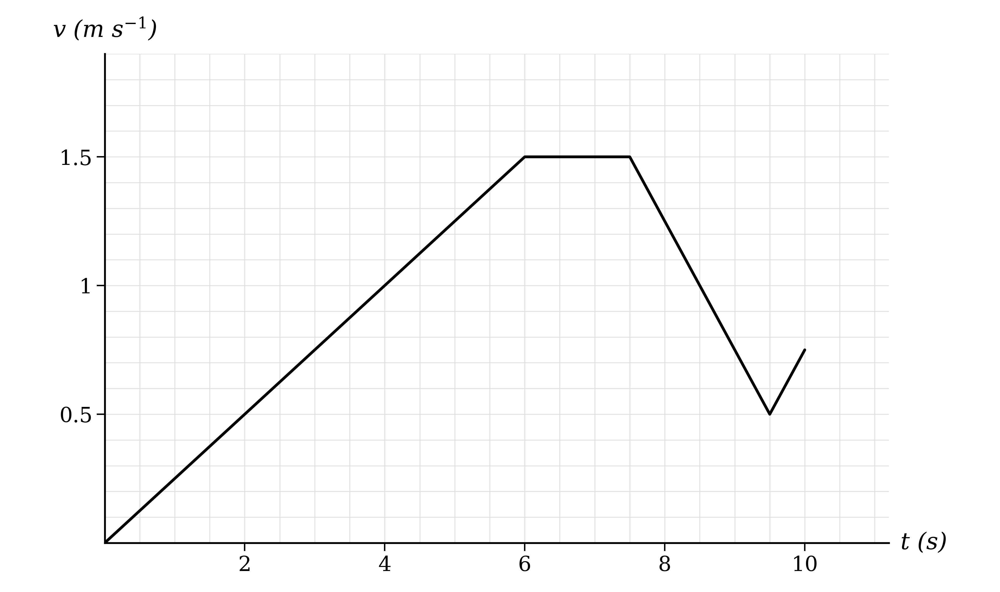

(i) Write down the velocity of the particle after 3 seconds.

(ii) Write down the speed of the particle after 8.5 seconds.

(iii) State the period of time during which the particle is moving with constant velocity.

**Q5** [2 marks]

Find the displacement of the particle from its starting position after 6 seconds.

**Q5** [2 marks]

Find the acceleration of the particle during the last 0.5 seconds of its motion.

### Q6 — easy — 3 marks

**Q6** [3 marks]

A marble rolls in a straight line along a tray. After 3 seconds its displacement from its initial position is 9 cm. 2 seconds later it has returned to its initial position. After another second the marble has a displacement of −6 cm, and it has returned to its initial position half a second later.

Sketch a displacement-time graph for the motion of the marble.

### Q7 — easy — 4 marks

**Q7** [4 marks]

The diagram shows the displacement-time graph for a particle moving in a straight line.

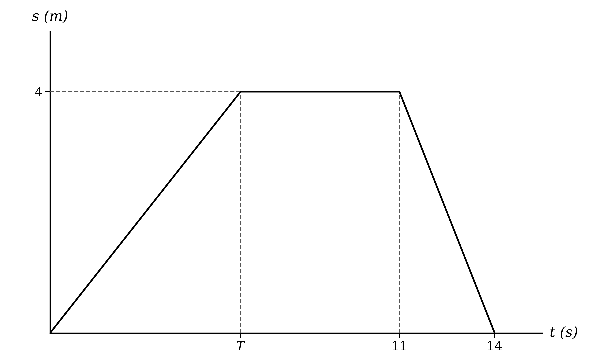

The speed of the particle during the first *T* seconds is half its speed during the last 3 seconds. Find the value of *T*.

### Q8 — easy — 5 marks

**Q8** [5 marks]

A particle moves in a straight line starting at the origin *O*. Initially at rest, it moves with constant acceleration for 6 seconds until it reaches the point *A*. The displacement of the particle at *A* is 9 m. The particle then decelerates uniformly for 4 seconds until it reaches the point *B* with velocity $2 \text{m s}^{-1}$. The particle then remains in motion at this velocity until it reaches the point *C*, where its displacement from *B* is 12 m.

Draw the velocity-time graph for the motion of the particle on the axes below, and show that the final displacement of the particle from *O* is 31 m.

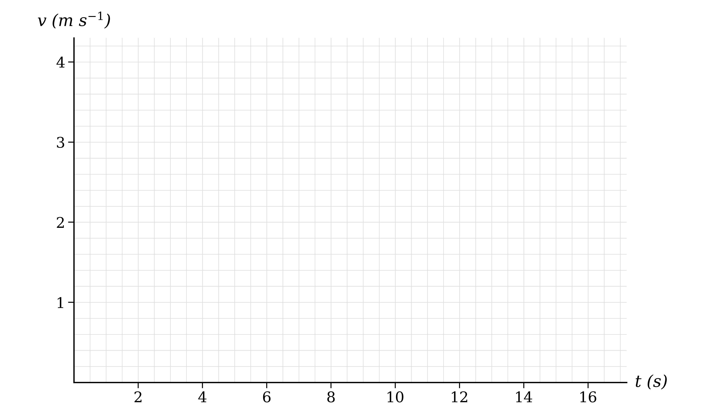

### Q9 — easy — 3 marks

**Q9** [3 marks]

A particle is set into motion with a constant velocity of $3 \text{m s}^{-1}$. After 5 seconds the particle stops and remains stationary for 6 seconds. The particle then moves with a constant velocity of $- 6 \text{m s}^{-1}$ until it returns to its initial position.

Sketch a displacement-time graph for the motion of the particle.

### Q10 — easy — 9 marks

**Q10** [3 marks]

The velocity-time graph below shows the motion of a particle moving in a straight line. Time is measured in seconds and velocity is measured in metres per second.

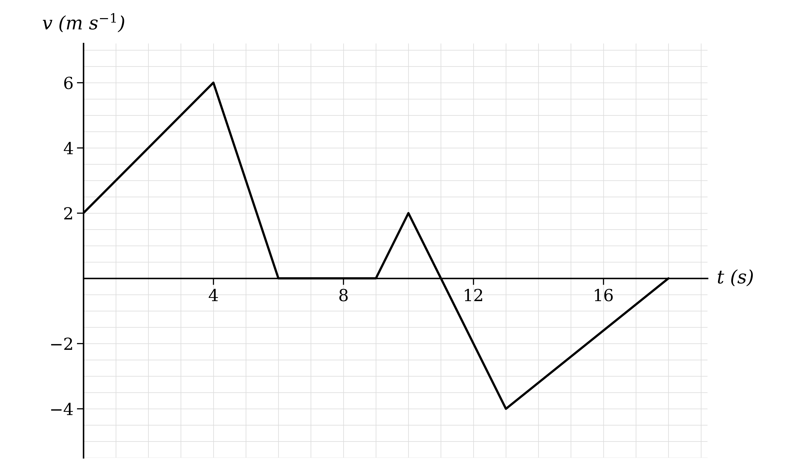

Write down

(i) the initial speed of the particle

(ii) the speed of the particle after 13 seconds

(iii) the time at which the particle is instantaneously at rest.

**Q10** [6 marks]

Find

(i) the acceleration of the particle during the first 4 seconds

(ii) the displacement of the particle during the first 6 seconds

(iii) the displacement of the particle during the last 7 seconds of its motion.

### Q11 — medium — 7 marks

**Q11** [3 marks]

A cable car crosses a river, running horizontally at a fixed height. It leaves one side of the river from rest with constant acceleration $2 \text{m s}^{-2}$ for 3 seconds. It then travels at constant speed until it has covered a further 24 m. The cable car then moves with constant acceleration $- 1 \text{m s}^{-2}$ until its velocity is $- 2 \text{m s}^{-1}$. It then decelerates uniformly and comes to rest on the other side of the river 5 seconds later.

Sketch the velocity-time graph for the journey of the cable car across the river.

**Q11** [2 marks]

Find the total distance travelled by the cable car.

**Q11** [2 marks]

Explain why 44 m would be a suitable upper bound for the width of the river where the cable car crosses it.

### Q12 — easy — 5 marks

**Q12** [3 marks]

A TV camera runs along a horizontal track beside the pitch at a rugby match. The pitch is 90 m long and the camera is initially positioned at the halfway line.

The camera moves from rest at a constant velocity and after 4 seconds has displacement −38 m. The camera then moves at a constant speed of $5 \text{m s}^{-1}$ to a position 17 m beyond the halfway line on the other side. It remains in this position for 6 seconds, then moves for the next 9 seconds with velocity $- 3 \text{m s}^{-1}$.

Sketch a displacement-time graph to illustrate the motion of the camera.

**Q12** [2 marks]

Find the average velocity of the camera during its motion.

### Q13 — very_hard — 9 marks

**Q13** [3 marks]

In a handicapped drag race two cars start side by side from rest, but car *A* is given a 2-second head start. Both cars accelerate in a straight horizontal line, and the first car to cross the finish line is declared the winner. Immediately after crossing the finish line each car deploys a parachute, enabling it to come to rest as quickly as possible.

The graph shows the velocities, in metres per second, of the two cars from the start of the race until they come to rest.

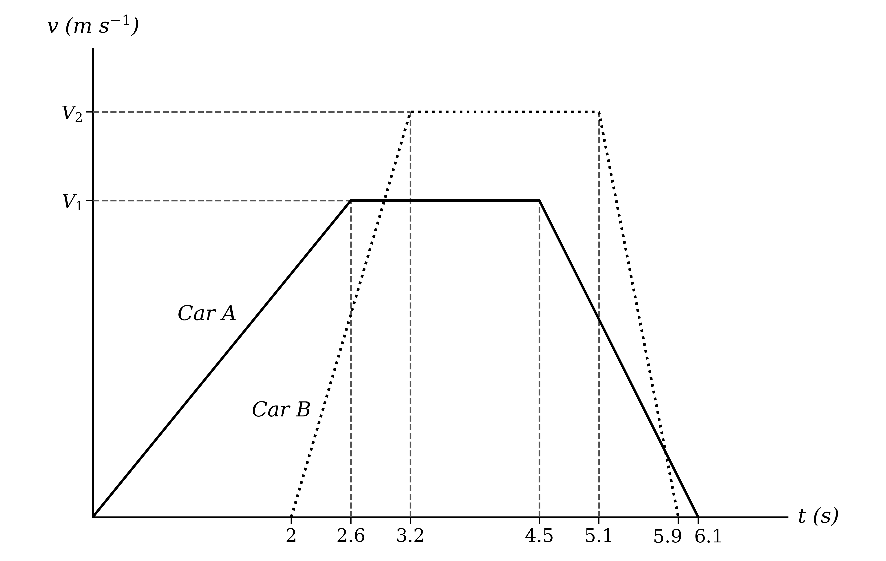

Show that $V_{2} = 1 . 28 V_{1}$.

**Q13** [2 marks]

The length of the race is 400 m. Find the values of $V_{1}$ and $V_{2}$.

**Q13** [4 marks]

Find the time, before either car crosses the finish line, at which the two cars have the same velocity.

### Q14 — medium — 6 marks

**Q14** [3 marks]

The diagram shows the velocity-time graph for a train travelling between two stations, starting at station *X* and finishing at station *Y*. Velocity is measured in kilometres per hour and time in minutes.

Find the distance between station *X* and station *Y*.

**Q14** [3 marks]

Find the greatest magnitude of the acceleration of the train, giving your answer in m s⁻².

### Q15 — very_hard — 6 marks

**Q15** [6 marks]

A robot is tested for accuracy by being programmed to walk back and forth along a straight horizontal line.

In a three-part test the robot walks with constant velocities of $- 0 . 5 \text{m s}^{-1}$, $1 . 5 \text{m s}^{-1}$ and $- 1 \text{m s}^{-1}$, in that order. Over the first two parts together its average velocity is $0 . 7 \text{m s}^{-1}$. The last part lasts 10 seconds, and the final displacement of the robot from its starting point is 4 m.

Plot the displacement-time graph of the robot on the axes below, labelling the coordinates of the points where its velocity changes and the coordinates of its final position.

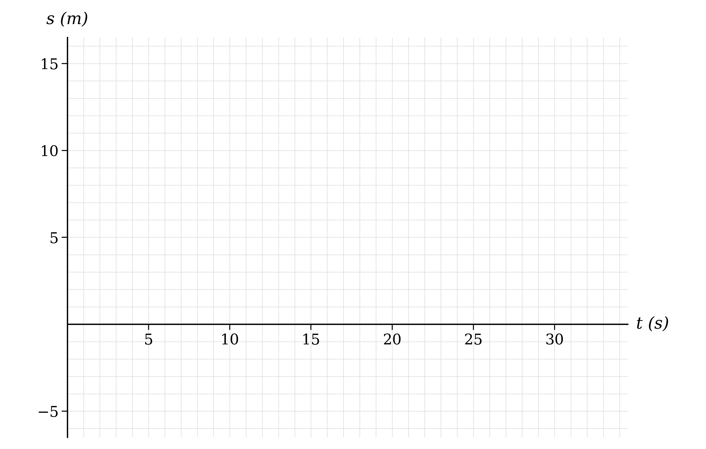

### Q16 — hard — 7 marks

**Q16** [4 marks]

A snooker ball is struck so that it travels in a straight line up and down a snooker table. The graph shows the velocity of the ball, $v \text{m s}^{-1}$, at time *t* seconds after it is struck.

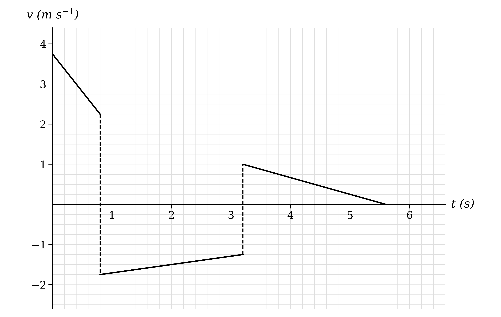

Write down the times at which the snooker ball hits a cushion, and hence find the length of the snooker table.

**Q16** [3 marks]

Show that the snooker ball comes to rest at exactly the point from which it was struck.

### Q17 — medium — 8 marks

**Q17** [8 marks]

The range of a mobility scooter is the distance it can travel on a single charge of its battery. The range is estimated by running the scooter on a machine that is equivalent to driving it along a straight horizontal road.

The scooter starts from rest and moves with constant acceleration $2 \text{m s}^{-2}$ for 4 seconds. It then maintains a constant velocity for the next 16 minutes. Its velocity is then reduced uniformly by a quarter, which takes 5 seconds, and it runs at this new velocity for a further 13.5 minutes. Finally, as the battery runs out, the scooter decelerates uniformly and comes to rest in 25 seconds.

Show that the scooter travels more than 12.6 km on a single charge, and that the battery lasts for approximately half an hour.

### Q18 — easy — 4 marks

**Q18** [4 marks]

A particle moves along a horizontal straight line. Its displacement from a fixed point *O*, in metres, is shown for the first 20 seconds of its motion on the displacement-time graph below.

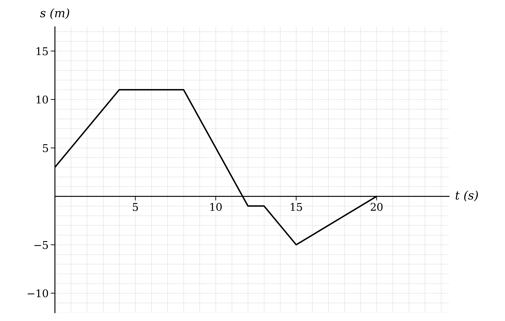

(i) Find the distance travelled by the particle in the first 10 seconds.

(ii) Find the average speed of the particle over the first 20 seconds.

### Q19 — hard — 6 marks

**Q19** [3 marks]

The diagram shows the displacement-time graph for a ferry travelling in a straight line between two ports, at the points *O* and *D* on the graph. Displacement is measured in metres and time in seconds. The points *A*, *B* and *C* do not represent ports.

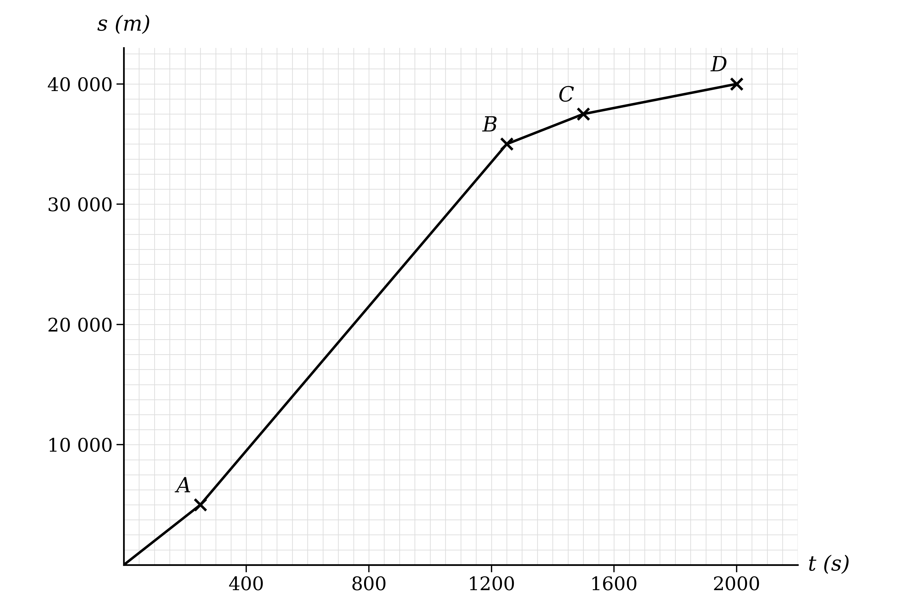

Find the difference between the velocities of the ferry during the fastest and the slowest parts of its journey.

**Q19** [3 marks]

The ferry company would like to reduce the total journey time. The velocity of the ferry can be increased only while it is more than 5 km from both ports, and the maximum speed of the ferry is $45 \text{m s}^{-1}$.

Find, to the nearest second, the greatest possible reduction in the journey time.

### Q20 — hard — 9 marks

**Q20** [3 marks]

Two particles, *P* and *Q*, start together at the top of a cliff at the same time, and each moves in a vertical line until it reaches the sea below. Particle *P* moves only downwards. Particle *Q* initially moves upwards.

The graph shows the displacements, in metres, of both particles above their starting point at time *t* seconds, until they reach the sea.

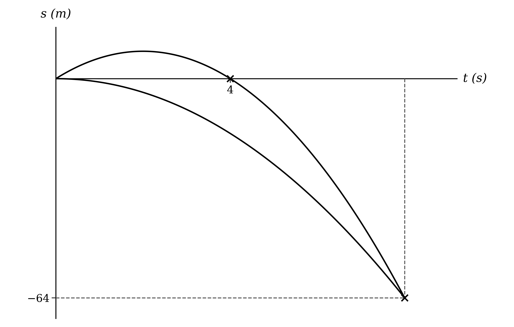

(i) Label the curves on the graph with *P* and *Q*.

(ii) Write down the height of the cliff.

(iii) One of the particles has a positive displacement for exactly half of the time it takes to reach the sea. Write down the time taken for each particle to reach the sea.

**Q20** [2 marks]

Without performing any calculations, explain how you know that the two particles have the same average velocity over their motion.

**Q20** [4 marks]

The displacement of particle *Q* is given by $s = A t ( B - t )$, where *A* and *B* are integers.

Find the greatest height of *Q* above the sea, and the time at which it reaches this height.

### Q21 — easy — 4 marks

**Q21** [4 marks]

A cable car crosses a river, running horizontally at a fixed height. It leaves one side of the river from rest with constant acceleration $1 . 2 \text{m s}^{-2}$ for 5 seconds. It then travels at constant speed until it has covered a further 42 m. The cable car then moves with constant acceleration $- 0 . 5 \text{m s}^{-2}$ until its velocity is $1 . 5 \text{m s}^{-1}$. It stays at this velocity for 5 seconds, before taking a further 6 seconds to come to rest with uniform deceleration.

Sketch the velocity-time graph for the journey of the cable car across the river.

### Q22 — medium — 5 marks

**Q22** [2 marks]

A ferry leaves a port *O* and travels in a straight line to its destination *C*. Its journey is shown on the displacement-time graph below, where displacement is measured in metres and time in seconds.

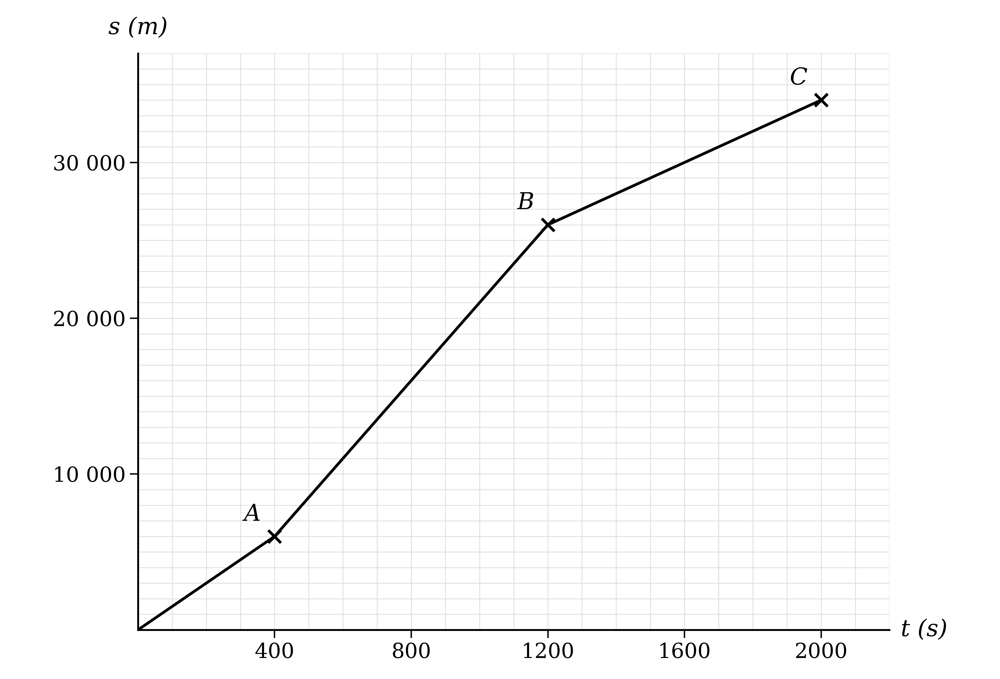

Find the velocity of the ferry during the fastest part of its journey.

**Q22** [3 marks]

The ferry company would like to reduce the total journey time from *O* to *C* by 5 minutes. The velocity of the ferry can be increased only between *A* and *B*.

Find the increase in velocity required.

### Q23 — medium — 9 marks

**Q23** [3 marks]

In drag racing, two cars start from rest side by side and accelerate rapidly in a straight horizontal line, the first to cross the finish line being declared the winner. Immediately after crossing the finish line each car releases a parachute, enabling it to decelerate to rest as quickly as possible.

The graph shows the velocities, in metres per second, of two cars from the start of a race until they come to rest afterwards.

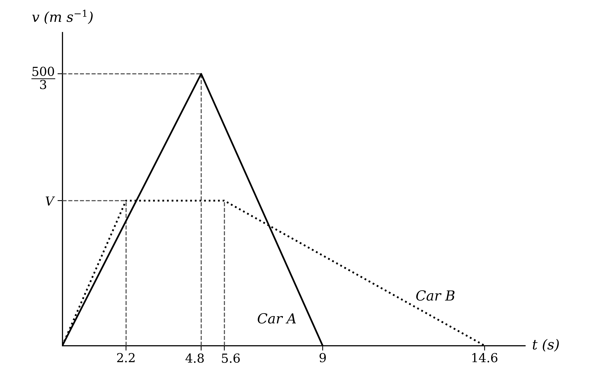

(i) State which car was still accelerating when it crossed the finish line.

(ii) Find the magnitude of the acceleration of car *A*.

**Q23** [3 marks]

The drag strip is 400 m long. Find the value of *V*.

**Q23** [3 marks]

Hence show that car *B* covered half of its total distance while it was decelerating.

### Q24 — hard — 7 marks

**Q24** [4 marks]

A TV camera runs along a horizontal track beside the pitch at a football match. The pitch is 100 m long and the camera is initially positioned at the halfway line.

The camera moves from rest at a constant velocity and after 5 seconds has displacement 35 m. It remains in this position for 3 seconds, before moving back to the halfway line at a constant speed of $10 \text{m s}^{-1}$. The camera then moves with constant velocity $- 2 . 5 \text{m s}^{-1}$ until it has travelled a total distance of 80 m.

Sketch a displacement-time graph to illustrate the motion of the camera.

**Q24** [3 marks]

Find the length of time for which the camera is more than 20 m from the halfway line.

### Q25 — hard — 9 marks

**Q25** [2 marks]

A snooker ball is struck so that it travels in a straight line up and down a snooker table. The graph shows the velocity of the ball, $v \text{m s}^{-1}$, at time *t* seconds after being struck.

(i) Write down the time at which the snooker ball hits the cushion.

(ii) Find the percentage reduction in the speed of the ball when it hits the cushion.

**Q25** [3 marks]

(i) Find the magnitude of the acceleration of the snooker ball before it hits the cushion.

(ii) Show that the magnitude of the acceleration of the snooker ball after it hits the cushion is $\frac{15}{10T-6} \text{m s}^{-2}$.

**Q25** [4 marks]

When the snooker ball comes to rest, its displacement from the point where it was struck is 0.3 m.

Find the value of *T* and the total distance travelled by the ball.

### Q26 — medium — 9 marks

**Q26** [3 marks]

A particle moves in a vertical line, starting at the top of a cliff and finishing when it reaches the sea below. At time *t* seconds the displacement of the particle above its starting point is *s* metres, where $s = 2 t ( 4 - t )$. The displacement-time graph for the motion is shown below.

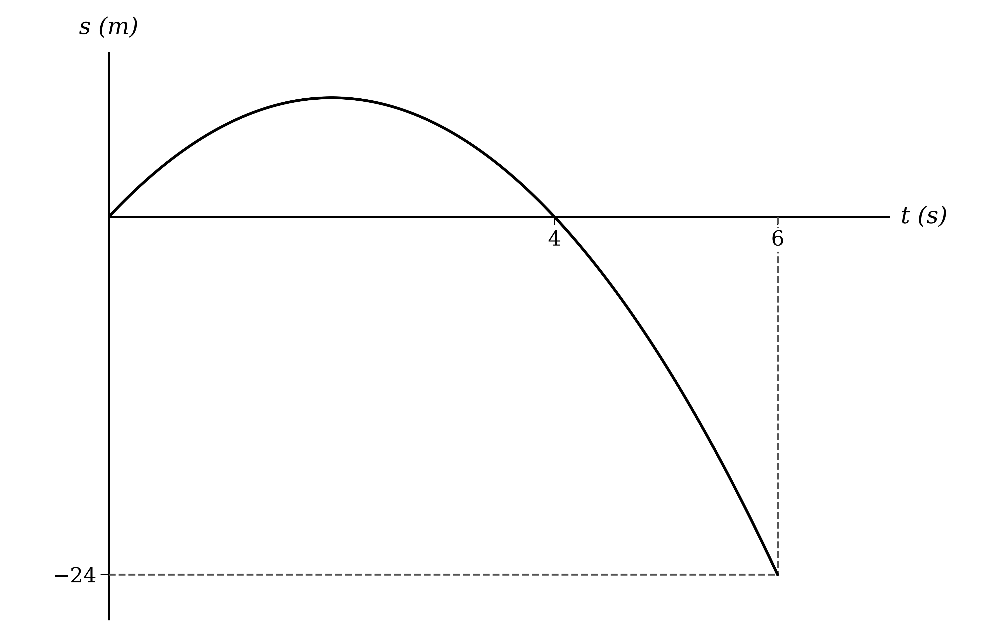

Find the greatest height of the particle above the sea.

**Q26** [2 marks]

Find the average velocity of the particle over the whole motion.

**Q26** [4 marks]

Find the average speed of the particle over the whole motion.

### Q27 — very_hard — 6 marks

**Q27** [6 marks]

The velocity-time graph below describes the motion of a particle moving in a straight line. Velocity is measured in metres per second and time in seconds.

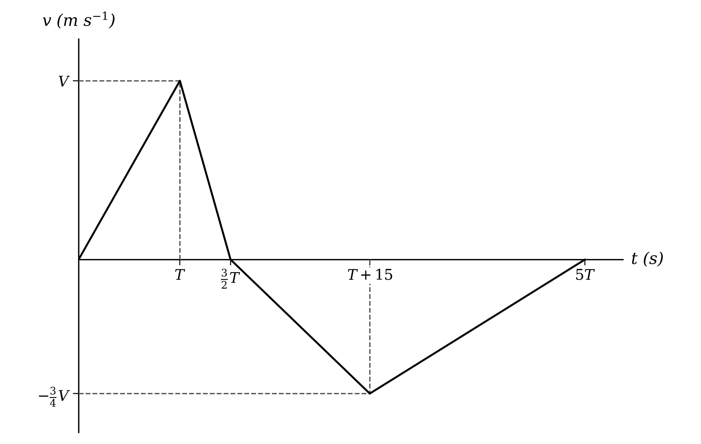

The final displacement of the particle from its starting position is −27 m, and the greatest magnitude of the acceleration of the particle during the motion is $1 . 5 \text{m s}^{-2}$.

Find the values of *V* and *T*.

### Q28 — easy — 5 marks

**Q28** [3 marks]

A TV camera runs along a horizontal track beside the pitch at a football match. The pitch is 80 m long and the camera is initially positioned at the halfway line.

The camera moves from rest at a constant velocity and after 6 seconds has displacement 24 m. It then moves back to the halfway line at a constant velocity, taking 12 seconds to do so. For the next 6 seconds the camera moves with constant velocity $- 3 \text{m s}^{-1}$.

Sketch a displacement-time graph to illustrate the motion of the camera.

**Q28** [2 marks]

(i) Write down the final displacement of the camera from the halfway line.

(ii) Write down the distance of the camera from the halfway line at the end of the motion.

### Q29 — medium — 6 marks

**Q29** [3 marks]

A particle moves in a vertical line, starting at the top of a cliff and finishing when it reaches the sea below. At time *t* seconds the displacement of the particle above its starting point is *s* metres. The displacement-time graph for the motion is shown below.

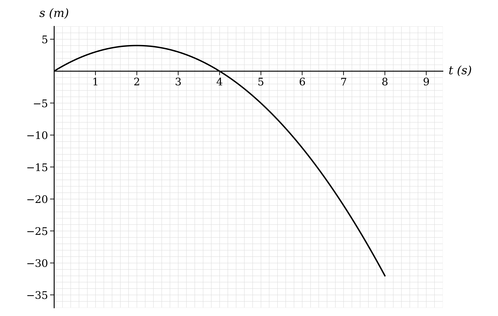

Use the graph to find

(i) the time taken for the particle to reach the sea,

(ii) the height of the cliff,

(iii) the time, other than $t = 0$, at which the displacement of the particle is zero.

**Q29** [3 marks]

Use the graph to find

(i) the time taken for the particle to reach its highest point, and the greatest height it reaches above its starting point,

(ii) the greatest height of the particle above the sea.

### Q30 — easy — 8 marks

**Q30** [4 marks]

A robot lawnmower is tested by running it back and forth along a 20 m horizontal strip of grass. Starting in the middle of the strip, the lawnmower moves with a constant velocity of $- 0 . 2 \text{m s}^{-1}$ for 15 seconds. The velocity is then changed instantly to $0 . 8 \text{m s}^{-1}$, and this is maintained until the lawnmower has displacement 9 m from its starting position. The lawnmower is left in this position for 2 seconds, before the final part of the test, in which it moves with a constant velocity of $- 0 . 5 \text{m s}^{-1}$ for 8 seconds.

Plot the displacement-time graph of the robot lawnmower on the axes below.

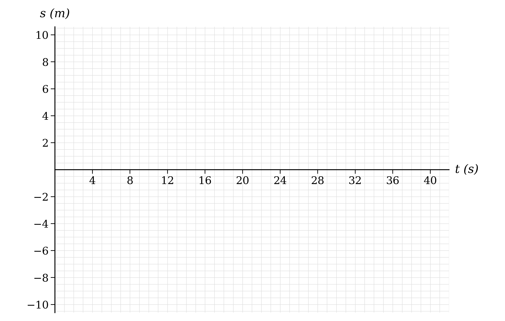

**Q30** [4 marks]

(i) Write down the time taken to complete the test.

(ii) Write down the final displacement of the robot lawnmower.

(iii) Find the distance travelled by the robot lawnmower during the test.

### Q31 — easy — 7 marks

**Q31** [2 marks]

A particle moves along a horizontal line starting at the point *O*. The displacement-time graph for the first 20 seconds of its motion is shown below. Displacement is measured in metres.

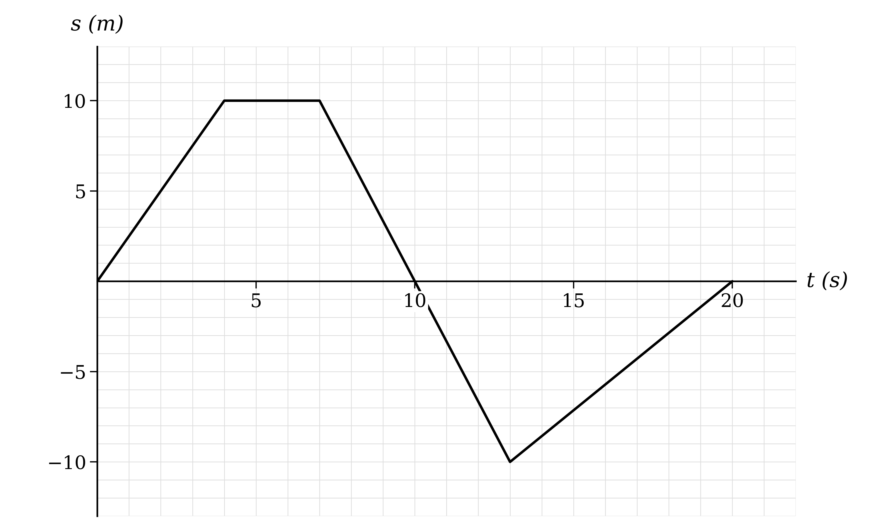

(i) Write down the displacement of the particle after 2 seconds.

(ii) Write down the distance travelled by the particle after 4 seconds.

**Q31** [3 marks]

Find the velocity of the particle between 13 and 20 seconds, and the speed of the particle between 7 and 10 seconds.

**Q31** [2 marks]

Find the total distance travelled by the particle during the 20 seconds.

### Q32 — easy — 5 marks

**Q32** [3 marks]

A ferry leaves port (point *O*) and travels directly towards its destination (point *B*). Its journey is shown on the displacement-time graph below, where displacement is measured in metres and time in seconds.

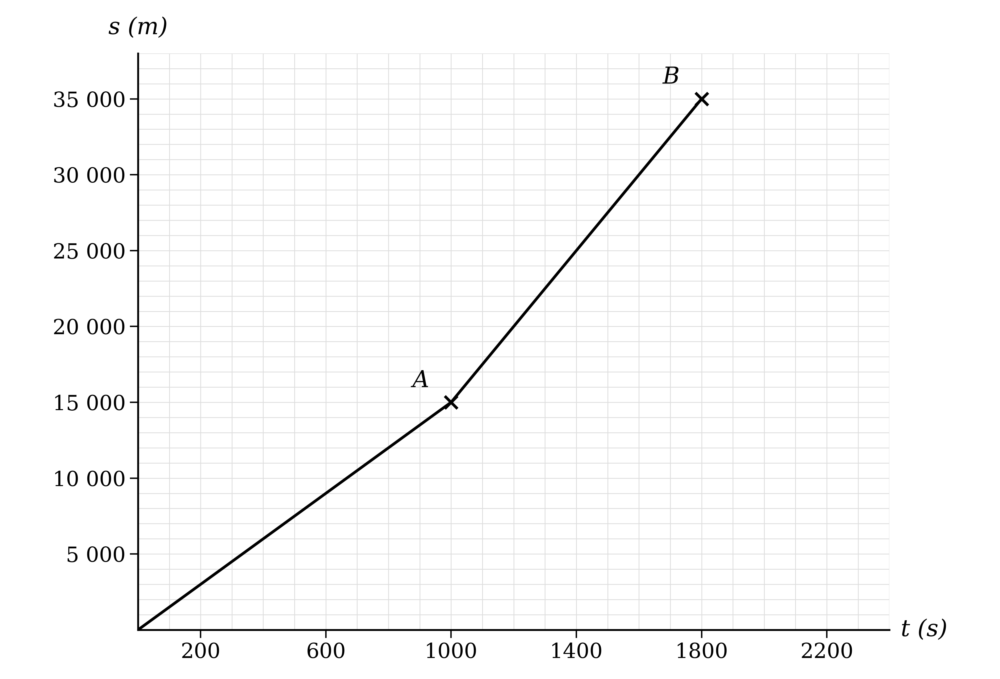

Use the graph to find

(i) the distance, in km, between the port and the destination,

(ii) the velocity of the ferry, in metres per second, between the points *A* and *B*.

**Q32** [2 marks]

The ferry company would like the journey to be completed within a maximum time of 25 minutes. Find, correct to 3 significant figures, the average velocity at which the ferry would need to travel in order to achieve this.

### Q33 — medium — 9 marks

**Q33** [2 marks]

A snooker ball is struck so that it travels in a straight line up and down a snooker table. The graph shows the velocity of the ball, $v \text{m s}^{-1}$, at time *t* seconds after being struck.

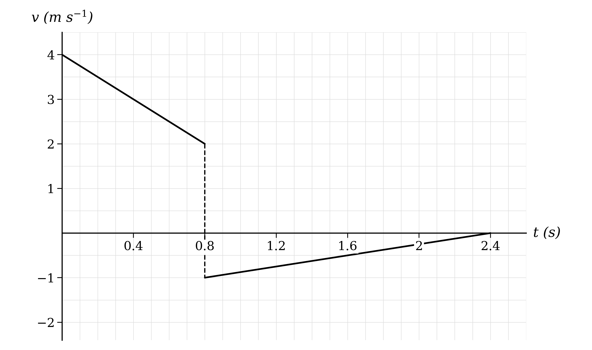

(i) Write down the time at which the snooker ball hits a cushion.

(ii) Find the amount by which the speed of the ball is reduced when it hits the cushion.

**Q33** [3 marks]

(i) Find the magnitude of the acceleration of the snooker ball before it hits the cushion.

(ii) After the ball hits the cushion its velocity is increasing, but the ball is slowing down. Explain briefly why this is so.

**Q33** [4 marks]

(i) Find the total distance travelled by the snooker ball.

(ii) Find the final displacement of the ball from its starting position.

### Q34 — medium — 6 marks

**Q34** [3 marks]

A trainee is practising a take-off manoeuvre by piloting an aircraft along a straight horizontal runway. The velocity-time graph below describes the motion of the aircraft, where velocity is measured in metres per second.

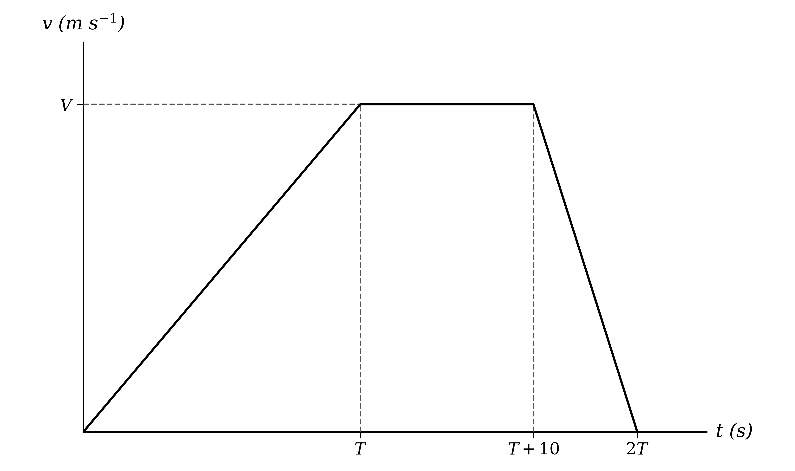

The aircraft accelerated at $5 \text{m s}^{-2}$, and the trainee pilot used 1.68 km of the runway to complete the manoeuvre.

Show that

(i) $V = 5 T$,

(ii) $V ( T + 5 ) = 1680$.

**Q34** [3 marks]

Hence find the values of *V* and *T*.

### Q35 — medium — 8 marks

**Q35** [4 marks]

In drag racing, two cars start from rest side by side and accelerate in a straight horizontal line, the first to cross the finish line being declared the winner. Immediately after crossing the finish line each car releases a parachute, enabling it to decelerate to rest as quickly as possible.

The graph shows the velocities, in metres per second, of two cars from the start of a race until they come to rest afterwards.

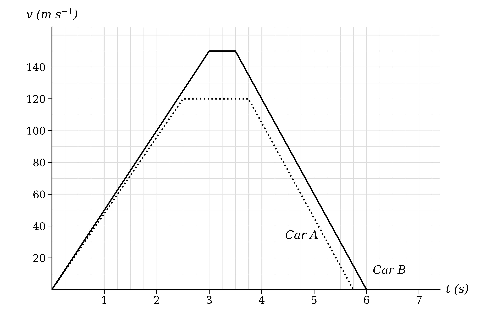

(i) State which car won the race.

(ii) Write down the top speed achieved by car *A* during the race.

(iii) Find the magnitude of the acceleration of car *B*.

**Q35** [3 marks]

Verify that both cars covered the length of the drag racetrack, 300 m, before decelerating.

**Q35** [1 mark]

Explain, without performing any calculations, how it can be seen from the graph that both cars had the same deceleration.

### Q36 — easy — 8 marks

**Q36** [2 marks]

The diagram shows the velocity-time graph for a train travelling between two stations, starting at station *A* and finishing at station *B*. Velocity is measured in metres per second and time in seconds.

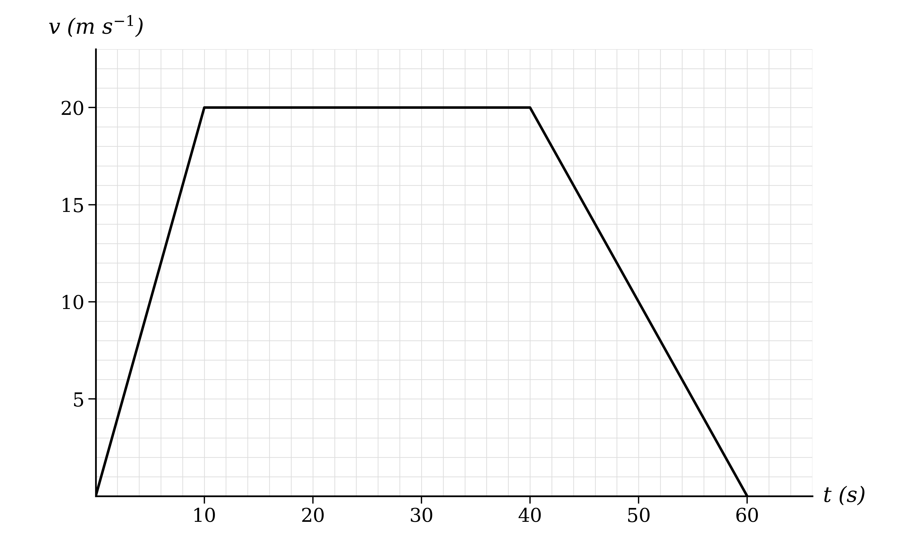

Find the displacement of the train in the first 10 seconds.

**Q36** [4 marks]

Find the distance between station *A* and station *B*.

**Q36** [2 marks]

Find the deceleration of the train during the last 20 seconds.

### Q37 — easy — 3 marks

**Q37** [3 marks]

A cable car crosses a river, running horizontally at a fixed height. It leaves one side of the river from rest with constant acceleration $3 \text{m s}^{-2}$ for 5 seconds. It then travels at constant speed until it has covered a further 45 m. The cable car then decelerates uniformly, coming to rest on the other side of the river 10 seconds later.

Sketch the velocity-time graph for the journey of the cable car across the river.
