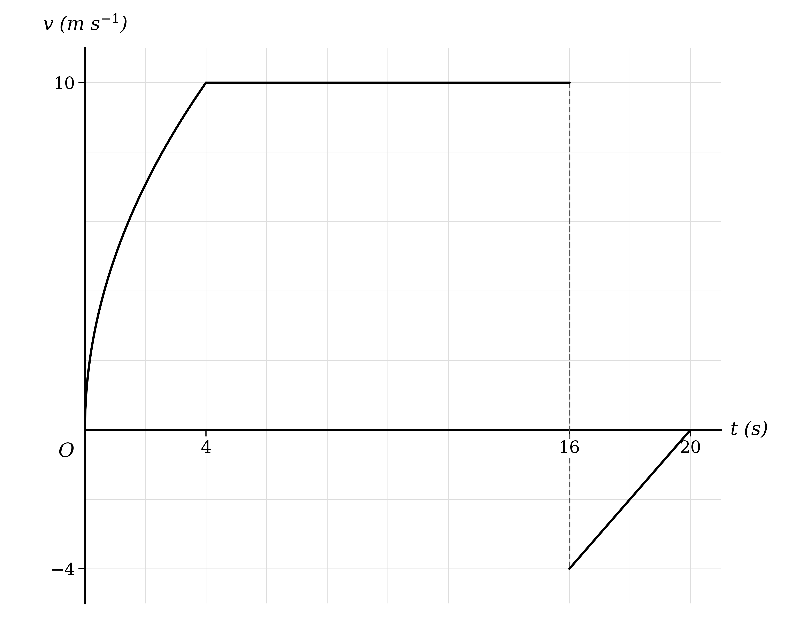

# Exam Questions — Variable Acceleration
**Kinematics (Straight Line Motion)** · Cambridge (CIE) AS maths (9709)
> Source: [https://www.savemyexams.com/as/maths/cie/20/mechanics/topic-questions/](https://www.savemyexams.com/as/maths/cie/20/mechanics/topic-questions/) · 29 questions across 1 sets

## Exam Questions (29 questions)

### Q1 — very_hard — 9 marks

**Q1** [5 marks]

A particle moves in a straight line, starting from a point $O$. At time $t$ hours after leaving $O$, the acceleration of the particle is $a \text{km h}^{-2}$, where

$a = \frac{1}{5} ( t - 11 )$

for $0 \leq t \leq 24$. When $t = 24$, the particle is back at $O$.

Show that the velocity, $v \text{km h}^{-1}$, of the particle at time $t$ hours is given by

`v = \dfrac{1}{10}\left(t^{2} - 22t + k\right)`

where $k$ is a constant to be found.

**Q1** [4 marks]

Find the exact total distance travelled by the particle for $0 \leq t \leq 24$.

### Q2 — hard — 6 marks

**Q2** [1 mark]

A go-kart manufacturer is testing a new model on a straight horizontal road. The go-kart starts from rest, and its velocity $v \text{m s}^{-1}$ at time $t$ seconds is modelled by

`v = k\left(t^{3} - 20t^{2} + 100t\right)`

for $0 \leq t \leq 12$, and

$v = 12$

for $t > 12$, where $k$ is a constant. There is no instantaneous change in the velocity of the go-kart at $t = 12$.

Show that $k = 0 . 25$.

**Q2** [5 marks]

Find the maximum velocity of the go-kart for $0 \leq t \leq 12$, and find the value of $t$, where $0 < t < 12$, at which the go-kart is instantaneously at rest.

### Q3 — very_hard — 8 marks

**Q3** [8 marks]

A high-speed train leaves a station from rest at time $t = 0$. Its displacement from the station at time $t$ seconds is $s$ m, where

$s = \frac{1}{p} t^{q}$

for $0 \leq t \leq 12$, and $p$ and $q$ are constants with $q > 1$.

In the first 10 seconds, the average velocity of the train is $\frac{5}{12} \text{m s}^{-1}$ and the average acceleration of the train is $\frac{1}{6} \text{m s}^{-2}$.

By first finding the values of $p$ and $q$, find an expression for the acceleration of the train for $0 \leq t \leq 12$.

### Q4 — hard — 6 marks

**Q4** [3 marks]

A particle moves along a straight line. At time $t$ seconds, the velocity of the particle is $v \text{m s}^{-1}$, where

$v = t^{\frac{3}{2}} - 6 t + 9 t^{\frac{1}{2}}$

for $t \geq 0$.

Find the values of $t$ at which the particle is instantaneously at rest.

**Q4** [3 marks]

Find the set of values of $t$ for which the acceleration of the particle is negative.

### Q5 — hard — 6 marks

**Q5** [2 marks]

A car travels along a straight horizontal road and passes a service station $S$ at time $t = 0$. The displacement of the car from $S$ at time $t$ seconds is modelled as $s$ m, where

`s = 0.4t\left(2t^{2} - 4t + 3\right)`

for $t \geq 0$.

Show that, according to the model, the car never returns to $S$.

**Q5** [4 marks]

Show that the car is decelerating for the first $\frac{2}{3}$ seconds after passing $S$.

### Q6 — hard — 7 marks

**Q6** [7 marks]

In a cheese-rolling competition, a cylindrical block of cheese starts from rest at the top of a hill at time $t = 0$. It rolls down the hill and reaches the flat ground at the bottom when $t = 15$, then slows down along the flat ground. The acceleration of the cheese at time $t$ seconds is modelled as $a \text{m s}^{-2}$, where

$a = 0 . 2 t$

for $0 \leq t \leq 15$, and

$a = 9 - t$

for $15 < t \leq A$, where $A$ is a constant. There is no instantaneous change in the velocity of the cheese at $t = 15$, and the cheese comes to rest when its acceleration is $- 9 \text{m s}^{-2}$.

By first finding the value of $A$, find the total distance the cheese rolls before it comes to rest.

### Q7 — hard — 7 marks

**Q7** [4 marks]

A home-made rocket is launched from rest at ground level at time $t = 0$. It moves in a vertical straight line, first upwards and then back down to the ground. At time $t$ seconds after launch, the acceleration of the rocket is $a \text{m s}^{-2}$, taking upwards as positive, where

$a = 6 + \frac{1}{2} t - \frac{1}{2} t^{2}$

Find the total time for which the rocket is in the air. Give your answer correct to 3 significant figures.

**Q7** [3 marks]

Find the total distance travelled by the rocket. Give your answer correct to 3 significant figures.

### Q8 — easy — 4 marks

**Q8** [1 mark]

A particle moves in a straight line. At time $t$ seconds, the acceleration of the particle is $a \text{m s}^{-2}$, where

$a = 6 t - 2$

Find the value of $t$ at which the acceleration of the particle is 10 $\text{m s}^{-2}$.

**Q8** [3 marks]

Given that the velocity of the particle is 68 $\text{m s}^{-1}$ when $t = 5$, find the velocity of the particle when $t = 8$.

### Q9 — easy — 5 marks

**Q9** [2 marks]

A particle moves in a straight line, starting from a point $O$. At time $t$ seconds after leaving $O$, the velocity of the particle is $v \text{m s}^{-1}$, where

$v = 8 t^{3} - 6 t^{2}$

Find the value of $t$, other than $t = 0$, at which the particle is instantaneously at rest.

**Q9** [3 marks]

Find the value of $t$, other than $t = 0$, at which the particle is next at $O$.

### Q10 — easy — 11 marks

**Q10** [4 marks]

A particle moves in a straight line. At time $t$ seconds, the velocity of the particle is $v \text{m s}^{-1}$, where

$v = 4 t - t^{2}$

for $0 \leq t \leq 5$.

(i) Find the values of $t$ for which the particle is instantaneously at rest.

(ii) Sketch the velocity-time graph for the motion of the particle for $0 \leq t \leq 5$.

**Q10** [4 marks]

(i) Show that the distance travelled by the particle between $t = 0$ and $t = 4$ is $\frac{32}{3}$ m.

(ii) Find the distance travelled by the particle between $t = 4$ and $t = 5$.

**Q10** [3 marks]

(i) Find the total distance travelled by the particle between $t = 0$ and $t = 5$.

(ii) Find the displacement of the particle from its initial position when $t = 5$.

### Q11 — easy — 5 marks

**Q11** [3 marks]

A particle $P$ moves in a straight line. At time $t$ seconds, the acceleration of $P$ is $a \text{m s}^{-2}$, where

$a = 12 t - 12 t^{2} + 10$

Show that the displacement, $s$ m, of $P$ from a fixed point $O$ on the line is given by

$s = 2 t^{3} - t^{4} + 5 t^{2} + c t + d$

where $c$ and $d$ are constants.

**Q11** [2 marks]

Given that $P$ starts from rest at $O$, write down the values of $c$ and $d$, and find the displacement of $P$ from $O$ when $t = 5$.

### Q12 — easy — 4 marks

**Q12** [2 marks]

A particle moves in a straight line. At time $t$ seconds, the velocity of the particle is $v \text{m s}^{-1}$, where

$v = 0 . 2 t^{2} - 0 . 1 t$

for $t \geq 0$.

Find the time at which the velocity of the particle is 1 $\text{m s}^{-1}$.

**Q12** [2 marks]

Find the acceleration of the particle when $t = 6$.

### Q13 — easy — 3 marks

**Q13** [1 mark]

A particle $P$ moves in a straight line. At time $t$ seconds, the displacement of $P$ from its initial position is $s$ m, where

$s = 3 t^{2} + 4 t$

Find the displacement of $P$ when $t = 12$.

**Q13** [2 marks]

Find the velocity of $P$ when $t = 8$.

### Q14 — easy — 7 marks

**Q14** [2 marks]

A particle moves in a straight line. At time $t$ seconds, the velocity of the particle is $v \text{m s}^{-1}$, where

$v = ( t - 4 ) ( t + 1 )$

for $0 \leq t \leq 6$, and

$v = 14$

for $t > 6$.

(i) Find the initial speed of the particle.

(ii) Write down the acceleration of the particle for $t > 6$.

**Q14** [2 marks]

Find the acceleration of the particle when $t = 5$.

**Q14** [3 marks]

Show that the displacement of the particle from its initial position, for $0 \leq t \leq 6$, is given by

$s = \frac{1}{3} t^{3} - \frac{3}{2} t^{2} - 4 t$

### Q15 — medium — 7 marks

**Q15** [5 marks]

A zip-wire runs in a straight horizontal line between two trees in a children's park. A child on the zip-wire leaves the first tree from rest at time $t = 0$. The velocity-time graph shows the motion of the child, where $v \text{m s}^{-1}$ is the velocity of the child at time $t$ seconds.

For $0 \leq t \leq 4$, the velocity is given by $v = 5 t^{\frac{1}{2}}$. The child reaches the second tree at $t = 16$ and rebounds from it, then moves back towards the first tree, coming to rest at $t = 20$.

(i) Find the distance between the two trees.

(ii) Find the distance of the child from the second tree when the child comes to rest.

**Q15** [2 marks]

Find the acceleration of the child when $t = 1$.

### Q16 — medium — 7 marks

**Q16** [3 marks]

A home-made rocket is launched from rest at ground level at time $t = 0$ and moves vertically. At time $t$ seconds after launch, the acceleration of the rocket is $a \text{m s}^{-2}$, where

$a = 56 + t - t^{2}$

(i) Find an expression for the velocity of the rocket in terms of $t$.

(ii) Find the value of $t$, other than $t = 0$, at which the velocity of the rocket is zero. Give your answer correct to 3 significant figures.

**Q16** [4 marks]

Find the greatest height reached by the rocket, giving your answer in kilometres correct to 3 significant figures.

### Q17 — medium — 7 marks

**Q17** [4 marks]

A go-kart manufacturer is testing a new model on a straight horizontal road. The go-kart starts from rest, and its velocity $v \text{m s}^{-1}$ at time $t$ seconds is modelled by

$v = \frac{1}{w} t^{2} ( 60 - t )$

for $0 \leq t \leq 60$, where $w$ is a constant.

Given that the maximum speed of the go-kart is 32 $\text{m s}^{-1}$, find the value of $w$ and the time at which the go-kart reaches its maximum speed.

**Q17** [3 marks]

(i) Find the maximum acceleration of the go-kart.

(ii) Justify that your answer to part (i) is a maximum.

### Q18 — medium — 5 marks

**Q18** [2 marks]

A particle moves along a straight line. At time $t$ seconds, the velocity of the particle is $v \text{m s}^{-1}$, where

$v = t - 4 t^{\frac{1}{2}} + 3$

for $t \geq 0$.

Find the values of $t$ at which the particle is instantaneously at rest.

**Q18** [3 marks]

Find the distance travelled by the particle while its velocity is negative.

### Q19 — hard — 9 marks

**Q19** [4 marks]

A particle moves in a straight line. At time $t = 0$ it passes through a fixed point $O$ with velocity 36 $\text{m s}^{-1}$. For $t > 0$, the acceleration of the particle is $a \text{m s}^{-2}$, where

$a = 6 - 15 t^{-\frac{1}{2}}$

Find the values of $t$ at which the particle is instantaneously at rest.

**Q19** [5 marks]

Find the total distance travelled by the particle for $0 \leq t \leq 16$.

### Q20 — hard — 10 marks

**Q20** [4 marks]

A bullet train leaves a station from rest at time $t = 0$. For $0 \leq t \leq 8$, the displacement of the train from the station is $s$ m, where

$s = \frac{3}{200} t^{3}$

During this time the acceleration of the train increases until it reaches its maximum value of 0.72 $\text{m s}^{-2}$.

Show that the train reaches its maximum acceleration when $t = 8$.

**Q20** [3 marks]

After reaching its maximum acceleration, the train continues to accelerate at 0.72 $\text{m s}^{-2}$ until its velocity reaches 75 $\text{m s}^{-1}$.

Find the time taken for the velocity of the train to increase to 75 $\text{m s}^{-1}$ at this constant acceleration.

**Q20** [3 marks]

The train then travels at a constant velocity of 75 $\text{m s}^{-1}$ for 10 minutes.

Find the displacement of the train from the station at the end of these 10 minutes. Give your answer in kilometres correct to 3 significant figures.

### Q21 — easy — 5 marks

**Q21** [2 marks]

An athlete training for the 100 m sprint aims to run according to the model

$s = 0 . 4 t^{2} + 3 . 5 t$

where $s$ m is the displacement of the athlete from the starting point at time $t$ seconds.

Find, according to the model, the time the athlete takes to complete the 100 m sprint. Give your answer correct to 3 significant figures.

**Q21** [3 marks]

Show that, according to the model, the acceleration of the athlete is constant.

### Q22 — easy — 6 marks

**Q22** [3 marks]

In a cheese-rolling competition, a cylindrical block of cheese rolls down a hill, starting from rest at the top of the hill. At time $t$ seconds, the acceleration of the cheese is modelled as $a \text{m s}^{-2}$, where

$a = 1 + 0 . 1 t$

for $0 \leq t \leq 20$. The cheese reaches the bottom of the hill when $t = 20$.

Find the velocity of the cheese when it reaches the bottom of the hill.

**Q22** [3 marks]

Find the length of the hill, as travelled by the cheese.

### Q23 — medium — 7 marks

**Q23** [5 marks]

A go-kart manufacturer is testing a new model on a straight horizontal road. The go-kart starts from rest, and its velocity $v \text{m s}^{-1}$ at time $t$ seconds is modelled by

$v = \frac{1}{10} t ( 36 - t )$

for $t \geq 0$.

Find the maximum velocity of the go-kart and the time at which it occurs. Justify that this is a maximum.

**Q23** [2 marks]

The test ends when the go-kart next comes to rest. Find the time at which the test ends.

### Q24 — medium — 8 marks

**Q24** [3 marks]

A particle moves in a straight line. At time $t$ seconds, the velocity of the particle is $v \text{m s}^{-1}$, where

$v = 12 t - 2 t^{2}$

for $0 \leq t \leq 10$.

Sketch the velocity-time graph for the motion of the particle for $0 \leq t \leq 10$.

**Q24** [5 marks]

Show that the total distance travelled by the particle for $0 \leq t \leq 10$ is $\frac{632}{3}$ m.

### Q25 — easy — 5 marks

**Q25** [3 marks]

A particle moves in a straight line. At time $t$ seconds, the velocity of the particle is $v \text{m s}^{-1}$, where

$v = t^{2} - 4 t + 4$

for $t \geq 0$.

(i) Write down the initial velocity of the particle.

(ii) Find the value of $t$ at which the particle is instantaneously at rest.

**Q25** [2 marks]

Show that the acceleration of the particle is negative for the first 2 seconds of its motion.

### Q26 — easy — 6 marks

**Q26** [1 mark]

A high-speed train leaves a station from rest at time $t = 0$. Its displacement from the station at time $t$ seconds is $s$ m, where

$s = \frac{1}{k} t^{3}$

for $0 \leq t \leq 20$, and $k$ is a constant.

Find an expression, in terms of $t$ and $k$, for the velocity of the train for $0 \leq t \leq 20$.

**Q26** [3 marks]

The acceleration of the train is 0.6 $\text{m s}^{-2}$ when $t = 20$.

Find the value of $k$.

**Q26** [2 marks]

Find the distance travelled by the train in the first 20 seconds.

### Q27 — medium — 7 marks

**Q27** [4 marks]

A particle moves along a straight line. At time $t$ seconds, the acceleration of the particle is $a \text{m s}^{-2}$, where

$a = 6 - 3 t^{\frac{1}{2}}$

for $t \geq 0$. The velocity of the particle is 8 $\text{m s}^{-1}$ when $t = 4$.

Find an expression for the velocity of the particle in terms of $t$.

**Q27** [3 marks]

(i) Find the value of $t$, other than $t = 0$, at which the velocity of the particle is zero.

(ii) Hence state the set of values of $t$ for which the velocity of the particle is positive.

### Q28 — medium — 6 marks

**Q28** [3 marks]

A particle $P$ moves in a straight line, starting from rest at a fixed point $O$. The displacement of $P$ from $O$ at time $t$ seconds is $s$ m, where

$s = 18 t^{2} - t^{3}$

(i) Find the displacement of $P$ from $O$ when $t = 3$.

(ii) Find the value of $t$, other than $t = 0$, at which $P$ is back at $O$.

**Q28** [3 marks]

Find the greatest displacement of $P$ from $O$ before it returns to $O$.

### Q29 — easy — 7 marks

**Q29** [3 marks]

A home-made rocket is launched from rest at ground level at time $t = 0$ and moves vertically upwards. At time $t$ seconds after launch, the acceleration of the rocket is $a \text{m s}^{-2}$, where

$a = 40 + 6 t - t^{2}$

(i) Write down the acceleration of the rocket at launch.

(ii) Find the acceleration of the rocket when $t = 9$.

**Q29** [4 marks]

(i) Find an expression for the velocity, $v \text{m s}^{-1}$, of the rocket in terms of $t$.

(ii) Find an expression for the height, $s$ m, of the rocket above the ground in terms of $t$.
