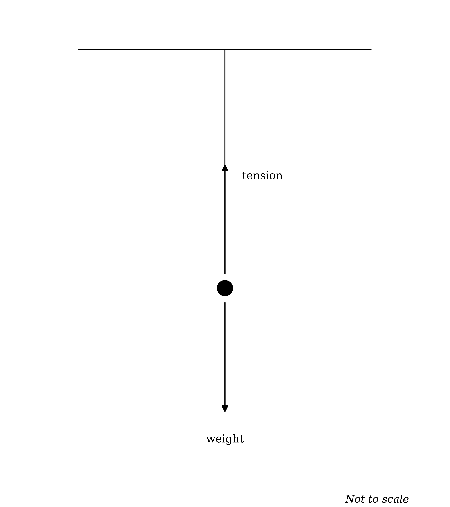
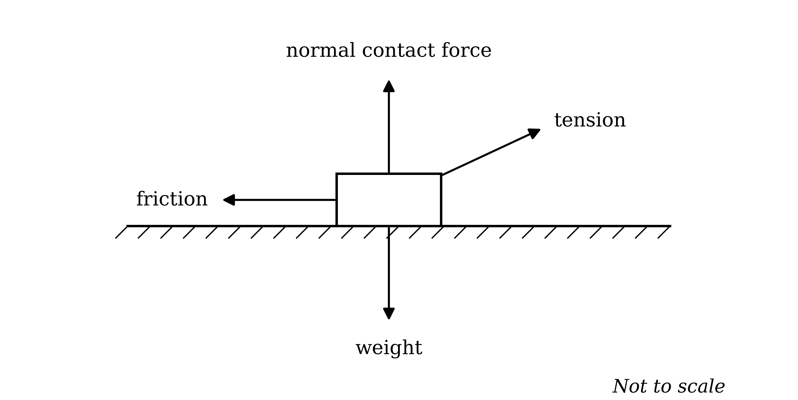
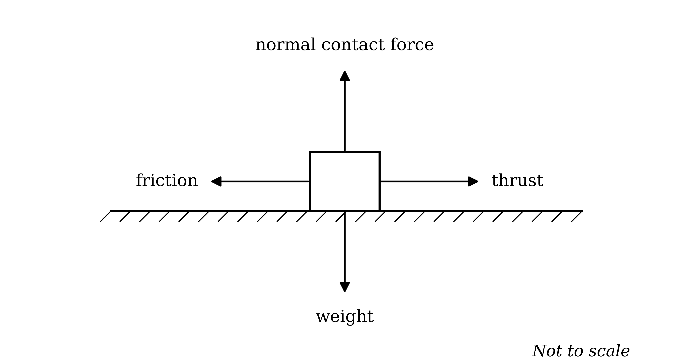
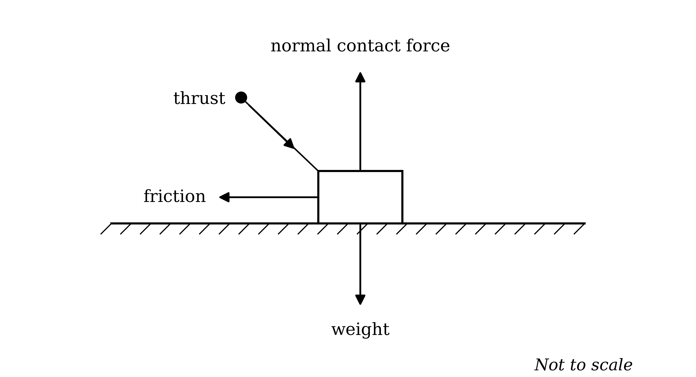
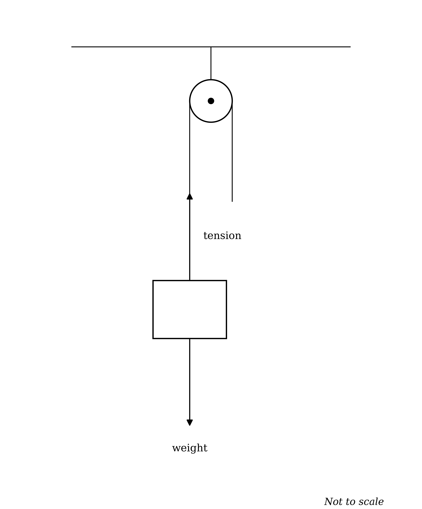

# Mark Schemes — Quantities, Units & Modelling
**Mechanics Toolkit** · Cambridge (CIE) AS maths (9709)

## Exam Questions (28 questions)

### Q1
(i)

A Newton's third law pair consists of two forces which two bodies exert on each other, so the two forces always act on different bodies

**Final answer:** **P and Q both act on the person, so they act on the same body**

**[B1]**

(ii)

The partner to the force the floor exerts on the person is the force the person exerts back on the floor

**Final answer:** **The force exerted by the person on the floor, acting vertically downwards**

**[B1]**

(iii)

Accelerating upwards needs a resultant force upwards, and the only upward force on the person is the normal contact force

**Final answer:** **P becomes larger than Q**

**[B1]**

Newton's third law holds whatever the bodies are doing, so the pair is unaffected by the acceleration

**Final answer:** **The pair named in part (ii) stays equal in magnitude to P**

**[B1]**

> **[mark-scheme]**
> **B1**: Both forces act on the person, that is on the same body, whereas a third law pair acts on two different bodies. "They are different types of force" is also accepted, since the two forces in a Newton's third law pair are always of the same type.
> 
> **B1**: The force exerted by the person on the floor, acting vertically downwards. Both what it acts on and the direction are needed.
> 
> **B1**: $P$ becomes larger than $Q$. Accept a supporting reason such as "there must be a resultant force upwards", but the comparison alone scores.
> 
> **B1**: The pair remains equal in magnitude to $P$, because Newton's third law applies whether or not the bodies are accelerating.

### Q2
(i)

Distance adds up every metre covered, whichever way the runner was facing

$\text{distance} = 600 + 600$

**Final answer:** **1200 m**

**[B1]**

Displacement records only where the runner finished relative to where she started, and she has returned to $O$

**Final answer:** **0 m**

**[B1]**

(ii)

Average speed uses the total distance and the total time, and the whole journey took $200 + 300 = 500$ s

$\text{average speed} = \frac{1200}{500}$

**Final answer:** **2.4 **$\text{m s}^{-1}$

**[B1]**

Average velocity uses the displacement over the same total time, and the displacement is zero

$\text{average velocity} = \frac{0}{500}$

**Final answer:** **0 **$\text{m s}^{-1}$

**[B1]**

> **[mark-scheme]**
> **B1**: 1200, in metres.
> 
> **B1**: 0. Accept "zero". Do not accept 1200, which is the distance.
> 
> **B1**: An answer which rounds to 2.4, in $\text{m s}^{-1}$, from $1200 \div 500$. Follow through from a wrong total distance.
> 
> **B1**: 0. This mark requires the average velocity to be obtained from the displacement, so award it for $0 \div 500$ or for a clear statement that the displacement is zero and therefore so is the average velocity. Units are not required anywhere in this question.

### Q3
(i)

The weight of a body is the force of gravity on it, given by $W = m g$

$W_{\text{Earth}} = 80 \times 10$

**Final answer:** **800 N**

**[B1]**

$W_{\text{Moon}} = 80 \times 1 . 6$

**Final answer:** **128 N**

**[B1]**

(ii)

Mass measures how much matter the body contains, and travelling to the Moon does not add or remove any of it

**Final answer:** **The mass is unchanged**

**[B1]**

Weight is a force, and it is found by multiplying that mass by the local value of $g$, which is smaller on the Moon

**Final answer:** **The weight changes because g is different, but the mass is a property of the body itself**

**[B1]**

> **[mark-scheme]**
> **B1**: 800, in newtons, from $80 \times 10$. Units are not required.
> 
> **B1**: 128, in newtons, from 80 × 1.6.
> 
> **B1**: The mass is unchanged.
> 
> **B1**: An explanation that mass is the amount of matter in the body and does not depend on location, while weight is the force $m g$ and depends on the local value of $g$. Both halves of the contrast are needed; "because gravity is weaker on the Moon" alone does not score, since it explains the weight but not the mass.

### Q4
(i)

The weight of a body is the force of gravity acting on it, given by $W = m g$ with $m = 24$ and $g = 10$

$W = 24 \times 10$

**[M1]**

**Final answer:** **240 N**

**[A1]**

(ii)

The kilogram measures how much matter a body contains, which is a different quantity from the force gravity exerts on it

**Final answer:** **Kilograms measure mass, not weight**

**[B1]**

Weight is a force, so it is measured in the unit used for every other force

**Final answer:** **Weight is a force and is measured in newtons**

**[B1]**

> **[exam-tip]**
> In everyday speech "weight" and "mass" are used interchangeably, but in mechanics they are different quantities in different units. The mass is what the question gives you; the weight is what you put into a force equation. Whenever a question hands you a mass in kilograms and you need a force, multiply by $g$ first.

> **[mark-scheme]**
> **M1**: Use of $W = m g$ with $m = 24$ and $g = 10$. The mark is for multiplying the mass by 10; it is available even if the arithmetic then goes wrong.
> 
> **A1**: 240, in newtons. Units are not required for the mark.
> 
> **B1**: A statement that kilograms are the unit of mass, not of weight. Accept "24 kg is the mass of the crate".
> 
> **B1**: A statement that weight is a force, measured in newtons. Both this and the previous mark may be earned in a single sentence which makes both points.
> 
> Accept an answer which makes the point by giving the correct version, provided both ideas appear, for example "the mass is 24 kg and the weight is 240 N, because weight is a force measured in newtons".

### Q5
(i)

Gravity pulls the book downwards, and this force is the weight of the book

**Final answer:** **The weight, acting vertically downwards**

**[B1]**

The table is in contact with the book and pushes it away from the surface, at right angles to the surface

**Final answer:** **The normal contact force, acting vertically upwards**

**[B1]**

(ii)

Newton's third law pairs act on two different bodies, so the partner to the force the table exerts on the book is the force the book exerts on the table

**Final answer:** **The book exerts a force on the table, equal in magnitude and acting vertically downwards**

**[B1]**

> **[mark-scheme]**
> **B1**: The weight, acting vertically downwards. Accept "mg" or "gravity". The direction is required.
> 
> **B1**: The normal contact force, acting vertically upwards. Accept "normal reaction", "reaction" or "R". The direction is required. Both forces may be shown on a diagram with arrows instead of being written out.
> 
> **B1**: The force exerted by the book on the table, equal in magnitude and acting vertically downwards. All three of what exerts it, what it acts on, and the direction are needed for the mark.
> 
> Do not accept "the weight of the book": the weight acts on the book, not on the table, so it is not the third law partner of a force the table exerts.

### Q6
A scalar has magnitude only; a vector has magnitude and a direction

(i)

A force acts in a particular direction, which is why forces are drawn as arrows on a force diagram

**Final answer:** **Vector**

**[B1]**

(ii)

Acceleration is the rate of change of velocity, and here it is stated to be vertically upwards

**Final answer:** **Vector**

**[B1]**

(iii)

The statement gives both a size and a direction for the acceleration

**Final answer:** **Vector**

**[B1]**

(iv)

A distance covered says how far the cyclist has travelled but not in which direction

**Final answer:** **Scalar**

**[B1]**

> **[exam-tip]**
> Part (iv) is the one to watch. Distance and displacement are easy to blur together, but only displacement records which way you went, so only displacement is a vector. If the question had said "moves 3200 m north" it would have been a displacement, and the answer would flip.

> **[mark-scheme]**
> **B1**: Vector. Force is a vector quantity.
> 
> **B1**: Vector. Acceleration is a vector quantity.
> 
> **B1**: Vector. Acceleration is a vector quantity, and a direction is given.
> 
> **B1**: Scalar. A distance is a scalar quantity, because no direction is given.
> 
> A reason is not required; the single word scores.

### Q7
Velocity and displacement are both vectors, so each takes the sign of the direction of travel

(i)

Lock A lies to the left of home, so the barge travels against the positive direction

$- 6 \text{km h}^{-1}$

**[B1]**

(ii)

Lock A is 7 km from home, again measured against the positive direction

$- 7 \text{km}$

**[B1]**

> **[mark-scheme]**
> **B1**: $- 6$, in $\text{km h}^{-1}$. The negative sign is essential; 6 without a sign does not score. Units are not required.
> 
> **B1**: $- 7$, in km. The negative sign is essential.
(i)

Travelling from Lock B back to home moves against the positive direction

$- 4 \text{km h}^{-1}$

**[B1]**

(ii)

Displacement is measured from the starting point to the finishing point, and the barge has finished where it began

$0 \text{km}$

**[B1]**

> **[mark-scheme]**
> **B1**: $- 4$, in $\text{km h}^{-1}$. The negative sign is essential.
> 
> **B1**: 0. Accept "zero". Do not accept 20 km, which is the total distance travelled, not the displacement.
The barge is travelling towards the left, so its velocity is negative throughout this stretch

$v = - 4$

**[B1]**

Slowing down means the speed falls towards zero

**Final answer:** **The velocity increases from −4 towards 0, so the acceleration is positive**

**[B1]**

> **[mark-scheme]**
> **B1**: A statement that the velocity is negative on this stretch, because the barge is travelling in the negative direction.
> 
> **B1**: A statement that the velocity is increasing towards zero, so the acceleration is positive. Accept "the acceleration is opposite in direction to the velocity, and the velocity is negative, so the acceleration is positive".
> 
> Do not award the second mark for "deceleration means negative acceleration", which is the misconception the question is testing.

### Q8
(i)

The word removes each block's size and shape from the problem

**Final answer:** **"Particle" means each block has no dimensions, so all the forces on it act at a single point**

**[B1]**

(ii)

A smooth contact exerts no force along the surface, only at right angles to it

**Final answer:** **"Smooth" means there is no friction between A and the table**

**[B1]**

> **[mark-scheme]**
> **B1**: Each block is treated as a single point whose dimensions are ignored, so all the forces act at that point. Accept "the size and shape of the blocks do not matter".
> 
> **B1**: There is no frictional force between block A and the table.
(i)

None of the tension is then used up supporting the string itself

**Final answer:** **"Light" means the string has no mass, so the tension is the same at both ends**

**[B1]**

(ii)

The two ends then stay the same distance apart along the string

**Final answer:** **"Inextensible" means the string cannot stretch, so A and B move with the same speed and the same acceleration**

**[B1]**

(iii)

A smooth pulley exerts no frictional force on the string passing over it

**Final answer:** **"Smooth" means the pulley exerts no friction on the string, so the tension is the same on both sides**

**[B1]**

> **[exam-tip]**
> These three assumptions are what let you write a single letter $T$ for the tension everywhere in the string and a single letter $a$ for the acceleration of both blocks. Without them you would need four separate unknowns, and connected-particle questions would be unsolvable!

> **[mark-scheme]**
> **B1**: The string has no mass, so the tension is the same throughout its length, or at both ends.
> 
> **B1**: The string does not stretch, so A and B have the same speed and the same acceleration. Either "same speed" or "same acceleration" is enough.
> 
> **B1**: There is no friction between the string and the pulley, so the tension is the same on both sides of the pulley.
> 
> Award the marks for the consequence, not for restating the assumption. "The string has no mass" on its own does not score without what it allows.

### Q9
The snowboarder is sliding down the slope, and friction on a rough surface always opposes the motion, so it acts up the slope

**Final answer:** **A is the friction**

The slope pushes the snowboarder away from its surface, at right angles to the slope

**Final answer:** **B is the normal contact force**

**[B1]**

The weight is the pull of gravity, which acts vertically downwards whatever the slope is doing

**Final answer:** **C is the weight**

**[B1]**

> **[mark-scheme]**
> **B1**: Any two of the three forces correctly named.
> 
> **B1**: All three correctly named: A friction, B normal contact force, C weight.
> 
> Accept "normal reaction", "reaction" or "R"; accept "F" for friction and "mg" or "gravity" for the weight. The names may be written on the diagram.
(i)

The parachute pushes against the air as it falls, and the air pushes back upwards on it, opposing the motion

**Final answer:** **D is the air resistance**

**[B1]**

The weight of the parachutist acts vertically downwards

**Final answer:** **E is the weight**

**[B1]**

(ii)

A constant speed in a straight line means there is no acceleration, so by Newton's second law the resultant force is zero

**Final answer:** **The air resistance and the weight are equal in magnitude**

**[B1]**

> **[mark-scheme]**
> **B1**: D is the air resistance. Accept "drag", "resistance" or "air resistance force".
> 
> **B1**: E is the weight. Accept "mg" or "gravity".
> 
> **B1**: The two forces are equal in magnitude, or equivalently that they balance and the resultant force is zero. Accept "they cancel out". Do not accept "there is no force acting".
> 
> The names in part (i) may be written on the diagram rather than listed.
(i)

A smooth contact exerts no force along the surface, only at right angles to it

**Final answer:** **"Smooth" means the friction, A, is removed**

**[B1]**

The component of the weight down the slope is then the only force acting along the slope

**Final answer:** **The snowboarder accelerates down the slope, and the acceleration never decreases**

**[B1]**

(ii)

The smooth model is only reasonable when the frictional force is small compared with the other forces acting

**Final answer:** **A real slope does exert friction on the board, so the model predicts a larger acceleration than actually occurs**

**[B1]**

> **[mark-scheme]**
> **B1**: The friction, A, is removed.
> 
> **B1**: The snowboarder accelerates down the slope with a constant acceleration, and does not slow down or reach a steady speed. Accept "there is a resultant force down the slope, so the snowboarder speeds up".
> 
> **B1**: Any statement that a real slope is not frictionless, together with a consequence for the model: that it overestimates the acceleration or the speed, or that it predicts the snowboarder never reaches a steady speed. The consequence is needed; "there would be friction" alone does not score.

### Q10
(i)

The rope is attached above the child and holds them up, so the force in the rope is a tension acting along the rope, upwards towards the point of support

The weight of the child acts vertically downwards

At the lowest point of the swing the rope is vertical, so both forces lie in the same vertical line, and nothing acts horizontally

**[B1 B1 B1]**

(ii)

The lane pushes the ball upwards at right angles to it, and the weight of the ball acts vertically downwards

At the moment of contact the skittle pushes back on the ball, and this contact force acts horizontally, opposing the ball's motion

**[B1 B1 B1]**

> **[exam-tip]**
> There is no forward force on the child, even though the child is moving forwards. A force is needed to change motion, not to keep it going, so the only forces on a diagram are the ones something is actually exerting: here, gravity and the rope. Adding an arrow in the direction of travel is the commonest error on a force diagram, and it never scores. The one horizontal force that would genuinely act on a real swing is air resistance, backwards, which is why the question tells you to ignore it.

> **[mark-scheme]**
> **B1**: A diagram for the child showing the weight acting vertically downwards.
> 
> **B1**: The tension marked, acting along the rope away from the child, towards the point of support.
> 
> **B1**: The rope drawn vertical at the lowest point, with both forces in the same vertical line. Award this mark for a diagram in which the two arrows are drawn along the same line in opposite directions.
> 
> **B1**: A diagram for the ball showing the weight vertically downwards and the normal contact force vertically upwards.
> 
> **B1**: A horizontal contact force from the skittle marked on the ball. Accept "normal contact force", "reaction" or "force from the skittle".
> 
> **B1**: That contact force drawn acting backwards, opposing the ball's motion. Do not award if it is drawn in the direction of motion.
> 
> In (i) no horizontal force acts at all, because the rope is vertical at the lowest point and air resistance is ignored. In particular do not credit a force in the direction of motion: nothing is pushing the child forwards. Note also that the tension and the weight are not equal at this instant, so the child should not be described as being in equilibrium.
> 
> The marks are for which forces are shown and which way they point, not for the quality of the drawing. Accept "normal reaction", "reaction" or "R"; accept "mg" or "gravity" for the weight. Friction on the lane is not required in (ii), and including it does not lose a mark.

### Q11
Car A's speed is given, so start by finding Car B's average speed from the distance it covers and the time it takes

$\text{average speed of B} = \frac{5200}{300} = 17 . 333 \dots$

**[M1]**

Subtract the smaller speed from the larger one, keeping Car B's speed unrounded

$26 - 17 . 333 \dots = 8 . 666 \dots$

**[M1]**

**Final answer:** **8.67 **$\text{m s}^{-1}$

**[A1]**

> **[exam-tip]**
> Rounding Car B's speed to 17.3 before subtracting gives 8.7, which is wrong in the third significant figure. Carry the full value through and round only once, at the very end.

> **[mark-scheme]**
> **M1**: Use of average speed = distance ÷ time for Car B, with 5200 and 300 substituted.
> 
> **M1**: Subtracting the two speeds, in either order. The mark is for the subtraction, so it is available from a wrong value for Car B's speed.
> 
> **A1**: An answer which rounds to 8.67. Units are not required. Do not award for 8.7, which comes from rounding Car B's speed before subtracting; an answer of −8.67 is acceptable, since a difference may be taken either way round.

### Q12
(i)

A smooth contact exerts no force along the surface, so nothing acts along the slope to oppose the motion

**Final answer:** **"Smooth" means there is no friction between the skateboard and the hill**

**[B1]**

With no friction, nothing opposes the component of the weight down the slope

**Final answer:** **The model predicts a constant acceleration, so the speed increases without limit**

**[B1]**

A real skateboard meets friction at the wheels and air resistance, and both grow in importance as the speed rises

**Final answer:** **The longer the roll, the faster the dog goes and the further the model's speed drifts above the real one**

**[B1]**

(ii)

Air resistance depends on how much surface the moving object presents to the air, and a balloon presents a very large one

**Final answer:** **The balloon is large, so the air resistance on it is large and cannot be treated as negligible**

**[B1]**

A small dense object has a large weight for its size, so the air resistance is small next to the other forces acting on it

**Final answer:** **For a small dense object the air resistance is negligible compared with its weight**

**[B1]**

Air resistance grows with speed until it balances the resultant of the other forces, at which point the acceleration is zero

**Final answer:** **The balloon reaches a constant maximum speed, which the model cannot predict**

**[B1]**

> **[exam-tip]**
> "Ignore air resistance" is not a free assumption; it is only reasonable when the resistance is small next to the other forces. Ask yourself whether the object is large and light, or small and dense. In a real exam question you will be told when to include air resistance, so you never have to make the judgement under exam conditions, but knowing why the instruction is there makes the models make sense.

> **[mark-scheme]**
> **B1**: There is no friction between the skateboard and the hill. Accept "no resistance along the slope".
> 
> **B1**: The model gives a constant acceleration down the slope, so the predicted speed keeps increasing. Accept "the dog speeds up at a steady rate and never stops speeding up".
> 
> **B1**: Any statement that real resistances (friction at the wheels, or air resistance) grow with speed, so the difference between the model and the real motion widens as the roll continues. The idea that the error grows is needed; "there would really be friction" alone does not score.
> 
> **B1**: The balloon is large, so the air resistance acting on it is large and is not negligible.
> 
> **B1**: For a small dense object the air resistance is small compared with its weight, so ignoring it changes the answer very little. A comparison is needed, either explicitly against the balloon or against the object's own weight.
> 
> **B1**: The balloon reaches a constant maximum speed once the air resistance balances the other forces. Accept "terminal velocity" provided the reason accompanies it.

### Q13
The string is attached at an angle and pulls the box forwards, so the arrow lying along the string is the tension

**Final answer:** **C is the tension**

The floor pushes the box away from its surface, at right angles to the floor

**Final answer:** **B is the normal contact force**

**[B1]**

The box is moving to the right along a rough floor, and friction always opposes the motion

**Final answer:** **A is the friction**

The weight of the box is the pull of gravity on it, acting vertically downwards

**Final answer:** **D is the weight**

**[B1]**

> **[mark-scheme]**
> **B1**: Any two of the four forces correctly named.
> 
> **B1**: All four correctly named: A friction, B normal contact force, C tension, D weight.
> 
> Accept "normal reaction", "reaction" or "R" for the normal contact force, and "friction force" or "F" for friction. Accept "mg" or "gravity" for the weight. The names may be written on the diagram rather than listed.

### Q14
Each modelling word removes one complication from the situation, so state what it lets you ignore or treat as fixed

(i)

The word removes the box's size and shape from the problem

**Final answer:** **"Particle" means the box has no dimensions, so all the forces act at a single point**

**[B1]**

(ii)

No part of the tension is then used up supporting the string itself

**Final answer:** **"Light" means the string has no mass, so the tension is the same at every point along it**

**[B1]**

(iii)

The length of the string is then fixed

**Final answer:** **"Inextensible" means the string cannot stretch, so the box and the end of the string move with the same speed and acceleration**

**[B1]**

(iv)

A contact force then acts along the floor as well as at right angles to it

**Final answer:** **"Rough" means there is a frictional force on the box, acting along the floor and opposing the motion**

**[B1]**

> **[mark-scheme]**
> **B1**: The box is treated as a single point, with its dimensions ignored, so all the forces act at that point.
> 
> **B1**: The string has no mass, so the tension is the same throughout its length. Accept "the tension at each end is the same".
> 
> **B1**: The string does not stretch, so the box and the end of the string have the same speed and the same acceleration. Accept "the length of the string stays the same".
> 
> **B1**: There is friction between the box and the floor. The direction (opposing the motion) is not required, but do not accept an answer which states the friction acts in the direction of motion.

### Q15
Displacement and velocity are both vectors, so in one dimension each one takes the sign of the direction of travel

(i)

Travelling from A to C moves along the line in the same sense as the arrow, while travelling from B to A moves back against it

**Final answer:** **A to C is positive, B to A is negative**

**[B1]**

(ii)

The velocity takes its sign from the direction of travel in the same way, and A to C follows the arrow while C to B runs against it

**Final answer:** **A to C is positive, C to B is negative**

**[B1]**

> **[mark-scheme]**
> **B1**: Positive for the displacement from A to C and negative for the displacement from B to A. Both are needed for the mark.
> 
> **B1**: Positive for the velocity from A to C and negative for the velocity from C to B. Both are needed for the mark.
> 
> No reason is required; the words "positive" and "negative" score on their own. Accept the signs $+$ and $-$ in place of the words.

### Q16
A scalar has magnitude only; a vector has magnitude and a direction

(i)

Acceleration is the rate of change of velocity, so it carries a direction

**Final answer:** **Vector**

**[B1]**

(ii)

Time has a magnitude but no direction

**Final answer:** **Scalar**

**[B1]**

(iii)

Speed is the rate at which distance is covered, with no direction attached

**Final answer:** **Scalar**

**[B1]**

(iv)

A width is a distance, so it has magnitude only

**Final answer:** **Scalar**

**[B1]**

(v)

A speed given together with a direction is a velocity

**Final answer:** **Vector**

**[B1]**

> **[exam-tip]**
> The quickest test is to ask whether reversing the direction of travel would change the quantity. A train that runs the same route backwards still has the same average speed, but its velocity changes sign, so speed is a scalar and velocity is a vector.

> **[mark-scheme]**
> **B1**: Vector. Acceleration is a vector quantity.
> 
> **B1**: Scalar. Time is a scalar quantity.
> 
> **B1**: Scalar. Speed is a scalar quantity, because no direction is given.
> 
> **B1**: Scalar. A width is a distance, which is a scalar quantity.
> 
> **B1**: Vector. "Upwards" gives the direction, so this is a velocity, which is a vector quantity.
> 
> A reason is not required; the single word scores. Accept "has magnitude only" for scalar and "has magnitude and direction" for vector as equivalent answers.

### Q17
(i)

A smooth contact is one where the surfaces exert no force along the surface, only at right angles to it

**Final answer:** **"Smooth" means the frictional force is removed**

**[B1]**

Only the pull of gravity and the push of the ice are left, and both of these are vertical

**Final answer:** **The weight and the normal contact force**

**[B1]**

These two vertical forces balance and nothing acts horizontally, so the resultant force on the puck is zero

**Final answer:** **The puck moves in a straight line with constant velocity, and never slows down**

**[B1]**

(ii)

Ignoring air resistance leaves the weight as the only force, so the model gives the same acceleration throughout the fall

$a = 10 \text{m s}^{-2}$

**[B1]**

A real skydiver meets a second force, which the first model leaves out

**Final answer:** **Air resistance acts upwards, opposing the motion, and increases as the speed increases**

**[B1]**

Once the air resistance has grown to balance the weight the resultant force is zero, which the model cannot reproduce

**Final answer:** **The model predicts a speed which increases without limit, but a real skydiver reaches a constant maximum speed**

**[B1]**

> **[mark-scheme]**
> **B1**: Friction (between the puck and the ice) is removed.
> 
> **B1**: The weight and the normal contact force. Accept "reaction" for the normal contact force, and "mg" or "gravity" for the weight.
> 
> **B1**: The puck travels in a straight line at constant velocity, or equivalently that it never slows down and keeps moving forever. Accept "the resultant force is zero, so there is no acceleration".
> 
> **B1**: The model leaves the weight as the only force, giving a constant acceleration of $10 \text{m s}^{-2}$ throughout. Accept a statement that the acceleration is constant, without the value.
> 
> **B1**: A real skydiver experiences air resistance, which acts upwards, opposing the motion, and increases with speed. Both the direction and the fact that it increases with speed are needed.
> 
> **B1**: The model therefore predicts a speed increasing without limit, whereas the real skydiver reaches a constant maximum speed when the air resistance balances the weight. Accept "terminal velocity" as the name for that constant speed, but the name alone does not score without the reason.

### Q18
Take each body in turn, mark the forces that act on it and give each arrow a direction

(i)

The rope is attached in front of the sledge and pulls it along, so the force in the rope is a tension acting away from the sledge

The path is rough and the sledge is moving forwards, so friction acts backwards along the path

The ground pushes up at right angles to the path, and the weight of the child and sledge acts vertically downwards

**[B1 B1 B1]**

(ii)

The crate is pushed from behind, so this force is a thrust acting forwards on the crate

The floor is rough and the crate moves forwards, so friction acts backwards

The floor pushes up at right angles to it, and the weight acts vertically downwards

**[B1 B1 B1]**

> **[mark-scheme]**
> **B1**: A diagram for the sledge showing the weight vertically downwards and the normal contact force vertically upwards.
> 
> **B1**: The tension marked on the diagram, acting forwards along the rope, away from the sledge.
> 
> **B1**: Friction marked, acting backwards along the path, opposing the motion. Do not award this mark if friction is drawn in the direction of motion.
> 
> **B1**: A diagram for the crate showing the weight vertically downwards and the normal contact force vertically upwards.
> 
> **B1**: The thrust marked, acting forwards on the crate.
> 
> **B1**: Friction marked, acting backwards along the floor. Do not award if drawn in the direction of motion.
> 
> The marks are for which forces are shown and which way they point, not for the quality of the drawing. Accept "normal reaction", "reaction" or "R"; accept "mg" or "gravity" for the weight; accept "push" or "driving force" for the thrust. A force may be named on the arrow or in a key beside the diagram. Air resistance is not required in either diagram, and including it does not lose a mark.

### Q19
Average speed is the total distance travelled divided by the time taken

$\text{average speed} = \frac{\text{distance travelled}}{\text{time taken}} = \frac{2400}{150}$

**[M1]**

$16 \text{m s}^{-1}$

**[A1]**

> **[mark-scheme]**
> **M1**: Use of average speed = distance ÷ time, with 2400 and 150 substituted. This mark is available even if the division is then carried out incorrectly.
> 
> **A1**: An answer which rounds to 16, in $\text{m s}^{-1}$. Units are not required for the mark.

### Q20
At A the ball is in contact with the player's hands, and the hands both support the ball and drive it upwards

**Final answer:** **At A: the weight, vertically downwards**

**Final answer:** **At A: the contact force from the hands, acting upwards and forwards**

**[B1 B1]**

At C the ball is touching the rim, so the rim pushes back on it, at right angles to the surface it strikes

**Final answer:** **At C: the weight, vertically downwards**

**Final answer:** **At C: the contact force from the rim, acting away from the rim, opposing the ball's motion**

**[B1 B1]**

> **[mark-scheme]**
> **B1**: The weight at A, acting vertically downwards. Accept "mg" or "gravity".
> 
> **B1**: The contact force from the hands at A, with a direction which is upwards, or upwards and forwards. Accept "normal contact force", "reaction", "push" or "thrust". A direction is required.
> 
> **B1**: The weight at C, acting vertically downwards.
> 
> **B1**: The contact force from the rim at C, acting away from the rim and opposing the ball's motion. Accept "normal contact force" or "reaction". A direction is required.
> 
> Air resistance is not required at either instant, and naming it does not lose a mark. Do not credit a force from the hands at C, or from the rim at A.
Treating the ball as a particle removes its size, so every force can be drawn acting at one point

**Final answer:** **"Particle" means the ball has no dimensions, so all the forces act at a single point**

**[B1]**

Ignoring air resistance leaves only the weight and the contact forces to be listed

**Final answer:** **Air resistance is ignored, so no resisting force acts on the ball**

**[B1]**

Treating the rim as rigid and smooth fixes the contact force at C to act at right angles to the surface

**Final answer:** **"Smooth" means the rim exerts no force along itself, so the contact force at C is perpendicular to it**

**[B1]**

> **[mark-scheme]**
> **B1**: The ball is modelled as a particle, so its size and shape are ignored and all the forces act at a single point. Both the assumption and its consequence are needed.
> 
> **B1**: Air resistance is ignored, so no resisting force is included. Accept "the ball moves slowly enough that air resistance is negligible".
> 
> **B1**: Any third valid assumption with its consequence: the rim is smooth, so the contact force is perpendicular to it; the ball does not deform, so the contact acts at a single point; or the contact at C is instantaneous, so the ball's weight can be neglected during the impact.
> 
> Accept any three distinct assumptions, each with a stated consequence. An assumption stated without a consequence does not score.

### Q21
The chain holds the bag up, so the force in it is a tension acting along the chain, away from the bag

The weight of the bag acts vertically downwards

The glove pushes horizontally on the bag at the moment of contact, so the bag is not in equilibrium and the chain swings away from the vertical

**[B1 B1 B1]**

Treating the bag as a particle lets all three forces be drawn acting at a single point

**Final answer:** **"Particle" means the bag has no dimensions, so all three forces act at one point**

**[B1]**

> **[mark-scheme]**
> **B1**: The weight marked, acting vertically downwards.
> 
> **B1**: The tension marked, acting along the chain away from the bag, towards the ceiling.
> 
> **B1**: The contact force from the glove marked, acting horizontally in the direction of the punch. Accept "normal contact force", "reaction", "thrust" or "push".
> 
> **B1**: One valid assumption with its consequence: the bag is a particle, so all the forces act at a point; the chain is light, so the tension is the same throughout; or air resistance is ignored.
> 
> The marks are for which forces are shown and which way they point, not for the quality of the drawing. A diagram which draws the chain vertical is not penalised, provided the three forces and their directions are correct.
The owner holds the upper end, so a tension acts along the string, upwards towards the hand

The weight of the string acts vertically downwards through its centre

The paw pushes sideways on the string where it touches, so the string swings away from the vertical

**[B1 B1 B1]**

The diagram includes the weight of the string, so the assumption must be one which keeps it

**Final answer:** **"Inextensible" means the string does not stretch, so its length is fixed**

**[B1]**

> **[mark-scheme]**
> **B1**: The tension marked, acting upwards along the string towards the owner's hand.
> 
> **B1**: The weight marked, acting vertically downwards. Alternatively, a response which has already assumed the string to be light may omit the weight, provided that assumption is stated; award this mark in that case.
> 
> **B1**: The contact force from the paw marked, acting horizontally in the direction the paw moves. Accept "normal contact force", "reaction", "thrust" or "push".
> 
> **B1**: One valid assumption with its consequence: the string is light, so its weight may be ignored; the string is inextensible, so its length is fixed; or the paw touches at a single point.

### Q22
(i)

The block is on the point of sliding down the plane, so friction acts up the plane to oppose that impending motion

**Final answer:** **J is the friction, acting up the plane**

**[B1]**

The plane pushes the block away from its surface at right angles, and the weight acts vertically downwards whatever the plane is doing

**Final answer:** **K is the normal contact force and L is the weight**

**[B1]**

(ii)

On the point of slipping the block is in limiting equilibrium, which is the moment friction reaches the largest value it can supply

**Final answer:** **The friction is at its maximum value, so **$F = μ R$

**[B1]**

(iii)

Treating the block as a particle lets every force be drawn acting at a single point

**Final answer:** **"Particle" means the block has no dimensions, so every force acts at a single point**

**[B1]**

> **[exam-tip]**
> "On the point of slipping", "about to slip" and "in limiting equilibrium" all mean the same thing, and all of them are telling you to replace the inequality $F \leq μ R$ with the equation $F = μ R$.

> **[mark-scheme]**
> **B1**: J is the friction, acting up the plane. The direction is required, since friction opposes the impending motion down the plane.
> 
> **B1**: K is the normal contact force and L is the weight, both correct. Accept "normal reaction", "reaction" or "R" for K, and "mg" or "gravity" for L. Award this mark only if both are correct.
> 
> **B1**: The friction has reached its maximum possible value, so $F = μ R$ rather than $F \leq μ R$. Either the words or the equation earns the mark; $F = μ R$ on its own is enough, since the equation itself states that the friction is at its maximum.
> 
> **B1**: Any one valid assumption: the block is a particle, the plane is a rigid straight surface, or air resistance is ignored.

### Q23
(i)

A rough surface is one which can exert a force along the surface as well as at right angles to it

**Final answer:** **"Rough" means the surface exerts a frictional force on a body sliding across it**

A smooth pulley exerts no frictional force on the string running over it

**Final answer:** **"Smooth" means the pulley exerts no friction on the string, so the tension is the same on both sides**

**[B1]**

Both appear together whenever a body is dragged along a rough surface by a string which changes direction

**Final answer:** **A box being pulled up a rough slope by a string running over a pulley at the top**

**[B1]**

(ii)

A light connector has no mass, so none of the force it carries is spent accelerating the connector itself

**Final answer:** **"Light" means the connector has no mass, so the force is the same at both ends**

**[B1]**

Rigid means the tow-bar keeps its length and its shape, while inextensible means the string cannot stretch

**Final answer:** **"Rigid" and "inextensible" both mean the length is fixed, so the two connected bodies move with the same speed and acceleration**

**[B1]**

(iii)

A thrust is a pushing force, so the connector would have to be shortened and push its ends apart

**Final answer:** **A rigid tow-bar keeps its length under compression, so it can push its ends apart**

**[B1]**

A string carries a force only while it is taut, and nothing stops it from becoming slack

**Final answer:** **A string goes slack rather than being compressed, so it can only ever pull**

**[B1]**

> **[mark-scheme]**
> **B1**: Rough: the surface exerts a frictional force on a body moving, or tending to move, across it. And smooth pulley: no friction between string and pulley, so the tension is the same on both sides. Both halves are needed.
> 
> **B1**: Any example in which a body on a rough surface is connected by a string passing over a pulley. Accept a box on a rough table connected over a pulley at the edge to a hanging mass, or a body dragged up a rough slope.
> 
> **B1**: Light means the connector has no mass, so the force in it is the same at both ends. Accept "the tension is the same throughout".
> 
> **B1**: Rigid, or inextensible, means the length does not change, so the two connected bodies have the same speed and the same acceleration. Either "same speed" or "same acceleration" is enough.
> 
> **B1**: A rigid tow-bar keeps its length when compressed, so it can push its two ends apart.
> 
> **B1**: A string becomes slack rather than resisting compression, so it can only pull, never push. Accept "a string can only exert a force along itself when taut".

### Q24
(i)

The stone is thrown at $t = 0$, and putting $t = 0$ into the model leaves only the constant term

$h = c$

**Final answer:** **The height of the stone above the water level at the moment it is thrown**

**[B1]**

(ii)

Taking upwards as positive, differentiate the height with respect to time to obtain the velocity

$\frac{\text{d}h}{\text{d}t} = 2 a t + b$

**[M1]**

Differentiate a second time to obtain the acceleration, which is constant

$\frac{\text{d}^{2}h}{\text{d}t^{2}} = 2 a$

The only force acting is the weight, so the acceleration is that due to gravity, acting downwards with $g = 10$

$2 a = - 10$

$a = - 5$

**[B1]**

> **[mark-scheme]**
> **B1**: $c$ is the height of the stone above the water level when it is thrown, that is at $t = 0$. Accept "the initial height" or "the height of the point it is thrown from".
> 
> **M1**: Differentiating the given model with respect to $t$, with the power of at least one term reduced by 1. The mark is for the act of differentiating and is available from a slip in the coefficients.
> 
> **B1**: Reaching $a = - 5$ from a second differentiation and the statement that the acceleration is $- 10$. Since the answer is given, the working must be complete and exact: both differentiations and the equation $2 a = - 10$ must be seen. A solution which simply asserts that the coefficient of $t^{2}$ is $- \frac{1}{2} g$ does not score without the differentiation shown.
The height $h$ is measured above the water level, so a negative value of $h$ describes a stone below the surface of the lake

**Final answer:** **A negative value of h would place the stone under the water**

**[B1]**

The model was built with the weight as the only force acting, and that stops being true the moment the stone enters the water

**Final answer:** **Once in the water the stone also meets resistance and upthrust, so its acceleration is no longer −10**

**[B1]**

> **[exam-tip]**
> A model's domain is set by the assumptions behind it, not by the algebra. The quadratic will happily return a value of $h$ for $t = 100$, but the physical situation it describes ended when the stone hit the water. Always check what a formula is still allowed to describe.

> **[mark-scheme]**
> **B1**: A negative value of $h$ means the stone is below the water surface, since $h$ is measured above water level.
> 
> **B1**: The modelling assumption that the weight is the only force acting fails in the water, so the acceleration is no longer $- 10$. Accept a named additional force: resistance from the water, upthrust, or drag. A statement that the stone simply "stops" does not score without a reason.

### Q25
(i)

The handle is inclined, so the push along it acts partly forwards and partly downwards into the lawn

The lawn is rough and the mower moves forwards, so friction acts backwards

The ground pushes up at right angles to it, and the weight acts vertically downwards

**[B1 B1 B1]**

Treating the mower as a particle lets all four forces be drawn acting at a single point

**Final answer:** **"Particle" means the lawnmower has no dimensions, so all four forces act at one point**

**[B1]**

(ii)

The rope is taut and runs upwards from the bucket to the pulley, so the tension acts vertically upwards

The weight of the bucket acts vertically downwards, and no other force acts because the bucket touches nothing

**[B1 B1]**

Modelling the rope as light and inextensible and the pulley as smooth lets the tension be the same all along the rope

**Final answer:** **"Light", "inextensible" and "smooth" together mean the tension is the same all along the rope**

**[B1]**

> **[mark-scheme]**
> **B1**: A diagram for the mower showing the weight vertically downwards and the normal contact force vertically upwards.
> 
> **B1**: The thrust marked, acting along the handle, directed forwards and downwards. A force drawn horizontally does not score this mark.
> 
> **B1**: Friction marked, acting backwards along the ground, opposing the motion.
> 
> **B1**: One valid modelling assumption for the mower: that it is a particle, that the lawn is horizontal, or that air resistance is ignored.
> 
> **B1**: A diagram for the bucket showing the weight vertically downwards.
> 
> **B1**: The tension marked, acting vertically upwards along the rope.
> 
> **B1**: One valid modelling assumption for the bucket: that the rope is light, that it is inextensible, that the pulley is smooth, or that the bucket is a particle.
> 
> The diagram marks are for which forces are shown and which way they point, not for the quality of the drawing. Accept "normal reaction", "reaction" or "R"; accept "mg" or "gravity"; accept "push" or "driving force" for the thrust.

### Q26
(i)

A light connector has no mass, so none of the force in it is used up accelerating the connector itself

**Final answer:** **"Light" means the tow-bar has no mass, so the force is the same at both ends**

**[B1]**

Treating each body as a particle removes its size and shape from the problem

**Final answer:** **"Particle" means each body has no dimensions, so all the forces on it act at a single point**

**[B1]**

(ii)

The trailer is speeding up, so there must be a resultant force on it in the direction of motion, and the tow-bar is the only thing pulling it forwards

**Final answer:** **Forwards, in the direction of motion, and the force is a tension**

**[B1]**

(iii)

Under braking the car slows first, so the trailer tends to run on and close the gap, which would compress the connector

**Final answer:** **A rigid tow-bar can be compressed, so it pushes backwards on the trailer**

**[B1]**

That backwards push on the trailer is a thrust rather than a tension, and only a rigid connector can provide one

**Final answer:** **The force in the tow-bar becomes a thrust**

**[B1]**

A rope carries a force only when it is taut, and it cannot be compressed

**Final answer:** **A rope would go slack, so it could exert no force on the trailer at all**

**[B1]**

> **[exam-tip]**
> This is the practical reason an exam question tells you which connector is used. With a rope you may only ever write a tension, so the rope can never slow the trailer down. With a rigid tow-bar the same letter can come out negative, and a negative answer is not a mistake; it means the force is a thrust.

> **[mark-scheme]**
> **B1**: The tow-bar has no mass, so the force in it is the same at both ends. Accept "the tension is the same throughout".
> 
> **B1**: The car and trailer are each treated as a single point with no dimensions, so all the forces on each act at that point.
> 
> **B1**: Forwards, in the direction of motion, and named as a tension. Both the direction and the name are needed.
> 
> **B1**: A statement that the trailer tends to catch up with the car under braking, so the tow-bar is compressed and pushes backwards on the trailer.
> 
> **B1**: That the force in the tow-bar is then a thrust. Accept "a compression" or "a negative tension".
> 
> **B1**: A rope cannot be compressed, so it would go slack and exert no force. Accept "a rope can only pull, never push".

### Q27
(i)

The string runs up the line of greatest slope and holds the particle back, so the force in it is a tension acting up the slope

**Final answer:** **P is the tension**

**[B1]**

The plane pushes the particle away from its surface, at right angles to the plane

**Final answer:** **Q is the normal contact force**

The weight acts vertically downwards, not perpendicular to the plane

**Final answer:** **R is the weight**

**[B1]**

(ii)

A smooth contact is one which exerts no force along the surface, only at right angles to it

**Final answer:** **"Smooth" means there is no friction between the particle and the plane**

**[B1]**

> **[mark-scheme]**
> **B1**: P is the tension. Accept "T".
> 
> **B1**: Q is the normal contact force and R is the weight, both correct. Accept "normal reaction", "reaction" or "R" for Q, and "mg" or "gravity" for R.
> 
> **B1**: A statement that the plane is smooth, so no frictional force acts. Accept "a smooth surface exerts no force along the plane".
The rope is taut and runs upwards to the anchor point, so the force in it is a tension acting along the rope, away from the climber

**Final answer:** **W is the tension**

The cliff face pushes the climber's feet away from the rock, horizontally and at right angles to the face

**Final answer:** **X is the normal contact force**

**[B1]**

The climber is sliding down the rock, so friction between the boots and the face acts upwards, opposing that motion

**Final answer:** **Y is the friction**

The weight acts vertically downwards

**Final answer:** **Z is the weight**

**[B1]**

> **[mark-scheme]**
> **B1**: Any two of the four forces correctly named.
> 
> **B1**: All four correctly named: W the tension, X the normal contact force, Y the friction, Z the weight.
> 
> Accept "normal reaction", "reaction" or "R"; accept "mg" or "gravity" for the weight. Note that the normal contact force here is horizontal, because the cliff face is vertical. A diagram showing it vertically upwards has not identified it correctly, and the second mark is lost.

### Q28
Stop 1 is a quarter of the way down and Stop 2 is four fifths of the way down, so Stop 2 is further from the hand than Stop 1

(i)

Moving from Stop 2 to Stop 1 is a move back towards the hand, which is against the chosen positive direction, at the return speed

**Final answer:** **−0.12 **$\text{m s}^{-1}$

**[B1]**

(ii)

Moving from Stop 1 to Stop 3 is a move away from the hand, in the positive direction, at the downward speed

**Final answer:** **0.15 **$\text{m s}^{-1}$

**[B1]**

> **[mark-scheme]**
> **B1**: $- 0 . 12$, in $\text{m s}^{-1}$. The negative sign is essential. If the positive direction has instead been taken up the string, accept $+ 0 . 12$ provided that choice is stated or marked on the diagram.
> 
> **B1**: $0 . 15$, in $\text{m s}^{-1}$. If the positive direction has been taken up the string, accept $- 0 . 15$. The two answers must use the same convention as each other.
(i)

Displacement is the finishing position minus the starting position, with Stop 1 a quarter of the way down and Stop 3 at the full 1 m

$0 . 25 - 1$

**Final answer:** **−0.75 m**

**[B1]**

(ii)

Distance adds every stretch of string covered, whichever way the yo-yo was moving, so follow the trick leg by leg

$0 . 8 + 0 . 55 + 0 . 75 + 0 . 75 + 0 . 25$

**Final answer:** **3.1 m**

**[B1]**

> **[mark-scheme]**
> **B1**: $- 0 . 75$, in metres. The negative sign is essential with the stated convention; accept $+ 0 . 75$ if the positive direction has been taken up the string. Do not accept 0.75 without a sign.
> 
> **B1**: An answer which rounds to 3.1, in metres. The five legs are Hand to Stop 2 (0.8), Stop 2 to Stop 1 (0.55), Stop 1 to Stop 3 (0.75), Stop 3 to Stop 1 (0.75) and Stop 1 to Hand (0.25). A negative answer does not score, since a distance cannot be negative.
