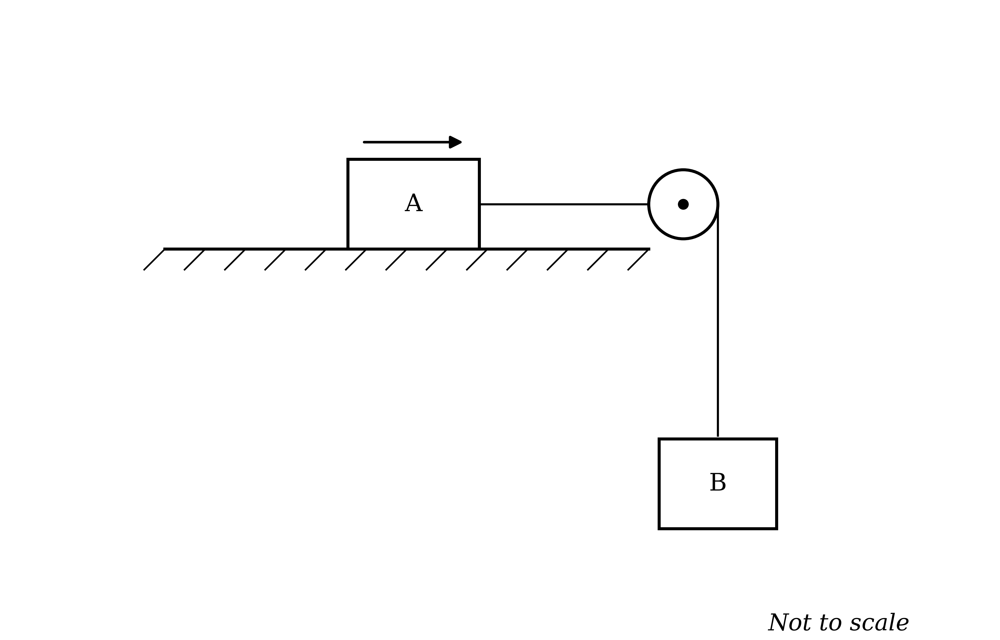
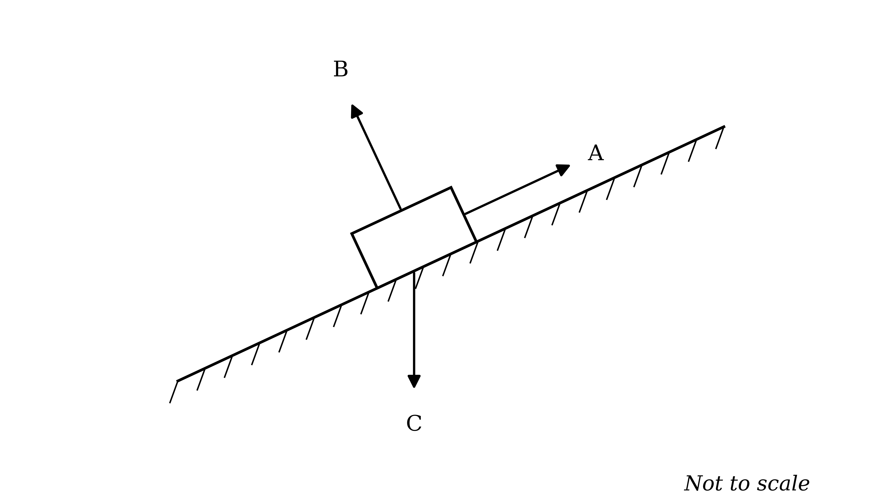
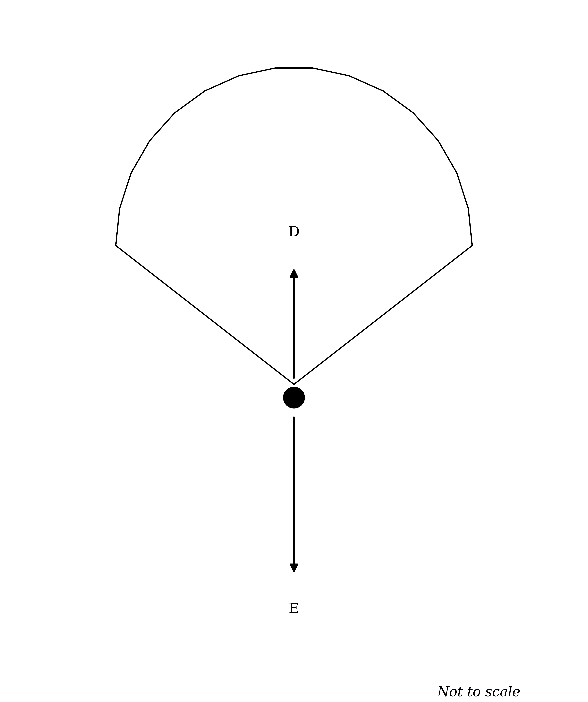
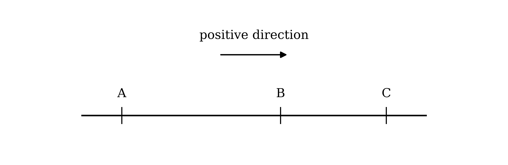
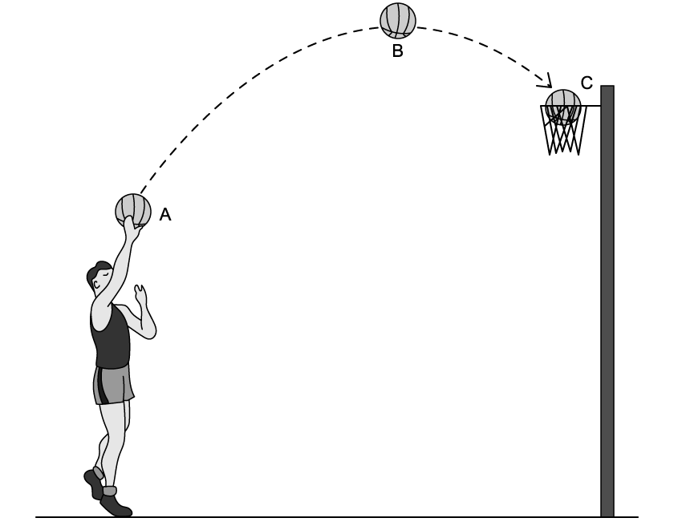
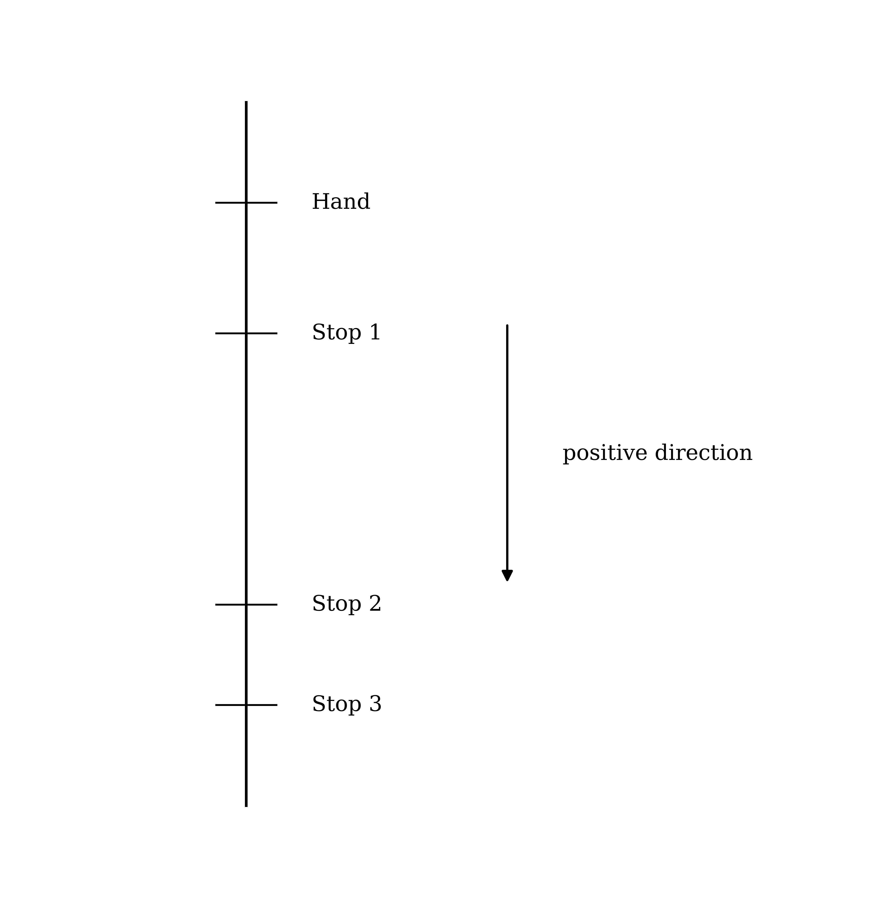

# Exam Questions — Quantities, Units & Modelling
**Mechanics Toolkit** · Cambridge (CIE) AS maths (9709)
> Source: [https://www.savemyexams.com/as/maths/cie/20/mechanics/topic-questions/](https://www.savemyexams.com/as/maths/cie/20/mechanics/topic-questions/) · 28 questions across 1 sets

## Exam Questions (28 questions)

### Q1 — hard — 4 marks

**Q1** [4 marks]

A person stands on the horizontal floor of a lift. Two of the forces in this situation are:

- $P$, the normal contact force exerted by the floor on the person;
- $Q$, the weight of the person.

(i) Explain why $P$ and $Q$ are not a Newton's third law pair.

(ii) State the force which does form a Newton's third law pair with $P$, and state its direction.

(iii) The lift now accelerates upwards. State what happens to the magnitude of $P$ compared with $Q$, and state whether the pair you named in part (ii) remains equal in magnitude to $P$.

### Q2 — medium — 4 marks

**Q2** [4 marks]

A runner runs in a straight line from a point $O$ to a point $P$, a distance of 600 m, taking 200 s. She then turns and runs straight back from $P$ to $O$, taking 300 s.

Taking the direction from $O$ to $P$ as positive, find for the whole journey:

(i) the total distance travelled and the displacement from $O$;

(ii) the average speed and the average velocity.

### Q3 — medium — 4 marks

**Q3** [4 marks]

An astronaut and her equipment have a combined mass of 80 kg.

On Earth the acceleration due to gravity is taken to be 10 $\text{m s}^{-2}$. On the Moon it is 1.6 $\text{m s}^{-2}$.

(i) Find the weight of the astronaut and her equipment on Earth, and their weight on the Moon.

(ii) State which of the mass and the weight is unchanged when the astronaut travels from the Earth to the Moon, and explain why.

### Q4 — easy — 4 marks

**Q4** [4 marks]

A crate has a mass of 24 kg.

Take the acceleration due to gravity to be 10 $\text{m s}^{-2}$.

(i) Find the weight of the crate.

(ii) A student writes "the weight of the crate is 24 kg". Explain why this statement is wrong.

### Q5 — easy — 3 marks

**Q5** [3 marks]

A book of mass 0.6 kg rests in equilibrium on a horizontal table.

(i) Name the two forces acting on the book, and state the direction of each.

(ii) The table exerts a normal contact force on the book. State the force which forms a Newton's third law pair with this force, saying what exerts it, what it acts on, and in which direction it acts.

### Q6 — easy — 4 marks

**Q6** [4 marks]

State whether the quantity described in each of the following is a scalar or a vector.

(i) A golf ball is hit with a force of 17793 N.

(ii) A hot air balloon rises vertically with an acceleration of 2.8 $\text{m s}^{-2}$.

(iii) The acceleration due to gravity acts vertically downwards at 10 $\text{m s}^{-2}$.

(iv) A cyclist covers a distance of 3200 m.

### Q7 — medium — 6 marks

**Q7** [2 marks]

A canal barge travels in a straight line between its home mooring and two locks, Lock A and Lock B, as shown in the diagram. The barge travels at 6 $\text{km h}^{-1}$ between home and Lock A, and at 4 $\text{km h}^{-1}$ between home and Lock B.

Taking the positive direction as shown in the diagram, state the following.

(i) The velocity of the barge as it travels from home to Lock A.

(ii) The displacement of the barge from home once it reaches Lock A.

**Q7** [2 marks]

The barge then returns home and travels on to Lock B, before returning home again.

Taking the same positive direction, state the following.

(i) The velocity of the barge as it travels from Lock B back to home.

(ii) The displacement of the barge from home once it has returned home for the second time.

**Q7** [2 marks]

On the journey from Lock B back to home, the barge slows down steadily as it approaches its mooring.

Explain why the acceleration of the barge is positive during this part of the journey, even though the barge is decelerating.

### Q8 — medium — 5 marks

**Q8** [2 marks]

Two blocks A and B are attached by a light inextensible string which runs over a smooth pulley fixed at the edge of a table, as shown in the diagram. Block A accelerates along the smooth horizontal surface of the table in the direction shown, while block B moves towards the ground.

State what each of the following assumptions allows you to assume in this model.

(i) A and B are both particles.

(ii) The surface of the table is smooth.

**Q8** [3 marks]

State what each of the following assumptions allows you to assume about the tension in the string, or about the motion of the two blocks.

(i) The string is light.

(ii) The string is inextensible.

(iii) The pulley is smooth.

### Q9 — medium — 8 marks

**Q9** [2 marks]

A snowboarder slides down a rough slope. The diagram shows the three forces acting, labelled A, B and C.

Label each of the forces A, B and C with its name, choosing from: friction, normal contact force, weight.

**Q9** [3 marks]

A parachutist descends vertically with an open parachute. The diagram shows the two forces acting, labelled D and E.

(i) Label each of the forces D and E with its name.

(ii) The parachutist descends at a constant speed. State what this tells you about the two forces.

**Q9** [3 marks]

The slope in part (a) is now modelled as smooth.

(i) State which of the forces A, B and C is removed by this assumption, and describe the motion of the snowboarder that the model then predicts.

(ii) Give one reason why modelling a real snow slope as smooth may not be suitable.

### Q10 — medium — 6 marks

**Q10** [6 marks]

Draw a diagram to represent each of the following situations, labelling it with all the forces acting on the body in italics. In both cases air resistance is to be ignored.

Choose the force names from: friction, normal contact force, tension, thrust, weight.

(i) A *child* swinging on a rope swing, at the lowest point of the swing.

(ii) A *bowling ball* rolling along a horizontal lane, just as it strikes a skittle.

### Q11 — medium — 3 marks

**Q11** [3 marks]

Car A travels at a constant speed of 26 $\text{m s}^{-1}$.

Car B travels 5200 m in a time of 300 s.

Find the difference between the average speeds of the two cars, giving your answer correct to three significant figures.

### Q12 — medium — 6 marks

**Q12** [6 marks]

(i) A dog on a skateboard rolls down a hill. In a first model the hill is treated as a smooth slope and the dog and skateboard together are treated as a particle.

State what the smooth assumption allows you to assume about the forces, and explain why the model becomes less reliable the longer the dog rolls.

(ii) A hot air balloon rises vertically towards its maximum height. A first model ignores air resistance.

Explain why ignoring air resistance is a poorer assumption for the balloon than it would be for a small dense object, and state what the balloon reaches that the model cannot predict.

### Q13 — easy — 2 marks

**Q13** [2 marks]

A box is pulled along a rough horizontal floor by a string. The diagram shows the four forces acting on the box, labelled A, B, C and D.

Label each of the forces A, B, C and D with its name, choosing from: tension, friction, weight, normal contact force.

### Q14 — easy — 4 marks

**Q14** [4 marks]

A box is pulled across a rough horizontal floor by a string.

In setting up a model of the motion, the box is treated as a particle and the string is treated as light and inextensible.

Explain what each of the following assumptions allows you to assume about the box or the string.

(i) The box is a particle.

(ii) The string is light.

(iii) The string is inextensible.

(iv) The floor is rough.

### Q15 — easy — 2 marks

**Q15** [2 marks]

Each day a train travels in a straight line between three stations A, B and C, as shown in the diagram.

Starting at A the train travels directly to C. It then travels back to B before returning to its starting position at A.

Taking the positive direction as shown in the diagram, state whether each of the following is positive or negative.

(i) The displacement from A to C, and the displacement from B to A.

(ii) The velocity from A to C, and the velocity from C to B.

### Q16 — easy — 5 marks

**Q16** [5 marks]

State whether the quantity described in each of the following is a scalar or a vector.

(i) A motorcycle accelerates at 3.4 $\text{m s}^{-2}$.

(ii) A concert lasts 2 hours 53 minutes.

(iii) A train has an average speed of 28.4 $\text{m s}^{-1}$.

(iv) A room is 3.95 m wide.

(v) A lift moves upwards at 2 $\text{m s}^{-1}$.

### Q17 — medium — 6 marks

**Q17** [6 marks]

(i) A puck slides across a horizontal ice rink after being hit. The ice is modelled as a smooth surface.

State the force that this assumption removes, name the forces that then act on the puck, and describe the motion that the model predicts.

(ii) A skydiver falls vertically after jumping from a plane, before the parachute is opened. A first model ignores air resistance.

Explain why this model is not suitable for the whole of the fall.

### Q18 — easy — 6 marks

**Q18** [6 marks]

Draw a diagram to represent each of the following situations, labelling it with all the forces acting on the body in italics below.

Choose the force names from: air resistance, friction, normal contact force, tension, thrust, weight.

(i) A *child on a sledge* being pulled by a rope along a rough horizontal path.

(ii) A *crate* being pushed across a rough horizontal floor.

### Q19 — easy — 2 marks

**Q19** [2 marks]

A film crew record a cheetah running in a straight line. The cheetah covers 2400 m in a time of 150 s.

Find the average speed of the cheetah.

### Q20 — hard — 7 marks

**Q20** [4 marks]

A basketball player takes a shot. Consider the ball at the following two instants.

At A, as the player takes the shot, with their hands still in contact with the ball.

At C, as the ball strikes the back of the metal rim of the basket.

Name all the forces acting on the ball at each of the two instants, stating the direction of each.

**Q20** [3 marks]

State three modelling assumptions you have made in answering part (a), and for each one state what it allows you to assume.

### Q21 — hard — 8 marks

**Q21** [4 marks]

A boxer strikes a punch bag which hangs from the ceiling on a chain.

Draw a diagram showing all the forces acting on the *punch bag* at the moment the glove strikes it, labelling each force and choosing the names from: air resistance, friction, normal contact force, tension, thrust, weight.

State also one modelling assumption you have made, and what it allows you to assume.

**Q21** [4 marks]

A cat bats at a piece of string which its owner holds at the upper end, letting the lower end hang freely.

Draw a diagram showing all the forces acting on the *string* at the moment the cat's paw touches it, labelling each force from the same list as in part (a).

State also one modelling assumption you have made, and what it allows you to assume.

### Q22 — hard — 4 marks

**Q22** [4 marks]

A block rests on a rough plane inclined to the horizontal. The angle of the plane is slowly increased until the block is on the point of slipping down the plane.

(i) Label each of the forces J, K and L with its name.

(ii) State what "on the point of slipping" tells you about the frictional force.

(iii) State one modelling assumption that has been made about the block.

### Q23 — hard — 6 marks

**Q23** [6 marks]

(i) Explain what is meant by a rough surface and by a smooth pulley, and give an example of a situation in which both would be used in the same model.

(ii) Explain what is meant by a light rigid tow-bar and by a light inextensible string, and state what each allows you to assume about the force it carries.

(iii) A rigid tow-bar can exert a thrust on the body it is attached to, but a string can never do so. Explain why.

### Q24 — very_hard — 5 marks

**Q24** [3 marks]

A stone is thrown vertically upwards from the edge of a lake. Its height above the water level, $h$ m, at time $t$ s after it is thrown is modelled by

$h = a t^{2} + b t + c$

where $a$, $b$ and $c$ are constants. Air resistance is ignored.

(i) State what the constant $c$ represents in this model.

(ii) Show that $a = - 5$.

**Q24** [2 marks]

Explain why the model should not be used once $h$ becomes negative.

### Q25 — hard — 7 marks

**Q25** [7 marks]

Draw a diagram to represent each of the following situations, labelling it with all the forces acting on the body in italics, and stating one modelling assumption you have made in each case.

Choose the force names from: air resistance, friction, normal contact force, tension, thrust, weight.

(i) A *lawnmower* being pushed along a horizontal lawn by a handle inclined to the horizontal.

(ii) A *bucket* being raised at a constant speed by a rope which passes over a fixed pulley.

### Q26 — hard — 6 marks

**Q26** [6 marks]

A car tows a trailer along a straight horizontal road. In one model the car and trailer are connected by a light rigid tow-bar; in another they are connected by a light rope. In both models the car and the trailer are treated as particles.

(i) State what modelling the tow-bar as light allows you to assume about the force in it, and what modelling the car and trailer as particles allows you to assume.

(ii) While the car is accelerating, state the direction of the force which the tow-bar exerts on the trailer, and name that force.

(iii) The driver now brakes sharply. Explain why the rigid tow-bar can slow the trailer down but a rope cannot.

### Q27 — medium — 5 marks

**Q27** [3 marks]

A particle rests in equilibrium on a smooth plane inclined at an angle to the horizontal. It is held in place by a string lying along a line of greatest slope, as shown.

(i) Label each of the forces P, Q and R with its name.

(ii) Explain why no frictional force appears on the diagram.

**Q27** [2 marks]

A climber abseils down a vertical cliff face. The climber's feet remain in contact with the cliff and the rope is held taut.

Label each of the forces W, X, Y and Z with its name.

### Q28 — hard — 4 marks

**Q28** [2 marks]

A yo-yo moves in a straight line up and down a string of length 1 m. As it travels down the string it moves at 0.15 $\text{m s}^{-1}$, and as it returns towards the hand it moves at 0.12 $\text{m s}^{-1}$.

To perform tricks the yo-yo stops at three points along the string. Stop 1 is a quarter of the way along the string and Stop 2 is four fifths of the way along it. At Stop 3 the string is fully extended. The trick "The Mechanic" runs Hand, Stop 2, Stop 1, Stop 3, Stop 1, Hand.

Taking the direction from the hand down the string as positive, state the velocity of the yo-yo:

(i) as it travels from Stop 2 to Stop 1;

(ii) as it travels from Stop 1 to Stop 3.

**Q28** [2 marks]

Using the same positive direction, find:

(i) the displacement of the yo-yo from Stop 3 to Stop 1;

(ii) the total distance travelled by the yo-yo during the whole trick.
