# Mark Schemes — Momentum & Collisions
**Momentum** · Cambridge (CIE) AS maths (9709)

## Exam Questions (28 questions)

### Q1
Take the direction of motion of $A$ as positive and let the velocity of $B$ after the collision be $v \text{m s}^{-1}$. Momentum before the collision equals momentum after the collision, and $B$ has no momentum before it

$0 . 4 \times 6 = 0 . 4 \times 2 + 0 . 2 v$

**[M1]**

$2 . 4 = 0 . 8 + 0 . 2 v$

$v = 8 \text{m s}^{-1}$

**[B1]**

> **[mark-scheme]**
> **M1**: Use of conservation of momentum with 3 non-zero terms. Allow sign errors for this mark.
> 
> **B1**: 8 reached from correct working. As the answer is given, the equation must be seen.
The combined particle has mass $0 . 2 + 0 . 8 = 1$ kg; let its velocity be $V \text{m s}^{-1}$. Momentum before the collision equals momentum after the collision, and $C$ has no momentum before it

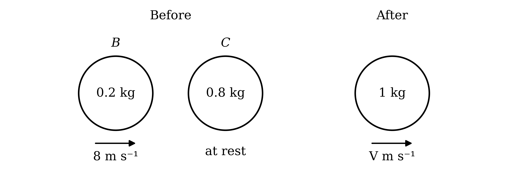

$0 . 2 \times 8 = 1 \times V$

**[M1]**

**Final answer:** $V =$** 1.6 **$\text{m s}^{-1}$

**[A1]**

> **[mark-scheme]**
> **M1**: Use of conservation of momentum with 2 non-zero terms and a combined mass of 1 kg.
> 
> **A1**: 1.6.
Measure distances from the original position of $B$, where $A$ and $B$ collided, in the direction of motion. First find how long $B$ takes to travel the 4 m to $C$ at 8 $\text{m s}^{-1}$

$t = \frac{4}{8} = 0 . 5 \text{s}$

**[M1]**

In that time $A$ travels at 2 $\text{m s}^{-1}$, so at the instant $B$ hits $C$, $A$ is at

$2 \times 0 . 5 = 1 \text{m}$

**[M1]**

Let $T$ seconds be the time after the $B$–$C$ collision until $A$ reaches the combined particle. Both then move at constant speed, so equate their positions

$1 + 2 T = 4 + 1 . 6 T$

**[M1]**

$0 . 4 T = 3$

$T = 7 . 5$

**[A1]**

In this time the combined particle moves on from the original position of $C$

$1 . 6 \times 7 . 5 = 12$

$\text{Distance from the original position of} C = 12 \text{m}$

**[A1]**

> **[mark-scheme]**
> **M1**: Time for $B$ to reach $C$ found as distance divided by the speed of $B$ found.
> 
> **M1**: Position of $A$ at the instant of the $B$–$C$ collision found, or the separation of 3 m between $A$ and the combined particle.
> 
> **M1**: An equation for the instant $A$ reaches the combined particle, equating two expressions for position with the speeds found, or dividing the separation by the difference of the speeds.
> 
> **A1**: $T = 7 . 5$.
> 
> **A1**: 12.

### Q2
Take the original direction of motion of $P$ as positive. Let the velocity of $Q$ be $u \text{m s}^{-1}$ before the collision and $v \text{m s}^{-1}$ after it; the signs will show the directions

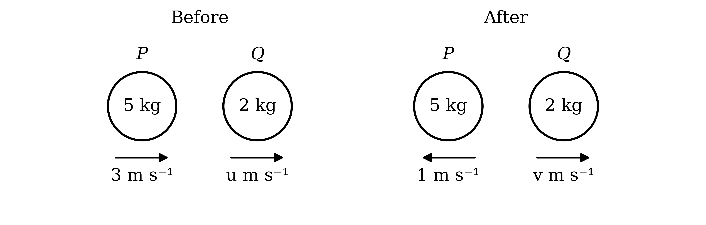

The kinetic energy lost is the total kinetic energy before minus the total after, using $\text{KE} = \frac{1}{2} m v^{2}$

$\frac{1}{2} \times 5 \times 3^{2} + \frac{1}{2} \times 2 \times u^{2} - \frac{1}{2} \times 5 \times 1^{2} - \frac{1}{2} \times 2 \times v^{2} = 60$

**[M1]**

$22 . 5 + u^{2} - 2 . 5 - v^{2} = 60$

$u^{2} - v^{2} = 40$

**[A1]**

Momentum before the collision equals momentum after the collision

$5 \times 3 + 2 u = 5 \times ( - 1 ) + 2 v$

**[M1]**

$2 v - 2 u = 20$

$v = u + 10$

**[A1]**

Substitute into the energy equation to find $u$

$u^{2} - ( u + 10 )^{2} = 40$

**[M1]**

$u^{2} - u^{2} - 20 u - 100 = 40$

$- 20 u = 140$

$u = - 7$

(i)

$u$ is negative, so $Q$ was moving in the opposite direction to $P$

**Final answer:** **The speed of Q before the collision is **$7 \text{m s}^{-1}$**, in the opposite direction to the motion of P (towards P)**

**[A1]**

(ii)

Find $v$ from $v = u + 10$

$v = - 7 + 10 = 3$

$v$ is positive, so $Q$ moves in the original direction of $P$

**Final answer:** **The speed of Q after the collision is **$3 \text{m s}^{-1}$**, in the original direction of motion of P**

**[A1]**

> **[mark-scheme]**
> **M1**: Kinetic energy loss equation with all 4 kinetic energy terms, using $\frac{1}{2} m v^{2}$ for each particle before and after.
> 
> **A1**: Correct equation, $u^{2} - v^{2} = 40$ or equivalent.
> 
> **M1**: Use of conservation of momentum with 4 non-zero terms. Allow sign errors for this mark.
> 
> **A1**: Correct equation, $v = u + 10$ or equivalent.
> 
> **M1**: The two equations solved simultaneously, eliminating one velocity.
> 
> **A1**: A speed of 7 before the collision, with the direction stated as opposite to $P$ (towards $P$).
> 
> **A1**: A speed of 3 after the collision, with the direction stated as the original direction of $P$.
> 
> The directions may be shown on a clearly labelled diagram. Units are not required.

### Q3
Take up the slope as positive, so before the collision $P$ has velocity $- 1$ and $Q$ has velocity $+ 5$, and after it $Q$ has velocity $- 1$. Let the velocity of $P$ after the collision be $v \text{m s}^{-1}$

Momentum before the collision equals momentum after the collision

$0 . 4 \times ( - 1 ) + 0 . 33 \times 5 = 0 . 4 v + 0 . 33 \times ( - 1 )$

**[M1 A1]**

$1 . 25 = 0 . 4 v - 0 . 33$

$v = 3 . 95$

**Final answer:** **The velocity is positive, so **$P$** moves up the slope towards **$A$** with speed 3.95 **$\text{m s}^{-1}$

**[A1]**

> **[mark-scheme]**
> **M1**: Use of conservation of momentum with 4 non-zero terms. Allow sign errors for this mark.
> 
> **A1**: Correct equation, $1 . 25 = 0 . 4 v - 0 . 33$ or equivalent.
> 
> **A1**: $v = 3 . 95$, with $P$ moving up the slope.

**Method 1**

The plane is smooth, so the only force along the slope is the component of the weight, 0.4g sin 40°, acting down the slope. By Newton's second law, with $g = 10$

$a = - 10 \text{sin}  40$*°*

**[M1]**

$a = - 6 . 4278 \dots$

**[A1]**

Find the square of the speed of $P$ when it has travelled the 1 m up to $A$, using $v^{2} = u^{2} + 2 a s$ with $u = 3 . 95$ and $s = 1$

$v_{A}^{2} = 3 . 95^{2} + 2 \times ( - 6 . 4278 \dots ) \times 1$

**[M1]**

$v_{A}^{2} = 2 . 7467 \dots$

$v_{A}^{2}$ is positive, so $P$ is still moving up the slope when it has travelled 1 m

**Final answer:** **P is still moving up the slope when it reaches A, so P reaches A**

**[B1]**

> **[mark-scheme]**
> **Method 1: Newton's second law and suvat**
> 
> **M1**: Acceleration found from the component of the weight along the slope, g sin 40°, with $g = 10$. Allow a sine and cosine mix for this mark.
> 
> **A1**: $a = - 6 . 43$ (magnitude 6.43), carried unrounded into later working.
> 
> **M1**: Use of $v^{2} = u^{2} + 2 a s$ with $u = 3 . 95$, $s = 1$ and the acceleration found.
> 
> **B1**: $v^{2} > 0$ (2.75, or $v = 1 . 66$) and the conclusion that $P$ reaches $A$. Finding instead that $P$ would travel 1.21 m before stopping, which is more than 1 m, is equally acceptable.

**Method 2**

Find the kinetic energy of $P$ immediately after the collision, using $\text{KE} = \frac{1}{2} m v^{2}$

$\text{KE} = \frac{1}{2} \times 0 . 4 \times 3 . 95^{2} = 3 . 1205$

**[M1]**

To reach $A$, $P$ must rise through a vertical height of 1 × sin 40° m. Find the gain in gravitational potential energy, with $g = 10$

$\text{GPE gain} = 0 . 4 \times 10 \times 1 \times \text{sin}  40$*°*

**[M1]**

$\text{GPE gain} = 2 . 5711 \dots$

The plane is smooth, so no energy is lost. Compare the kinetic energy available with the energy needed

$3 . 1205 > 2 . 5711 \dots$

**[M1]**

**Final answer:** **P has more kinetic energy than it needs to rise to A, so P reaches A**

**[B1]**

> **[mark-scheme]**
> **Method 2: conservation of energy**
> 
> **M1**: Kinetic energy of $P$ after the collision, using its speed from the collision.
> 
> **M1**: Gain in gravitational potential energy from the collision point to $A$, using a vertical height of sin 40° and $g = 10$. Using the distance along the slope as the height does not earn this mark.
> 
> **M1**: Comparison of the kinetic energy with the gain in potential energy, or an energy equation for the kinetic energy at $A$.
> 
> **B1**: 3.12 > 2.57 (or kinetic energy at $A$ of 0.549 > 0) and the conclusion that $P$ reaches $A$.
For $P$, use $v = u + a t$ with $u = 3 . 95$, the speed at $A$ from part (a), $v = 1 . 6573 \dots$, and $a = - 6 . 4278 \dots$

$1 . 6573 \dots = 3 . 95 - 6 . 4278 \dots t_{P}$

**[M1]**

$t_{P} = 0 . 35667 \dots$

**[A1]**

$Q$ starts 1 m down from $A$, so it has 3 m to travel to $B$. It moves down the slope with initial speed 1 $\text{m s}^{-1}$, accelerating at $6 . 4278 \dots \text{m s}^{-2}$ down the slope

$s = 4 - 1 = 3$

**[B1]**

Taking down the slope as positive for $Q$, use $s = u t + \frac{1}{2} a t^{2}$

$3 = 1 \times t_{Q} + \frac{1}{2} \times 6 . 4278 \dots \times t_{Q}^{2}$

**[M1]**

$3 . 2139 \dots t_{Q}^{2} + t_{Q} - 3 = 0$

Solve with the quadratic formula; the time must be positive

$t_{Q} = \frac{-1+\sqrt{1^{2}+4\times3.2139\dots\times3}}{2\times3.2139\dots}$

**[M1]**

$t_{Q} = 0 . 82301 \dots$

**[A1]**

Compare the two times

$t_{P} = 0 . 357 < t_{Q} = 0 . 823$

**Final answer:** **P reaches A before Q reaches B**

**[B1]**

> **[mark-scheme]**
> **M1**: A complete suvat method for the time for $P$ to reach $A$, using $u = 3 . 95$ and an acceleration of magnitude 10 sin 40°. Using $s = u t + \frac{1}{2} a t^{2}$ with $s = 1$ and choosing the smaller positive root is equally acceptable.
> 
> **A1**: Answers which round to 0.357.
> 
> **B1**: A distance of 3 m for $Q$ to travel to $B$.
> 
> **M1**: Use of $s = u t + \frac{1}{2} a t^{2}$ (or an equivalent method) for $Q$ with $u = 1$, $s = 3$ and an acceleration of 10 sin 40° down the slope.
> 
> **M1**: Solution of the quadratic equation, selecting the positive root.
> 
> **A1**: Answers which round to 0.823.
> 
> **B1**: Comparison of the two times with the conclusion that $P$ reaches $A$ first. Follow through from the times found, provided both are positive.

### Q4
Take the original direction of motion of $A$ as positive, so $B$ has velocity $- λ u$ before the collision and $A$ has velocity $- 3 u$ after it. The direction of $B$ after the collision is not given, so consider both cases

If $B$ is reversed, its velocity after the collision is $+ 2 u$. Momentum before the collision equals momentum after the collision

$10 m \times 5 u + 7 m \times ( - λ u ) = 10 m \times ( - 3 u ) + 7 m \times 2 u$

**[M1 A1]**

Every term contains $m u$, so divide through by $m u$

$50 - 7 λ = - 30 + 14$

$7 λ = 66$

$λ = \frac{66}{7}$

**[A1]**

If $B$ is not reversed, its velocity after the collision is $- 2 u$

$10 m \times 5 u + 7 m \times ( - λ u ) = 10 m \times ( - 3 u ) + 7 m \times ( - 2 u )$

**[M1 A1]**

$50 - 7 λ = - 30 - 14$

$7 λ = 94$

$λ = \frac{94}{7}$

**[A1]**

In the second case both particles move in the negative direction, but $A$ is behind $B$ and moves faster away from it, so both cases are possible

> **[mark-scheme]**
> **M1**: Use of conservation of momentum with 4 non-zero terms in either case. Allow sign errors for this mark.
> 
> **A1**: Correct equation for the case where $B$ is reversed, $50 - 7 λ = - 16$ or equivalent.
> 
> **A1**: $λ = \frac{66}{7}$. Accept answers which round to 9.43.
> 
> **M1**: Use of conservation of momentum for the other case, with the velocity of $B$ after the collision taking the opposite sign.
> 
> **A1**: Correct equation for the case where $B$ is not reversed, $50 - 7 λ = - 44$ or equivalent.
> 
> **A1**: $λ = \frac{94}{7}$. Accept answers which round to 13.4.
> 
> The two cases are marked independently.

### Q5
Take the original direction of motion of $P$ as positive. Both particles reverse, so after the collision $P$ has velocity $- v_{P}$ and $Q$ has velocity $+ v_{Q}$

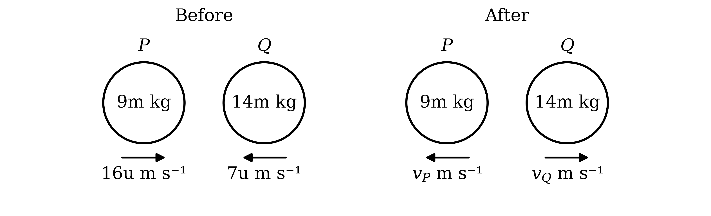

Momentum before the collision equals momentum after the collision

$9 m \times 16 u + 14 m \times ( - 7 u ) = 9 m \times ( - v_{P} ) + 14 m v_{Q}$

**[M1]**

Every term contains $m$, so divide through by $m$

$144 u - 98 u = - 9 v_{P} + 14 v_{Q}$

$14 v_{Q} = 46 u + 9 v_{P}$

**[A1]**

$v_{P}$ is a speed, so $v_{P} > 0$ and therefore $46 u + 9 v_{P} > 46 u$

$14 v_{Q} > 46 u$

**[M1]**

$v_{Q} > \frac{23}{7} u$

**[B1]**

> **[mark-scheme]**
> **M1**: Use of conservation of momentum with 4 non-zero terms, with both velocities after the collision reversed. Allow sign errors for this mark.
> 
> **A1**: Correct equation, $14 v_{Q} = 46 u + 9 v_{P}$ or equivalent.
> 
> **M1**: Use of $v_{P} > 0$ to form an inequality in $v_{Q}$.
> 
> **B1**: $v_{Q} > \frac{23}{7} u$ reached from correct working. As the answer is given, the use of $v_{P} > 0$ must be seen.
Let $Q$ take $t$ seconds to come to rest. Use $v = u + a t$ for $Q$, with initial speed $v_{Q}$, final speed 0 and acceleration $- 2$

$0 = v_{Q} - 2 t$

$v_{Q} = 2 t$

**[M1]**

$P$ takes $( t + 0 . 3 u )$ seconds to come to rest

$0 = v_{P} - 2 ( t + 0 . 3 u )$

**[M1]**

$v_{P} = 2 t + 0 . 6 u$

Replace $2 t$ by $v_{Q}$

$v_{P} = v_{Q} + 0 . 6 u$

**[A1]**

Substitute into the momentum equation from part (a)

$14 v_{Q} = 46 u + 9 ( v_{Q} + 0 . 6 u )$

**[M1]**

$14 v_{Q} = 46 u + 9 v_{Q} + 5 . 4 u$

$5 v_{Q} = 51 . 4 u$

$v_{Q} = \frac{257}{25} u$

**[A1]**

Use $v_{P} = v_{Q} + 0 . 6 u$

$v_{P} = \frac{272}{25} u$

**[A1]**

> **[mark-scheme]**
> **M1**: Use of $v = u + a t$ (or an equivalent constant acceleration formula) for $Q$, with final speed 0 and a deceleration of 2.
> 
> **M1**: The same for $P$, with a time 0.3u greater than that for $Q$.
> 
> **A1**: $v_{P} = v_{Q} + 0 . 6 u$ or equivalent.
> 
> **M1**: The relation found, solved simultaneously with the momentum equation from part (a).
> 
> **A1**: $v_{Q} = \frac{257}{25} u$, or $10 . 28 u$.
> 
> **A1**: $v_{P} = \frac{272}{25} u$, or $10 . 88 u$.
> 
> The two answers are marked independently.

### Q6
Take the direction from $R$ towards $T$ as positive, so $S$ has velocity $- 1$ and $T$ has velocity $- 1$ before their collisions

For the collision between $R$ and $S$, momentum before equals momentum after

$0 . 4 \times 3 + 0 . 2 \times ( - 1 ) = 0 . 4 v + 0 . 2 \times 2 v$

**[M1]**

$1 = 0 . 8 v$

$v = 1 . 25$

**[A1]**

So $S$ moves towards $T$ at $2 \times 1 . 25 = 2 . 5 \text{m s}^{-1}$. Let the velocity of $S$ after hitting $T$ be $y \text{m s}^{-1}$. For the collision between $S$ and $T$, momentum before equals momentum after

$0 . 2 \times 2 . 5 + 0 . 1 \times ( - 1 ) = 0 . 2 y + 0 . 1 x$

**[M1]**

$0 . 4 = 0 . 2 y + 0 . 1 x$

$y = 2 - 0 . 5 x$

$R$ is behind $S$ moving at 1.25 $\text{m s}^{-1}$. For $R$ never to catch $S$, the velocity of $S$ must be at least that of $R$

$2 - 0 . 5 x \geq 1 . 25$

**[M1]**

$0 . 5 x \leq 0 . 75$

$x \leq 1 . 5$

**[A1]**

$S$ must also not catch $T$ again. At $x = 1 . 5$, find the velocity of $S$ and compare it with that of $T$

$y = 2 - 0 . 5 \times 1 . 5 = 1 . 25 \leq 1 . 5$

**[B1]**

**Final answer:** $\text{Greatest value of} x =$** 1.5**

> **[mark-scheme]**
> **M1**: Use of conservation of momentum for the collision between $R$ and $S$, with 4 non-zero terms and speeds $v$ and $2 v$ after. Allow sign errors for this mark.
> 
> **A1**: $v = 1 . 25$.
> 
> **M1**: Use of conservation of momentum for the collision between $S$ and $T$, with 4 non-zero terms. Allow sign errors for this mark.
> 
> **M1**: A condition that the velocity of $S$ after hitting $T$ is at least the velocity of $R$, used to form an inequality or equation in $x$.
> 
> **A1**: 1.5.
> 
> **B1**: A check that $S$ does not catch $T$ at this value, for example the velocity of $S$ (1.25) not exceeding that of $T$ (1.5).

### Q7
Find the speed of the ball as it reaches the ground, using $v^{2} = u^{2} + 2 a s$ with $u = 0$, $a = 10$ (taking downwards as positive) and $s = 2$

$v^{2} = 0^{2} + 2 \times 10 \times 2 = 40$

**[M1]**

$v = \sqrt{40} = 6 . 3245 \dots$

**[A1]**

The magnitude of the momentum just before hitting the ground is mass multiplied by speed

$0 . 16 \times 6 . 3245 \dots = 1 . 0119 \dots$

Let the speed of the ball just after hitting the ground be $w \text{m s}^{-1}$

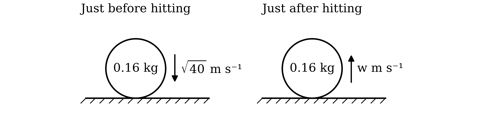

After hitting the ground, the magnitude of the momentum is 0.584 less

$0 . 16 w = 1 . 0119 \dots - 0 . 584$

**[M1]**

$w = \frac{0.4279\dots}{0.16} = 2 . 6745 \dots$

**[A1]**

The ball rises until its speed is zero. Taking upwards as positive, use $v^{2} = u^{2} + 2 a s$ with $u = 2 . 6745 \dots$, $v = 0$ and $a = - 10$

$0^{2} = 2 . 6745 \dots^{2} + 2 \times ( - 10 ) \times s$

**[M1]**

$s = \frac{7.1532\dots}{20} = 0 . 35766 \dots$

**Final answer:** $\text{Greatest height} =$** 0.358 m (3 s.f.)**

**[A1]**

> **[mark-scheme]**
> **M1**: Use of $v^{2} = u^{2} + 2 a s$ with $u = 0$, $s = 2$ and $g = 10$ for the fall.
> 
> **A1**: $v = \sqrt{40}$, or answers which round to 6.32.
> 
> **M1**: Magnitude of momentum after the bounce found as $0 . 16 \times$ the speed found, minus 0.584, and divided by 0.16 for the rebound speed.
> 
> **A1**: Answers which round to 2.67.
> 
> **M1**: Use of $v^{2} = u^{2} + 2 a s$ with $v = 0$, $a = - 10$ and the rebound speed found.
> 
> **A1**: Answers which round to 0.358.
> 
> An energy method for either the fall ($m g h = \frac{1}{2} m v^{2}$) or the rise is equally acceptable and earns the corresponding M and A marks. Values must not be rounded before the final answer.

### Q8
Take the direction of motion of $P$ as positive and let the common speed be $V \text{m s}^{-1}$. $Q$ is hit from behind, so it moves in the positive direction with momentum $+ 1 . 2$. The total momentum before the collision is $0 . 5 \times 6 = 3$

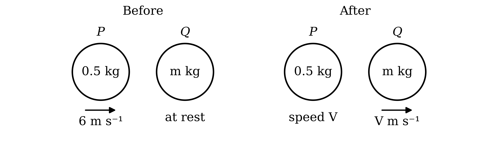

$P$ could move either way after the collision. Test $P$ reversed first, with velocity $- V$

$3 = 0 . 5 \times ( - V ) + 1 . 2$

**[M1]**

$V = - 3 . 6$

A speed cannot be negative, so $P$ is not reversed: both particles move in the positive direction

$3 = 0 . 5 V + 1 . 2$

**[M1]**

$0 . 5 V = 1 . 8$

**Final answer:** $\text{Common speed} =$** 3.6 **$\text{m s}^{-1}$

**[A1]**

The momentum of $Q$ is its mass multiplied by its velocity

$m \times 3 . 6 = 1 . 2$

**[M1]**

$m = \frac{1}{3}$

**[A1]**

> **[mark-scheme]**
> **M1**: Use of conservation of momentum with 3 non-zero terms, using 1.2 for the momentum of $Q$ after the collision. Allow sign errors for this mark.
> 
> **M1**: The case with $P$ reversed rejected (for example, because it gives a negative speed), or an otherwise valid argument that both particles move in the original direction of $P$. May be implied by a correct equation with both velocities positive.
> 
> **A1**: 3.6.
> 
> **M1**: Mass of $Q$ found by dividing 1.2 by the common speed found.
> 
> **A1**: $m = \frac{1}{3}$. Accept answers which round to 0.333.

### Q9
Take Armina's original direction of motion as positive, so Dillon has velocity $- 6$ before the collision and Armina has velocity $- 2 . 6$ after it. Dillon's direction after the collision is not given, so his velocity is $+ 2$ or $- 2$

If Dillon is reversed, momentum before the collision equals momentum after the collision

$5 \times 3 + m \times ( - 6 ) = 5 \times ( - 2 . 6 ) + 2 m$

**[M1]**

$15 - 6 m = - 13 + 2 m$

If Dillon is not reversed

$15 - 6 m = - 13 - 2 m$

**[A1]**

Solve each equation

$m = 3 . 5$

$m = 7$

**[A1]**

Find Armina's kinetic energy before and after using $\text{KE} = \frac{1}{2} m v^{2}$; it is the same in both cases

$\text{KE before} = \frac{1}{2} \times 5 \times 3^{2} = 22 . 5$

**[B1]**

$\text{KE after} = \frac{1}{2} \times 5 \times 2 . 6^{2} = 16 . 9$

The loss is the total kinetic energy before minus the total after. For $m = 3 . 5$

$\text{Loss} = 22 . 5 + \frac{1}{2} \times 3 . 5 \times 6^{2} - 16 . 9 - \frac{1}{2} \times 3 . 5 \times 2^{2}$

**[M1]**

$\text{Loss} = 22 . 5 + 63 - 16 . 9 - 7 = 61 . 6$

For $m = 7$

$\text{Loss} = 22 . 5 + \frac{1}{2} \times 7 \times 6^{2} - 16 . 9 - \frac{1}{2} \times 7 \times 2^{2}$

$\text{Loss} = 22 . 5 + 126 - 16 . 9 - 14 = 117 . 6$

**Final answer:** $\text{Loss of KE} =$** 61.6 J or 117.6 J**

**[A1]**

> **[mark-scheme]**
> **M1**: Use of conservation of momentum with 4 non-zero terms in either case. Allow sign errors for this mark.
> 
> **A1**: Both equations correct, $15 - 6 m = - 13 + 2 m$ and $15 - 6 m = - 13 - 2 m$.
> 
> **A1**: $m = 3 . 5$ and $m = 7$.
> 
> **B1**: A correct kinetic energy term for either particle, before or after the collision, using $\frac{1}{2} m v^{2}$. Follow through from the values of $m$ found.
> 
> **M1**: Loss of kinetic energy found as the total kinetic energy before minus the total kinetic energy after, for either value of $m$.
> 
> **A1**: Both losses, 61.6 and 117.6. Accept 118 for the second.
Armina reaches the rough ground with speed 2.6 $\text{m s}^{-1}$. Taking her direction of motion as positive, find her acceleration using $v = u + a t$ with $v = 0$ and $t = 2$

$0 = 2 . 6 + 2 a$

**[M1]**

$a = - 1 . 3$

**[A1]**

There is no vertical acceleration, so resolve vertically to find the normal reaction, using $g = 10$

$R = 5 \times 10 = 50$

**[B1]**

Armina is sliding on the rough ground, so friction is limiting

$F = μ R = 50 μ$

**[M1]**

Friction is the only horizontal force and acts against the motion. Apply Newton's second law

$- 50 μ = 5 \times ( - 1 . 3 )$

**[M1]**

$μ = 0 . 13$

**[A1]**

> **[mark-scheme]**
> **M1**: Use of $v = u + a t$ with $u = 2 . 6$, $v = 0$ and $t = 2$. Follow through from the speed of Armina found in part (a).
> 
> **A1**: $a = - 1 . 3$, or a deceleration of 1.3.
> 
> **B1**: $R = 50$, from resolving vertically with $g = 10$.
> 
> **M1**: Use of $F = μ R$ with the value of $R$ found.
> 
> **M1**: Use of Newton's second law with friction as the only horizontal force, 2 terms. Allow a sign error for this mark.
> 
> **A1**: 0.13.

### Q10
(i)

Take the direction of motion of Lucy's truck as positive, so Fran's truck has velocity $- 5 \text{m s}^{-1}$. After the collision both trucks have the same velocity, $v \text{m s}^{-1}$

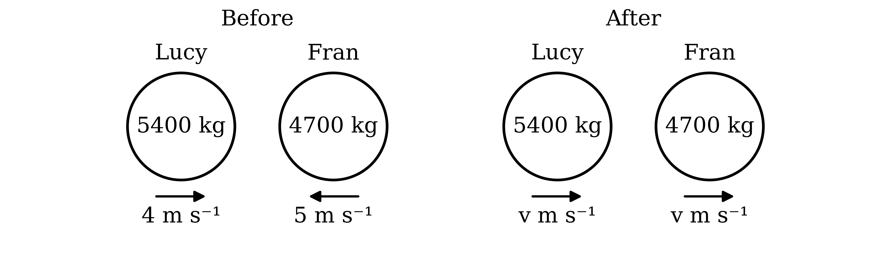

Momentum before the collision equals momentum after the collision

$5400 \times 4 + 4700 \times ( - 5 ) = 5400 v + 4700 v$

**[M1 A1]**

$21600 - 23500 = 10100 v$

$v = - \frac{1900}{10100} = - 0 . 18811 \dots$

The speed is the magnitude of the velocity

**Final answer:** $\text{Speed} =$** 0.188 **$\text{m s}^{-1}$** (3 s.f.)**

**[A1]**

(ii)

The velocity is negative, so both trucks move in Fran's original direction after the collision

**Final answer:** **Lucy's direction of motion has been reversed**

**[B1]**

(iii)

The change in momentum is the momentum after minus the momentum before, for Fran's truck only. Keep the unrounded velocity

`\text{Change in momentum} = 4700 \times \left(-\dfrac{19}{101}\right) - 4700 \times (-5)`

**[M1]**

$\text{Change in momentum} = 22615 . 8 \dots$

The change is positive, so it acts in Lucy's original direction, against the motion of Fran's truck

**Final answer:** $22600 \text{kg m s}^{-1}$** (3 s.f.) in the opposite direction to the motion of Fran's truck**

**[A1]**

> **[mark-scheme]**
> **M1**: Use of conservation of momentum with 4 non-zero terms and a common velocity after the collision. Allow sign errors for this mark.
> 
> **A1**: Correct equation, $21600 - 23500 = 10100 v$ or equivalent.
> 
> **A1**: Answers which round to 0.188. The answer must be positive, since a speed is asked for.
> 
> **B1**: Lucy. Follow through from the sign of the velocity found in part (i).
> 
> **M1**: Final momentum of Fran's truck minus its initial momentum, using its mass of 4700 kg and velocities of consistent sign.
> 
> **A1**: Answers which round to 22 600, with the direction stated as opposite to the motion of Fran's truck (or in Lucy's original direction). A signed answer consistent with a clearly defined positive direction is accepted. Units are not required.
Keep Lucy's original direction as positive and let the common speed be $v \text{m s}^{-1}$. Both trucks reverse, so Lucy's truck now has velocity $- v$ and Fran's truck has velocity $+ v$

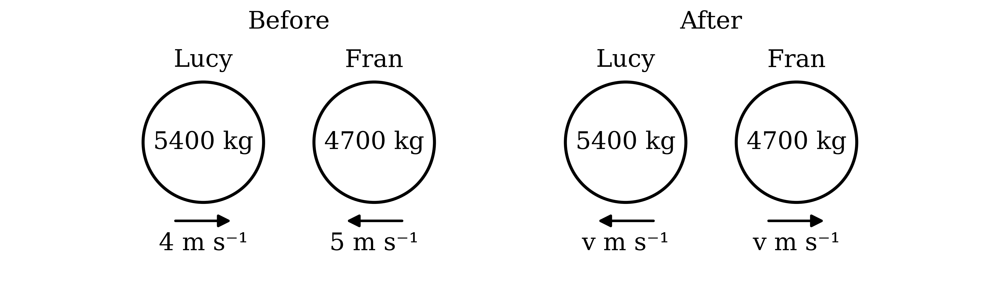

Momentum before the collision equals momentum after the collision

$5400 \times 4 + 4700 \times ( - 5 ) = 5400 \times ( - v ) + 4700 v$

**[M1 A1]**

$- 1900 = - 700 v$

$v = \frac{19}{7} = 2 . 7142 \dots$

**Final answer:** $\text{Speed} =$** 2.71 **$\text{m s}^{-1}$** (3 s.f.)**

**[A1]**

> **[mark-scheme]**
> **M1**: Use of conservation of momentum with 4 non-zero terms and velocities of equal magnitude after the collision. Allow sign errors for this mark.
> 
> **A1**: Correct equation with the two velocities after the collision of opposite sign, each opposite to that truck's original velocity, $- 1900 = - 700 v$ or equivalent.
> 
> **A1**: Answers which round to 2.71, or $\frac{19}{7}$.

### Q11
Take the original direction of motion of $A$ as positive. The total momentum before the collision is

$0 . 2 \times 11 + 0 . 3 \times ( - 2 ) = 1 . 6$

Let the speed of $A$ after the collision be $a \text{m s}^{-1}$, so $B$ has speed $2 a$. If $B$ kept its direction, its momentum $- 0 . 6 a$ would outweigh the momentum of $A$, which is at most $0 . 2 a$, and the total would be negative. The total is $+ 1 . 6$, so $B$ must be reversed, and $A$ may or may not be

If $A$ is also reversed, momentum before the collision equals momentum after the collision

$1 . 6 = 0 . 2 \times ( - a ) + 0 . 3 \times 2 a$

**[M1]**

$1 . 6 = 0 . 4 a$

$a = 4$

$\text{Speed of} B = 8 \text{m s}^{-1}$

**[A1]**

If $A$ keeps its direction

$1 . 6 = 0 . 2 a + 0 . 3 \times 2 a$

**[M1]**

$1 . 6 = 0 . 8 a$

$a = 2$

$\text{Speed of} B = 4 \text{m s}^{-1}$

**[A1]**

> **[mark-scheme]**
> **M1**: Use of conservation of momentum with 4 non-zero terms in either case, using speeds $a$ and $2 a$ after the collision. Allow sign errors for this mark.
> 
> **A1**: 8.
> 
> **M1**: Use of conservation of momentum for the other case, with the velocity of $A$ after the collision taking the opposite sign.
> 
> **A1**: 4.
> 
> The two values are marked independently. Any further case leading to a negative speed must be rejected; an answer including such a value does not score the final A1.
In this case $A$ moves away from $B$ with speed 4 $\text{m s}^{-1}$ and $B$ moves towards $C$ with speed 8 $\text{m s}^{-1}$. Take the direction in which $B$ is now moving as positive and let the velocity of $B$ after hitting $C$ be $w \text{m s}^{-1}$

Momentum before the collision equals momentum after the collision, and $C$ has no momentum before it

$0 . 3 \times 8 = 0 . 3 w + 1 . 5 v$

**[M1]**

$w = 8 - 5 v$

$A$ is moving in the negative direction at 4 $\text{m s}^{-1}$. If $B$ rebounds, it must not move in the negative direction faster than $A$, so its velocity must be at least $- 4$

$8 - 5 v \geq - 4$

**[M1]**

$5 v \leq 12$

**Final answer:** $\text{Greatest value of} v =$** 2.4**

**[A1]**

> **[mark-scheme]**
> **M1**: Use of conservation of momentum for the collision between $B$ and $C$, with 3 non-zero terms. Allow sign errors for this mark.
> 
> **M1**: A condition that the velocity of $B$ after hitting $C$ is at least $- 4$ in the direction of $B$'s motion (so that $B$ does not catch $A$), used to form an inequality or equation in $v$. Setting the velocity of $B$ equal to $- 4$ earns this mark.
> 
> **A1**: 2.4.

### Q12
Take the original direction of motion of $A$ as positive, so $B$ has velocity $- 5 u$ before the collision. Find the total momentum before the collision

$7 m \times 3 u + 4 m \times ( - 5 u ) = 21 m u - 20 m u = m u$

$A$ is reversed, so its momentum after the collision is $- 7 m v_{A}$, which is negative. The total momentum stays equal to $m u$, which is positive, so $B$ must have positive momentum after the collision

**Final answer:** **B must be moving in the positive direction after the collision, so its direction of motion is also reversed**

**[B1]**

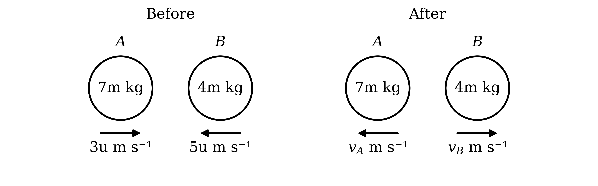

Momentum before the collision equals momentum after the collision

$21 m u - 20 m u = - 7 m v_{A} + 4 m v_{B}$

**[M1]**

Every term contains $m$, so divide through by $m$

$u = 4 v_{B} - 7 v_{A}$

**[A1]**

$4 v_{B} = u + 7 v_{A}$

$v_{A}$ is a speed, so $v_{A} > 0$ and therefore $u + 7 v_{A} > u$

$4 v_{B} > u$

**[M1]**

$v_{B} > \frac{u}{4}$

**[B1]**

> **[mark-scheme]**
> **B1**: A correct explanation that the total momentum before the collision is positive in the original direction of $A$ (or equals $m u$), while $A$'s momentum after is negative, so $B$'s momentum after must be positive and $B$ is reversed.
> 
> **M1**: Use of conservation of momentum with 4 non-zero terms, with the velocity of $A$ after the collision negative. Allow sign errors for this mark.
> 
> **A1**: Correct equation, $u = 4 v_{B} - 7 v_{A}$ or equivalent.
> 
> **M1**: Use of $v_{A} > 0$ to form an inequality in $v_{B}$.
> 
> **B1**: $v_{B} > \frac{u}{4}$ reached from correct working. As the answer is given, the use of $v_{A} > 0$ must be seen.
Substitute $v_{B} = 2 v_{A}$ into the equation from part (a)

$u = 4 ( 2 v_{A} ) - 7 v_{A}$

**[M1]**

$u = 8 v_{A} - 7 v_{A}$

$v_{A} = u$

**[A1]**

$v_{B} = 2 u$

**[A1]**

> **[mark-scheme]**
> **M1**: Substitution of $v_{B} = 2 v_{A}$ into a momentum equation containing $v_{A}$ and $v_{B}$. Follow through from the equation found in part (a).
> 
> **A1**: $v_{A} = u$.
> 
> **A1**: $v_{B} = 2 u$.
> 
> The two answers are marked independently.

### Q13
Take the original direction of motion as positive and let the speed of $Q$ after the collision be $v \text{m s}^{-1}$. $Q$ is in front, so it keeps moving forwards and $P$ is the one reversed, with velocity $- \frac{v}{2}$

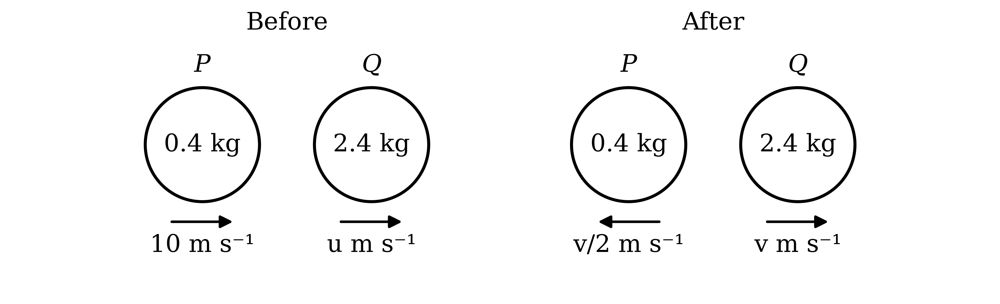

Momentum before the collision equals momentum after the collision

`0.4 \times 10 + 2.4u = 0.4 \times \left(-\dfrac{v}{2}\right) + 2.4v`

**[M1]**

$4 + 2 . 4 u = - 0 . 2 v + 2 . 4 v$

$4 + 2 . 4 u = 2 . 2 v$

**[A1]**

Make $v$ the subject, then multiply the numerator and denominator by 5 to clear the decimals

$v = \frac{4+2.4u}{2.2} = \frac{20+12u}{11}$

**[M1]**

Take out the common factor of 2

$v = \frac{2}{11} ( 10 + 6 u )$

**[B1]**

> **[mark-scheme]**
> **M1**: Use of conservation of momentum with 4 non-zero terms, using $\frac{v}{2}$ for the speed of $P$ after the collision. Allow sign errors for this mark.
> 
> **A1**: Correct equation with $P$'s velocity after the collision negative, $4 + 2 . 4 u = 2 . 2 v$ or equivalent.
> 
> **M1**: Rearrangement to make $v$ the subject.
> 
> **B1**: $\frac{2}{11} ( 10 + 6 u )$ reached from correct working. As the answer is given, the intermediate form must be seen.
The resistive force is the only horizontal force on $Q$ and acts against its motion. Apply Newton's second law to $Q$

$- 3 . 2 = 2 . 4 a$

**[M1]**

$a = - \frac{4}{3}$

**[A1]**

Find the speed of $Q$ immediately after the collision using $v = u + a t$, with final velocity 0 and $t = 3$

`0 = v + \left(-\dfrac{4}{3}\right) \times 3`

**[M1]**

$v = 4$

This is the speed from part (a), so equate the two

$\frac{2}{11} ( 10 + 6 u ) = 4$

**[M1]**

$10 + 6 u = 22$

$u = 2$

**[A1]**

> **[mark-scheme]**
> **M1**: Use of Newton's second law for $Q$ with 2 terms, the resistive force and $m a$. Allow a sign error for this mark.
> 
> **A1**: $a = - \frac{4}{3}$, or a deceleration of $\frac{4}{3}$.
> 
> **M1**: Use of $v = u + a t$ with a final velocity of 0, $t = 3$ and the acceleration found, to find the speed of $Q$ after the collision.
> 
> **M1**: The speed of $Q$ found, equated to $\frac{2}{11} ( 10 + 6 u )$.
> 
> **A1**: $u = 2$.

### Q14
Take the direction of motion of $P$ as positive, so $Q$ has velocity $- 15 \text{m s}^{-1}$. $R$ has mass $( 0 . 6 + m )$ kg, but its direction is not given, so its velocity is either $+ 12$ or $- 12 \text{m s}^{-1}$

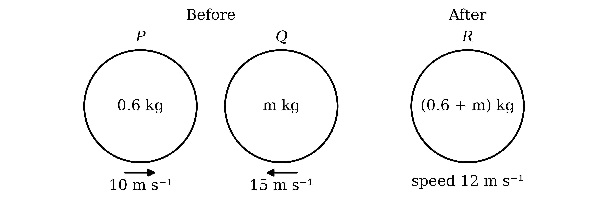

Test $R$ moving in the positive direction. Momentum before the collision equals momentum after the collision

$0 . 6 \times 10 + m \times ( - 15 ) = 12 ( 0 . 6 + m )$

**[M1]**

$6 - 15 m = 7 . 2 + 12 m$

$m = - \frac{2}{45}$

A mass cannot be negative, so $R$ must move in the negative direction, the original direction of $Q$

$0 . 6 \times 10 + m \times ( - 15 ) = - 12 ( 0 . 6 + m )$

**[M1 A1]**

$6 - 15 m = - 7 . 2 - 12 m$

$13 . 2 = 3 m$

**Final answer:** $m =$** 4.4**

**[A1]**

> **[mark-scheme]**
> **M1**: Use of conservation of momentum with 3 non-zero terms and a combined mass of $( 0 . 6 + m )$, in either direction for $R$. Allow sign errors for this mark.
> 
> **M1**: The direction of $R$ correctly determined as the original direction of $Q$. This may be by rejecting the negative mass from the other direction, or by arguing that $P$ cannot gain speed in its own direction in a head-on collision. This mark may be implied by a correct equation with $R$ in the direction of $Q$.
> 
> **A1**: Correct equation, $6 - 15 m = - 7 . 2 - 12 m$ or equivalent.
> 
> **A1**: $m = 4 . 4$.
**Method 1**

$R$ has mass $0 . 6 + 4 . 4 = 5$ kg. Find its acceleration using $v^{2} = u^{2} + 2 a s$ with $u = 12$, $v = 0$ and $s = 120$

$0^{2} = 12^{2} + 2 a \times 120$

**[M1]**

$- 144 = 240 a$

$a = - 0 . 6$

**[A1]**

The resistance is the only horizontal force, so apply Newton's second law with the resistance acting against the motion

$- F = 5 \times ( - 0 . 6 )$

**[M1]**

**Final answer:** $F = 3$** N**

**[A1]**

> **[mark-scheme]**
> **Method 1: suvat and Newton's second law**
> 
> **M1**: Use of $v^{2} = u^{2} + 2 a s$ with $u = 12$, $v = 0$ and $s = 120$.
> 
> **A1**: $a = - 0 . 6$, or a deceleration of 0.6.
> 
> **M1**: Use of Newton's second law with 2 terms, the resistance and $m a$, using the combined mass. Follow through from the mass found in part (a).
> 
> **A1**: 3. The answer must be positive, since a magnitude is asked for.

**Method 2**

$R$ has mass $0 . 6 + 4 . 4 = 5$ kg. Find the kinetic energy it loses in coming to rest, using $\text{KE} = \frac{1}{2} m v^{2}$

$\text{Loss of KE} = \frac{1}{2} \times 5 \times 12^{2}$

**[M1]**

$\text{Loss of KE} = 360$

**[A1]**

The work done against the resistance over the 120 m equals the loss of kinetic energy

$F \times 120 = 360$

**[M1]**

**Final answer:** $F = 3$** N**

**[A1]**

> **[mark-scheme]**
> **Method 2: work-energy principle**
> 
> **M1**: Kinetic energy of $R$ found using $\frac{1}{2} m v^{2}$ with the combined mass and a speed of 12. Follow through from the mass found in part (a).
> 
> **A1**: 360.
> 
> **M1**: Work done against the resistance, $F \times 120$, equated to the loss of kinetic energy.
> 
> **A1**: 3.

### Q15
**Method 1**

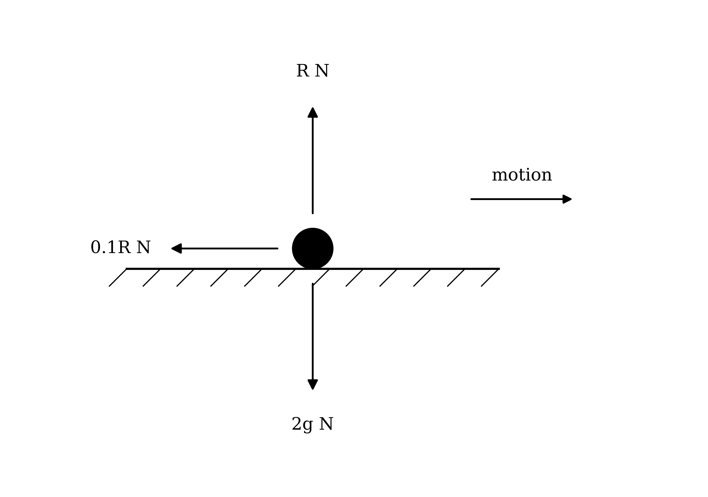

There is no vertical acceleration, so resolve vertically to find the normal reaction, using $g = 10$

$R = 2 \times 10 = 20$

**[B1]**

The ball is sliding, so friction is limiting and $F = μ R$

$F = 0 . 1 \times 20 = 2$

**[M1]**

Friction is the only horizontal force and acts against the motion, so apply Newton's second law with the direction of motion positive

$- 2 = 2 a$

**[M1]**

$a = - 1$

**[A1]**

Find the speed at the wall using $v^{2} = u^{2} + 2 a s$ with $u = 8$, $a = - 1$ and $s = 20$

$v^{2} = 8^{2} + 2 \times ( - 1 ) \times 20 = 24$

$v = \sqrt{24} = 2 \sqrt{6}$

**[M1]**

Momentum is mass multiplied by velocity

$\text{Momentum} = 2 \times 2 \sqrt{6} = 4 \sqrt{6}$

**Final answer:** $\text{Momentum} =$** 9.80 **$\text{kg m s}^{-1}$** (3 s.f.)**

**[A1]**

> **[mark-scheme]**
> **Method 1: Newton's second law and suvat**
> 
> **B1**: $R = 20$, from resolving vertically with $g = 10$.
> 
> **M1**: Use of $F = μ R$ with the value of $R$ found.
> 
> **M1**: Use of Newton's second law with friction as the only horizontal force. Allow a sign error for this mark.
> 
> **A1**: $a = - 1$, or a deceleration of 1.
> 
> **M1**: Use of $v^{2} = u^{2} + 2 a s$ with $u = 8$, $s = 20$ and the acceleration found.
> 
> **A1**: $4 \sqrt{6}$, or answers which round to 9.80. Units are not required.

**Method 2**

Resolve vertically to find the normal reaction, using $g = 10$

$R = 2 \times 10 = 20$

**[B1]**

The ball is sliding, so friction is limiting and $F = μ R$

$F = 0 . 1 \times 20 = 2$

**[M1]**

Find the work done against friction over the 20 m

$\text{Work done against friction} = 2 \times 20 = 40$

**[M1]**

The kinetic energy at the wall is the initial kinetic energy minus the work done against friction

$\frac{1}{2} \times 2 \times v^{2} = \frac{1}{2} \times 2 \times 8^{2} - 40$

**[M1]**

$v^{2} = 24$

$v = 2 \sqrt{6}$

**[A1]**

Momentum is mass multiplied by velocity

$\text{Momentum} = 2 \times 2 \sqrt{6} = 4 \sqrt{6}$

**Final answer:** $\text{Momentum} =$** 9.80 **$\text{kg m s}^{-1}$** (3 s.f.)**

**[A1]**

> **[mark-scheme]**
> **Method 2: work-energy principle**
> 
> **B1**: $R = 20$, from resolving vertically with $g = 10$.
> 
> **M1**: Use of $F = μ R$ with the value of $R$ found.
> 
> **M1**: Work done against friction found as friction multiplied by 20.
> 
> **M1**: Work-energy equation with 3 terms: the final kinetic energy, the initial kinetic energy and the work done against friction.
> 
> **A1**: $v = 2 \sqrt{6}$, or $v^{2} = 24$.
> 
> **A1**: $4 \sqrt{6}$, or answers which round to 9.80.
Friction still acts against the motion with magnitude 2 N, so the deceleration is still 1 $\text{m s}^{-2}$. Taking the direction away from the wall as positive, use $v = u + a t$ with $v = 0$, $a = - 1$ and $t = 3$, where $u$ is the rebound speed

$0 = u + ( - 1 ) \times 3$

**[M1]**

$u = 3$

**[A1]**

Momentum is mass multiplied by velocity

$\text{Momentum} = 2 \times 3$

**Final answer:** $6 \text{kg m s}^{-1}$** directly away from the wall**

**[A1]**

> **[mark-scheme]**
> **M1**: Use of $v = u + a t$ with $v = 0$, $t = 3$ and a deceleration of magnitude 1. Follow through from the acceleration found in part (a).
> 
> **A1**: A rebound speed of 3.
> 
> **A1**: 6. The direction is not required; −6 with the direction towards the wall taken as positive is also accepted.

### Q16
Take the original direction of motion as positive. The direction of $A$ after the collision is not given, so its velocity is either $+ 2$ or $- 2 \text{m s}^{-1}$

If the direction of $A$ is unchanged, momentum before the collision equals momentum after the collision

$5 \times 12 + 2 m = 5 \times 2 + 4 m$

**[M1]**

$60 + 2 m = 10 + 4 m$

$m = 25$

**[A1]**

If the direction of $A$ is reversed

$5 \times 12 + 2 m = 5 \times ( - 2 ) + 4 m$

**[M1]**

$60 + 2 m = - 10 + 4 m$

$m = 35$

**[A1]**

> **[mark-scheme]**
> **M1**: Use of conservation of momentum with 4 non-zero terms in either case. Allow sign errors for this mark.
> 
> **A1**: $m = 25$.
> 
> **M1**: Use of conservation of momentum for the other case, with the velocity of $A$ after the collision taking the opposite sign.
> 
> **A1**: $m = 35$.
> 
> The two values are marked independently.
Find the kinetic energy of $A$ before and after, using $\text{KE} = \frac{1}{2} m v^{2}$; this is the same in both cases

$\text{KE of} A \text{before} = \frac{1}{2} \times 5 \times 12^{2} = 360$

$\text{KE of} A \text{after} = \frac{1}{2} \times 5 \times 2^{2} = 10$

For $m = 25$, find the loss of kinetic energy of the system

`\text{Loss} = \left(360 + \dfrac{1}{2} \times 25 \times 2^2\right) - \left(10 + \dfrac{1}{2} \times 25 \times 4^2\right)`

**[M1]**

$\text{Loss} = 410 - 210 = 200$

For $m = 35$

`\text{Loss} = \left(360 + \dfrac{1}{2} \times 35 \times 2^2\right) - \left(10 + \dfrac{1}{2} \times 35 \times 4^2\right)`

$\text{Loss} = 430 - 290 = 140$

**[A1]**

Compare the two losses

$140 < 200$

**Final answer:** $\text{Smaller loss of KE} = 140$** J**

**[B1]**

> **[mark-scheme]**
> **M1**: Total kinetic energy before minus total kinetic energy after, using $\text{KE} = \frac{1}{2} m v^{2}$, for either value of $m$.
> 
> **A1**: Both losses correct, 200 J and 140 J. Follow through from incorrect values of $m$ in part (a).
> 
> **B1**: 140 J identified as the smaller loss from a comparison of the two. As the answer is given, both losses must be seen; finding only the loss for $m = 35$ does not show that it is the smaller.

### Q17
Take the direction of motion of $A$ as positive, so $B$ has velocity $- 6 \text{m s}^{-1}$. The particles coalesce (stick together), so $C$ has mass $0 . 6 + 1 . 4 = 2$ kg; let its velocity be $v \text{m s}^{-1}$

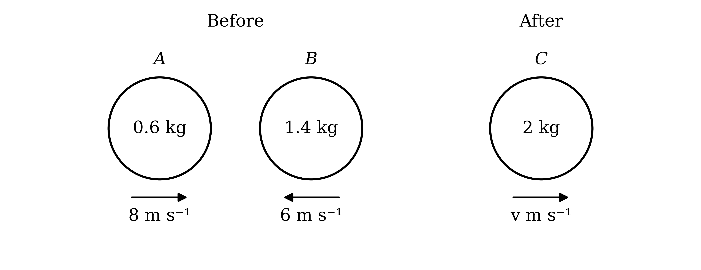

Momentum before the collision equals momentum after the collision

$0 . 6 \times 8 + 1 . 4 \times ( - 6 ) = 2 v$

**[M1]**

$4 . 8 - 8 . 4 = 2 v$

$v = - 1 . 8$

The speed is the magnitude of the velocity

**Final answer:** $\text{Speed of} C =$** 1.8 **$\text{m s}^{-1}$

**[A1]**

The velocity is negative, so $C$ moves against the original direction of $A$

**Final answer:** **C moves in the direction in which B was originally moving**

**[B1]**

> **[mark-scheme]**
> **M1**: Use of conservation of momentum with 3 non-zero terms, using a combined mass of 2 kg. Allow sign errors for this mark.
> 
> **A1**: 1.8. The answer must be positive, since a speed is asked for.
> 
> **B1**: Direction given as the original direction of motion of $B$ (or opposite to the original motion of $A$). Accept the direction shown on a clearly labelled diagram. Taking $B$'s direction as positive, giving $v = 1 . 8$ in that direction, is equally acceptable.
Momentum is mass multiplied by velocity, using the combined mass of 2 kg and the speed from part (a)

$\text{Momentum} = 2 \times 1 . 8$

**Final answer:** $\text{Momentum of} C =$** 3.6 **$\text{kg m s}^{-1}$

**[B1]**

> **[mark-scheme]**
> **B1**: 3.6. Follow through as twice the speed found in part (a). Units and direction are not required; an answer of −3.6 consistent with a stated positive direction is also accepted.

### Q18
$M$ is at rest after the collision and lies in the path of $N$, so $N$ cannot continue in its original direction: its direction of motion must be reversed

Take the direction of motion of $M$ as positive, so $N$ has velocity $- 5 \text{m s}^{-1}$ before the collision and $+ 4 \text{m s}^{-1}$ after it

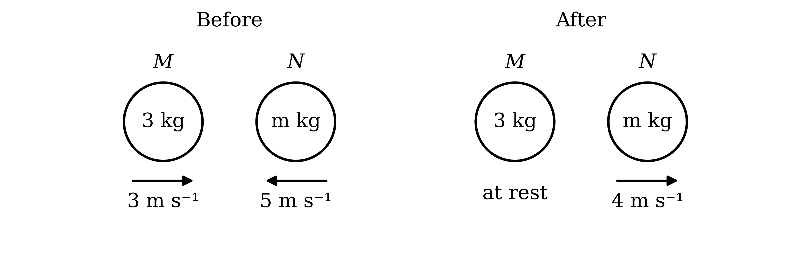

Momentum before the collision equals momentum after the collision

$3 \times 3 + m \times ( - 5 ) = 3 \times 0 + m \times 4$

**[M1 A1]**

$9 - 5 m = 4 m$

$9 = 9 m$

$m = 1$

**[A1]**

> **[mark-scheme]**
> **M1**: Use of conservation of momentum with 3 non-zero terms. Allow sign errors for this mark.
> 
> **A1**: Correct equation with the velocities of $N$ before and after taking opposite signs, $9 - 5 m = 4 m$ or equivalent.
> 
> **A1**: $m = 1$. The answer $m = 9$, from assuming $N$ keeps its original direction, does not score either A mark.

### Q19
Take the original direction of motion of $P$ as positive. Then $Q$ has velocity $- 2 u$ before the collision, $P$ has velocity $- \frac{3}{2} u$ after it, and let $Q$ have velocity $v \text{m s}^{-1}$ after it

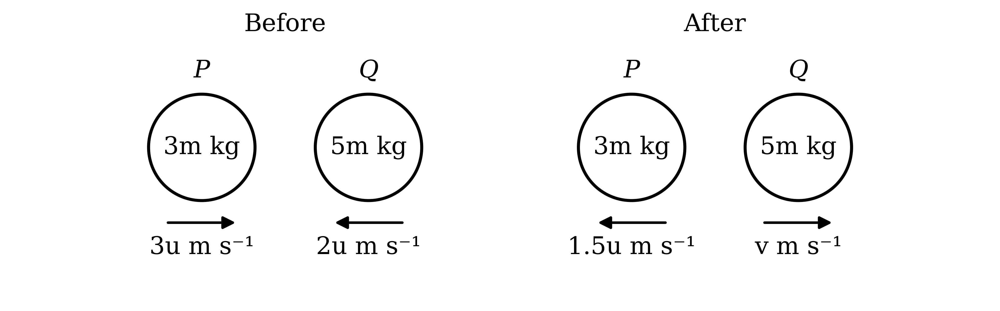

Momentum before the collision equals momentum after the collision

`3m \times 3u + 5m \times (-2u) = 3m \times \left(-\dfrac{3}{2}u\right) + 5mv`

**[M1 A1]**

Every term contains $m$, so divide through by $m$

$9 u - 10 u = - 4 . 5 u + 5 v$

$5 v = 3 . 5 u$

$\text{Speed of} Q = 0 . 7 u \text{m s}^{-1}$

**[A1]**

> **[mark-scheme]**
> **M1**: Use of conservation of momentum with 4 non-zero terms. Allow sign errors for this mark.
> 
> **A1**: Correct equation, $9 m u - 10 m u = - 4 . 5 m u + 5 m v$ or equivalent.
> 
> **A1**: $0 . 7 u$, or $\frac{7}{10} u$. The answer must be positive and must include $u$.
$Q$ was moving in the negative direction before the collision, and its velocity $0 . 7 u$ after the collision is positive

**Final answer:** **The direction of motion of Q is changed (reversed) by the collision**

**[B1]**

> **[mark-scheme]**
> **B1**: The direction of $Q$ is changed. Follow through from the sign of the velocity found in part (a), provided the positive direction has been defined.

### Q20
Take the original direction of motion as positive. The two cases differ only in the sign of the velocity of $A$ after the collision

(i)

$A$ keeps its direction, so its velocity after the collision is $+ 1 \text{m s}^{-1}$. Momentum before the collision equals momentum after the collision

$8 m + 1 . 5 \times 3 = m \times 1 + 1 . 5 \times 4$

**[M1 A1]**

$8 m + 4 . 5 = m + 6$

$7 m = 1 . 5$

$m = \frac{3}{14}$

**[A1]**

(ii)

$A$ reverses, so its velocity after the collision is $- 1 \text{m s}^{-1}$

$8 m + 1 . 5 \times 3 = m \times ( - 1 ) + 1 . 5 \times 4$

**[M1 A1]**

$8 m + 4 . 5 = - m + 6$

$9 m = 1 . 5$

$m = \frac{1}{6}$

**[A1]**

> **[mark-scheme]**
> **M1**: Use of conservation of momentum with 4 non-zero terms for case (i). Allow sign errors for this mark.
> 
> **A1**: Correct equation for case (i), $8 m + 4 . 5 = m + 6$ or equivalent.
> 
> **A1**: $m = \frac{3}{14}$. Accept answers which round to 0.214.
> 
> **M1**: Use of conservation of momentum with 4 non-zero terms for case (ii). Allow sign errors for this mark.
> 
> **A1**: Correct equation for case (ii), with the velocity of $A$ after the collision taken as negative.
> 
> **A1**: $m = \frac{1}{6}$. Accept answers which round to 0.167.
> 
> The two cases are marked independently.

### Q21
Take the direction of motion of $A$ as positive and let the velocity of $B$ after the collision be $v \text{m s}^{-1}$

Momentum before the collision equals momentum after the collision, and $B$ has no momentum before it

$0 . 1 \times 12 = 0 . 1 \times 1 . 5 + 0 . 3 v$

**[M1 A1]**

$1 . 2 = 0 . 15 + 0 . 3 v$

$0 . 3 v = 1 . 05$

**Final answer:** $v =$** 3.5 **$\text{m s}^{-1}$

**[B1]**

> **[mark-scheme]**
> **M1**: Use of conservation of momentum with 3 non-zero terms. Allow sign errors for this mark.
> 
> **A1**: Correct equation, $1 . 2 = 0 . 15 + 0 . 3 v$ or equivalent.
> 
> **B1**: 3.5 reached from correct working. As the answer is given, the rearrangement must be seen.
Keep the same positive direction and let the velocity of $B$ after its collision with $C$ be $w \text{m s}^{-1}$

Momentum before the collision equals momentum after the collision, and $C$ has no momentum before it

$0 . 3 \times 3 . 5 = 0 . 3 w + 0 . 5 \times 1 . 5$

**[M1]**

$1 . 05 = 0 . 3 w + 0 . 75$

$w = 1$

**[A1]**

$B$ still moves in the positive direction, and $A$, which is behind it, still moves in the positive direction with speed 1.5 $\text{m s}^{-1}$. Compare their velocities

$1 . 5 > 1$

**Final answer:** **A is behind B and moving faster in the same direction, so A will catch up with B and there will be another collision**

**[B1]**

> **[mark-scheme]**
> **M1**: Use of conservation of momentum for the collision between $B$ and $C$, with 3 non-zero terms. Allow sign errors for this mark.
> 
> **A1**: $w = 1$.
> 
> **B1**: Comparison of the velocities of $A$ and $B$, with a conclusion that $A$ catches $B$ because it is behind $B$ and moving faster in the same direction. As a collision is given, the comparison must be seen.
(i)

The spheres coalesce (stick together), so the combined sphere has mass $0 . 1 + 0 . 3 = 0 . 4$ kg; let its velocity be $V \text{m s}^{-1}$. Momentum before the collision equals momentum after the collision

$0 . 1 \times 1 . 5 + 0 . 3 \times 1 = 0 . 4 V$

**[M1]**

$0 . 45 = 0 . 4 V$

**Final answer:** $V =$** 1.125 **$\text{m s}^{-1}$

**[B1]**

(ii)

Before the three collisions only $A$ is moving, so find the initial kinetic energy using $\text{KE} = \frac{1}{2} m v^{2}$

$\text{Initial KE} = \frac{1}{2} \times 0 . 1 \times 12^{2} = 7 . 2$

**[M1]**

After all three collisions, $C$ moves at 1.5 $\text{m s}^{-1}$ and the combined sphere moves at 1.125 $\text{m s}^{-1}$

$\text{Final KE} = \frac{1}{2} \times 0 . 5 \times 1 . 5^{2} + \frac{1}{2} \times 0 . 4 \times 1 . 125^{2}$

**[M1]**

$\text{Final KE} = 0 . 5625 + 0 . 253125 = 0 . 815625$

The total loss is the initial kinetic energy minus the final kinetic energy

$\text{Loss of KE} = 7 . 2 - 0 . 815625 = 6 . 384375$

**Final answer:** $\text{Loss of KE} =$** 6.38 J (3 s.f.)**

**[B1]**

> **[mark-scheme]**
> **M1**: Use of conservation of momentum with 3 non-zero terms and a combined mass of 0.4 kg.
> 
> **B1**: 1.125 reached from correct working. As the answer is given, the equation must be seen.
> 
> **M1**: Initial kinetic energy of the system, $\frac{1}{2} \times 0 . 1 \times 12^{2}$.
> 
> **M1**: Final kinetic energy of the system, including both the kinetic energy of $C$ and that of the combined sphere.
> 
> **B1**: 6.38 reached from correct working, with a more accurate value such as 6.384 seen before rounding.
> 
> Finding the loss for each collision separately and adding the three losses is equally acceptable.

### Q22
Take the direction in which $P$ is moving as positive, and let the velocity of $Q$ after the collision be $v \text{m s}^{-1}$

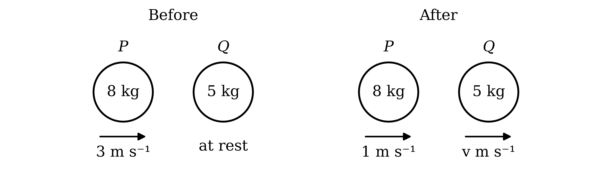

Momentum before the collision equals momentum after the collision, and $Q$ has no momentum before the collision because it is at rest

$8 \times 3 = 8 \times 1 + 5 v$

**[M1 A1]**

$24 = 8 + 5 v$

$5 v = 16$

**Final answer:** $v =$** 3.2 **$\text{m s}^{-1}$

**[A1]**

> **[mark-scheme]**
> **M1**: Use of conservation of momentum with 3 non-zero terms. Allow sign errors for this mark.
> 
> **A1**: Correct equation, $24 = 8 + 5 v$ or equivalent.
> 
> **A1**: 3.2. The answer must be positive, since a speed is asked for.
Find the total kinetic energy before the collision, using $\text{KE} = \frac{1}{2} m v^{2}$. Only $P$ is moving

$\text{KE before} = \frac{1}{2} \times 8 \times 3^{2} = 36$

**[M1]**

Find the total kinetic energy after the collision, using the speed of $Q$ from part (a)

$\text{KE after} = \frac{1}{2} \times 8 \times 1^{2} + \frac{1}{2} \times 5 \times 3 . 2^{2}$

$\text{KE after} = 4 + 25 . 6 = 29 . 6$

The loss of kinetic energy is the difference between the two totals

$\text{Loss of KE} = 36 - 29 . 6$

**Final answer:** $\text{Loss of KE} =$** 6.4 J**

**[A1]**

> **[mark-scheme]**
> **M1**: Use of $\text{KE} = \frac{1}{2} m v^{2}$ for either particle, either before or after the collision.
> 
> **A1**: 6.4. Follow through from an incorrect speed in part (a). Units are not required.

### Q23
Before the collision both particles move in the same direction, and $P$ is faster, so $P$ must catch up with $Q$ from behind

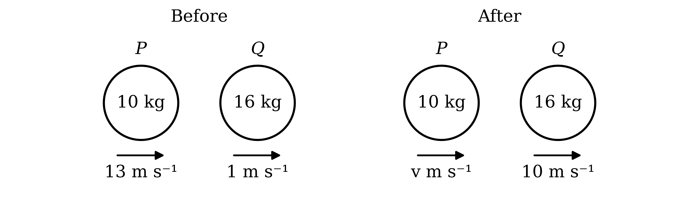

**Final answer:** **Q is hit from behind by P, so it is pushed forwards and continues to move in the same direction**

**[B1]**

> **[mark-scheme]**
> **B1**: A correct explanation that $P$ collides with $Q$ from behind, so $Q$ is pushed in its original direction of motion. Accept an equivalent explanation, such as the collision force on $Q$ acting in its direction of motion.

(i)

Take the original direction of motion as positive, and let the velocity of $P$ after the collision be $v \text{m s}^{-1}$

Momentum before the collision equals momentum after the collision

$10 \times 13 + 16 \times 1 = 10 v + 16 \times 10$

**[M1 A1]**

$146 = 10 v + 160$

$10 v = - 14$

$v = - 1 . 4$

The speed is the magnitude of the velocity

**Final answer:** $\text{Speed of} P =$** 1.4 **$\text{m s}^{-1}$

**[A1]**

(ii)

**Final answer:** **The velocity of P after the collision is negative, so P is now moving in the opposite direction to the one taken as positive**

**[B1]**

> **[mark-scheme]**
> **M1**: Use of conservation of momentum with 4 non-zero terms. Allow sign errors for this mark.
> 
> **A1**: Correct equation, $146 = 10 v + 160$ or equivalent.
> 
> **A1**: 1.4. The answer must be positive, since a speed is asked for; −1.4 does not score this mark.
> 
> **B1**: Reversal explained by the negative velocity (or negative momentum) of $P$ in the original direction of motion. Follow through from a negative velocity in part (i).

### Q24
(i)

Momentum is mass multiplied by velocity, and the spheres all move in the same direction, so equate the momentum of $P$ and the momentum of $R$

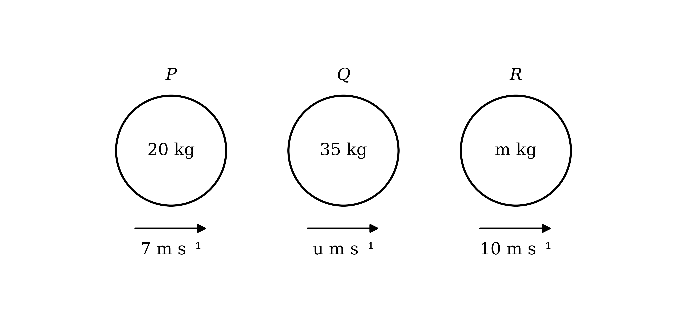

$20 \times 7 = m \times 10$

**[M1]**

$140 = 10 m$

$m = 14$

**[A1]**

(ii)

Equate the momentum of $P$ and the momentum of $Q$

$20 \times 7 = 35 u$

**[M1]**

$140 = 35 u$

$u = 4$

**[A1]**

> **[mark-scheme]**
> **M1**: Momentum of $P$ equated to momentum of $R$, each written as mass multiplied by speed.
> 
> **A1**: $m = 14$.
> 
> **M1**: Momentum of $Q$ equated to the momentum of $P$ or of $R$.
> 
> **A1**: $u = 4$.
The spheres move in the same direction along the same line, so for none of them to catch up with another, the fastest sphere must be at the front and the slowest at the back

The speeds are 7 $\text{m s}^{-1}$ for $P$, 4 $\text{m s}^{-1}$ for $Q$ and 10 $\text{m s}^{-1}$ for $R$

**Final answer:** **R is travelling at the front**

**[B1]**

**Final answer:** **Q is travelling at the back**

**[B1]**

> **[mark-scheme]**
> **B1**: $R$ identified as the sphere at the front.
> 
> **B1**: $Q$ identified as the sphere at the back. Follow through from an incorrect value of $u$ in part (a)(ii).
> 
> The two answers are marked independently. No working or reason is required.

### Q25
Let the mass of Safa's ball be $m$ kg. The magnitude of its momentum is its mass multiplied by its speed, whatever its direction

$\text{Magnitude before} = 6 m$

$\text{Magnitude after} = 2 m$

**[M1]**

The magnitude decreases by 2.4

$6 m - 2 m = 2 . 4$

**[A1]**

$4 m = 2 . 4$

**Final answer:** $m =$** 0.6**

**[B1]**

> **[mark-scheme]**
> **M1**: Both magnitudes of momentum written as mass multiplied by speed, $6 m$ and $2 m$.
> 
> **A1**: Correct equation, $6 m - 2 m = 2 . 4$ or equivalent. Treating the velocity after the collision as negative, giving $6 m - ( - 2 m ) = 2 . 4$, does not earn this mark, since the question describes a change in the magnitude of the momentum.
> 
> **B1**: $m = 0 . 6$ reached from correct working. As the answer is given, the equation must be seen.

(i)

Take the original direction of motion of Safa's ball as positive, and let the velocity of Adam's ball after the collision be $v \text{m s}^{-1}$

Momentum before the collision equals momentum after the collision

$0 . 6 \times 6 + 0 . 8 \times ( - 3 ) = 0 . 6 \times ( - 2 ) + 0 . 8 v$

**[M1 A1]**

$3 . 6 - 2 . 4 = - 1 . 2 + 0 . 8 v$

$0 . 8 v = 2 . 4$

$v = 3$

$\text{Speed of Adam's ball} = 3 \text{m s}^{-1}$

**[A1]**

(ii)

Adam's ball was moving in the negative direction before the collision, and $v$ is positive

**Final answer:** **The direction of motion of Adam's ball is changed (reversed) by the collision**

**[B1]**

> **[mark-scheme]**
> **M1**: Use of conservation of momentum with 4 non-zero terms. Allow sign errors for this mark.
> 
> **A1**: Correct equation, $3 . 6 - 2 . 4 = - 1 . 2 + 0 . 8 v$ or equivalent.
> 
> **A1**: 3. The answer must be positive, since a speed is asked for.
> 
> **B1**: The direction of Adam's ball is changed. Follow through from the sign of the velocity found in part (i), provided the positive direction has been defined.

### Q26
Take the direction of motion of $A$ before the collision as positive, so $B$ has velocity $- 5 \text{m s}^{-1}$ before the collision and $+ 3 \text{m s}^{-1}$ after it

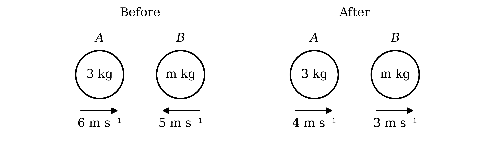

Momentum before the collision equals momentum after the collision

$3 \times 6 + m \times ( - 5 ) = 3 \times 4 + m \times 3$

**[M1 A1]**

$18 - 5 m = 12 + 3 m$

$6 = 8 m$

$m = \frac{6}{8}$

**Final answer:** $m =$** 0.75**

**[B1]**

> **[mark-scheme]**
> **M1**: Use of conservation of momentum with 4 non-zero terms. Allow sign errors for this mark.
> 
> **A1**: Correct equation with the velocities of $B$ taking opposite signs, $18 - 5 m = 12 + 3 m$ or equivalent.
> 
> **B1**: $m = 0 . 75$ reached from correct working. As the answer is given, the equation and its rearrangement must be seen.
The change in momentum is the momentum after the collision minus the momentum before it, keeping the positive direction from part (a)

$\text{Change in momentum of} A = ( 3 \times 4 ) - ( 3 \times 6 )$

**[M1]**

$\text{Change in momentum of} A = - 6$

The negative sign means the change acts against the original direction of motion of $A$

$6 \text{kg m s}^{-1}$

**[A1]**

**Final answer:** **The change in momentum is in the opposite direction to the original motion of A**

**[B1]**

> **[mark-scheme]**
> **M1**: Final momentum of $A$ minus initial momentum of $A$, using $m v - m u$ with the mass of $A$. Allow sign errors for this mark.
> 
> **A1**: A magnitude of 6. Units are not required.
> 
> **B1**: Direction stated as opposite to the original motion of $A$. Accept an answer of −6 with the positive direction clearly defined as the original motion of $A$.

### Q27
Convert the mass to kilograms, so that the momentum is in SI units

$400 \text{g} = 0 . 4 \text{kg}$

Use momentum $=$ mass $\times$ velocity

$\text{Momentum} = 0 . 4 \times 2$

**[M1]**

**Final answer:** $\text{Momentum} =$** 0.8 **$\text{kg m s}^{-1}$

**[A1]**

> **[mark-scheme]**
> **M1**: Mass multiplied by speed. Allow the mass in grams for this mark.
> 
> **A1**: 0.8. The mass must have been converted to kilograms, so 800 does not score this mark. Units are not required.
Convert the speed to metres per second, to match the units of the momentum

$90 \text{km h}^{-1} = \frac{90\times1000}{60\times60} \text{m s}^{-1}$

$90 \text{km h}^{-1} = 25 \text{m s}^{-1}$

Use momentum $=$ mass $\times$ velocity

$m \times 25 = 32500$

**[M1]**

$m = 1300$

**[A1]**

> **[mark-scheme]**
> **M1**: Momentum equated to $m$ multiplied by the speed, with an attempt to convert 90 $\text{km h}^{-1}$ to $\text{m s}^{-1}$.
> 
> **A1**: $m = 1300$.

### Q28
Let the mass of $A$ be $m_{A}$ kg. The loss of kinetic energy of $A$ is its kinetic energy before the collision minus its kinetic energy after, using $\text{KE} = \frac{1}{2} m v^{2}$

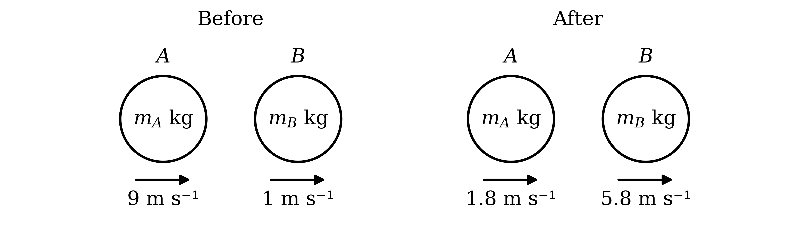

$\frac{1}{2} m_{A} \times 9^{2} - \frac{1}{2} m_{A} \times 1 . 8^{2} = 388 . 8$

**[M1]**

$\frac{1}{2} m_{A} ( 81 - 3 . 24 ) = 388 . 8$

$38 . 88 m_{A} = 388 . 8$

$m_{A} = 10$

**[B1]**

> **[mark-scheme]**
> **M1**: Loss of kinetic energy of $A$ written as $\frac{1}{2} m_{A} \times 9^{2} - \frac{1}{2} m_{A} \times 1 . 8^{2}$ and equated to 388.8.
> 
> **B1**: $m_{A} = 10$ reached from correct working. As the answer is given, the equation and a correct simplification must be seen.
Take the direction of motion as positive and let the mass of $B$ be $m_{B}$ kg

Momentum before the collision equals momentum after the collision

$10 \times 9 + m_{B} \times 1 = 10 \times 1 . 8 + m_{B} \times 5 . 8$

**[M1 A1]**

$90 + m_{B} = 18 + 5 . 8 m_{B}$

$72 = 4 . 8 m_{B}$

$m_{B} = 15$

**[B1]**

> **[mark-scheme]**
> **M1**: Use of conservation of momentum with 4 non-zero terms. Allow sign errors for this mark.
> 
> **A1**: Correct equation, $90 + m_{B} = 18 + 5 . 8 m_{B}$ or equivalent.
> 
> **B1**: $m_{B} = 15$ reached from correct working. As the answer is given, the rearrangement must be seen.
(i)

Keep the same positive direction and let the velocity of $B$ after this collision be $v \text{m s}^{-1}$. $C$ is hit from behind, so it moves in the positive direction

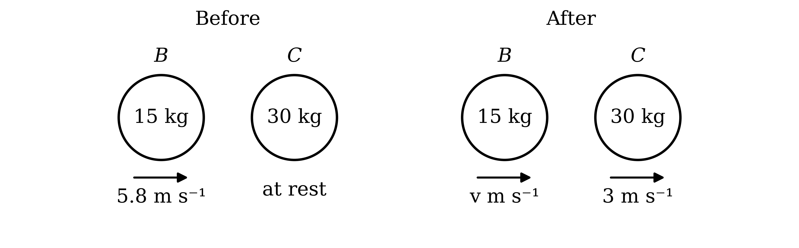

Momentum before the collision equals momentum after the collision, and $C$ has no momentum before it

$15 \times 5 . 8 = 15 v + 30 \times 3$

**[M1]**

$87 = 15 v + 90$

$15 v = - 3$

$v = - 0 . 2$

The speed is the magnitude of the velocity

**Final answer:** $\text{Speed of} B =$** 0.2 **$\text{m s}^{-1}$

**[A1]**

(ii)

The velocity of $B$ is negative, so $B$ now moves in the opposite direction

**Final answer:** **The collision with C reverses the direction of motion of B**

**[B1]**

> **[mark-scheme]**
> **M1**: Use of conservation of momentum with 3 non-zero terms. Allow sign errors for this mark.
> 
> **A1**: 0.2. The answer must be positive, since a speed is asked for; −0.2 does not score this mark.
> 
> **B1**: The direction of $B$ is changed (reversed). Follow through from the sign of the velocity found in part (i).
After the first collision $A$ is still moving in the positive direction, behind $B$, and after hitting $C$ the sphere $B$ is moving in the negative direction

**Final answer:** **A is moving towards B and B is moving back towards A, so the two spheres must collide again**

**[B1]**

> **[mark-scheme]**
> **B1**: Explanation that $A$ is still moving forwards while $B$ is now moving back towards $A$, so they are moving towards each other. Follow through from the answer to part (c)(ii).
