# Exam Questions — Representation of Data
**Data Presentation & Interpretation** · Cambridge (CIE) AS maths (9709)
> Source: [https://www.savemyexams.com/as/maths/cie/20/probability-and-statistics-1/topic-questions/](https://www.savemyexams.com/as/maths/cie/20/probability-and-statistics-1/topic-questions/) · 27 questions across 1 sets

## Exam Questions (27 questions)

### Q1 — hard — 8 marks

**Q1** [4 marks]

The scores of 160 employees of a company in an aptitude test are represented in the cumulative frequency graph.

Use the graph to estimate the number of employees whose score is within 5 of the median score.

**Q1** [2 marks]

The employees with the top 10% of scores are offered a management training course.

Use the graph to estimate the lowest score of an employee who is offered the course.

**Q1** [2 marks]

The employees with the bottom 5% of scores are offered extra support.

Use the graph to estimate the highest score of an employee who is offered extra support.

### Q2 — hard — 8 marks

**Q2** [3 marks]

The lengths of time, $t$ minutes, of Susie's calls with her customers are summarised in the table, where $a$, $b$ and $c$ are unknown frequencies.

| Time ($t$ minutes) | $4 < t \leq 8$ | $8 < t \leq 12$ | $12 < t \leq 16$ | $16 < t \leq 20$ |
|---|---|---|---|---|
| Frequency | 16 | $a$ | $b$ | $c$ |

The table was used to draw the cumulative frequency graph.

Use the graph to find the values of $a$, $b$ and $c$.

**Q2** [3 marks]

Use the graph to estimate the interquartile range of the times of Susie's calls.

**Q2** [2 marks]

Use the graph to estimate the percentage of Susie's calls that lasted longer than 10 minutes.

### Q3 — very_hard — 10 marks

**Q3** [5 marks]

Crystal is given an incomplete box-and-whisker plot of the lengths of 99 unicorn horns. She also knows that

the median length is halfway between the minimum and maximum lengths

the range is 2.5 times the interquartile range.

Complete the diagrams below to show that there are two possible box-and-whisker plots that fit this information.

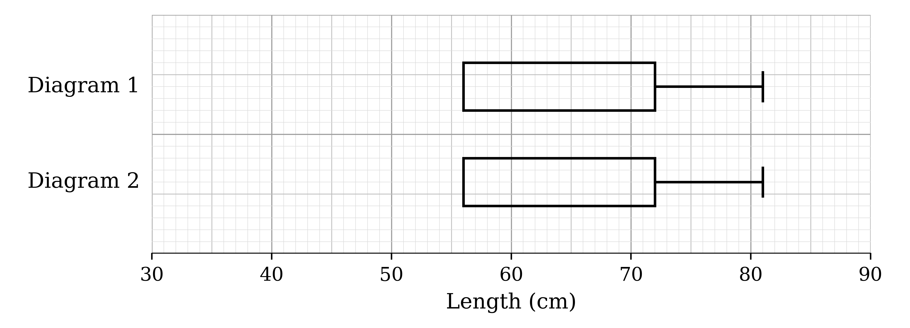

**Q3** [3 marks]

The box-and-whisker plot below shows the masses, in kg, of the 99 unicorn horns.

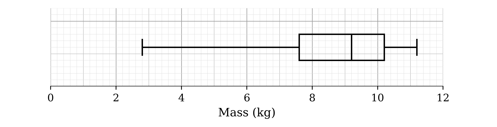

Crystal discovers that two masses were recorded incorrectly: 11 kg should have been 8 kg, and 9 kg should have been 10 kg.

Explain why at most one of the five values on the box-and-whisker plot will need to be changed.

**Q3** [2 marks]

Explain why it is possible that the box-and-whisker plot will not change when the masses are corrected.

### Q4 — hard — 6 marks

**Q4** [3 marks]

Mr Shapesphere, a history teacher, records the time, to the nearest minute, that it takes him to mark each of his students' essays. The table shows some of the results.

| Time (minutes) | 0 – 10 | 11 – 30 | 31 – 35 | 36 – 50 |
|---|---|---|---|---|
| Frequency | 7 | 16 | 4 |   |

The histogram represents all of the times. No scale is shown on the frequency density axis.

Find the number of essays that took him from 36 to 50 minutes to mark.

**Q4** [3 marks]

Estimate the number of essays that took him between 20 and 40 minutes to mark.

### Q5 — hard — 7 marks

**Q5** [4 marks]

The numbers of goals scored by the champions of the Premier League football competition in each of 29 seasons, from its launch in 1992 up to the 2020–21 season, are as follows.

| 67 | 80 | 80 | 73 | 76 | 68 | 80 | 97 | 79 | 79 |
|---|---|---|---|---|---|---|---|---|---|
| 74 | 73 | 72 | 72 | 83 | 80 | 68 | 103 | 78 | 93 |
| 86 | 102 | 73 | 68 | 85 | 106 | 95 | 85 | 83 |   |

(i) Give a reason why a stem-and-leaf diagram is suitable for these data.

(ii) Draw an ordered stem-and-leaf diagram with stretched (split) stems to represent these data.

**Q5** [3 marks]

The median number of goals is 80 and the mean is 81.3, correct to 3 significant figures.

(i) State what feature of the distribution accounts for the mean being greater than the median.

(ii) State, with a reason, which measure of central tendency would be most appropriate for these data.

### Q6 — very_hard — 5 marks

**Q6** [5 marks]

The histogram shows the loudest sound level, in decibels (dB), reached by the bark of each of the 180 dogs at a rescue centre. No scale is shown on the frequency density axis.

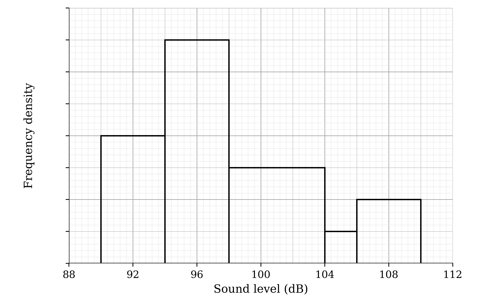

Estimate the number of these dogs whose loudest bark was between 99 dB and 107 dB.

### Q7 — easy — 4 marks

**Q7** [3 marks]

The flight times, $t$ seconds, of the paper aeroplanes of 55 contestants in a paper-aeroplane competition are summarised in the table.

| Time ($t$ seconds) | $0 \leq t < 4$ | $4 \leq t < 8$ | $8 \leq t < 12$ | $12 \leq t < 16$ |
|---|---|---|---|---|
| Frequency | 12 | 25 | 16 | 2 |

On the grid, draw a cumulative frequency graph to illustrate the data.

**Q7** [1 mark]

Use your graph to estimate the median flight time.

### Q8 — easy — 8 marks

**Q8** [3 marks]

The times, in minutes, taken by a train to complete a particular journey on weekdays are represented by the box-and-whisker plot below.

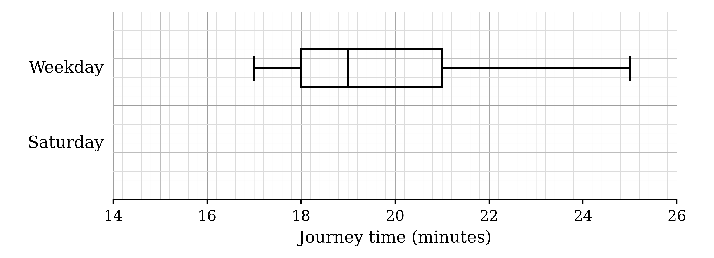

Find the median and the interquartile range of the journey times on weekdays.

**Q8** [3 marks]

The times, in minutes, for the same journey on Saturdays are summarised in the table.

| Fastest | Lower quartile | Median | Upper quartile | Slowest |
|---|---|---|---|---|
| 16 | 18 | 19 | 20 | 25 |

On the same diagram, draw a box-and-whisker plot to represent the journey times on Saturdays.

**Q8** [2 marks]

Make two comparisons between the journey times on weekdays and the journey times on Saturdays.

### Q9 — easy — 6 marks

**Q9** [4 marks]

The tempos, $b$ beats per minute, of 60 randomly chosen drum 'n' bass songs are summarised in the table.

| Tempo ($b$ beats per minute) | Frequency |
|---|---|
| $140 \leq b < 160$ | 10 |
| $160 \leq b < 170$ | 20 |
| $170 \leq b < 175$ | 20 |
| $175 \leq b < 180$ | 10 |

On the grid, draw a histogram to represent this information.

**Q9** [2 marks]

Estimate the number of these songs with a tempo of less than 150 beats per minute.

### Q10 — easy — 5 marks

**Q10** [5 marks]

A company tests elastic bands by stretching them until they snap. The length, in millimetres, of each band at the moment it snaps is recorded.

The incomplete histogram and frequency table below show the results.

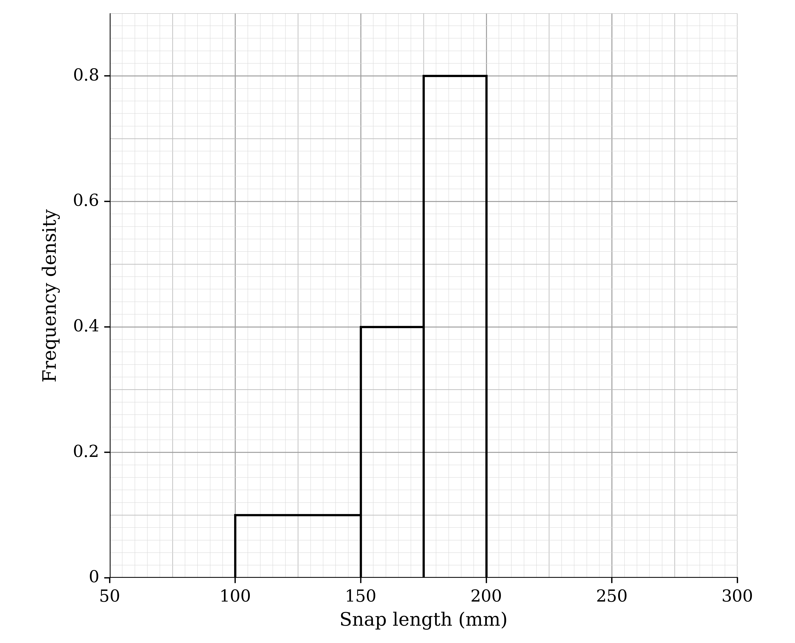

| Snap length ($l$ mm) | Frequency | Class width | Frequency density |
|---|---|---|---|
| $100 \leq l < 150$ | 5 | 50 | 0.1 |
| $150 \leq l < 175$ |   |   | 0.4 |
| $175 \leq l < 200$ |   |   |   |
| $200 \leq l < 225$ | 15 | 25 |   |
| $225 \leq l < 275$ | 10 |   |   |

Use the information to complete both the histogram and the frequency table.

### Q11 — easy — 4 marks

**Q11** [3 marks]

Kungawo measures the lengths, in millimetres, of 23 earthworms that he finds in his garden. His results are shown in the stem-and-leaf diagram.

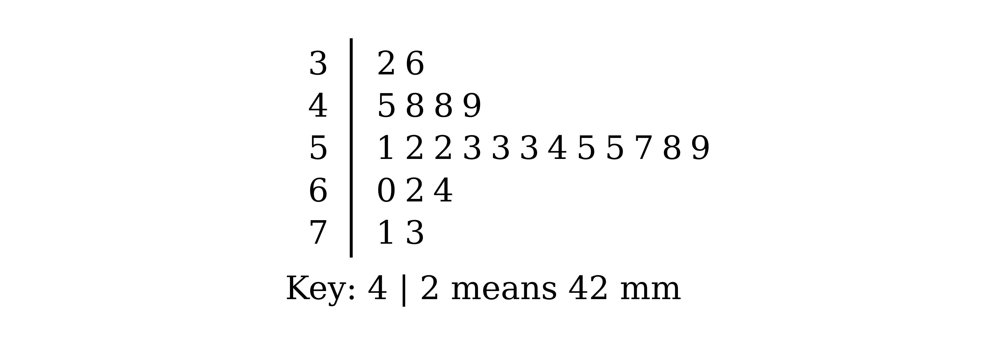

Find the median and the interquartile range of the lengths.

**Q11** [1 mark]

State one advantage of using a stem-and-leaf diagram, rather than a box-and-whisker plot, to represent these data.

### Q12 — easy — 6 marks

**Q12** [3 marks]

The manager of an ambulance service records the response times, in minutes, to 15 emergency calls. The times are as follows.

| 4 | 8 | 12 | 9 | 7 |
|---|---|---|---|---|
| 14 | 6 | 5 | 8 | 7 |
| 9 | 10 | 7 | 3 | 6 |

Find the median and the interquartile range of these response times.

**Q12** [3 marks]

On the grid, draw a box-and-whisker plot to represent these response times.

### Q13 — easy — 4 marks

**Q13** [2 marks]

A meteorologist records the highest wind speed each day, in knots, at a weather station. The box-and-whisker plot shows the results for 15 days in June.

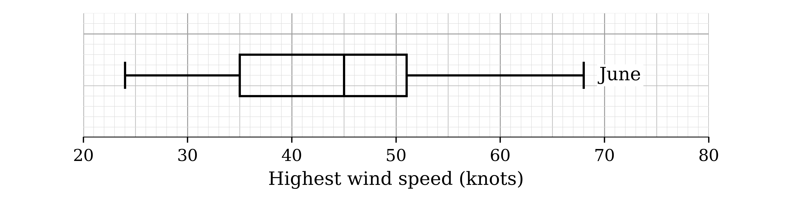

(i) Give one reason why a box-and-whisker plot is a suitable way to represent these data.

(ii) The highest wind speed recorded in June, 68 knots, is an extreme value. Give a reason why the median is likely to be more suitable than the mean as a measure of the average wind speed in June.

**Q13** [2 marks]

The box-and-whisker plot for 15 days in July has been added to the same diagram.

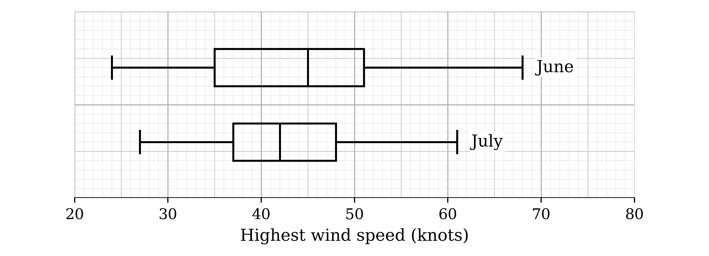

Make two comparisons between the highest wind speeds in June and the highest wind speeds in July.

### Q14 — easy — 5 marks

**Q14** [3 marks]

The distances, in metres, flown by the paper aeroplanes of 40 contestants in a paper-aeroplane competition are represented in the cumulative frequency graph.

Use the graph to estimate the median and the interquartile range of the distances.

**Q14** [2 marks]

The 9 contestants whose aeroplanes flew the furthest qualify for the final.

Use the graph to estimate the least distance that a contestant's aeroplane must fly in order for the contestant to qualify.

### Q15 — hard — 7 marks

**Q15** [3 marks]

A teacher took 19 students on a trip abroad. The weights, in kg, of the students' luggage were all different. The incomplete box-and-whisker plot shows part of a summary of these weights.

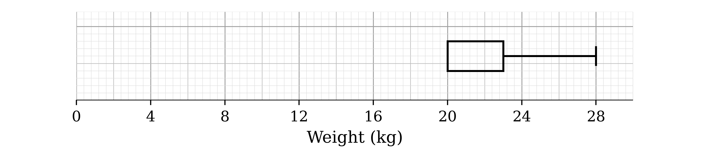

It is given that

the median weight is 4 kg more than the lower quartile

the range of the weights is three times the interquartile range.

Use this information to complete the box-and-whisker plot.

**Q15** [2 marks]

Find the proportion of the luggage weights that were less than 20 kg.

**Q15** [2 marks]

Students had to pay an extra fee if their luggage weighed more than 23 kg.

Find the number of students who had to pay the extra fee.

### Q16 — medium — 7 marks

**Q16** [1 mark]

In a cheese-rolling contest, people chase a round cheese down a steep hillside 200 metres long. A group of 60 friends take part. The table summarises the distance, $d$ metres, that each friend travelled before first falling over.

| Distance ($d$ metres) | Frequency |
|---|---|
| $0 \leq d < 40$ | 23 |
| $40 \leq d < 80$ | 11 |
| $80 \leq d < 120$ | 9 |
| $120 \leq d < 160$ | 7 |
| $160 \leq d < 200$ | 6 |

Find the number of these friends who reached the bottom of the hill without falling over.

**Q16** [3 marks]

On the grid, draw a cumulative frequency graph to illustrate the data in the table.

**Q16** [3 marks]

The steepest part of the hill is between 100 metres and 140 metres from the start.

Use your graph to estimate the number of friends who fell over for the first time on this part of the hill.

### Q17 — hard — 5 marks

**Q17** [2 marks]

Remy records how long each of his 80 rats takes to find the exit of a maze. Every 2.5 minutes he records the number of rats that have found the exit. His results are shown in the cumulative frequency graph.

The time taken by the fastest rat is $t$ minutes. Use the graph to write down an inequality satisfied by $t$.

**Q17** [3 marks]

The fastest time was 4 minutes and the slowest time was 33 minutes. These have been marked on the grid below.

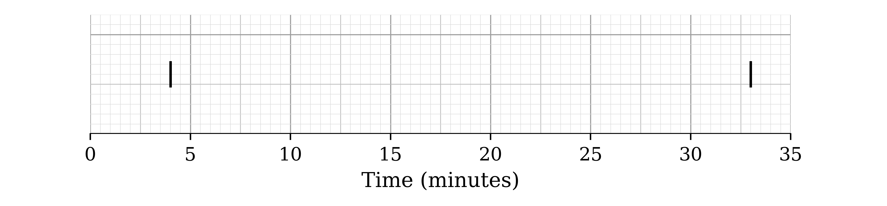

Use the cumulative frequency graph to complete the box-and-whisker plot.

### Q18 — hard — 4 marks

**Q18** [4 marks]

Wendy collects the running times, in minutes, of 199 movies. She finds the following information.

When the running times are placed in order, the 50th running time is one hour.

The longest running time is two and a half hours.

The interquartile range of the running times is 63 minutes.

The median divides the interquartile range in the ratio 3 : 4.

The range of the running times is 123 minutes.

On the grid, draw a box-and-whisker plot to represent the running times.

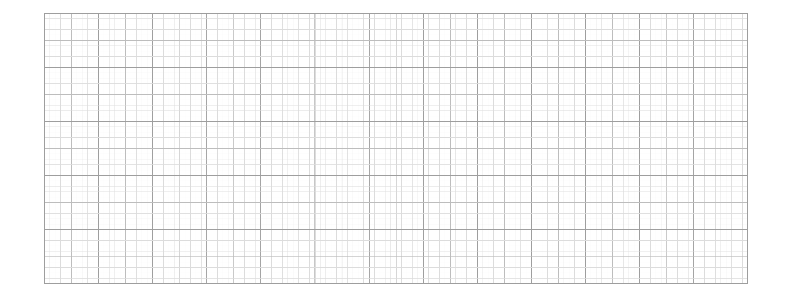

### Q19 — medium — 8 marks

**Q19** [1 mark]

The times, in minutes, that engineers spent dealing with 30 faults at a power station were recorded to the nearest minute. The results are summarised in the table.

| Time (minutes) | 90 – 129 | 130 – 169 | 170 – 199 | 200 – 249 |
|---|---|---|---|---|
| Frequency | 6 | 8 | 12 | 4 |

Give a reason why a histogram is a suitable diagram to represent these data.

**Q19** [4 marks]

On the grid, draw a histogram to represent these data.

**Q19** [3 marks]

Estimate the proportion of these faults on which the engineers spent longer than three hours.

### Q20 — medium — 6 marks

**Q20** [2 marks]

Aggie runs a bowls club. She chooses 35 female members and 35 male members of the club at random and records their ages, in years. The ages are shown in the back-to-back stem-and-leaf diagram.

(i) Give a reason why a stem-and-leaf diagram is suitable for these data.

(ii) The diagram shows no male members under 20 years old. Give a reason why there may still be male members of the club under 20 years old.

**Q20** [4 marks]

By finding the median and the interquartile range of the ages for each group, make two comparisons between the ages of the female members and the ages of the male members.

### Q21 — medium — 6 marks

**Q21** [3 marks]

In a charity race, 120 runners each run as far as they can in 6 hours. The distances run, $d$ km, are summarised in the table.

| Distance ($d$ km) | Frequency |
|---|---|
| $25 \leq d < 30$ | 8 |
| $30 \leq d < 35$ | 10 |
| $35 \leq d < 40$ | 32 |
| $40 \leq d < 45$ | 54 |
| $45 \leq d < 50$ | 10 |
| $50 \leq d < 55$ | 6 |

On the grid, draw a cumulative frequency graph to illustrate the data.

**Q21** [3 marks]

Use your graph to estimate the median and the interquartile range of the distances.

### Q22 — medium — 6 marks

**Q22** [3 marks]

A charity shows an advert on TV at the same time every weekday for four weeks. The manager records the number of donations received in the hour after the advert each day. The results are as follows.

| 21 | 27 | 24 | 31 | 17 |
|---|---|---|---|---|
| 22 | 25 | 26 | 27 | 9 |
| 32 | 29 | 25 | 24 | 40 |
| 23 | 22 | 19 | 12 | 14 |

Represent these data in a stem-and-leaf diagram.

**Q22** [2 marks]

The manager decides that the advert is only worth continuing if the median number of donations in the hour after the advert is at least 25.

Determine whether the manager should continue to run the advert.

**Q22** [1 mark]

Give one advantage of using a stem-and-leaf diagram, rather than a grouped frequency table, to represent these data.

### Q23 — easy — 7 marks

**Q23** [5 marks]

The total time, $t$ minutes, that cleaners in a supermarket spent dealing with unplanned incidents was recorded each day for 49 days. The results are summarised in the table.

| Time ($t$ minutes) | Frequency |
|---|---|
| $0 \leq t < 90$ | 9 |
| $90 \leq t < 120$ | 24 |
| $120 \leq t < 200$ | 12 |
| $200 \leq t < 250$ | 4 |

(i) State a reason why a histogram is a suitable diagram to represent these data.

(ii) On the grid, draw a histogram to represent these data.

**Q23** [2 marks]

Calculate an estimate for the number of days on which the cleaners spent less than 30 minutes dealing with unplanned incidents.

### Q24 — medium — 4 marks

**Q24** [4 marks]

A cinema recorded the ages of its visitors during one day. The incomplete histogram and frequency table show some of the information collected.

| Age ($a$ years) | Frequency |
|---|---|
| $0 \leq a < 5$ | 15 |
| $5 \leq a < 10$ |   |
| $10 \leq a < 20$ |   |
| $20 \leq a < 30$ | 12 |
| $30 \leq a < 50$ | 18 |
| $50 \leq a < 60$ | 7 |

Use the information to complete the histogram and the frequency table.

### Q25 — medium — 6 marks

**Q25** [3 marks]

A charity records the weight, in grams, of each rescued otter when it first arrives. The weights are represented by the box-and-whisker plot.

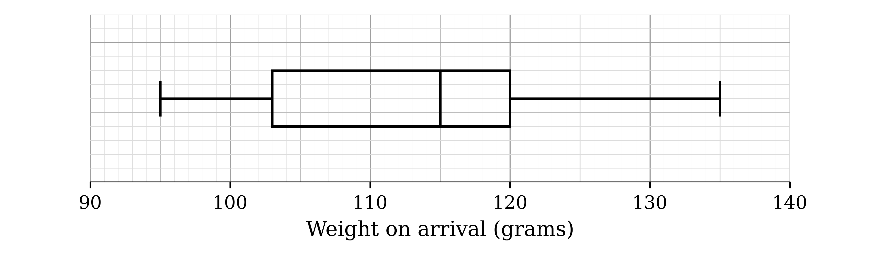

Find the median and the interquartile range of the weights on arrival.

**Q25** [3 marks]

The otters are weighed again after one month. The weights, in grams, are summarised in the table.

| Smallest weight | Range | Median | Upper quartile | Interquartile range |
|---|---|---|---|---|
| 125 | 48 | 152 | 164 | 33 |

On the grid, draw a box-and-whisker plot to represent the weights after one month.

### Q26 — medium — 5 marks

**Q26** [2 marks]

The police record the speeds, in km/h, of 80 vehicles on a stretch of road. The results are represented in the cumulative frequency graph.

Use the graph to estimate the median speed.

**Q26** [3 marks]

The speed limit on this road is 80 km/h. The police stop every vehicle that is travelling at more than 10% above the speed limit.

Use the graph to estimate the percentage of these vehicles that the police stop.

### Q27 — medium — 6 marks

**Q27** [3 marks]

A taxi company records the times, to the nearest minute, that customers wait for their taxis to arrive. The times for a random sample of 20 customers are as follows.

| 6 | 7 | 16 | 30 | 24 |
|---|---|---|---|---|
| 27 | 20 | 7 | 5 | 8 |
| 20 | 24 | 27 | 12 | 34 |
| 32 | 31 | 6 | 19 | 14 |

Find the median and the interquartile range of these waiting times.

**Q27** [3 marks]

On the grid, draw a box-and-whisker plot to represent these waiting times.

