# Mark Schemes — Working with Data
**Data Presentation & Interpretation** · Cambridge (CIE) AS maths (9709)

## Exam Questions (23 questions)

### Q1
No child was older than 7, so the last class is $6 \leq a \leq 7$

To estimate the mean and the variance, use the mid-point of each class

| Age (a years) | 0 ≤ a < 2 | 2 ≤ a < 5 | 5 ≤ a < 6 | 6 ≤ a ≤ 7 |
|---|---|---|---|---|
| Mid-point, x | 1 | 3.5 | 5.5 | 6.5 |
| Frequency, f | 6 | 9 | 10 | 2 |

**[B1]**

To estimate the mean, use $\overline{x} = \frac{\sumfx}{\sumf}$

$\overline{x} = \frac{6\times1+9\times3.5+10\times5.5+2\times6.5}{27} = \frac{105.5}{27}$

**[M1]**

$\overline{x} = 3 . 9074 \dots$

**Final answer:** **Mean = 3.91 years (3 s.f.)**

**[A1]**

To find the variance, use $\frac{\sumfx^{2}}{\sumf} - \overline{x}^{2}$

`\text{Variance} = \dfrac{6 \times 1^{2} + 9 \times 3.5^{2} + 10 \times 5.5^{2} + 2 \times 6.5^{2}}{27} - \left(\dfrac{105.5}{27}\right)^{2}`

`\text{Variance} = \dfrac{503.25}{27} - \left(\dfrac{105.5}{27}\right)^{2} = 3.3710\ldots`

**[M1]**

To find the standard deviation, square root the variance

$\text{Standard deviation} = \sqrt{3.3710\dots} = 1 . 8360 \dots$

**Final answer:** **Standard deviation = 1.84 years (3 s.f.)**

**[A1]**

> **[mark-scheme]**
> **B1**: At least 3 correct mid-points, including 6.5 for the last class.
> 
> **M1**: Correct mean formula with their mid-points (within each class, not the class boundaries) and the frequencies, divided by 27.
> 
> **A1**: Mean of 3.91 (answers which round to 3.91).
> 
> **M1**: Correct variance formula with their mid-points and their mean.
> 
> **A1**: Standard deviation of 1.84 (answers which round to 1.84).
Once data are grouped, each value is known only to lie in its class

**Final answer:** **The exact values are lost, so statistics such as the mean and standard deviation can only be estimated**

**[B1]**

> **[mark-scheme]**
> **B1**: The original (exact) values are lost, so calculated statistics are only estimates.
Both children are in the class $2 \leq a < 5$, so in the estimates each is represented by the mid-point 3.5, which is less than the estimated mean of 3.91

**Final answer:** **The estimate of the mean decreases, because both added values are below the estimated mean**

**[B1]**

Both added values are close to the estimated mean, well within one standard deviation (1.84) of it, so they reduce the average spread about the mean

**Final answer:** **The estimate of the standard deviation decreases, because both added values are close to the mean**

**[B1]**

> **[mark-scheme]**
> **B1**: The estimate of the mean decreases, with a reason: the added values (the mid-point 3.5, or the ages of 3) are below the estimated mean of 3.91.
> 
> **B1**: The estimate of the standard deviation decreases, with a reason: the added values are close to the mean (within one standard deviation of it), so they reduce the spread. "Decreases" with no reason does not score.
> 
> The two marks are awarded independently.

### Q2
Tim needs to compare the two sets of waiting times

**Final answer:** **They show the median and the spread of each set of waiting times on the same scale, so the two medical centres are easy to compare**

**[B1]**

> **[mark-scheme]**
> **B1**: A reason referring to easy comparison of the two data sets, or to showing the average and spread (median, quartiles, range) at a glance.

The FitFirst upper whisker runs from 30 to 44 minutes, far beyond the rest of the data

**Final answer:** **The mean is affected by the extreme waiting time of 44 minutes, but the median is not**

**[B1]**

> **[mark-scheme]**
> **B1**: A reason that refers to the extreme value of 44 minutes (or to the skew) in the context of waiting times.

Compare the medians (20 minutes at HealthHut, 24 minutes at FitFirst) in context

**Final answer:** **On average, patients at HealthHut wait less time than patients at FitFirst**

**[B1]**

Compare the interquartile ranges (19 minutes at HealthHut, 13 minutes at FitFirst) in context

**Final answer:** **The waiting times at FitFirst are more consistent than the waiting times at HealthHut**

**[B1]**

Tim wants to be seen faster, which is a statement about the average

**Final answer:** **Tim should join HealthHut, because patients there are seen faster on average**

**[B1]**

> **[mark-scheme]**
> **B1**: A comparison of the averages in context, for example that HealthHut patients wait less on average.
> 
> **B1**: A comparison of the spreads in context, using the interquartile range (FitFirst more consistent) or the range. Stating or comparing the values alone does not score.
> 
> **B1**: A choice of medical centre with a reason that is consistent with the comparisons. Either HealthHut, because the average waiting time is shorter, or FitFirst, because the average waiting times are similar (only 4 minutes apart) and the waiting times at FitFirst are more consistent. A choice with no reason, or with a reason that contradicts the comparisons, does not score.

### Q3
Find the mean of the coded values $m - a$

$\text{Mean of} ( m - a ) = \frac{90}{30} = 3$

The mean mass is $a$ more than the coded mean

$1423 = a + 3$

**[M1]**

$a = 1420$

**[A1]**

Subtracting a constant does not change the spread, so use the variance formula with the coded totals

`\text{Variance} = \dfrac{2182818}{30} - \left(\dfrac{90}{30}\right)^{2} = 72751.6`

**[M1]**

To find the standard deviation, square root the variance

$\text{Standard deviation} = \sqrt{72751.6} = 269 . 72 \dots$

**Final answer:** **Standard deviation = 270 kg (3 s.f.)**

**[A1]**

> **[mark-scheme]**
> **M1**: Mean mass written as a plus the coded mean, with the coded mean 90/30.
> 
> **A1**: a = 1420.
> 
> **M1**: Correct variance formula with the coded totals 2 182 818 and 90 and n = 30 (or with the uncoded totals, if found).
> 
> **A1**: Standard deviation of 270 (answers which round to 270).
The added mass, 1423 kg, is equal to the mean mass of the 30 cars

**Final answer:** **The mean stays the same, because the added mass is equal to the mean**

**[B1]**

The added mass has a deviation of 0 from the mean, so the sum of the squared deviations does not change, but it is now shared between 31 cars instead of 30

**Final answer:** **The standard deviation decreases, because the added mass is at the mean, so it adds nothing to the spread while the number of cars increases**

**[B1]**

> **[mark-scheme]**
> **B1**: The mean stays the same, with a reason: the added mass, 1423 kg, is equal to the mean.
> 
> **B1**: The standard deviation decreases, with a reason: the added mass is at the mean (a deviation of 0), so the sum of the squared deviations is unchanged but is divided by 31 instead of 30. "Decreases" with no reason does not score.
> 
> The two marks are awarded independently.

### Q4
(i)

The value of 50 is much larger than the mean of 18

**Final answer:** **Including 50 increases the mean and the standard deviation, so it makes Marya's lateness look worse**

**[B1]**

(ii)

The value of 50 is a genuine record of how late Marya was

**Final answer:** **It is a true value, so including it gives a complete picture of how late Marya was over the six days**

**[B1]**

> **[mark-scheme]**
> **B1**: A reason for excluding the value, such as it raising the mean (or the spread) or being a one-off that is not typical.
> 
> **B1**: A reason for including the value, such as it being a genuine recorded value (not an error), so it belongs in a true record of her lateness.
Find the total of the six values from the mean, using $\overline{x} = \frac{\sumx}{n}$

$\sum x = 6 \times 18 = 108$

**[B1]**

Find the total of the squares from the variance, using $\text{Variance} = \frac{\sumx^{2}}{n} - \overline{x}^{2}$

$210 = \frac{\sumx^{2}}{6} - 18^{2}$

$\sum x^{2} = 6 \times ( 210 + 324 ) = 3204$

**[B1]**

Remove the value of 50 from both totals

$\sum x = 108 - 50 = 58$

$\sum x^{2} = 3204 - 50^{2} = 704$

Find the new mean with $n = 5$

$\overline{x} = \frac{58}{5}$

**Final answer:** **Mean = 11.6 minutes**

**[B1]**

To find the new variance, use the formula for the variance with the new totals

$\text{Variance} = \frac{704}{5} - 11 . 6^{2} = 6 . 24$

**[M1]**

To find the standard deviation, square root the variance

$\text{Standard deviation} = \sqrt{6.24} = 2 . 4979 \dots$

**Final answer:** **Standard deviation = 2.50 minutes (3 s.f.)**

**[A1]**

> **[mark-scheme]**
> **B1**: Total of 108 for the six values.
> 
> **B1**: Total of squares of 3204 for the six values.
> 
> **B1**: New mean of 11.6.
> 
> **M1**: Correct variance formula with n = 5, their new total of squares (3204 minus 2500) and their new mean.
> 
> **A1**: Standard deviation of 2.50 (answers which round to 2.50), or the exact value of the square root of 6.24.

### Q5
Read the cumulative frequencies at the class boundaries 40, 60 and 80 seconds

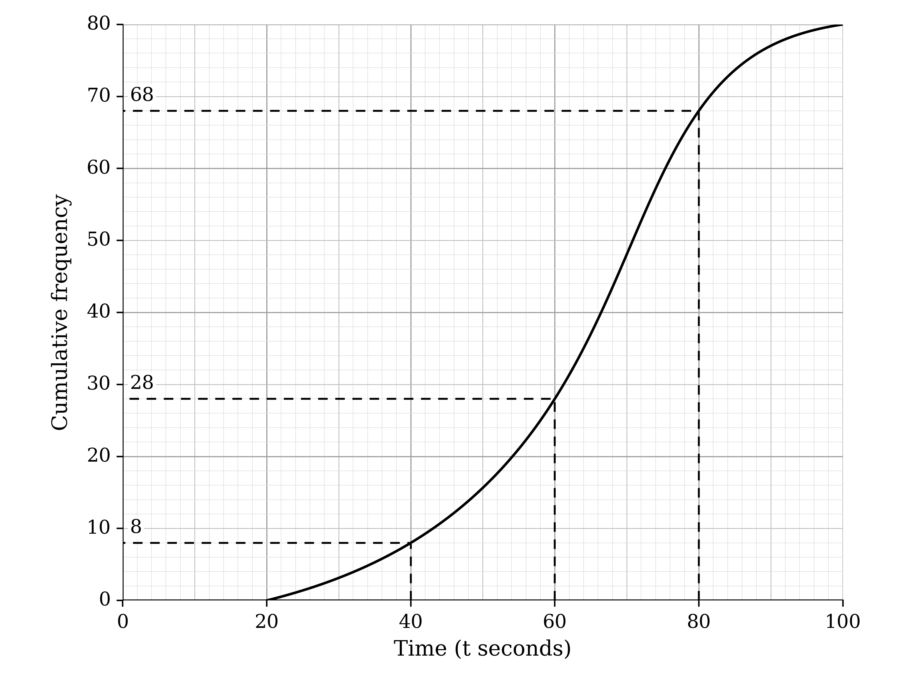

**[B1]**

Each frequency is the difference between consecutive cumulative frequencies

| Time (t seconds) | 20 < t ≤ 40 | 40 < t ≤ 60 | 60 < t ≤ 80 | 80 < t ≤ 100 |
|---|---|---|---|---|
| Frequency | 8 | **Final answer:** **20** | **Final answer:** **40** | **Final answer:** **12** |

**[B1]**

> **[mark-scheme]**
> **B1**: Cumulative frequencies 28 and 68 read at 60 and 80 seconds (seen or implied).
> 
> **B1**: Frequencies 20, 40 and 12.
The frequency table from part (a)

| Time (t seconds) | 20 < t ≤ 40 | 40 < t ≤ 60 | 60 < t ≤ 80 | 80 < t ≤ 100 |
|---|---|---|---|---|
| Frequency | 8 | 20 | 40 | 12 |

To estimate the mean, use the mid-points 30, 50, 70 and 90 in $\overline{x} = \frac{\sumfx}{\sumf}$

**[B1]**

$\overline{x} = \frac{8\times30+20\times50+40\times70+12\times90}{80} = \frac{5120}{80}$

**[M1]**

**Final answer:** **Mean = 64 seconds**

**[A1]**

There are 80 students, so the lower and upper quartiles are at cumulative frequencies of 20 and 60

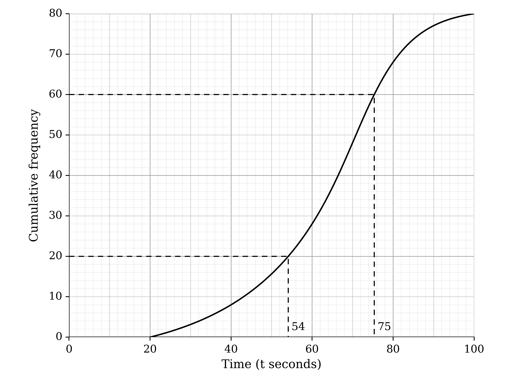

*Lower quartile = 54*

*Upper quartile = 75*

To find the interquartile range, subtract the lower quartile from the upper quartile

$75 - 54$

**[M1]**

**Final answer:** **Interquartile range = 21 seconds**

**[A1]**

> **[mark-scheme]**
> **B1**: At least 3 correct mid-points (30, 50, 70, 90).
> 
> **M1**: Correct mean formula with their mid-points and their frequencies from part (a), divided by 80.
> 
> **A1**: Mean of 64.
> 
> **M1**: Upper quartile minus lower quartile, read at cumulative frequencies 60 and 20, with an upper quartile from 74 to 76 and a lower quartile from 53 to 55.
> 
> **A1**: Interquartile range of 21 (or a correct value from quartiles in those ranges).
Read the cumulative frequencies at 32 seconds and 90 seconds

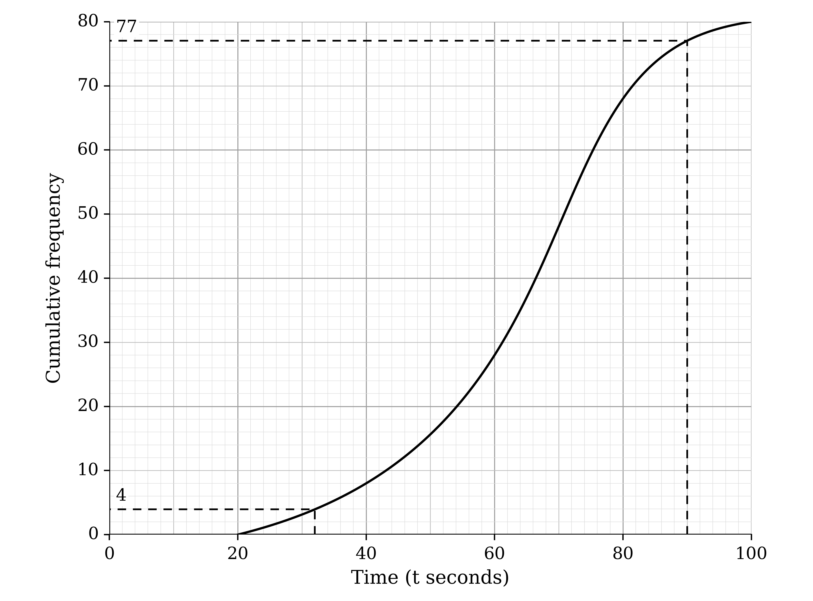

*Times under 32 seconds: 4 students*

$\text{Times over 90 seconds} = 80 - 77 = 3$

**[M1]**

To find the percentage, add the two tails and divide by 80

$\frac{4+3}{80} \times 100$

**Final answer:** **8.75% of the times are unusual**

**[A1]**

> **[mark-scheme]**
> **M1**: The graph used at 32 seconds and at 90 seconds, with the number above 90 found as 80 minus the cumulative frequency read.
> 
> **A1**: 8.75% (accept from 6.25% to 11.25%, from readings of 3 to 5 at 32 seconds and 76 to 78 at 90 seconds).

### Q6
To draw the diagram, use the tens digit as the stem, with "without" on the left and "with" on the right

The leaves on each side increase outwards from the stem, and the key names both sides

**[B1 B1 B1 B1]**

> **[mark-scheme]**
> **B1**: Correct stem 4 to 9 (not split).
> 
> **B1**: Correct "without" leaves on the left, in order from right to left, lined up, no commas.
> 
> **B1**: Correct "with" leaves on the right, in order, lined up, no commas.
> 
> **B1**: A key for the diagram naming both sides and the unit (%).

Each set has 15 values, so each median is the 8th value in order

To find each median, count from the smallest value along that side of the diagram

**Final answer:** **Median without the chemical = 79%**

**[B1]**

**Final answer:** **Median with the chemical = 49%**

**[B1]**

> **[mark-scheme]**
> **B1**: Median without the chemical of 79.
> 
> **B1**: Median with the chemical of 49.

Without the chemical, 48 is removed and 77 is added

Both are below the median of 79, so the 8th value is unchanged

**Final answer:** **The median without the chemical stays the same (79%)**

**[B1]**

With the chemical, 77 (above the median of 49) is replaced by 48 (below it)

*40, 40, 45, 46, 46, 48, 48, 48, 49, …*

The 8th value is now 48

**Final answer:** **The median with the chemical decreases (to 48%)**

**[B1]**

> **[mark-scheme]**
> **B1**: Without the chemical: no change, with a reason (both values are below the median of 79).
> 
> **B1**: With the chemical: decreases, with a reason (a value above the median is replaced by one below it), or the new median of 48 stated.

### Q7
Write the numbers of strikes in order

*2, 5, 5, 6, 7, 8, 8, 9,*

*9, 9, 9, 10, 11, 12, 17*

There are 15 values, so the median is the 8th value in order

**Final answer:** **Median = 9 strikes**

**[B1]**

The lower quartile is the 4th value and the upper quartile is the 12th value (the middle of each half either side of the median)

*Lower quartile = 6*

*Upper quartile = 10*

To find the interquartile range, subtract the lower quartile from the upper quartile

$10 - 6$

**[M1]**

**Final answer:** **Interquartile range = 4 strikes**

**[A1]**

> **[mark-scheme]**
> **B1**: Median of 9.
> 
> **M1**: Upper quartile minus lower quartile, with an upper quartile from 9.5 to 10 and a lower quartile from 6 to 6.5.
> 
> **A1**: Interquartile range of 4 (or a correct value from quartiles in those ranges).
(i)

To find the mean, first add the 15 values

$\sum x = 127$

Then divide by the number of matches

$\overline{x} = \frac{127}{15} = 8 . 4666 \dots$

**Final answer:** **Mean = 8.47 strikes (3 s.f.)**

**[B1]**

(ii)

One match needed far more strikes than the others

**Final answer:** **The median, because the mean is affected by the extreme value of 17 strikes**

**[B1]**

> **[mark-scheme]**
> **B1**: Mean of 8.47, or the exact value of 127/15.
> 
> **B1**: Median chosen, with a reason that refers to the extreme value (17, or 2) in the number of strikes. A reason about "values" in general, or choosing the median with no reason, does not score.

### Q8
Find the totals of the values and of their squares

$\sum x = 40$

$\sum x^{2} = 4 + 16 + 1 + 0 + 9 + 16 + 9 + 81 + 9 + 4 + 16 + 25 = 190$

To find the mean, use $\overline{x} = \frac{\sumx}{n}$ with $n = 12$

$\overline{x} = \frac{40}{12} = 3 . 3333 \dots$

**Final answer:** **Mean = 3.33 towels (3 s.f.)**

**[B1]**

To find the variance, use $\frac{\sumx^{2}}{n} - \overline{x}^{2}$

`\text{Variance} = \dfrac{190}{12} - \left(\dfrac{40}{12}\right)^{2} = 4.7222\ldots`

**[M1]**

To find the standard deviation, square root the variance

$\text{Standard deviation} = \sqrt{4.7222\dots} = 2 . 1730 \dots$

**Final answer:** **Standard deviation = 2.17 towels (3 s.f.)**

**[A1]**

> **[mark-scheme]**
> **B1**: Mean of 3.33, or the exact value of 10/3.
> 
> **M1**: Correct variance formula with the totals 190 and 40 and n = 12 (or the mean found).
> 
> **A1**: Standard deviation of 2.17, or the exact value of the square root of 85/18.
(i)

Write the values in order

*0, 1, 2, 2, 3, 3, 3, 4, 4, 4, 5, 9*

There are 12 values, so the median is halfway between the 6th and 7th values

$\frac{3+3}{2}$

**Final answer:** **Median = 3 towels**

**[B1]**

(ii)

One day had far more missing towels than the others

**Final answer:** **The mean is affected by the extreme value of 9 towels, but the median is not**

**[B1]**

> **[mark-scheme]**
> **B1**: Median of 3.
> 
> **B1**: A reason that refers to the extreme value of 9 towels (or to the data being skewed) in the context of the question. A comment about "values" in general does not score.

### Q9
(i)

There are 100 calls, so the lower quartile is at a cumulative frequency of 25 and the upper quartile at 75

$\frac{1}{4} \times 100 = 25$

$\frac{3}{4} \times 100 = 75$

Read across from these cumulative frequencies to the curve, then down to the time axis

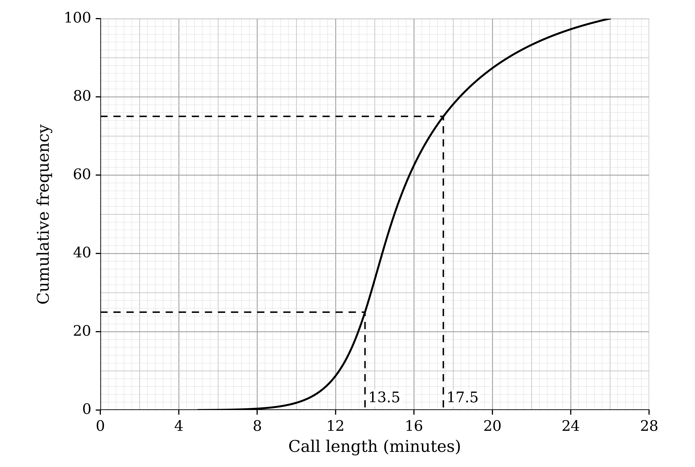

**[M1]**

**Final answer:** **Lower quartile = 13.5 minutes**

**Final answer:** **Upper quartile = 17.5 minutes**

**[A1]**

(ii)

To find the interquartile range, subtract the lower quartile from the upper quartile

$17 . 5 - 13 . 5$

**Final answer:** **Interquartile range = 4 minutes**

**[A1]**

> **[mark-scheme]**
> **M1**: Use of the graph at cumulative frequencies 25 and 75, shown on the graph or stated.
> 
> **A1**: Lower quartile from 13.3 to 13.7 and upper quartile from 17.3 to 17.7.
> 
> **A1**: Interquartile range of 4 (or upper quartile minus lower quartile for values read from the graph).
The median is at a cumulative frequency of 50 (half of the 100 calls)

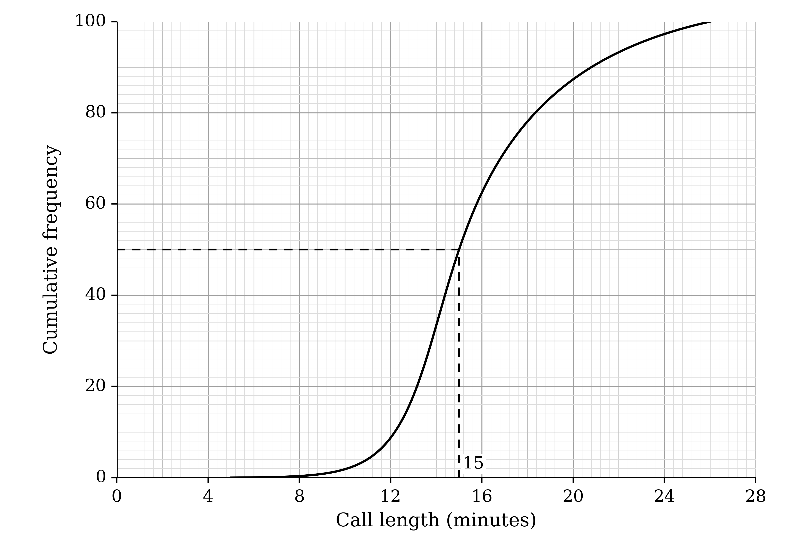

**Final answer:** **Median of the morning calls = 15 minutes**

**[B1]**

Compare the averages (the medians) in context

**Final answer:** **On average, the calls in the morning and in the afternoon were the same length**

**[B1]**

Compare the spreads (the interquartile ranges, 4 minutes and 9 minutes) in context

**Final answer:** **The lengths of the afternoon calls were much more spread out than the lengths of the morning calls**

**[B1]**

> **[mark-scheme]**
> **B1**: Median from 14.8 to 15.2, with the graph used at a cumulative frequency of 50.
> 
> **B1**: A comparison of the averages in context, for example that the typical call length was the same (follow through from the median read).
> 
> **B1**: A comparison of the spreads in context, for example that afternoon call lengths were more varied. Stating or comparing the values alone does not score.

### Q10
To find the mean, add the seven values and divide by 7

$\overline{x} = \frac{7+8+5+12+9+7+3}{7} = \frac{51}{7} = 7 . 2857 \dots$

**Final answer:** **Mean = 7.29 species (3 s.f.)**

**[B1]**

> **[mark-scheme]**
> **B1**: Mean of 7.29, or the exact value of 51/7.
Find the total for the remaining 24 days from their mean

$9 . 25 \times 24 = 222$

To find the total for the whole month, add the total for the first week

$222 + 51 = 273$

**[M1]**

There are $7 + 24 = 31$ days in the month, so divide by 31

$\frac{273}{31} = 8 . 8064 \dots$

**[M1]**

*Mean for the month = 8.81 species (3 s.f.)*

Compare with Joe's claim

**Final answer:** **Joe is not correct: the mean for the month is 8.81, not 9, and the number of species varies from day to day (from 3 to 12 in the first week), so he cannot expect the same number every day**

**[A1]**

> **[mark-scheme]**
> **M1**: Total for the month found as 9.25 × 24 + 51 (= 273).
> 
> **M1**: Their total divided by 31.
> 
> **A1**: Mean of 8.81 (or 273/31) with the conclusion that Joe is not correct.
Three months later is a different time of year

**Final answer:** **It is a different season, so some species may have migrated or there may be less food in gardens, so fewer species visit**

**[B1]**

> **[mark-scheme]**
> **B1**: A sensible reason in context, such as a change of season (migration, less food, weather), or that one month of data is not enough to show a long-term decline.

### Q11
(i)

To draw the diagram, use the whole metres as the stem and the tenths as the leaves, with each row in order and a key

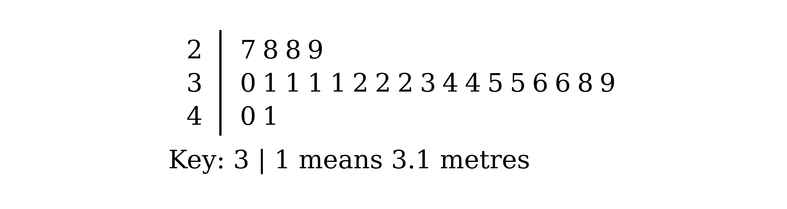

**[B1 B1 B1]**

(ii)

There are 23 distances, so the median is the 12th value in order

$\frac{23+1}{2} = 12$

**Final answer:** **Median = 3.2 metres**

**[B1]**

The value that appears most often is 3.1 (four times)

**Final answer:** **Mode = 3.1 metres**

**[B1]**

> **[mark-scheme]**
> **B1**: Correct stem of 2, 3, 4 (a stem split into two rows each is also accepted).
> 
> **B1**: All leaves correct, in order and lined up, with no commas.
> 
> **B1**: A key for the diagram that includes the units, such as 3 | 1 means 3.1 metres.
> 
> **B1**: Median of 3.2.
> 
> **B1**: Mode of 3.1.
(i)

To find the mean, first add the 23 distances

$\sum x = 76 . 3$

Then divide by the number of jumps

$\overline{x} = \frac{76.3}{23} = 3 . 3173 \dots$

**Final answer:** **Mean = 3.32 metres (3 s.f.)**

**[B1]**

(ii)

The longest jumps (3.8, 3.9, 4.0 and 4.1 metres) are further above the median than the shortest jumps are below it

**Final answer:** **The data are positively skewed: a few long jumps raise the mean more than the median**

**[B1]**

> **[mark-scheme]**
> **B1**: Mean of 3.32, or the exact value of 763/230.
> 
> **B1**: The data are not symmetrical, or are skewed (any description of the skew), or a reference to the long jumps at the upper end.

### Q12
To find the mean at each distance, use $\overline{x} = \frac{\sumx}{n}$

$\overline{x}_{5} = \frac{3885}{20} = 194 . 25$

$\overline{x}_{25} = \frac{2220}{20} = 111$

**Final answer:** **Mean at 5 m = 194 mm (3 s.f.)**

**Final answer:** **Mean at 25 m = 111 mm**

**[B1]**

To find the variance at 5 m, use $\frac{\sumx^{2}}{n} - \overline{x}^{2}$

$\text{Variance} = \frac{1124175}{20} - 194 . 25^{2} = 18475 . 6875$

**[M1]**

To find the standard deviation, square root the variance

$\text{Standard deviation} = \sqrt{18475.6875} = 135 . 925 \dots$

**Final answer:** **Standard deviation at 5 m = 136 mm (3 s.f.)**

**[A1]**

To find the standard deviation at 25 m, repeat with the 25 m totals

$\text{Variance} = \frac{534000}{20} - 111^{2} = 14379$

$\text{Standard deviation} = \sqrt{14379} = 119 . 912 \dots$

**Final answer:** **Standard deviation at 25 m = 120 mm (3 s.f.)**

**[A1]**

> **[mark-scheme]**
> **B1**: Both means correct: 194 (or 194.25) and 111.
> 
> **M1**: Correct variance formula with the totals for either distance, using their mean.
> 
> **A1**: Standard deviation at 5 m of 136 (answers which round to 136).
> 
> **A1**: Standard deviation at 25 m of 120 (answers which round to 120).
Compare the means in context

**Final answer:** **On average, the rocks at 5 m from the cliff are longer than the rocks at 25 m**

**[B1]**

Compare the standard deviations in context

**Final answer:** **The lengths of the rocks at 5 m are more varied than the lengths of the rocks at 25 m**

**[B1]**

> **[mark-scheme]**
> **B1**: A comparison of the averages in context (rock lengths), for example that rocks nearer the cliff are longer on average.
> 
> **B1**: A comparison of the spreads in context, for example that the lengths of the rocks at 5 m vary more. Stating or comparing the numerical values alone does not score.

### Q13
(i)

Read the line inside the box

**Final answer:** **Median = 13 days**

**[B1]**

(ii)

The upper whisker is much longer than the rest of the plot: one employee was absent for 29 days

**Final answer:** **The median, because the mean is affected by the extreme value of 29 days**

**[B1]**

> **[mark-scheme]**
> **B1**: Median of 13.
> 
> **B1**: Median chosen, with a reason that refers to the extreme value of 29 days (or the positive skew) in context.
Remove 29 from the total of the values

$\sum x = 286 - 29 = 257$

Remove $29^{2}$ from the total of the squares

$\sum x^{2} = 4238 - 29^{2} = 3397$

**[B1]**

Find the new mean with $n = 22$

$\overline{x} = \frac{257}{22} = 11 . 681 \dots$

**Final answer:** **Mean = 11.7 days (3 s.f.)**

**[B1]**

To find the new variance, use $\frac{\sumx^{2}}{n} - \overline{x}^{2}$ with the new totals

`\text{Variance} = \dfrac{3397}{22} - \left(\dfrac{257}{22}\right)^{2} = 17.944\ldots`

**[M1]**

To find the standard deviation, square root the variance

$\text{Standard deviation} = \sqrt{17.944\dots} = 4 . 2360 \dots$

**Final answer:** **Standard deviation = 4.24 days (3 s.f.)**

**[A1]**

> **[mark-scheme]**
> **B1**: New totals of 257 and 3397 (seen or implied).
> 
> **B1**: Mean of 11.7, or the exact value of 257/22.
> 
> **M1**: Correct variance formula with n = 22, their new total of squares and their new mean.
> 
> **A1**: Standard deviation of 4.24 (answers which round to 4.24).

### Q14
There are 19 values, so the median is the 10th value

$\frac{19+1}{2} = 10$

Count along the diagram to the 10th value

**Final answer:** **Median = 29 packs**

**[B1]**

The lower quartile is the median of the 9 values below the median, which is the 5th value

**Final answer:** **Lower quartile = 16 packs**

**[B1]**

> **[mark-scheme]**
> **B1**: Median of 29.
> 
> **B1**: Lower quartile of 16 (accept 15.5 to 16 from another standard method).
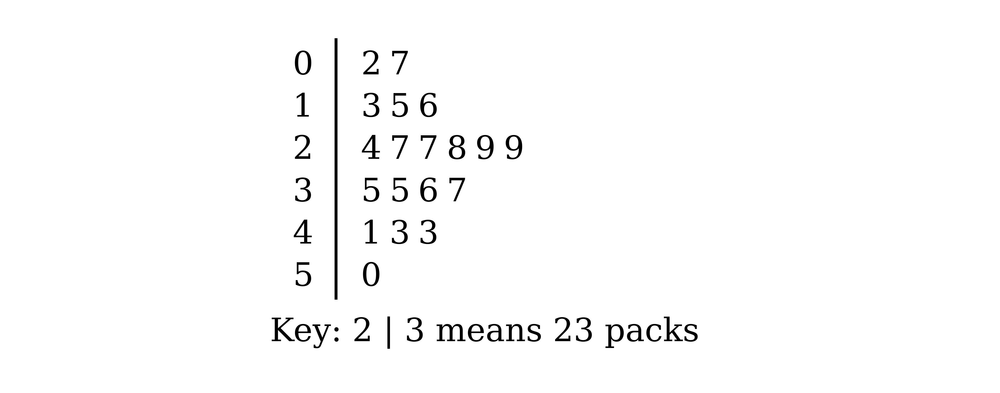

(i)

With 20 values, the median is halfway between the 10th and 11th values

*The new value is below 29, so the 10th and 11th values are now 28 and 29*

Find the new median

$\frac{28+29}{2} = 28 . 5$

**Final answer:** **The median decreases from 29 to 28.5**

**[B1]**

(ii)

The lower quartile is now halfway between the 5th and 6th of the lowest 10 values, which are

*2, 7, 13, 15, 16, 24, 27, 27, 28 and the new value*

**[M1]**

If the new value is 15 or less, the 5th and 6th values are 15 and 16

**Final answer:** **If the new value is 15 or less, the lower quartile decreases to 15.5**

**[A1]**

If the new value is 16 or more, the 5th value is 16 and the 6th value is the new value

**Final answer:** **If the new value is 16, the lower quartile stays at 16**

**Final answer:** **If the new value is 17, 18 or 19, the lower quartile increases (to 16.5, 17 or 17.5)**

**[A1]**

> **[mark-scheme]**
> **B1**: Median decreases to 28.5, with the reason that the new value lies below the median.
> 
> **M1**: The new lower quartile is found as halfway between the 5th and 6th values of the lowest 10 (or another consistent method for 20 values).
> 
> **A1**: Lower quartile decreases (to 15.5) when the new value is 15 or less.
> 
> **A1**: Lower quartile unchanged when the new value is 16, and increases when it is 17, 18 or 19.

### Q15
(i)

A histogram shows only how many speeds fall in each class

**Final answer:** **The individual speeds are lost, so statistics such as the median cannot be found exactly**

**[B1]**

(ii)

Find each frequency as frequency density × class width

| Speed (km/h) | 0–10 | 10–20 | 20–25 | 25–30 | 30–35 | 35–40 | 40–45 | 45–55 |
|---|---|---|---|---|---|---|---|---|
| Frequency | 4 | 7 | 14 | 19 | 22 | 31 | 21 | 2 |
| Cumulative frequency | 4 | 11 | 25 | 44 | 66 | 97 | 118 | 120 |

**[M1]**

There are 120 speeds, so the median is between the 60th and 61st values

The cumulative frequency passes 60 in the class 30 to 35

**Final answer:** **The median is in the class 30 to 35 km/h**

**[A1]**

> **[mark-scheme]**
> **B1**: A reference to the individual (raw) speeds being lost, or to exact statistics (such as the median or the mean) not being possible.
> 
> **M1**: Frequencies found from frequency density × class width, with cumulative frequencies (at least up to 66).
> 
> **A1**: Class 30 to 35 for the median.
The frequencies found in part (a)

| Speed (km/h) | 0–10 | 10–20 | 20–25 | 25–30 | 30–35 | 35–40 | 40–45 | 45–55 |
|---|---|---|---|---|---|---|---|---|
| Frequency | 4 | 7 | 14 | 19 | 22 | 31 | 21 | 2 |
| Cumulative frequency | 4 | 11 | 25 | 44 | 66 | 97 | 118 | 120 |

Find 30% of the 120 vehicles

$0 . 3 \times 120 = 36$

**[B1]**

The cut-off is $40 - 2 . 5 = 37 . 5$ km/h, halfway through the class 35 to 40, so count half of that class and all of the classes above it

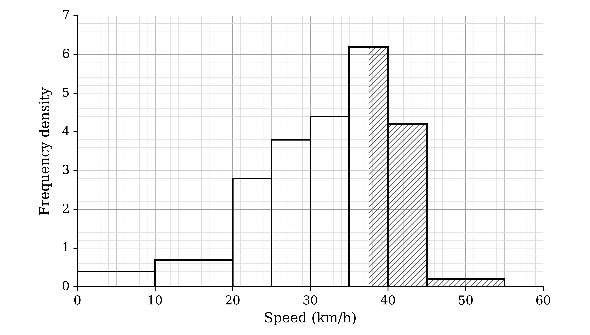

$\frac{1}{2} \times 31 + 21 + 2 = 38 . 5$

**[M1]**

Compare with 36

$38 . 5 > 36$

**Final answer:** **About 38.5 vehicles (more than 30%) were faster than 37.5 km/h, so the team will recommend speed-reduction measures**

**[A1]**

> **[mark-scheme]**
> **B1**: 36 vehicles (30% of 120), or the percentage found in the next step compared with 30%.
> 
> **M1**: An estimate of the number above 37.5, using half of the frequency of the class 35 to 40 plus the frequencies of the classes above.
> 
> **A1**: 38.5 (or about 32%) with the conclusion that measures will be recommended.

### Q16
(i)

Write the 15 values in order

*47, 49, 52, 52, 52, 52, 53, 56,*

*56, 58, 58, 63, 64, 68, 71*

The value that appears most often is 52 (four times)

**Final answer:** **Mode = 52 customers**

**[B1]**

There are 15 values, so the median is the 8th value

**Final answer:** **Median = 56 customers**

**[B1]**

(ii)

To find the mean, use $\overline{x} = \frac{\sumx}{n}$ with $n = 15$

$\overline{x} = \frac{851}{15} = 56 . 733 \dots$

**Final answer:** **Mean = 56.7 customers (3 s.f.)**

**[B1]**

To find the variance, use $\frac{\sumx^{2}}{n} - \overline{x}^{2}$

`\text{Variance} = \dfrac{48965}{15} - \left(\dfrac{851}{15}\right)^{2} = 45.662\ldots`

**[M1]**

To find the standard deviation, square root the variance

$\text{Standard deviation} = \sqrt{45.662\dots} = 6 . 7573 \dots$

**Final answer:** **Standard deviation = 6.76 customers (3 s.f.)**

**[A1]**

> **[mark-scheme]**
> **B1**: Mode of 52.
> 
> **B1**: Median of 56.
> 
> **B1**: Mean of 56.7, or the exact value of 851/15.
> 
> **M1**: Correct variance formula with the totals and n = 15.
> 
> **A1**: Standard deviation of 6.76 (answers which round to 6.76).
The busiest days (63, 64, 68 and 71 customers) are further above the median than the quietest days are below it

**Final answer:** **The data are positively skewed: a few busy days raise the mean above the median**

**[B1]**

> **[mark-scheme]**
> **B1**: The data are not symmetrical, or are skewed (any description of the skew), or a reference to the few high values in context.

### Q17
To find the mean for School A, use $\overline{x} = \frac{\sumx}{n}$

$\overline{x}_{A} = \frac{21873}{12} = 1822 . 75$

**Final answer:** **Mean for School A = 1820 N (3 s.f.)**

**[B1]**

To find the variance, use $\frac{\sumx^{2}}{n} - \overline{x}^{2}$

$\text{Variance} = \frac{41532545}{12} - 1822 . 75^{2} = 138627 . 85 \dots$

**[M1]**

To find the standard deviation, square root the variance

$\text{Standard deviation} = \sqrt{138627.85\dots} = 372 . 33 \dots$

**Final answer:** **Standard deviation for School A = 372 N (3 s.f.)**

**[A1]**

Repeat for School B

$\overline{x}_{B} = \frac{29520}{17} = 1736 . 47 \dots$

**Final answer:** **Mean for School B = 1740 N (3 s.f.)**

**[B1]**

`\text{Variance} = \dfrac{52330890}{17} - \left(\dfrac{29520}{17}\right)^{2} = 62957.54\ldots`

$\text{Standard deviation} = \sqrt{62957.54\dots} = 250 . 91 \dots$

**Final answer:** **Standard deviation for School B = 251 N (3 s.f.)**

**[A1]**

> **[mark-scheme]**
> **B1**: Mean for School A of 1820 (or 1822.75).
> 
> **M1**: Correct variance formula with the totals for either school, using their mean.
> 
> **A1**: Standard deviation for School A of 372 (answers which round to 372).
> 
> **B1**: Mean for School B of 1740 (answers which round to 1736 or 1740).
> 
> **A1**: Standard deviation for School B of 251 (answers which round to 251).
Compare the means in context

**Final answer:** **On average, the students at School A hit with a greater force than the students at School B**

**[B1]**

Compare the standard deviations in context

**Final answer:** **The forces of the hits at School A are more varied than at School B**

**[B1]**

> **[mark-scheme]**
> **B1**: A comparison of the averages in context, for example that School A students hit harder on average.
> 
> **B1**: A comparison of the spreads in context, for example that School B students hit more consistently. Stating or comparing the values alone does not score.

### Q18
To find the mean, use $\overline{x} = \frac{\sumx}{n}$ with $n = 14$

$\overline{x} = \frac{5301}{14} = 378 . 642 \dots$

**Final answer:** **Mean = 379 vaccinations (3 s.f.)**

**[B1]**

To find the variance, use $\frac{\sumx^{2}}{n} - \overline{x}^{2}$

`\text{Variance} = \dfrac{2113195}{14} - \left(\dfrac{5301}{14}\right)^{2} = 7572.08\ldots`

**[M1]**

To find the standard deviation, square root the variance

$\text{Standard deviation} = \sqrt{7572.08\dots} = 87 . 017 \dots$

**Final answer:** **Standard deviation = 87.0 vaccinations (3 s.f.)**

**[A1]**

> **[mark-scheme]**
> **B1**: Mean of 379 (answers which round to 378.6 or 379).
> 
> **M1**: Correct variance formula with the totals and n = 14.
> 
> **A1**: Standard deviation of 87.0 (answers which round to 87.0).
Remove 583 from the total of the values

$\sum x = 5301 - 583 = 4718$

Remove $583^{2}$ from the total of the squares

$\sum x^{2} = 2113195 - 583^{2} = 1773306$

Find the new mean with $n = 13$

$\overline{x} = \frac{4718}{13} = 362 . 923 \dots$

**Final answer:** **Mean = 363 vaccinations (3 s.f.)**

**[B1]**

To find the new variance, use the formula for the variance with the new totals

`\text{Variance} = \dfrac{1773306}{13} - \left(\dfrac{4718}{13}\right)^{2} = 4694.99\ldots`

**[M1]**

To find the standard deviation, square root the variance

$\text{Standard deviation} = \sqrt{4694.99\dots} = 68 . 520 \dots$

**Final answer:** **Standard deviation = 68.5 vaccinations (3 s.f.)**

**[A1]**

> **[mark-scheme]**
> **B1**: New mean of 363 (answers which round to 362.9 or 363), from a total of 4718.
> 
> **M1**: Correct variance formula with n = 13, the new total of squares 1 773 306 (or 2 113 195 minus the square of 583) and their new mean.
> 
> **A1**: Standard deviation of 68.5 (answers which round to 68.5).
With 14 values, the median is halfway between the 7th and 8th values

$\frac{378+378}{2} = 378$

Removing 583, the largest value, leaves 13 values, so the median becomes the 7th value

*7th value = 378*

**Final answer:** **The median does not change, because the 7th and 8th values are both 378**

**[B1]**

> **[mark-scheme]**
> **B1**: Does not change, with a reason, such as the 7th and 8th values both being 378, or the median of the remaining 13 values (the 7th) still being 378.

### Q19
Find the cumulative frequencies by adding up the frequencies, and pair each with the upper boundary of its class

| Income, I (thousands of dollars) | Cumulative frequency |
|---|---|
| I < 20 | **Final answer:** **34** |
| I < 40 | **Final answer:** **62** |
| I < 60 | **Final answer:** **89** |
| I < 80 | **Final answer:** **106** |
| I < 100 | **Final answer:** **116** |
| I < 120 | **Final answer:** **120** |

**[B1]**

Plot each cumulative frequency at the upper class boundary, starting from (0, 0), and join the points with a smooth curve

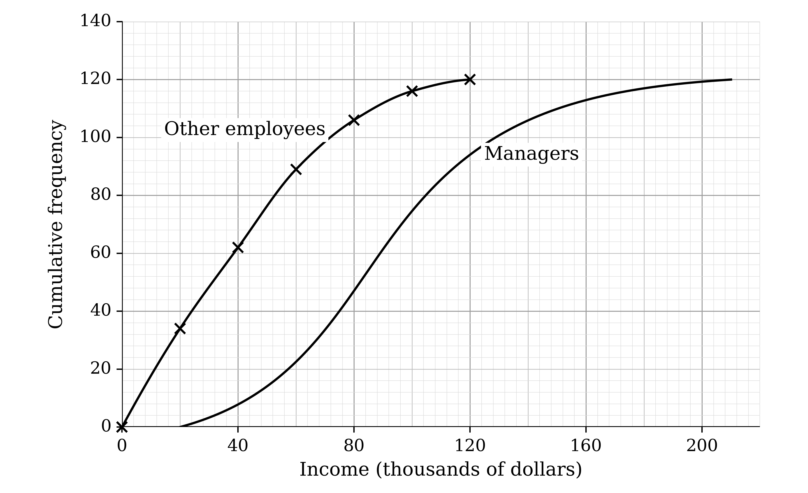

**[M1 A1]**

> **[mark-scheme]**
> **B1**: Correct cumulative frequencies 34, 62, 89, 106, 116, 120 (may be seen on the graph).
> 
> **M1**: At least 4 points plotted at the upper class boundaries 20, 40, 60, 80, 100, 120.
> 
> **A1**: All points plotted correctly and joined by a curve that starts at (0, 0). Straight-line segments do not earn this mark.
There are 120 people in each group, so the lower quartile, median and upper quartile are at cumulative frequencies of 30, 60 and 90

$\frac{1}{4} \times 120 = 30$

$\frac{1}{2} \times 120 = 60$

$\frac{3}{4} \times 120 = 90$

Read across at 30, 60 and 90 to the other employees' curve

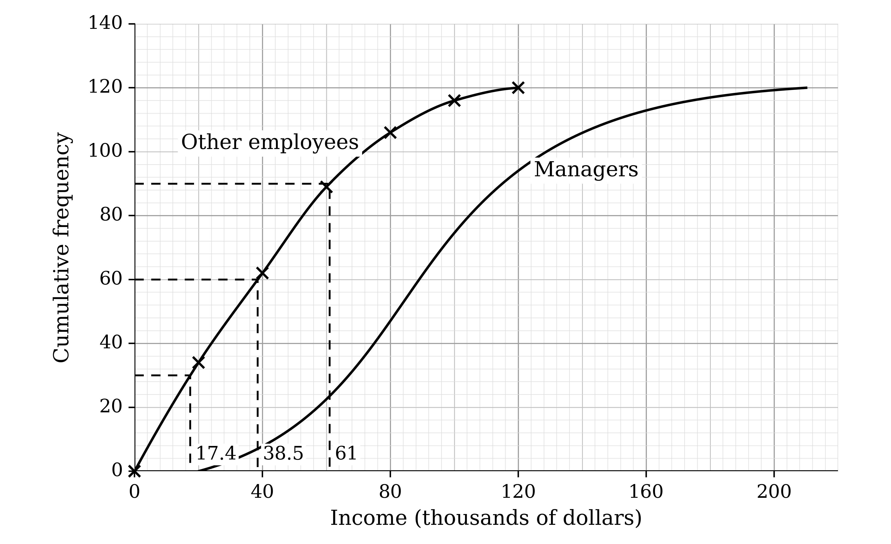

*Other employees: lower quartile = 17.4*

*Other employees: median = 38.5*

*Other employees: upper quartile = 61*

Read across at 30, 60 and 90 to the managers' curve

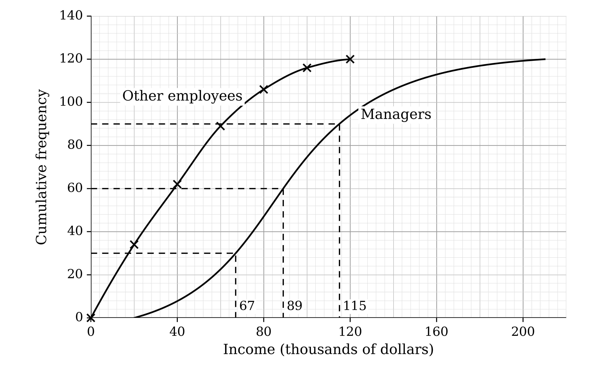

*Managers: lower quartile = 67*

*Managers: median = 89*

*Managers: upper quartile = 115*

**Final answer:** **Median for other employees = 38.5 thousand dollars**

**Final answer:** **Median for managers = 89 thousand dollars**

**[B1]**

Subtract the lower quartile from the upper quartile for each group

$61 - 17 . 4 = 43 . 6$

$115 - 67 = 48$

**Final answer:** **Interquartile range for other employees = 43.6 thousand dollars**

**Final answer:** **Interquartile range for managers = 48 thousand dollars**

**[B1]**

Compare the medians in context

**Final answer:** **On average, the managers earn more than the other employees**

**[B1]**

Compare the interquartile ranges in context

**Final answer:** **The managers' incomes are slightly more spread out than the incomes of the other employees**

**[B1]**

> **[mark-scheme]**
> **B1**: Both medians, from 36.5 to 40.5 for the other employees and from 87 to 91 for the managers (or from their graph).
> 
> **B1**: Both interquartile ranges, from 40 to 48 for the other employees and from 44 to 52 for the managers, from quartiles read at cumulative frequencies 30 and 90.
> 
> **B1**: A comparison of the averages in context, for example that managers earn more on average.
> 
> **B1**: A comparison of the spreads in context, for example that managers' incomes vary slightly more, or that the spreads of the incomes are similar. Stating or comparing the values alone does not score.

### Q20
There are 100 competitors, so the lower quartile, median and upper quartile are at cumulative frequencies of 25, 50 and 75

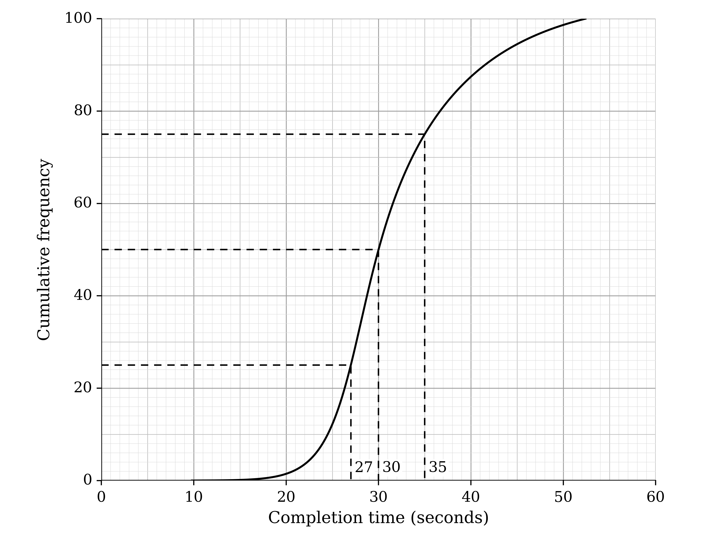

*Lower quartile = 27*

*Median = 30*

*Upper quartile = 35*

The whiskers run to the quickest and slowest times, 9.8 seconds and 52.4 seconds

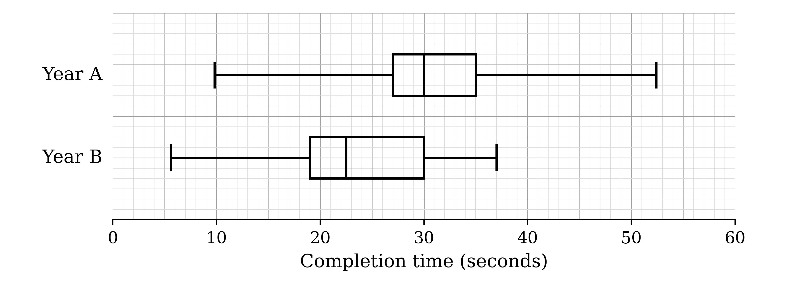

**[B1 B1 B1 B1]**

> **[mark-scheme]**
> **B1**: Median from 29.5 to 30.5, read from the graph at a cumulative frequency of 50 and plotted.
> 
> **B1**: Lower quartile from 26.5 to 27.5 and upper quartile from 34.5 to 35.5, read at cumulative frequencies 25 and 75 and plotted as the box.
> 
> **B1**: Whiskers drawn to 9.8 and 52.4.
> 
> **B1**: Whiskers not through the box or from its corners, and the plot labelled Year A.
The box-and-whisker plots from part (a)

Compare the medians (30 seconds in Year A, 22.5 seconds in Year B) in context

**Final answer:** **On average, the competitors were faster in Year B than in Year A**

**[B1]**

Compare the ranges (42.6 seconds in Year A, 31.4 seconds in Year B) in context

**Final answer:** **The completion times in Year A were more spread out than in Year B**

**[B1]**

> **[mark-scheme]**
> **B1**: A comparison of the averages in context, for example that competitors were quicker on average in Year B.
> 
> **B1**: A comparison of the spreads in context, using the range (Year A more spread out) or the interquartile range (the middle half of the Year B times more spread out). Stating or comparing the values alone does not score.

### Q21
A box-and-whisker plot shows only five summary values, but a stem-and-leaf diagram keeps every value

**Final answer:** **It shows every individual number of attempts, so other statistics, such as the mean or the mode, can still be found**

**[B1]**

> **[mark-scheme]**
> **B1**: A reference to the diagram showing all the original data values, or to further statistics (such as the mean, mode or standard deviation) being possible. Statistics that both diagrams show, such as the median, quartiles or range, do not score.
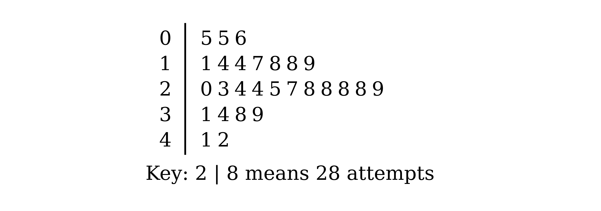

There are 27 values, so the median is the 14th value

$\frac{27+1}{2} = 14$

**Final answer:** **Median = 24 attempts**

**[B1]**

The lower quartile is the median of the 13 values below the median, which is the 7th value

**Final answer:** **Lower quartile = 17 attempts**

**[B1]**

The upper quartile is the median of the 13 values above the median, which is the 21st value

**Final answer:** **Upper quartile = 29 attempts**

**[B1]**

> **[mark-scheme]**
> **B1**: Median of 24.
> 
> **B1**: Lower quartile of 17.
> 
> **B1**: Upper quartile of 29.
A harder level is likely to need more attempts from most of the gamers

**Final answer:** **The median would increase, because most gamers would need more attempts to complete a harder level**

**[B1]**

> **[mark-scheme]**
> **B1**: Increase, with a reason in context (a harder level needs more attempts).

### Q22
(i)

Read the line inside the 'toffee deluxe' box

**Final answer:** **Median = 7 sweets**

**[B1]**

(ii)

The box runs from the lower quartile, 5, to the upper quartile, 8

$8 - 5$

**[M1]**

**Final answer:** **Interquartile range = 3 sweets**

**[A1]**

> **[mark-scheme]**
> **B1**: Median of 7.
> 
> **M1**: Upper quartile minus lower quartile read from the 'toffee deluxe' box.
> 
> **A1**: Interquartile range of 3.

The tub with 16 'toffee deluxe' sweets is far above the rest, which mostly have between 3 and 8

**Final answer:** **The median, because the mean is affected by the extreme value of 16 sweets**

**[B1]**

> **[mark-scheme]**
> **B1**: Median chosen, with a reason that refers to the extreme value of 16 'toffee deluxe' sweets (or to skew) in context.

(i)

Compare the medians (7 for 'toffee deluxe', from 10 to 13 for the others)

**Final answer:** **On average, there are fewer 'toffee deluxe' sweets in a tub than any of the other four sweets**

**[B1]**

Compare the interquartile ranges (3 for 'toffee deluxe', from 5 to 9 for the others)

**Final answer:** **The number of 'toffee deluxe' sweets in a tub varies less than for any of the other four sweets**

**[B1]**

(ii)

The 'toffee deluxe' upper quartile (8) is no higher than the lower quartile of most of the other sweets

**Final answer:** **Yes: in three quarters of the tubs there were 8 or fewer 'toffee deluxe' sweets, fewer than the median number of every other sweet, although 10 tubs is only a small sample**

**[B1]**

> **[mark-scheme]**
> **B1**: A comparison of central tendency in context, for example that tubs contain fewer 'toffee deluxe' sweets on average.
> 
> **B1**: A comparison of variation in context, for example that the number of 'toffee deluxe' sweets is more consistent.
> 
> **B1**: A conclusion (a valid complaint) justified by the diagrams, for example the median or upper quartile of 'toffee deluxe' being below the medians of the other sweets.

### Q23
The heights are already in order. There are 20 values, so the median is halfway between the 10th and 11th values

$\frac{1.2+1.3}{2}$

**Final answer:** **Median = 1.25 metres**

**[B1]**

The lower quartile is the median of the first 10 values, halfway between the 5th and 6th

$\frac{1.2+1.2}{2} = 1 . 2$

The upper quartile is the median of the last 10 values, halfway between the 15th and 16th

$\frac{1.4+1.4}{2} = 1 . 4$

Subtract the lower quartile from the upper quartile

$1 . 4 - 1 . 2$

**[M1]**

**Final answer:** **Interquartile range = 0.2 metres**

**[A1]**

> **[mark-scheme]**
> **B1**: Median of 1.25.
> 
> **M1**: Upper quartile minus lower quartile, with an upper quartile of 1.4 and a lower quartile of 1.2.
> 
> **A1**: Interquartile range of 0.2.
The five values needed are the minimum and maximum from the list, and the quartiles and median from part (a)

*Minimum = 0.9*

*Lower quartile = 1.2*

*Median = 1.25*

*Upper quartile = 1.4*

*Maximum = 1.6*

Draw the box from the lower quartile to the upper quartile with a line at the median, and the whiskers out to the minimum and maximum

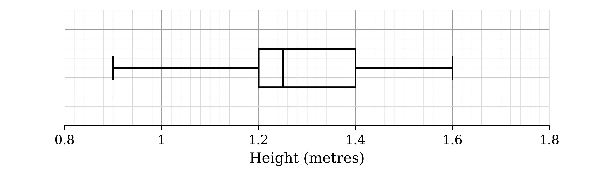

**[B1 B1 B1]**

> **[mark-scheme]**
> **B1**: Box drawn from 1.2 to 1.4 with the median line at 1.25 (follow through from part (a)).
> 
> **B1**: Whiskers drawn to 0.9 and 1.6.
> 
> **B1**: Whiskers not drawn through the box or from its corners, on a linear scale labelled height in metres.
With 21 heights, the median is the 11th value. The new height, 1.7, is larger than every other height, so the first 20 values stay in the same order

*11th value = 1.3*

**Final answer:** **The median increases (from 1.25 to 1.3 metres), because the added height is above the median**

**[B1]**

> **[mark-scheme]**
> **B1**: Increases, with a reason, such as the added height being above the median, or the new median of 1.3 (the 11th of the 21 values) stated. "Increases" with no reason does not score.
