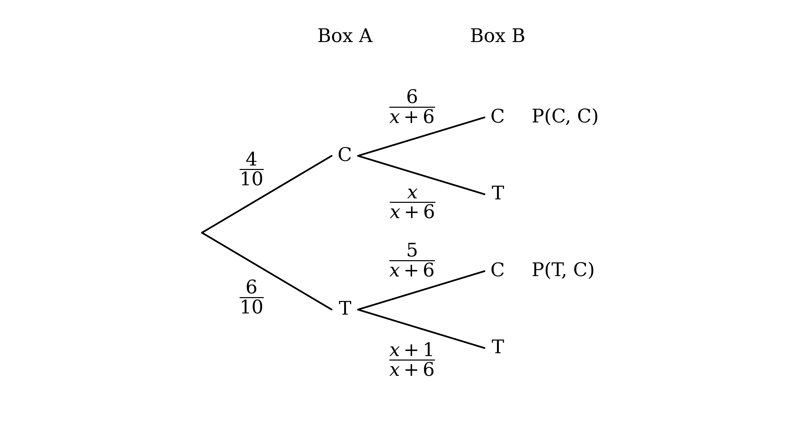
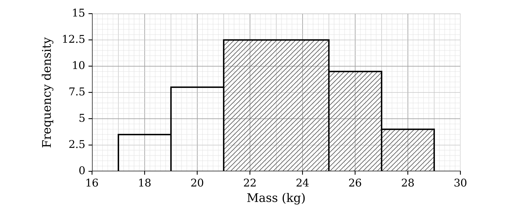
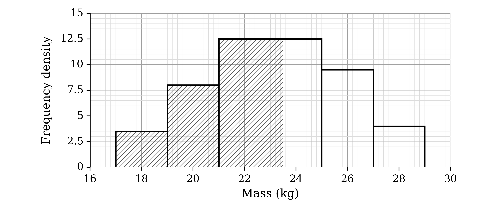
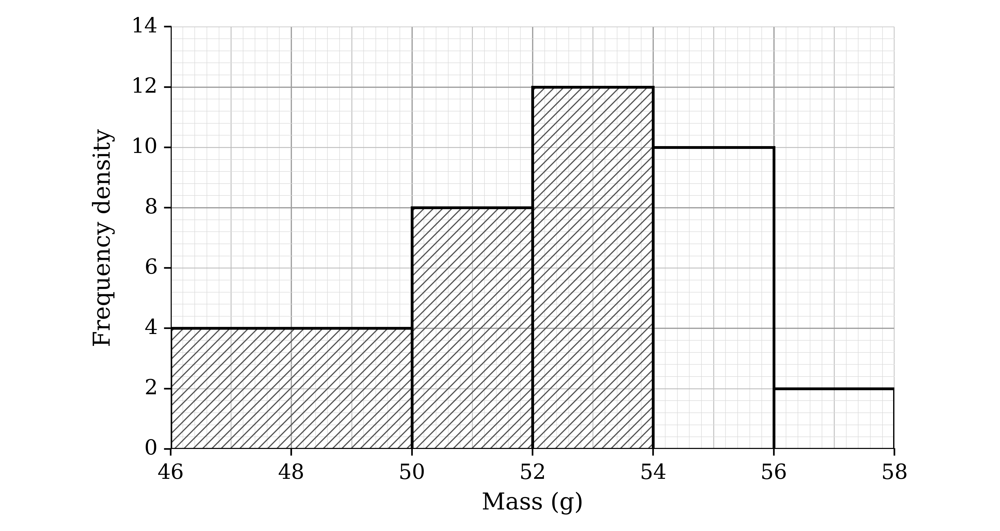
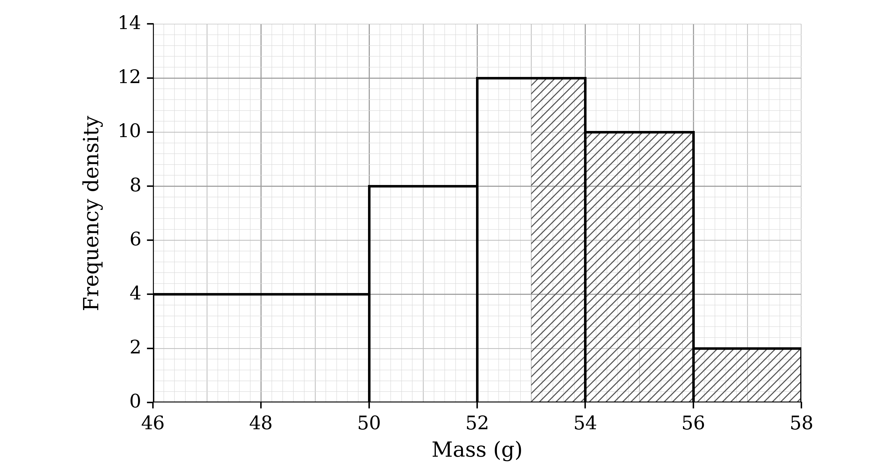
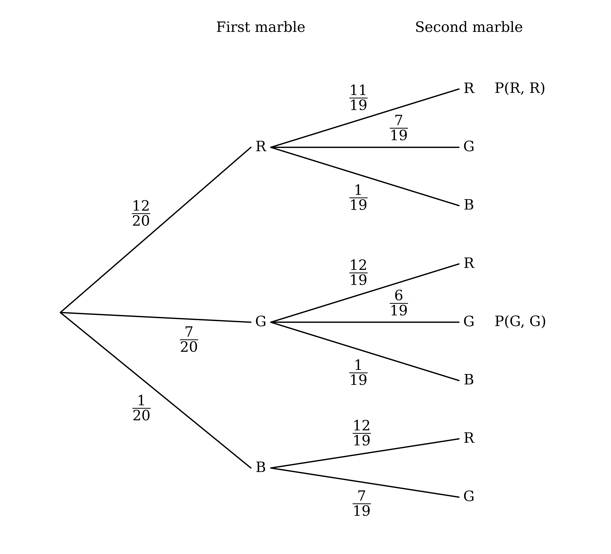
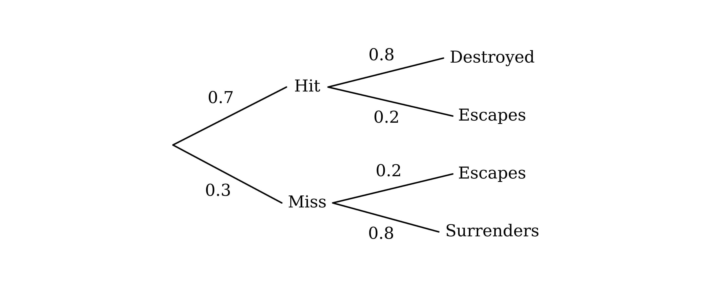
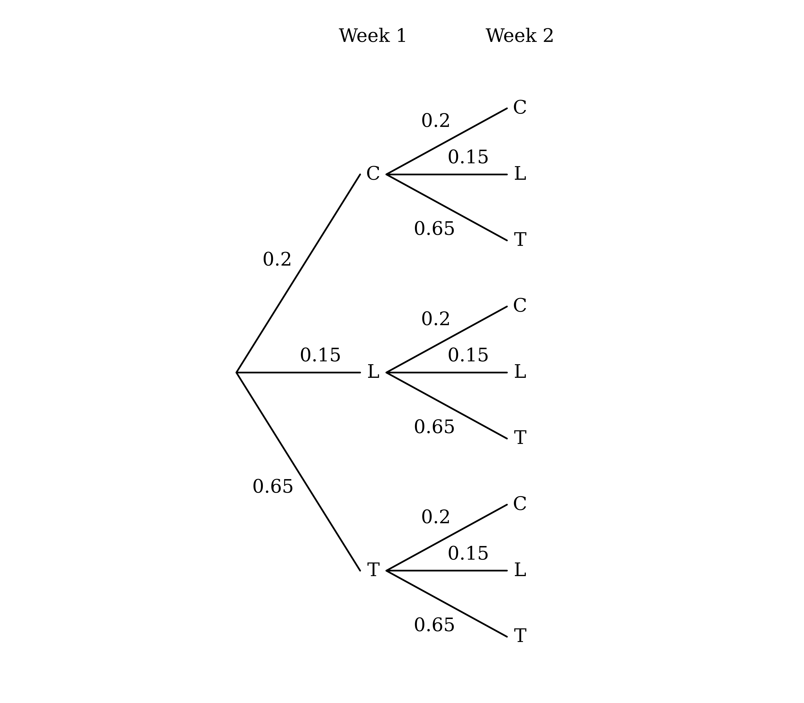
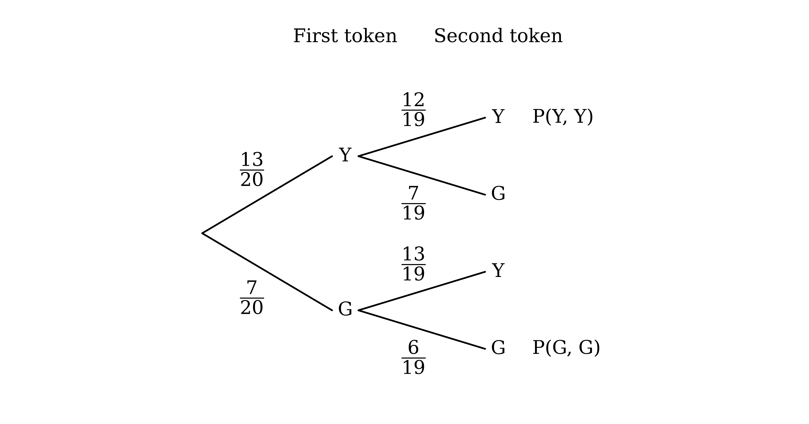
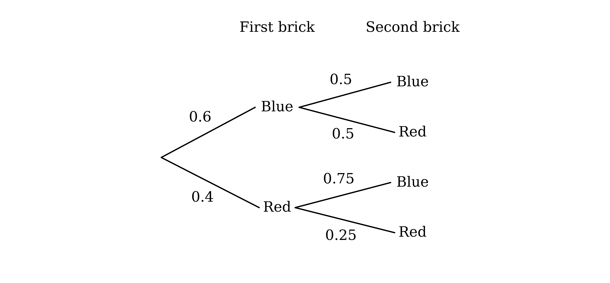

# Mark Schemes — Basic Probability
**Probability** · Cambridge (CIE) AS maths (9709)

## Exam Questions (25 questions)

### Q1
After one chocolate is moved, box B holds $x + 6$ chocolates. The number of caramels in it depends on what was moved

If a caramel is moved, box B has 6 caramels

$\text{P} ( C , C ) = \frac{4}{10} \times \frac{6}{x+6} = \frac{24}{10(x+6)}$

**[B1]**

If a toffee is moved, box B still has 5 caramels

$\text{P} ( T , C ) = \frac{6}{10} \times \frac{5}{x+6} = \frac{30}{10(x+6)}$

**[B1]**

Add the two paths that end with a caramel

$\frac{24}{10(x+6)} + \frac{30}{10(x+6)} = \frac{54}{10(x+6)}$

**[M1]**

$\text{P(friend takes a caramel)} = \frac{27}{5(x+6)}$

**[A1]**

> **[mark-scheme]**
> **B1**: Probability for caramel moved, then caramel taken, 4/10 × 6/(x + 6) or equivalent.
> 
> **B1**: Probability for toffee moved, then caramel taken, 6/10 × 5/(x + 6) or equivalent.
> 
> **M1**: Sum of the two products.
> 
> **A1**: The printed result reached with no errors. As the answer is given, the sum over a common denominator must be seen before simplifying.
The friend takes either a caramel or a toffee, so find the probability of a caramel

$\text{P(caramel)} = 1 - \frac{11}{20} = \frac{9}{20}$

**[B1]**

Set this equal to the result from part (a)

$\frac{27}{5(x+6)} = \frac{9}{20}$

**[M1]**

Cross-multiply and solve for $x + 6$

$540 = 45 ( x + 6 )$

$x + 6 = 12$

**[M1]**

$x = 6$

**[A1]**

> **[mark-scheme]**
> **B1**: Probability of a caramel of 9/20.
> 
> **M1**: The probability of a caramel equated to 27/(5(x + 6)).
> 
> **M1**: The equation cleared of fractions and rearranged for x (or x + 6).
> 
> **A1**: x = 6.
> 
> Equating the toffee paths directly, 4/10 × x/(x + 6) + 6/10 × (x + 1)/(x + 6) = 11/20, is equally acceptable: B1 for the toffee expression, then M1 M1 A1 as above.

### Q2
The area of each bar gives its frequency, so use frequency = class width × frequency density for the three bars above 21 kg

*4 × 12.5 + 2 × 9.5 + 2 × 4 = 50 + 19 + 8 = 77*

**[M1]**

Divide by the total of 100 calves

$\frac{77}{100}$

**Final answer:** **Probability = 0.77**

**[A1]**

> **[mark-scheme]**
> **M1**: At least two frequencies found correctly as class width × frequency density.
> 
> **A1**: Probability of 0.77 (or 77/100).
23.5 kg lies inside the 21 to 25 class, so take the 2.5 kg of that bar below 23.5 kg (assuming the masses are evenly spread within the class)

*2.5 × 12.5 = 31.25*

**[B1]**

Add the frequencies of the two classes below 21 kg

*2 × 3.5 + 2 × 8 + 31.25 = 7 + 16 + 31.25 = 54.25*

**[M1]**

Divide by the total of 100 calves

*54.25 ÷ 100*

**Final answer:** **Probability = 0.5425**

**[A1]**

> **[mark-scheme]**
> **B1**: 31.25 calves estimated between 21 kg and 23.5 kg (2.5 × 12.5).
> 
> **M1**: The estimate of 31.25 added to the frequencies 7 and 16 of the classes below 21 kg.
> 
> **A1**: Probability of 0.5425 (or 217/400); answers which round to 0.543 are accepted.

### Q3
(i)

A and C are mutually exclusive, so the probability of A or C is the sum of their probabilities

$\text{P} ( A \cup C ) = \text{P} ( A ) + \text{P} ( C )$

Substitute the given values

*0.4 = 0.28 + P(C)*

**Final answer:** **P(C) = 0.12**

**[B1]**

(ii)

B and C are independent, so the probability that both occur is the product of their probabilities

$\text{P} ( B \cap C ) = \text{P} ( B ) \times \text{P} ( C )$

Substitute the given value and P(C) = 0.12

*0.02 = P(B) × 0.12*

**[M1]**

$\text{P} ( B ) = \frac{1}{6}$

**[A1]**

(iii)

The probability of C splits into the part where B also occurs and the part where it does not

$\text{P} ( C \cap B ' ) = \text{P} ( C ) - \text{P} ( B \cap C ) = 0 . 12 - 0 . 02$

**[M1]**

**Final answer:** **P(C occurs and B does not) = 0.1**

**[A1]**

> **[mark-scheme]**
> **B1**: P(C) = 0.12, from P(A) + P(C) = 0.4.
> 
> **M1**: Use of P(B) × P(C) = 0.02 for independent events, with the value of P(C) from (i).
> 
> **A1**: P(B) = 1/6 (or answers which round to 0.167).
> 
> **M1**: P(C) − 0.02, or P(C) × (1 − P(B)), with the values from (i) and (ii).
> 
> **A1**: Probability that C occurs and B does not of 0.1.

### Q4
The first token is taken from all 16 tokens, and the coin is fair. After heads, 15 tokens remain (one fewer of the first colour); after tails, all 16 are back in the bag

**[B1 B1 B1 B1]**

> **[mark-scheme]**
> **B1**: Correct three-stage structure, fully labelled: black and white, then heads and tails after each, then black and white after each of those (8 ends).
> 
> **B1**: First-token probabilities 10/16 and 6/16, and 1/2 on every coin branch.
> 
> **B1**: Second-token branches after heads (without replacement): 9/15 and 6/15 after black, 10/15 and 5/15 after white.
> 
> **B1**: Second-token branches after tails (with replacement): 10/16 and 6/16 after both colours.
> 
> Equivalent fractions and decimals are accepted.

Find the probability of each path that ends with a white second token

$\text{P} ( B , H , W ) = \frac{10}{16} \times \frac{1}{2} \times \frac{6}{15} = \frac{16}{128}$

$\text{P} ( B , T , W ) = \frac{10}{16} \times \frac{1}{2} \times \frac{6}{16} = \frac{15}{128}$

$\text{P} ( W , H , W ) = \frac{6}{16} \times \frac{1}{2} \times \frac{5}{15} = \frac{8}{128}$

$\text{P} ( W , T , W ) = \frac{6}{16} \times \frac{1}{2} \times \frac{6}{16} = \frac{9}{128}$

**[M1]**

Add the four paths

$\frac{16}{128} + \frac{15}{128} + \frac{8}{128} + \frac{9}{128} = \frac{48}{128}$

**[M1]**

$\text{P(second token white)} = \frac{3}{8}$

**[A1]**

> **[mark-scheme]**
> **M1**: At least two correct three-factor products for paths ending in white, following through from the tree in part (a).
> 
> **M1**: Sum of the four products for the paths ending in white.
> 
> **A1**: Probability of 3/8 (or 48/128, 0.375).

### Q5
Show the 24 equally likely scores in a table

| Die \ Spinner | 1 | 2 | 3 | 4 |
|---|---|---|---|---|
| **1** | 0 | 1 | 2 | 3 |
| **2** | 1 | 0 | 1 | 2 |
| **3** | 2 | 1 | 0 | 1 |
| **4** | 3 | 2 | 1 | 0 |
| **5** | 4 | 3 | 2 | 1 |
| **6** | 5 | 4 | 3 | 2 |

**[B1]**

(i)

A score of 0 appears 4 times

$\text{P(score is 0)} = \frac{4}{24} = \frac{1}{6}$

**[B1]**

(ii)

Scores of 3, 4 or 5 appear 7 times

$\text{P(score is 3 or more)} = \frac{7}{24}$

**[B1]**

(iii)

The possible prime scores are 2, 3 and 5, which appear 6, 4 and 1 times

$6 + 4 + 1 = 11$

$\text{P(score is prime)} = \frac{11}{24}$

**[B1]**

> **[mark-scheme]**
> **B1**: All 24 scores correct, in a table or a list of outcomes.
> 
> **B1**: Probability of a score of exactly 0 of 1/6.
> 
> **B1**: Probability of a score of 3 or more of 7/24.
> 
> **B1**: Probability of a prime score of 11/24.
> 
> Unsimplified fractions (e.g. 4/24) and decimals correct to 3 significant figures (0.167, 0.292, 0.458) are accepted. The three answers are marked independently.

### Q6
The area of each bar gives its frequency, so use frequency = class width × frequency density for the three bars below 54 g

$4 \times 4 + 2 \times 8 + 2 \times 12 = 16 + 16 + 24 = 56$

**[M1]**

Divide by the total of 80 ducklings

$\frac{56}{80}$

**Final answer:** **Probability = 0.7**

**[A1]**

> **[mark-scheme]**
> **M1**: At least two frequencies found correctly as class width × frequency density.
> 
> **A1**: Probability of 0.7 (or 56/80, 7/10).
53 g is halfway through the 52 to 54 class, so assume half of that class's 24 ducklings are heavier than 53 g

$\frac{1}{2} \times 2 \times 12 = 12$

**[B1]**

Add the frequencies of the two classes above 54 g

$12 + 2 \times 10 + 2 \times 2 = 12 + 20 + 4 = 36$

**[M1]**

Divide by the total of 80 ducklings

$\frac{36}{80}$

**Final answer:** **Probability = 0.45**

**[A1]**

> **[mark-scheme]**
> **B1**: 12 ducklings estimated between 53 g and 54 g (half of the 52 to 54 class).
> 
> **M1**: The estimate of 12 added to the frequencies 20 and 4 of the classes above 54 g.
> 
> **A1**: Probability of 0.45 (or 36/80, 9/20).

### Q7
For the first marble there are 20 marbles in the bag. After one is taken, 19 remain, with one fewer of the colour already taken. There is only one black marble, so after a black the second marble must be red or green

**[B1 B1 B1]**

> **[mark-scheme]**
> **B1**: Correct structure, fully labelled: three first branches (red, green, black), three second branches after red and after green, and two after black (a third branch for black with probability 0 is also accepted).
> 
> **B1**: First-marble probabilities 12/20, 7/20 and 1/20.
> 
> **B1**: All second-marble probabilities correct: 11/19, 7/19, 1/19 after red; 12/19, 6/19, 1/19 after green; 12/19, 7/19 after black.
> 
> Equivalent fractions and decimals are accepted.

Find the probability that both marbles are the same colour. Two black marbles are impossible, so only red, red and green, green are possible

$\text{P} ( R , R ) + \text{P} ( G , G ) = \frac{12}{20} \times \frac{11}{19} + \frac{7}{20} \times \frac{6}{19}$

$= \frac{132}{380} + \frac{42}{380} = \frac{174}{380}$

**[M1]**

Subtract from 1 to find the probability that they are not the same colour

$1 - \frac{174}{380} = \frac{206}{380}$

**[M1]**

$\text{P(not the same colour)} = \frac{103}{190}$

**[A1]**

> **[mark-scheme]**
> **M1**: Sum of the products for red, red and green, green (a black, black term of 0 may be included).
> 
> **M1**: 1 minus the probability of the same colour.
> 
> **A1**: Probability of 103/190 (or 206/380; answers which round to 0.542).
> 
> Adding the six products for two different colours directly is also accepted for both method marks.

### Q8
(i)

Put the given probabilities in a two-way table. He always does at least one of the two activities, so the probability of neither is 0, and the totals for not doing each activity are 1 − 0.55 = 0.45 and 1 − 0.75 = 0.25

|   | Swimming | Not swimming | Total |
|---|---|---|---|
| **Poetry** |   |   | 0.55 |
| **Not poetry** |   | 0 | 0.45 |
| **Total** | 0.75 | 0.25 | 1 |

The Not swimming column adds up to 0.25, and its Not poetry cell is 0

*P(poetry but not swimming) = 0.25 − 0 = 0.25*

**[M1]**

The Poetry row adds up to 0.55

*P(poetry and swimming) = 0.55 − 0.25*

**Final answer:** **P(poetry and swimming) = 0.3**

**[A1]**

(ii)

The Swimming column adds up to 0.75

*P(swimming but not poetry) = 0.75 − 0.3*

**[M1]**

**Final answer:** **P(swimming but not poetry) = 0.45**

**[A1]**

The completed table is correct, as the Not poetry row adds up to 0.45 + 0 = 0.45

|   | Swimming | Not swimming | Total |
|---|---|---|---|
| **Poetry** | 0.3 | 0.25 | 0.55 |
| **Not poetry** | 0.45 | 0 | 0.45 |
| **Total** | 0.75 | 0.25 | 1 |

> **[mark-scheme]**
> **M1**: Use of "at least one" to find the overlap, e.g. a 0 in the neither cell of a two-way table leading to 0.25 for poetry only, or 0.55 + 0.75 − 1.
> 
> **A1**: Probability of swimming and poetry of 0.3.
> 
> **M1**: 0.75 minus the probability of both from (i), or 1 − 0.55 (every day without poetry is a swimming day).
> 
> **A1**: Probability of swimming but not poetry of 0.45.
> 
> Reasoning in words, or a list of the three possible cases, is equally acceptable.

### Q9
(i)

Mutually exclusive events cannot both happen, so the probability of either is the sum of their probabilities

$\text{P} ( B \text{or} C ) = \text{P} ( B ) + \text{P} ( C )$

Substitute the given values

*P(B or C) = 0.33 + 0.43*

**[M1]**

**Final answer:** **P(B or C) = 0.76**

**[A1]**

(ii)

For independent events, the probability of both is the product of their probabilities

$\text{P} ( A \text{and} D ) = \text{P} ( A ) \times \text{P} ( D )$

Substitute the given values

*P(A and D) = 0.28 × 0.25*

**[M1]**

**Final answer:** **P(A and D) = 0.07**

**[A1]**

> **[mark-scheme]**
> **M1**: Sum P(B) + P(C) with the given values.
> 
> **A1**: Probability of B or C of 0.76.
> 
> **M1**: Product P(A) × P(D) with the given values.
> 
> **A1**: Probability of A and D of 0.07.
> 
> The two answers are marked independently.

### Q10
Let the probability of tennis be $t$, so football is $4 t$ and basketball is $3 t$. The three probabilities add up to 1

$t + 4 t + 3 t = 1$

$8 t = 1$

$\text{P(tennis)} = t = \frac{1}{8}$

**[B1]**

> **[mark-scheme]**
> **B1**: The equation t + 4t + 3t = 1 (or equivalent) formed and solved to reach 1/8. As the answer is given, the equation must be seen.
From part (a), the three probabilities are

$\text{P(tennis)} = \frac{1}{8}$

$\text{P(football)} = \frac{4}{8} = \frac{1}{2}$

$\text{P(basketball)} = \frac{3}{8}$

Find the probability of one particular order, for example tennis, then football, then basketball

$\frac{1}{8} \times \frac{1}{2} \times \frac{3}{8} = \frac{3}{128}$

**[M1]**

The three different sports can be chosen in any of $3 ! = 6$ orders, each with the same probability

$6 \times \frac{3}{128}$

**[M1]**

$\text{P(three different sports)} = \frac{9}{64}$

**[A1]**

> **[mark-scheme]**
> **M1**: Product of the three probabilities 1/8, 1/2 and 3/8 (in any order).
> 
> **M1**: The product multiplied by 6 (or 3!), or the six products of the three probabilities added.
> 
> **A1**: Probability of 9/64 (or 18/128, 0.140625, answers which round to 0.141).
Multiply the probability of football for the five independent days

`\left(\dfrac{1}{2}\right)^{5}`

**[M1]**

$\text{P(football on all five days)} = \frac{1}{32}$

**[A1]**

> **[mark-scheme]**
> **M1**: P(football) raised to the power 5, following through from the value of P(football) found in part (b).
> 
> **A1**: Probability of 1/32 (or 0.03125, answers which round to 0.0313).

### Q11
Multiply each possible first number by each possible second number

| Second \ First | 1 | 2 | 3 | 4 | 5 |
|---|---|---|---|---|---|
| **1** | 1 | 2 | 3 | 4 | 5 |
| **2** | 2 | 4 | 6 | 8 | 10 |
| **3** | 3 | 6 | 9 | 12 | 15 |
| **4** | 4 | 8 | 12 | 16 | 20 |
| **5** | 5 | 10 | 15 | 20 | 25 |

**[B1 B1]**

> **[mark-scheme]**
> **B1**: At least 20 of the 25 products correct.
> 
> **B1**: All 25 products correct.
| Second \ First | 1 | 2 | 3 | 4 | 5 |
|---|---|---|---|---|---|
| **1** | 1 | 2 | 3 | 4 | 5 |
| **2** | 2 | 4 | 6 | 8 | 10 |
| **3** | 3 | 6 | 9 | 12 | 15 |
| **4** | 4 | 8 | 12 | 16 | 20 |
| **5** | 5 | 10 | 15 | 20 | 25 |

There are 25 equally likely outcomes in the table

(i)

The product is odd only when both numbers are odd (1, 3 or 5), which happens in 9 outcomes, so 16 products are even

$\text{P} ( R ) = \frac{16}{25}$

**[B1]**

(ii)

The first number is greater in 10 outcomes (above the diagonal of the table)

$\text{P} ( S ' ) = 1 - \frac{10}{25} = \frac{3}{5}$

**[B1]**

(iii)

Of those 10, the even products are 2 × 1, 4 × 1, 3 × 2, 4 × 2, 5 × 2, 4 × 3 and 5 × 4 (first × second)

$\text{P} ( R \cap S ) = \frac{7}{25}$

**[B1]**

(iv)

Count the outcomes in R or S, counting the 7 in both only once

$16 + 10 - 7 = 19$

$\text{P} ( R \cup S ) = \frac{19}{25}$

**[B1]**

> **[mark-scheme]**
> **B1**: Probability that R occurs of 16/25.
> 
> **B1**: Probability that S does not occur of 3/5 (or 15/25).
> 
> **B1**: Probability that both R and S occur of 7/25.
> 
> **B1**: Probability that at least one of R and S occurs of 19/25, following through from the answers to (i) to (iii).
> 
> Equivalent decimals (0.64, 0.6, 0.28, 0.76) are accepted. The four answers are marked independently.
Mutually exclusive events cannot both occur, so for them

$\text{P} ( R \cap S ) = 0$

Compare with part (b)(iii), where both occur, for example when the first number is 2 and the second is 1

$\text{P} ( R \cap S ) = \frac{7}{25} \neq 0$

**[M1]**

**Final answer:** **R and S are not mutually exclusive**

**[A1]**

> **[mark-scheme]**
> **M1**: The probability that both R and S occur, from part (b), shown to be non-zero, or an outcome in both events identified (e.g. 2 then 1), or P(R) + P(S) = 26/25 compared with P(R ∪ S) = 19/25.
> 
> **A1**: Conclusion that R and S are not mutually exclusive, from a correct reason.

### Q12
The probabilities on each pair of branches add up to 1, so a miss has probability 0.3, a hit robot ship escapes with probability 0.2, and a missed robot ship surrenders with probability 0.8

**[B1 B1 B1]**

> **[mark-scheme]**
> **B1**: Correct structure, fully labelled: hit and miss, then destroyed and escapes after a hit, escapes and surrenders after a miss.
> 
> **B1**: First-stage probabilities 0.7 and 0.3.
> 
> **B1**: All four second-stage probabilities correct: 0.8 and 0.2 after a hit; 0.2 and 0.8 after a miss.
> 
> Equivalent fractions are accepted.

(i)

The robot ship can only be destroyed after a hit

*0.7 × 0.8*

**Final answer:** **P(destroyed) = 0.56**

**[B1]**

(ii)

The robot ship can escape after a hit or after a miss, so add the two paths

*0.7 × 0.2 + 0.3 × 0.2 = 0.14 + 0.06*

**Final answer:** **P(escapes) = 0.2**

**[B1]**

(iii)

The robot ship can only surrender after a miss

*0.3 × 0.8*

**Final answer:** **P(surrenders) = 0.24**

**[B1]**

> **[mark-scheme]**
> **B1**: Probability that the robot ship is destroyed of 0.56.
> 
> **B1**: Probability that the robot ship escapes of 0.2.
> 
> **B1**: Probability that the robot ship surrenders of 0.24.
> 
> Each answer follows through from the tree in part (a). The three answers are marked independently.
State the test for independence

$\text{P} ( \text{hit} \cap \text{escapes} ) = \text{P} ( \text{hit} ) \times \text{P} ( \text{escapes} )$

Work out the product, using P(escapes) from part (b)(ii)

*P(hit) × P(escapes) = 0.7 × 0.2 = 0.14*

**[M1]**

Compare it with the probability of the hit, escapes path on the tree, found in part (b)(ii)

$\text{P} ( \text{hit} \cap \text{escapes} ) = 0 . 14 = \text{P} ( \text{hit} ) \times \text{P} ( \text{escapes} )$

**Final answer:** **The events are independent, as required**

**[A1]**

> **[mark-scheme]**
> **M1**: Product of P(hit) = 0.7 and P(escapes) from part (b)(ii) evaluated.
> 
> **A1**: P(hit ∩ escapes) = 0.14 found from the tree, the comparison 0.14 = 0.14 with the notation, and the conclusion that the events are independent. As the result is given, both values must be seen.

### Q13
A tree diagram for the two meetings helps to see the cases (C: changes the time, L: late, T: on time)

(i)

The three outcomes at a meeting have probabilities adding up to 1

*P(on time) = 1 − 0.2 − 0.15 = 0.65*

Multiply for the two independent meetings

*0.65 × 0.65*

**Final answer:** **P(on time for both) = 0.4225**

**[B1]**

(ii)

Find the probability that she does not change the time at one meeting

*P(no change) = 1 − 0.2 = 0.8*

Subtract the probability of no change at either meeting from 1

*1 − 0.8 × 0.8 = 1 − 0.64*

**[M1]**

**Final answer:** **P(changes the time at least once) = 0.36**

**[A1]**

(iii)

She can be late in week 1 and change the time in week 2, or the other way round

*0.15 × 0.2 + 0.2 × 0.15 = 0.03 + 0.03*

**[M1]**

**Final answer:** **P(late for one, changes the other) = 0.06**

**[A1]**

> **[mark-scheme]**
> **B1**: Probability of on time for both of 0.4225 (or 169/400; answers which round to 0.423).
> 
> **M1**: 1 − 0.8², or the sum of the three cases with at least one change (0.2² + 2 × 0.2 × 0.8).
> 
> **A1**: Probability of at least one change of 0.36.
> 
> **M1**: 0.15 × 0.2 counted for both orders (added twice, or multiplied by 2).
> 
> **A1**: Probability of late for one and a change for the other of 0.06.
> 
> The three answers are marked independently.

### Q14
If A and B are mutually exclusive, the probability of A or B is the sum of their probabilities

$\text{P} ( A \cup B ) = \text{P} ( A ) + \text{P} ( B )$

Work out the sum

*P(A) + P(B) = 0.35 + 0.25 = 0.6*

**[M1]**

Compare it with the given probability

$\text{P} ( A \cup B ) = 0 . 6 = \text{P} ( A ) + \text{P} ( B )$

**Final answer:** **A and B are mutually exclusive**

**[A1]**

> **[mark-scheme]**
> **M1**: Sum 0.35 + 0.25 evaluated, or P(A ∩ B) = 0.35 + 0.25 − 0.6 = 0 found.
> 
> **A1**: The comparison 0.6 = 0.6 (or P(A ∩ B) = 0) and the conclusion that A and B are mutually exclusive.
State the test for independence

$\text{P} ( C \cap D ) = \text{P} ( C ) \times \text{P} ( D )$

Work out the product

*P(C) × P(D) = 0.2 × 0.4 = 0.08*

**[M1]**

Compare it with the probability that both occur

$\text{P} ( C \cap D ) = 0 . 18 \neq 0 . 08$

**Final answer:** **C and D are not independent**

**[A1]**

> **[mark-scheme]**
> **M1**: Product 0.2 × 0.4 evaluated.
> 
> **A1**: P(C), P(D) and P(C ∩ D) (or P(C and D)) identified, the numerical comparison 0.18 ≠ 0.08 and the conclusion that C and D are not independent.
> 
> Comparing a conditional probability instead, e.g. P(C | D) = 0.45 ≠ 0.2 = P(C), with the notation and a conclusion, is also accepted.

### Q15
Show the 9 equally likely products in a table

| × | 1 | 2 | 3 |
|---|---|---|---|
| **1** | 1 | 2 | 3 |
| **2** | 2 | 4 | 6 |
| **3** | 3 | 6 | 9 |

**[B1]**

(i)

Two of the products are 6

$\text{P(product is 6)} = \frac{2}{9}$

**[B1]**

(ii)

The products less than 4 are 1, 2, 3, 2 and 3

$\text{P(product is less than 4)} = \frac{5}{9}$

**[B1]**

(iii)

The odd products are 1, 3, 3 and 9

$\text{P(product is odd)} = \frac{4}{9}$

**[B1]**

> **[mark-scheme]**
> **B1**: All 9 products correct, in a table or a list of outcomes.
> 
> **B1**: Probability that the product is exactly 6 of 2/9.
> 
> **B1**: Probability that the product is less than 4 of 5/9.
> 
> **B1**: Probability that the product is odd of 4/9.
> 
> Decimals correct to 3 significant figures (0.222, 0.556, 0.444) are accepted. The three answers are marked independently.

### Q16
Add the two scores in each cell

| Six-sided \ Four-sided | 1 | 2 | 3 | 4 |
|---|---|---|---|---|
| **1** | 2 | 3 | **Final answer:** **4** | **Final answer:** **5** |
| **2** | 3 | **Final answer:** **4** | **Final answer:** **5** | **Final answer:** **6** |
| **3** | **Final answer:** **4** | **Final answer:** **5** | **Final answer:** **6** | **Final answer:** **7** |
| **4** | **Final answer:** **5** | **Final answer:** **6** | **Final answer:** **7** | **Final answer:** **8** |
| **5** | **Final answer:** **6** | **Final answer:** **7** | **Final answer:** **8** | **Final answer:** **9** |
| **6** | **Final answer:** **7** | **Final answer:** **8** | **Final answer:** **9** | **Final answer:** **10** |

**[B1]**

> **[mark-scheme]**
> **B1**: All 21 missing sums correct.
| Six-sided \ Four-sided | 1 | 2 | 3 | 4 |
|---|---|---|---|---|
| **1** | 2 | 3 | 4 | 5 |
| **2** | 3 | 4 | 5 | 6 |
| **3** | 4 | 5 | 6 | 7 |
| **4** | 5 | 6 | 7 | 8 |
| **5** | 6 | 7 | 8 | 9 |
| **6** | 7 | 8 | 9 | 10 |

There are 24 equally likely outcomes in the table

(i)

The sums more than 7 are 8, 8, 8, 9, 9 and 10

$\text{P} ( A ) = \frac{6}{24} = \frac{1}{4}$

**[B1]**

(ii)

One odd and one even number always give an odd sum, and 12 of the sums are odd

$\text{P} ( B ) = \frac{12}{24} = \frac{1}{2}$

**[B1]**

(iii)

Both occur when the sum is odd and more than 7, which is the two sums of 9

$\text{P} ( A \cap B ) = \frac{2}{24} = \frac{1}{12}$

**[B1]**

(iv)

Count the outcomes in A or B, counting the two sums of 9 only once

$6 + 12 - 2 = 16$

$\text{P} ( A \cup B ) = \frac{16}{24} = \frac{2}{3}$

**[B1]**

> **[mark-scheme]**
> **B1**: Probability that A occurs of 1/4.
> 
> **B1**: Probability that B occurs of 1/2.
> 
> **B1**: Probability that both A and B occur of 1/12.
> 
> **B1**: Probability that at least one of A and B occurs of 2/3, following through from the answers to (i) to (iii) as P(A) + P(B) − P(A ∩ B).
> 
> Unsimplified fractions (e.g. 6/24) and decimals correct to 3 significant figures (0.25, 0.5, 0.0833, 0.667) are accepted. The four answers are marked independently.
State the test for independence

$\text{P} ( A \cap B ) = \text{P} ( A ) \times \text{P} ( B )$

Work out the product

$\text{P} ( A ) \times \text{P} ( B ) = \frac{1}{4} \times \frac{1}{2} = \frac{1}{8}$

**[M1]**

Compare it with the probability that both occur, from part (b)

$\text{P} ( A \cap B ) = \frac{1}{12} \neq \frac{1}{8}$

**Final answer:** **A and B are not independent**

**[A1]**

> **[mark-scheme]**
> **M1**: Product of P(A) and P(B) from part (b).
> 
> **A1**: P(A), P(B) and P(A ∩ B) (or P(A and B)) identified, the numerical comparison 1/12 ≠ 1/8 and the conclusion that A and B are not independent.
> 
> Comparing a conditional probability instead, e.g. P(A | B) = 1/6 ≠ 1/4 = P(A), with the notation and a conclusion, is also accepted.

### Q17
For the first token there are 20 tokens in the bag. After one is taken, 19 remain, and one fewer of the colour already taken

**[B1 B1 B1]**

> **[mark-scheme]**
> **B1**: Correct structure, fully labelled: yellow and green for the first token, then yellow and green after each.
> 
> **B1**: First-token probabilities 13/20 and 7/20.
> 
> **B1**: All four second-token probabilities correct: 12/19 and 7/19 after yellow; 13/19 and 6/19 after green.
> 
> Any clear labels (Y and G, or the colours in words) are accepted, and equivalent decimals are accepted.

Multiply along the yellow, yellow branches

$\text{P} ( Y , Y ) = \frac{13}{20} \times \frac{12}{19} = \frac{156}{380}$

**[M1]**

Multiply along the green, green branches

$\text{P} ( G , G ) = \frac{7}{20} \times \frac{6}{19} = \frac{42}{380}$

The two tokens are the same colour in either of these cases, so add

$\frac{156}{380} + \frac{42}{380} = \frac{198}{380}$

**[M1]**

$\text{P(same colour)} = \frac{99}{190}$

**[A1]**

> **[mark-scheme]**
> **M1**: One correct two-factor product for yellow, yellow or green, green, following through from the tree in part (a).
> 
> **M1**: Sum of the two products for yellow, yellow and green, green.
> 
> **A1**: Probability of 99/190 (or 198/380; answers which round to 0.521).

### Q18
Each probability is the number of platypuses in the group divided by the total of 120

(i)

Add the male frequencies

$7 + 21 + 19 + 5 + 2 + 1 = 55$

$\text{P(male)} = \frac{55}{120} = \frac{11}{24}$

**[B1]**

(ii)

Add the female and male frequencies in the first four classes

$( 14 + 29 + 12 + 6 ) + ( 0 + 0 + 7 + 21 ) = 89$

$\text{P(less than 51 cm)} = \frac{89}{120}$

**[B1]**

(iii)

The male frequencies in the first two classes are both 0

$\text{P(male less than 45 cm)} = 0$

**[B1]**

(iv)

Add the female frequencies in the classes from 45 cm up to 54 cm

$12 + 6 + 3 = 21$

$\text{P(female between 45 and 54 cm)} = \frac{21}{120} = \frac{7}{40}$

**[B1]**

> **[mark-scheme]**
> **B1**: Probability that the platypus is male of 11/24.
> 
> **B1**: Probability that the platypus is less than 51 cm long of 89/120.
> 
> **B1**: Probability that the platypus is a male less than 45 cm long of 0.
> 
> **B1**: Probability that the platypus is a female between 45 and 54 cm long of 7/40.
> 
> Unsimplified fractions (e.g. 55/120) and decimals correct to 3 significant figures (e.g. 0.458, 0.742, 0.175) are accepted. The four answers are marked independently.

### Q19
(i)

The only repeated letters are I (twice) and S (twice), so the letters are the same if both are I or both are S

$\text{P} ( A ) = \frac{2}{10} \times \frac{1}{9} + \frac{2}{10} \times \frac{1}{9} = \frac{4}{90}$

**[M1]**

$\text{P} ( A ) = \frac{2}{45}$

**[A1]**

(ii)

2 of the 10 letters are S

$\text{P} ( B ) = \frac{2}{10} = \frac{1}{5}$

**[B1]**

(iii)

Both occur only if the first letter is an S and the second is the other S

$\text{P} ( A \cap B ) = \frac{2}{10} \times \frac{1}{9} = \frac{2}{90}$

**[M1]**

$\text{P} ( A \cap B ) = \frac{1}{45}$

**[A1]**

> **[mark-scheme]**
> **M1**: Sum of the two-factor products for two Is and two Ss, without replacement.
> 
> **A1**: Probability that A occurs of 2/45.
> 
> **B1**: Probability that B occurs of 1/5.
> 
> **M1**: The product 2/10 × 1/9 for two Ss.
> 
> **A1**: Probability that both A and B occur of 1/45.
> 
> Unsimplified fractions and decimals correct to 3 significant figures (0.0444, 0.2, 0.0222) are accepted.
Mutually exclusive events cannot both occur, so for them

$\text{P} ( A \cap B ) = 0$

Compare with the probability of both from part (a)

$\text{P} ( A \cap B ) = \frac{1}{45} \neq 0$

**[M1]**

**Final answer:** **A and B are not mutually exclusive**

**[A1]**

> **[mark-scheme]**
> **M1**: The probability that both A and B occur, from part (a), shown to be non-zero, or an outcome in both events identified (S then S).
> 
> **A1**: Conclusion that A and B are not mutually exclusive, from a correct reason.

### Q20
(i)

Multiply along the Y, Y branches

$\text{P} ( Y , Y ) = \frac{5}{7} \times \frac{8}{9}$

$\text{P(both successful)} = \frac{40}{63}$

**[B1]**

(ii)

Exactly one success happens as Y then N, or N then Y, so add the two paths

$\text{P} ( Y , N ) + \text{P} ( N , Y ) = \frac{5}{7} \times \frac{1}{9} + \frac{2}{7} \times \frac{2}{5}$

**[M1]**

$= \frac{5}{63} + \frac{4}{35} = \frac{25}{315} + \frac{36}{315}$

$\text{P(exactly one successful)} = \frac{61}{315}$

**[A1]**

(iii)

The only way to have no success is N then N, so subtract that from 1

$1 - \text{P} ( N , N ) = 1 - \frac{2}{7} \times \frac{3}{5} = 1 - \frac{6}{35}$

**[M1]**

$\text{P(at least one successful)} = \frac{29}{35}$

**[A1]**

> **[mark-scheme]**
> **B1**: Probability of both successful of 40/63.
> 
> **M1**: Sum of the two products for Y then N and N then Y.
> 
> **A1**: Probability of exactly one successful of 61/315.
> 
> **M1**: 1 − P(N, N), or the sum of the three products for Y, Y and Y, N and N, Y (or the answers to (i) and (ii) added).
> 
> **A1**: Probability of at least one successful of 29/35.
> 
> Unsimplified fractions and decimals correct to 3 significant figures (0.635, 0.194, 0.829) are accepted. The three answers are marked independently.

### Q21
(i)

"At least 50 cm" means 50 cm or more, which is the last two classes

$42 + 10$

**Final answer:** **52 penguins**

**[B1]**

(ii)

Between 45 cm and 55 cm covers the two middle classes

$36 + 42$

**Final answer:** **78 penguins**

**[B1]**

> **[mark-scheme]**
> **B1**: 52 penguins at least 50 cm tall.
> 
> **B1**: 78 penguins between 45 cm and 55 cm tall.
Divide each count from part (a) by the total of 100 penguins

(i)

$\frac{52}{100}$

**Final answer:** **P(at least 50 cm tall) = 0.52**

**[B1]**

(ii)

$\frac{78}{100}$

**Final answer:** **P(between 45 cm and 55 cm tall) = 0.78**

**[B1]**

> **[mark-scheme]**
> **B1**: Probability of 0.52 for a penguin at least 50 cm tall.
> 
> **B1**: Probability of 0.78 for a penguin between 45 cm and 55 cm tall.
> 
> Any equivalent fraction (e.g. 52/100 or 13/25, and 78/100 or 39/50) is accepted; a percentage on its own is not. Each mark follows through from the matching count in part (a) divided by 100.

### Q22
State the test for independence

$\text{P} ( A \cap B ) = \text{P} ( A ) \times \text{P} ( B )$

Work out the product

*P(A) × P(B) = 0.3 × 0.8 = 0.24*

**[M1]**

Compare it with the probability that both events occur

$\text{P} ( A \cap B ) = 0 . 24 = \text{P} ( A ) \times \text{P} ( B )$

**Final answer:** **A and B are independent**

**[A1]**

> **[mark-scheme]**
> **M1**: Product 0.3 × 0.8 evaluated.
> 
> **A1**: P(A), P(B) and P(A ∩ B) (or P(A and B)) identified, the numerical comparison 0.24 = 0.24 and the conclusion that A and B are independent.
If C and D were mutually exclusive, the probability that at least one occurs would be the sum of their probabilities

$\text{P} ( C \cup D ) = \text{P} ( C ) + \text{P} ( D )$

Work out the sum

*P(C) + P(D) = 0.42 + 0.51 = 0.93*

**[M1]**

Compare it with the given probability

$\text{P} ( C \cup D ) = 0 . 91 \neq 0 . 93$

**Final answer:** **C and D are not mutually exclusive**

**[A1]**

> **[mark-scheme]**
> **M1**: Sum 0.42 + 0.51 evaluated, or P(C ∩ D) = 0.42 + 0.51 − 0.91 = 0.02 found.
> 
> **A1**: The comparison 0.93 ≠ 0.91 (or 0.02 ≠ 0) and the conclusion that C and D are not mutually exclusive.

### Q23
(i)

3 of the 5 bricks are blue

$\text{P(blue)} = \frac{3}{5}$

**[B1]**

(ii)

2 of the 5 bricks are red

$\text{P(red)} = \frac{2}{5}$

**[B1]**

> **[mark-scheme]**
> **B1**: Probability of blue of 3/5.
> 
> **B1**: Probability of red of 2/5.
> 
> Equivalent decimals (0.6 and 0.4) are accepted.
The probabilities on each pair of branches add up to 1

*First brick blue: 1 − 0.4 = 0.6*

**[B1]**

*Second brick red after a blue: 1 − 0.5 = 0.5*

*Second brick blue after a red: 1 − 0.25 = 0.75*

**[B1]**

> **[mark-scheme]**
> **B1**: 0.6 on the first-brick blue branch.
> 
> **B1**: 0.5 on the second-brick red branch after blue and 0.75 on the second-brick blue branch after red.
> 
> Equivalent fractions (3/5, 1/2, 3/4) are accepted.

Multiply along the blue, blue branches of the tree

*P(blue, blue) = 0.6 × 0.5*

**[M1]**

**Final answer:** **P(both blue) = 0.3**

**[A1]**

> **[mark-scheme]**
> **M1**: Product of the first-brick blue probability and the second-brick blue probability from the tree, following through from part (b).
> 
> **A1**: Probability of 0.3 (or 3/10, 6/20).

### Q24
(i)

Three of the five equal sections are labelled 'dog'

$\text{P(dog)} = \frac{3}{5}$

**[B1]**

(ii)

One of the five sections is labelled 'rabbit'

$\text{P(rabbit)} = \frac{1}{5}$

**[B1]**

> **[mark-scheme]**
> **B1**: Probability of landing on 'dog' of 3/5.
> 
> **B1**: Probability of landing on 'rabbit' of 1/5.
> 
> Equivalent decimals (0.6 and 0.2) are accepted.
(i)

The two spins are independent, so multiply the probability of 'cat' on each spin

$\frac{1}{5} \times \frac{1}{5}$

$\text{P(cat on both spins)} = \frac{1}{25}$

**[B1]**

(ii)

Find the probability of not landing on 'dog' on one spin

$\text{P(not dog)} = 1 - \frac{3}{5} = \frac{2}{5}$

Multiply for the two independent spins

$\frac{2}{5} \times \frac{2}{5}$

**[M1]**

$\text{P(no dog on either spin)} = \frac{4}{25}$

**[A1]**

> **[mark-scheme]**
> **B1**: Probability of 'cat' on both spins of 1/25.
> 
> **M1**: Probability of not 'dog' squared, e.g. (2/5)², following through from 1 − the probability of 'dog' found in part (a).
> 
> **A1**: Probability of not landing on 'dog' on either spin of 4/25.
> 
> Equivalent decimals (0.04 and 0.16) are accepted.

### Q25
Pair each score on the die with each side of the coin

| Die \ Coin | Heads | Tails |
|---|---|---|
| **1** | 1H | 1T |
| **2** | **Final answer:** **2H** | **Final answer:** **2T** |
| **3** | **Final answer:** **3H** | **Final answer:** **3T** |
| **4** | **Final answer:** **4H** | **Final answer:** **4T** |
| **5** | **Final answer:** **5H** | **Final answer:** **5T** |
| **6** | **Final answer:** **6H** | **Final answer:** **6T** |

**[B1 B1]**

> **[mark-scheme]**
> **B1**: At least 5 of the 10 missing outcomes correct.
> 
> **B1**: All 10 missing outcomes correct.
| Die \ Coin | Heads | Tails |
|---|---|---|
| **1** | 1H | 1T |
| **2** | 2H | 2T |
| **3** | 3H | 3T |
| **4** | 4H | 4T |
| **5** | 5H | 5T |
| **6** | 6H | 6T |

There are 12 equally likely outcomes in the table

(i)

Half of the outcomes (the whole Heads column) show heads

$\text{P} ( B ) = \frac{6}{12} = \frac{1}{2}$

**[B1]**

(ii)

$A$ is the die showing 3 or 6, so $A$ does not occur when the die shows 1, 2, 4 or 5

$\text{P} ( A ' ) = \frac{8}{12} = \frac{2}{3}$

**[B1]**

(iii)

Both occur for a multiple of 3 together with heads, which is 3H and 6H

$\text{P} ( A \cap B ) = \frac{2}{12} = \frac{1}{6}$

**[B1]**

(iv)

List the outcomes with a multiple of 3, or heads, or both, counting 3H and 6H only once

*1H, 2H, 3H, 4H, 5H, 6H, 3T, 6T*

**[M1]**

$\text{P} ( A \cup B ) = \frac{8}{12} = \frac{2}{3}$

**[A1]**

> **[mark-scheme]**
> **B1**: Probability that B occurs of 1/2.
> 
> **B1**: Probability that A does not occur of 2/3.
> 
> **B1**: Probability that both A and B occur of 1/6.
> 
> **M1**: Counting the 8 outcomes in A or B (or both), with 3H and 6H counted once, or 6/12 + 4/12 − 2/12 seen.
> 
> **A1**: Probability that at least one of A and B occurs of 2/3.
> 
> Unsimplified fractions (e.g. 8/12) and equivalent decimals are accepted throughout. The answers are marked independently.
