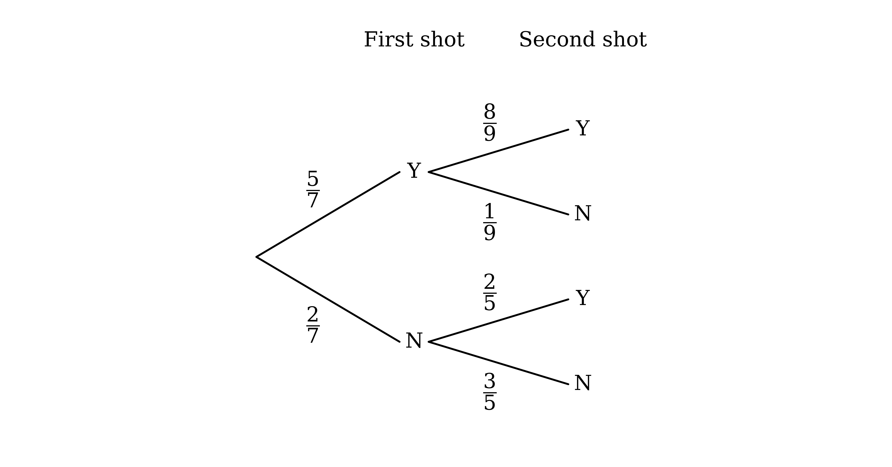

# Exam Questions — Basic Probability
**Probability** · Cambridge (CIE) AS maths (9709)
> Source: [https://www.savemyexams.com/as/maths/cie/20/probability-and-statistics-1/topic-questions/](https://www.savemyexams.com/as/maths/cie/20/probability-and-statistics-1/topic-questions/) · 25 questions across 1 sets

## Exam Questions (25 questions)

### Q1 — very_hard — 8 marks

**Q1** [4 marks]

Isabel has two boxes of chocolates. Box $A$ contains 4 caramels and 6 toffees, and box $B$ contains 5 caramels and $x$ toffees. Isabel chooses a chocolate at random from box $A$ and places it in box $B$. Her friend then chooses a chocolate at random from box $B$.

Show that the probability that Isabel's friend chooses a caramel is $\frac{27}{5(x+6)}$.

**Q1** [4 marks]

Given that the probability that Isabel's friend chooses a toffee is $\frac{11}{20}$, find the value of $x$.

### Q2 — hard — 5 marks

**Q2** [2 marks]

The histogram below shows the distribution of the masses, in kg, of 100 newborn calves.

Find the probability that a calf chosen at random has a mass greater than 21 kg.

**Q2** [3 marks]

Estimate the probability that a calf chosen at random has a mass less than 23.5 kg.

### Q3 — hard — 5 marks

**Q3** [5 marks]

A student is chosen at random from a college. Events $A$, $B$ and $C$ are defined as follows.

$A$: the student plays the violin

$B$: the student plays the piano

$C$: the student plays the cello

It is given that P($A$) = 0.28, that the probability that $A$ or $C$ occurs is 0.4, and that the probability that both $B$ and $C$ occur is 0.02. It is also given that $A$ and $C$ are mutually exclusive, and that $B$ and $C$ are independent.

Find

(i) P($C$)

(ii) P($B$)

(iii) the probability that $C$ occurs and $B$ does not occur.

### Q4 — very_hard — 7 marks

**Q4** [4 marks]

A bag contains 10 black tokens and 6 white tokens. A token is taken at random from the bag and its colour is noted. A fair coin is then thrown.

- If the coin shows heads, a second token is taken at random from the bag without replacing the first token.
- If the coin shows tails, the first token is replaced in the bag and then a second token is taken at random.

Draw a fully labelled tree diagram to represent this information, showing the probability on each of the branches.

**Q4** [3 marks]

Find the probability that the second token taken is white.

### Q5 — medium — 4 marks

**Q5** [4 marks]

A game is played using a fair spinner with four sectors numbered 1 to 4, as well as a fair die with its six sides numbered 1 to 6. The spinner is spun and the die is rolled, and the score in the game is defined as the (positive) difference between the two results.

Find the probability of the score in the game being

(i) exactly 0

(ii) 3 or more

(iii) a prime number.

### Q6 — hard — 5 marks

**Q6** [2 marks]

The histogram below shows the distribution of the masses, in grams, of 80 newly hatched ducklings.

Find the probability that a duckling chosen at random has a mass less than 54 g.

**Q6** [3 marks]

Estimate the probability that a duckling chosen at random has a mass greater than 53 g.

### Q7 — hard — 6 marks

**Q7** [3 marks]

A bag contains 12 red marbles, 7 green marbles and 1 black marble. Two marbles are taken at random from the bag, one after the other, without replacement.

Draw a fully labelled tree diagram to represent this information, showing the probability on each of the branches.

**Q7** [3 marks]

Find the probability that the two marbles taken are not the same colour.

### Q8 — hard — 4 marks

**Q8** [4 marks]

On any given day, the probability that Tomás works on his poetry is 0.55 and the probability that he goes swimming is 0.75. It is given that on every day he does at least one of these two activities.

Find the probability that, on a randomly chosen day, Tomás

(i) goes swimming and works on his poetry

(ii) goes swimming but does not work on his poetry.

### Q9 — easy — 4 marks

**Q9** [4 marks]

$A$, $B$, $C$ and $D$ are four events such that P($A$) = 0.28, P($B$) = 0.33, P($C$) = 0.43 and P($D$) = 0.25.

(i) Given that $B$ and $C$ are mutually exclusive, find P($B$ or $C$).

(ii) Given that $A$ and $D$ are independent, find P($A$ and $D$).

### Q10 — hard — 6 marks

**Q10** [1 mark]

Praewa plays one sport every day after school: football, tennis or basketball. On any day, the probability that she chooses football is 4 times the probability that she chooses tennis, and the probability that she chooses basketball is 3 times the probability that she chooses tennis. Her choices on different days are independent.

Show that the probability that Praewa chooses tennis on a particular day is $\frac{1}{8}$.

**Q10** [3 marks]

Find the probability that Praewa chooses three different sports on the next three days.

**Q10** [2 marks]

For a 5-day week chosen at random, find the probability that Praewa chooses football every day.

### Q11 — medium — 8 marks

**Q11** [2 marks]

A fair spinner has five equal sections labelled 1, 2, 3, 4 and 5. The spinner is spun twice and the product of the two numbers it lands on is recorded.

Draw up a table to show all the possible products.

**Q11** [4 marks]

Events $R$ and $S$ are defined as follows.

$R$: the product of the two numbers is even

$S$: the first number is greater than the second number

Find the probability that

(i) $R$ occurs

(ii) $S$ does not occur

(iii) both $R$ and $S$ occur

(iv) at least one of $R$ and $S$ occurs.

**Q11** [2 marks]

Determine whether $R$ and $S$ are mutually exclusive, justifying your answer.

### Q12 — medium — 8 marks

**Q12** [3 marks]

In the video game Galactic Unicorns, your space frigate attacks an evil robot ship. The probability that your attack hits the robot ship is 0.7. If you hit the robot ship, the probability that it is destroyed is 0.8; otherwise it escapes. If you miss the robot ship, the probability that it escapes is 0.2; otherwise it surrenders, having seen the power of your rainbow lasers.

Draw a fully labelled tree diagram to represent this information, showing the probability on each of the branches.

**Q12** [3 marks]

Find the probability that the robot ship

(i) is destroyed

(ii) escapes

(iii) surrenders.

**Q12** [2 marks]

Show that the events 'your attack hits the robot ship' and 'the robot ship escapes' are independent.

### Q13 — medium — 5 marks

**Q13** [5 marks]

Angelo meets his maths tutor, Miss Perry, once a week. For any meeting, the probability that Miss Perry changes the time of the meeting is 0.2 and the probability that she is late is 0.15. Otherwise she is on time. What happens at one meeting is independent of what happens at any other meeting.

For the next two weekly meetings, find the probability that Miss Perry

(i) is on time for both meetings

(ii) changes the time of the meeting at least once

(iii) is late for one meeting and changes the time of the other meeting.

### Q14 — easy — 4 marks

**Q14** [2 marks]

A student is chosen at random from a class.

$A$ is the event that the student studies Art and $B$ is the event that the student studies Biology. It is given that P($A$) = 0.35, P($B$) = 0.25 and that the probability that the student studies Art or Biology is 0.6.

State, with a reason, whether $A$ and $B$ are mutually exclusive.

**Q14** [2 marks]

$C$ is the event that the student plays chess and $D$ is the event that the student is in the drama club. It is given that P($C$) = 0.2, P($D$) = 0.4 and that the probability that the student plays chess and is in the drama club is 0.18.

Determine whether $C$ and $D$ are independent, justifying your answer.

### Q15 — medium — 4 marks

**Q15** [4 marks]

Two fair spinners each have three sectors numbered 1 to 3. The two spinners are spun together and then the product of the numbers indicated on each spinner is recorded.

Find the probability of the product indicated by the spinners being

(i) exactly 6

(ii) less than 4

(iii) an odd number.

### Q16 — medium — 7 marks

**Q16** [1 mark]

A fair four-sided die, with faces numbered 1 to 4, and a fair six-sided die, with faces numbered 1 to 6, are rolled at the same time. The sum of the numbers on their uppermost faces is recorded.

Complete the table below to show all the possible sums.

| Six-sided \ Four-sided | 1 | 2 | 3 | 4 |
|---|---|---|---|---|
| **1** | 2 | 3 |   |   |
| **2** | 3 |   |   |   |
| **3** |   |   |   |   |
| **4** |   |   |   |   |
| **5** |   |   |   |   |
| **6** |   |   |   |   |

**Q16** [4 marks]

Events $A$ and $B$ are defined as follows.

$A$: the sum of the two numbers is greater than 7

$B$: one die shows an odd number and the other die shows an even number

Find the probability that

(i) $A$ occurs

(ii) $B$ occurs

(iii) both $A$ and $B$ occur

(iv) at least one of $A$ and $B$ occurs.

**Q16** [2 marks]

Determine whether the events $A$ and $B$ are independent, justifying your answer.

### Q17 — medium — 6 marks

**Q17** [3 marks]

A bag contains 13 yellow tokens and 7 green tokens. Two tokens are taken at random from the bag, one after the other, without replacement.

Draw a fully labelled tree diagram to represent this information, showing the probability on each of the branches.

**Q17** [3 marks]

Find the probability that the two tokens taken are the same colour.

### Q18 — medium — 4 marks

**Q18** [4 marks]

The lengths, in cm, of 120 adult platypuses are recorded in the following table.

| **Length, **$l$** (cm)** | **Frequency (female)** | **Frequency (male)** |
|---|---|---|
| $39 \leq l < 42$ | 14 | 0 |
| $42 \leq l < 45$ | 29 | 0 |
| $45 \leq l < 48$ | 12 | 7 |
| $48 \leq l < 51$ | 6 | 21 |
| $51 \leq l < 54$ | 3 | 19 |
| $54 \leq l < 57$ | 1 | 5 |
| $57 \leq l < 60$ | 0 | 2 |
| $60 \leq l < 63$ | 0 | 1 |

One platypus is chosen at random. Find the probability that the platypus is

(i) male

(ii) less than 51 cm long

(iii) a male less than 45 cm long

(iv) a female between 45 and 54 cm long.

### Q19 — medium — 7 marks

**Q19** [5 marks]

Two letters are chosen at random, without replacement, from the 10 letters of the word IMPOSSIBLE.

Event $A$ is 'the two letters are the same'.

Event $B$ is 'the first letter chosen is an S'.

Find the probability that

(i) $A$ occurs

(ii) $B$ occurs

(iii) both $A$ and $B$ occur.

**Q19** [2 marks]

Determine whether events $A$ and $B$ are mutually exclusive, justifying your answer.

### Q20 — easy — 5 marks

**Q20** [5 marks]

A pool player attempts two trick shots, one after the other. The tree diagram shows the probabilities of each shot being successful, where $Y$ represents a successful trick shot and $N$ represents a failed trick shot.

Find the probability that the pool player

(i) successfully completes both trick shots

(ii) successfully completes exactly one trick shot

(iii) successfully completes at least one trick shot.

### Q21 — easy — 4 marks

**Q21** [2 marks]

The heights, in cm, of 100 rockhopper penguins are recorded in the following table.

| **Height, **$h$** (cm)** | **Frequency** |
|---|---|
| $40 \leq h < 45$ | 12 |
| $45 \leq h < 50$ | 36 |
| $50 \leq h < 55$ | 42 |
| $55 \leq h < 60$ | 10 |

State the number of penguins that are

(i) at least 50 cm tall

(ii) between 45 cm and 55 cm tall.

**Q21** [2 marks]

A rockhopper penguin is chosen at random. Find the probability that the penguin is

(i) at least 50 cm tall

(ii) between 45 cm and 55 cm tall.

### Q22 — easy — 4 marks

**Q22** [2 marks]

$A$ and $B$ are two events such that P($A$) = 0.3 and P($B$) = 0.8. The probability that both $A$ and $B$ occur is 0.24.

Determine whether $A$ and $B$ are independent, justifying your answer.

**Q22** [2 marks]

$C$ and $D$ are two events such that P($C$) = 0.42 and P($D$) = 0.51. The probability that at least one of $C$ and $D$ occurs is 0.91.

Determine whether $C$ and $D$ are mutually exclusive, justifying your answer.

### Q23 — easy — 6 marks

**Q23** [2 marks]

A box contains 3 blue bricks and 2 red bricks, all of equal size.

A brick is chosen at random from the box. Find the probability that this brick is

(i) blue

(ii) red.

**Q23** [2 marks]

A second brick is then chosen at random from the box, without replacing the first brick.

Complete the tree diagram below to show the probabilities.

**Q23** [2 marks]

Find the probability that both bricks chosen are blue.

### Q24 — easy — 5 marks

**Q24** [2 marks]

A fair spinner has five equal sections labelled 'dog', 'cat', 'dog', 'dog' and 'rabbit'.

The spinner is spun once. Find the probability that the spinner lands on a section labelled

(i) 'dog'

(ii) 'rabbit'.

**Q24** [3 marks]

The spinner is spun twice. Find the probability that

(i) the spinner lands on the section labelled 'cat' on both spins

(ii) the spinner does not land on a section labelled 'dog' on either spin.

### Q25 — easy — 7 marks

**Q25** [2 marks]

A fair die is rolled and a fair coin is tossed.

Complete the table below, listing all the possible outcomes.

| Die \ Coin | Heads | Tails |
|---|---|---|
| **1** | 1H | 1T |
| **2** |   |   |
| **3** |   |   |
| **4** |   |   |
| **5** |   |   |
| **6** |   |   |

**Q25** [5 marks]

The event $A$ is 'the die shows a multiple of 3' and the event $B$ is 'the coin shows heads'.

Write down the probability that

(i) $B$ occurs

(ii) $A$ does not occur

(iii) both $A$ and $B$ occur

(iv) at least one of $A$ and $B$ occurs.
