# Mark Schemes — Further Probability
**Probability** · Cambridge (CIE) AS maths (9709)

## Exam Questions (25 questions)

### Q1
Let the probability that she chooses The Amenic be $p$. The missing snack probabilities are $1 - 0 . 2 - 0 . 5 = 0 . 3$ for nachos at The Amenic and $1 - 0 . 4 - 0 . 2 = 0 . 4$ for popcorn at The Seivom. Draw a tree diagram

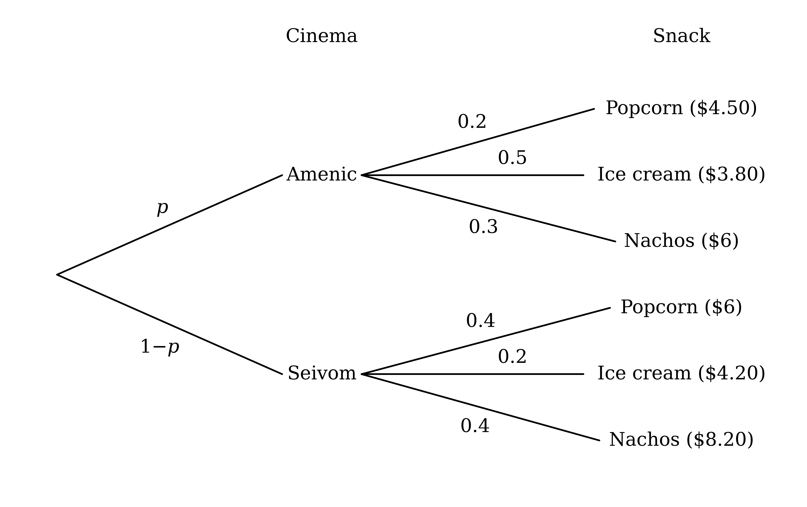

She spends exactly \$6 on nachos at The Amenic or popcorn at The Seivom, so add those two products

$\text{P(spends 6 dollars)} = 0 . 3 p + 0 . 4 ( 1 - p )$

**[M1]**

This is given to be 0.33

$0 . 3 p + 0 . 4 ( 1 - p ) = 0 . 33$

**[A1]**

Expand and solve

$0 . 4 - 0 . 1 p = 0 . 33$

$0 . 1 p = 0 . 07$

**[M1]**

$p = 0 . 7$

**[A1]**

> **[mark-scheme]**
> **M1**: Sum of two two-factor products for spending exactly \$6, e.g. 0.3p + 0.4(1 − p), which may be seen on a tree diagram.
> 
> **A1**: Correct equation, 0.3p + 0.4(1 − p) = 0.33, unsimplified accepted.
> 
> **M1**: Correct method to solve a linear equation of this form.
> 
> **A1**: Probability of 0.7.

Use the formula for conditional probability

`\text{P(Seivom} \mid \text{under 5 dollars)} = \dfrac{\text{P(Seivom and under 5 dollars)}}{\text{P(under 5 dollars)}}`

At The Seivom, only ice cream costs less than 5 dollars, and the probability of choosing The Seivom is 1 − 0.7 from part (a)

$\text{P(Seivom and under 5 dollars)} = 0 . 3 \times 0 . 2 = 0 . 06$

**[M1]**

At The Amenic, popcorn and ice cream both cost less than 5 dollars

$\text{P(under 5 dollars)} = 0 . 7 \times 0 . 2 + 0 . 7 \times 0 . 5 + 0 . 3 \times 0 . 2 = 0 . 55$

**[M1]**

`\text{P(Seivom} \mid \text{under 5 dollars)} = \dfrac{0.06}{0.55}`

**Final answer:** `\text{P(Seivom} \mid \text{under 5 dollars)} = \dfrac{6}{55} = 0.109`** (3 s.f.)**

**[A1]**

> **[mark-scheme]**
> **M1**: 0.3 × 0.2 (or (1 − the answer to (a)) × 0.2) seen as the numerator of a conditional probability fraction.
> 
> **M1**: Sum of the three products for snacks under \$5, 0.7 × 0.2 + 0.7 × 0.5 + 0.3 × 0.2, seen as the denominator of a conditional probability fraction.
> 
> **A1**: Probability of 6/55 (answers which round to 0.109).

### Q2
The five probabilities must add to 1

$k \times 1^{2} + k \times 2^{2} + k \times 3^{2} + k \times 4^{2} + k \times 5^{2} = 1$

$k ( 1 + 4 + 9 + 16 + 25 ) = 1$

**[M1]**

$55 k = 1$

$k = \frac{1}{55}$

**[A1]**

> **[mark-scheme]**
> **M1**: The sum of kx² for x = 1 to 5 equated to 1.
> 
> **A1**: k = 1/55.
Write each probability using $k = \frac{1}{55}$

| Number | 1 | 2 | 3 | 4 | 5 |
|---|---|---|---|---|---|
| Probability | $\frac{1}{55}$ | $\frac{4}{55}$ | $\frac{9}{55}$ | $\frac{16}{55}$ | $\frac{25}{55}$ |

Sort the numbers. 1 is odd but not prime; 2 is prime but not odd; 3 and 5 are both; 4 is neither

$\text{P(odd and prime)} = \frac{9}{55} + \frac{25}{55} = \frac{34}{55}$

**[M1]**

|   | Prime | Not prime | Total |
|---|---|---|---|
| **Odd** | $\frac{34}{55}$ | $\frac{1}{55}$ | $\frac{35}{55}$ |
| **Not odd** | $\frac{4}{55}$ | $\frac{16}{55}$ | $\frac{20}{55}$ |
| **Total** | $\frac{38}{55}$ | $\frac{17}{55}$ | **Final answer:** **1** |

**[B1 A1]**

> **[mark-scheme]**
> **M1**: At least two correct inner probabilities linked to the correct outcomes, e.g. 34/55 for odd and prime.
> 
> **B1**: A two-by-two table with both attributes labelled (odd / not odd, prime / not prime).
> 
> **A1**: All four inner probabilities correct, 34/55, 1/55, 4/55 and 16/55, with consistent totals.
> 
> Totals are not required but act as a check. Equivalent fractions or decimals correct to 3 significant figures are accepted.
|   | Prime | Not prime | Total |
|---|---|---|---|
| **Odd** | $\frac{34}{55}$ | $\frac{1}{55}$ | $\frac{35}{55}$ |
| **Not odd** | $\frac{4}{55}$ | $\frac{16}{55}$ | $\frac{20}{55}$ |
| **Total** | $\frac{38}{55}$ | $\frac{17}{55}$ | 1 |

(i)

Neither odd nor prime is the number 4

$\text{P(neither)} = \frac{16}{55}$

**[B1]**

(ii)

Use the formula for conditional probability with the prime column

`\text{P(not odd} \mid \text{prime)} = \dfrac{\text{P(not odd and prime)}}{\text{P(prime)}} = \dfrac{\dfrac{4}{55}}{\dfrac{38}{55}}`

`\text{P(not odd} \mid \text{prime)} = \dfrac{4}{38} = \dfrac{2}{19}`

**[B1]**

(iii)

Use the formula for conditional probability with the odd row

`\text{P(prime} \mid \text{odd)} = \dfrac{\text{P(prime and odd)}}{\text{P(odd)}} = \dfrac{\dfrac{34}{55}}{\dfrac{35}{55}}`

`\text{P(prime} \mid \text{odd)} = \dfrac{34}{35}`

**[B1]**

> **[mark-scheme]**
> **B1**: Probability of 16/55 (answers which round to 0.291).
> 
> **B1**: Probability of 2/19 (or 4/38; answers which round to 0.105), following through from the table in part (b).
> 
> **B1**: Probability of 34/35 (answers which round to 0.971), following through from the table in part (b).

### Q3
(i)

Count the selections of 2 red apples from 8 and 3 green apples from 6

`{}^{8}C_{2} \times {}^{6}C_{3} = 28 \times 20 = 560`

**[M1]**

Divide by the number of ways of choosing any 5 of the 14 apples

`\text{P(2 red, 3 green)} = \dfrac{560}{{}^{14}C_{5}} = \dfrac{560}{2002}`

**[M1]**

**Final answer:** $\text{P(2 red, 3 green)} = \frac{40}{143} = 0 . 280$** (3 s.f.)**

**[A1]**

(ii)

After 4 green apples have been chosen, 10 apples remain, and 2 of them are green

`\text{P(fifth green} \mid \text{first four green)} = \dfrac{2}{10}`

**[M1]**

`\text{P(fifth green} \mid \text{first four green)} = \dfrac{1}{5}`

**[A1]**

> **[mark-scheme]**
> **M1**: ⁸C₂ × ⁶C₃ seen as a numerator, or a 5-factor product such as 8/14 × 7/13 × 6/12 × 5/11 × 4/10 for one order.
> 
> **M1**: Division by ¹⁴C₅ (or 2002), or the 5-factor product multiplied by 10 (or ⁵C₂).
> 
> **A1**: Probability of 40/143 (answers which round to 0.280).
> 
> **M1**: 2 green apples out of the 10 that remain, or a correct use of the conditional probability formula.
> 
> **A1**: Probability of 1/5 (or 0.2).
There are now 23 apples: 10 green and 13 red. Use the formula for conditional probability

`\text{P(same basket} \mid \text{same colour)} = \dfrac{\text{P(same basket and same colour)}}{\text{P(same colour)}}`

Every pair of 2 apples from the 23 is equally likely, so count pairs. Pairs from the same basket and of the same colour, from the first basket then the second

`\left({}^{6}C_{2} + {}^{8}C_{2}\right) + \left({}^{4}C_{2} + {}^{5}C_{2}\right) = (15 + 28) + (6 + 10) = 59`

**[M1]**

Pairs of the same colour, from all 23 apples

`{}^{10}C_{2} + {}^{13}C_{2} = 45 + 78 = 123`

**[M1]**

Both counts are out of the same total of `{}^{23}C_{2}` pairs, which cancels

**Final answer:** `\text{P(same basket} \mid \text{same colour)} = \dfrac{59}{123} = 0.480`** (3 s.f.)**

**[A1]**

> **[mark-scheme]**
> **M1**: 59 (or 59/253) for pairs from the same basket and of the same colour, seen as the numerator of a conditional probability fraction.
> 
> **M1**: 123 (or 123/253) for pairs of the same colour, seen as the denominator of a conditional probability fraction.
> 
> **A1**: Probability of 59/123 (answers which round to 0.480).
> 
> Working with probabilities instead of counts is also accepted, e.g. 8/23 × 7/22 + 6/23 × 5/22 + 5/23 × 4/22 + 4/23 × 3/22 as the numerator.

### Q4
Let there be $b$ black counters, so there are $b + 3$ red counters and $2 b + 3$ counters altogether. Taking two at once is the same as taking two without replacement

$\text{P} ( B ,  B ) = \frac{b}{2b+3} \times \frac{b-1}{2b+2}$

$\text{P} ( R ,  R ) = \frac{b+3}{2b+3} \times \frac{b+2}{2b+2}$

Dennis wins if both are the same colour, so add and set equal to the given probability

$\frac{b(b-1)+(b+3)(b+2)}{(2b+3)(2b+2)} = \frac{17}{35}$

**[M1 A1]**

Expand the numerator

$\frac{2b^{2}+4b+6}{(2b+3)(2b+2)} = \frac{17}{35}$

Divide the top and bottom by 2

$\frac{b^{2}+2b+3}{(2b+3)(b+1)} = \frac{17}{35}$

Cross-multiply

`35\left(b^{2} + 2b + 3\right) = 17\left(2b^{2} + 5b + 3\right)`

$35 b^{2} + 70 b + 105 = 34 b^{2} + 85 b + 51$

**[M1]**

Collect the terms on one side

$b^{2} - 15 b + 54 = 0$

**[A1]**

Factorise

$( b - 6 ) ( b - 9 ) = 0$

$b = 6 \text{or} b = 9$

**[A1]**

> **[mark-scheme]**
> **M1**: P(B, B) + P(R, R) written in terms of b, with denominators 2b + 3 and 2b + 2 (or combinations ᵇC₂ + ᵇ⁺³C₂ over ²ᵇ⁺³C₂).
> 
> **A1**: A fully correct unsimplified equation equal to 17/35.
> 
> **M1**: Fractions cleared and terms expanded to form a three-term quadratic in b.
> 
> **A1**: b² − 15b + 54 = 0, or an equivalent such as 2b² − 30b + 108 = 0.
> 
> **A1**: Both values, 6 and 9.
Dennis did not win, so he took one black and one red counter. Count what is left

$b - 1 \text{black and} b + 2 \text{red counters}$

**[B1]**

Test the two values from part (a). For $b = 6$ there are 5 black and 8 red counters, 13 in all. Use the formula for conditional probability

`\text{P}(R, \; R \mid \text{same colour}) = \dfrac{\text{P}(R, \; R)}{\text{P}(R, \; R) + \text{P}(B, \; B)}`

`\text{P}(R, \; R \mid \text{same colour}) = \dfrac{\dfrac{8}{13} \times \dfrac{7}{12}}{\dfrac{8}{13} \times \dfrac{7}{12} + \dfrac{5}{13} \times \dfrac{4}{12}} = \dfrac{56}{56 + 20} = \dfrac{14}{19}`

**[M1]**

For $b = 9$ there are 8 black and 11 red counters

`\text{P}(R, \; R \mid \text{same colour}) = \dfrac{11 \times 10}{11 \times 10 + 8 \times 7} = \dfrac{110}{166} = \dfrac{55}{83} \neq \dfrac{14}{19}`

Only $b = 6$ gives the stated probability

**Final answer:** **There were 6 black counters in the box originally**

**[A1]**

> **[mark-scheme]**
> **B1**: b − 1 black and b + 2 red counters left (or 5 and 8, or 8 and 11), seen or implied.
> 
> **M1**: P(R, R) ÷ (P(R, R) + P(B, B)) for at least one of the values from part (a), or the same expression in terms of b equated to 14/19.
> 
> **A1**: 6, with b = 9 shown to fail (or, from the algebra, 3b² − 19b + 6 = 0 with b = 1/3 rejected).

### Q5
A standard game is drawn with probability $1 - 0 . 7 - 0 . 1 = 0 . 2$ in the first match, and $1 - 0 . 55 - 0 . 3 = 0 . 15$ after a sudden-death win. Draw a tree diagram

There are four ways to win both matches. Win both outright

$0 . 7 \times 0 . 7 = 0 . 49$

Win the first outright, then the second by sudden death

$0 . 7 \times 0 . 2 p = 0 . 14 p$

Win the first by sudden death, then the second outright

$0 . 2 p \times 0 . 55 = 0 . 11 p$

Win both by sudden death

$0 . 2 p \times 0 . 15 p = 0 . 03 p^{2}$

**[M1]**

Add the four and set the total equal to 0.6508

$0 . 49 + 0 . 14 p + 0 . 11 p + 0 . 03 p^{2} = 0 . 6508$

**[M1]**

Collect the terms

$0 . 03 p^{2} + 0 . 25 p - 0 . 1608 = 0$

**[A1]**

Solve with the quadratic formula

`p = \dfrac{-0.25 \pm \sqrt{0.25^{2} - 4 \times 0.03 \times \left(-0.1608\right)}}{2 \times 0.03}`

$p = \frac{-0.25\pm\sqrt{0.081796}}{0.06} = \frac{-0.25\pm0.286}{0.06}$

**[M1]**

A probability must lie between 0 and 1, so reject the negative root $p = - 8 . 93 \dots$

$p = 0 . 6$

**[A1]**

> **[mark-scheme]**
> **M1**: At least two of the four winning paths correct, e.g. 0.7 × 0.7 and 0.7 × 0.2p.
> 
> **M1**: The sum of all four paths, with no extra terms, equated to 0.6508.
> 
> **A1**: A correct quadratic, 0.03p² + 0.25p − 0.1608 = 0 or an equivalent such as 75p² + 625p − 402 = 0.
> 
> **M1**: A correct method to solve their three-term quadratic.
> 
> **A1**: p = 0.6 only, with the negative root rejected or not stated.

Use the formula for conditional probability

`\text{P(both outright} \mid \text{won both)} = \dfrac{\text{P(both outright)}}{\text{P(won both)}}`

Winning both outright is one of the ways of winning both, and the probability of winning both is given

`\text{P(both outright} \mid \text{won both)} = \dfrac{0.7 \times 0.7}{0.6508} = \dfrac{0.49}{0.6508}`

**[M1]**

**Final answer:** `\text{P(both outright} \mid \text{won both)} = 0.753`** (3 s.f.)**

**[A1]**

> **[mark-scheme]**
> **M1**: 0.7 × 0.7 (or 0.49) divided by 0.6508.
> 
> **A1**: Probability of 1225/1627 (answers which round to 0.753).

### Q6
The number of students is the rest of the 180

$180 - 72 = 108$

**[B1]**

For independent events, being a student does not change the probability of preferring Latin poetry

`\text{P(Latin} \mid \text{student)} = \text{P(Latin)}`

Let $L$ be the total number who prefer Latin poetry, and substitute

$\frac{63}{108} = \frac{L}{180}$

**[M1]**

$L = \frac{63\times180}{108} = 105$

**[A1]**

Fill in the rest of the table by subtracting from the totals

$105 - 63 = 42$

$180 - 105 = 75$

$108 - 63 = 45$

$72 - 42 = 30$

|   | Latin poetry | Extreme sports | Total |
|---|---|---|---|
| **Students** | 63 | **Final answer:** **45** | **Final answer:** **108** |
| **Teachers** | **Final answer:** **42** | **Final answer:** **30** | 72 |
| **Total** | **Final answer:** **105** | **Final answer:** **75** | 180 |

**[A1]**

> **[mark-scheme]**
> **B1**: 108 students, seen in the table or the working.
> 
> **M1**: Correct use of independence to find the Latin poetry total or the number of teachers preferring Latin poetry, e.g. 63/108 = L/180, or 72 × 63/108, or P(student) × P(Latin) = 63/180.
> 
> **A1**: 105 who prefer Latin poetry, or 42 teachers who prefer Latin poetry.
> 
> **A1**: All remaining cells correct: 45, 108, 42, 30, 105 and 75.

### Q7
Start a two-way table with the given values

|   | Likes anchovies | Does not like anchovies | Total |
|---|---|---|---|
| **Likes bananas** | 12 | 28 |   |
| **Does not like bananas** |   |   | 320 |
| **Total** |   | 144 |   |

Of the 144 who do not like anchovies, 28 like bananas, so the rest like neither

$144 - 28 = 116$

Of the 320 who do not like bananas, 116 do not like anchovies, so the rest like anchovies only

$320 - 116 = 204$

Complete the totals

$12 + 28 = 40 \text{like bananas}$

$12 + 204 = 216 \text{like anchovies}$

$40 + 320 = 360 \text{in total}$

|   | Likes anchovies | Does not like anchovies | Total |
|---|---|---|---|
| **Likes bananas** | 12 | 28 | **Final answer:** **40** |
| **Does not like bananas** | **Final answer:** **204** | **Final answer:** **116** | 320 |
| **Total** | **Final answer:** **216** | 144 | **Final answer:** **360** |

**[B1 B1 B1]**

> **[mark-scheme]**
> **B1**: A two-way table with both attributes labelled (likes / does not like anchovies, likes / does not like bananas).
> 
> **B1**: The four inner values 12, 28, 204 and 116 correct.
> 
> **B1**: All totals correct, including the overall total of 360.
> 
> The table may be drawn either way round.
|   | Likes anchovies | Does not like anchovies | Total |
|---|---|---|---|
| **Likes bananas** | 12 | 28 | 40 |
| **Does not like bananas** | 204 | 116 | 320 |
| **Total** | 216 | 144 | 360 |

(i)

40 of the 360 like bananas

$\text{P(bananas)} = \frac{40}{360} = \frac{1}{9}$

**[B1]**

(ii)

116 of the 360 like neither

$\text{P(neither)} = \frac{116}{360} = \frac{29}{90}$

**[B1]**

(iii)

Use the formula for conditional probability

`\text{P(bananas} \mid \text{anchovies)} = \dfrac{\text{P(bananas and anchovies)}}{\text{P(anchovies)}}`

Substitute the probabilities from the table

`\text{P(bananas} \mid \text{anchovies)} = \dfrac{\dfrac{12}{360}}{\dfrac{216}{360}} = \dfrac{12}{216}`

**[M1]**

`\text{P(bananas} \mid \text{anchovies)} = \dfrac{1}{18}`

**[A1]**

> **[mark-scheme]**
> **B1**: Probability of 1/9 (or 40/360; answers which round to 0.111), following through from the total in part (a).
> 
> **B1**: Probability of 29/90 (or 116/360; answers which round to 0.322).
> 
> **M1**: 12 divided by the number who like anchovies (216), or the equivalent probabilities; unsimplified is accepted.
> 
> **A1**: Probability of 1/18 (answers which round to 0.0556).

### Q8
The word PROBABLE has 7 different letters, with B appearing twice. Split the arrangements into those with three different letters and those with both Bs

With three different letters, choose and arrange 3 of the 7 different letters

`{}^{7}P_{3} = 7 \times 6 \times 5 = 210`

**[M1]**

With both Bs, choose the third letter from the 6 others, then place it in one of 3 positions

$6 \times 3 = 18$

Add the two cases to find the total number of arrangements

$210 + 18$

**[M1]**

$228$

**[A1]**

> **[mark-scheme]**
> **M1**: Correct count for one case, e.g. ⁷P₃ = 210 (or ⁷C₃ × 3!) for three different letters, or ⁶C₁ × 3!/2! = 18 for both Bs.
> 
> **M1**: Correct count for the other case, added to the first.
> 
> **A1**: 228 exactly.
The letters E, A and R each appear once among the 8, so pick them in that order, one at a time without replacement

$\text{P(EAR)} = \frac{1}{8} \times \frac{1}{7} \times \frac{1}{6}$

**[M1]**

$\text{P(EAR)} = \frac{1}{336}$

**[A1]**

> **[exam-tip]**
> This is not 1/228. The 228 arrangements are not equally likely, because the two Bs make any arrangement containing a B more likely to be picked than one without, so you cannot just take one over the total from part (a).

> **[mark-scheme]**
> **M1**: Product of three probabilities 1/8 × 1/7 × 1/6, or 1 over ⁸P₃ = 336.
> 
> **A1**: Probability of 1/336 (answers which round to 0.00298).

### Q9
For the first marble there are 25 in the bag. After one is taken, 24 remain, with one fewer of the colour already chosen

**[B1 B1 B1]**

> **[mark-scheme]**
> **B1**: Correct structure, fully labelled: three branches for the first marble and three after each.
> 
> **B1**: First-marble probabilities 12/25, 8/25 and 5/25.
> 
> **B1**: All nine second-marble probabilities correct, with denominators of 24.
> 
> Equivalent fractions or decimals are accepted.
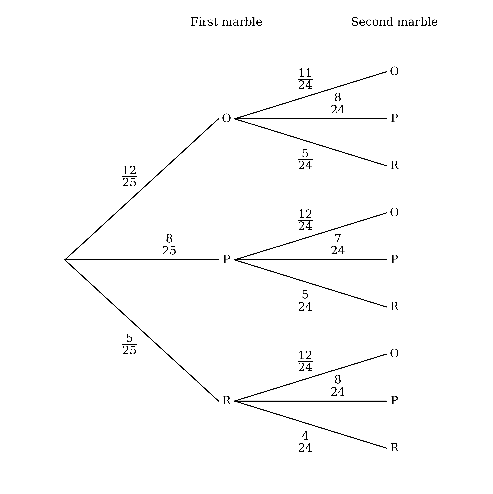

(i)

It is quicker to find the probability that both are the same colour, then subtract from 1

$\text{P(same)} = \frac{12}{25} \times \frac{11}{24} + \frac{8}{25} \times \frac{7}{24} + \frac{5}{25} \times \frac{4}{24} = \frac{208}{600}$

$\text{P(different)} = 1 - \frac{208}{600} = \frac{392}{600}$

**[M1]**

$\text{P(different)} = \frac{49}{75}$

**[A1]**

(ii)

Use the formula for conditional probability

`\text{P(second purple} \mid \text{different)} = \dfrac{\text{P(second purple and different)}}{\text{P(different)}}`

The second marble is purple and the colours are different when the first is orange or red

$\text{P(second purple and different)} = \frac{12}{25} \times \frac{8}{24} + \frac{5}{25} \times \frac{8}{24} = \frac{136}{600}$

**[M1]**

The denominator is the answer to (i)

`\text{P(second purple} \mid \text{different)} = \dfrac{\dfrac{136}{600}}{\dfrac{392}{600}} = \dfrac{136}{392}`

**[M1]**

`\text{P(second purple} \mid \text{different)} = \dfrac{17}{49}`

**[A1]**

> **[mark-scheme]**
> **M1**: 1 minus the sum of the three same-colour products, or the sum of the six different-colour products, consistent with the tree in part (a).
> 
> **A1**: Probability of 49/75 (or 392/600; answers which round to 0.653).
> 
> **M1**: P(O, P) + P(R, P) = 136/600 (or 17/75) seen as the numerator of a conditional probability fraction.
> 
> **M1**: The answer to (i) seen as the denominator of a conditional probability fraction.
> 
> **A1**: Probability of 17/49 (answers which round to 0.347).

### Q10
Let the probability that she runs a workshop be $p$, and draw a tree diagram

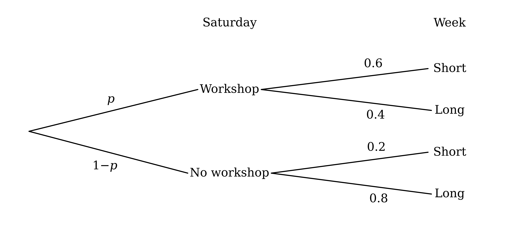

A short week can follow either branch, so add the two products that end in Short

$\text{P(short)} = 0 . 6 p + 0 . 2 ( 1 - p )$

**[M1]**

This is given to be 0.46

$0 . 6 p + 0 . 2 ( 1 - p ) = 0 . 46$

**[A1]**

Expand the bracket and collect the terms in $p$

$0 . 4 p + 0 . 2 = 0 . 46$

$0 . 4 p = 0 . 26$

**[M1]**

$p = 0 . 65$

**[A1]**

> **[mark-scheme]**
> **M1**: Sum of two two-factor products, 0.6p + 0.2(1 − p) (or with 1 − p written as another letter), which may be seen on a tree diagram.
> 
> **A1**: Correct equation, 0.6p + 0.2(1 − p) = 0.46, unsimplified accepted.
> 
> **M1**: Correct method to solve a linear equation of this form.
> 
> **A1**: Probability of 0.65 (or 13/20).
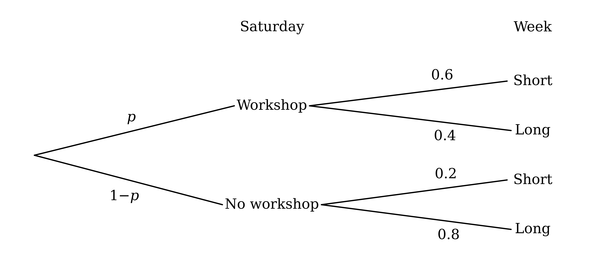

Use the formula for conditional probability

`\text{P(workshop} \mid \text{short)} = \dfrac{\text{P(workshop and short)}}{\text{P(short)}}`

Multiply along the Workshop, Short branches, with $p = 0 . 65$ from part (a)

$\text{P(workshop and short)} = 0 . 65 \times 0 . 6 = 0 . 39$

**[M1]**

The denominator is the given probability of a short week

`\text{P(workshop} \mid \text{short)} = \dfrac{0.39}{0.46}`

**[M1]**

**Final answer:** `\text{P(workshop} \mid \text{short)} = \dfrac{39}{46} = 0.848`** (3 s.f.)**

**[A1]**

> **[mark-scheme]**
> **M1**: 0.6 × 0.65 (or 0.6 × the answer to (a)) seen as the numerator of a conditional probability fraction.
> 
> **M1**: 0.46 seen as the denominator of a conditional probability fraction.
> 
> **A1**: Probability of 39/46 (answers which round to 0.848).

### Q11
There are $7 + x$ socks to start with, $x$ of them blue

$\text{P(first blue)} = \frac{x}{7+x}$

After a red sock, $6 + x$ socks remain and $x$ are blue

`\text{P(second blue} \mid \text{first red)} = \dfrac{x}{6 + x}`

After a blue sock, $6 + x$ socks remain: 7 red and $x - 1$ blue

`\text{P(second red} \mid \text{first blue)} = \dfrac{7}{6 + x}`

`\text{P(second blue} \mid \text{first blue)} = \dfrac{x - 1}{6 + x}`

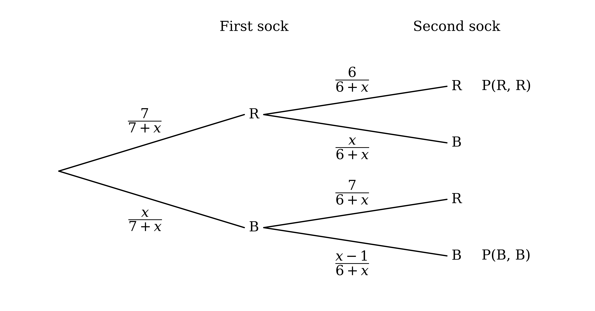

**[B1 B1 B1]**

> **[mark-scheme]**
> **B1**: x/(7 + x) on the first blue branch.
> 
> **B1**: x/(6 + x) on the blue branch after red.
> 
> **B1**: 7/(6 + x) and (x − 1)/(6 + x) on the branches after blue.

Multiply along the red, red and blue, blue branches

$\text{P} ( R ,  R ) = \frac{7}{7+x} \times \frac{6}{6+x} = \frac{42}{(7+x)(6+x)}$

$\text{P} ( B ,  B ) = \frac{x}{7+x} \times \frac{x-1}{6+x} = \frac{x(x-1)}{(7+x)(6+x)}$

The socks are the same colour in either case, so add

$\text{P(same colour)} = \frac{42+x(x-1)}{(7+x)(6+x)}$

**[M1]**

Use the formula for conditional probability, and set it equal to the given value

$\frac{\text{P}(R,R)}{\text{P(same colour)}} = \frac{7}{8}$

The factors $( 7 + x ) ( 6 + x )$ cancel

$\frac{42}{42+x(x-1)} = \frac{7}{8}$

**[M1]**

Multiply both sides by `8\left(42 + x(x - 1)\right)`

`336 = 7\left(42 + x^{2} - x\right)`

Divide by 7 and rearrange

$48 = 42 + x^{2} - x$

$x^{2} - x - 6 = 0$

Factorise

$( x - 3 ) ( x + 2 ) = 0$

**[M1]**

The number of blue socks cannot be negative, so reject $x = - 2$

$x = 3$

**[A1]**

> **[mark-scheme]**
> **M1**: Sum of the two products for red, red and blue, blue, in terms of x, consistent with the tree in part (a).
> 
> **M1**: P(R, R) divided by the probability of the same colour, set equal to 7/8.
> 
> **M1**: Fractions cleared to form a three-term quadratic in x, and a correct method to solve it.
> 
> **A1**: x = 3 only, with x = −2 rejected or not stated.

### Q12
(i)

45 of the 144 people are aged over 65

$\text{P(over 65)} = \frac{45}{144} = \frac{5}{16}$

**[B1]**

64 of the 144 prefer a beach holiday

$\text{P(beach)} = \frac{64}{144} = \frac{4}{9}$

**[B1]**

(ii)

For independent events, the probability of both is the product of the two probabilities

$\text{P(over 65 and beach)} = \text{P(over 65)} \times \text{P(beach)}$

$\text{P(over 65 and beach)} = \frac{5}{16} \times \frac{4}{9} = \frac{5}{36}$

Multiply by the 144 people to get the number in that cell

$\frac{5}{36} \times 144 = 20$

**[M1]**

Fill in the rest of the table by subtracting from the totals

$64 - 20 = 44$

$45 - 20 = 25$

$99 - 44 = 55$

|   | Beach holiday | City break | Total |
|---|---|---|---|
| **Aged 18 to 25** | **Final answer:** **44** | **Final answer:** **55** | 99 |
| **Aged over 65** | **Final answer:** **20** | **Final answer:** **25** | 45 |
| **Total** | 64 | 80 | 144 |

**[A1]**

> **[mark-scheme]**
> **B1**: Probability of being aged over 65 of 5/16 (or 45/144).
> 
> **B1**: Probability of preferring a beach holiday of 4/9 (or 64/144; answers which round to 0.444).
> 
> **M1**: The product of the two probabilities from (i) multiplied by 144, or 45 × 64 ÷ 144, to find the number aged over 65 who prefer a beach holiday.
> 
> **A1**: All four missing values correct: 44, 55, 20 and 25.

### Q13
Organise the information in a two-way table

|   | Owns a cat | Does not own a cat | Total |
|---|---|---|---|
| **Owns a dog** | 27 |   | 144 |
| **Does not own a dog** |   |   |   |
| **Total** | 75 |   | 240 |

The students who own a dog but not a cat are

$144 - 27 = 117$

The students who own a cat but not a dog are

$75 - 27 = 48$

The rest own neither

$240 - 27 - 117 - 48 = 48$

**[M1]**

|   | Owns a cat | Does not own a cat | Total |
|---|---|---|---|
| **Owns a dog** | 27 | 117 | 144 |
| **Does not own a dog** | 48 | 48 | 96 |
| **Total** | 75 | 165 | 240 |

$\text{P(neither)} = \frac{48}{240} = \frac{1}{5}$

**[A1]**

> **[mark-scheme]**
> **M1**: Correct method for the number owning neither, e.g. 240 − (144 + 75 − 27), or from a table.
> 
> **A1**: Probability of 1/5 (or 48/240, 0.2).
|   | Owns a cat | Does not own a cat | Total |
|---|---|---|---|
| **Owns a dog** | 27 | 117 | 144 |
| **Does not own a dog** | 48 | 48 | 96 |
| **Total** | 75 | 165 | 240 |

(i)

Use the formula for conditional probability

`\text{P(cat} \mid \text{dog)} = \dfrac{\text{P(dog and cat)}}{\text{P(dog)}}`

Substitute the probabilities from the table

`\text{P(cat} \mid \text{dog)} = \dfrac{\dfrac{27}{240}}{\dfrac{144}{240}} = \dfrac{27}{144}`

**[M1]**

`\text{P(cat} \mid \text{dog)} = \dfrac{3}{16}`

**[A1]**

(ii)

Let $D$ be the event 'owns a dog' and $C$ the event 'owns a cat'. State the test for independence

$\text{P} ( D \cap C ) = \text{P} ( D ) \times \text{P} ( C )$

Work out the product

$\text{P} ( D ) \times \text{P} ( C ) = \frac{144}{240} \times \frac{75}{240} = \frac{3}{16}$

**[M1]**

Compare it with the probability of owning both

$\text{P} ( D \cap C ) = \frac{27}{240} = \frac{9}{80} \neq \frac{3}{16}$

**Final answer:** **The events are not independent**

**[A1]**

> **[mark-scheme]**
> **M1**: 27 divided by 144 (or 27/240 divided by 144/240); unsimplified is accepted.
> 
> **A1**: Probability of 3/16 (or 0.1875).
> 
> **M1**: Product of the probabilities of owning a dog and owning a cat, 144/240 × 75/240.
> 
> **A1**: P(D), P(C) and P(D ∩ C) (or P(D and C)) identified, the numerical comparison 9/80 ≠ 3/16 and the conclusion that the events are not independent.
> 
> Comparing a conditional probability instead, e.g. P(C | D) = 3/16 ≠ 5/16 = P(C), with the notation and a conclusion, is also accepted.

### Q14
Each pair of second-stage branches must add to 1, so the probabilities of not sleeping well are 0.3, 0.1 and 0.8

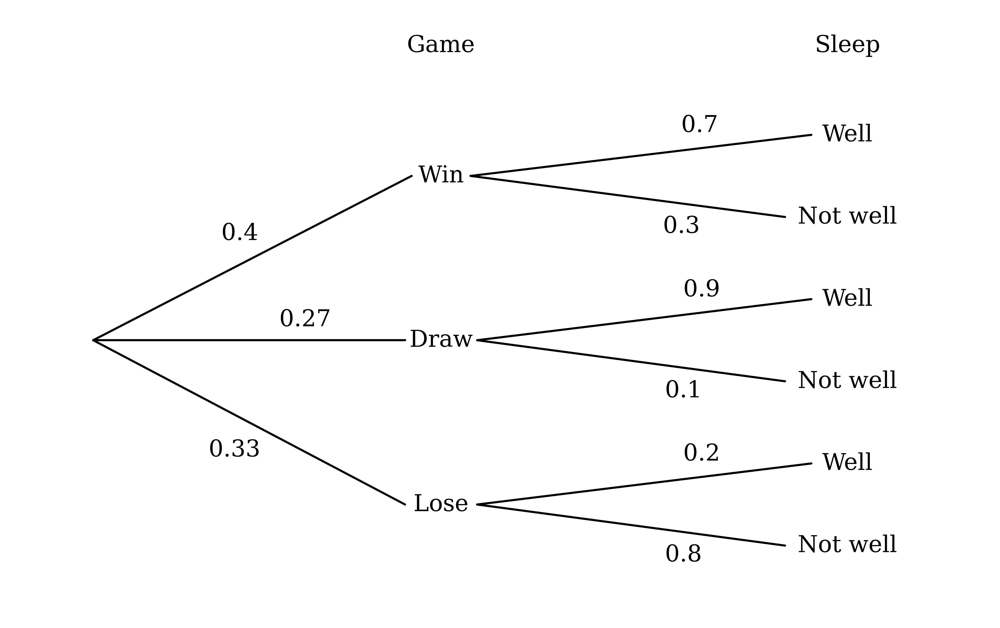

**[B1 B1 B1]**

> **[mark-scheme]**
> **B1**: Correct structure, fully labelled: win, draw and lose, then sleeps well and does not sleep well after each.
> 
> **B1**: Game probabilities 0.4, 0.27 and 0.33.
> 
> **B1**: All six sleep probabilities correct: 0.7 and 0.3; 0.9 and 0.1; 0.2 and 0.8.

(i)

Multiply along the Lose, Well branches

$\text{P(lose and well)} = 0 . 33 \times 0 . 2$

$\text{P(lose and well)} = 0 . 066$

**[B1]**

(ii)

He can sleep well after any of the three results, so add the three branch products that end in Well

$\text{P(well)} = 0 . 4 \times 0 . 7 + 0 . 27 \times 0 . 9 + 0 . 33 \times 0 . 2$

$\text{P(well)} = 0 . 28 + 0 . 243 + 0 . 066$

**[M1]**

$\text{P(well)} = 0 . 589$

**[A1]**

> **[mark-scheme]**
> **B1**: Probability of losing and sleeping well of 0.066 (or 33/500).
> 
> **M1**: Sum of the three products 0.4 × 0.7, 0.27 × 0.9 and 0.33 × 0.2, correct or consistent with the tree in part (a).
> 
> **A1**: Probability of sleeping well of 0.589 (or 589/1000).

Use the formula for conditional probability

`\text{P(not draw} \mid \text{well)} = \dfrac{\text{P(not draw and well)}}{\text{P(well)}}`

Not a draw means a win or a loss, so add those two products ending in Well, from part (b)

$\text{P(not draw and well)} = 0 . 28 + 0 . 066 = 0 . 346$

**[M1]**

The denominator is the answer to part (b)(ii)

`\text{P(not draw} \mid \text{well)} = \dfrac{0.346}{0.589}`

**[M1]**

**Final answer:** `\text{P(not draw} \mid \text{well)} = \dfrac{346}{589} = 0.587`** (3 s.f.)**

**[A1]**

> **[mark-scheme]**
> **M1**: 0.4 × 0.7 + 0.33 × 0.2 (or 0.589 − 0.27 × 0.9), i.e. 0.346, seen as the numerator of a conditional probability fraction.
> 
> **M1**: The answer to part (b)(ii) seen as the denominator of a conditional probability fraction.
> 
> **A1**: Probability of 346/589 (answers which round to 0.587).

### Q15
(i)

13 of the 52 cards are red

$\text{P(red)} = \frac{13}{52} = \frac{1}{4}$

**[B1]**

The numbers greater than 9 are 10, 11, 12 and 13, so there are 4 of each colour

$4 \times 4 = 16$

$\text{P(greater than 9)} = \frac{16}{52} = \frac{4}{13}$

**[B1]**

(ii)

The red cards numbered 10, 11, 12 and 13 satisfy both

$\text{P(red and greater than 9)} = \frac{4}{52} = \frac{1}{13}$

**[B1]**

(iii)

Given that the number is greater than 9, the card is one of 16 cards, and 4 of these are red

`\text{P(red} \mid \text{greater than 9)} = \dfrac{4}{16} = \dfrac{1}{4}`

**[B1]**

> **[mark-scheme]**
> **B1**: Probability that the card is red of 1/4 (or 13/52).
> 
> **B1**: Probability that the number is greater than 9 of 4/13 (or 16/52; answers which round to 0.308).
> 
> **B1**: Probability of 1/13 (or 4/52; answers which round to 0.0769).
> 
> **B1**: Probability of 1/4 (or 4/16), e.g. from the counts or as (1/13) ÷ (4/13).
Let $R$ be the event 'the card is red' and $G$ the event 'the number is greater than 9'. State the test for independence

$\text{P} ( R \cap G ) = \text{P} ( R ) \times \text{P} ( G )$

Work out the product, using part (a)

$\text{P} ( R ) \times \text{P} ( G ) = \frac{1}{4} \times \frac{4}{13} = \frac{1}{13}$

**[M1]**

Compare it with the probability of both, from part (a)(ii)

$\text{P} ( R \cap G ) = \frac{1}{13} = \text{P} ( R ) \times \text{P} ( G )$

**Final answer:** **The events are independent**

**[A1]**

> **[mark-scheme]**
> **M1**: Product of the probabilities from (a)(i), 1/4 × 4/13.
> 
> **A1**: P(R), P(G) and P(R ∩ G) (or P(R and G)) identified, the comparison 1/13 = 1/13 and the conclusion that the events are independent.
> 
> Comparing the conditional probability instead, P(R | G) = 1/4 = P(R), with the notation and a conclusion, is also accepted.

### Q16
For the first tadpole there are 11 in the pond. After one is taken, 10 remain, with one fewer of the sex already taken

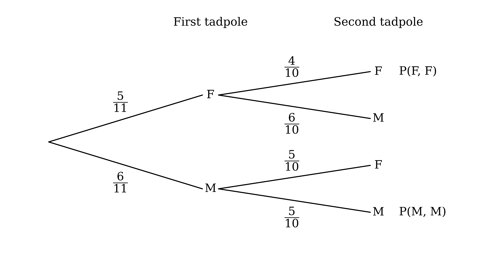

**[B1 B1 B1]**

> **[mark-scheme]**
> **B1**: Correct structure, fully labelled: female and male for the first tadpole, then female and male after each.
> 
> **B1**: First-tadpole probabilities 5/11 and 6/11.
> 
> **B1**: All four second-tadpole probabilities correct: 4/10 and 6/10 after female; 5/10 and 5/10 after male.
> 
> Equivalent fractions or decimals are accepted.

(i)

Multiply along the female, female branches

$\text{P} ( F ,  F ) = \frac{5}{11} \times \frac{4}{10} = \frac{20}{110}$

Multiply along the male, male branches

$\text{P} ( M ,  M ) = \frac{6}{11} \times \frac{5}{10} = \frac{30}{110}$

The tadpoles are the same sex in either case, so add

$\frac{20}{110} + \frac{30}{110} = \frac{50}{110}$

**[M1]**

$\text{P(same sex)} = \frac{5}{11}$

**[A1]**

(ii)

Use the formula for conditional probability

`\text{P(both female} \mid \text{same sex)} = \dfrac{\text{P(both female and same sex)}}{\text{P(same sex)}}`

Two female tadpoles are always the same sex, so the numerator is P(F, F)

`\text{P(both female} \mid \text{same sex)} = \dfrac{\dfrac{20}{110}}{\dfrac{50}{110}}`

**[M1]**

`\text{P(both female} \mid \text{same sex)} = \dfrac{2}{5}`

**[A1]**

> **[mark-scheme]**
> **M1**: Sum of the two products for female, female and male, male, correct or following through from the tree in part (a).
> 
> **A1**: Probability of 5/11 (or 50/110; answers which round to 0.455).
> 
> **M1**: P(F, F) divided by the answer to (i).
> 
> **A1**: Probability of 2/5 (or 0.4).
> 
> Choosing with combinations is also accepted, e.g. (⁵C₂ + ⁶C₂)/¹¹C₂ = 25/55 for (i).

### Q17
For the first token there are 42 tokens in the bag. After one is taken, 41 remain, with one fewer of the colour already chosen

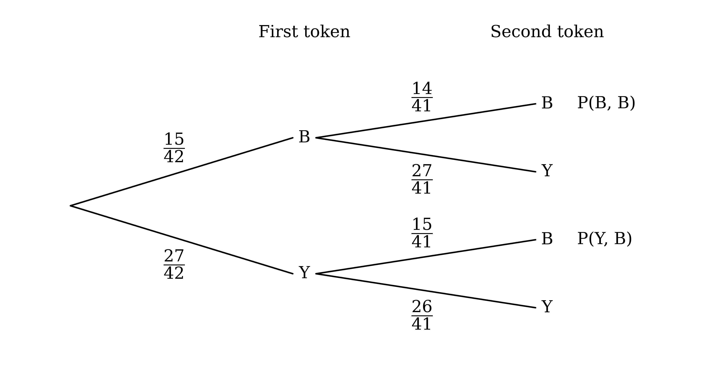

**[B1 B1 B1]**

> **[mark-scheme]**
> **B1**: Correct structure, fully labelled: blue and yellow for the first token, then blue and yellow after each.
> 
> **B1**: First-token probabilities 15/42 and 27/42.
> 
> **B1**: All four second-token probabilities correct: 14/41 and 27/41 after blue; 15/41 and 26/41 after yellow.
> 
> Equivalent fractions (e.g. 5/14, 9/14 for the first token) are accepted.

(i)

The second token is blue on the blue, blue and yellow, blue paths, so add their products

$\text{P(second blue)} = \frac{15}{42} \times \frac{14}{41} + \frac{27}{42} \times \frac{15}{41}$

$\text{P(second blue)} = \frac{210}{1722} + \frac{405}{1722} = \frac{615}{1722}$

**[M1]**

$\text{P(second blue)} = \frac{5}{14}$

**[A1]**

(ii)

Use the formula for conditional probability

`\text{P(both blue} \mid \text{second blue)} = \dfrac{\text{P(both blue and second blue)}}{\text{P(second blue)}}`

If both are blue then the second is blue, so the numerator is P(B, B)

`\text{P(both blue} \mid \text{second blue)} = \dfrac{\dfrac{210}{1722}}{\dfrac{615}{1722}}`

**[M1]**

`\text{P(both blue} \mid \text{second blue)} = \dfrac{14}{41}`

**[A1]**

> **[mark-scheme]**
> **M1**: Sum of the two products for blue, blue and yellow, blue, correct or following through from the tree in part (a).
> 
> **A1**: Probability of 5/14 (or 615/1722; answers which round to 0.357).
> 
> **M1**: P(B, B) = 210/1722 (or 5/41) divided by the answer to (i).
> 
> **A1**: Probability of 14/41 (answers which round to 0.341).

### Q18
(i)

For independent events, knowing that $B$ occurs does not change the probability of $A$

`\text{P}(A \mid B) = \text{P}(A)`

`\text{P}(A \mid B) = 0.47`

**[B1]**

(ii)

$B$ is also independent of $A$ not occurring, so the probability of $B$ is unchanged

`\text{P}(B \mid A') = \text{P}(B)`

`\text{P}(B \mid A') = 0.31`

**[B1]**

> **[mark-scheme]**
> **B1**: 0.47.
> 
> **B1**: 0.31.
(i)

Given that the student is in middle school, look only at the middle school row: 21 of the 70 prefer ketchup

`\text{P(ketchup} \mid \text{middle)} = \dfrac{21}{70} = \dfrac{3}{10}`

**[B1]**

Given that the student prefers ketchup, look only at the ketchup column: 21 of the 48 are in middle school

`\text{P(middle} \mid \text{ketchup)} = \dfrac{21}{48} = \dfrac{7}{16}`

**[B1]**

(ii)

The events are independent if a condition makes no difference, so compare each answer with the probability without the condition

$\text{P(ketchup)} = \frac{48}{160} = \frac{3}{10}$

**[M1]**

$\text{P(middle)} = \frac{70}{160} = \frac{7}{16}$

Both are equal to the conditional probabilities from part (b)(i)

`\text{P(ketchup} \mid \text{middle)} = \text{P(ketchup)} = \dfrac{3}{10}`

**Final answer:** **The events 'is in middle school' and 'prefers ketchup' are independent**

**[A1]**

> **[mark-scheme]**
> **B1**: Probability of preferring ketchup given middle school of 3/10 (or 21/70, 0.3).
> 
> **B1**: Probability of being in middle school given preferring ketchup of 7/16 (or 21/48, 0.4375).
> 
> **M1**: P(ketchup) = 48/160 or P(middle) = 70/160 found.
> 
> **A1**: A conditional probability from (i) compared with the matching unconditional probability, shown to be equal, with the conclusion that the events are independent.
> 
> One comparison is enough for the A1. Comparing P(middle and ketchup) = 21/160 with P(middle) × P(ketchup) = 7/16 × 3/10 = 21/160 is also accepted.

### Q19
Each pair of branches must add to 1, so subtract each given probability from 1

$\text{P(no rain)} = 1 - 0 . 4 = 0 . 6$

`\text{P(late} \mid \text{rain)} = 1 - 0.6 = 0.4`

`\text{P(late} \mid \text{no rain)} = 1 - 0.9 = 0.1`

**[B1 B1]**

> **[mark-scheme]**
> **B1**: 0.6 on the No rain branch.
> 
> **B1**: 0.4 and 0.1 on the two Late branches.
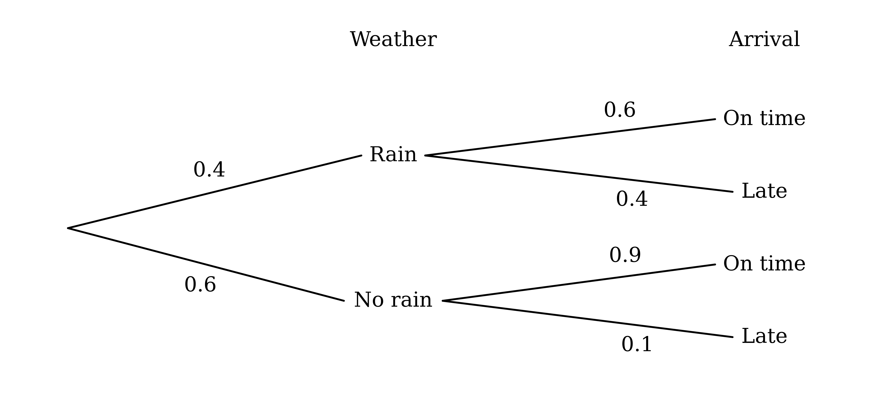

Suresh can be on time when it rains or when it does not, so add the two branch products that end in On time

$\text{P(on time)} = 0 . 4 \times 0 . 6 + 0 . 6 \times 0 . 9$

**[M1]**

$\text{P(on time)} = 0 . 78$

**[A1]**

> **[mark-scheme]**
> **M1**: Sum of the two products 0.4 × 0.6 and 0.6 × 0.9, correct or consistent with the tree in part (a).
> 
> **A1**: Probability of 0.78 (or 39/50).

Use the formula for conditional probability

`\text{P(rain} \mid \text{late)} = \dfrac{\text{P(rain and late)}}{\text{P(late)}}`

Multiply along the Rain, Late branches for the numerator

$\text{P(rain and late)} = 0 . 4 \times 0 . 4 = 0 . 16$

**[M1]**

Being late is the complement of being on time, from part (b)

$\text{P(late)} = 1 - 0 . 78 = 0 . 22$

`\text{P(rain} \mid \text{late)} = \dfrac{0.16}{0.22}`

**[M1]**

**Final answer:** `\text{P(rain} \mid \text{late)} = \dfrac{8}{11} = 0.727`** (3 s.f.)**

**[A1]**

> **[mark-scheme]**
> **M1**: 0.4 × 0.4 (or 0.16) seen as the numerator of a conditional probability fraction.
> 
> **M1**: 1 − (the answer to part (b)), or 0.4 × 0.4 + 0.6 × 0.1, seen as the denominator of a conditional probability fraction.
> 
> **A1**: Probability of 8/11 (answers which round to 0.727).

### Q20
List every outcome in a sample space. There are 7 × 7 = 49 equally likely outcomes

| + | 0 | 1 | 1 | 3 | 3 | 3 | 3 |
|---|---|---|---|---|---|---|---|
| **0** | 0 | 1 | 1 | 3 | 3 | 3 | 3 |
| **1** | 1 | 2 | 2 | 4 | 4 | 4 | 4 |
| **1** | 1 | 2 | 2 | 4 | 4 | 4 | 4 |
| **3** | 3 | 4 | 4 | 6 | 6 | 6 | 6 |
| **3** | 3 | 4 | 4 | 6 | 6 | 6 | 6 |
| **3** | 3 | 4 | 4 | 6 | 6 | 6 | 6 |
| **3** | 3 | 4 | 4 | 6 | 6 | 6 | 6 |

The positive square numbers that can occur are 1 and 4. Count them in the table

$4 + 16 = 20$

**[M1]**

$\text{P(positive square)} = \frac{20}{49}$

**[A1]**

> **[mark-scheme]**
> **M1**: Sums of 1 and 4 identified and their outcomes added, 4 + 16, or 20 seen as a numerator over 49.
> 
> **A1**: Probability of 20/49 (answers which round to 0.408).
> 
> A sample space or list of outcomes is credited as working but is not required.
| + | 0 | 1 | 1 | 3 | 3 | 3 | 3 |
|---|---|---|---|---|---|---|---|
| **0** | 0 | 1 | 1 | 3 | 3 | 3 | 3 |
| **1** | 1 | 2 | 2 | 4 | 4 | 4 | 4 |
| **1** | 1 | 2 | 2 | 4 | 4 | 4 | 4 |
| **3** | 3 | 4 | 4 | 6 | 6 | 6 | 6 |
| **3** | 3 | 4 | 4 | 6 | 6 | 6 | 6 |
| **3** | 3 | 4 | 4 | 6 | 6 | 6 | 6 |
| **3** | 3 | 4 | 4 | 6 | 6 | 6 | 6 |

(i)

The positive even sums are 2, 4 and 6. Count them in the table

$4 + 16 + 16 = 36$

**[M1]**

$\text{P(positive even)} = \frac{36}{49}$

**[A1]**

(ii)

Use the formula for conditional probability

`\text{P(square} \mid \text{positive even)} = \dfrac{\text{P(square and positive even)}}{\text{P(positive even)}}`

The only sum that is both square and positive even is 4, which occurs 16 times

`\text{P(square} \mid \text{positive even)} = \dfrac{\dfrac{16}{49}}{\dfrac{36}{49}} = \dfrac{16}{36}`

**[M1]**

`\text{P(square} \mid \text{positive even)} = \dfrac{4}{9}`

**[A1]**

> **[mark-scheme]**
> **M1**: Sums of 2, 4 and 6 identified and their outcomes added, 4 + 16 + 16, or 36 seen as a numerator over 49.
> 
> **A1**: Probability of 36/49 (answers which round to 0.735).
> 
> **M1**: 16/49 divided by the answer to (i), or 16/36 counted directly from the sample space.
> 
> **A1**: Probability of 4/9 (or 16/36; answers which round to 0.444).

### Q21
Organise the information in a two-way table

|   | Likes football | Does not like football | Total |
|---|---|---|---|
| **Likes cricket** |   |   | 58 |
| **Does not like cricket** |   | 10 |   |
| **Total** | 84 |   | 100 |

Start with the number who do not like football

$100 - 84 = 16$

Of these 16, 10 do not like cricket, so the rest like cricket but not football

$16 - 10 = 6$

The other children who like cricket also like football

$58 - 6 = 52$

**[M1]**

Fill in the remaining cells by subtracting from the totals

|   | Likes football | Does not like football | Total |
|---|---|---|---|
| **Likes cricket** | 52 | 6 | 58 |
| **Does not like cricket** | 32 | 10 | 42 |
| **Total** | 84 | 16 | 100 |

52 of the 100 children like both

$\text{P(likes both)} = \frac{52}{100} = \frac{13}{25}$

**[A1]**

> **[mark-scheme]**
> **M1**: Correct method to find the number who like both, e.g. 58 − (16 − 10) or 84 + 58 − 90, seen or implied by a correct table or a numerator of 52.
> 
> **A1**: Probability of 13/25 (or 52/100, 0.52).
> 
> A completed table is not required, but any table drawn is credited as working.
|   | Likes football | Does not like football | Total |
|---|---|---|---|
| **Likes cricket** | 52 | 6 | 58 |
| **Does not like cricket** | 32 | 10 | 42 |
| **Total** | 84 | 16 | 100 |

(i)

Add the children who like football but not cricket and those who like cricket but not football

$32 + 6 = 38$

**[M1]**

$\text{P(exactly one)} = \frac{38}{100} = \frac{19}{50}$

**[A1]**

(ii)

Use the formula for conditional probability

`\text{P(football} \mid \text{cricket)} = \dfrac{\text{P(football and cricket)}}{\text{P(cricket)}}`

Substitute the probabilities from the table

`\text{P(football} \mid \text{cricket)} = \dfrac{\dfrac{52}{100}}{\dfrac{58}{100}} = \dfrac{52}{58}`

**[M1]**

`\text{P(football} \mid \text{cricket)} = \dfrac{26}{29}`

**[A1]**

> **[mark-scheme]**
> **M1**: Sum of the two non-overlapping groups, 32 + 6 (or 90 − 52), following through from part (a).
> 
> **A1**: Probability of 19/50 (or 38/100, 0.38).
> 
> **M1**: Probability that the child likes both divided by the probability that the child likes cricket, e.g. 52/58 or (52/100) ÷ (58/100), following through from part (a); unsimplified is accepted.
> 
> **A1**: Probability of 26/29 (answers which round to 0.897).

### Q22
(i)

70% of the Drama students also study Economics, so multiply

$\text{P(Drama and Economics)} = 0 . 2 \times 0 . 7$

$\text{P(Drama and Economics)} = 0 . 14$

**[B1]**

(ii)

Put the probabilities into a two-way table, with the answer to (i)

|   | Economics | Not Economics | Total |
|---|---|---|---|
| **Drama** | 0.14 |   | 0.2 |
| **Not Drama** |   |   |   |
| **Total** | 0.4 |   | 1 |

The Drama students who do not study Economics are

$0 . 2 - 0 . 14 = 0 . 06$

The Economics students who do not study Drama are

$0 . 4 - 0 . 14 = 0 . 26$

**[M1]**

The rest study neither subject

$1 - 0 . 14 - 0 . 06 - 0 . 26 = 0 . 54$

|   | Economics | Not Economics | Total |
|---|---|---|---|
| **Drama** | 0.14 | 0.06 | 0.2 |
| **Not Drama** | 0.26 | 0.54 | 0.8 |
| **Total** | 0.4 | 0.6 | 1 |

$\text{P(neither)} = 0 . 54$

**[A1]**

> **[mark-scheme]**
> **B1**: Probability of studying both of 0.14 (or 7/50).
> 
> **M1**: Correct method for the probability of neither, e.g. 1 − (0.14 + 0.06 + 0.26) or 1 − (0.2 + 0.4 − 0.14), following through from (i); may be seen in a table.
> 
> **A1**: Probability of studying neither of 0.54 (or 27/50).
|   | Economics | Not Economics | Total |
|---|---|---|---|
| **Drama** | 0.14 | 0.06 | 0.2 |
| **Not Drama** | 0.26 | 0.54 | 0.8 |
| **Total** | 0.4 | 0.6 | 1 |

Let $D$ be the event 'studies Drama' and $E$ the event 'studies Economics'. State the test for independence

$\text{P} ( D \cap E ) = \text{P} ( D ) \times \text{P} ( E )$

Work out the product

$\text{P} ( D ) \times \text{P} ( E ) = 0 . 2 \times 0 . 4 = 0 . 08$

**[M1]**

Compare it with the probability of studying both, from part (a)

$\text{P} ( D \cap E ) = 0 . 14 \neq 0 . 08$

**Final answer:** **The events are not independent**

**[A1]**

> **[mark-scheme]**
> **M1**: Product of the probabilities of studying Drama and studying Economics, 0.2 × 0.4.
> 
> **A1**: P(D), P(E) and P(D ∩ E) (or P(D and E)) identified, the numerical comparison 0.14 ≠ 0.08 and the conclusion that the events are not independent.
> 
> Comparing a conditional probability instead, e.g. P(E | D) = 0.7 ≠ 0.4 = P(E), with the notation and a conclusion, is also accepted.

### Q23
Each pair of branches must add to 1, so subtract each given probability from 1

$\text{P(fails first)} = 1 - 0 . 3 = 0 . 7$

`\text{P(fails second} \mid \text{completed first)} = 1 - 0.6 = 0.4`

`\text{P(fails second} \mid \text{failed first)} = 1 - 0.5 = 0.5`

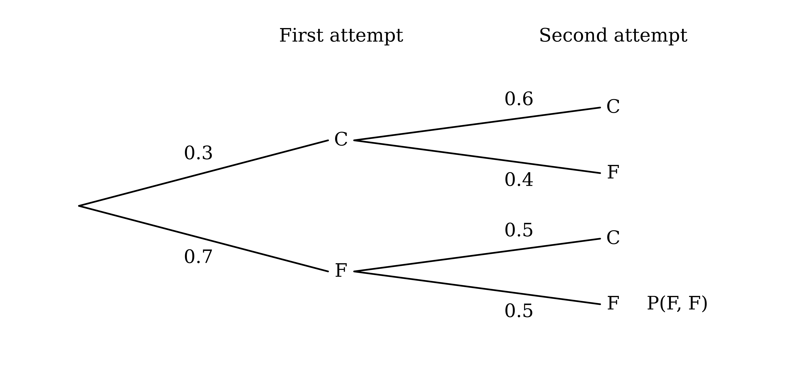

**[B1 B1]**

> **[mark-scheme]**
> **B1**: 0.7 on the first-attempt fail branch.
> 
> **B1**: 0.4 and 0.5 on the two second-attempt fail branches.
> 
> Equivalent fractions (7/10, 2/5, 1/2) are accepted.

(i)

Multiply along the fail, fail branches

$\text{P} ( F ,  F ) = 0 . 7 \times 0 . 5$

$\text{P} ( F ,  F ) = 0 . 35$

**[B1]**

(ii)

Completing the trick at least once is the complement of failing at both attempts

$\text{P(at least once)} = 1 - 0 . 35$

**[M1]**

$\text{P(at least once)} = 0 . 65$

**[A1]**

> **[mark-scheme]**
> **B1**: Probability of failing at both attempts of 0.35 (or 7/20).
> 
> **M1**: 1 minus the answer to (i), or the sum of the three products for the identified scenarios C, C and C, F and F, C (0.18 + 0.12 + 0.35), correct or following through from the tree.
> 
> **A1**: Probability of completing the trick at least once of 0.65 (or 13/20).
> 
> Also accepted for the M1: 0.3 + 0.7 × 0.5 (completes the first attempt, or fails it and completes the second).

Use the formula for conditional probability

`\text{P(first} \mid \text{at least once)} = \dfrac{\text{P(first and at least once)}}{\text{P(at least once)}}`

If she completes the first attempt then she has completed the trick at least once, so the numerator is the probability of completing the first attempt

$\text{P(first and at least once)} = 0 . 3$

**[M1]**

The denominator is the answer to part (b)(ii)

`\text{P(first} \mid \text{at least once)} = \dfrac{0.3}{0.65}`

**[M1]**

**Final answer:** `\text{P(first} \mid \text{at least once)} = \dfrac{6}{13} = 0.462`** (3 s.f.)**

**[A1]**

> **[mark-scheme]**
> **M1**: 0.3 (or 0.3 × 0.6 + 0.3 × 0.4) seen as the numerator of a conditional probability fraction.
> 
> **M1**: The answer to part (b)(ii) seen as the denominator of a conditional probability fraction.
> 
> **A1**: Probability of 6/13 (answers which round to 0.462).

### Q24
For the first counter there are 10 counters in the box. After one is taken, 9 remain, with one fewer of the colour already chosen

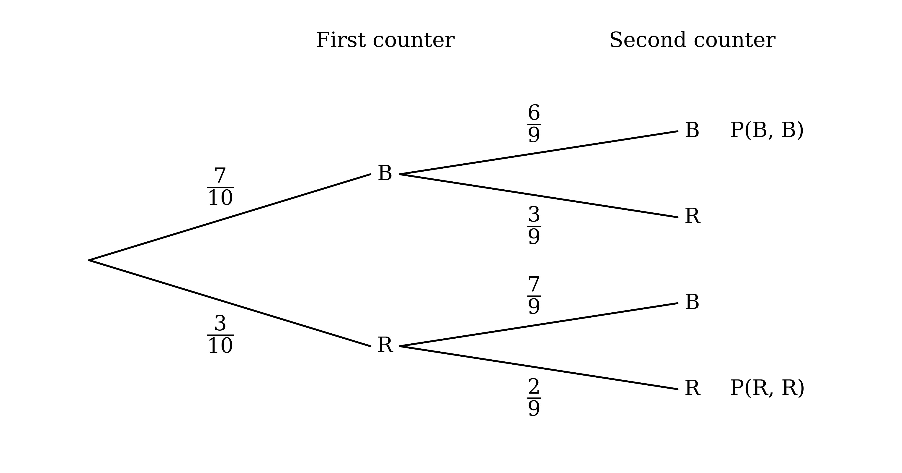

**[B1 B1 B1]**

> **[mark-scheme]**
> **B1**: Correct structure, fully labelled: blue and red for the first counter, then blue and red after each.
> 
> **B1**: First-counter probabilities 7/10 and 3/10.
> 
> **B1**: All four second-counter probabilities correct: 6/9 and 3/9 after blue; 7/9 and 2/9 after red.
> 
> Any clear labels (B and R, or the colours in words) are accepted, and equivalent fractions or decimals are accepted.

(i)

Multiply along the blue, blue branches

$\text{P} ( B ,  B ) = \frac{7}{10} \times \frac{6}{9} = \frac{42}{90}$

Multiply along the red, red branches

$\text{P} ( R ,  R ) = \frac{3}{10} \times \frac{2}{9} = \frac{6}{90}$

The counters are the same colour in either of these cases, so add

$\frac{42}{90} + \frac{6}{90} = \frac{48}{90}$

**[M1]**

$\text{P(same colour)} = \frac{8}{15}$

**[A1]**

(ii)

Neither counter is blue only when both are red

$\text{P} ( R ,  R ) = \frac{6}{90} = \frac{1}{15}$

**[B1]**

> **[mark-scheme]**
> **M1**: Sum of the two products for blue, blue and red, red, correct or following through from the tree in part (a).
> 
> **A1**: Probability that both are the same colour of 8/15 (or 48/90; answers which round to 0.533).
> 
> **B1**: Probability that neither is blue of 1/15 (or 6/90; answers which round to 0.0667).
> 
> Choosing with combinations is also accepted, e.g. (⁷C₂ + ³C₂)/¹⁰C₂ = 24/45 for (i).

Use the formula for conditional probability

`\text{P(first red} \mid \text{same colour)} = \dfrac{\text{P(first red and same colour)}}{\text{P(same colour)}}`

The first counter is red and both are the same colour only when both are red, so the numerator is P(R, R) from part (b)

$\text{P(first red and same colour)} = \frac{6}{90}$

**[M1]**

The denominator is the probability that both are the same colour, from part (b)

`\text{P(first red} \mid \text{same colour)} = \dfrac{\dfrac{6}{90}}{\dfrac{48}{90}}`

**[M1]**

`\text{P(first red} \mid \text{same colour)} = \dfrac{1}{8}`

**[A1]**

> **[mark-scheme]**
> **M1**: 6/90 (or 1/15) seen as the numerator of a conditional probability fraction.
> 
> **M1**: The probability that both are the same colour from part (b) seen as the denominator of a conditional probability fraction.
> 
> **A1**: Probability of 1/8 (or 0.125).

### Q25
(i)

To find the number who travel by bus, add the bus column

$22 + 12 = 34$

$\text{P(bus)} = \frac{34}{200} = \frac{17}{100}$

**[B1]**

(ii)

Complete the table, starting with the total for Year 13

$200 - 160 = 40$

The Year 13 students who walk are the rest of that row

$40 - 2 - 12 - 3 = 23$

So the Year 12 students who walk are

$79 - 23 = 56$

The Year 12 students who travel by car are the rest of that row

$160 - 56 - 22 - 0 = 82$

**[M1]**

|   | Walk | Car | Bus | Cycle | Total |
|---|---|---|---|---|---|
| **Year 12** | 56 | 82 | 22 | 0 | 160 |
| **Year 13** | 23 | 2 | 12 | 3 | 40 |
| **Total** | 79 | 84 | 34 | 3 | 200 |

$\text{P(Year 12 and car)} = \frac{82}{200} = \frac{41}{100}$

**[A1]**

> **[mark-scheme]**
> **B1**: Probability of travelling by bus of 17/100 (or 34/200, 0.17).
> 
> **M1**: Correct method for the number of Year 12 students who travel by car, e.g. 160 − (79 − 23) − 22, seen or implied by a correct table.
> 
> **A1**: Probability of 41/100 (or 82/200, 0.41).
|   | Walk | Car | Bus | Cycle | Total |
|---|---|---|---|---|---|
| **Year 12** | 56 | 82 | 22 | 0 | 160 |
| **Year 13** | 23 | 2 | 12 | 3 | 40 |
| **Total** | 79 | 84 | 34 | 3 | 200 |

(i)

Use the formula for conditional probability

`\text{P(walk} \mid \text{Year 13)} = \dfrac{\text{P(walk and Year 13)}}{\text{P(Year 13)}}`

Substitute the probabilities from the table

`\text{P(walk} \mid \text{Year 13)} = \dfrac{\dfrac{23}{200}}{\dfrac{40}{200}}`

**[M1]**

`\text{P(walk} \mid \text{Year 13)} = \dfrac{23}{40}`

**[A1]**

(ii)

Use the formula for conditional probability again

`\text{P(Year 12} \mid \text{bus)} = \dfrac{\text{P(Year 12 and bus)}}{\text{P(bus)}}`

Substitute the probabilities from the table

`\text{P(Year 12} \mid \text{bus)} = \dfrac{\dfrac{22}{200}}{\dfrac{34}{200}} = \dfrac{22}{34}`

**[M1]**

`\text{P(Year 12} \mid \text{bus)} = \dfrac{11}{17}`

**[A1]**

> **[mark-scheme]**
> **M1**: Number of Year 13 students who walk divided by the number of Year 13 students, e.g. 23/40, following through from part (a); unsimplified is accepted.
> 
> **A1**: Probability of 23/40 (or 0.575).
> 
> **M1**: Number of Year 12 bus users divided by the number of bus users, e.g. 22/34; unsimplified is accepted.
> 
> **A1**: Probability of 11/17 (answers which round to 0.647).
> 
> The two answers are marked independently.
