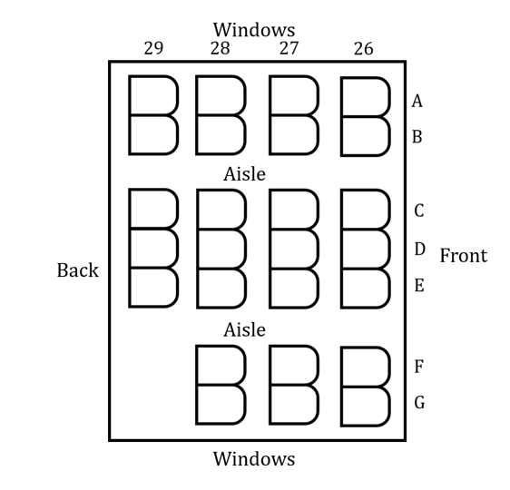
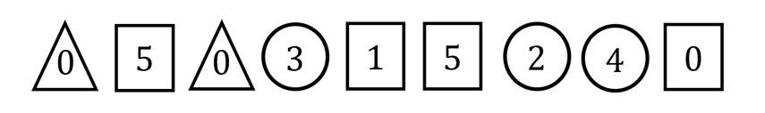
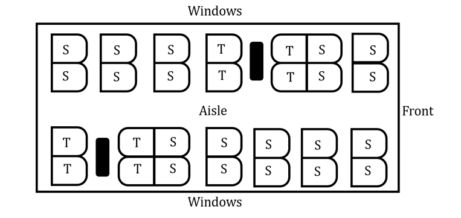

# Exam Questions — Permutations & Combinations
**Probability** · Cambridge (CIE) AS maths (9709)
> Source: [https://www.savemyexams.com/as/maths/cie/20/probability-and-statistics-1/topic-questions/](https://www.savemyexams.com/as/maths/cie/20/probability-and-statistics-1/topic-questions/) · 31 questions across 1 sets

## Exam Questions (31 questions)

### Q1 — very_hard — 9 marks

**Q1** [4 marks]

Twenty-six people are travelling on a plane: 7 businesspeople going to a conference, 3 members of a string trio going to a concert, and 16 cryptozoologists following up a reported unicorn sighting. They are allocated the seats 26A to 29E, shown in the diagram below.

Find the number of different ways in which the 26 people can be seated if the 3 members of the string trio all sit in the back row and the 7 businesspeople all sit in window seats.

**Q1** [5 marks]

Given that each of the 7 window seats is taken by a cryptozoologist, find the probability that the 3 members of the string trio are not all sitting together in one of the groups of three seats between the two aisles.

### Q2 — hard — 8 marks

**Q2** [5 marks]

Four families, 6 adults and 12 children in total, go to the cinema together:

Mr and Mrs Mitchell and their two children

Alex and Sam Lee and their four children

Mr Kim and his three children

Ms Miller and her three children.

Find the number of different ways in which all 18 people can sit in a row of 18 seats if

(i) no two adults sit next to each other,

(ii) each family sits together.

**Q2** [3 marks]

Instead, the 18 people sit at random in three rows of six seats.

Find the probability that all 6 adults sit in the back row.

### Q3 — very_hard — 9 marks

**Q3** [6 marks]

Ahmed has the following nine cards.

Ahmed arranges all nine cards in a line to form a 9-digit number. The first card cannot be a 0.

Find the number of different 9-digit numbers that are multiples of 5 and in which the three circular cards are not all together.

**Q3** [3 marks]

Ahmed chooses one triangular card, one circular card and one rectangular card, and arranges them in a line to form a 3-digit code. A code may start with 0.

Find the number of different 3-digit codes that Ahmed can make.

### Q4 — very_hard — 9 marks

**Q4** [4 marks]

The diagram shows part of a train carriage. There are 28 seats: 20 standard seats, S, and 8 table seats, T. The seats are in pairs, with 7 pairs on each side of the aisle.

There are 23 passengers in this part of the carriage: 12 schoolchildren and 2 teachers, a married couple, 4 business travellers and 3 backpackers.

Find the number of different ways in which the passengers can be seated if

(i) there are no restrictions,

(ii) the 4 business travellers sit together, facing each other around one of the tables.

**Q4** [5 marks]

The passengers are seated completely at random. Find the probability that

(i) the 3 backpackers sit in the four seats nearest the front, and the 2 teachers sit next to each other in the same pair of seats,

(ii) the 12 schoolchildren all sit on one side of the aisle, and the married couple sit next to each other in the same pair of seats on the other side of the aisle.

### Q5 — hard — 8 marks

**Q5** [4 marks]

Four letters are chosen at random from the 9 letters in the word EXCELLENT.

Find the number of different selections that contain

(i) no Ls and exactly one E,

(ii) no Ls.

**Q5** [4 marks]

The 9 letters in the word EXCELLENT are arranged in a random order.

Find the probability that the three Es are separated from each other by at least one letter.

### Q6 — very_hard — 9 marks

**Q6** [2 marks]

Find the number of different arrangements of the 12 letters in the word HIPPOPOTAMUS that start and end with the letter P.

**Q6** [4 marks]

Find the number of different arrangements of the 12 letters in the word HIPPOPOTAMUS in which the two Os are next to each other and the three Ps are not all together.

**Q6** [3 marks]

Taking the vowels to be A, E, I, O and U, an arrangement of the 12 letters in the word HIPPOPOTAMUS is chosen at random.

Find the probability that the arrangement begins with a vowel.

### Q7 — easy — 4 marks

**Q7** [3 marks]

A football team of 11 players is to be selected from a squad of 18 players.

(i) Find the number of different ways in which the team can be selected.

(ii) The 11 selected players then stand in a line for a team photograph. Find the number of different ways in which 11 players can be selected from the 18 and arranged in a line.

**Q7** [1 mark]

Four of the 11 players in the team are selected to go to an award ceremony.

Find the number of different ways in which these 4 players can be selected.

### Q8 — medium — 7 marks

**Q8** [2 marks]

Find the number of different arrangements of the 10 letters in the word ENTHUSIASM.

**Q8** [3 marks]

Find the number of different arrangements of the 7 letters in the word BOREDOM in which the consonants (B, D, M and R) and the vowels (E, O and O) alternate.

**Q8** [2 marks]

An arrangement of the 7 letters in the word BOREDOM is chosen at random.

Find the probability that the consonants and vowels alternate. Give your answer as a fraction in its simplest form.

### Q9 — easy — 5 marks

**Q9** [1 mark]

Six cards numbered 1, 2, 2, 2, 2 and 3 are arranged in a line to form a six-digit number.

Find the number of different six-digit numbers that can be formed.

**Q9** [2 marks]

Find the number of different six-digit numbers that are greater than 300 000.

**Q9** [2 marks]

A six-digit number is formed at random using all six cards.

Find the probability that the number is greater than 300 000.

### Q10 — easy — 6 marks

**Q10** [6 marks]

Aran is allowed to choose 3 fish from an aquarium to add to his collection. The aquarium contains 4 tetras, 6 guppies and 2 platies, and all the fish are different.

Find the number of different ways in which Aran can choose his 3 fish if he chooses

(i) one fish of each type,

(ii) one tetra and two guppies,

(iii) two tetras and one other fish.

### Q11 — easy — 6 marks

**Q11** [6 marks]

Mr Kevin chooses two students from each of the seven year groups in his school (Years 7, 8, 9, 10, 11, 12 and 13) to present awards in a school assembly. The 14 students stand in a line.

Find the number of different arrangements of the 14 students if

(i) there are no restrictions,

(ii) a Year 13 student stands at each end of the line,

(iii) the two Year 7 students stand first, followed by the two Year 8 students, then the two Year 9 students, and so on, ending with the two Year 13 students.

### Q12 — easy — 3 marks

**Q12** [3 marks]

Twelve friends travel home from a party in three taxis: Taxi A, Taxi B and Taxi C. Four of the friends travel in each taxi.

Find the number of different ways in which the twelve friends can be allocated to the three taxis.

### Q13 — easy — 8 marks

**Q13** [2 marks]

(i) By writing $5 !$ in its full form, show that $5 ! = 120$.

(ii) The digits 1, 2, 3, 4 and 5 are arranged to make a five-digit code using each digit exactly once. How many distinct codes are there?

**Q13** [3 marks]

(i) Show, by writing $7 !$ and $5 !$ in their full form and cancelling, that $\frac{7!}{5!} = 7 \times 6$.

(ii) Hence, simplify $\frac{n!}{(n-2)!}$.

(iii) The digits 1, 1, 1, 1, 1, 2 and 3 are arranged to make a seven-digit code using each digit exactly once. How many distinct codes are there?

**Q13** [3 marks]

The word MATHS and the word STATS both have five letters. Explain why the word STATS has fewer distinct arrangements of its letters than the word MATHS, and find the number of distinct arrangements of the word STATS.

### Q14 — easy — 4 marks

**Q14** [4 marks]

State whether each of the following scenarios represents a **permutation** or a **combination**.

(i) A pin code is a 4-digit number made up from the digits 0 to 9, using each digit once only.

(ii) Three students from a class of twelve are chosen at random to represent their class in an interview.

(iii) Five toppings are chosen from a menu of twelve different toppings to put on a pizza.

(iv) A student council is made up of ten members and they need to elect a president, a vice-president and a treasurer.

### Q15 — easy — 1 marks

**Q15** [1 mark]

Five swimmers compete in a race. Gold, silver and bronze medals are awarded to the swimmers finishing first, second and third.

Find the number of different ways in which the three medals can be awarded.

### Q16 — medium — 7 marks

**Q16** [4 marks]

Four letters are chosen at random from the 10 letters in the word CALIFORNIA.

Find the number of different selections that contain

(i) no As and no Is,

(ii) exactly one A and no Is,

(iii) exactly one A.

**Q16** [3 marks]

Find the number of different arrangements of four letters chosen from the 10 letters in the word CALIFORNIA, if the four letters are all different.

### Q17 — hard — 11 marks

**Q17** [2 marks]

Find the number of different arrangements of the 10 letters in the word POSITIVITY.

**Q17** [5 marks]

Find the number of different arrangements of the 10 letters in the word POSITIVITY in which

(i) the three Is are all together,

(ii) the two Ts are not next to each other.

**Q17** [4 marks]

An arrangement of the 10 letters in the word POSITIVITY is chosen at random.

Find the probability that the four vowels, O, I, I and I, are not all together.

### Q18 — hard — 10 marks

**Q18** [4 marks]

Nine cards are numbered 1, 2, 2, 3, 5, 5, 5, 6 and 8.

All nine cards are placed in a line. Find the number of different arrangements if

(i) no two odd numbers are next to each other,

(ii) all the odd numbers are together.

**Q18** [6 marks]

Four of the nine cards are chosen and placed in a line to form a 4-digit code.

Find the number of different codes that can be formed if

(i) all four digits in the code are different,

(ii) the code contains both cards numbered 2.

### Q19 — hard — 8 marks

**Q19** [5 marks]

Mr Roland has 15 books on his classroom bookshelf: 7 different books about GeoGebra, 5 different books about football and 3 identical Mathematics textbooks.

Find the number of different ways in which the 15 books can be arranged in a line on the shelf if

(i) there are no restrictions,

(ii) no two books about football are next to each other,

(iii) there is a Mathematics textbook at each end of the shelf.

**Q19** [3 marks]

Mr Roland's son selects 3 of the 15 books at random to take home to read.

Find the number of different selections that he can make if

(i) he chooses one book of each type,

(ii) the three books he chooses are all different.

### Q20 — hard — 7 marks

**Q20** [3 marks]

An examination paper has 4 questions in Section A and 8 questions in Section B. Candidates must choose 5 questions to answer.

Find the number of different ways in which a candidate can choose 5 questions if:

(i) there are no restrictions,

(ii) at least 3 questions must be chosen from Section A.

**Q20** [4 marks]

Candidates are now given these instructions for choosing their 5 questions.

If Question 1 of Section A is chosen, no other question from Section A may be chosen.

If Question 1 of Section A is not chosen, Question 1 of Section B must be chosen, together with at least 2 other questions from Section A.

Find the number of different ways in which a candidate can choose 5 questions.

### Q21 — medium — 6 marks

**Q21** [3 marks]

Nine men and six women try out for a place in a mixed relay team. The team will consist of two men and two women.

During the try-outs, the 15 candidates are divided at random into four groups: Group A, Group B and Group C each contain four candidates, and Group D contains three candidates.

Find the number of different ways in which the 15 candidates can be divided into these four groups.

**Q21** [3 marks]

Two of the candidates are a brother and a sister. They will join the relay team only if they are both selected, so either both of them are in the team or neither of them is.

Find the number of different ways in which the team can be chosen.

### Q22 — hard — 8 marks

**Q22** [4 marks]

Dylan makes a playlist of 19 different songs for a party: 5 afrobeats songs, 3 blues songs, 3 country songs and 8 drum and bass songs.

Find the number of different orders in which Dylan can play all 19 songs if:

(i) a country song is played first, a country song is played exactly in the middle of the playlist and a country song is played last,

(ii) all the country songs are played first, followed by all the blues songs, then all the afrobeats songs, and finally all the drum and bass songs.

**Q22** [4 marks]

A friend chooses 12 of the 19 songs to make a playlist. The playlist starts with two blues songs, followed by ten songs that alternate between afrobeats and drum and bass.

Find the number of different playlists that the friend can make.

### Q23 — hard — 7 marks

**Q23** [4 marks]

Helen has collected samples from 4 different acacia trees, 2 different banyan trees and 3 different cedar trees for a biology project. All nine samples are different. She chooses 6 of the samples to take to a science fair.

Find the number of different selections of 6 samples that Helen can make if she includes at least one cedar sample and no more than three samples of any one type of tree.

**Q23** [3 marks]

Helen takes 3 acacia samples, 2 banyan samples and 1 cedar sample.

Find the number of different orders in which she can arrange these 6 samples in a row if the two banyan samples are not next to each other.

### Q24 — medium — 7 marks

**Q24** [2 marks]

A pool table has 15 different balls, one of which is the black ball. The balls are potted one at a time, and the black ball is always the last ball to be potted.

Find the number of different orders in which the 15 balls can be potted.

**Q24** [5 marks]

The other 14 balls are seven pairs of different colours. In each pair, one ball has a stripe and the other has a spot. The black ball is still the last ball to be potted.

Find the number of different orders in which the 15 balls can be potted if

(i) all the striped balls are potted before any of the spotted balls, or all the spotted balls are potted before any of the striped balls,

(ii) the two balls of each colour are potted one immediately after the other, in either order.

### Q25 — medium — 6 marks

**Q25** [4 marks]

Three letters are chosen at random from the 8 letters in the word REVISION.

Find the number of different selections that contain

(i) no Is,

(ii) exactly one I,

(iii) two Is.

**Q25** [2 marks]

Find the number of different arrangements of three letters chosen from the 8 letters in the word REVISION that contain exactly one I.

### Q26 — medium — 4 marks

**Q26** [2 marks]

Eight competitors take part in a gymnastics final. They represent six different countries: two competitors are from Country A, two are from Country B, and there is one competitor from each of the other four countries.

The final ranking list shows the country of each competitor in order, from first to eighth.

Find the number of different orders in which the names of the countries can appear in the ranking list.

**Q26** [2 marks]

Each competitor is equally likely to finish in any position.

Find the probability that a competitor from Country A finishes first.

### Q27 — hard — 8 marks

**Q27** [4 marks]

Riley is going on holiday and is allowed to take four of his toys. He has 9 different plastic dinosaurs, 6 different toy cars and 5 different wooden reptiles.

Find the number of different selections of four toys that Riley can make if he chooses at least one of each type of toy.

**Q27** [4 marks]

Riley decides to take five toys instead.

Find the number of different selections of five toys that Riley can make if he takes more plastic dinosaurs than any other type of toy.

### Q28 — medium — 8 marks

**Q28** [6 marks]

Eight cards are numbered 1, 2, 2, 3, 4, 4, 4 and 5. All eight cards are placed in a line to form an 8-digit number.

Find the number of different 8-digit numbers that can be formed if the number is

(i) greater than 50 000 000,

(ii) odd,

(iii) odd and greater than 50 000 000.

**Q28** [2 marks]

The eight cards are placed in a line in a random order.

Find the probability that the 8-digit number formed is odd and greater than 50 000 000.

### Q29 — medium — 7 marks

**Q29** [6 marks]

Find the number of different arrangements of the 11 letters in the word SAVEMYEXAMS if

(i) there are no restrictions,

(ii) there is an S at each end of the arrangement,

(iii) the two As are next to each other.

**Q29** [1 mark]

An arrangement of the 11 letters in the word SAVEMYEXAMS is chosen at random.

Find the probability that the arrangement is MYEXAMSSAVE.

### Q30 — medium — 6 marks

**Q30** [6 marks]

A litter of 11 puppies contains 2 puppies that are mostly white, 4 that are mostly black and 5 that are mixed black and white. Five of the puppies are selected at random.

Find the number of different selections that contain

(i) both of the mostly white puppies,

(ii) none of the mixed black and white puppies,

(iii) at least two of the mostly black puppies.

### Q31 — medium — 7 marks

**Q31** [7 marks]

Ms Aiba has twelve different mathematics textbooks on her classroom bookshelf. Five of them are Statistics textbooks and the other seven are Pure Mathematics textbooks.

Find the number of different ways in which the twelve textbooks can be arranged in a line on the shelf if

(i) there are no restrictions,

(ii) the Statistics textbooks are all first, followed by all the Pure Mathematics textbooks,

(iii) the Statistics textbooks are all together and the Pure Mathematics textbooks are all together,

(iv) the Statistics textbooks are all together.
