# Mark Schemes — Working with Distributions
**Statistical Distributions** · Cambridge (CIE) AS maths (9709)

## Exam Questions (22 questions)

### Q1
The number of heads, $H$, from five independent fair coins follows a binomial distribution

`H \sim \text{B}\left(5, \; \dfrac{1}{2}\right)`

Use the binomial probability formula, `\text{P}(H = r) = {}^{n}C_{r} p^{r} (1 - p)^{n - r}`, for 4 heads and for 5 heads

`\text{P}(H \geq 4) = {}^{5}C_{4}\left(\dfrac{1}{2}\right)^{4}\left(\dfrac{1}{2}\right) + \left(\dfrac{1}{2}\right)^{5}`

**[M1]**

$\text{P} ( H \geq 4 ) = \frac{5}{32} + \frac{1}{32} = \frac{6}{32}$

$\text{P} ( H \geq 4 ) = \frac{3}{16}$

**[A1]**

> **[mark-scheme]**
> **M1**: P(4 heads) + P(5 heads) with binomial terms, such as `{}^{5}C_{4}\left(\frac{1}{2}\right)^{5} + \left(\frac{1}{2}\right)^{5}`, or 5/32 + 1/32.
> 
> **A1**: 3/16 reached from correct working. The answer is given, so both terms must be seen.
Each throw is independent with the same probability $\frac{3}{16}$ of winning a point, and the throws are counted up to and including the first point; so $G$, the number of throws, follows a geometric distribution

`G \sim \text{Geo}\left(\dfrac{3}{16}\right)`

Use the geometric probability formula

$\text{P} ( G = r ) = p ( 1 - p )^{r-1}$

`\text{P}(G = 5) = \dfrac{3}{16} \times \left(\dfrac{13}{16}\right)^{4}`

**[M1]**

$\text{P} ( G = 5 ) = 0 . 081713 \dots$

**Final answer:** $\text{P} ( G = 5 ) = 0 . 0817$** (3 s.f.)**

**[A1]**

> **[mark-scheme]**
> **M1**: $( 1 - p )^{4} p$ with p = 3/16 (or their p from part (a)), 0 < p < 1.
> 
> **A1**: 0.0817, or answers which round to 0.0817. Accept the exact $\frac{85683}{1048576}$.
The 120 throws are independent, each winning a point with probability $\frac{3}{16}$, so $X$, the number of points, follows a binomial distribution, `X \sim \text{B}\left(120, \; \dfrac{3}{16}\right)`; for the normal approximation, the mean is $n p$ and the variance is $n p ( 1 - p )$

$μ = 120 \times \frac{3}{16} = 22 . 5$

$σ^{2} = 120 \times \frac{3}{16} \times \frac{13}{16} = 18 . 28125$

**[B1]**

"More than 25" means the number of points can be any whole number from 26 upwards; on the continuous scale, with `Y \sim \text{N}(22.5, \; 18.28125)`, $Y$ can take any value above 25.5 (continuity correction)

$\text{P} ( X > 25 ) \approx \text{P} ( Y > 25 . 5 )$

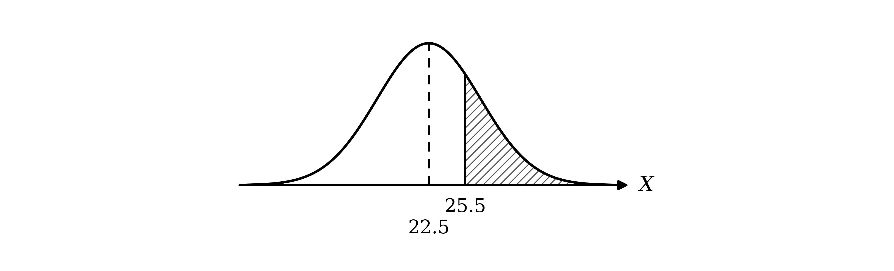

Standardise using the formula

$Z = \frac{X-μ}{σ}$

Substitute $σ = \sqrt{18.28125} = 4 . 2756 \dots$

`\text{P}\left(Z > \dfrac{25.5 - 22.5}{4.2756\ldots}\right) = \text{P}(Z > 0.702)`

**[M1 M1]**

The required area is to the right of 0.702

$\text{P} ( Z > 0 . 702 ) = 1 - Φ ( 0 . 702 )$

**[M1]**

In the table of the normal distribution function in the formula booklet, the 0.7 row and the 0 column give 0.7580, and ADD 2 in the 0.7 row is 6

$Φ ( 0 . 702 ) = 0 . 7580 + 0 . 0006 = 0 . 7586$

$1 - 0 . 7586 = 0 . 2414$

**Final answer:** $\text{P} ( X > 25 ) = 0 . 241$** (3 s.f.)**

**[A1]**

> **[mark-scheme]**
> **B1**: Mean 22.5 and variance 18.28 seen, allow unsimplified. σ = 4.276 implies the variance. Giving 18.28 as the standard deviation does not score.
> 
> **M1**: Substituting their mean and their standard deviation into the standardisation formula (any boundary value), not σ² and not √σ.
> 
> **M1**: A continuity correction of 25.5 or 26.5 in their standardisation.
> 
> **M1**: The appropriate area, 1 − Φ(0.702), which must be a probability less than 0.5.
> 
> **A1**: 0.241, accepting any value from 0.241 to 0.2415.
> 
> If the answer is given with no working, for example straight from a calculator, award 1 mark only.
A normal approximation to $\text{B} ( n ,  p )$ is valid when $n p > 5$ and $n ( 1 - p ) > 5$

$n p = 120 \times \frac{3}{16} = 22 . 5$

$n ( 1 - p ) = 120 \times \frac{13}{16} = 97 . 5$

**Final answer:** $n p = 22 . 5$** and **$n ( 1 - p ) = 97 . 5$** are both greater than 5**

**[B1]**

> **[mark-scheme]**
> **B1**: np = 22.5 and n(1 − p) = 97.5 (or nq = 97.5) both evaluated, and both stated to be greater than 5. "n is large" alone does not score.

### Q2
Let $L$ be the length, in cm, of a variety A cucumber, so `L \sim \text{N}(30, \; 2.5^{2})`

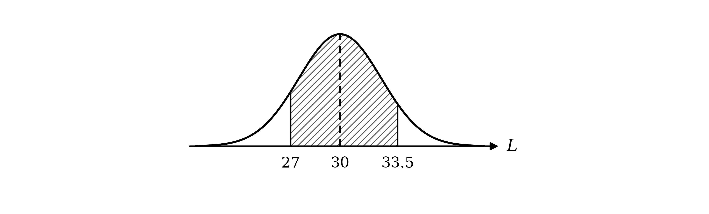

Standardise each boundary using the formula

$Z = \frac{X-μ}{σ}$

`\text{P}(27 < L < 33.5) = \text{P}\left(\dfrac{27 - 30}{2.5} < Z < \dfrac{33.5 - 30}{2.5}\right) = \text{P}(-1.2 < Z < 1.4)`

**[M1]**

The area is the area to the left of 1.4 minus the area to the left of −1.2, using symmetry for the negative value

`\text{P}(-1.2 < Z < 1.4) = \mathrm{\Phi}(1.4) - \left(1 - \mathrm{\Phi}(1.2)\right)`

**[M1]**

In the table of the normal distribution function in the formula booklet, the 1.4 row and the 0 column give 0.9192, and the 1.2 row and the 0 column give 0.8849

$0 . 9192 - ( 1 - 0 . 8849 ) = 0 . 8041$

**[A1]**

The expected number is the sample size times this probability

$400 \times 0 . 8041 = 321 . 64$

A number of cucumbers is a whole number

**Final answer:** **322 cucumbers**

**[B1]**

> **[mark-scheme]**
> **M1**: Standardising with 30, 2.5 and either 27 or 33.5. Using 2.5² or √2.5, or a continuity correction, does not score.
> 
> **M1**: The appropriate area, such as Φ(1.4) − (1 − Φ(1.2)) or Φ(1.4) + Φ(1.2) − 1, leading to a probability greater than 0.5.
> 
> **A1**: 0.804, accepting any value from 0.804 to 0.8042.
> 
> **B1**: 321 or 322, from their probability to at least 4 s.f. multiplied by 400. A single whole number only, with no "≈" or "about"; 321.64 does not score.
Let $M$ be the length, in cm, of a variety B cucumber, so `M \sim \text{N}(28, \; \sigma^{2})` and $\text{P} ( M < 25 ) = 0 . 15$

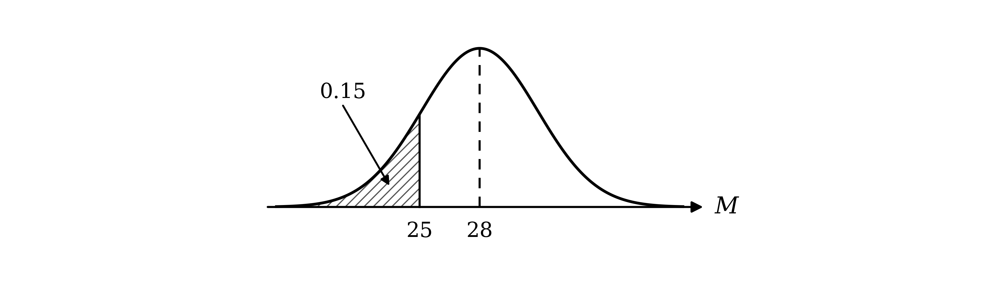

0.15 is a left-tail area, so 25 is below the mean and its $z$-value is negative; the area to the left of the matching positive value is 0.85, which is not in the table of critical values, so look for it in the body of the table of the normal distribution function in the formula booklet; the nearest value below 0.85 is in the 1.0 row and the 3 column

$Φ ( 1 . 03 ) = 0 . 8485$

Subtract to find how much more area is needed

$0 . 85 - 0 . 8485 = 0 . 0015$

In the 1.0 row, the nearest ADD value to 15 is 14, in the ADD 6 column, so the third decimal place is 6

$z = - 1 . 036$

**[B1]**

Standardise using the formula

$Z = \frac{X-μ}{σ}$

Set the result equal to this $z$-value

$\frac{25-28}{σ} = - 1 . 036$

**[M1]**

$σ = \frac{3}{1.036} = 2 . 8957 \dots$

**Final answer:** $σ = 2 . 90$** (3 s.f.)**

**[A1]**

> **[mark-scheme]**
> **B1**: z = −1.036, accepting any value from 1.036 to 1.037 or from −1.037 to −1.036.
> 
> **M1**: (25 − 28)/σ equated to a z-value (signs consistent). Equating to 0.15, 0.85 or 0.5596 does not score.
> 
> **A1**: σ = 2.90, accepting any value from 2.89 to 2.90.
The 90 cucumbers are chosen at random, so they are independent, each shorter than 25.0 cm with probability 0.15; so $X$, the number of these cucumbers, follows a binomial distribution, `X \sim \text{B}(90, \; 0.15)`; for the normal approximation, the mean is $n p$ and the variance is $n p ( 1 - p )$

$μ = 90 \times 0 . 15 = 13 . 5$

$σ^{2} = 90 \times 0 . 15 \times 0 . 85 = 11 . 475$

**[B1]**

"Fewer than 10" means the number can be any whole number up to 9; on the continuous scale, with `Y \sim \text{N}(13.5, \; 11.475)`, $Y$ can take any value up to 9.5 (continuity correction)

$\text{P} ( X < 10 ) \approx \text{P} ( Y < 9 . 5 )$

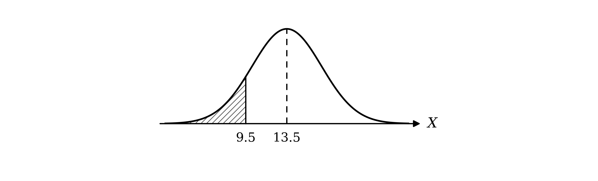

Standardise using the formula

$Z = \frac{X-μ}{σ}$

Substitute $σ = \sqrt{11.475} = 3 . 3874 \dots$

`\text{P}\left(Z < \dfrac{9.5 - 13.5}{3.3874\ldots}\right) = \text{P}(Z < -1.181)`

**[M1 M1]**

The $z$-value is negative, so use symmetry

$\text{P} ( Z < - 1 . 181 ) = 1 - Φ ( 1 . 181 )$

**[M1]**

In the table of the normal distribution function in the formula booklet, the 1.1 row and the 8 column give 0.8810, and ADD 1 in the 1.1 row is 2

$Φ ( 1 . 181 ) = 0 . 8810 + 0 . 0002 = 0 . 8812$

$1 - 0 . 8812 = 0 . 1188$

**Final answer:** $\text{P} ( X < 10 ) = 0 . 119$** (3 s.f.)**

**[A1]**

> **[mark-scheme]**
> **B1**: Mean 13.5 and variance 11.475 seen, allow unsimplified. σ = 3.387 implies the variance. Giving 11.475 as the standard deviation does not score.
> 
> **M1**: Substituting their mean and their standard deviation into the standardisation formula (any boundary value), not σ² and not √σ.
> 
> **M1**: A continuity correction of 9.5 or 10.5 in their standardisation.
> 
> **M1**: The appropriate area, 1 − Φ(1.181), which must be a probability less than 0.5.
> 
> **A1**: 0.119, accepting any value from 0.1185 to 0.119.
> 
> If the answer is given with no working, for example straight from a calculator, award 1 mark only.

### Q3
(i)

A mass is a continuous measurement, so it can take any value in a range

**Final answer:** **Normal**

**[B1]**

(ii)

There are a fixed number of flips (100), each independent, with the same probability 0.5 of tails

**Final answer:** **Binomial**

**[B1]**

(iii)

There is no fixed number of trials for the emails, and the number is not a continuous measurement

**Final answer:** **Neither**

**[B1]**

(iv)

There are a fixed number of students (30), each rolling independently, with the same probability $\frac{4}{6}$ of a number less than 5

**Final answer:** **Binomial**

**[B1]**

> **[mark-scheme]**
> **B1**: Normal for $A$.
> 
> **B1**: Binomial for $B$.
> 
> **B1**: Neither for $C$.
> 
> **B1**: Binomial for $D$.
> 
> No reasons are required. An answer that names more than one distribution does not score.
$X$ counts the selections up to and including the first '5', with the same probability $\frac{1}{9}$ of a '5' each time, independently

**Final answer:** **Geometric distribution**

**[B1]**

> **[mark-scheme]**
> **B1**: Geometric distribution. Accept `\text{Geo}\left(\dfrac{1}{9}\right)`; the parameter is not required.

### Q4
**Final answer:** **The trials are independent of each other**

**[B1]**

**Final answer:** **The probability of success is the same for every trial**

**[B1]**

> **[mark-scheme]**
> **B1**: Trials independent.
> 
> **B1**: Constant probability of success. Accept "p is fixed" or equivalent.
> 
> Repeating the conditions given in the question (a fixed number of trials, two outcomes) does not score.
(i)

The spinning stops at the first '1', so the number of spins is not decided in advance

**Final answer:** **There is not a fixed number of trials**

**[B1]**

(ii)

Each spin turns exactly 115° from where the last one stopped, so where it lands depends on the previous spin

**Final answer:** **The trials are not independent**

**[B1]**

(iii)

$C$ can take any of the eight values 1 to 8, not just "success" or "failure"

**Final answer:** **Each trial has more than two outcomes**

**[B1]**

> **[mark-scheme]**
> **B1**: Not a fixed number of trials for $A$.
> 
> **B1**: Trials not independent for $B$. Accept "the outcome depends on the previous spin" or "the probability of a '1' is not constant".
> 
> **B1**: More than two outcomes for $C$ (or $C$ is not a count of successes).
$A$ counts the spins up to and including the first '1', with the same probability $\frac{1}{8}$ of a '1' on each independent spin

$A$

**[B1]**

> **[mark-scheme]**
> **B1**: $A$.

### Q5
The 8 students are chosen at random, so they are independent, each walking to college with probability 0.75; so $W$, the number who walk, follows a binomial distribution

`W \sim \text{B}(8, \; 0.75)`

Use the binomial probability formula

`\text{P}(W = r) = {}^{n}C_{r} p^{r} (1 - p)^{n - r}`

"At least 7" means $W = 7$ or 8

`\text{P}(W \geq 7) = {}^{8}C_{7}(0.75)^{7}(0.25) + (0.75)^{8}`

**[M1 A1]**

$\text{P} ( W \geq 7 ) = 0 . 266968 + 0 . 100113 = 0 . 367081 \dots$

**Final answer:** $\text{P} ( W \geq 7 ) = 0 . 367$** (3 s.f.)**

**[B1]**

> **[mark-scheme]**
> **M1**: At least one term of the form `{}^{8}C_{x}\,p^{x}(1 - p)^{8 - x}`, 0 < p < 1.
> 
> **A1**: A correct expression for P(7) + P(8), written out in full with no terms missing. Accept unsimplified.
> 
> **B1**: 0.367, or answers which round to 0.367.
> 
> If 0.367 is given with no working, for example straight from a calculator, award 1 mark only.
The 75 students are chosen at random, so they are independent, each walking to college with probability 0.75; so $X$, the number who walk, follows a binomial distribution, `X \sim \text{B}(75, \; 0.75)`; for the normal approximation, the mean is $n p$ and the variance is $n p ( 1 - p )$

$μ = 75 \times 0 . 75 = 56 . 25$

$σ^{2} = 75 \times 0 . 75 \times 0 . 25 = 14 . 0625$

**[B1]**

Let `Y \sim \text{N}(56.25, \; 14.0625)`; "between 55 and 57 inclusive" means the number who walk can be 55, 56 or 57, so on the continuous scale $Y$ can take any value from 54.5 to 57.5 (continuity correction)

$\text{P} ( 55 \leq X \leq 57 ) \approx \text{P} ( 54 . 5 < Y < 57 . 5 )$

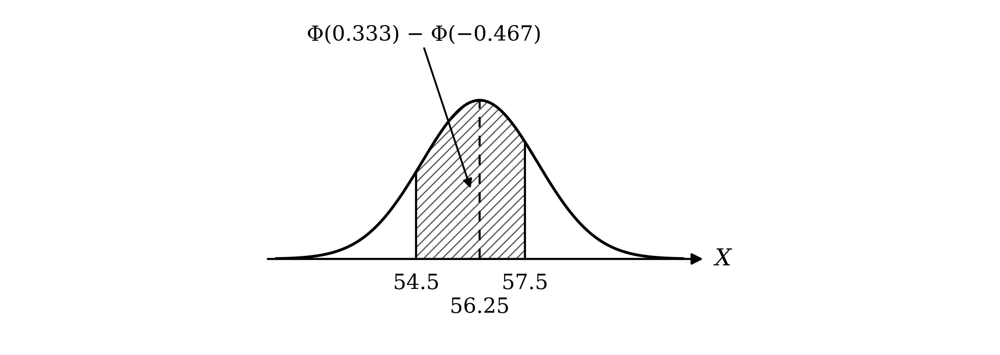

Standardise using the formula

$Z = \frac{X-μ}{σ}$

Substitute $μ = 56 . 25$ and $σ = \sqrt{14.0625} = 3 . 75$

`\text{P}\left(\dfrac{54.5 - 56.25}{3.75} < Z < \dfrac{57.5 - 56.25}{3.75}\right) = \text{P}(-0.467 < Z < 0.333)`

**[M1 M1]**

The area between the two $z$-values is the area to the left of 0.333 minus the area to the left of −0.467

$\text{P} ( - 0 . 467 < Z < 0 . 333 ) = Φ ( 0 . 333 ) - Φ ( - 0 . 467 )$

The table only gives positive values of $z$, so use symmetry

$Φ ( - 0 . 467 ) = 1 - Φ ( 0 . 467 )$

`\text{P}(-0.467 < Z < 0.333) = \mathrm{\Phi}(0.333) - \left(1 - \mathrm{\Phi}(0.467)\right)`

**[M1]**

In the table of the normal distribution function in the formula booklet, the 0.3 row and the 3 column give 0.6293, and ADD 3 in the 0.3 row is 11

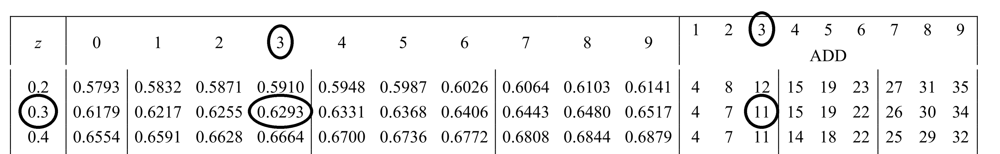

$Φ ( 0 . 333 ) = 0 . 6293 + 0 . 0011 = 0 . 6304$

The 0.4 row and the 6 column give 0.6772, and ADD 7 in the 0.4 row is 25

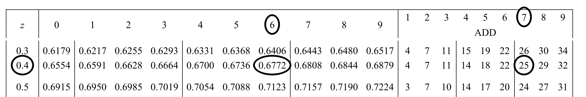

$Φ ( 0 . 467 ) = 0 . 6772 + 0 . 0025 = 0 . 6797$

$0 . 6304 - ( 1 - 0 . 6797 ) = 0 . 3101$

**Final answer:** $\text{P} ( 55 \leq X \leq 57 ) \approx 0 . 310$** (3 s.f.)**

**[A1]**

> **[mark-scheme]**
> **B1**: Mean 56.25 and variance 14.0625 seen, allow unsimplified. σ = 3.75 implies the variance. Giving 14.0625 as the standard deviation does not score.
> 
> **M1**: Substituting their mean and their standard deviation into the standardisation formula (any boundary value), not σ² and not √σ.
> 
> **M1**: A continuity correction: 54.5 or 55.5, and 56.5 or 57.5, in their standardisation.
> 
> **M1**: The appropriate area from their z-values, such as Φ(0.333) − (1 − Φ(0.467)), which must be a probability.
> 
> **A1**: 0.310, accepting any value from 0.310 to 0.3105.
> 
> If the answer is given with no working, for example straight from a calculator, award 1 mark only.
A normal approximation to $\text{B} ( n ,  p )$ is valid when $n p > 5$ and $n ( 1 - p ) > 5$

$n p = 75 \times 0 . 75 = 56 . 25$

$n ( 1 - p ) = 75 \times 0 . 25 = 18 . 75$

**Final answer:** $n p = 56 . 25$** and **$n ( 1 - p ) = 18 . 75$** are both greater than 5**

**[B1]**

> **[mark-scheme]**
> **B1**: np = 56.25 and n(1 − p) = 18.75 (or nq = 18.75) both evaluated, and both stated to be greater than 5. "n is large" alone does not score.

### Q6
(i)

A length is measured, so it can take any value in a range

**Final answer:** $A$** is continuous**

**[B1]**

(ii)

Marks are whole numbers from 0 to 50, so only certain values are possible

**Final answer:** $B$** is discrete**

**[B1]**

(iii)

Shoes come in set sizes (whole and half sizes), so only certain values are possible

**Final answer:** $C$** is discrete**

**[B1]**

> **[mark-scheme]**
> **B1**: $A$ continuous, with a reason (a measurement, can take any value in a range).
> 
> **B1**: $B$ discrete, with a reason (whole numbers only, or counted).
> 
> **B1**: $C$ discrete, with a reason (set sizes only).
> 
> A correct type with no reason does not score.
A normal distribution is bell-shaped, with most values near the middle, but this histogram has most of its values at the two ends

**Final answer:** **A normal distribution is not appropriate, because the histogram is not bell-shaped**

**[B1]**

> **[mark-scheme]**
> **B1**: Not appropriate, with a reason: not bell-shaped, or most values at the extremes rather than the centre. Symmetry alone is not a reason here, because this histogram is roughly symmetrical.

### Q7
**Final answer:** $n p > 5$** and **$n ( 1 - p ) > 5$

**[B1]**

> **[mark-scheme]**
> **B1**: Both np > 5 and n(1 − p) > 5 (or nq > 5). Accept "n large enough for np and nq both to exceed 5". "n is large" or "p is close to 0.5" alone does not score.
A normal approximation can be used when $n p > 5$ and $n ( 1 - p ) > 5$

(i)

$n p = 6 \times 0 . 45 = 2 . 7$

**Final answer:** $n p < 5$**, so a normal approximation is not appropriate**

**[B1]**

(ii)

$n p = 60 \times 0 . 05 = 3$

**Final answer:** $n p < 5$**, so a normal approximation is not appropriate**

**[B1]**

(iii)

$n p = 60 \times 0 . 45 = 27$

$n ( 1 - p ) = 60 \times 0 . 55 = 33$

Both are greater than 5, so a normal approximation is appropriate

**[B1]**

The mean of the binomial distribution is $n p$

$μ = n p = 27$

**[B1]**

The variance of the binomial distribution is $n p ( 1 - p )$

$σ^{2} = n p ( 1 - p ) = 60 \times 0 . 45 \times 0 . 55 = 14 . 85$

**[B1]**

$X \approx \text{N} ( 27 ,  14 . 85 )$

> **[mark-scheme]**
> **B1**: B(6, 0.45) not appropriate, with np = 2.7 evaluated and compared with 5.
> 
> **B1**: B(60, 0.05) not appropriate, with np = 3 evaluated and compared with 5.
> 
> **B1**: B(60, 0.45) appropriate, with np = 27 and n(1 − p) = 33 both evaluated and both stated to be greater than 5.
> 
> **B1**: μ = 27.
> 
> **B1**: σ² = 14.85. Accept N(27, 14.85) written in full. Giving 14.85 as the standard deviation does not score.
> 
> The first two marks need the number compared with 5; "n is too small" or "p is not close to 0.5" alone does not score.

### Q8
The mean of the binomial distribution is $n p$

$μ = 100 \times 0 . 36$

$μ = 36$

**[B1]**

The variance of the binomial distribution is $n p ( 1 - p )$

$σ^{2} = 100 \times 0 . 36 \times 0 . 64 = 23 . 04$

Square root the variance to find the standard deviation

$σ = \sqrt{23.04}$

$σ = 4 . 8$

**[B1]**

> **[mark-scheme]**
> **B1**: μ = 36.
> 
> **B1**: σ = 4.8. Giving 23.04 as σ does not score.
$X$ takes whole-number values, and each value $x$ is represented on the normal curve by the interval from $x - 0 . 5$ to $x + 0 . 5$

(i)

30 is the largest value included, so go to the top of its interval

$k = 30 . 5$

**[B1]**

(ii)

29 is the largest value included, so go to the top of its interval

$k = 29 . 5$

**[B1]**

(iii)

30 is the smallest value included, so go to the bottom of its interval

$k = 29 . 5$

**[B1]**

(iv)

31 is the smallest value included, so go to the bottom of its interval

$k = 30 . 5$

**[B1]**

> **[mark-scheme]**
> **B1**: k = 30.5.
> 
> **B1**: k = 29.5.
> 
> **B1**: k = 29.5.
> 
> **B1**: k = 30.5.

### Q9
The quartiles cut off 25% in each tail, and the distribution is symmetrical about $μ$, so they are the same distance either side of the mean

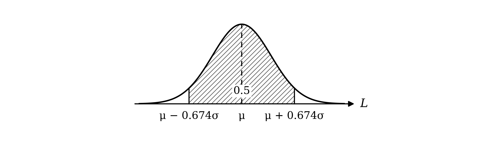

0.75 is in the table of critical values in the formula booklet

$z = 0 . 674$

**[B1]**

So the upper quartile is $μ + 0 . 674 σ$ and the lower quartile is $μ - 0 . 674 σ$; the interquartile range is their difference

$( μ + 0 . 674 σ ) - ( μ - 0 . 674 σ ) = 0 . 01712$

**[M1]**

$1 . 348 σ = 0 . 01712$

$σ = \frac{0.01712}{1.348} = 0 . 012700 \dots$

**Final answer:** $σ = 0 . 0127$** (3 s.f.)**

**[A1]**

> **[mark-scheme]**
> **B1**: z = 0.674 (or −0.674), the critical value for 0.75.
> 
> **M1**: An equation using standardisation with a z-value, such as (UQ − μ)/σ = 0.674 with UQ − μ = 0.00856, or 1.348σ = 0.01712. Using 0.75 or 0.25 as z does not score.
> 
> **A1**: σ = 0.0127, or answers which round to 0.0127.
1 cm is 0.01 m, so the rod's length is at most $μ - 0 . 01$

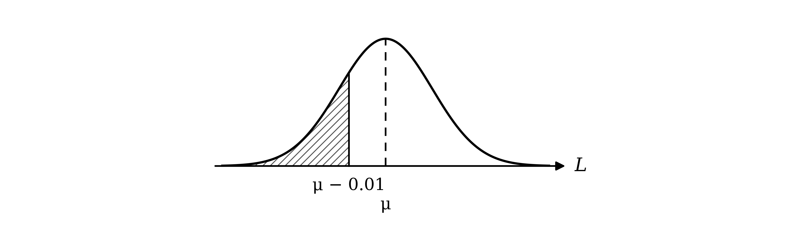

Standardise using the formula

$Z = \frac{X-μ}{σ}$

Substitute the unrounded $σ = 0 . 012700 \dots$ from part (a); the $μ$ cancels

`\text{P}(L \leq \mu - 0.01) = \text{P}\left(Z \leq \dfrac{(\mu - 0.01) - \mu}{0.012700\ldots}\right) = \text{P}(Z \leq -0.787)`

**[M1]**

The $z$-value is negative, so use symmetry

$\text{P} ( Z \leq - 0 . 787 ) = 1 - Φ ( 0 . 787 )$

**[M1]**

In the table of the normal distribution function in the formula booklet, the 0.7 row and the 8 column give 0.7823, and ADD 7 in the 0.7 row is 21

$Φ ( 0 . 787 ) = 0 . 7823 + 0 . 0021 = 0 . 7844$

$1 - 0 . 7844 = 0 . 2156$

**Final answer:** $0 . 216$** (3 s.f.)**

**[A1]**

> **[mark-scheme]**
> **M1**: Standardising with −0.01 (or μ − 0.01 and μ) and their σ.
> 
> **M1**: The appropriate area, 1 − Φ(0.787), leading to a probability less than 0.5.
> 
> **A1**: 0.215 or 0.216 (table or calculator), kept to at least 4 s.f. for part (c).
> 
> If the answer is given with no working, for example straight from a calculator, award 1 mark only.
The 20 rods are chosen at random, so they are independent, each 1 cm or more below the mean with probability 0.2156; so $X$, the number of such rods, follows a binomial distribution

`X \sim \text{B}(20, \; 0.2156)`

Use the binomial probability formula, `\text{P}(X = r) = {}^{n}C_{r} p^{r} (1 - p)^{n - r}`. "At most two" means $X = 0$, 1 or 2

`\text{P}(X \leq 2) = (0.7844)^{20} + {}^{20}C_{1}(0.2156)(0.7844)^{19} + {}^{20}C_{2}(0.2156)^{2}(0.7844)^{18}`

**[M1 A1]**

$\text{P} ( X \leq 2 ) = 0 . 007776 + 0 . 042746 + 0 . 111616 = 0 . 162137 \dots$

**Final answer:** $\text{P} ( X \leq 2 ) = 0 . 162$** (3 s.f.)**

**[A1]**

> **[mark-scheme]**
> **M1**: At least one term of the form `{}^{20}C_{x}\,p^{x}(1 - p)^{20 - x}` with any p, 0 < p < 1.
> 
> **A1**: A correct expression for P(0) + P(1) + P(2), written out in full with no terms missing, using their p to at least 3 s.f. Accept unsimplified.
> 
> **A1**: 0.162 or 0.163 (from a table or calculator value of p).
> 
> If 0.162 is given with no working, for example straight from a calculator, award 1 mark only.

### Q10
The 980 adults are chosen at random, so they are independent, each reading the newspaper with probability 0.4; so $W$, the number who read it, follows a binomial distribution, `W \sim \text{B}(980, \; 0.4)`; for the normal approximation, the mean is $n p$ and the variance is $n p ( 1 - p )$

$μ = 980 \times 0 . 4 = 392$

$σ^{2} = 980 \times 0 . 4 \times 0 . 6 = 235 . 2$

**[B1]**

"More than 386 but fewer than 398" means the number who read the newspaper can be any whole number from 387 to 397; on the continuous scale, with `V \sim \text{N}(392, \; 235.2)`, $V$ can take any value from 386.5 to 397.5 (continuity correction)

$\text{P} ( 386 < W < 398 ) \approx \text{P} ( 386 . 5 < V < 397 . 5 )$

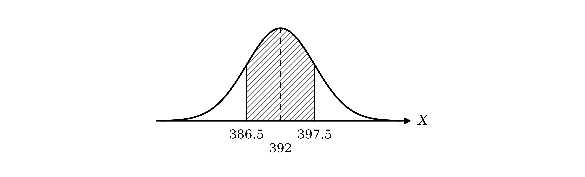

Standardise each boundary using the formula

$Z = \frac{X-μ}{σ}$

Substitute $σ = \sqrt{235.2} = 15 . 336 \dots$

`\text{P}\left(\dfrac{386.5 - 392}{\sqrt{235.2}} < Z < \dfrac{397.5 - 392}{\sqrt{235.2}}\right) = \text{P}(-0.359 < Z < 0.359)`

**[M1 M1]**

The area between the two $z$-values is the area to the left of 0.359 minus the area to the left of −0.359

$\text{P} ( - 0 . 359 < Z < 0 . 359 ) = Φ ( 0 . 359 ) - Φ ( - 0 . 359 )$

The table only gives positive values of $z$. By symmetry, the area to the left of −0.359 equals the area to the right of 0.359

$Φ ( - 0 . 359 ) = 1 - Φ ( 0 . 359 )$

Substitute this into the first line

`\text{P}(-0.359 < Z < 0.359) = \mathrm{\Phi}(0.359) - \left(1 - \mathrm{\Phi}(0.359)\right)`

$\text{P} ( - 0 . 359 < Z < 0 . 359 ) = 2 Φ ( 0 . 359 ) - 1$

**[M1]**

In the table of the normal distribution function in the formula booklet, the 0.3 row and the 5 column give 0.6368, and ADD 9 in the 0.3 row is 34

$Φ ( 0 . 359 ) = 0 . 6368 + 0 . 0034 = 0 . 6402$

$2 \times 0 . 6402 - 1 = 0 . 2804$

**Final answer:** $\text{P} ( 386 < W < 398 ) = 0 . 280$** (3 s.f.)**

**[A1]**

> **[mark-scheme]**
> **B1**: Mean 392 and variance 235.2 seen, allow unsimplified. σ = 15.34 implies the variance. Giving 235.2 as the standard deviation does not score.
> 
> **M1**: Substituting their mean and their standard deviation into the standardisation formula (any boundary value), not σ² and not √σ.
> 
> **M1**: Continuity corrections: 386.5 or 387.5, and 396.5 or 397.5, in their standardisation.
> 
> **M1**: The appropriate area from their z-values, such as 2Φ(0.359) − 1, which must be a probability.
> 
> **A1**: 0.280, accepting any value from 0.280 to 0.2805.
> 
> If the answer is given with no working, for example straight from a calculator, award 1 mark only.
"At least 400" means the number can be any whole number from 400 upwards; on the continuous scale, $V$ can take any value above 399.5

$\text{P} ( W \geq 400 ) \approx \text{P} ( V > 399 . 5 )$

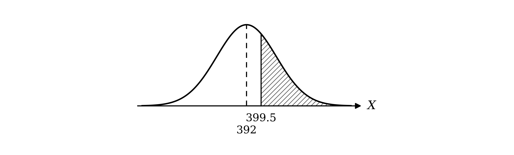

Standardise using the formula

$Z = \frac{X-μ}{σ}$

Substitute $μ = 392$ and $σ = \sqrt{235.2}$

`\text{P}\left(Z > \dfrac{399.5 - 392}{\sqrt{235.2}}\right) = \text{P}(Z > 0.489)`

**[M1]**

The required area is to the right of 0.489

$\text{P} ( Z > 0 . 489 ) = 1 - Φ ( 0 . 489 )$

**[M1]**

In the table of the normal distribution function in the formula booklet, the 0.4 row and the 8 column give 0.6844, and ADD 9 in the 0.4 row is 32

$Φ ( 0 . 489 ) = 0 . 6844 + 0 . 0032 = 0 . 6876$

$1 - 0 . 6876 = 0 . 3124$

**Final answer:** $\text{P} ( W \geq 400 ) = 0 . 312$** (3 s.f.)**

**[A1]**

> **[mark-scheme]**
> **M1**: Standardising with their mean and standard deviation and a continuity correction of 399.5 or 400.5.
> 
> **M1**: The appropriate area, 1 − Φ(0.489), which must be a probability less than 0.5.
> 
> **A1**: 0.312, accepting any value from 0.312 to 0.3125.
> 
> If the answer is given with no working, for example straight from a calculator, award 1 mark only.
A normal approximation to $\text{B} ( n ,  p )$ is valid when $n p > 5$ and $n ( 1 - p ) > 5$

$n p = 980 \times 0 . 4 = 392$

$n ( 1 - p ) = 980 \times 0 . 6 = 588$

**Final answer:** $n p = 392$** and **$n ( 1 - p ) = 588$** are both greater than 5**

**[B1]**

> **[mark-scheme]**
> **B1**: np = 392 and n(1 − p) = 588 (or nq = 588) both evaluated, and both stated to be greater than 5. "n is large" alone does not score.
"More than $k$ but fewer than $784 - k$" means the number can be any whole number from $k + 1$ to $783 - k$; on the continuous scale, $V$ can take any value from $k + 0 . 5$ to $783 . 5 - k$; the midpoint of these two values is $\frac{784}{2} = 392$, the mean, so the interval is symmetrical about the mean, extending $391 . 5 - k$ either side

$\text{P} ( k + 0 . 5 < V < 783 . 5 - k ) < 0 . 5$

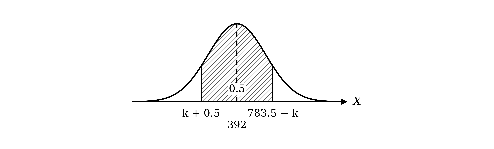

Standardise using the formula

$Z = \frac{X-μ}{σ}$

Let $c = \frac{391.5-k}{\sqrt{235.2}}$; the interval is symmetrical about the mean, so it standardises to $- c < Z < c$, with area the area to the left of $c$ minus the area to the left of $- c$

$\text{P} ( - c < Z < c ) = Φ ( c ) - Φ ( - c )$

By symmetry, the area to the left of $- c$ equals the area to the right of $c$

$Φ ( - c ) = 1 - Φ ( c )$

`\text{P}(-c < Z < c) = \mathrm{\Phi}(c) - \left(1 - \mathrm{\Phi}(c)\right) = 2\mathrm{\Phi}(c) - 1`

Set this less than 0.5

$2 Φ ( c ) - 1 < 0 . 5$

**[M1]**

$Φ ( c ) < 0 . 75$

0.75 is in the table of critical values in the formula booklet

$z = 0 . 674$

**[B1]**

$\frac{391.5-k}{\sqrt{235.2}} < 0 . 674$

**[M1]**

Rearrange for $k$; subtracting $k$ means the inequality reverses when solving for it

$k > 391 . 5 - 0 . 674 \sqrt{235.2} = 381 . 16 \dots$

$k$ is an integer

$k = 382$

**[A1]**

> **[exam-tip]**
> The interval looks lopsided until you add its two ends: k + (784 − k) = 784, so its centre is always 392, the mean. Spotting that it is symmetrical is what lets you use 2Φ(z) − 1.

> **[mark-scheme]**
> **M1**: The interval recognised as symmetrical about 392 and its area written as 2Φ(z) − 1 (or equivalent).
> 
> **B1**: z = 0.674, the critical value for 0.75.
> 
> **M1**: (391.5 − k)/√235.2 (or (392 − k)/√235.2 with no continuity correction, or 392.5 − k) compared with or equated to their z-value. Using 0.75 or 0.25 as z does not score.
> 
> **A1**: k = 382 only.

### Q11
A counter is red or black with probability

$\frac{6}{13} + \frac{6}{13} = \frac{12}{13}$

The 50 counters are independent, so $X$, the number that are red or black, follows a binomial distribution

`X \sim \text{B}\left(50, \; \dfrac{12}{13}\right)`

Use the binomial probability formula

`\text{P}(X = r) = {}^{n}C_{r} p^{r} (1 - p)^{n - r}`

`\text{P}(X = 45) = {}^{50}C_{45}\left(\dfrac{12}{13}\right)^{45}\left(\dfrac{1}{13}\right)^{5}`

**[M1]**

$\text{P} ( X = 45 ) = 0 . 155621 \dots$

**Final answer:** $\text{P} ( X = 45 ) = 0 . 156$** (3 s.f.)**

**[A1]**

> **[mark-scheme]**
> **M1**: A term of the form `{}^{50}C_{45}\,p^{45}(1 - p)^{5}`, 0 < p < 1.
> 
> **A1**: 0.156, or answers which round to 0.156.
> 
> If 0.156 is given with no working, for example straight from a calculator, award 1 mark only.
A counter is green with probability $1 - \frac{12}{13} = \frac{1}{13}$, so $Y$, the number of green counters, follows `\text{B}\left(1000, \; \dfrac{1}{13}\right)`; for the normal approximation, the mean is $n p$ and the variance is $n p ( 1 - p )$

$μ = 1000 \times \frac{1}{13} = 76 . 923 \dots$

$σ^{2} = 1000 \times \frac{1}{13} \times \frac{12}{13} = 71 . 005 \dots$

**[B1]**

"At least 75 but fewer than 80" means the number of green counters can be any whole number from 75 to 79; on the continuous scale, with `V \sim \text{N}(76.923\ldots, \; 71.005\ldots)`, $V$ can take any value from 74.5 to 79.5 (continuity correction)

$\text{P} ( 75 \leq Y < 80 ) \approx \text{P} ( 74 . 5 < V < 79 . 5 )$

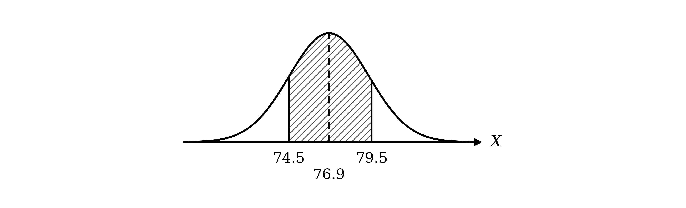

Standardise each boundary using the formula

$Z = \frac{X-μ}{σ}$

Substitute $σ = \sqrt{71.005\dots} = 8 . 4265 \dots$

`\text{P}\left(\dfrac{74.5 - 76.923\ldots}{8.4265\ldots} < Z < \dfrac{79.5 - 76.923\ldots}{8.4265\ldots}\right) = \text{P}(-0.288 < Z < 0.306)`

**[M1 M1]**

The area is the area to the left of 0.306 minus the area to the left of −0.288, using symmetry for the negative value

`\text{P}(-0.288 < Z < 0.306) = \mathrm{\Phi}(0.306) - \left(1 - \mathrm{\Phi}(0.288)\right)`

**[M1]**

In the table of the normal distribution function in the formula booklet, the 0.3 row and the 0 column give 0.6179, and ADD 6 in the 0.3 row is 22

$Φ ( 0 . 306 ) = 0 . 6179 + 0 . 0022 = 0 . 6201$

The 0.2 row and the 8 column give 0.6103, and ADD 8 in the 0.2 row is 31

$Φ ( 0 . 288 ) = 0 . 6103 + 0 . 0031 = 0 . 6134$

$0 . 6201 - ( 1 - 0 . 6134 ) = 0 . 2335$

**Final answer:** $\text{P} ( 75 \leq Y < 80 ) = 0 . 234$** (3 s.f.)**

**[A1]**

> **[mark-scheme]**
> **B1**: Mean 76.92 and variance 71.01 seen, allow unsimplified. σ = 8.427 implies the variance. Giving 71.01 as the standard deviation does not score.
> 
> **M1**: Substituting their mean and their standard deviation into the standardisation formula (any boundary value), not σ² and not √σ.
> 
> **M1**: Continuity corrections: 74.5 or 75.5, and 78.5 or 79.5, in their standardisation.
> 
> **M1**: The appropriate area from their z-values, such as Φ(0.306) − (1 − Φ(0.288)), which must be a probability.
> 
> **A1**: 0.233 or 0.234 (table or calculator values of Φ), accepting any value from 0.233 to 0.2335.
> 
> If the answer is given with no working, for example straight from a calculator, award 1 mark only.
A normal approximation to $\text{B} ( n ,  p )$ is valid when $n p > 5$ and $n ( 1 - p ) > 5$

$n p = 1000 \times \frac{1}{13} = 76 . 9$

$n ( 1 - p ) = 1000 \times \frac{12}{13} = 923 . 1$

**Final answer:** $n p = 76 . 9$** and **$n ( 1 - p ) = 923 . 1$** are both greater than 5**

**[B1]**

> **[mark-scheme]**
> **B1**: np = 76.9 and n(1 − p) = 923.1 (or nq = 923.1) both evaluated, and both stated to be greater than 5. Accept the fractions $\frac{1000}{13}$ and $\frac{12000}{13}$. "n is large" alone does not score.

### Q12
The 36 seeds are chosen at random, so they are independent, each producing a red flower with probability $\frac{18}{37}$; so $X$, the number of seeds producing red flowers, follows a binomial distribution

`X \sim \text{B}\left(36, \; \dfrac{18}{37}\right)`

Use the binomial probability formula

`\text{P}(X = r) = {}^{n}C_{r} p^{r} (1 - p)^{n - r}`

`\text{P}(X = 18) = {}^{36}C_{18}\left(\dfrac{18}{37}\right)^{18}\left(\dfrac{19}{37}\right)^{18}`

**[M1]**

$\text{P} ( X = 18 ) = 0 . 130334 \dots$

**Final answer:** $\text{P} ( X = 18 ) = 0 . 130$** (3 s.f.)**

**[A1]**

> **[mark-scheme]**
> **M1**: A term of the form `{}^{36}C_{18}\,p^{18}(1 - p)^{18}`, 0 < p < 1.
> 
> **A1**: 0.130, or answers which round to 0.130.
> 
> If 0.130 is given with no working, for example straight from a calculator, award 1 mark only.
Let $Y$ be the number of these seeds producing red flowers, so `Y \sim \text{B}\left(1000, \; \dfrac{18}{37}\right)`; for the normal approximation, the mean is $n p$ and the variance is $n p ( 1 - p )$

$μ = 1000 \times \frac{18}{37} = 486 . 486 \dots$

$σ^{2} = 1000 \times \frac{18}{37} \times \frac{19}{37} = 249 . 817 \dots$

**[B1]**

"Fewer than 482" means the number can be any whole number up to 481, and "more than 491" means any whole number from 492 upwards; on the continuous scale, with `V \sim \text{N}(486.486\ldots, \; 249.817\ldots)`, $V$ can take any value below 481.5 or above 491.5 (continuity correction)

$\text{P} ( Y < 482 \text{or} Y > 491 ) \approx \text{P} ( V < 481 . 5 ) + \text{P} ( V > 491 . 5 )$

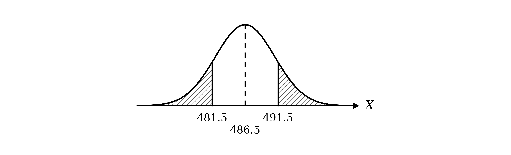

Standardise each boundary using the formula

$Z = \frac{X-μ}{σ}$

Substitute $σ = \sqrt{249.817\dots} = 15 . 806 \dots$

`\text{P}(V < 481.5) = \text{P}\left(Z < \dfrac{481.5 - 486.486\ldots}{15.806\ldots}\right) = \text{P}(Z < -0.315)`

`\text{P}(V > 491.5) = \text{P}\left(Z > \dfrac{491.5 - 486.486\ldots}{15.806\ldots}\right) = \text{P}(Z > 0.317)`

**[M1 M1]**

Each tail is 1 minus a value from the table (using symmetry for the left tail)

`\text{P}(Z < -0.315) + \text{P}(Z > 0.317) = \left(1 - \mathrm{\Phi}(0.315)\right) + \left(1 - \mathrm{\Phi}(0.317)\right)`

**[M1]**

In the table of the normal distribution function in the formula booklet, the 0.3 row and the 1 column give 0.6217; ADD 5 in that row is 19 and ADD 7 is 26

$Φ ( 0 . 315 ) = 0 . 6217 + 0 . 0019 = 0 . 6236$

$Φ ( 0 . 317 ) = 0 . 6217 + 0 . 0026 = 0 . 6243$

$( 1 - 0 . 6236 ) + ( 1 - 0 . 6243 ) = 0 . 3764 + 0 . 3757 = 0 . 7521$

**Final answer:** $\text{P} ( Y < 482 \text{or} Y > 491 ) = 0 . 752$** (3 s.f.)**

**[A1]**

> **[mark-scheme]**
> **B1**: Mean 486.5 and variance 249.8 seen, allow unsimplified. σ = 15.81 implies the variance. Giving 249.8 as the standard deviation does not score.
> 
> **M1**: Substituting their mean and their standard deviation into at least one standardisation (any boundary value), not σ² and not √σ.
> 
> **M1**: Continuity corrections: 481.5 or 482.5, and 490.5 or 491.5, in their two standardisations.
> 
> **M1**: The appropriate area for both tails, such as (1 − Φ(0.315)) + (1 − Φ(0.317)) or 1 − (Φ(0.317) − Φ(−0.315)), which must be a probability.
> 
> **A1**: 0.752, accepting any value from 0.7515 to 0.7525.
> 
> If the answer is given with no working, for example straight from a calculator, award 1 mark only.
A normal approximation to $\text{B} ( n ,  p )$ is valid when $n p > 5$ and $n ( 1 - p ) > 5$

$n p = 1000 \times \frac{18}{37} = 486 . 5$

$n ( 1 - p ) = 1000 \times \frac{19}{37} = 513 . 5$

**Final answer:** $n p = 486 . 5$** and **$n ( 1 - p ) = 513 . 5$** are both greater than 5**

**[B1]**

> **[mark-scheme]**
> **B1**: np = 486.5 and n(1 − p) = 513.5 (or nq = 513.5) both evaluated, and both stated to be greater than 5. "n is large" alone does not score.

### Q13
A normal approximation can be used when $n p > 5$ and $n ( 1 - p ) > 5$, with $μ = n p$ and $σ^{2} = n p ( 1 - p )$

(i)

$n p = 15 \times 0 . 5 = 7 . 5$

$n ( 1 - p ) = 15 \times 0 . 5 = 7 . 5$

Both are greater than 5, so a normal approximation can be used

**[B1]**

$μ = 7 . 5$

**[B1]**

$σ = \sqrt{15\times0.5\times0.5} = \sqrt{3.75} = 1 . 9364 \dots$

**Final answer:** $σ = 1 . 94$** (3 s.f.)**

**[B1]**

$X \approx \text{N} ( 7 . 5 ,  1 . 94^{2} )$

(ii)

$n p = 150 \times 0 . 005 = 0 . 75$

**Final answer:** $n p < 5$**, so a normal approximation cannot be used**

**[B1]**

(iii)

$n p = 1500 \times 0 . 005 = 7 . 5$

$n ( 1 - p ) = 1500 \times 0 . 995 = 1492 . 5$

Both are greater than 5, so a normal approximation can be used

**[B1]**

$μ = 7 . 5$

**[B1]**

$σ = \sqrt{1500\times0.005\times0.995} = \sqrt{7.4625} = 2 . 7317 \dots$

**Final answer:** $σ = 2 . 73$** (3 s.f.)**

**[B1]**

$X \approx \text{N} ( 7 . 5 ,  2 . 73^{2} )$

> **[exam-tip]**
> Parts (ii) and (iii) are a pair: a large n does not guarantee the approximation works if p is very small, and a p far from 0.5 is fine if n is big enough. Only the two numbers np and n(1 − p) decide it.

> **[mark-scheme]**
> **B1**: B(15, 0.5): np = 7.5 and n(1 − p) = 7.5 both evaluated and both stated to be greater than 5.
> 
> **B1**: μ = 7.5.
> 
> **B1**: σ = 1.94, or answers which round to 1.94.
> 
> **B1**: B(150, 0.005) cannot be approximated, with np = 0.75 evaluated and compared with 5. "p is not close to 0.5" alone does not score.
> 
> **B1**: B(1500, 0.005): np = 7.5 and n(1 − p) = 1492.5 both evaluated and both stated to be greater than 5.
> 
> **B1**: μ = 7.5.
> 
> **B1**: σ = 2.73, or answers which round to 2.73.
> 
> Giving the variance as σ does not earn the σ mark.

### Q14
The 1200 customers are chosen at random, so they are independent, each paying by card with probability 0.6; so $W$, the number who pay by card, follows a binomial distribution, `W \sim \text{B}(1200, \; 0.6)`; for the normal approximation, the mean is $n p$ and the variance is $n p ( 1 - p )$

$μ = 1200 \times 0 . 6 = 720$

$σ^{2} = 1200 \times 0 . 6 \times 0 . 4 = 288$

**[B1]**

"More than 700 and at most 730" means the number who pay by card can be any whole number from 701 to 730; on the continuous scale, with `V \sim \text{N}(720, \; 288)`, $V$ can take any value from 700.5 to 730.5 (continuity correction)

$\text{P} ( 700 < W \leq 730 ) \approx \text{P} ( 700 . 5 < V < 730 . 5 )$

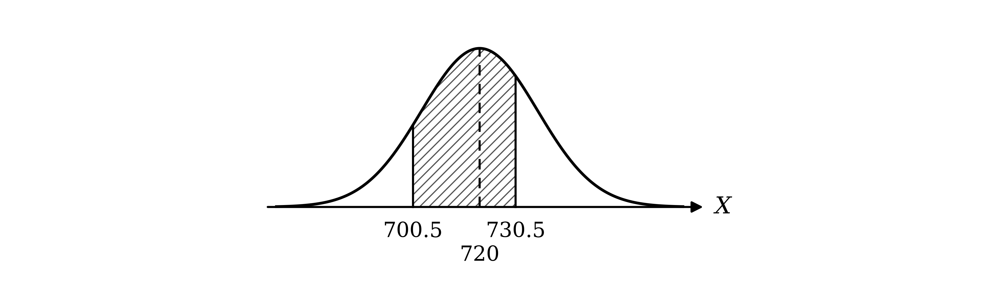

Standardise each boundary using the formula

$Z = \frac{X-μ}{σ}$

Substitute $σ = \sqrt{288} = 16 . 970 \dots$

`\text{P}\left(\dfrac{700.5 - 720}{\sqrt{288}} < Z < \dfrac{730.5 - 720}{\sqrt{288}}\right) = \text{P}(-1.149 < Z < 0.619)`

**[M1 M1]**

The area is the area to the left of 0.619 minus the area to the left of −1.149, using symmetry for the negative value

`\text{P}(-1.149 < Z < 0.619) = \mathrm{\Phi}(0.619) - \left(1 - \mathrm{\Phi}(1.149)\right)`

**[M1]**

In the table of the normal distribution function in the formula booklet, the 0.6 row and the 1 column give 0.7291, and ADD 9 in the 0.6 row is 29

$Φ ( 0 . 619 ) = 0 . 7291 + 0 . 0029 = 0 . 7320$

The 1.1 row and the 4 column give 0.8729, and ADD 9 in the 1.1 row is 18

$Φ ( 1 . 149 ) = 0 . 8729 + 0 . 0018 = 0 . 8747$

$0 . 7320 - ( 1 - 0 . 8747 ) = 0 . 6067$

**Final answer:** $\text{P} ( 700 < W \leq 730 ) = 0 . 607$** (3 s.f.)**

**[A1]**

> **[mark-scheme]**
> **B1**: Mean 720 and variance 288 seen, allow unsimplified. σ = 16.97 implies the variance. Giving 288 as the standard deviation does not score.
> 
> **M1**: Substituting their mean and their standard deviation into the standardisation formula (any boundary value), not σ² and not √σ.
> 
> **M1**: Continuity corrections: 700.5 or 701.5, and 729.5 or 730.5, in their standardisation.
> 
> **M1**: The appropriate area from their z-values, such as Φ(0.619) − (1 − Φ(1.149)), which must be a probability.
> 
> **A1**: 0.607, accepting any value from 0.6065 to 0.607.
> 
> If the answer is given with no working, for example straight from a calculator, award 1 mark only.
"At least 719" means the number can be any whole number from 719 upwards; on the continuous scale, $V$ can take any value above 718.5

$\text{P} ( W \geq 719 ) \approx \text{P} ( V > 718 . 5 )$

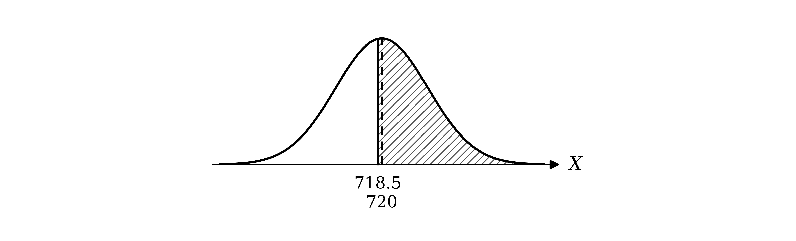

Standardise using the formula

$Z = \frac{X-μ}{σ}$

Substitute $μ = 720$ and $σ = \sqrt{288}$

`\text{P}\left(Z > \dfrac{718.5 - 720}{\sqrt{288}}\right) = \text{P}(Z > -0.088)`

**[M1]**

By symmetry, the area to the right of −0.088 equals the area to the left of 0.088

$\text{P} ( Z > - 0 . 088 ) = Φ ( 0 . 088 )$

**[M1]**

In the table of the normal distribution function in the formula booklet, the 0.0 row and the 8 column give 0.5319, and ADD 8 in the 0.0 row is 32

$Φ ( 0 . 088 ) = 0 . 5319 + 0 . 0032 = 0 . 5351$

**Final answer:** $\text{P} ( W \geq 719 ) = 0 . 535$** (3 s.f.)**

**[A1]**

> **[mark-scheme]**
> **M1**: Standardising with their mean and standard deviation and a continuity correction of 718.5 or 719.5.
> 
> **M1**: The appropriate area, Φ(0.088), leading to a probability greater than 0.5.
> 
> **A1**: 0.535, accepting any value from 0.535 to 0.5355.
> 
> If the answer is given with no working, for example straight from a calculator, award 1 mark only.
A normal approximation to $\text{B} ( n ,  p )$ is valid when $n p > 5$ and $n ( 1 - p ) > 5$

$n p = 1200 \times 0 . 6 = 720$

$n ( 1 - p ) = 1200 \times 0 . 4 = 480$

**Final answer:** $n p = 720$** and **$n ( 1 - p ) = 480$** are both greater than 5**

**[B1]**

> **[mark-scheme]**
> **B1**: np = 720 and n(1 − p) = 480 (or nq = 480) both evaluated, and both stated to be greater than 5. "n is large" alone does not score.
The number differs from 720 by less than $k$ when it is any whole number from $721 - k$ to $719 + k$; on the continuous scale, $V$ can take any value from $720 . 5 - k$ to $719 . 5 + k$, which is $k - 0 . 5$ either side of the mean

$\text{P} ( 720 . 5 - k < V < 719 . 5 + k ) < 0 . 5$

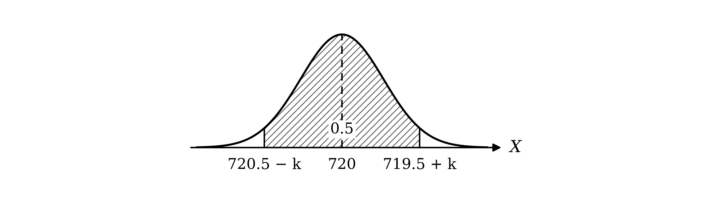

Standardise using the formula

$Z = \frac{X-μ}{σ}$

Let $c = \frac{k-0.5}{\sqrt{288}}$; the interval standardises to $- c < Z < c$, and its area is the area to the left of $c$ minus the area to the left of $- c$

$\text{P} ( - c < Z < c ) = Φ ( c ) - Φ ( - c )$

By symmetry, the area to the left of $- c$ equals the area to the right of $c$

$Φ ( - c ) = 1 - Φ ( c )$

`\text{P}(-c < Z < c) = \mathrm{\Phi}(c) - \left(1 - \mathrm{\Phi}(c)\right) = 2\mathrm{\Phi}(c) - 1`

**[M1]**

Set this less than 0.5

$2 Φ ( c ) - 1 < 0 . 5$

$Φ ( c ) < 0 . 75$

0.75 is in the table of critical values in the formula booklet

$z = 0 . 674$

**[B1]**

$\frac{k-0.5}{\sqrt{288}} < 0 . 674$

**[M1]**

$k < 0 . 5 + 0 . 674 \sqrt{288} = 11 . 938 \dots$

$k$ is an integer

$k = 11$

**[A1]**

> **[mark-scheme]**
> **M1**: The symmetrical area written as 2Φ(z) − 1 (or equivalent) for an interval centred on 720.
> 
> **B1**: z = 0.674, the critical value for 0.75.
> 
> **M1**: (k − 0.5)/√288 (or k/√288 with no continuity correction, or k + 0.5) compared with or equated to their z-value. Using 0.75 or 0.25 as z does not score.
> 
> **A1**: k = 11 only.

### Q15
Let $W$ be the weight, in kg, of feed in a sack, so `W \sim \text{N}(20, \; 0.1^{2})`

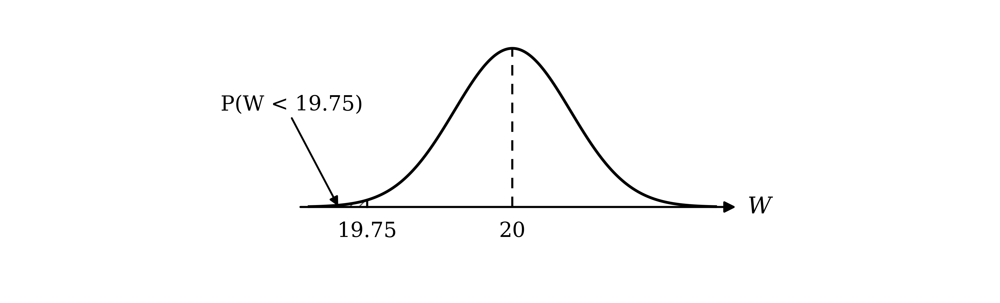

Standardise using the formula

$Z = \frac{X-μ}{σ}$

Substitute $X = 19 . 75$, $μ = 20$ and $σ = 0 . 1$

`\text{P}(W < 19.75) = \text{P}\left(Z < \dfrac{19.75 - 20}{0.1}\right) = \text{P}(Z < -2.5)`

**[M1]**

The $z$-value is negative, so use symmetry

$\text{P} ( Z < - 2 . 5 ) = 1 - Φ ( 2 . 5 )$

**[M1]**

In the table of the normal distribution function in the formula booklet, the 2.5 row and the 0 column give 0.9938

$1 - 0 . 9938 = 0 . 0062$

$\text{P} ( W < 19 . 75 ) = 0 . 0062$

**[A1]**

> **[mark-scheme]**
> **M1**: Standardising with 19.75, 20 and 0.1. Using 0.01 (the variance) or √0.1 does not score.
> 
> **M1**: The appropriate area, 1 − Φ(2.5), leading to a probability less than 0.5.
> 
> **A1**: 0.0062 or 0.00621.
> 
> If the answer is given with no working, for example straight from a calculator, award 1 mark only.
A weight differs from 20 kg by less than 0.25 kg when it is between 19.75 kg and 20.25 kg; the normal curve is symmetrical about 20, so the area above 20.25 equals the area below 19.75 found in part (a)

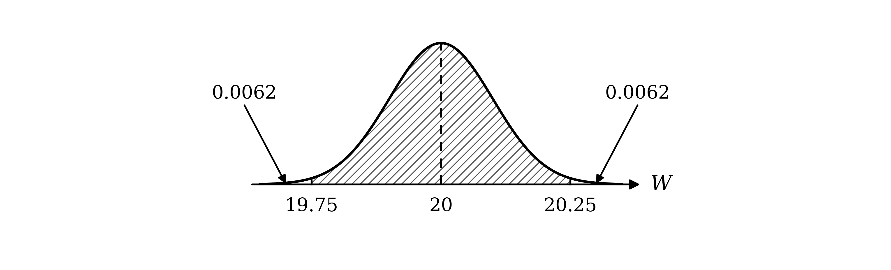

$\text{P} ( 19 . 75 < W < 20 . 25 ) = 1 - 2 \times \text{P} ( W < 19 . 75 )$

**[M1]**

$1 - 2 \times 0 . 0062 = 0 . 9876$

**[A1]**

The 10 sacks are chosen at random, so they are independent, and each must be within 0.25 kg of the mean

$0 . 9876^{10} = 0 . 88269 \dots$

**Final answer:** $0 . 883$** (3 s.f.)**

**[B1]**

> **[mark-scheme]**
> **M1**: The symmetrical area, 1 − 2 × their part (a), or 2Φ(2.5) − 1 from both ±2.5 seen as z-values.
> 
> **A1**: 0.9876, or answers which round to 0.988, kept to at least 4 s.f. for the next step.
> 
> **B1**: (their probability to at least 4 s.f.)¹⁰. 0.883, accepting any value from 0.882 to 0.883.
Each sack independently differs from the mean by 0.25 kg or more with probability

$1 - 0 . 9876 = 0 . 0124$

So $X$, the number of such sacks out of 10, follows a binomial distribution

`X \sim \text{B}(10, \; 0.0124)`

Use the binomial probability formula, `\text{P}(X = r) = {}^{n}C_{r} p^{r} (1 - p)^{n - r}`. "At least two" is 1 minus the probability of none or one

`\text{P}(X \geq 2) = 1 - \left(0.9876^{10} + {}^{10}C_{1}(0.0124)(0.9876)^{9}\right)`

**[M1 A1]**

$\text{P} ( X \geq 2 ) = 1 - ( 0 . 882695 + 0 . 110829 ) = 0 . 006476 \dots$

**Final answer:** $\text{P} ( X \geq 2 ) = 0 . 00648$** (3 s.f.)**

**[A1]**

> **[mark-scheme]**
> **M1**: At least one term of the form `{}^{10}C_{x}\,p^{x}(1 - p)^{10 - x}` with any p, 0 < p < 1.
> 
> **A1**: A correct expression for 1 − (P(0) + P(1)), written out in full with no terms missing, using their p to at least 3 s.f. Accept the long sum P(2) + … + P(10).
> 
> **A1**: 0.00648, accepting any value from 0.00648 to 0.00650.
> 
> If 0.00648 is given with no working, for example straight from a calculator, award 1 mark only.

### Q16
The 100 packets are independent, each containing a prize with probability 0.47, so $X$, the number of packets containing a prize, follows a binomial distribution

`X \sim \text{B}(100, \; 0.47)`

Use the binomial probability formula

`\text{P}(X = r) = {}^{n}C_{r} p^{r} (1 - p)^{n - r}`

`\text{P}(X = 49) = {}^{100}C_{49}(0.47)^{49}(0.53)^{51}`

**[M1]**

$\text{P} ( X = 49 ) = 0 . 073471 \dots$

**Final answer:** $\text{P} ( X = 49 ) = 0 . 07347$** (4 s.f.)**

**[A1]**

> **[mark-scheme]**
> **M1**: A term of the form `{}^{100}C_{49}\,p^{49}(1 - p)^{51}`, 0 < p < 1.
> 
> **A1**: 0.07347, or answers which round to 0.07347.
For the normal approximation, the mean is $n p$ and the variance is $n p ( 1 - p )$

$μ = 100 \times 0 . 47 = 47$

$σ^{2} = 100 \times 0 . 47 \times 0 . 53 = 24 . 91$

$\text{N} ( 47 ,  24 . 91 )$

**[B1]**

> **[mark-scheme]**
> **B1**: N(47, 24.91). Accept N(47, 4.991²). N(47, 24.91²) does not score.
Let `Y \sim \text{N}(47, \; 24.91)`; the single value 49 covers the interval from 48.5 to 49.5 on the continuous scale (continuity correction)

$\text{P} ( X = 49 ) \approx \text{P} ( 48 . 5 < Y < 49 . 5 )$

**[B1]**

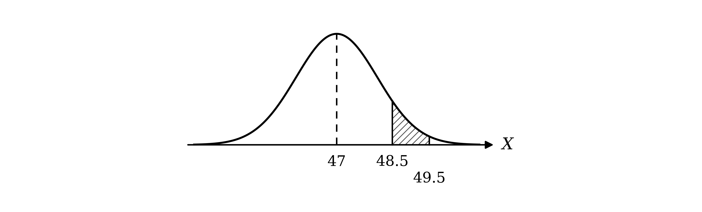

Standardise using the formula

$Z = \frac{X-μ}{σ}$

Substitute $μ = 47$ and $σ = \sqrt{24.91} = 4 . 9909 \dots$

`\text{P}\left(\dfrac{48.5 - 47}{4.9909\ldots} < Z < \dfrac{49.5 - 47}{4.9909\ldots}\right) = \text{P}(0.301 < Z < 0.501)`

**[M1]**

The area between the two $z$-values is the difference of the areas to their left

$\text{P} ( 0 . 301 < Z < 0 . 501 ) = Φ ( 0 . 501 ) - Φ ( 0 . 301 )$

**[M1]**

In the table of the normal distribution function in the formula booklet, the 0.5 row and the 0 column give 0.6915, and ADD 1 in the 0.5 row is 3

$Φ ( 0 . 501 ) = 0 . 6915 + 0 . 0003 = 0 . 6918$

The 0.3 row and the 0 column give 0.6179, and ADD 1 in the 0.3 row is 4

$Φ ( 0 . 301 ) = 0 . 6179 + 0 . 0004 = 0 . 6183$

$0 . 6918 - 0 . 6183 = 0 . 0735$

**Final answer:** $\text{P} ( X = 49 ) \approx 0 . 0735$** (3 s.f.)**

**[A1]**

> **[mark-scheme]**
> **B1**: The continuity-corrected interval 48.5 to 49.5.
> 
> **M1**: Standardising both boundaries with 47 and their standard deviation, not σ² and not √σ.
> 
> **M1**: The appropriate area, Φ(0.501) − Φ(0.301).
> 
> **A1**: 0.0735, accepting any value from 0.0735 to 0.0737 (table or calculator values of Φ).

### Q17
A normal approximation can be used when $n p > 5$ and $n ( 1 - p ) > 5$, with $μ = n p$ and $σ^{2} = n p ( 1 - p )$

(i)

$n p = 8 \times 0 . 5 = 4$

**Final answer:** $n p < 5$**, so a normal approximation is not appropriate**

**[B1]**

(ii)

$n p = 80 \times 0 . 54 = 43 . 2$

$n ( 1 - p ) = 80 \times 0 . 46 = 36 . 8$

Both are greater than 5, so a normal approximation is appropriate

**[B1]**

$μ = 43 . 2$

**[B1]**

$σ^{2} = 80 \times 0 . 54 \times 0 . 46 = 19 . 872$

$σ = \sqrt{19.872} = 4 . 4578 \dots$

**Final answer:** $σ = 4 . 46$** (3 s.f.)**

**[B1]**

$X \approx \text{N} ( 43 . 2 ,  4 . 46^{2} )$

(iii)

$n p = 625 \times 0 . 45 = 281 . 25$

$n ( 1 - p ) = 625 \times 0 . 55 = 343 . 75$

Both are greater than 5, so a normal approximation is appropriate

**[B1]**

$μ = 281 . 25$

**[B1]**

$σ^{2} = 625 \times 0 . 45 \times 0 . 55 = 154 . 6875$

$σ = \sqrt{154.6875} = 12 . 437 \dots$

**Final answer:** $σ = 12 . 4$** (3 s.f.)**

**[B1]**

$X \approx \text{N} ( 281 . 25 ,  12 . 4^{2} )$

(iv)

$n ( 1 - p ) = 90 \times 0 . 05 = 4 . 5$

**Final answer:** $n ( 1 - p ) < 5$**, so a normal approximation is not appropriate**

**[B1]**

> **[mark-scheme]**
> **B1**: B(8, 0.5) not appropriate, with np = 4 evaluated and compared with 5.
> 
> **B1**: B(80, 0.54) appropriate, with np = 43.2 and n(1 − p) = 36.8 both evaluated and both stated to be greater than 5.
> 
> **B1**: μ = 43.2.
> 
> **B1**: σ = 4.46, or answers which round to 4.46. Accept σ² = 19.872 shown with σ correct.
> 
> **B1**: B(625, 0.45) appropriate, with np = 281.25 and n(1 − p) = 343.75 both evaluated and both stated to be greater than 5.
> 
> **B1**: μ = 281.25.
> 
> **B1**: σ = 12.4, or answers which round to 12.4.
> 
> **B1**: B(90, 0.95) not appropriate, with n(1 − p) = 4.5 evaluated and compared with 5.
> 
> Giving the variance as σ does not earn the σ mark. "n is large" or "p is close to 0.5" alone does not earn a check mark.

### Q18
(i)

$S$ can be any of the eight numbers, not just "success" or "failure"

**Final answer:** **Not binomial: each spin has more than two outcomes**

**[B1]**

(ii)

The spinning continues until the first '7', so the number of spins is not fixed in advance

**Final answer:** **Not binomial: there is not a fixed number of trials**

**[B1]**

(iii)

The primes are 2, 3, 5 and 7, so each spin lands on a prime with probability $\frac{4}{8} = \frac{1}{2}$, and the 12 spins are independent

**Final answer:** **Binomial: **`Y \sim \text{B}\left(12, \; \dfrac{1}{2}\right)`

**[B1]**

(iv)

After a spin, whether the next spin is a win depends on the number just spun (after an 8 a win is a 1, 2, 4 or 8, but after a 7 only a 1 or a 7)

**Final answer:** **Not binomial: the probability of a win is not constant, so the trials are not independent**

**[B1]**

> **[mark-scheme]**
> **B1**: $S$ not binomial, with a reason (more than two outcomes).
> 
> **B1**: $W$ not binomial, with a reason (not a fixed number of trials).
> 
> **B1**: $Y$ binomial, with a reason (12 independent spins, constant probability of a prime). Accept B(12, 0.5) as the reason.
> 
> **B1**: $L$ not binomial, with a reason (the probability of a win depends on the previous spin; not constant; not independent).
> 
> A verdict with no reason does not score.
$W$ counts the spins up to and including the first '7', each independent with probability $\frac{1}{8}$

**Final answer:** **Geometric distribution**

**[B1]**

> **[mark-scheme]**
> **B1**: Geometric. Accept `\text{Geo}\left(\dfrac{1}{8}\right)`; the parameter is not required.

### Q19
The 500 seeds germinate independently, each with probability 0.4, so $W$, the number that germinate, follows a binomial distribution

`W \sim \text{B}(500, \; 0.4)`

For the normal approximation, the mean is $n p$ and the variance is $n p ( 1 - p )$

$μ = 500 \times 0 . 4 = 200$

$σ^{2} = 500 \times 0 . 4 \times 0 . 6 = 120$

**[B1]**

Let $Y$ be the approximating normal variable

`Y \sim \text{N}(200, \; 120)`

"Between 189 and 211 inclusive" means the number that germinate can be any whole number from 189 to 211; on the continuous scale, $Y$ can take any value from 188.5 to 211.5 (continuity correction)

$\text{P} ( 189 \leq W \leq 211 ) \approx \text{P} ( 188 . 5 < Y < 211 . 5 )$

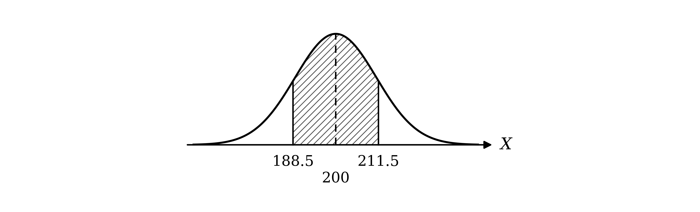

Standardise using the formula

$Z = \frac{X-μ}{σ}$

Substitute $μ = 200$ and $σ = \sqrt{120}$

`\text{P}\left(\dfrac{188.5 - 200}{\sqrt{120}} < Z < \dfrac{211.5 - 200}{\sqrt{120}}\right) = \text{P}(-1.050 < Z < 1.050)`

**[M1 M1]**

The area between the two $z$-values is the area to the left of 1.050 minus the area to the left of −1.050

$\text{P} ( - 1 . 050 < Z < 1 . 050 ) = Φ ( 1 . 050 ) - Φ ( - 1 . 050 )$

The table only gives positive values of $z$. By symmetry, the area to the left of −1.050 equals the area to the right of 1.050

$Φ ( - 1 . 050 ) = 1 - Φ ( 1 . 050 )$

Substitute this into the first line

`\text{P}(-1.050 < Z < 1.050) = \mathrm{\Phi}(1.050) - \left(1 - \mathrm{\Phi}(1.050)\right)`

$\text{P} ( - 1 . 050 < Z < 1 . 050 ) = 2 Φ ( 1 . 050 ) - 1$

**[M1]**

In the table of the normal distribution function in the formula booklet, the 1.0 row and the 5 column give 0.8531

$2 \times 0 . 8531 - 1 = 0 . 7062$

**Final answer:** $\text{P} ( 189 \leq W \leq 211 ) = 0 . 706$** (3 s.f.)**

**[A1]**

> **[mark-scheme]**
> **B1**: Mean 200 and variance 120 seen, allow unsimplified. σ = 10.95 implies the variance. Giving 120 as the standard deviation does not score.
> 
> **M1**: Substituting their mean and their standard deviation into the standardisation formula (any boundary value), not σ² and not √σ.
> 
> **M1**: A continuity correction: 188.5 or 189.5, and 210.5 or 211.5, in their standardisation.
> 
> **M1**: The appropriate area from their z-values, such as 2Φ(1.050) − 1 or Φ(1.050) − Φ(−1.050), which must be a probability.
> 
> **A1**: 0.706, accepting any value from 0.706 to 0.7065.
> 
> If the answer is given with no working, for example straight from a calculator, award 1 mark only.
"More than 220" means the number can be any whole number from 221 upwards; on the continuous scale, $Y$ can take any value above 220.5

$\text{P} ( W > 220 ) \approx \text{P} ( Y > 220 . 5 )$

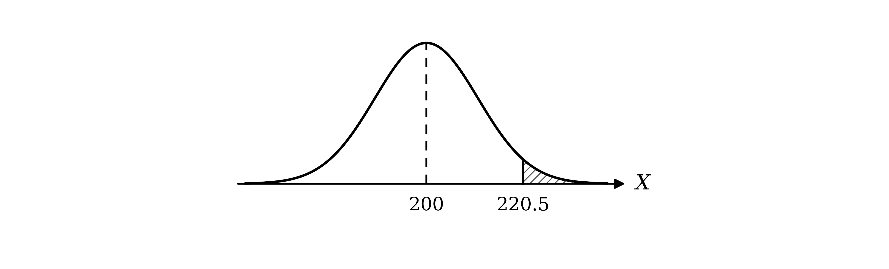

Standardise using the formula

$Z = \frac{X-μ}{σ}$

Substitute $μ = 200$ and $σ = \sqrt{120}$

`\text{P}\left(Z > \dfrac{220.5 - 200}{\sqrt{120}}\right) = \text{P}(Z > 1.871)`

**[M1]**

The required area is to the right of 1.871

$\text{P} ( Z > 1 . 871 ) = 1 - Φ ( 1 . 871 )$

**[M1]**

In the table of the normal distribution function in the formula booklet, the 1.8 row and the 7 column give 0.9693, and ADD 1 in the 1.8 row is 1

$Φ ( 1 . 871 ) = 0 . 9693 + 0 . 0001 = 0 . 9694$

$1 - 0 . 9694 = 0 . 0306$

**Final answer:** $\text{P} ( W > 220 ) = 0 . 0306$** (3 s.f.)**

**[A1]**

> **[mark-scheme]**
> **M1**: Standardising with their mean and standard deviation and a continuity correction of 219.5 or 220.5.
> 
> **M1**: The appropriate area, 1 − Φ(1.871), which must be a probability less than 0.5.
> 
> **A1**: 0.0306, accepting any value from 0.0306 to 0.0307.
> 
> If the answer is given with no working, for example straight from a calculator, award 1 mark only.
A normal approximation to $\text{B} ( n ,  p )$ is valid when $n p > 5$ and $n ( 1 - p ) > 5$

$n p = 500 \times 0 . 4 = 200$

$n ( 1 - p ) = 500 \times 0 . 6 = 300$

**Final answer:** $n p = 200$** and **$n ( 1 - p ) = 300$** are both greater than 5**

**[B1]**

> **[mark-scheme]**
> **B1**: np = 200 and n(1 − p) = 300 (or nq = 300) both evaluated, and both stated to be greater than 5. "n is large" or "p is close to 0.5" alone does not score.
"At most $w$" means the number of seeds that germinate can be any whole number up to $w$; on the continuous scale, $Y$ can take any value up to $w + 0 . 5$, so the condition is

$\text{P} ( Y < w + 0 . 5 ) < 0 . 1$

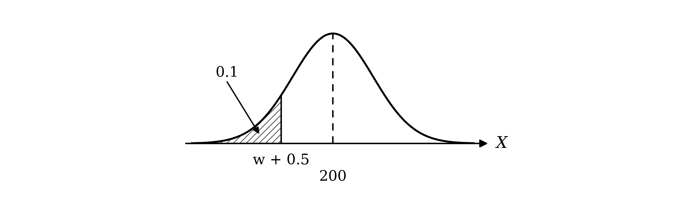

0.1 is in the left tail; 0.9 is in the table of critical values in the formula booklet, with $z = 1 . 282$, so by symmetry

$z = - 1 . 282$

**[B1]**

Standardise using the formula

$Z = \frac{X-μ}{σ}$

The boundary $w + 0 . 5$ must be below this $z$-value

$\frac{w+0.5-200}{\sqrt{120}} < - 1 . 282$

**[M1]**

Rearrange for $w$

$w + 0 . 5 < 200 - 1 . 282 \sqrt{120} = 185 . 957 \dots$

$w < 185 . 457 \dots$

$w$ is a whole number

$w = 185$

**[A1]**

> **[mark-scheme]**
> **B1**: z = −1.282 (or 1.282 used consistently), the critical value.
> 
> **M1**: Standardising with their mean and standard deviation, a continuity correction (w + 0.5 or w − 0.5) and equated to (or compared with) a z-value. Using 0.1 or 0.9 as z does not score.
> 
> **A1**: w = 185 only, as a single integer.

### Q20
The 30 rounds are independent, each won with probability $\frac{9}{19}$, so $X$, the number of rounds won, follows a binomial distribution

`X \sim \text{B}\left(30, \; \dfrac{9}{19}\right)`

Use the binomial probability formula

`\text{P}(X = r) = {}^{n}C_{r} p^{r} (1 - p)^{n - r}`

`\text{P}(X = 14) = {}^{30}C_{14}\left(\dfrac{9}{19}\right)^{14}\left(\dfrac{10}{19}\right)^{16}`

**[M1]**

$\text{P} ( X = 14 ) = 0 . 144350 \dots$

**Final answer:** $\text{P} ( X = 14 ) = 0 . 144$** (3 s.f.)**

**[A1]**

> **[mark-scheme]**
> **M1**: A term of the form `{}^{30}C_{14}\,p^{14}(1 - p)^{16}`, 0 < p < 1.
> 
> **A1**: 0.144, or answers which round to 0.144.
> 
> If 0.144 is given with no working, for example straight from a calculator, award 1 mark only.
Let $Y$ be the number of these rounds won, so `Y \sim \text{B}\left(1000, \; \dfrac{9}{19}\right)`; for the normal approximation, the mean is $n p$ and the variance is $n p ( 1 - p )$

$μ = 1000 \times \frac{9}{19} = 473 . 684 \dots$

$σ^{2} = 1000 \times \frac{9}{19} \times \frac{10}{19} = 249 . 307 \dots$

**[B1]**

"At least 500" means the number of rounds won can be any whole number from 500 upwards; on the continuous scale, with `V \sim \text{N}(473.684\ldots, \; 249.307\ldots)`, $V$ can take any value above 499.5 (continuity correction)

$\text{P} ( Y \geq 500 ) \approx \text{P} ( V > 499 . 5 )$

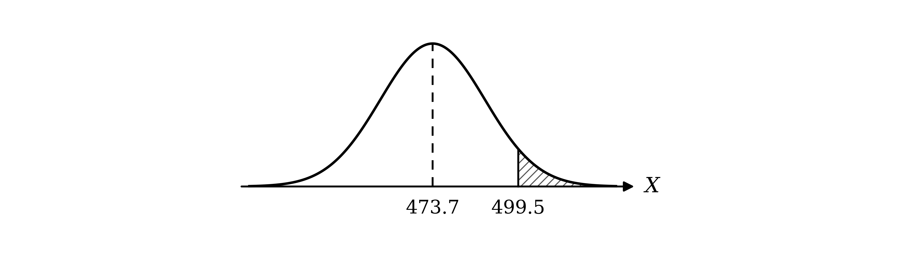

Standardise using the formula

$Z = \frac{X-μ}{σ}$

Substitute $μ = 473 . 684 \dots$ and $σ = \sqrt{249.307\dots} = 15 . 789 \dots$

`\text{P}\left(Z > \dfrac{499.5 - 473.684\ldots}{15.789\ldots}\right) = \text{P}(Z > 1.635)`

**[M1 M1]**

The required area is to the right of 1.635

$\text{P} ( Z > 1 . 635 ) = 1 - Φ ( 1 . 635 )$

**[M1]**

In the table of the normal distribution function in the formula booklet, the 1.6 row and the 3 column give 0.9484, and ADD 5 in the 1.6 row is 5

$Φ ( 1 . 635 ) = 0 . 9484 + 0 . 0005 = 0 . 9489$

$1 - 0 . 9489 = 0 . 0511$

**Final answer:** $\text{P} ( Y \geq 500 ) = 0 . 0511$** (3 s.f.)**

**[A1]**

> **[mark-scheme]**
> **B1**: Mean 473.7 and variance 249.3 seen, allow unsimplified (such as $1000 \times \frac{9}{19}$). σ = 15.79 implies the variance. Giving 249.3 as the standard deviation does not score.
> 
> **M1**: Substituting their mean and their standard deviation into the standardisation formula (any boundary value), not σ² and not √σ.
> 
> **M1**: A continuity correction of 499.5 or 500.5 in their standardisation.
> 
> **M1**: The appropriate area, 1 − Φ(1.635), which must be a probability less than 0.5.
> 
> **A1**: 0.0511, accepting any value from 0.0510 to 0.0511.
> 
> If the answer is given with no working, for example straight from a calculator, award 1 mark only.
A normal approximation to $\text{B} ( n ,  p )$ is valid when $n p > 5$ and $n ( 1 - p ) > 5$

$n p = 1000 \times \frac{9}{19} = 473 . 7$

$n ( 1 - p ) = 1000 \times \frac{10}{19} = 526 . 3$

**Final answer:** $n p = 473 . 7$** and **$n ( 1 - p ) = 526 . 3$** are both greater than 5**

**[B1]**

> **[mark-scheme]**
> **B1**: np = 473.7 and n(1 − p) = 526.3 (or nq = 526.3) both evaluated, and both stated to be greater than 5. Accept the fractions $\frac{9000}{19}$ and $\frac{10000}{19}$. "n is large" alone does not score.

### Q21
(i)

A length is measured, so it can take any value from 0 m to 0.5 m

**Final answer:** $A$** is continuous**

**[B1]**

(ii)

A number of students is counted, so it can only be a whole number

**Final answer:** $B$** is discrete**

**[B1]**

(iii)

The age at the most recent birthday is a whole number of years

**Final answer:** $C$** is discrete**

**[B1]**

> **[mark-scheme]**
> **B1**: $A$ continuous, with a reason (measured; any value in a range).
> 
> **B1**: $B$ discrete, with a reason (counted; whole numbers only).
> 
> **B1**: $C$ discrete, with a reason (whole numbers of years only).
> 
> A correct type with no reason does not score.
A normal distribution is symmetrical and bell-shaped, with a single peak at the mean

(i)

**Final answer:** **Appropriate: the histogram for **$D$** is symmetrical and bell-shaped**

**[B1]**

(ii)

**Final answer:** **Not appropriate: the histogram for **$E$** has two peaks, so it is not bell-shaped**

**[B1]**

(iii)

**Final answer:** **Not appropriate: the histogram for **$F$** is not symmetrical or bell-shaped**

**[B1]**

> **[mark-scheme]**
> **B1**: $D$ appropriate, with a reason (symmetrical and bell-shaped).
> 
> **B1**: $E$ not appropriate, with a reason (two peaks; not bell-shaped).
> 
> **B1**: $F$ not appropriate, with a reason (not symmetrical; skewed; not bell-shaped).
> 
> A verdict with no reason does not score.

### Q22
Let $W$ be the weight, in grams, of a chocolate bar, so `W \sim \text{N}(200, \; 17.5^{2})`

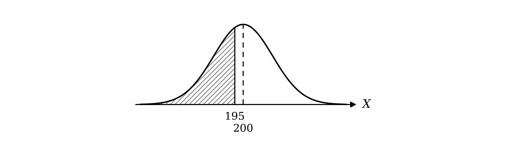

Standardise using the formula

$Z = \frac{X-μ}{σ}$

Substitute $X = 195$, $μ = 200$ and $σ = 17 . 5$

`\text{P}(W < 195) = \text{P}\left(Z < \dfrac{195 - 200}{17.5}\right) = \text{P}(Z < -0.286)`

**[M1]**

The $z$-value is negative, so use symmetry

$\text{P} ( Z < - 0 . 286 ) = 1 - Φ ( 0 . 286 )$

**[M1]**

In the table of the normal distribution function in the formula booklet, the 0.2 row and the 8 column give 0.6103, and ADD 6 in the 0.2 row is 23

$Φ ( 0 . 286 ) = 0 . 6103 + 0 . 0023 = 0 . 6126$

$1 - 0 . 6126 = 0 . 3874$

**Final answer:** $\text{P} ( W < 195 ) = 0 . 387$** (3 s.f.)**

**[A1]**

> **[mark-scheme]**
> **M1**: Standardising with 195, 200 and 17.5. Using 17.5² or √17.5, or a continuity correction, does not score.
> 
> **M1**: The appropriate area, 1 − Φ(0.286) or Φ(−0.286), leading to a probability less than 0.5.
> 
> **A1**: 0.387, accepting any value from 0.3874 to 0.388.
> 
> If the answer is given with no working, for example straight from a calculator, award 1 mark only.
The bars are chosen independently, each with probability 0.3874 of weighing less than 195 grams, and Hilda chooses up to and including the first such bar; so $G$, the number of bars she chooses, follows a geometric distribution

`G \sim \text{Geo}(0.3874)`

Use the geometric probability formula

$\text{P} ( G = r ) = p ( 1 - p )^{r-1}$

The first 7 bars weigh at least 195 grams and the 8th weighs less

$\text{P} ( G = 8 ) = 0 . 3874 \times 0 . 6126^{7}$

**[M1]**

$\text{P} ( G = 8 ) = 0 . 012543 \dots$

**Final answer:** $\text{P} ( G = 8 ) = 0 . 0125$** (3 s.f.)**

**[A1]**

> **[mark-scheme]**
> **M1**: $( 1 - p )^{7} p$ with their p from part (a), 0 < p < 1.
> 
> **A1**: 0.0125, or answers which round to 0.0125, using a probability from part (a) to at least 3 s.f.
The 12 bars are chosen at random, so they are independent, each with probability 0.3874 of weighing less than 195 grams; so $X$, the number of these bars, follows a binomial distribution

`X \sim \text{B}(12, \; 0.3874)`

Use the binomial probability formula

`\text{P}(X = r) = {}^{n}C_{r} p^{r} (1 - p)^{n - r}`

`\text{P}(X = 2) = {}^{12}C_{2}(0.3874)^{2}(0.6126)^{10}`

**[M1 A1]**

$\text{P} ( X = 2 ) = 0 . 07373 \dots$

**Final answer:** $\text{P} ( X = 2 ) = 0 . 0737$** (3 s.f.)**

**[A1]**

> **[mark-scheme]**
> **M1**: A term of the form `{}^{12}C_{x}\,p^{x}(1 - p)^{12 - x}` with any p, 0 < p < 1.
> 
> **A1**: The correct expression `{}^{12}C_{2}\,p^{2}(1 - p)^{10}` using their p from part (a) to at least 3 s.f.
> 
> **A1**: 0.0737, or answers which round to 0.0736 or 0.0737 (from a table or calculator value of p).
> 
> If 0.0737 is given with no working, for example straight from a calculator, award 1 mark only.
