# Mark Schemes — Combinations of Transformations
**Algebra & Functions** · Cambridge (CIE) AS maths (9709)

## Exam Questions (28 questions)

### Q1
$y = \text{g} ( x ) = 2 x$ is a straight line through the origin with gradient 2; its inverse is the reflection in the line $y = x$, so $y = \text{g}^{-1} ( x )$ is a straight line through the origin with gradient $\frac{1}{2}$ — each graph meets the axes only at the origin

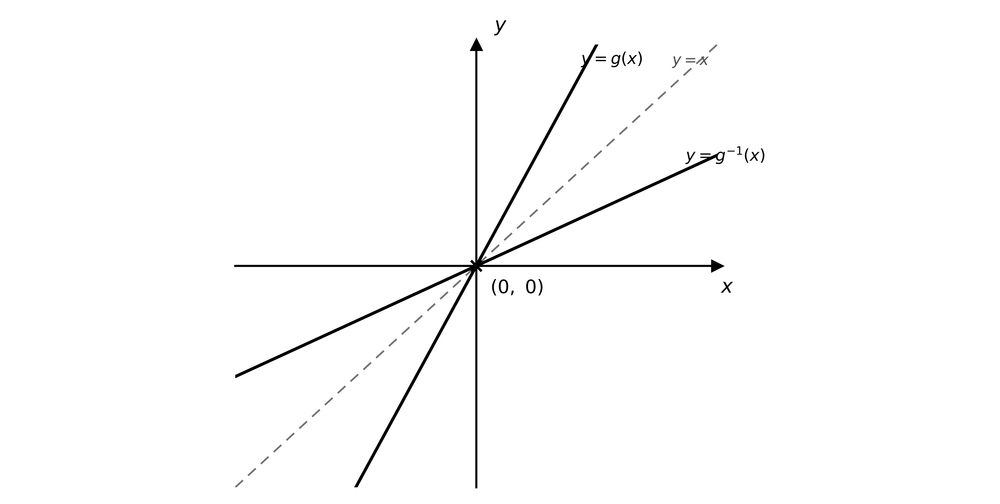

$( 0 ,  0 )$

**[B1]**

The line $y = x$ is drawn as the line of symmetry between the graph and its inverse

**[B1]**

> **[mark-scheme]**
> **B1**: Both graphs correct — straight lines through the origin, with $y = \text{g} ( x )$ steeper (gradient 2) than $y = \text{g}^{-1} ( x )$ (gradient $\frac{1}{2}$) — and the only axis crossing $( 0 , 0 )$ indicated.
> 
> **B1**: The line $y = x$ shown as the line of symmetry (no need to label it).
(i)

Let $y = 2 x$ and make $x$ the subject, then interchange $x$ and $y$

$y = 2 x  \Rightarrow  x = \frac{1}{2} y$

$\text{g}^{-1} ( x ) = \frac{1}{2} x$

**[B1]**

(ii)

Compare $\text{g}^{-1} ( x ) = \frac{1}{2} x$ with $\text{g} ( x ) = 2 x$; dividing the whole function by 4 gives $\frac{1}{2} x$

$\frac{1}{4}  \text{g} ( x ) = \frac{1}{4} ( 2 x ) = \frac{1}{2} x$

$\text{g}^{-1} ( x ) = \frac{1}{4}  \text{g} ( x )$

**[B1]**

so the graph of $\text{g}$ maps onto its inverse under a single stretch

**Final answer:** **Stretch, factor **$\frac{1}{4}$**, parallel to the y-axis**

**[B1 B1]**

> **[mark-scheme]**
> **B1**: Correct inverse, $\text{g}^{-1} ( x ) = \frac{1}{2} x$ (accept $\frac{x}{2}$ or $0 . 5 x$).
> 
> **B1**: $\text{g}^{-1} ( x )$ written correctly in terms of $\text{g}$, as $\frac{1}{4}  \text{g} ( x )$. The equivalent form $\text{g} ( \frac{1}{4} x )$ is also accepted.
> 
> **B1**: The transformation named as a stretch parallel to the $y$-axis (accept "vertically" or "$x$-axis invariant").
> 
> **B1**: Scale factor $\frac{1}{4}$ stated. If instead the form $\text{g} ( \frac{1}{4} x )$ is used, the correct equivalent description is a stretch parallel to the $x$-axis with scale factor 4.

### Q2
(i)

$A$ is where $x = 0$, and $B$ is where the curve touches the $x$-axis

$\text{f} ( 0 ) = ( 0 - 2 )^{2} = 4$

**Final answer:** $A ( 0 , 4 )$** and **$B ( 2 , 0 )$

**[B1 B1]**

(ii)

$y = - \text{f} ( x ) - 4$ reflects each point in the $x$-axis, so $y \rightarrow - y$, then translates it 4 units down; the $x$-coordinates are unchanged

$A ( 0 , 4 ) \rightarrow ( 0 ,  - 4 - 4 )$

$( 0 ,  - 8 )$

**[B1]**

$B ( 2 , 0 ) \rightarrow ( 2 ,  - 0 - 4 )$

$( 2 ,  - 4 )$

**[B1]**

> **[mark-scheme]**
> **B1**: $A$ given as $( 0 , 4 )$.
> 
> **B1**: $B$ given as $( 2 , 0 )$.
> 
> **B1**: Image of $A$ given as $( 0 , - 8 )$.
> 
> **B1**: Image of $B$ given as $( 2 , - 4 )$. The transformation $y = - \text{f} ( x ) - 4$ is a reflection in the $x$-axis followed by a translation of 4 units in the negative $y$-direction, so only the $y$-coordinates change.

### Q3
Apply the transformations in the given order. The reflection in the $y$-axis replaces $x$ with $- x$

$y = \text{f} ( - x )$

**[M1]**

the vertical stretch with factor 4 multiplies the whole function by 4

$y = 4  \text{f} ( - x )$

**[M1]**

the translation by `\begin{pmatrix} 0 \\ -2 \end{pmatrix}` subtracts 2 from the function

$y = 4  \text{f} ( - x ) - 2$

**[A1]**

> **[mark-scheme]**
> **M1**: Reflection in the $y$-axis applied correctly, replacing $x$ with $- x$ to give $\text{f} ( - x )$.
> 
> **M1**: Vertical stretch with factor 4 applied, multiplying the function by 4 to give $4 \text{f} ( - x )$.
> 
> **A1**: Fully correct final equation $y = 4 \text{f} ( - x ) - 2$. The transformations must be applied in the given order.

### Q4
(i)

The factor 3 multiplies the whole function, so apply the vertical stretch first; the $- 1$ then lowers the graph — both act vertically, so the order matters

**Final answer:** **Stretch, factor 3, parallel to the y-axis**

**[B1]**

**Final answer:** **Translation by **`\begin{pmatrix} 0 \\ -1 \end{pmatrix}`

**[B1]**

(ii)

The stretch and the translation act on different axes, so they may be applied in either order

**Final answer:** **Translation by **`\begin{pmatrix} 1 \\ 0 \end{pmatrix}`

**[B1]**

**Final answer:** **Stretch, factor **$\frac{1}{3}$**, parallel to the y-axis**

**[B1]**

> **[mark-scheme]**
> **B1**: For $y = 3 \text{f} ( x ) - 1$, a stretch parallel to the $y$-axis with factor 3. (All three of "stretch", "factor 3" and the direction are needed.)
> 
> **B1**: For $y = 3 \text{f} ( x ) - 1$, a translation by `\begin{pmatrix} 0 \\ -1 \end{pmatrix}`, applied after the stretch (accept "1 unit in the negative $y$-direction").
> 
> **Alternative order for (i)** — the translation may instead be done before the stretch, giving: first a translation by `\begin{pmatrix} 0 \\ -\tfrac{1}{3} \end{pmatrix}`, then a stretch parallel to the $y$-axis with factor 3. (Translating first changes the vector from `\begin{pmatrix} 0 \\ -1 \end{pmatrix}` to `\begin{pmatrix} 0 \\ -\tfrac{1}{3} \end{pmatrix}`.)
> 
> **B1**: For $y = \frac{1}{3} \text{f} ( x - 1 )$, a translation by `\begin{pmatrix} 1 \\ 0 \end{pmatrix}` (accept "1 unit in the positive $x$-direction").
> 
> **B1**: For $y = \frac{1}{3} \text{f} ( x - 1 )$, a stretch parallel to the $y$-axis with factor $\frac{1}{3}$. These are the same two transformations in either order — they act on different axes, so the order does not matter.

### Q5
(i)

The graph of $\text{cos}  t$ reaches its lowest point at the bottom of the curve

$- 1$

**[B1]**

(ii)

$t = 180 ^{\circ}$

**[B1]**

> **[mark-scheme]**
> **B1**: Minimum value given as $- 1$.
> 
> **B1**: Occurs at $t = 180 ^{\circ}$.
(i)

The factor 3 stretches the graph vertically, so the minimum value $- 1$ becomes $3 \times ( - 1 )$; the horizontal translation does not change the minimum value

$3 \times ( - 1 ) = - 3$

$- 3$

**[B1]**

(ii)

The $- 45 ^{\circ}$ translates the graph $45 ^{\circ}$ in the positive $t$-direction, so the minimum moves from $t = 180 ^{\circ}$

$t = 180 ^{\circ} + 45 ^{\circ}$

$t = 225 ^{\circ}$

**[B1]**

> **[mark-scheme]**
> **B1**: Minimum value given as $- 3$.
> 
> **B1**: Occurs at $t = 225 ^{\circ}$. The translation shifts the graph $45 ^{\circ}$ to the right, moving the minimum from $180 ^{\circ}$ to $225 ^{\circ}$; the vertical stretch scales the value to $- 3$.
Since $\text{f} ( t ) = \text{cos}  t$, the target graph is $y = 3  \text{f} ( t ) + 1$; the factor 3 multiplies the whole function, so the vertical stretch is applied first, then the translation up — both act vertically, so the order matters

**Final answer:** **Stretch, factor 3, parallel to the y-axis**

**[B1]**

**Final answer:** **Translation by **`\begin{pmatrix} 0 \\ 1 \end{pmatrix}`

**[B1]**

> **[mark-scheme]**
> **B1**: Stretch parallel to the $y$-axis with factor 3.
> 
> **B1**: Translation by `\begin{pmatrix} 0 \\ 1 \end{pmatrix}`, applied after the stretch (accept "1 unit in the positive $y$-direction").
> 
> **Alternative order** — the translation may instead be done before the stretch, giving: first a translation by `\begin{pmatrix} 0 \\ \tfrac{1}{3} \end{pmatrix}`, then a stretch parallel to the $y$-axis with factor 3. (Translating first changes the vector from `\begin{pmatrix} 0 \\ 1 \end{pmatrix}` to `\begin{pmatrix} 0 \\ \tfrac{1}{3} \end{pmatrix}`.)

### Q6
(i)

$\text{g} ( x ) = \frac{1}{x}$ has a vertical asymptote where the denominator is zero and a horizontal asymptote as $x \rightarrow \pm \infty$

**Final answer:** $x = 0$** and **$y = 0$

**[B1 B1]**

(ii)

$y = \text{g} ( x - 1 ) + 5$ translates the graph 1 unit in the positive $x$-direction and 5 units up, so each asymptote moves in the same way

$x = 0 \rightarrow x = 1 ,  y = 0 \rightarrow y = 5$

**Final answer:** $x = 1$** and **$y = 5$

**[B1 B1]**

> **[mark-scheme]**
> **B1**: Vertical asymptote $x = 0$.
> 
> **B1**: Horizontal asymptote $y = 0$.
> 
> **B1**: Transformed vertical asymptote $x = 1$.
> 
> **B1**: Transformed horizontal asymptote $y = 5$. The translation by `\begin{pmatrix} 1 \\ 5 \end{pmatrix}` moves $x = 0$ to $x = 1$ and $y = 0$ to $y = 5$.

### Q7
(i)

A translation by `\begin{pmatrix} -2 \\ 3 \end{pmatrix}` replaces $x$ with $x + 2$ (2 units in the negative $x$-direction)

$y = \text{f} ( x + 2 )$

**[B1]**

then adds 3 to the output (3 units up)

$y = \text{f} ( x + 2 ) + 3$

**[B1]**

(ii)

A horizontal stretch with scale factor 2 replaces $x$ with $\frac{1}{2} x$

$y = \text{f} ( \frac{1}{2} x )$

**[B1]**

then a vertical stretch with scale factor 3 multiplies the whole function by 3

$y = 3  \text{f} ( \frac{1}{2} x )$

**[B1]**

> **[mark-scheme]**
> **B1**: Correct horizontal part of the translation, giving $\text{f} ( x + 2 )$.
> 
> **B1**: Correct vertical part, giving $\text{f} ( x + 2 ) + 3$. Accept the two components stated together as the final equation.
> 
> **B1**: Correct horizontal stretch, giving $\text{f} ( \frac{1}{2} x )$ (accept $\text{f} ( x / 2 )$).
> 
> **B1**: Correct vertical stretch, giving $3  \text{f} ( \frac{1}{2} x )$. Because the two stretches act on different axes, applying them in either order gives the same equation.

### Q8
(i)

Stretch the graph vertically by factor 2, then translate it 1 unit up; the $x$-coordinate of $A$ is unchanged and its $y$-coordinate becomes $2 \times 8 + 1$

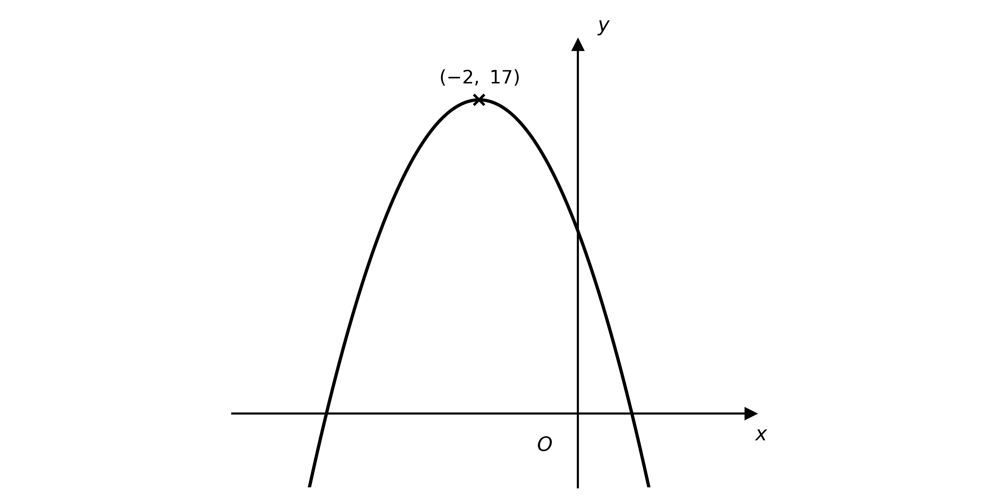

**[B1]**

$( - 2 ,  17 )$

**[B1]**

(ii)

Translate the graph 1 unit in the negative $x$-direction, then stretch it vertically by factor $\frac{1}{2}$; the $x$-coordinate of $A$ becomes $- 2 - 1$ and its $y$-coordinate becomes $\frac{1}{2} \times 8$

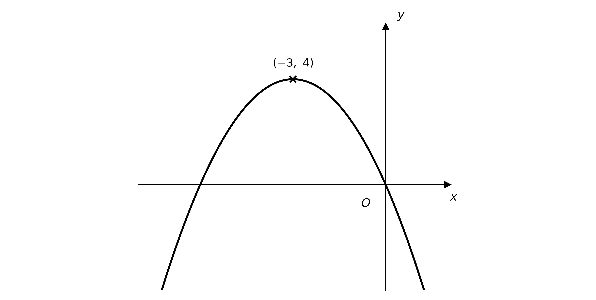

**[B1]**

$( - 3 ,  4 )$

**[B1]**

> **[mark-scheme]**
> **B1**: Correct shape for $y = 2 \text{f} ( x ) + 1$ — your sketch shows the graph of $\text{f} ( x )$ stretched vertically by factor 2 and then translated 1 unit up (same overall shape, maximum raised).
> 
> **B1**: Image of $A$ given as $( - 2 , 17 )$.
> 
> **B1**: Correct shape for $y = \frac{1}{2} \text{f} ( x + 1 )$ — your sketch shows the graph of $\text{f} ( x )$ translated 1 unit to the left and then stretched vertically by factor $\frac{1}{2}$ (flatter, shifted left).
> 
> **B1**: Image of $A$ given as $( - 3 , 4 )$.

### Q9
(i)

Writing $\frac{1}{3} x - 1 = \frac{1}{3} ( x - 3 )$: translate 1 unit right, stretch horizontally by factor 3, then stretch vertically by factor 2, so each point $( p , q )$ maps to $( 3 p + 3 ,  2 q )$

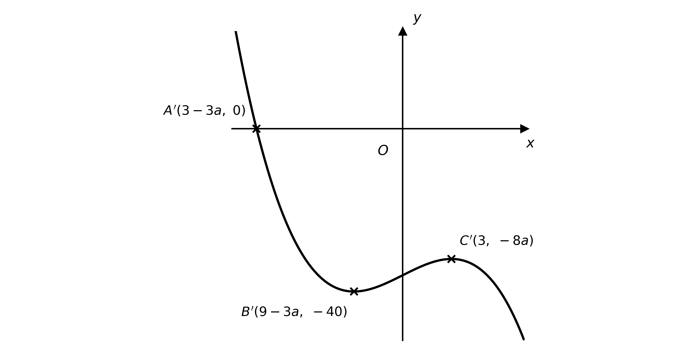

**[B1]**

**Final answer:** $A ' ( 3 - 3 a , 0 )$** and **$C ' ( 3 , - 8 a )$

**[B1]**

$B ' ( 9 - 3 a , - 40 )$

**[B1]**

(ii)

Translate 1 unit left, stretch vertically by factor 2 with a reflection in the $x$-axis (the factor $- 2$), then translate 1 unit up, so each point $( p , q )$ maps to $( p - 1 ,  - 2 q + 1 )$

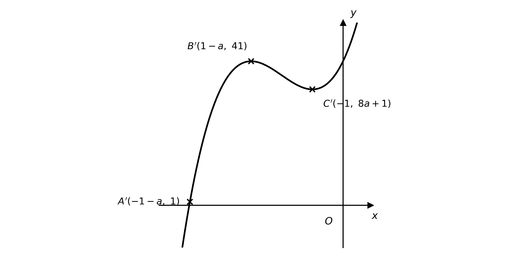

**[B1]**

**Final answer:** $A ' ( - 1 - a , 1 )$** and **$C ' ( - 1 , 8 a + 1 )$

**[B1]**

$B ' ( 1 - a , 41 )$

**[B1]**

> **[mark-scheme]**
> **B1**: Correct shape for $y = 2 \text{f} ( \frac{1}{3} x - 1 )$ — the same cubic shape, wider (horizontal stretch factor 3) and taller (vertical stretch factor 2).
> 
> **B1**: Images $A ' ( 3 - 3 a , 0 )$ and $C ' ( 3 , - 8 a )$.
> 
> **B1**: Image $B ' ( 9 - 3 a , - 40 )$.
> 
> **B1**: Correct shape for $y = - 2 \text{f} ( x + 1 ) + 1$ — the cubic reflected in the $x$-axis, shifted 1 left and 1 up.
> 
> **B1**: Images $A ' ( - 1 - a , 1 )$ and $C ' ( - 1 , 8 a + 1 )$.
> 
> **B1**: Image $B ' ( 1 - a , 41 )$.

### Q10
$( x - 3 )^{2} - ( y - 1 )^{2} = 1$ is $x^{2} - y^{2} = 1$ translated by `\begin{pmatrix} 3 \\ 1 \end{pmatrix}`, so add $( 3 , 1 )$ to each point

**Final answer:** $A ' ( 2 , 1 )$** and **$B ' ( 4 , 1 )$

**[B1 B1]**

> **[mark-scheme]**
> **B1**: Image $A ' ( 2 , 1 )$.
> 
> **B1**: Image $B ' ( 4 , 1 )$.
(i)

The asymptotes $y = x$ and $y = - x$ are translated by `\begin{pmatrix} 3 \\ 1 \end{pmatrix}`, replacing $x$ with $x - 3$ and $y$ with $y - 1$

$y - 1 = ( x - 3 )  \text{and}  y - 1 = - ( x - 3 )$

**Final answer:** $y = x - 2$** and **$y = - x + 4$

**[B1 B1]**

(ii)

For $x^{2} - y^{2} = 1$, $x^{2} = 1 + y^{2} \geq 1$, so the original curve exists only for $x \leq - 1$ or $x \geq 1$

**[B1]**

translating by 3 in the $x$-direction shifts each part 3 to the right

$x - 3 \leq - 1  \text{or}  x - 3 \geq 1$

**[M1]**

**Final answer:** $x \leq 2$** or **$x \geq 4$

**[A1]**

> **[mark-scheme]**
> **B1**: Asymptote $y = x - 2$.
> 
> **B1**: Asymptote $y = - x + 4$ (accept $y = 4 - x$).
> 
> **B1**: Correct domain of the original curve, $x \leq - 1$ or $x \geq 1$ (from $x^{2} = 1 + y^{2} \geq 1$).
> 
> **M1**: Translating the domain 3 units in the positive $x$-direction.
> 
> **A1**: Domain $x \leq 2$ or $x \geq 4$ (the two regions joined by "or", not "and").

### Q11
The graph touches the $x$-axis where $x^{2} - a = 0$, and meets the $y$-axis where $x = 0$

$x^{2} = a  \Rightarrow  x = \pm \sqrt{a} ,  \text{f} ( 0 ) = a^{2}$

**Final answer:** $A ( - \sqrt{a} , 0 )$**, **$C ( \sqrt{a} , 0 )$** and **$B ( 0 , a^{2} )$

**[B1 B1]**

> **[mark-scheme]**
> **B1**: $A ( - \sqrt{a} , 0 )$ and $C ( \sqrt{a} , 0 )$.
> 
> **B1**: $B ( 0 , a^{2} )$.
$y = - \frac{1}{2} \text{f} ( x - 1 )$ translates the graph 1 unit right, stretches it vertically by factor $\frac{1}{2}$ and reflects it in the $x$-axis; each point $( p , q )$ maps to $( p + 1 ,  - \frac{1}{2} q )$

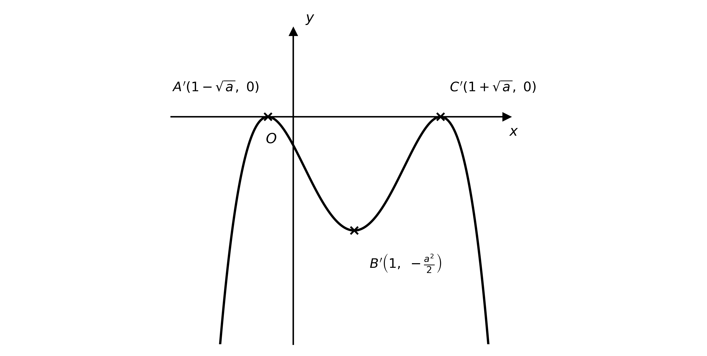

**[B1]**

**Final answer:** $A ' ( 1 - \sqrt{a} , 0 )$**, **$C ' ( 1 + \sqrt{a} , 0 )$

**[B1]**

$B ' ( 1 , - \frac{1}{2} a^{2} )$

**[B1]**

> **[mark-scheme]**
> **B1**: Correct shape for $y = - \frac{1}{2} \text{f} ( x - 1 )$ — an inverted quartic (flatter, shifted 1 right), touching the $x$-axis twice.
> 
> **B1**: Images of the touch points, $A ' ( 1 - \sqrt{a} , 0 )$ and $C ' ( 1 + \sqrt{a} , 0 )$.
> 
> **B1**: Image of the turning point, $B ' ( 1 , - \frac{1}{2} a^{2} )$.
A point on the $x$-axis stays on it under any vertical or horizontal stretch (and reflections in the axes), and the point on the $y$-axis likewise stays on it; a translation, however, would move them off. So use stretches only — the form $a \text{f} ( b x )$

$y = a  \text{f} ( b x ) ,  a , b \neq 0$

**[B1]**

for example

$y = 3 \text{f} ( - 5 x )$

**[B1]**

> **[mark-scheme]**
> **B1**: A combination of stretches (form $a \text{f} ( b x )$, no translation) — a translation would move a point off its axis.
> 
> **B1**: A valid specific expression, e.g. $3 \text{f} ( - 5 x )$ (any $a , b \neq 0$ is acceptable; reflections in the axes are allowed).

### Q12
(i)

The $x + b$ shifts the graph horizontally, the factor $a$ (with $a > 0$) stretches it vertically, and the $+ c$ shifts it vertically; the stretch and the vertical translation act on the same axis, so the stretch must come first

**Final answer:** **Translation by **`\begin{pmatrix} -b \\ 0 \end{pmatrix}`

**[B1]**

**Final answer:** **Stretch, factor a, parallel to the y-axis**

**[B1]**

**Final answer:** **Translation by **`\begin{pmatrix} 0 \\ c \end{pmatrix}`

**[B1]**

(ii)

The two reflections act on different axes, so they may be applied in either order

**Final answer:** **Reflection in the y-axis**

**[B1]**

**Final answer:** **Reflection in the x-axis**

**[B1]**

> **[mark-scheme]**
> **B1**: For (i), a translation by `\begin{pmatrix} -b \\ 0 \end{pmatrix}` (accept "$b$ units in the negative $x$-direction").
> 
> **B1**: For (i), a stretch parallel to the $y$-axis with factor $a$.
> 
> **B1**: For (i), a translation by `\begin{pmatrix} 0 \\ c \end{pmatrix}`, applied after the stretch.
> 
> **Alternative order for (i)** — the vertical translation may instead be done before the stretch, giving: a translation by `\begin{pmatrix} -b \\ 0 \end{pmatrix}`, then a translation by `\begin{pmatrix} 0 \\ \tfrac{c}{a} \end{pmatrix}`, then a stretch parallel to the $y$-axis with factor $a$. (Translating before the stretch changes the vertical vector from `\begin{pmatrix} 0 \\ c \end{pmatrix}` to `\begin{pmatrix} 0 \\ \tfrac{c}{a} \end{pmatrix}`.)
> 
> **B1**: For (ii), a reflection in the $y$-axis.
> 
> **B1**: For (ii), a reflection in the $x$-axis. These are the same two reflections in either order — they act on different axes, so the order does not matter.
If $a = 1$, the vertical stretch has factor 1, so it has no effect and can be left out of the sequence

**Final answer:** **a = 1: the vertical stretch is omitted (it has no effect)**

**[B1]**

If $a < 0$, writing `a = -|a|` shows the factor also reverses the graph, so a reflection in the $x$-axis is introduced alongside a vertical stretch of factor `|a|`

**Final answer:** **a < 0: add a reflection in the x-axis (with a stretch of factor |a|)**

**[B1]**

> **[mark-scheme]**
> **B1**: If $a = 1$, the vertical stretch has factor 1, so it has no effect and can be omitted.
> 
> **B1**: If $a < 0$, a reflection in the $x$-axis is introduced (alongside a vertical stretch of factor `|a|`).

### Q13
Find the inverse of $\text{f}$. Let $y = k x$ and make $x$ the subject

$y = k x  \Rightarrow  x = \frac{y}{k}$

**[M1]**

interchanging $x$ and $y$ gives

$\text{f}^{-1} ( x ) = \frac{x}{k}$

**[A1]**

You have to show that `\text{f}^{-1}(x) = \tfrac{1}{k}\,\text{f}\left(\tfrac{1}{k}x\right)`, so find an expression for $\text{f} ( \frac{1}{k} x )$

$\text{f} ( x ) = k x$

`\text{f}\left(\tfrac{1}{k}x\right) = k \cdot \tfrac{1}{k}x = x`

Now simplify the right-hand side of `\text{f}^{-1}(x) = \tfrac{1}{k}\,\text{f}\left(\tfrac{1}{k}x\right)`, using $\text{f} ( \frac{1}{k} x ) = x$

`\tfrac{1}{k}\,\text{f}\left(\tfrac{1}{k}x\right) = \tfrac{1}{k} \cdot x = \dfrac{x}{k}`

**[M1]**

This is identical to $\text{f}^{-1} ( x )$, as required

`\tfrac{1}{k}\,\text{f}\left(\tfrac{1}{k}x\right) = \dfrac{x}{k} = \text{f}^{-1}(x)`

**[A1]**

> **[mark-scheme]**
> **M1**: Rearranging $y = k x$ to make $x$ the subject.
> 
> **A1**: Correct inverse $\text{f}^{-1} ( x ) = \frac{x}{k}$.
> 
> **M1**: Simplifying `\tfrac{1}{k}\,\text{f}\left(\tfrac{1}{k}x\right)` using `\text{f}\left(\tfrac{1}{k}x\right) = x`.
> 
> **A1**: Reaching $\frac{x}{k}$ and concluding it equals $\text{f}^{-1} ( x )$, with a clear concluding statement rather than an assertion.

### Q14
Find the inverse of $\text{p}$. Let $y = 2 x + 1$ and make $x$ the subject

$y = 2 x + 1  \Rightarrow  x = \frac{y-1}{2}$

**[M1]**

interchanging $x$ and $y$ gives

$\text{p}^{-1} ( x ) = \frac{x-1}{2}$

**[A1]**

Now apply the given transformation to $\text{p}$, using $\text{p} ( \frac{1}{2} x ) = 2 ( \frac{1}{2} x ) + 1 = x + 1$

$\frac{1}{2} \text{p} ( \frac{1}{2} x ) - 1 = \frac{1}{2} ( x + 1 ) - 1$

**[M1]**

$= \frac{x+1}{2} - 1 = \frac{x-1}{2}$

This is identical to $\text{p}^{-1} ( x )$, so the transformation maps the graph of $y = \text{p} ( x )$ onto the graph of its inverse

$\frac{1}{2} \text{p} ( \frac{1}{2} x ) - 1 = \frac{x-1}{2} = \text{p}^{-1} ( x )$

**[A1]**

> **[mark-scheme]**
> **M1**: Rearranging $y = 2 x + 1$ to make $x$ the subject.
> 
> **A1**: Correct inverse $\text{p}^{-1} ( x ) = \frac{x-1}{2}$.
> 
> **M1**: Substituting into and simplifying $\frac{1}{2} \text{p} ( \frac{1}{2} x ) - 1$.
> 
> **A1**: Reaching $\frac{x-1}{2}$ and concluding it equals $\text{p}^{-1} ( x )$. A clear concluding statement is required — showing the two expressions are identical, not merely asserting it.

### Q15
(i)

$\text{g} ( x ) = \frac{1}{ax}$ has a vertical asymptote where the denominator is zero and a horizontal asymptote as $x \rightarrow \pm \infty$

**Final answer:** $x = 0$** and **$y = 0$

**[B1 B1]**

(ii)

For $y = 3 \text{g} ( 2 x + 1 ) = \frac{3}{a(2x+1)}$, the vertical asymptote is where $2 x + 1 = 0$

$2 x + 1 = 0  \Rightarrow  x = - \frac{1}{2}$

**[M1]**

$x = - \frac{1}{2}$

**[A1]**

the factor 3 is a vertical stretch, which does not move the horizontal asymptote

$y = 0$

**[B1]**

> **[mark-scheme]**
> **B1**: Vertical asymptote $x = 0$.
> 
> **B1**: Horizontal asymptote $y = 0$.
> 
> **M1**: Setting the new denominator $2 x + 1 = 0$ to locate the vertical asymptote (or applying the translation and stretch to $x = 0$).
> 
> **A1**: Vertical asymptote $x = - \frac{1}{2}$.
> 
> **B1**: Horizontal asymptote $y = 0$ (unchanged, since a vertical stretch fixes it).
$\text{g}$ is undefined where its input is zero, so $\text{f}$ is undefined where $\frac{1}{3} x + 3 = 0$

$\frac{1}{3} x + 3 = 0  \Rightarrow  x = - 9$

**[M1]**

**Final answer:** **Domain: **$x \in ℝ ,  x \neq - 9$

**[A1]**

The horizontal asymptote $y = 0$ of $\text{g}$ is stretched and reflected by the factor $- 2$ (still $0$) and then translated 4 units down, so $\text{f} ( x )$ cannot equal $- 4$

**Final answer:** **Range: **$\text{f} ( x ) \in ℝ ,  \text{f} ( x ) \neq - 4$

**[A1]**

> **[mark-scheme]**
> **M1**: Locating the excluded input by solving $\frac{1}{3} x + 3 = 0$ (or applying the translation and stretch to $x = 0$).
> 
> **A1**: Domain $x \in ℝ$, $x \neq - 9$.
> 
> **A1**: Range $\text{f} ( x ) \in ℝ$, $\text{f} ( x ) \neq - 4$ (the horizontal asymptote $y = 0$ moved down 4 by the final translation).

### Q16
(i)

Deal with the bracket $3 x - 1$ first: it is horizontal, so — following the standard "inside bracket first" order — the translation comes before the stretch; the leading negative sign is a vertical reflection, applied last

**Final answer:** **Translation by **`\begin{pmatrix} 1 \\ 0 \end{pmatrix}`

**[B1]**

**Final answer:** **Stretch, factor **$\frac{1}{3}$**, parallel to the x-axis**

**[B1]**

**Final answer:** **Reflection in the x-axis**

**[B1]**

(ii)

Again deal with the bracket $5 - x = - ( x - 5 )$ first (horizontal, so the translation comes before the reflection); the vertical stretch is applied last

**Final answer:** **Translation by **`\begin{pmatrix} -5 \\ 0 \end{pmatrix}`

**[B1]**

**Final answer:** **Reflection in the y-axis**

**[B1]**

**Final answer:** **Stretch, factor 2, parallel to the y-axis**

**[B1]**

> **[mark-scheme]**
> **B1**: For (i), a translation by `\begin{pmatrix} 1 \\ 0 \end{pmatrix}`.
> 
> **B1**: For (i), a stretch parallel to the $x$-axis with factor $\frac{1}{3}$, applied after the translation.
> 
> **B1**: For (i), a reflection in the $x$-axis (this acts vertically, so it may be placed at any stage).
> 
> **Alternative order for (i)** — the stretch may instead be done before the translation, giving: first a stretch parallel to the $x$-axis with factor $\frac{1}{3}$, then a translation by `\begin{pmatrix} \tfrac{1}{3} \\ 0 \end{pmatrix}`, then a reflection in the $x$-axis. (Stretching first changes the translation vector from `\begin{pmatrix} 1 \\ 0 \end{pmatrix}` to `\begin{pmatrix} \tfrac{1}{3} \\ 0 \end{pmatrix}`.)
> 
> **B1**: For (ii), a translation by `\begin{pmatrix} -5 \\ 0 \end{pmatrix}`.
> 
> **B1**: For (ii), a reflection in the $y$-axis, applied after the translation.
> 
> **B1**: For (ii), a stretch parallel to the $y$-axis with factor 2 (this acts vertically, so it may be placed at any stage).
> 
> **Alternative order for (ii)** — the reflection may instead be done before the translation, giving: first a reflection in the $y$-axis, then a translation by `\begin{pmatrix} 5 \\ 0 \end{pmatrix}`, then a stretch parallel to the $y$-axis with factor 2. (Reflecting first changes the translation vector from `\begin{pmatrix} -5 \\ 0 \end{pmatrix}` to `\begin{pmatrix} 5 \\ 0 \end{pmatrix}`.)

### Q17
The translation by `\begin{pmatrix} 2 \\ 0 \end{pmatrix}` replaces $x$ with $x - 2$

$y = \text{f} ( x - 2 )$

**[M1]**

the reflection in the $y$-axis replaces $x$ with $- x$

$y = \text{f} ( - x - 2 )$

**[M1]**

the vertical stretch with factor $\frac{2}{3}$ multiplies the function by $\frac{2}{3}$

$y = \frac{2}{3}  \text{f} ( - x - 2 )$

**[M1]**

the translation by `\begin{pmatrix} 0 \\ 4 \end{pmatrix}` adds 4

$y = \frac{2}{3}  \text{f} ( - x - 2 ) + 4$

**[A1]**

> **[mark-scheme]**
> **M1**: Correct translation, replacing $x$ with $x - 2$ to give $\text{f} ( x - 2 )$.
> 
> **M1**: Reflection in the $y$-axis applied, replacing $x$ with $- x$ to give $\text{f} ( - x - 2 )$ (equivalently $\text{f} ( - ( x + 2 ) )$).
> 
> **M1**: Vertical stretch with factor $\frac{2}{3}$ applied, multiplying the function by $\frac{2}{3}$.
> 
> **A1**: Fully correct final equation $y = \frac{2}{3}  \text{f} ( - x - 2 ) + 4$. The transformations must be applied in the given order.

### Q18
The translation by `\begin{bmatrix} - 3 \\ 0 \end{bmatrix}` replaces $x$ with $x + 3$

$\sqrt{2(x+3)+1} = \sqrt{2x+7}$

**[M1]**

the horizontal stretch with factor $\frac{1}{2}$ replaces $x$ with $2 x$

$\sqrt{2(2x)+7} = \sqrt{4x+7}$

**[M1]**

the reflection in the $x$-axis multiplies the function by $- 1$

$\text{g} ( x ) = - \sqrt{4x+7}$

**[M1 A1]**

> **[mark-scheme]**
> **M1**: Correct translation, replacing $x$ with $x + 3$ to give $\sqrt{2x+7}$.
> 
> **M1**: Correct horizontal stretch, replacing $x$ with $2 x$ to give $\sqrt{4x+7}$.
> 
> **M1**: Reflection in the $x$-axis applied, multiplying the function by $- 1$.
> 
> **A1**: Fully correct final equation $\text{g} ( x ) = - \sqrt{4x+7}$. The transformations must be applied in the given order.

### Q19
$y = - 3 \text{f} ( 2 x )$ stretches the graph horizontally by factor $\frac{1}{2}$ (each $x$-coordinate halves), stretches it vertically by factor 3, and reflects it in the $x$-axis

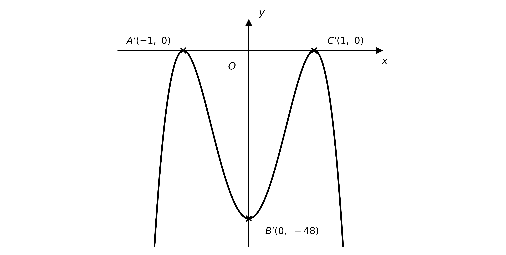

**[B1]**

**Final answer:** $A ' ( - 1 , 0 )$** and **$C ' ( 1 , 0 )$

**[B1]**

$B ' ( 0 , - 48 )$

**[B1]**

> **[mark-scheme]**
> **B1**: Correct shape for $y = - 3 \text{f} ( 2 x )$ — an inverted quartic (compressed horizontally to factor $\frac{1}{2}$, stretched vertically by 3 and reflected in the $x$-axis), touching the $x$-axis at two points.
> 
> **B1**: Images of the touch points, $A ' ( - 1 , 0 )$ and $C ' ( 1 , 0 )$.
> 
> **B1**: Image of the turning point, $B ' ( 0 , - 48 )$.
A translation with both a horizontal and a vertical component moves every point

Choose the two shifts so that no image lands on an axis

Starting from $A ( - 2 , 0 )$, $B ( 0 , 16 )$, $C ( 2 , 0 )$, a horizontal shift $\text{f} ( x + a )$ must avoid $a = 0 ,  2 ,  - 2$ and a vertical shift $+ b$ must avoid $b = 0 ,  - 16$

$y = \text{f} ( x + a ) + b ,  a \neq 0 , \pm 2 ,  b \neq 0 , - 16$

**[B1]**

for example, taking $a = 3$ and $b = - 4$ sends $A \rightarrow ( - 5 , - 4 )$, $B \rightarrow ( - 3 , 12 )$, $C \rightarrow ( - 1 , - 4 )$

$y = \text{f} ( x + 3 ) - 4$

**[B1]**

> **[mark-scheme]**
> **B1**: A translation of the form $\text{f} ( x + a ) + b$ (or equivalent) with both a horizontal and a vertical shift — a single transformation direction cannot clear all three points.
> 
> **B1**: A valid specific expression, e.g. $\text{f} ( x + 3 ) - 4$, for which none of the images lies on an axis (any `a \notin \{0, 2, -2\}` and `b \notin \{0, -16\}` is acceptable).

### Q20
(i)

$y = - 2 \text{f} ( 3 t ) = - 2  \text{cos}  3 t$ is greatest when $\text{cos}  3 t = - 1$, giving $- 2 \times ( - 1 )$

$2$

**[B1]**

(ii)

$\text{cos}  3 t = - 1$ first occurs when $3 t = 180 ^{\circ}$

$3 t = 180 ^{\circ}  \Rightarrow  t = 60 ^{\circ}$

$t = 60 ^{\circ}$

**[B1]**

> **[mark-scheme]**
> **B1**: Maximum value given as $2$.
> 
> **B1**: Occurs first at $t = 60 ^{\circ}$.
Since $\text{cos} ( t + 90 ^{\circ} ) = - \text{sin}  t$, a translation of the graph $90 ^{\circ}$ in the negative $t$-direction gives $\text{f} ( t + 90 ^{\circ} ) = - \text{sin}  t$

$\text{f} ( t + 90 ^{\circ} ) = - \text{sin}  t$

**[B1]**

then a vertical stretch with factor 4 gives $- 4  \text{sin}  t$, and a translation 2 units up gives the target graph

$y = 4  \text{f} ( t + 90 ^{\circ} ) + 2$

**[B1]**

> **[mark-scheme]**
> **B1**: A horizontal translation giving $\text{f} ( t + 90 ^{\circ} )$ (using $\text{cos} ( t + 90 ^{\circ} ) = - \text{sin}  t$). Accept the form $\text{f} ( t - 90 ^{\circ} )$ provided it is combined with a reflection in the $t$-axis, since $\text{cos} ( t - 90 ^{\circ} ) = \text{sin}  t$.
> 
> **B1**: The vertical stretch with factor 4 and translation 2 units up, giving $y = 4  \text{f} ( t + 90 ^{\circ} ) + 2$ (or the equivalent $y = - 4  \text{f} ( t - 90 ^{\circ} ) + 2$).

### Q21
(i)

Stretch the graph horizontally by factor 2 (so each $x$-coordinate doubles), then translate it 2 units up

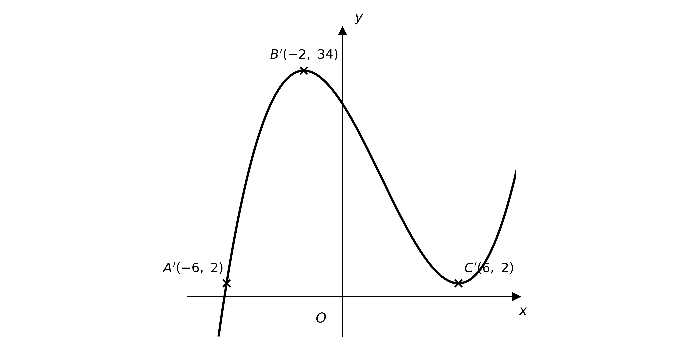

**[B1]**

**Final answer:** $A ' ( - 6 , 2 )$** and **$C ' ( 6 , 2 )$

**[B1]**

$B ' ( - 2 , 34 )$

**[B1]**

(ii)

Translate the graph 1 unit in the positive $x$-direction, then reflect it in the $x$-axis (so each $y$-coordinate changes sign)

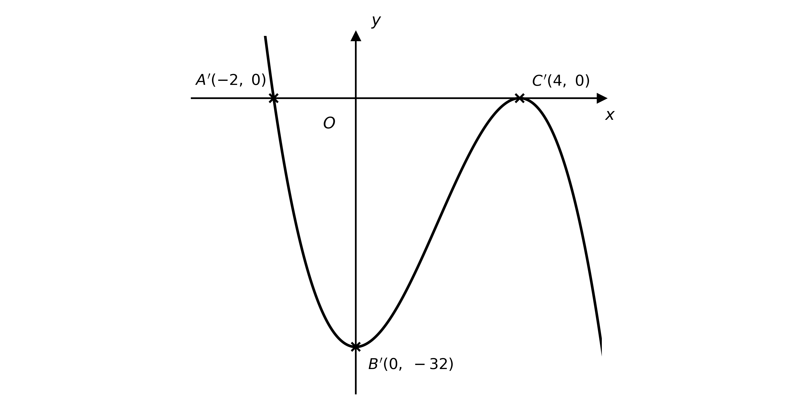

**[B1]**

**Final answer:** $A ' ( - 2 , 0 )$** and **$C ' ( 4 , 0 )$

**[B1]**

$B ' ( 0 , - 32 )$

**[B1]**

> **[mark-scheme]**
> **B1**: Correct shape for $y = \text{f} ( \frac{1}{2} x ) + 2$ — the cubic stretched horizontally by factor 2 and raised 2 units.
> 
> **B1**: Images of the intercepts, $A ' ( - 6 , 2 )$ and $C ' ( 6 , 2 )$.
> 
> **B1**: Image of the maximum, $B ' ( - 2 , 34 )$.
> 
> **B1**: Correct shape for $y = - \text{f} ( x - 1 )$ — the cubic shifted 1 right and reflected in the $x$-axis.
> 
> **B1**: Images of the intercepts, $A ' ( - 2 , 0 )$ and $C ' ( 4 , 0 )$.
> 
> **B1**: Image of the maximum (now a minimum), $B ' ( 0 , - 32 )$.

### Q22
The translation by `\begin{pmatrix} 2 \\ 0 \end{pmatrix}` replaces $x$ with $x - 2$

$\text{f} ( x - 2 ) = 3 ( x - 2 )^{2} - 2 ( x - 2 )$

**[M1]**

the vertical stretch with factor 4 multiplies the whole function by 4

`y = 4\left[3(x - 2)^2 - 2(x - 2)\right]`

**[M1]**

the translation by `\begin{pmatrix} 0 \\ -3 \end{pmatrix}` subtracts 3

`y = 4\left(3x^2 - 14x + 16\right) - 3`

**[A1]**

$\text{g} ( x ) = 12 x^{2} - 56 x + 61$

**[A1]**

> **[mark-scheme]**
> **M1**: Correct horizontal translation, replacing $x$ with $x - 2$ to give $3 ( x - 2 )^{2} - 2 ( x - 2 )$.
> 
> **M1**: Vertical stretch applied, multiplying the whole function by 4.
> 
> **A1**: Correct assembled expression `4\left[3(x - 2)^2 - 2(x - 2)\right] - 3` (or equivalent), with the $- 3$ included.
> 
> **A1**: Fully correct expanded answer $\text{g} ( x ) = 12 x^{2} - 56 x + 61$. The transformations must be applied in the given order.

### Q23
$A$ is the $y$-intercept, found by setting $x = 0$, and $B$ is where the curve touches the $x$-axis

$\text{f} ( 0 ) = ( 0 - a )^{2} = a^{2}$

**Final answer:** $A ( 0 , a^{2} )$** and **$B ( a , 0 )$

**[B1 B1]**

> **[mark-scheme]**
> **B1**: $A$ given as $( 0 , a^{2} )$ (the $y$-intercept).
> 
> **B1**: $B$ given as $( a , 0 )$ (where the curve touches the $x$-axis).
$y = - \text{f} ( - x )$ reflects the graph in the $y$-axis (replacing $x$ with $- x$) and then in the $x$-axis; this is $y = - ( x + a )^{2}$, a downward parabola with its vertex at $( - a , 0 )$

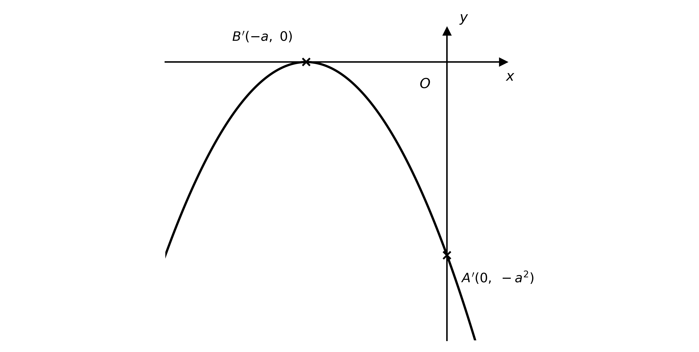

**[B1]**

The images of $A$ and $B$ are

**Final answer:** $A ' ( 0 , - a^{2} )$** and **$B ' ( - a , 0 )$

**[B1 B1]**

> **[mark-scheme]**
> **B1**: Correct shape for $y = - \text{f} ( - x )$ — a downward parabola with vertex at $( - a , 0 )$.
> 
> **B1**: Image $A ' ( 0 , - a^{2} )$.
> 
> **B1**: Image $B ' ( - a , 0 )$.
$A ( 0 , a^{2} )$ is a distance $a^{2}$ from the origin and $B ( a , 0 )$ is a distance $a$ from the origin (as $a > 0$); set the first equal to three times the second

$a^{2} = 3 a  \Rightarrow  a ( a - 3 ) = 0$

$a = 3$

**[B1]**

> **[mark-scheme]**
> **B1**: $a = 3$, obtained from $a^{2} = 3 a$ and rejecting $a = 0$ since $a > 1$.

### Q24
(i)

Stretch the graph vertically by factor 2, then translate it 4 units down; each $y$-coordinate becomes $2 \times ( \text{old} ) - 4$ and the $x$-coordinates are unchanged

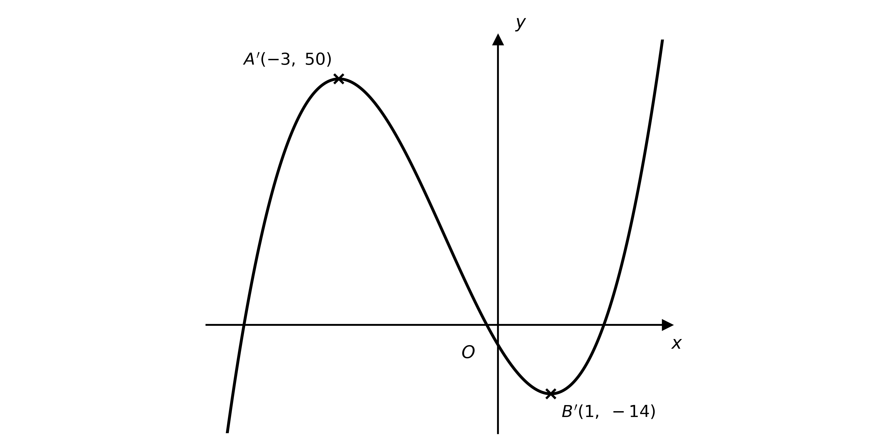

**[B1]**

**Final answer:** $A ( - 3 , 50 )$** and **$B ( 1 , - 14 )$

**[B1]**

(ii)

Translate the graph 1 unit in the negative $x$-direction and 3 units up

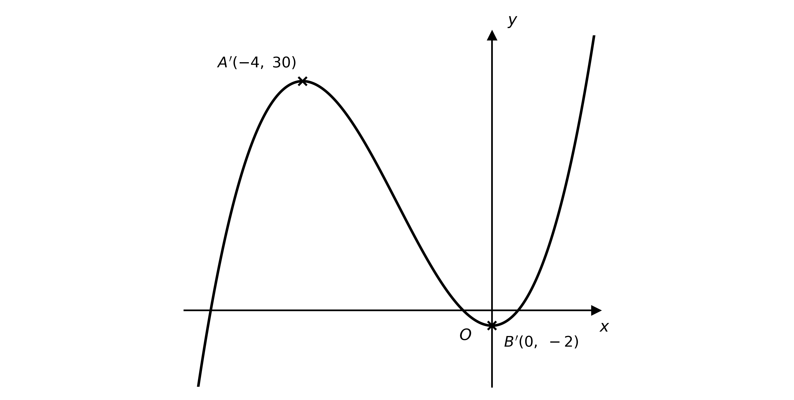

**[B1]**

**Final answer:** $A ( - 4 , 30 )$** and **$B ( 0 , - 2 )$

**[B1]**

> **[mark-scheme]**
> **B1**: Correct shape for $y = 2 \text{f} ( x ) - 4$ — the same cubic shape, stretched vertically by factor 2 and then lowered 4.
> 
> **B1**: Images given as $A ( - 3 , 50 )$ and $B ( 1 , - 14 )$.
> 
> **B1**: Correct shape for $y = \text{f} ( x + 1 ) + 3$ — the same cubic shape, shifted 1 left and 3 up.
> 
> **B1**: Images given as $A ( - 4 , 30 )$ and $B ( 0 , - 2 )$.

### Q25
(i)

The stretch and the translation act on different axes, so they may be applied in either order

**Final answer:** **Stretch, factor 3, parallel to the y-axis**

**[B1]**

**Final answer:** **Translation by **`\begin{pmatrix} -2 \\ 0 \end{pmatrix}`

**[B1]**

(ii)

The reflection and the translation act on different axes, so they may be applied in either order

**Final answer:** **Reflection in the y-axis**

**[B1]**

**Final answer:** **Translation by **`\begin{pmatrix} 0 \\ -1 \end{pmatrix}`

**[B1]**

> **[mark-scheme]**
> **B1**: For $y = 3 \text{f} ( x + 2 )$, a stretch parallel to the $y$-axis with factor 3 (all of "stretch", "factor 3" and the direction needed).
> 
> **B1**: For $y = 3 \text{f} ( x + 2 )$, a translation by `\begin{pmatrix} -2 \\ 0 \end{pmatrix}` (accept "2 units in the negative $x$-direction"). These act on different axes, so either order is accepted.
> 
> **B1**: For $y = \text{f} ( - x ) - 1$, a reflection in the $y$-axis.
> 
> **B1**: For $y = \text{f} ( - x ) - 1$, a translation by `\begin{pmatrix} 0 \\ -1 \end{pmatrix}` (accept "1 unit in the negative $y$-direction"). These act on different axes, so either order is accepted.

### Q26
The horizontal stretch with factor 2 replaces $x$ with $\frac{1}{2} x$

$y = \text{f} ( \frac{1}{2} x )$

**[M1]**

the reflection in the $x$-axis multiplies the function by $- 1$

$y = - \text{f} ( \frac{1}{2} x )$

**[M1]**

the translation by `\begin{pmatrix} 0 \\ 2 \end{pmatrix}` adds 2

$y = 2 - \text{f} ( \frac{1}{2} x )$

**[A1]**

> **[mark-scheme]**
> **M1**: Horizontal stretch with factor 2 applied, replacing $x$ with $\frac{1}{2} x$ to give $\text{f} ( \frac{1}{2} x )$.
> 
> **M1**: Reflection in the $x$-axis applied, multiplying the function by $- 1$ to give $- \text{f} ( \frac{1}{2} x )$.
> 
> **A1**: Fully correct final equation $y = 2 - \text{f} ( \frac{1}{2} x )$ (accept $- \text{f} ( \frac{1}{2} x ) + 2$). The transformations must be applied in the given order.

### Q27
(i)

The factor 3 stretches the graph vertically, so the maximum value 1 becomes $3 \times 1$

$3$

**[B1]**

(ii)

$t = 45 ^{\circ}$

**[B1]**

> **[mark-scheme]**
> **B1**: Maximum value given as $3$.
> 
> **B1**: Occurs first at $t = 45 ^{\circ}$ (where $\text{sin}  2 t = 1$).
(i)

The factor 5 stretches the graph vertically, so the minimum value $- 1$ becomes $5 \times ( - 1 )$; the horizontal translation does not change the minimum value

$5 \times ( - 1 ) = - 5$

$- 5$

**[B1]**

(ii)

The minimum needs $\text{sin} ( 2 t + 60 ^{\circ} ) = - 1$, so $2 t + 60 ^{\circ} = 270 ^{\circ}$

$2 t = 210 ^{\circ}  \Rightarrow  t = 105 ^{\circ}$

$t = 105 ^{\circ}$

**[B1]**

> **[mark-scheme]**
> **B1**: Minimum value given as $- 5$.
> 
> **B1**: Occurs first at $t = 105 ^{\circ}$. The translation shifts $\text{sin}  2 t$ by $30 ^{\circ}$ to the left, so the minimum (at $135 ^{\circ}$ before the shift) moves to $105 ^{\circ}$.
Since $\text{f} ( t ) = \text{sin}  2 t$, note that $\text{sin}  t = \text{f} ( \frac{1}{2} t )$; the target graph is therefore $y = \text{f} ( \frac{1}{2} t ) + 2$

**Final answer:** **Stretch, factor 2, parallel to the t-axis**

**[B1]**

**Final answer:** **Translation by **`\begin{pmatrix} 0 \\ 2 \end{pmatrix}`

**[B1]**

> **[mark-scheme]**
> **B1**: Stretch parallel to the $t$-axis (horizontal) with factor 2 — this turns $\text{sin}  2 t$ into $\text{sin}  t$.
> 
> **B1**: Translation by `\begin{pmatrix} 0 \\ 2 \end{pmatrix}` (accept "2 units in the positive $y$-direction"). The two transformations act on different axes, so either order is accepted.

### Q28
The line $y = \text{p} ( x ) = 3 x - 4$ crosses the axes where $3 x - 4 = 0$ and where $x = 0$

**Final answer:** $( \frac{4}{3} , 0 )$** and **$( 0 , - 4 )$

**[B1]**

The graph of $y = \text{p}^{-1} ( x )$ is the reflection of $y = \text{p} ( x )$ in the line $y = x$, so its intercepts are those of $\text{p}$ with the coordinates interchanged

**Final answer:** $( - 4 , 0 )$** and **$( 0 , \frac{4}{3} )$

**[B1]**

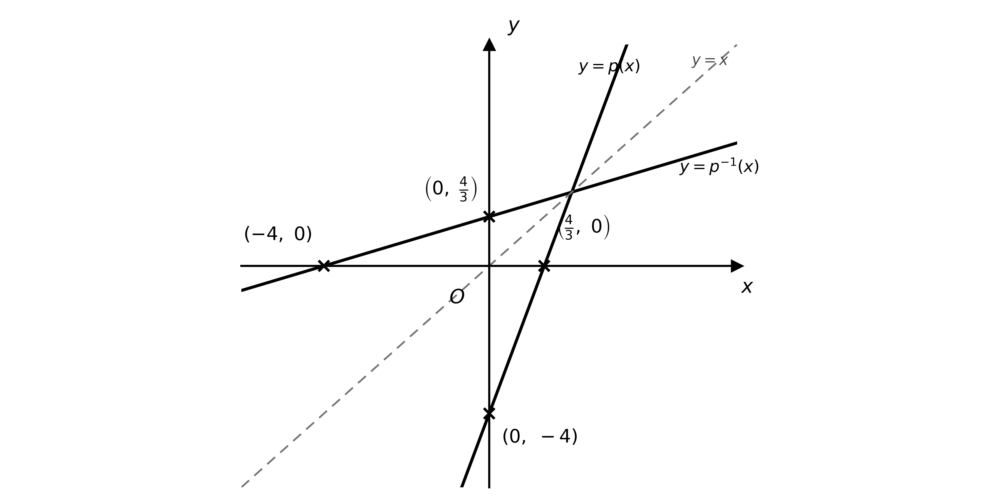

**[B1]**

The line $y = x$ is drawn as the line of symmetry between the two graphs

**[B1]**

> **[mark-scheme]**
> **B1**: Intercepts of $y = \text{p} ( x )$ given as $( \frac{4}{3} , 0 )$ and $( 0 , - 4 )$.
> 
> **B1**: Intercepts of $y = \text{p}^{-1} ( x )$ given as $( - 4 , 0 )$ and $( 0 , \frac{4}{3} )$ (the coordinates of $\text{p}$'s intercepts interchanged).
> 
> **B1**: Both straight lines drawn correctly, with $y = \text{p}^{-1} ( x )$ the reflection of $y = \text{p} ( x )$.
> 
> **B1**: The line $y = x$ shown as the line of symmetry (no need to label it).
(i)

Let $y = 3 x - 4$ and make $x$ the subject, then interchange $x$ and $y$

$y = 3 x - 4  \Rightarrow  x = \frac{y+4}{3}$

$\text{p}^{-1} ( x ) = \frac{x+4}{3}$

**[B1]**

(ii)

Substitute $\text{p} ( x ) = 3 x - 4$ and simplify

`\tfrac{1}{9}\left[(3x - 4) + 16\right] = \tfrac{1}{9}(3x + 12)`

**[M1]**

$\frac{1}{3} ( x + 4 )$

**[A1]**

(iii)

The simplified expression is identical to $\text{p}^{-1} ( x )$

`\tfrac{1}{9}\left[\text{p}(x) + 16\right] = \tfrac{1}{3}(x + 4) = \text{p}^{-1}(x)`

so applying this sequence of transformations to $y = \text{p} ( x )$ reproduces the inverse function

**Final answer:** **It maps the graph of y = p(x) onto the graph of its inverse — equivalently, a reflection in the line y = x**

**[B1]**

> **[mark-scheme]**
> **B1**: Correct inverse $\text{p}^{-1} ( x ) = \frac{x+4}{3}$ (accept $\frac{1}{3} ( x + 4 )$).
> 
> **M1**: Substituting $\text{p} ( x ) = 3 x - 4$ into `\tfrac{1}{9}\left[\text{p}(x) + 16\right]` and beginning to simplify.
> 
> **A1**: Correct simplified expression $\frac{1}{3} ( x + 4 )$ (or $\frac{x+4}{3}$).
> 
> **B1**: Deduction that `\tfrac{1}{9}\left[\text{p}(x) + 16\right] = \text{p}^{-1}(x)`, so this sequence of transformations (a translation of 16 units up, followed by a vertical stretch of factor $\frac{1}{9}$) maps the graph of $\text{p}$ onto the graph of its inverse.
