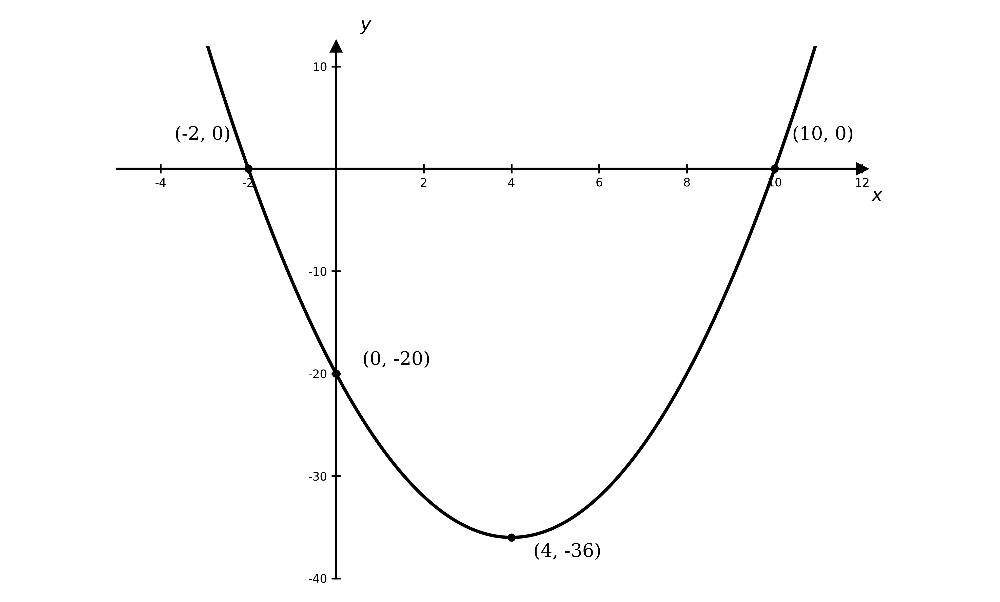
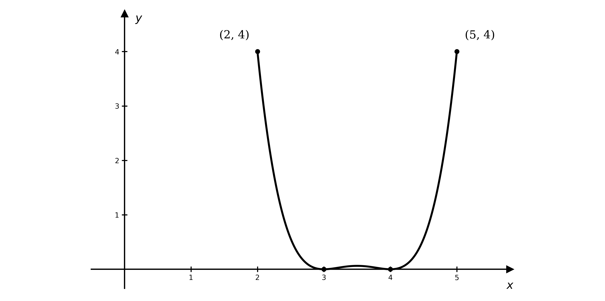
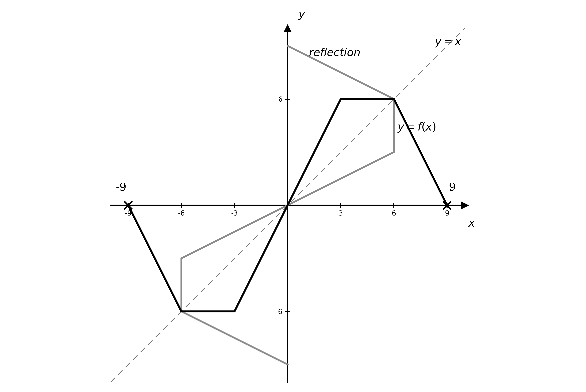
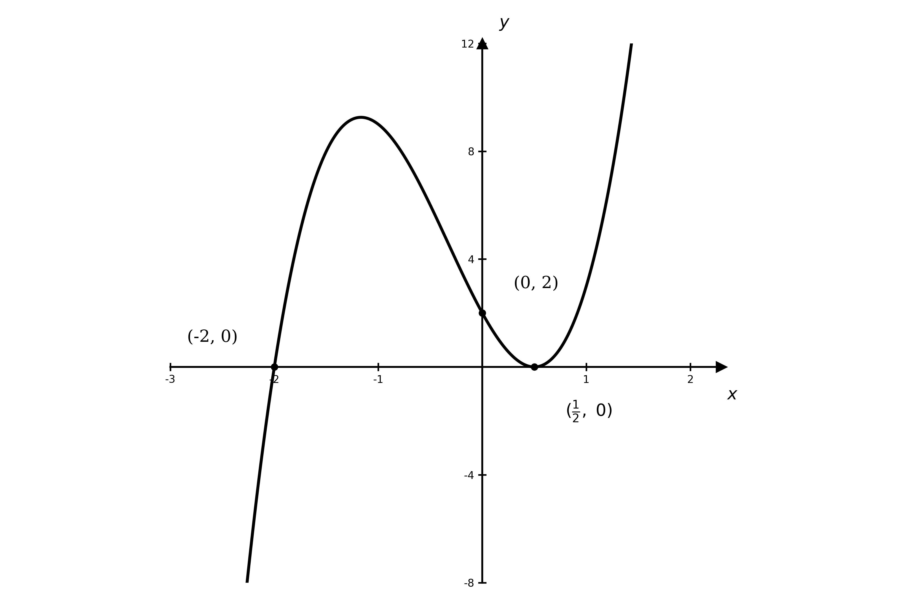
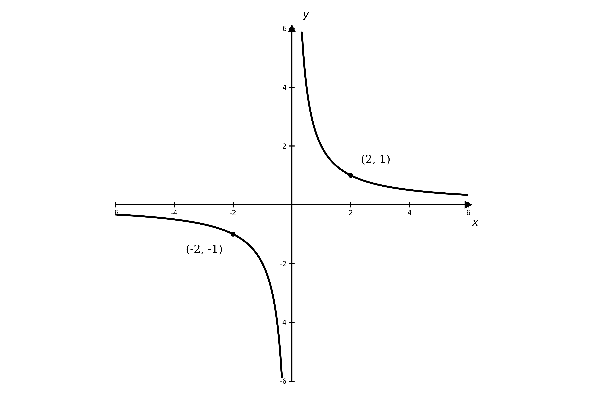
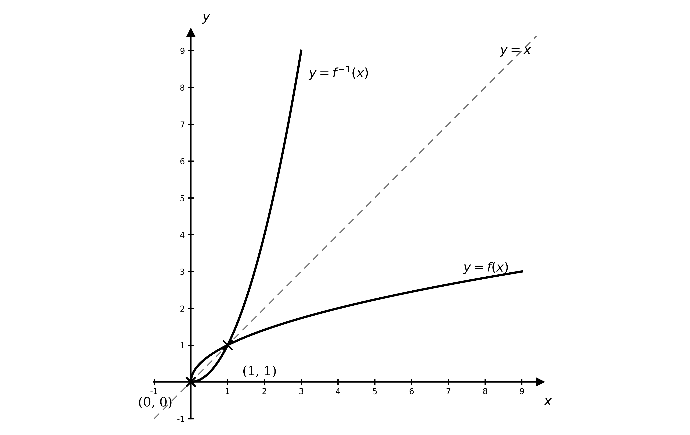
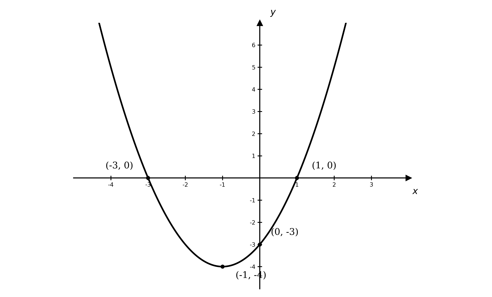
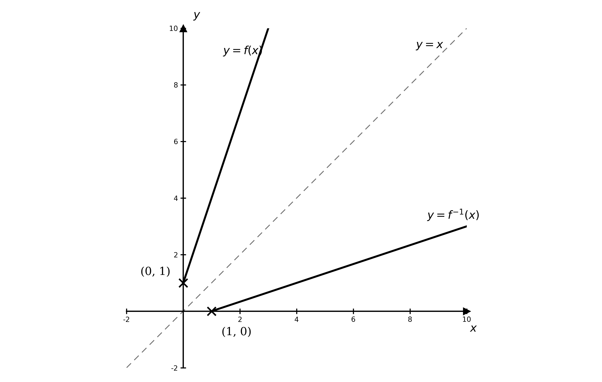

# Mark Schemes — Functions
**Algebra & Functions** · Cambridge (CIE) AS maths (9709)

## Exam Questions (21 questions)

### Q1
Let $y = \text{f} ( x )$ and rearrange to make $x^{2}$ the subject

$y = 3 x^{2} + 1$

$x^{2} = \frac{y-1}{3}$

**[M1]**

Take the square root

$x = \pm \sqrt{\frac{y-1}{3}}$

**[M1]**

The domain is $x \geq 0$, so take the positive root and write the inverse as a function of $x$

$\text{f}^{-1} ( x ) = \sqrt{\frac{x-1}{3}}$

**[A1]**

> **[mark-scheme]**
> **M1**: Setting $y = 3 x^{2} + 1$ and rearranging to make $x^{2}$ the subject, $x^{2} = \frac{y-1}{3}$.
> 
> **M1**: Taking the square root of both sides.
> 
> **A1**: Correct $\text{f}^{-1} ( x ) = \sqrt{\frac{x-1}{3}}$, selecting the positive root (because $x \geq 0$) and written as a function of $x$. Do not accept an answer left as $x = \dots$ or one that keeps the $\pm$.
The domain of $\text{f}^{-1}$ is the range of $\text{f}$; on $x \geq 0$ the least value is $\text{f} ( 0 ) = 1$, so the range of $\text{f}$ is $\text{f} ( x ) \geq 1$

$\text{domain of}\text{f}^{-1}:x\geq1$

**[B1]**

The range of $\text{f}^{-1}$ is the domain of $\text{f}$

$\text{range of}\text{f}^{-1}:\text{f}^{-1}(x)\geq0$

**[B1]**

> **[mark-scheme]**
> **B1**: Correct domain of $\text{f}^{-1}$: $x \geq 1$ (this is the range of $\text{f}$). Must be in terms of $x$; accept the interval `[1, \infty)`.
> 
> **B1**: Correct range of $\text{f}^{-1}$: $\text{f}^{-1} ( x ) \geq 0$ (this is the domain of $\text{f}$). Accept $y \geq 0$.

### Q2
(i) For $\text{fg} ( x )$, substitute $\text{g} ( x )$ into $\text{f}$

$\text{fg} ( x ) = \text{f} ( - 2 x ) = 3 ( - 2 x ) + 5$

**[M1]**

$\text{fg} ( x ) = - 6 x + 5$

**[A1]**

(ii) For $\text{gf} ( x )$, substitute $\text{f} ( x )$ into $\text{g}$

$\text{gf} ( x ) = \text{g} ( 3 x + 5 ) = - 2 ( 3 x + 5 )$

**[M1]**

$\text{gf} ( x ) = - 6 x - 10$

**[A1]**

> **[mark-scheme]**
> **M1**: Correct substitution of $\text{g} ( x ) = - 2 x$ into $\text{f}$ to form $\text{fg} ( x )$ (substituting in the wrong order scores M0).
> 
> **A1**: Correct simplified expression $\text{fg} ( x ) = - 6 x + 5$.
> 
> **M1**: Correct substitution of $\text{f} ( x ) = 3 x + 5$ into $\text{g}$ to form $\text{gf} ( x )$.
> 
> **A1**: Correct simplified expression $\text{gf} ( x ) = - 6 x - 10$.
Set the two expressions equal and collect the terms in $x$

$3 x + 5 = - 2 x$

$5 x = - 5$

**[M1]**

$x = - 1$

**[A1]**

> **[mark-scheme]**
> **M1**: Setting $3 x + 5 = - 2 x$ and rearranging to collect the terms in $x$.
> 
> **A1**: Correct solution $x = - 1$.

### Q3
For $x \geq 3$ the curve is increasing, so the least value is at $x = 3$

$\text{f} ( 3 ) = 3^{2} - 9 = 0$

$\text{f} ( x ) \geq 0$

**[B1]**

For $x \geq 0$ the least value of $x^{2}$ is $0$, at $x = 0$

$\text{f} ( 0 ) = 0^{2} - 9 = - 9$

**[M1]**

This minimum is now inside the domain, so the range extends down to $- 9$

$\text{f} ( x ) \geq - 9$

**[A1]**

> **[mark-scheme]**
> **B1**: Correct range for the domain $x \geq 3$: $\text{f} ( x ) \geq 0$. Accept $y \geq 0$. The inequality must be inclusive ($\geq$, not $>$) and must not be written in terms of $x$.
> 
> **M1**: For the domain $x \geq 0$, correct least value $\text{f} ( 0 ) = - 9$ (the least value of $x^{2}$ is $0$).
> 
> **A1**: Correct range for the domain $x \geq 0$: $\text{f} ( x ) \geq - 9$. Accept $y \geq - 9$, inclusive $\geq$, not in terms of $x$.

### Q4
Factorise to find where the graph crosses the $x$-axis

$x^{2} - 8 x - 20 = ( x - 10 ) ( x + 2 )$

**Final answer:** $( - 2 , 0 )$** and **$( 10 , 0 )$

**[B1]**

Substitute $x = 0$ to find where the graph crosses the $y$-axis

$\text{f} ( 0 ) = - 20$

$( 0 , - 20 )$

**[B1]**

Sketch a positive (U-shaped) parabola passing through these three points

**[B1]**

> **[mark-scheme]**
> **B1**: Correct $x$-axis intercepts, $( - 2 , 0 )$ and $( 10 , 0 )$ (accept $x = - 2$ and $x = 10$).
> 
> **B1**: Correct $y$-axis intercept, $( 0 , - 20 )$.
> 
> **B1**: Correct shape — a positive (U-shaped) parabola — passing through all three intercepts, with its minimum between the two roots.
Find the value of the function at the minimum point

$\text{f} ( 4 ) = ( 4 )^{2} - 8 ( 4 ) - 20 = - 36$

**[M1]**

The minimum point is the lowest point on the graph, so the range is every value from $- 36$ upwards

$\text{f} ( x ) \geq - 36$

**[A1]**

> **[mark-scheme]**
> **M1**: Correct substitution of $x = 4$ into $\text{f} ( x )$, giving the minimum value $\text{f} ( 4 ) = - 36$.
> 
> **A1**: Correct range $\text{f} ( x ) \geq - 36$. Accept $y \geq - 36$; the inequality must be inclusive ($\geq$, not $>$) and must not be in terms of $x$.

### Q5
(i) A straight line: each input has one output, and each output comes from just one input

**Final answer:** **one-one**

**[B1]**

(ii) The same output is reached from two inputs (e.g. $x = 2$ and $x = - 2$ both give $4$)

**Final answer:** **many-one**

**[B1]**

(iii) A straight line: each input has one output, and each output comes from just one input

**Final answer:** **one-one**

**[B1]**

(iv) $\sqrt{x}$ is the positive square root, so each $x \geq 0$ has exactly one image

**Final answer:** **one-one**

**[B1]**

> **[mark-scheme]**
> **B1**: $4 x - 2$ is one-one (a linear function: distinct inputs give distinct outputs).
> 
> **B1**: $x^{2}$ is many-one (two inputs such as $x = 2$ and $x = - 2$ share the output $4$).
> 
> **B1**: $\frac{x}{4}$ is one-one (a linear function: distinct inputs give distinct outputs).
> 
> **B1**: $\sqrt{x}$ is one-one (the positive square root gives exactly one image for each $x \geq 0$).

### Q6
Sketching $\text{f}$ on $2 \leq x \leq 5$ shows where its largest and smallest values occur

$\text{f}$ is a square, so $\text{f} ( x ) \geq 0$; it equals $0$ where $( x - 3 ) ( x - 4 ) = 0$, i.e. at $x = 3$ and $x = 4$ (both in the interval)

$\text{f} ( 3 ) = \text{f} ( 4 ) = 0$

The largest values on the closed interval are at the endpoints

$\text{f} ( 2 ) = ( - 1 )^{2} ( - 2 )^{2} = 4 ,  \text{f} ( 5 ) = ( 2 )^{2} ( 1 )^{2} = 4$

**[M1]**

$0 \leq \text{f} ( x ) \leq 4$

**[A1]**

> **[mark-scheme]**
> **M1**: Correct key values — $\text{f} = 0$ at $x = 3 , 4$ and $\text{f} = 4$ at the endpoints $x = 2 , 5$.
> 
> **A1**: Correct range $0 \leq \text{f} ( x ) \leq 4$ (inclusive at both ends).
For $x \leq 2$, both $( x - 3 )$ and $( x - 4 )$ are negative, so their product is positive and smallest at $x = 2$; the value grows without bound as $x$ decreases

$\text{f} ( 2 ) = ( - 1 )^{2} ( - 2 )^{2} = 4$

$\text{f} ( x ) \geq 4$

**[B1]**

> **[mark-scheme]**
> **B1**: Correct range $\text{f} ( x ) \geq 4$ (inclusive $\geq$; not in terms of $x$).
The graph is symmetric about $x = 3 . 5$, so the reflection of $x \leq 2$ gives the same range

$x \geq 5$

**[B1]**

> **[mark-scheme]**
> **B1**: Correct domain $x \geq 5$ (the reflection of $x \leq 2$ in the line of symmetry $x = 3 . 5$), giving the same range $\text{f} ( x ) \geq 4$.

### Q7
From the graph, $\text{f}$ runs from $x = - 9$ to $x = 9$ and takes values between $- 6$ and $6$

**Final answer:** $\text{domain:} - 9 \leq x \leq 9$**,   **$\text{range:} - 6 \leq \text{f} ( x ) \leq 6$

**[B1]**

Reflect $\text{f}$ in the line $y = x$ by swapping the coordinates of each point

**[B1]**

**Final answer:** **f is many-one: the flat parts mean several inputs share an output (for example f(x) = 6 for all x from 3 to 6), so the reflection sends one input to several outputs. f is not a function, so this cannot be the inverse.**

**[B1]**

> **[mark-scheme]**
> **B1**: Correct domain $- 9 \leq x \leq 9$ and range $- 6 \leq \text{f} ( x ) \leq 6$.
> 
> **B1**: Reflection of $\text{f}$ in the line $y = x$ drawn correctly (the image of each point has its coordinates swapped).
> 
> **B1**: A correct explanation that $\text{f}$ is many-one (not one-one), so its reflection is one-many — not a function — and therefore cannot be $\text{f}^{-1}$.

(i) The flat section where $\text{f} ( x ) = 6$ is symmetric about $x = 4 . 5$; since its largest solution is $x = 6$, it runs from $x = 3$ to $x = 6$, so $\text{f}$ is one-one only up to $x = 3$. By the rotational symmetry, restrict to:

$- 3 \leq x \leq 3$

**[B1]**

(ii) The domain of $\text{f}^{-1}$ is the range of the restricted $\text{f}$, and its range is the restricted domain

**Final answer:** $\text{domain:} - 6 \leq x \leq 6$**,   **$\text{range:} - 3 \leq \text{f}^{-1} ( x ) \leq 3$

**[B1]**

> **[mark-scheme]**
> **B1**: Correct restriction $- 3 \leq x \leq 3$ (any domain on which $\text{f}$ is one-one with this as the principal branch).
> 
> **B1**: Correct domain $- 6 \leq x \leq 6$ and range $- 3 \leq \text{f}^{-1} ( x ) \leq 3$ for $\text{f}^{-1}$.

### Q8
(i) For $\text{fg} ( x )$, substitute $\text{g} ( x )$ into $\text{f}$

`\text{fg}(x) = \left((1 + \sqrt{x + 4}) - 1\right)^{2} - 4 = (x + 4) - 4`

**[M1]**

$\text{fg} ( x ) = x$

**[A1]**

(ii) For $\text{gf} ( x )$, substitute $\text{f} ( x )$ into $\text{g}$; since $x \geq 1$, $\sqrt{(x-1)^{2}} = x - 1$

$\text{gf} ( x ) = 1 + \sqrt{(x-1)^{2}-4+4} = 1 + ( x - 1 )$

$\text{gf} ( x ) = x$

**[A1]**

> **[mark-scheme]**
> **M1**: Correct method for a composite function — substituting one function into the other in the correct order (wrong order scores M0).
> 
> **A1**: Correct $\text{fg} ( x ) = x$.
> 
> **A1**: Correct $\text{gf} ( x ) = x$ (using $\sqrt{(x-1)^{2}} = x - 1$ for $x \geq 1$).
From part (a), $\text{g}$ is the inverse of $\text{f}$

$\text{f}^{-1} ( x ) = 1 + \sqrt{x+4}$

**[B1]**

The range of $\text{f}$ (for $x \geq 1$) is $\text{f} ( x ) \geq - 4$, which is the domain of $\text{f}^{-1}$; its range is the domain of $\text{f}$

**Final answer:** $\text{domain:} x \geq - 4$**,   **$\text{range:} \text{f}^{-1} ( x ) \geq 1$

**[B1]**

> **[mark-scheme]**
> **B1**: Correct $\text{f}^{-1} ( x ) = 1 + \sqrt{x+4}$.
> 
> **B1**: Correct domain $x \geq - 4$ and range $\text{f}^{-1} ( x ) \geq 1$.
A function and its inverse are mirror images in the line $y = x$

**Final answer:** **Reflection in the line y = x.**

**[B1 B1]**

> **[mark-scheme]**
> **B1**: "Reflection" identified.
> 
> **B1**: In the line $y = x$ (the exact mirror line must be stated).
The graphs meet on the line $y = x$, so solve $\text{f} ( x ) = x$

$( x - 1 )^{2} - 4 = x  \Rightarrow  x^{2} - 3 x - 3 = 0$

**[M1]**

Solve, taking the root with $x \geq 1$

`\left( \dfrac{3 + \sqrt{21}}{2}, \ \dfrac{3 + \sqrt{21}}{2} \right)`

**[A1]**

> **[mark-scheme]**
> **M1**: Setting $\text{f} ( x ) = x$ (using that the intersection lies on $y = x$) and forming $x^{2} - 3 x - 3 = 0$.
> 
> **A1**: Correct coordinates `\left( \dfrac{3 + \sqrt{21}}{2}, \dfrac{3 + \sqrt{21}}{2} \right)` (rejecting $\frac{3-\sqrt{21}}{2} < 1$).

### Q9
$\text{f}$ is a cubic polynomial, defined for every real number

$\text{domain:} x \in ℝ$

**[B1]**

A cubic takes every real value as $x$ ranges over $ℝ$

$\text{range:} \text{f} ( x ) \in ℝ$

**[B1]**

> **[mark-scheme]**
> **B1**: Correct domain $x \in ℝ$ (all real numbers).
> 
> **B1**: Correct range $\text{f} ( x ) \in ℝ$ (all real numbers).
Factorise to find where the graph meets the $x$-axis

$\text{f} ( x ) = ( 2 x - 1 )^{2} ( x + 2 )$

The repeated factor $( 2 x - 1 )^{2}$ gives a touch; the factor $( x + 2 )$ gives a crossing

`\left(\tfrac{1}{2},\ 0\right), \ (-2,\ 0)`

**[B1]**

The $y$-axis intercept

$\text{f} ( 0 ) = 2$

$( 0 ,  2 )$

**[B1]**

Sketch the positive cubic, touching the $x$-axis at $x = \frac{1}{2}$ and crossing at $x = - 2$

**[B1]**

> **[mark-scheme]**
> **B1**: Correct $x$-axis intercepts — touches at `\left(\tfrac{1}{2}, 0\right)` (repeated root) and crosses at $( - 2 , 0 )$.
> 
> **B1**: Correct $y$-axis intercept $( 0 , 2 )$.
> 
> **B1**: Correct shape — a positive cubic, tangent to the $x$-axis at $x = \frac{1}{2}$ and crossing at $x = - 2$.

### Q10
**Final answer:** **f is the upper half of a circle, symmetric about the y-axis: f(x) = f(-x), for example f(3) = f(-3) = 4. **

**Final answer:** **Two inputs share an output, so f is many-one and has no inverse.**

**[B1]**

> **[mark-scheme]**
> **B1**: A correct reason that $\text{f}$ is many-one / not one-one (e.g. $\text{f} ( x ) = \text{f} ( - x )$, so two inputs give the same output), hence no inverse.
$\text{f}$ is never negative, so the first quadrant requires $x \geq 0$; the largest such domain on which $\text{f}$ is one-one is

$0 \leq x \leq 5$

**[B1]**

On this domain $\text{f}$ decreases from $5$ to $0$

$\text{range:} 0 \leq \text{f} ( x ) \leq 5$

**[B1]**

> **[mark-scheme]**
> **B1**: Correct adapted domain $0 \leq x \leq 5$ (one-one, first quadrant, largest possible).
> 
> **B1**: Correct range $0 \leq \text{f} ( x ) \leq 5$.
On $- 5 \leq x \leq 0$ the function is one-one. Let $y = \text{f} ( x )$, square both sides and rearrange

$y = \sqrt{25-x^{2}}  \Rightarrow  y^{2} = 25 - x^{2}  \Rightarrow  x^{2} = 25 - y^{2}$

**[M1]**

Take the square root; since $x \leq 0$, take the negative root

$\text{f}^{-1} ( x ) = - \sqrt{25-x^{2}}$

**[A1]**

The domain of $\text{f}^{-1}$ is the range of $\text{f}$, and its range is the domain of $\text{f}$

**Final answer:** $\text{domain:} 0 \leq x \leq 5$**,   **$\text{range:} - 5 \leq \text{f}^{-1} ( x ) \leq 0$

**[B1]**

> **[mark-scheme]**
> **M1**: Setting $y = \sqrt{25-x^{2}}$, squaring and rearranging to $x^{2} = 25 - y^{2}$.
> 
> **A1**: Correct $\text{f}^{-1} ( x ) = - \sqrt{25-x^{2}}$, selecting the negative root (because $x \leq 0$) and written as a function of $x$.
> 
> **B1**: Correct domain $0 \leq x \leq 5$ and range $- 5 \leq \text{f}^{-1} ( x ) \leq 0$.

### Q11
A square is never negative, so the least value of $\text{f}$ is $- 2$

$\text{f} ( x ) \geq - 2$

**[B1]**

> **[mark-scheme]**
> **B1**: Correct range $\text{f} ( x ) \geq - 2$. Accept $y \geq - 2$, inclusive $\geq$, not in terms of $x$.
(i) For $\text{fg} ( x )$, substitute $\text{g} ( x )$ into $\text{f}$ and combine over a common denominator

`\text{fg}(x) = \left(1 - \dfrac{2}{x}\right)^{2} - 2 = -1 - \dfrac{4}{x} + \dfrac{4}{x^{2}}`

**[M1]**

$\text{fg} ( x ) = \frac{4-4x-x^{2}}{x^{2}}$

**[A1]**

(ii) For $\text{gf} ( x )$, substitute $\text{f} ( x )$ into $\text{g}$

$\text{gf} ( x ) = 1 - \frac{2}{x^{2}-2}$

$\text{gf} ( x ) = \frac{x^{2}-4}{x^{2}-2}$

**[A1]**

> **[mark-scheme]**
> **M1**: Correct substitution of $\text{g} ( x )$ into $\text{f}$ for $\text{fg} ( x )$ (wrong order scores M0).
> 
> **A1**: Correct single fraction $\text{fg} ( x ) = \frac{4-4x-x^{2}}{x^{2}}$ (or equivalent).
> 
> **A1**: Correct single fraction $\text{gf} ( x ) = \frac{x^{2}-4}{x^{2}-2}$.
Set the expressions equal and multiply through by $x$ to clear the fraction

$x^{2} - 2 = 1 - \frac{2}{x}  \Rightarrow  x^{3} - 3 x + 2 = 0$

$( x - 1 )^{2} ( x + 2 ) = 0$

**[M1]**

**Final answer:** $x = 1$** or **$x = - 2$

**[A1]**

> **[mark-scheme]**
> **M1**: Clearing the fraction to reach the cubic $x^{3} - 3 x + 2 = 0$ and attempting to solve (e.g. by factorising).
> 
> **A1**: Correct solutions $x = 1$ and $x = - 2$.

### Q12
The function is undefined where the denominator is zero

$x\inℝ,x\neq0$

**[B1]**

> **[mark-scheme]**
> **B1**: Correct domain $x \in ℝ , x \neq 0$ (all real numbers except $0$).
$\frac{2}{x}$ is never $0$ and is undefined at $x = 0$, so the graph crosses neither axis

**Final answer:** **no intersections with the axes**

**[B1]**

The graph approaches both axes without meeting them, so they are the asymptotes

**Final answer:** $x = 0$** and **$y = 0$

**[B1]**

Sketch the two branches, in the first and third quadrants

**[B1]**

> **[mark-scheme]**
> **B1**: States there are no intersections with either axis (since $\frac{2}{x} \neq 0$ and is undefined at $x = 0$).
> 
> **B1**: Correct asymptotes $x = 0$ and $y = 0$.
> 
> **B1**: Correct shape — two branches in the first and third quadrants, each approaching the asymptotes.
The curve gets arbitrarily close to the $x$-axis but never reaches it, so $\text{f}$ never takes the value $0$

$\text{f}(x)\inℝ,\text{f}(x)\neq0$

**[B1]**

> **[mark-scheme]**
> **B1**: Correct range $\text{f} ( x ) \in ℝ , \text{f} ( x ) \neq 0$ (accept $y \neq 0$, or "all real values except $0$").

### Q13
(i) The curve starts at the origin and continues to the right, taking values from $0$ upwards

**Final answer:** $\text{domain:} x \geq 0$**,   **$\text{range:} \text{f} ( x ) \geq 0$

**[B1 B1]**

(ii) The dotted line passes through the origin and $( 1 , 1 )$, so it has gradient $1$

$y = x$

**[B1]**

> **[mark-scheme]**
> **B1**: Correct domain $x \geq 0$ (in terms of $x$).
> 
> **B1**: Correct range $\text{f} ( x ) \geq 0$ (accept $y \geq 0$; inclusive $\geq$).
> 
> **B1**: Correct equation of the dotted line, $y = x$.
Reflect the graph of $\text{f}$ in the line $y = x$; the fixed points $( 0 , 0 )$ and $( 1 , 1 )$ stay, and the concave-down curve becomes concave-up

**[B1 B1]**

> **[mark-scheme]**
> **B1**: $\text{f}^{-1}$ drawn as the reflection of $\text{f}$ in the line $y = x$ (a concave-up curve).
> 
> **B1**: $\text{f}^{-1}$ passes through $( 0 , 0 )$ and $( 1 , 1 )$.

### Q14
The smallest value of $3 x^{2}$ is $0$, at $x = 0$, so the least value of $\text{f}$ is $2$

$\text{f} ( x ) \geq 2$

**[B1]**

> **[mark-scheme]**
> **B1**: Correct range $\text{f} ( x ) \geq 2$. Accept $y \geq 2$, inclusive $\geq$, not in terms of $x$.
(i) For $\text{fg} ( x )$, substitute $\text{g} ( x )$ into $\text{f}$

$\text{fg} ( x ) = 3 ( 1 - 3 x )^{2} + 2$

**[M1]**

$\text{fg} ( x ) = 27 x^{2} - 18 x + 5$

**[A1]**

(ii) For $\text{gf} ( x )$, substitute $\text{f} ( x )$ into $\text{g}$

$\text{gf} ( x ) = 1 - 3 ( 3 x^{2} + 2 )$

**[M1]**

$\text{gf} ( x ) = - 9 x^{2} - 5$

**[A1]**

> **[mark-scheme]**
> **M1**: Correct substitution of $\text{g} ( x ) = 1 - 3 x$ into $\text{f}$ for $\text{fg} ( x )$ (wrong order scores M0).
> 
> **A1**: Correct simplified $\text{fg} ( x ) = 27 x^{2} - 18 x + 5$.
> 
> **M1**: Correct substitution of $\text{f} ( x ) = 3 x^{2} + 2$ into $\text{g}$ for $\text{gf} ( x )$.
> 
> **A1**: Correct simplified $\text{gf} ( x ) = - 9 x^{2} - 5$.
Set up the equation and rearrange into a quadratic

$3 x^{2} + 2 = ( 1 - 3 x ) + 1$

$3 x^{2} + 3 x = 0  \Rightarrow  3 x ( x + 1 ) = 0$

**[M1]**

**Final answer:** $x = 0$** or **$x = - 1$

**[A1]**

> **[mark-scheme]**
> **M1**: Setting $3 x^{2} + 2 = 2 - 3 x$, rearranging to $3 x^{2} + 3 x = 0$ and attempting to solve.
> 
> **A1**: Correct solutions $x = 0$ and $x = - 1$.

### Q15
(i) The same output is reached from two inputs (e.g. $x = 2$ and $x = - 2$ both give $4$)

**Final answer:** **many-one**

**[B1]**

(ii) A straight line: each input has one output, and each output comes from just one input

**Final answer:** **one-one**

**[B1]**

(iii) A cubic that is always increasing, so each input has one output and each output comes from just one input

**Final answer:** **one-one**

**[B1]**

(iv) Each positive input gives two outputs, $+ \sqrt{x}$ and $- \sqrt{x}$

**Final answer:** **one-many**

**[B1]**

> **[mark-scheme]**
> **B1**: $x^{2}$ is many-one (two inputs such as $x = 2$ and $x = - 2$ share the output $4$).
> 
> **B1**: $3 x + 1$ is one-one (a linear function: distinct inputs give distinct outputs).
> 
> **B1**: $( x + 1 )^{3}$ is one-one (the cubic is strictly increasing, so distinct inputs give distinct outputs).
> 
> **B1**: $\pm \sqrt{x}$ is one-many (each positive input maps to the two values $+ \sqrt{x}$ and $- \sqrt{x}$, so it is not a function).

### Q16
Factorise to find where the graph crosses the $x$-axis, and substitute $x = 0$ for the $y$-axis

$x^{2} + 2 x - 3 = ( x + 3 ) ( x - 1 )$

$\text{f} ( 0 ) = - 3$

$(-3,0),(1,0),(0,-3)$

**[B1]**

Complete the square to find the turning point

$x^{2} + 2 x - 3 = ( x + 1 )^{2} - 4$

$( - 1 , - 4 )$

**[B1]**

Sketch a positive (U-shaped) parabola through these points

**[B1]**

> **[mark-scheme]**
> **B1**: Correct axis intercepts $( - 3 , 0 )$, $( 1 , 0 )$ and $( 0 , - 3 )$.
> 
> **B1**: Correct turning point $( - 1 , - 4 )$.
> 
> **B1**: Correct shape — a positive (U-shaped) parabola — through the intercepts with its minimum at the turning point.
The turning point is the lowest point on the graph, so the range is every value from $- 4$ upwards

$\text{f} ( x ) \geq - 4$

**[B1]**

> **[mark-scheme]**
> **B1**: Correct range $\text{f} ( x ) \geq - 4$. Accept $y \geq - 4$; the inequality must be inclusive ($\geq$, not $>$) and must not be in terms of $x$.

### Q17
On $x \geq 0$ the least value of $x^{2}$ is $0$, at $x = 0$

$\text{f} ( 0 ) = 0^{2} - 4 = - 4$

**[M1]**

The function increases from this least value, so:

$\text{f} ( x ) \geq - 4$

**[A1]**

> **[mark-scheme]**
> **M1**: Correct least value $\text{f} ( 0 ) = - 4$ (the least value of $x^{2}$ on $x \geq 0$ is $0$).
> 
> **A1**: Correct range $\text{f} ( x ) \geq - 4$. Accept $y \geq - 4$, inclusive $\geq$, not in terms of $x$.
On $x \leq 0$ the least value of $x^{2}$ is still $0$, at $x = 0$, so the minimum value of $\text{f}$ is unchanged

$\text{f} ( x ) \geq - 4$

**[B1]**

> **[mark-scheme]**
> **B1**: Correct range $\text{f} ( x ) \geq - 4$ (the vertex $x = 0$ lies in this domain too, so the range is unchanged). Accept $y \geq - 4$, inclusive $\geq$, not in terms of $x$.

### Q18
The solid line starts at $( 0 , 1 )$ and continues to the right only

$\text{domain:} x \geq 0$

**[B1]**

Its lowest value is $1$ (at $x = 0$), and it increases from there

$\text{range:} \text{f} ( x ) \geq 1$

**[B1]**

The dotted line passes through the origin and $( 1 , 1 )$, so it has gradient $1$

$y = x$

**[B1]**

> **[mark-scheme]**
> **B1**: Correct domain $x \geq 0$ (in terms of $x$).
> 
> **B1**: Correct range $\text{f} ( x ) \geq 1$ (accept $y \geq 1$; inclusive $\geq$).
> 
> **B1**: Correct equation of the dotted line, $y = x$.
Reflect the graph of $\text{f}$ in the line $y = x$; the point $( 0 , 1 )$ reflects to $( 1 , 0 )$, and the steep line becomes a shallower line

**[B1 B1]**

> **[mark-scheme]**
> **B1**: $\text{f}^{-1}$ drawn as the reflection of $\text{f}$ in the line $y = x$ (a straight line, less steep than $y = x$).
> 
> **B1**: $\text{f}^{-1}$ passes through $( 1 , 0 )$, the image of $( 0 , 1 )$.

### Q19
Split the single fraction into two terms

$\frac{x^{2}+1}{x^{2}} = \frac{x^{2}}{x^{2}} + \frac{1}{x^{2}}$

**[M1]**

Simplify the first term to obtain the required result

$\text{f} ( x ) = 1 + \frac{1}{x^{2}}$

**[A1]**

> **[mark-scheme]**
> **M1**: Splitting the fraction into $\frac{x^{2}}{x^{2}} + \frac{1}{x^{2}}$ (or any equivalent valid first step).
> 
> **A1**: Correctly reaching the given result $\text{f} ( x ) = 1 + \frac{1}{x^{2}}$.
**Final answer:** **The same output is reached from two inputs**

**Final answer:** **For example f(1) = f(-1) = 2, so f is many-one and has no inverse**

**[B1]**

**Final answer:** **Restricting the domain to x > 0 (or to x < 0) makes f one-one, so the inverse then exists**

**[B1]**

> **[mark-scheme]**
> **B1**: A correct reason that $\text{f}$ is many-one / not one-one (e.g. $\text{f} ( x ) = \text{f} ( - x )$, so two inputs share an output), hence no inverse.
> 
> **B1**: A suitable restricted domain on which $\text{f}$ is one-one, e.g. $x > 0$ or $x < 0$.
Using the form from part (a), let $y = \text{f} ( x )$ and make $x^{2}$ the subject

$y = 1 + \frac{1}{x^{2}}  \Rightarrow  x^{2} = \frac{1}{y-1}$

**[M1]**

Take the square root; since $x > 0$, take the positive root

$x = \pm \frac{1}{\sqrt{y-1}}$

**[M1]**

$\text{f}^{-1} ( x ) = \frac{1}{\sqrt{x-1}}$

**[A1]**

For $x > 0$ the values of $\text{f}$ satisfy $\text{f} ( x ) > 1$, which gives the domain of $\text{f}^{-1}$; its range is the domain of $\text{f}$

**Final answer:** $\text{domain:} x > 1$**,   **$\text{range:} \text{f}^{-1} ( x ) > 0$

**[B1]**

> **[mark-scheme]**
> **M1**: Setting $y = 1 + \frac{1}{x^{2}}$ and rearranging to $x^{2} = \frac{1}{y-1}$.
> 
> **M1**: Taking the square root of both sides.
> 
> **A1**: Correct $\text{f}^{-1} ( x ) = \frac{1}{\sqrt{x-1}}$, selecting the positive root (because $x > 0$) and written as a function of $x$.
> 
> **B1**: Correct domain $x > 1$ and range $\text{f}^{-1} ( x ) > 0$ (both strict).

### Q20
(i) For $\text{fg} ( x )$, substitute $\text{g} ( x )$ into $\text{f}$

`\text{fg}(x) = \tfrac{1}{2}\left(4(0.5x + 0.75) - 3\right) = \tfrac{1}{2}(2x)`

**[M1]**

$\text{fg} ( x ) = x$

**[A1]**

(ii) For $\text{gf} ( x )$, substitute $\text{f} ( x ) = 2 x - 1 . 5$ into $\text{g}$

$\text{gf} ( x ) = 0 . 5 ( 2 x - 1 . 5 ) + 0 . 75 = x - 0 . 75 + 0 . 75$

$\text{gf} ( x ) = x$

**[A1]**

Since $\text{fg} ( x ) = \text{gf} ( x ) = x$, the functions $\text{f}$ and $\text{g}$ are inverses of each other

> **[mark-scheme]**
> **M1**: Correct method for a composite function — substituting one function into the other in the correct order (wrong order scores M0).
> 
> **A1**: Correct $\text{fg} ( x ) = x$.
> 
> **A1**: Correct $\text{gf} ( x ) = x$.
Let $y = \text{f} ( x )$ and make $x$ the subject

$y = \frac{1}{2} ( 4 x - 3 )  \Rightarrow  2 y = 4 x - 3  \Rightarrow  x = \frac{2y+3}{4}$

**[M1]**

Write as a function of $x$ (this is $\text{g}$, as expected from part (a))

$\text{f}^{-1} ( x ) = 0 . 5 x + 0 . 75$

**[A1]**

$\text{f}$ is linear over all real numbers, so the inverse has the same domain and range

**Final answer:** $\text{domain:} x \in ℝ$**,   **$\text{range:} \text{f}^{-1} ( x ) \in ℝ$

**[B1]**

> **[mark-scheme]**
> **M1**: Setting $y = \frac{1}{2} ( 4 x - 3 )$ and rearranging to make $x$ the subject.
> 
> **A1**: Correct $\text{f}^{-1} ( x ) = 0 . 5 x + 0 . 75$ (equivalently $\frac{1}{2} x + \frac{3}{4}$), written as a function of $x$.
> 
> **B1**: Correct domain $x \in ℝ$ and range $\text{f}^{-1} ( x ) \in ℝ$.

### Q21
A square is never negative, so the least value of $\text{f}$ is $0$

$\text{f} ( x ) \geq 0$

**[B1]**

> **[mark-scheme]**
> **B1**: Correct range $\text{f} ( x ) \geq 0$. Accept $y \geq 0$, inclusive $\geq$, not in terms of $x$.
(i) For $\text{fg} ( x )$, substitute $\text{g} ( x )$ into $\text{f}$

$\text{fg} ( x ) = \text{f} ( 4 x - 3 ) = ( 4 x - 3 )^{2}$

**[M1]**

$\text{fg} ( x ) = ( 4 x - 3 )^{2} = 16 x^{2} - 24 x + 9$

**[A1]**

(ii) For $\text{gf} ( x )$, substitute $\text{f} ( x )$ into $\text{g}$

$\text{gf} ( x ) = \text{g} ( x^{2} ) = 4 x^{2} - 3$

**[M1]**

$\text{gf} ( x ) = 4 x^{2} - 3$

**[A1]**

> **[mark-scheme]**
> **M1**: Correct substitution of $\text{g} ( x ) = 4 x - 3$ into $\text{f}$ for $\text{fg} ( x )$ (wrong order scores M0).
> 
> **A1**: Correct $\text{fg} ( x ) = ( 4 x - 3 )^{2}$ (accept the expanded form $16 x^{2} - 24 x + 9$).
> 
> **M1**: Correct substitution of $\text{f} ( x ) = x^{2}$ into $\text{g}$ for $\text{gf} ( x )$.
> 
> **A1**: Correct $\text{gf} ( x ) = 4 x^{2} - 3$.
Set the expressions equal and rearrange into a quadratic

$x^{2} = 4 x - 3$

$x^{2} - 4 x + 3 = 0$

$( x - 1 ) ( x - 3 ) = 0$

**[M1]**

**Final answer:** $x = 1$** or **$x = 3$

**[A1]**

> **[mark-scheme]**
> **M1**: Setting $x^{2} = 4 x - 3$, rearranging to $x^{2} - 4 x + 3 = 0$ and attempting to solve (factorising or the quadratic formula).
> 
> **A1**: Correct solutions $x = 1$ and $x = 3$.
