# Mark Schemes — Graphs of Functions
**Algebra & Functions** · Cambridge (CIE) AS maths (9709)

## Exam Questions (30 questions)

### Q1
When $a > 0$, $\frac{a}{x^{2}}$ is always positive, so both branches lie above the $x$-axis (quadrants 1 and 2)

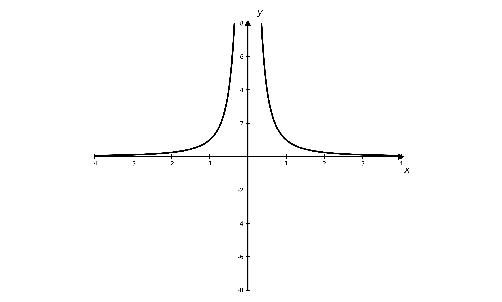

**[B1]**

When $a < 0$, $\frac{a}{x^{2}}$ is always negative, so both branches lie below the $x$-axis (quadrants 3 and 4)

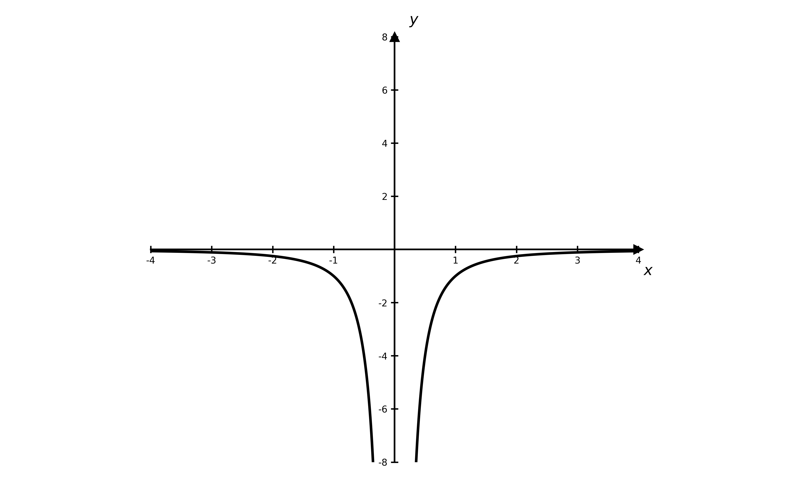

**[B1 B1]**

> **[mark-scheme]**
> **B1**: Correct $a > 0$ graph — both branches above the $x$-axis (quadrants 1 & 2).
> 
> **B1**: Correct $a < 0$ graph — both branches below the $x$-axis (quadrants 3 & 4).
> 
> **B1**: Both graphs symmetric about the $y$-axis, approaching the asymptotes $x = 0$ and $y = 0$.
Substitute $( m , m^{6} )$ into $y = \frac{a}{x^{2}}$

$m^{6} = \frac{a}{m^{2}}$

**[M1]**

$a = m^{8}$

**[A1]**

**Final answer:** **Since **$m \neq 0$**, **$a = m^{8} > 0$**, so the point lies on the graph with **$a > 0$

**[B1]**

> **[mark-scheme]**
> **M1**: Substitutes $( m , m^{6} )$ into $y = \frac{a}{x^{2}}$.
> 
> **A1**: Correct expression, $a = m^{8}$.
> 
> **B1**: States the point lies on the graph with $a > 0$, justified by $m^{8} > 0$ (an even power of a non-zero number).

### Q2
Since $t$ is proportional to `\sqrt[3]{p}`, write `t = k\sqrt[3]{p}` and substitute $t = 6 . 4 \times 10^{-4}$, $p = 8$

`6.4 \times 10^{-4} = k\sqrt[3]{8} = 2k`

**[M1]**

$k = 3 . 2 \times 10^{-4}$

**[A1]**

Substitute $t = 1 . 28 \times 10^{-3}$ into `t = 3.2 \times 10^{-4}\sqrt[3]{p}` and solve for `\sqrt[3]{p}`

`1.28 \times 10^{-3} = 3.2 \times 10^{-4}\sqrt[3]{p} \Rightarrow \sqrt[3]{p} = 4`

**[M1]**

$p = 64$

**[A1]**

> **[mark-scheme]**
> **M1**: Sets up `t = k\sqrt[3]{p}` and substitutes $t = 6 . 4 \times 10^{-4}$, $p = 8$.
> 
> **A1**: Correct constant, $k = 3 . 2 \times 10^{-4}$.
> 
> **M1**: Substitutes $t = 1 . 28 \times 10^{-3}$ and solves to `\sqrt[3]{p} = 4`.
> 
> **A1**: Correct number of processes, $p = 64$.
Substitute $p = 250$ into `t = 3.2 \times 10^{-4}\sqrt[3]{p}`

`t = 3.2 \times 10^{-4} \times \sqrt[3]{250} = 3.2 \times 10^{-4} \times 6.2996\ldots`

**[M1]**

$t = 2 . 02 \times 10^{-3} \text{s}$

**[A1]**

> **[mark-scheme]**
> **M1**: Substitutes $p = 250$ into `t = 3.2 \times 10^{-4}\sqrt[3]{p}`.
> 
> **A1**: Correct time, answers which round to $t = 2 . 02 \times 10^{-3}$ seconds (3 significant figures).

### Q3
$y = \frac{1}{x^{2}}$ is always positive, so both branches lie above the $x$-axis (in the first and second quadrants)

**[B1]**

$y = \frac{-3}{x^{2}}$ is always negative, so both branches lie below the $x$-axis (in the third and fourth quadrants), and are steeper (magnitude $3$ times as large)

**[B1]**

Both curves approach the $x$-axis and $y$-axis without touching them

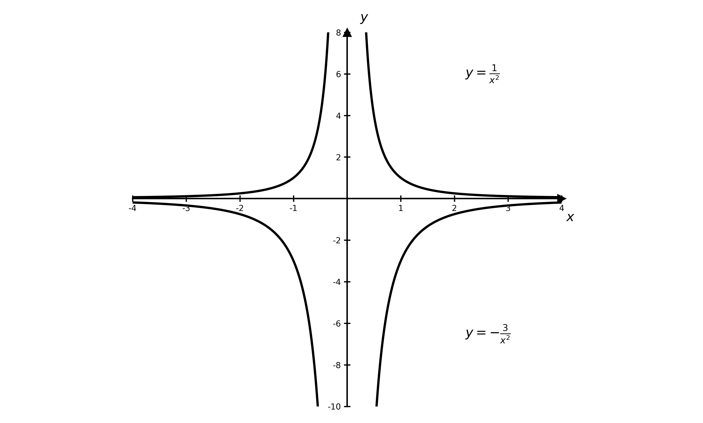

**[B1]**

> **[mark-scheme]**
> **B1**: Correct $y = \frac{1}{x^{2}}$ — both branches above the $x$-axis (quadrants 1 & 2).
> 
> **B1**: Correct $y = \frac{-3}{x^{2}}$ — both branches below the $x$-axis (quadrants 3 & 4).
> 
> **B1**: Both curves approach the $x$-axis and $y$-axis as asymptotes without meeting them.
Both curves are symmetric about the $y$-axis, so the line of symmetry is

$x = 0$

**[B1]**

Both curves approach the two axes, so the asymptotes are

**Final answer:** $x = 0$** and **$y = 0$

**[B1]**

> **[mark-scheme]**
> **B1**: Line of symmetry $x = 0$ (the $y$-axis), for both graphs.
> 
> **B1**: Asymptotes $x = 0$ and $y = 0$, for both graphs. (Note $x = 0$ is both a line of symmetry and an asymptote.)

### Q4
$y = ( x - 1 )^{2}$ is a positive parabola with minimum at $( 1 , 0 )$, passing through $( 0 , 1 )$

**[B1]**

$y = 2 - x^{2} - x = - ( x + 2 ) ( x - 1 )$ is a negative ($\cap$-shaped) parabola, crossing the $x$-axis at $( - 2 , 0 )$ and $( 1 , 0 )$, with maximum at $( - 0 . 5 , 2 . 25 )$

**[B1]**

The $y$-intercepts are $( 0 , 1 )$ and $( 0 , 2 )$ respectively

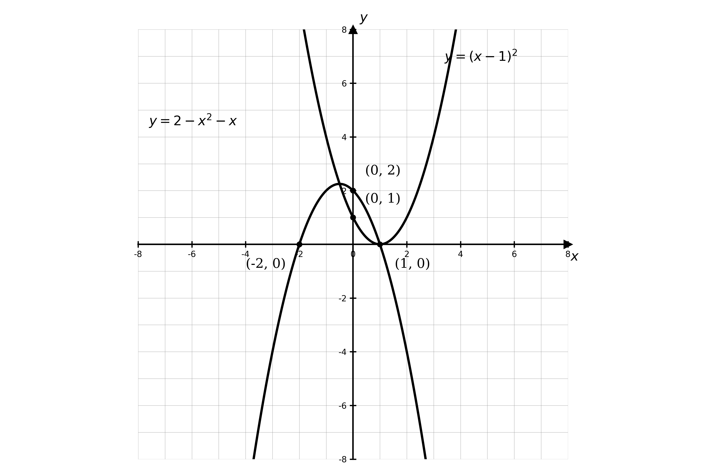

**[B1]**

> **[mark-scheme]**
> **B1**: Correct $y = ( x - 1 )^{2}$ — positive parabola with minimum at $( 1 , 0 )$.
> 
> **B1**: Correct $y = 2 - x^{2} - x$ — negative ($\cap$-shaped) parabola with roots $( - 2 , 0 )$ and $( 1 , 0 )$.
> 
> **B1**: Correct $y$-intercepts $( 0 , 1 )$ and $( 0 , 2 )$.
Collect all terms on one side

$x^{2} - 2 x + 1 = 2 - x^{2} - x \Rightarrow 2 x^{2} - x - 1 = 0$

**[M1]**

Factorise to find the solutions

$( 2 x + 1 ) ( x - 1 ) = 0$

**Final answer:** $x = - \frac{1}{2}$** and **$x = 1$

**[A1]**

> **[mark-scheme]**
> **M1**: Collects terms to form the quadratic $2 x^{2} - x - 1 = 0$.
> 
> **A1**: Both solutions correct, $x = - \frac{1}{2}$ and $x = 1$.

### Q5
Since $y$ is inversely proportional to $x^{2}$, write $y = \frac{k}{x^{2}}$ and substitute $x = 4$, $y = 8$

$8 = \frac{k}{4^{2}} = \frac{k}{16}$

**[M1]**

$k = 128$

**[A1]**

With $k = 128$ the relationship is $y = \frac{128}{x^{2}}$, a reciprocal-squared curve with both branches above the $x$-axis (quadrants 1 and 2), approaching both axes

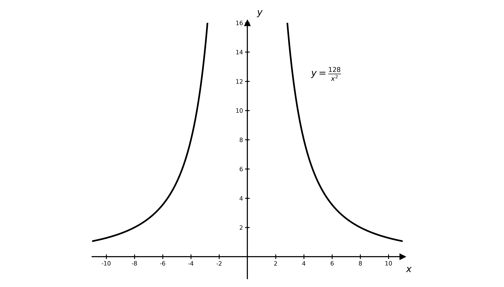

**[B1 B1]**

> **[mark-scheme]**
> **M1**: Sets up $y = \frac{k}{x^{2}}$ and substitutes $x = 4$, $y = 8$.
> 
> **A1**: Correct constant of proportionality, $k = 128$.
> 
> **B1**: Correct shape — both branches above the $x$-axis (quadrants 1 & 2), symmetric about the $y$-axis.
> 
> **B1**: Both branches approach the $x$-axis and $y$-axis (asymptotes) without meeting them.

### Q6
Since $t$ is proportional to $p^{2}$, write $t = k p^{2}$ and substitute $t = 0 . 032$, $p = 8$

$0 . 032 = k \times 8^{2} = 64 k$

**[M1]**

$k = 0 . 0005$

So the equation linking $p$ and $t$ is

$t = 0 . 0005 p^{2}$

**[A1]**

> **[mark-scheme]**
> **M1**: Sets up $t = k p^{2}$ and substitutes $t = 0 . 032$, $p = 8$.
> 
> **A1**: Correct equation, $t = 0 . 0005 p^{2}$.
Substitute $t = 0 . 2$ into $t = 0 . 0005 p^{2}$ and rearrange

$0 . 2 = 0 . 0005 p^{2} \Rightarrow p^{2} = 400$

**[M1]**

$p = 20$

**[A1]**

> **[mark-scheme]**
> **M1**: Substitutes $t = 0 . 2$ into the equation and rearranges to $p^{2} = 400$.
> 
> **A1**: Correct number of processes, $p = 20$ (take the positive root).
Substitute $p = 30$ into $t = 0 . 0005 p^{2}$

$t = 0 . 0005 \times 30^{2} = 0 . 0005 \times 900$

**[M1]**

$t = 0 . 45 \text{s}$

**[A1]**

> **[mark-scheme]**
> **M1**: Substitutes $p = 30$ into $t = 0 . 0005 p^{2}$.
> 
> **A1**: Correct time, $t = 0 . 45$ seconds.

### Q7
Since $y$ is inversely proportional to $x$, write $y = \frac{k}{x}$ and substitute $x = 2$, $y = 10$

$10 = \frac{k}{2}$

**[M1]**

$k = 20$

**[A1]**

With $k = 20$ the relationship is $y = \frac{20}{x}$, a reciprocal curve with two branches in the first and third quadrants, approaching both axes

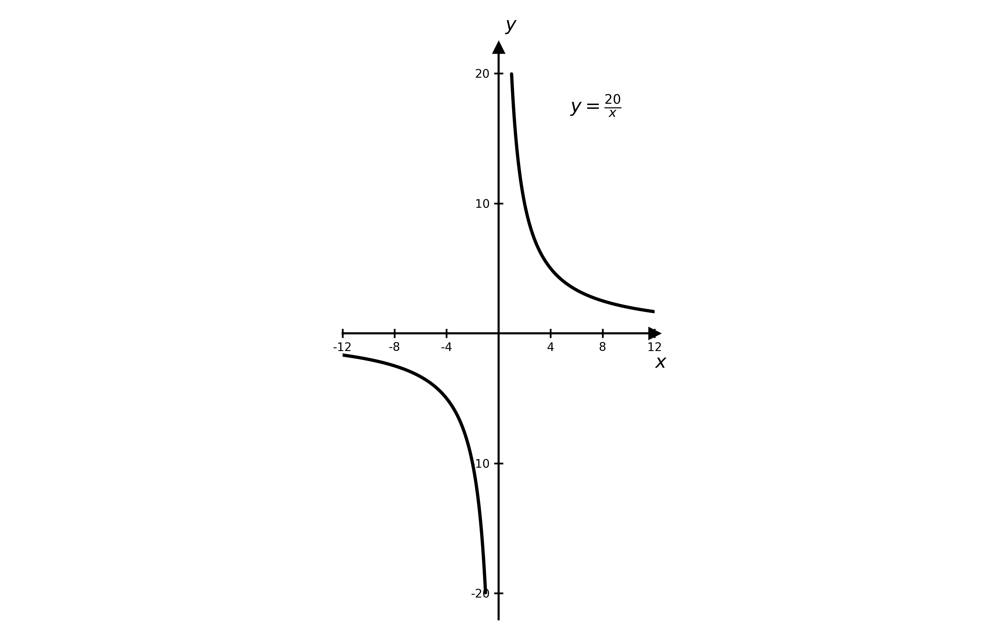

**[B1 B1]**

> **[mark-scheme]**
> **M1**: Sets up $y = \frac{k}{x}$ and substitutes $x = 2$, $y = 10$.
> 
> **A1**: Correct constant of proportionality, $k = 20$.
> 
> **B1**: Correct reciprocal shape — two branches in the first and third quadrants.
> 
> **B1**: Both branches approach the $x$-axis and $y$-axis (asymptotes), without meeting them.

### Q8
The cubic $y = x^{3} - 2 x^{2} - 8 x = x ( x - 4 ) ( x + 2 )$ crosses the $x$-axis at its roots

**Final answer:** $( - 2 ,  0 )$**, **$( 0 ,  0 )$** and **$( 4 ,  0 )$

**[B1]**

It is a positive cubic (rising from bottom-left to top-right)

**[B1]**

The reciprocal $y = \frac{1}{x}$ has two branches, in the first and third quadrants

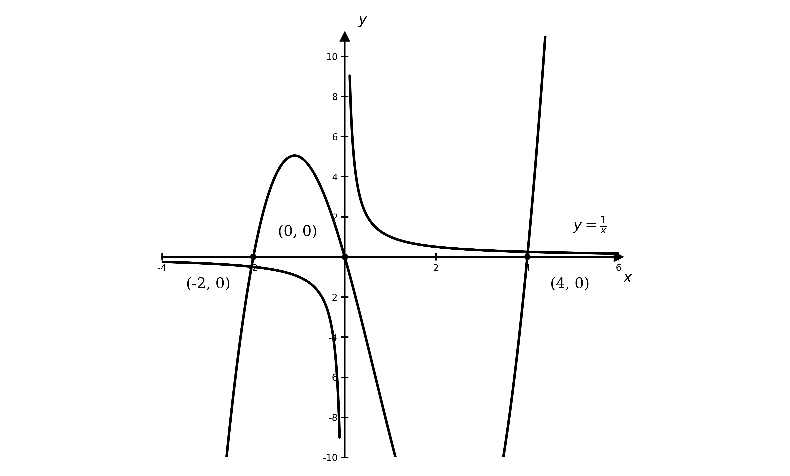

**[B1]**

> **[mark-scheme]**
> **B1**: Correct cubic roots $( - 2 , 0 )$, $( 0 , 0 )$ and $( 4 , 0 )$.
> 
> **B1**: Correct shape — a positive cubic.
> 
> **B1**: Correct reciprocal $y = \frac{1}{x}$ (two branches in the first and third quadrants).

The number of solutions equals the number of points where the two curves cross. From the diagram they cross at two points (one for $x < 0$ and one for $x > 0$)

**Final answer:** $2$** solutions**

**[B1]**

> **[mark-scheme]**
> **B1**: States there are $2$ solutions, consistent with two points of intersection on the candidate's diagram.

### Q9
Factorise to find where the graph crosses the $x$-axis

$3 x^{3} - 2 x^{2} - x = x ( 3 x^{2} - 2 x - 1 ) = x ( 3 x + 1 ) ( x - 1 )$

The non-zero factors give the $x$-intercepts

**Final answer:** `\left(-\tfrac{1}{3},\ 0\right)`** and **$( 1 ,  0 )$

**[B1]**

The factor $x$ gives a root at the origin, which is also the $y$-intercept

$( 0 ,  0 )$

**[B1]**

Sketch a positive cubic (leading coefficient $3 > 0$) passing through these three points

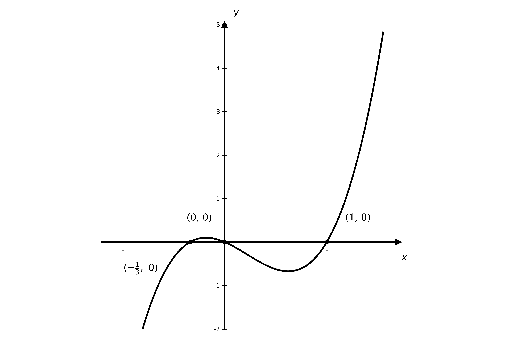

**[B1]**

> **[mark-scheme]**
> **B1**: Correct non-zero $x$-axis intercepts, `\left(-\tfrac{1}{3}, 0\right)` and $( 1 , 0 )$.
> 
> **B1**: Curve passes through the origin $( 0 , 0 )$ (the $y$-intercept).
> 
> **B1**: Correct shape — a positive cubic rising from bottom-left to top-right — passing through all three intercepts.

### Q10
The parabola $y = x^{2} + 2 x - 3 = ( x + 3 ) ( x - 1 )$ is positive (U-shaped), crossing the $x$-axis at $( - 3 , 0 )$ and $( 1 , 0 )$

**[B1]**

It crosses the $y$-axis at $( 0 , - 3 )$, with minimum at $( - 1 , - 4 )$

**[B1]**

The line $y = x - 1$ has gradient $1$, passing through $( 0 , - 1 )$ and $( 1 , 0 )$

**[B1]**

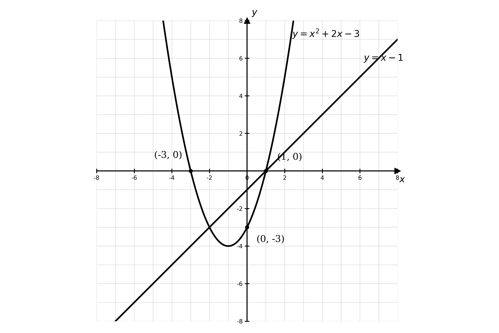

> **[mark-scheme]**
> **B1**: Correct parabola — positive (U-shaped) with $x$-intercepts $( - 3 , 0 )$ and $( 1 , 0 )$.
> 
> **B1**: Parabola crosses the $y$-axis at $( 0 , - 3 )$ (minimum at $( - 1 , - 4 )$).
> 
> **B1**: Correct line $y = x - 1$ (gradient $1$, through $( 0 , - 1 )$ and $( 1 , 0 )$).
The equations are the parabola $y = ( x + 3 ) ( x - 1 ) = x^{2} + 2 x - 3$ and the line $y = x - 1$. Set them equal and collect terms

$x^{2} + 2 x - 3 = x - 1 \Rightarrow x^{2} + x - 2 = 0$

**[M1]**

Factorise and find each $y$ from $y = x - 1$

**Final answer:** $( - 2 ,  - 3 )$** and **$( 1 ,  0 )$

**[A1]**

> **[mark-scheme]**
> **M1**: Equates the two expressions for $y$ and collects terms to form $x^{2} + x - 2 = 0$.
> 
> **A1**: Both solutions correct, $( - 2 , - 3 )$ and $( 1 , 0 )$ (accept $x = - 2$, $y = - 3$ and $x = 1$, $y = 0$ clearly paired).

### Q11
$\frac{-2}{x^{2}}$ is always negative and is undefined at $x = 0$, so the graph approaches both axes without meeting them — they are the asymptotes

**Final answer:** $x = 0$** and **$y = 0$

**[B1]**

Both branches lie below the $x$-axis (in the third and fourth quadrants), symmetric about the $y$-axis

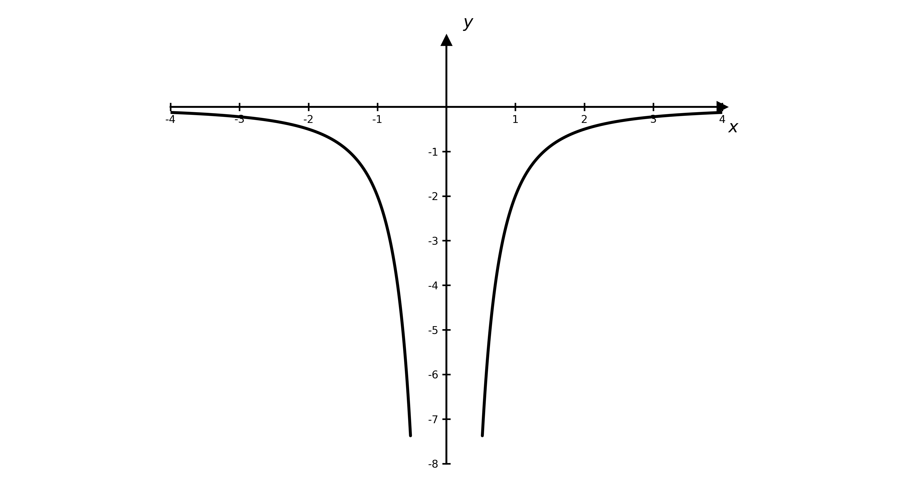

**[B1]**

> **[mark-scheme]**
> **B1**: Correct asymptotes $x = 0$ and $y = 0$ (accept "the $x$-axis and the $y$-axis").
> 
> **B1**: Correct shape — two branches below the $x$-axis (in the third and fourth quadrants), symmetric about the $y$-axis, each approaching both asymptotes.

### Q12
When $a < 0$, $\frac{a}{x^{2}}$ is always negative, so the graph is the reflection of the given curve in the $x$-axis — both branches lie below the $x$-axis (in the third and fourth quadrants)

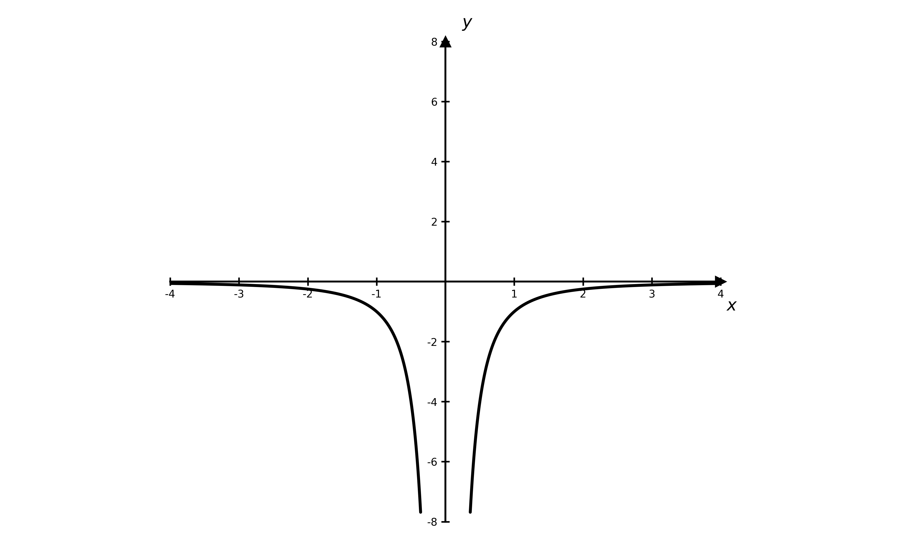

**[B1 B1]**

> **[mark-scheme]**
> **B1**: Branches drawn in the third and fourth quadrants (below the $x$-axis).
> 
> **B1**: Correct reciprocal-squared shape — symmetric about the $y$-axis, each branch approaching both axes.
Substitute the point $( m , m^{4} )$ into $y = \frac{a}{x^{2}}$ to find the value of $a$

$m^{4} = \frac{a}{m^{2}} \Rightarrow a = m^{4} \times m^{2} = m^{6}$

**Final answer:** **Since **$m \neq 0$**, the value **$a = m^{6} > 0$

**[B1]**

**Final answer:** **So the point lies on the graph with **$a > 0$

**[B1]**

> **[mark-scheme]**
> **B1**: Correct reason — substituting gives $a = m^{6}$, which is positive (accept: $m^{4} > 0$, so the point lies above the $x$-axis).
> 
> **B1**: States the point lies on the graph with $a > 0$.

### Q13
$\frac{1}{x^{2}}$ is always positive and is undefined at $x = 0$, so the graph approaches both axes without meeting them — they are the asymptotes

**Final answer:** $x = 0$** and **$y = 0$

**[B1]**

Both branches lie above the $x$-axis (in the first and second quadrants), symmetric about the $y$-axis

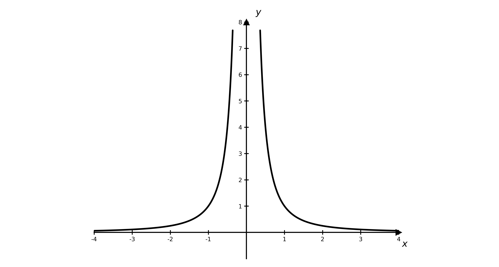

**[B1]**

> **[mark-scheme]**
> **B1**: Correct asymptotes $x = 0$ and $y = 0$ (accept "the $x$-axis and the $y$-axis").
> 
> **B1**: Correct shape — two branches above the $x$-axis (in the first and second quadrants), symmetric about the $y$-axis, each approaching both asymptotes.

### Q14
Set $y = 0$: the only root is where the bracket is zero (a triple root), so the graph touches/crosses the $x$-axis at

$( x + 3 )^{3} = 0 \Rightarrow x = - 3$

$( - 3 ,  0 )$

**[B1]**

Set $x = 0$ to find where the graph crosses the $y$-axis

$y = ( 0 + 3 )^{3} = 27$

$( 0 ,  27 )$

**[B1]**

The graph is $y = x^{3}$ translated $3$ to the left — a positive cubic that flattens as it passes through $( - 3 , 0 )$

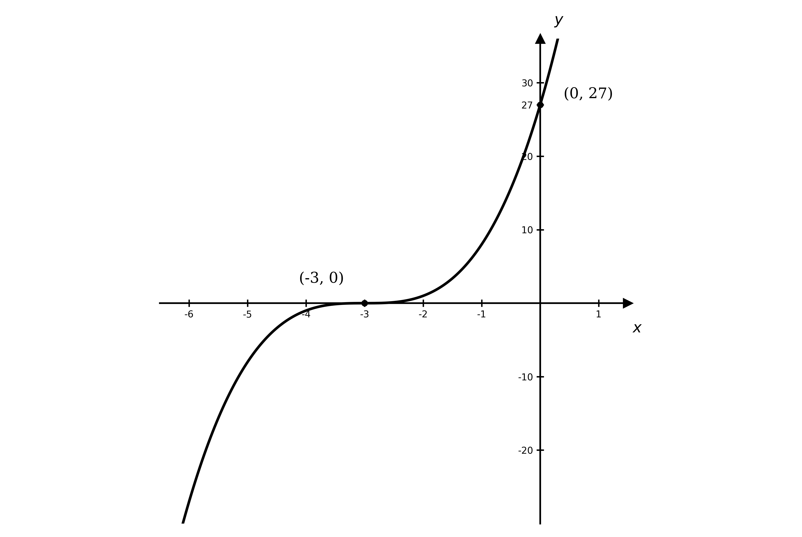

**[B1]**

> **[mark-scheme]**
> **B1**: Correct $x$-axis intercept, $( - 3 , 0 )$ (accept $x = - 3$).
> 
> **B1**: Correct $y$-axis intercept, $( 0 , 27 )$ (accept $y = 27$).
> 
> **B1**: Correct shape — a positive cubic (the curve $y = x^{3}$ translated to the left), flattening as it passes through $( - 3 , 0 )$.

### Q15
When $a < 0$ the graph is the reflection of the given curve in either axis, so its two branches lie in the second and fourth quadrants

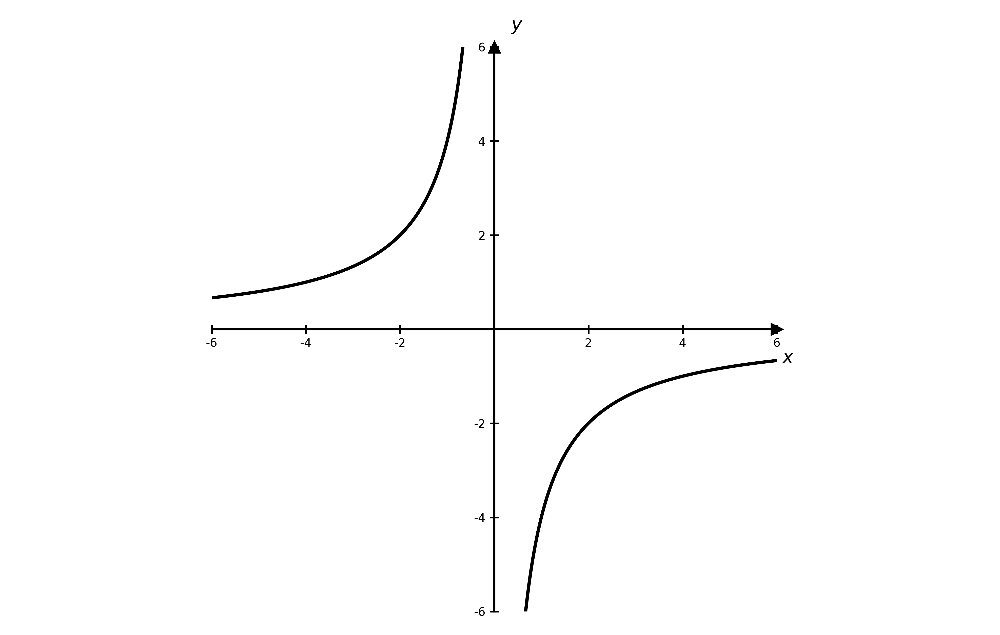

**[B1 B1]**

> **[mark-scheme]**
> **B1**: Branches drawn in the second and fourth quadrants.
> 
> **B1**: Correct reciprocal shape — each branch approaching both the $x$-axis and the $y$-axis.
(i)

Substitute $( - 4 , - 5 )$ into $y = \frac{a}{x}$

$- 5 = \frac{a}{-4}$

$a = 20$

**[B1]**

This value is positive, so the point lies on the graph with $a > 0$

**Final answer:** **graph with **$a > 0$

**[B1]**

(ii)

Substitute $( - 0 . 02 , 250 )$ into $y = \frac{a}{x}$

$250 = \frac{a}{-0.02}$

$a = - 5$

**[B1]**

This value is negative, so the point lies on the graph with $a < 0$

**Final answer:** **graph with **$a < 0$

**[B1]**

> **[mark-scheme]**
> **B1**: Correct value $a = 20$ for the point $( - 4 , - 5 )$.
> 
> **B1**: States this point lies on the graph with $a > 0$.
> 
> **B1**: Correct value $a = - 5$ for the point $( - 0 . 02 , 250 )$.
> 
> **B1**: States this point lies on the graph with $a < 0$.

### Q16
Bring all terms to one side

$x^{3} - x^{2} - 2 x + 4 = 4 x + 4 \Rightarrow x^{3} - x^{2} - 6 x = 0$

**[M1]**

Take out the common factor $x$, then factorise the quadratic

$x ( x^{2} - x - 6 ) = 0 \Rightarrow x ( x - 3 ) ( x + 2 ) = 0$

**[M1]**

**Final answer:** $x = - 2$**, **$x = 0$** and **$x = 3$

**[A1]**

> **[mark-scheme]**
> **M1**: Collects all terms on one side to obtain the cubic $x^{3} - x^{2} - 6 x = 0$.
> 
> **M1**: Factorises, taking out the common factor $x$ and factorising the resulting quadratic.
> 
> **A1**: All three solutions, $x = - 2$, $x = 0$ and $x = 3$. The solution $x = 0$ must be retained (do not divide through by $x$).
The graphs intersect where $x^{3} - x^{2} - 2 x + 4 = 4 x + 4$, which is the equation solved in part (a)

**Final answer:** $x = - 2$**, **$x = 0$** and **$x = 3$

**[B1]**

> **[mark-scheme]**
> **B1**: All three $x$-coordinates correct, $x = - 2$, $0$ and $3$.
Substitute each $x$-coordinate into the line $y = 4 x + 4$ (the simpler equation)

$y = 4 ( - 2 ) + 4 = - 4$

$y = 4 ( 0 ) + 4 = 4$

$y = 4 ( 3 ) + 4 = 16$

**[M1]**

**Final answer:** $( - 2 ,  - 4 )$**, **$( 0 ,  4 )$** and **$( 3 ,  16 )$

**[A1]**

> **[mark-scheme]**
> **M1**: Substitutes the $x$-coordinates into $y = 4 x + 4$ (or into the cubic).
> 
> **A1**: Correct $y$-coordinates $- 4$, $4$ and $16$ (points $( - 2 , - 4 )$, $( 0 , 4 )$, $( 3 , 16 )$).
The cubic $y = x^{3} - x^{2} - 2 x + 4$ is a positive cubic with $y$-intercept $( 0 , 4 )$; the line $y = 4 x + 4$ has gradient $4$ and also passes through $( 0 , 4 )$. They meet at the three points found above

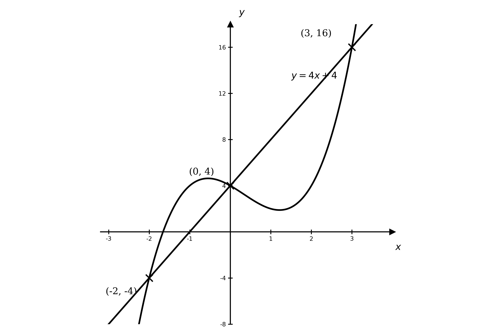

**[B1 B1 B1 B1]**

> **[mark-scheme]**
> **B1**: Correct shape of the cubic (a positive cubic).
> 
> **B1**: Cubic crosses the $y$-axis at $( 0 , 4 )$.
> 
> **B1**: Correct line $y = 4 x + 4$ (gradient $4$, through $( 0 , 4 )$).
> 
> **B1**: The three points of intersection $( - 2 , - 4 )$, $( 0 , 4 )$ and $( 3 , 16 )$ shown.

### Q17
The line $y = 3 x - 2$ has gradient $3$, crossing the axes at $( 0 , - 2 )$ and `\left(\tfrac{2}{3}, 0\right)`

**[B1]**

The line $y = x + 4$ has gradient $1$, crossing the axes at $( 0 , 4 )$ and $( - 4 , 0 )$

**[B1]**

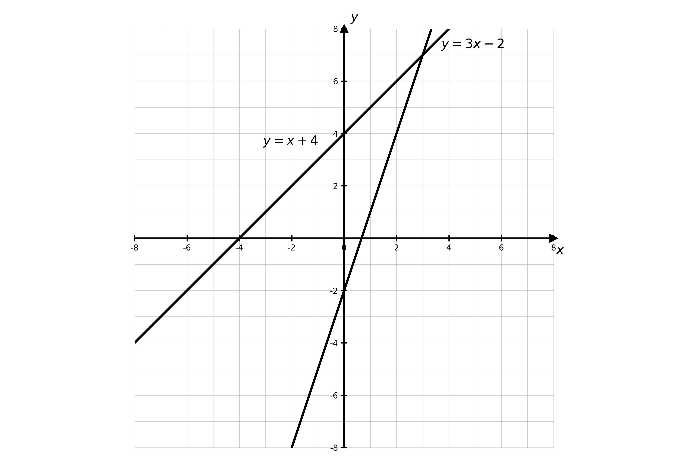

> **[mark-scheme]**
> **B1**: Correct line $y = 3 x - 2$ (gradient $3$, through $( 0 , - 2 )$).
> 
> **B1**: Correct line $y = x + 4$ (gradient $1$, through $( 0 , 4 )$ and $( - 4 , 0 )$).
The two equations are $y = 3 x - 2$ and $y = x + 4$, so the solution is the point where the lines meet. Subtracting the equations eliminates $y$

$( 3 x - y ) - ( x - y ) = 2 - ( - 4 ) \Rightarrow 2 x = 6 \Rightarrow x = 3$

$( 3 ,  7 )$

**[B1]**

> **[mark-scheme]**
> **B1**: Correct solution $( 3 , 7 )$ (accept $x = 3$, $y = 7$), consistent with the point of intersection.

### Q18
The cubic $y = x ( x + 2 ) ( x - 1 )$ crosses the $x$-axis at its roots

**Final answer:** $( - 2 ,  0 )$**, **$( 0 ,  0 )$** and **$( 1 ,  0 )$

**[B1]**

It is a positive cubic (rising from bottom-left to top-right)

**[B1]**

The reciprocal $y = \frac{1}{x}$ has two branches, in the first and third quadrants

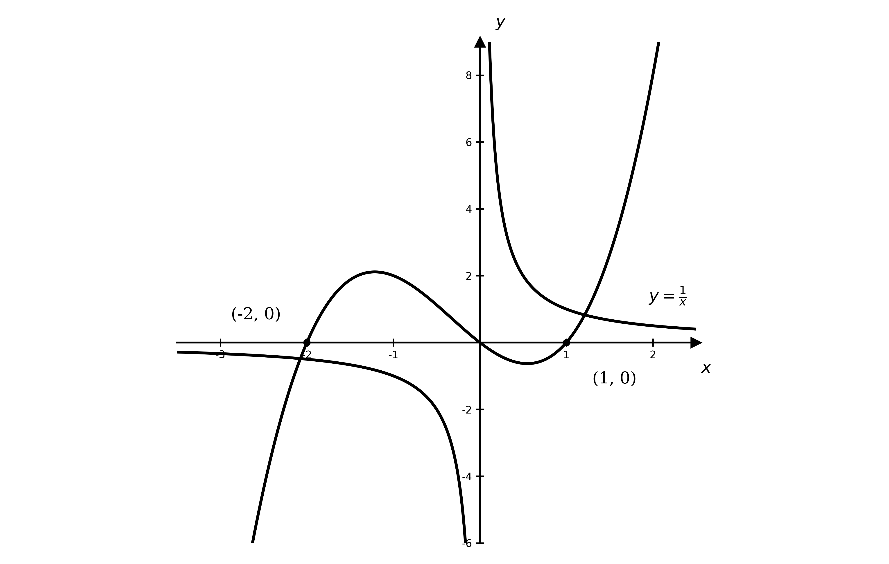

**[B1]**

> **[mark-scheme]**
> **B1**: Correct cubic roots $( - 2 , 0 )$, $( 0 , 0 )$ and $( 1 , 0 )$.
> 
> **B1**: Correct shape — a positive cubic.
> 
> **B1**: Correct reciprocal $y = \frac{1}{x}$ (two branches in the first and third quadrants).

The number of solutions equals the number of points where the two curves cross. From the diagram they cross at two points (one for $x < 0$ and one for $x > 0$)

**Final answer:** $2$** solutions**

**[B1]**

> **[mark-scheme]**
> **B1**: States there are $2$ solutions, consistent with two points of intersection on the candidate's diagram.

### Q19
Since $y$ is inversely proportional to $x$, write $y = \frac{k}{x}$ and substitute $x = 3$, $y = 12$

$12 = \frac{k}{3}$

**[M1]**

$k = 36$

**[A1]**

With $k = 36$ the relationship is $y = \frac{36}{x}$, a reciprocal curve with two branches in the first and third quadrants

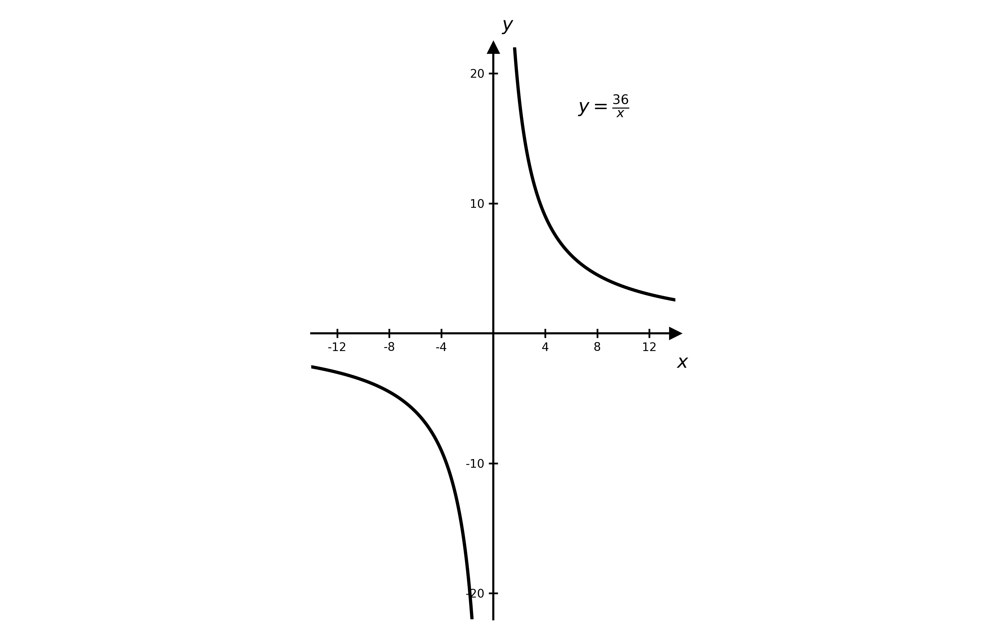

**[B1]**

> **[mark-scheme]**
> **M1**: Sets up $y = \frac{k}{x}$ and substitutes $x = 3$, $y = 12$.
> 
> **A1**: Correct constant of proportionality, $k = 36$.
> 
> **B1**: Correct sketch — a reciprocal curve with two branches in the first and third quadrants, approaching both axes.

### Q20
Since $t$ is proportional to $p$, write $t = k p$ and substitute $t = 0 . 01$, $p = 10$

$0 . 01 = k \times 10$

**[M1]**

Divide by $10$ to obtain the required constant

$k = 0 . 001$

**[A1]**

> **[mark-scheme]**
> **M1**: Sets up $t = k p$ and substitutes $t = 0 . 01$, $p = 10$.
> 
> **A1**: Correctly obtains the given constant $k = 0 . 001$.
Substitute $k = 0 . 001$ (from part (a)) into $t = k p$

$t = 0 . 001 p$

**[B1]**
Substitute $p = 200$ into $t = 0 . 001 p$

$t = 0 . 001 \times 200$

**[M1]**

$t = 0 . 2 \text{s}$

**[A1]**

> **[mark-scheme]**
> **M1**: Substitutes $p = 200$ into $t = 0 . 001 p$.
> 
> **A1**: Correct time, $t = 0 . 2$ seconds.
Substitute $t = 2 . 3$ into $t = 0 . 001 p$ and rearrange

$2 . 3 = 0 . 001 p \Rightarrow p = \frac{2.3}{0.001}$

**[M1]**

$p = 2300$

**[A1]**

> **[mark-scheme]**
> **M1**: Substitutes $t = 2 . 3$ into $t = 0 . 001 p$ and rearranges for $p$.
> 
> **A1**: Correct number of processes, $p = 2300$.

### Q21
Set $y = 0$. The factor $( x + 3 )$ gives a root where the curve crosses the $x$-axis

$( - 3 ,  0 )$

**[B1]**

The repeated factor $x^{2}$ gives a double root at the origin, so the curve **touches** the $x$-axis there — this is also the $y$-intercept

$( 0 ,  0 )$

**[B1]**

Sketch a positive cubic that crosses at $( - 3 , 0 )$ and touches the $x$-axis at the origin

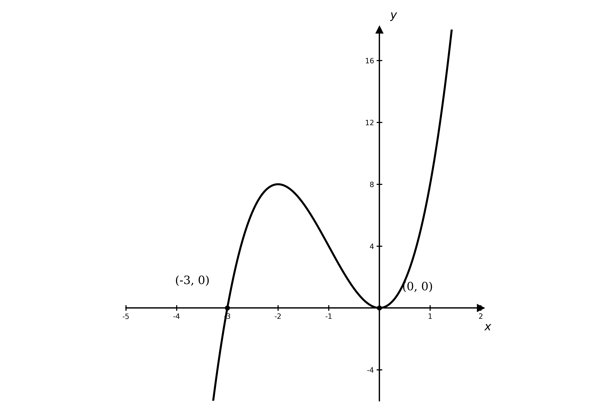

**[B1]**

> **[mark-scheme]**
> **B1**: Correct crossing point, $( - 3 , 0 )$.
> 
> **B1**: Curve touches the $x$-axis at the origin $( 0 , 0 )$ (a double root, not a crossing).
> 
> **B1**: Correct shape — a positive cubic that crosses at $( - 3 , 0 )$ and touches the $x$-axis at the origin.

### Q22
(i)

Since $y$ is proportional to $x$, write the relationship with constant $k$, then substitute $x = 2$ and $y = 10$

$y = k x \Rightarrow 10 = 2 k$

**[M1]**

$k = 5$

**[A1]**

(ii)

With $k = 5$ the relationship is $y = 5 x$, a straight line through the origin with gradient $5$

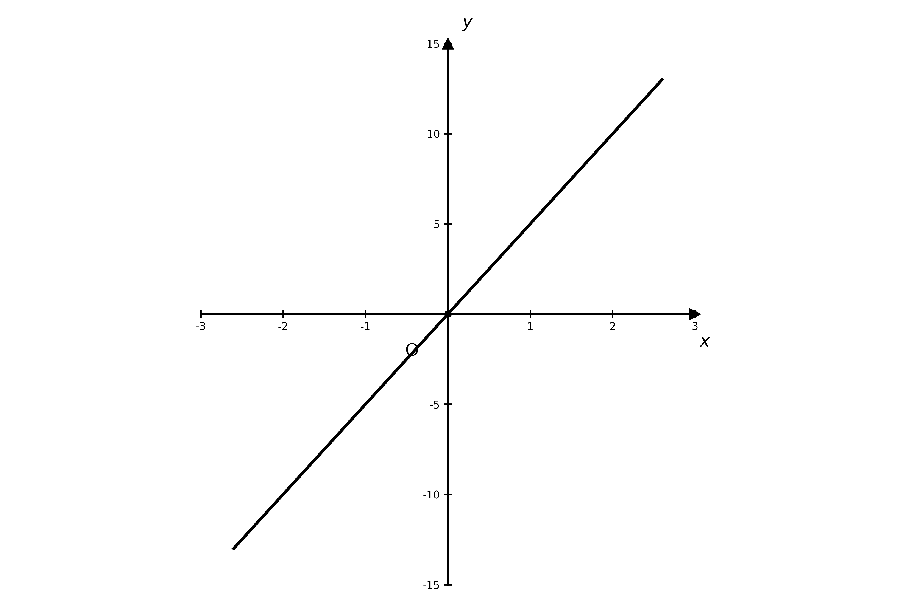

**[B1]**

> **[mark-scheme]**
> **M1**: Sets up $y = k x$ and substitutes $x = 2$, $y = 10$.
> 
> **A1**: Correct constant of proportionality, $k = 5$.
> 
> **B1**: Correct sketch — a straight line through the origin with a positive gradient.

### Q23
Set $y = 0$ to find where the graph crosses the $x$-axis

$6 x - 12 = 0 \Rightarrow x = 2$

$( 2 ,  0 )$

**[B1]**

Set $x = 0$ to find where the graph crosses the $y$-axis

$y = 6 ( 0 ) - 12 = - 12$

$( 0 ,  - 12 )$

**[B1]**

Draw a straight line with positive gradient through these two points

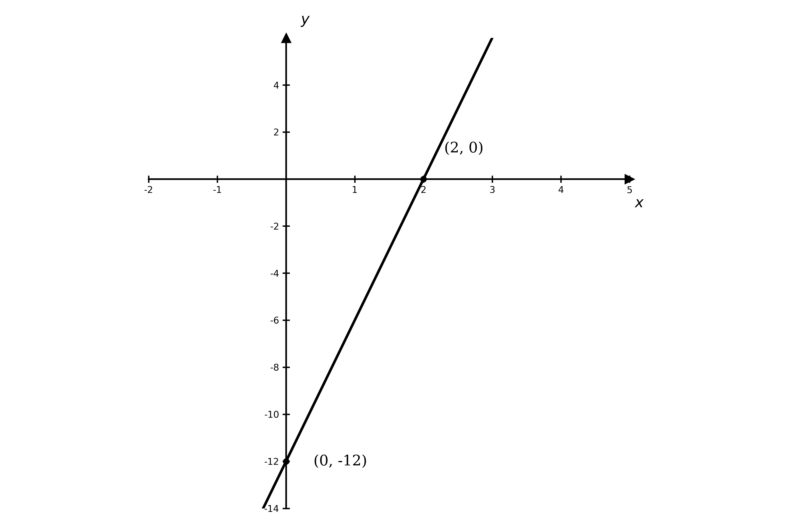

**[B1]**

> **[mark-scheme]**
> **B1**: Correct $x$-axis intercept, $( 2 , 0 )$ (accept $x = 2$).
> 
> **B1**: Correct $y$-axis intercept, $( 0 , - 12 )$ (accept $y = - 12$).
> 
> **B1**: A straight line with positive gradient passing through both intercepts.

### Q24
(i)

Substitute $x = 0$

$\text{f} ( 0 ) = ( 0 )^{2} + 3 ( 0 ) - 4 = - 4$

$- 4$

**[B1]**

(ii)

Factorise the quadratic — two numbers multiplying to $- 4$ and summing to $+ 3$ are $+ 4$ and $- 1$

$\text{f} ( x ) = ( x + 4 ) ( x - 1 )$

**[B1]**

> **[mark-scheme]**
> **B1**: Correct value, $\text{f} ( 0 ) = - 4$.
> 
> **B1**: Correct factorisation, $( x + 4 ) ( x - 1 )$.
The factorised form gives the points where the graph crosses the $x$-axis

**Final answer:** $( - 4 ,  0 )$** and **$( 1 ,  0 )$

**[B1]**

From part (a)(i), the graph crosses the $y$-axis at

$( 0 ,  - 4 )$

**[B1]**

Sketch a positive (U-shaped) parabola passing through these three points

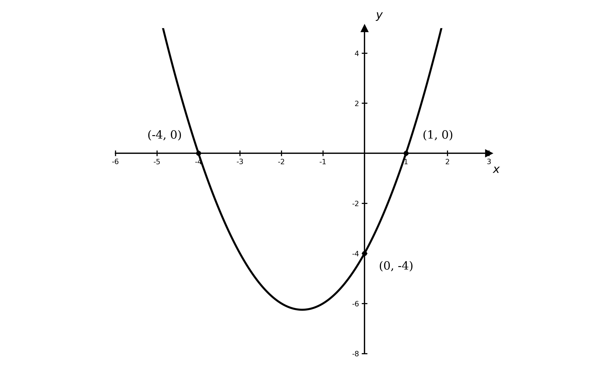

**[B1]**

> **[mark-scheme]**
> **B1**: Correct $x$-axis intercepts, $( - 4 , 0 )$ and $( 1 , 0 )$ (accept $x = - 4$ and $x = 1$).
> 
> **B1**: Correct $y$-axis intercept, $( 0 , - 4 )$.
> 
> **B1**: Correct shape — a positive (U-shaped) parabola — passing through all three intercepts, with the minimum between the two roots.

### Q25
(i)

The line $y = x$ passes through the origin with gradient $1$

**[B1]**

The line $y = - x + 2$ has gradient $- 1$, crossing the axes at $( 0 , 2 )$ and $( 2 , 0 )$

**[B1]**

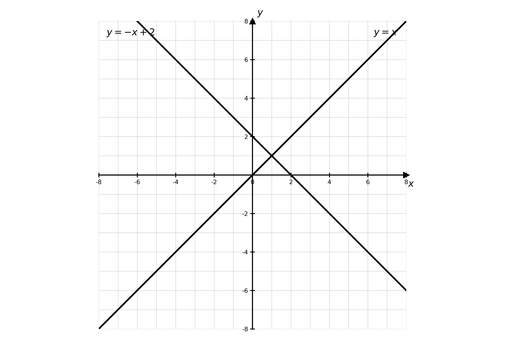

(ii)

The graphs meet at a single point; reading it off (and confirming by solving $x = - x + 2$) gives $x = 1$, and so $y = 1$

$x = - x + 2 \Rightarrow 2 x = 2 \Rightarrow x = 1$

$( 1 ,  1 )$

**[B1]**

> **[mark-scheme]**
> **B1**: Correct line $y = x$ (straight line through the origin with positive gradient).
> 
> **B1**: Correct line $y = - x + 2$ (gradient $- 1$, through $( 0 , 2 )$ and $( 2 , 0 )$).
> 
> **B1**: Correct solution $( 1 , 1 )$ (accept $x = 1$, $y = 1$), read from the point of intersection.

### Q26
Set $y = 0$ to find where the graph crosses the $x$-axis

$x^{2} - 1 = 0 \Rightarrow x = \pm 1$

**Final answer:** $( - 1 ,  0 )$** and **$( 1 ,  0 )$

**[B1]**

Set $x = 0$ to find where the graph crosses the $y$-axis

$y = ( 0 )^{2} - 1 = - 1$

$( 0 ,  - 1 )$

**[B1]**

Sketch a positive (U-shaped) parabola passing through these three points, with its minimum at $( 0 , - 1 )$

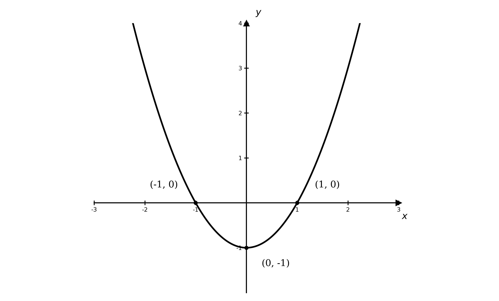

**[B1]**

> **[mark-scheme]**
> **B1**: Correct $x$-axis intercepts, $( - 1 , 0 )$ and $( 1 , 0 )$ (accept $x = \pm 1$).
> 
> **B1**: Correct $y$-axis intercept, $( 0 , - 1 )$ (accept $y = - 1$).
> 
> **B1**: Correct shape — a positive (U-shaped) parabola — passing through all three intercepts, with the minimum between the two roots.

### Q27
The point $( 6 , - 4 )$ lies outside the circle, since its distance from the centre $( 3 , - 2 )$ is $\sqrt{(6-3)^{2}+(-4+2)^{2}} = \sqrt{13} > 3$. A line through an external point can miss the circle, touch it (a tangent), or cross it. Draw one line of each type through $( 6 , - 4 )$

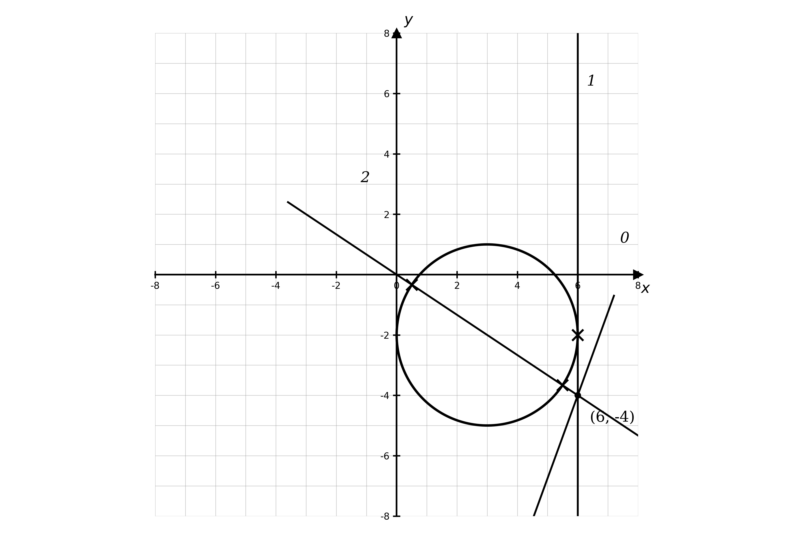

**[B1 B1 B1]**

> **[mark-scheme]**
> **B1**: A line through $( 6 , - 4 )$ that does not meet the circle (no points of intersection).
> 
> **B1**: A line through $( 6 , - 4 )$ that is a tangent to the circle (touches it at exactly one point).
> 
> **B1**: A line through $( 6 , - 4 )$ that crosses the circle at two points. All three lines must pass through $( 6 , - 4 )$.

### Q28
Take out the common factor $2 x$

$2 x^{3} + 2 x^{2} - 12 x = 2 x ( x^{2} + x - 6 )$

**[M1]**

Factorise the quadratic

$2 x ( x + 3 ) ( x - 2 )$

**[A1]**

> **[mark-scheme]**
> **M1**: Takes out the common factor $2 x$, giving $2 x ( x^{2} + x - 6 )$.
> 
> **A1**: Fully correct factorisation, $2 x ( x + 3 ) ( x - 2 )$ (i.e. $a = 2$, $b = 3$, $c = - 2$).
The factorised form gives the points where the graph crosses the $x$-axis. The non-zero factors give

**Final answer:** $( - 3 ,  0 )$** and **$( 2 ,  0 )$

**[B1]**

The factor $2 x$ gives a root at the origin, which is also the $y$-intercept

$( 0 ,  0 )$

**[B1]**

Sketch a positive cubic (leading coefficient $2 > 0$) passing through these three points

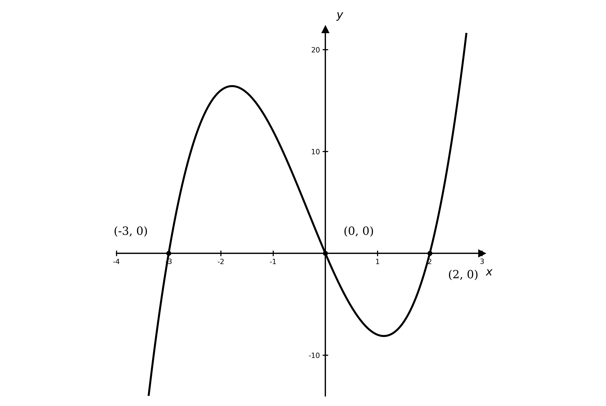

**[B1]**

> **[mark-scheme]**
> **B1**: Correct non-zero $x$-axis intercepts, $( - 3 , 0 )$ and $( 2 , 0 )$.
> 
> **B1**: Curve passes through the origin $( 0 , 0 )$ (the $y$-intercept).
> 
> **B1**: Correct shape — a positive cubic rising from bottom-left to top-right — passing through all three intercepts.

### Q29
$\frac{1}{x}$ is never $0$ and is undefined at $x = 0$, so the graph crosses neither axis

**Final answer:** **no intersections with the axes**

**[B1]**

The graph approaches both axes without meeting them, so they are the asymptotes

**Final answer:** $x = 0$** and **$y = 0$

**[B1]**

Sketch the two branches, in the first and third quadrants

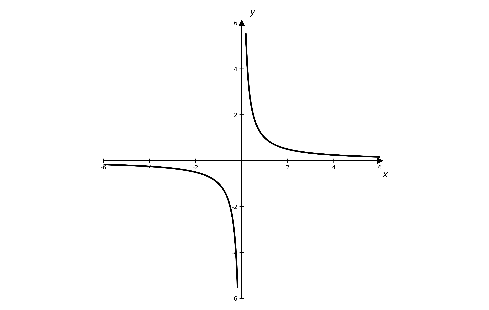

**[B1]**

> **[mark-scheme]**
> **B1**: States there are no intersections with either axis (since $\frac{1}{x} \neq 0$ and is undefined at $x = 0$).
> 
> **B1**: Correct asymptotes $x = 0$ and $y = 0$ (accept "the $x$-axis and the $y$-axis").
> 
> **B1**: Correct shape — two branches in the first and third quadrants, each approaching both asymptotes.

### Q30
Sketch the positive cubic $y = x^{3}$ (through the origin) and the reciprocal $y = \frac{1}{x}$ (two branches, in the first and third quadrants) on the same diagram

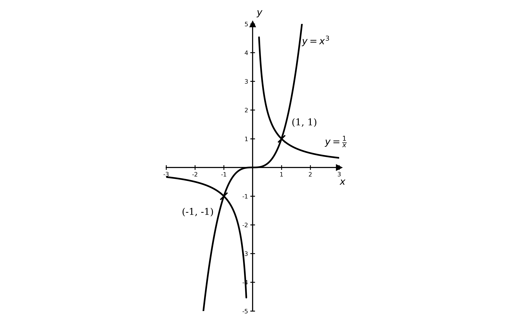

**[B1 B1]**

The number of real solutions of $x^{3} = \frac{1}{x}$ equals the number of points where the curves cross, and they cross at exactly two points (in the first and third quadrants)

**Final answer:** $( 1 ,  1 )$** and **$( - 1 ,  - 1 )$

The two points of intersection show that the equation has exactly two real solutions

**[B1]**

> **[mark-scheme]**
> **B1**: Correct sketch of $y = x^{3}$ (positive cubic through the origin).
> 
> **B1**: Correct sketch of $y = \frac{1}{x}$ (two branches in the first and third quadrants, approaching both axes).
> 
> **B1**: Both points of intersection clearly indicated (e.g. marked with a dot or cross), leading to the conclusion of exactly two real solutions.
