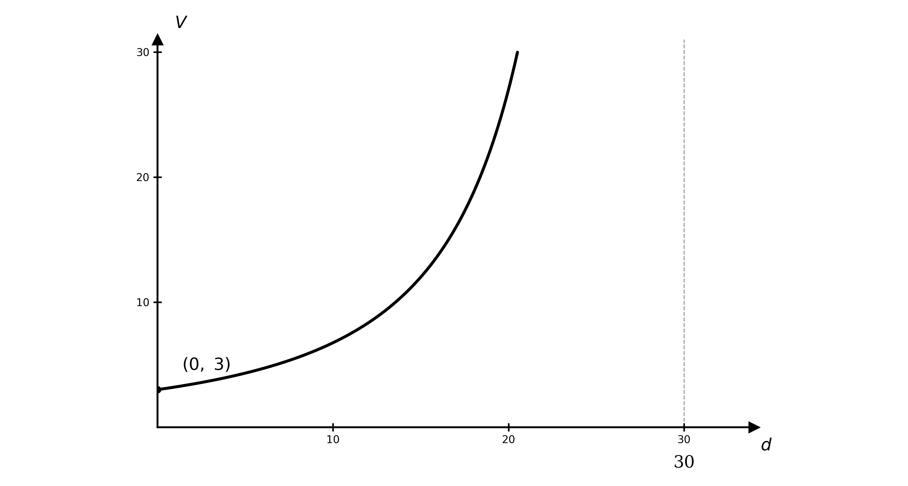
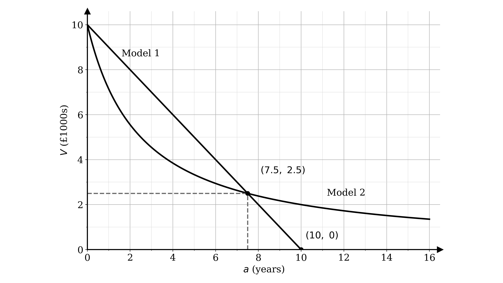
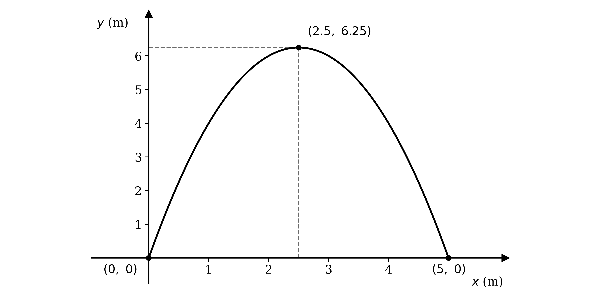
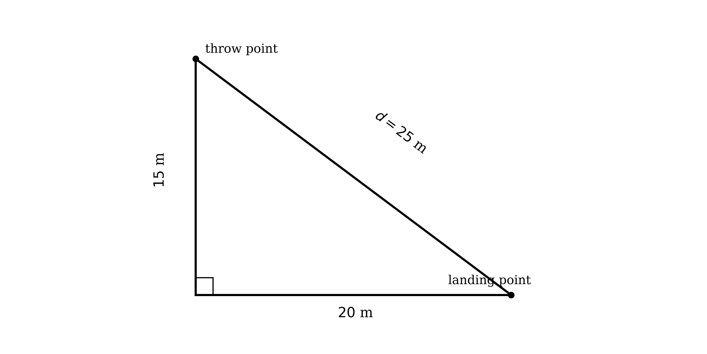
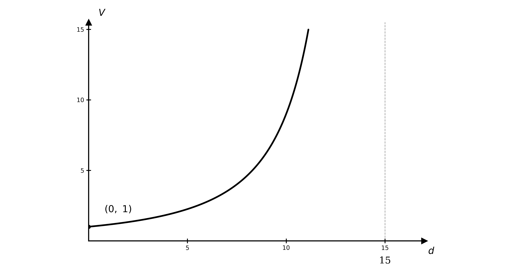
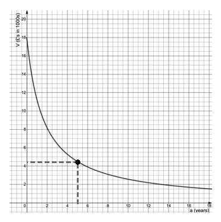
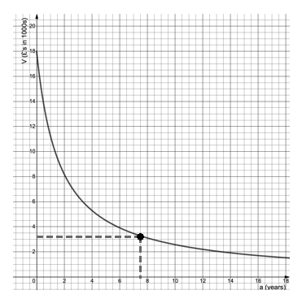
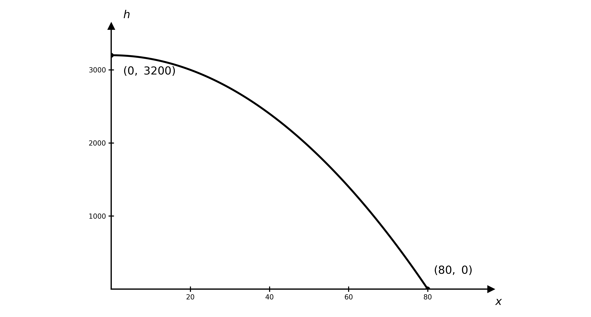
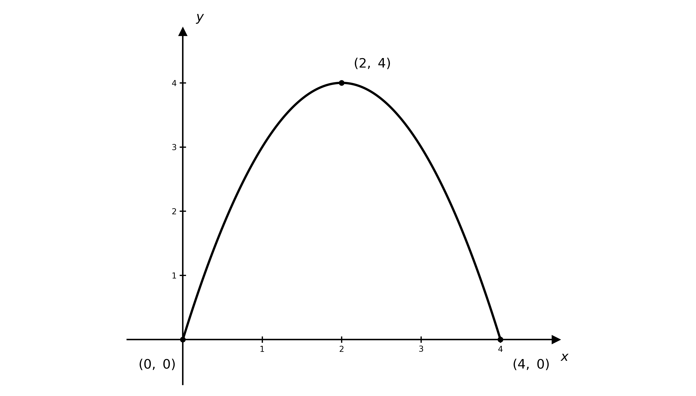

# Mark Schemes — Modelling with Functions
**Algebra & Functions** · Cambridge (CIE) AS maths (9709)

## Exam Questions (26 questions)

### Q1
(i)

Substitute $h = 0$ into the model

`D\left(0\right) = 1 + 6\left(0\right) - \left(0\right)^{2}`

`D\left(0\right) = 1 \text{ mg}`

**[B1]**

There is 1 mg of the drug already present in the bloodstream before any medication is taken

**[B1]**

(ii)

2 pm is 2 hours after midday, so $h = 2$

`D\left(2\right) = 1 + 6\left(2\right) - \left(2\right)^{2} = 1 + 12 - 4`

**[M1]**

`D\left(2\right) = 9 \text{ mg}`

**[A1]**

(iii)

6 pm is 6 hours after midday, so $h = 6$

`D\left(6\right) = 1 + 6\left(6\right) - \left(6\right)^{2} = 1 + 36 - 36`

**[M1]**

`D\left(6\right) = 1 \text{ mg}`

**Final answer:** **This equals **`D\left(0\right) = 1`** mg, so the amount has returned to its starting value**

**[A1]**

> **[mark-scheme]**
> **B1**: Evaluates `D\left(0\right) = 1`.
> 
> **B1**: States that 1 mg is present before the medication is taken.
> 
> **M1**: Substitutes $h = 2$ into the model.
> 
> **A1**: Correct amount of 9 mg.
> 
> **M1**: Substitutes $h = 6$ into the model.
> 
> **A1**: Obtains 1 mg and states this equals the starting amount `D\left(0\right)`.

### Q2
(i)

The virus is first discovered when $d = 0$

`V = \dfrac{2700}{\left(0 - 30\right)^{2}} = \dfrac{2700}{900}`

$V = 3 \text{cases}$

**[B1]**

(ii)

**[B1 B1 B1]**

> **[mark-scheme]**
> **B1**: Substitutes $d = 0$ into the model to obtain $V = 3$ cases.
> 
> **B1**: Curve of the correct shape — positive, increasing and getting steeper across $0 \leq d < 30$.
> 
> **B1**: Curve rising steeply as $d$ approaches 30 (a vertical asymptote at $d = 30$).
> 
> **B1**: The $V$-intercept labelled `\left(0, 3\right)`.

### Q3
Factorise the variable terms, taking out $- 400$

`3200x - 400x^{2} = -400\left(x^{2} - 8x\right)`

**[M1]**

Complete the square inside the bracket

`-400\left(x^{2} - 8x\right) = -400\left[\left(x - 4\right)^{2} - 16\right] = -400\left(x - 4\right)^{2} + 6400`

**[M1]**

Substitute back into the revenue model

`R = 96\,000 + 6400 - 400\left(x - 4\right)^{2}`

`R = 102\,400 - 400\left(x - 4\right)^{2}`

**[A1]**

> **[mark-scheme]**
> **M1**: Factorises $3200 x - 400 x^{2}$ as `-400\left(x^{2} - 8x\right)`.
> 
> **M1**: Completes the square to reach `-400\left(x - 4\right)^{2} + 6400` or equivalent.
> 
> **A1**: Combines with 96 000 to obtain the given `R = 102\,400 - 400\left(x - 4\right)^{2}`.
(i)

Since `400\left(x - 4\right)^{2} \geq 0`, the revenue is greatest when this term is zero

$R_{\text{max}} = \text{£} 102  400$

**[B1]**

(ii)

The maximum occurs when `\left(x - 4\right)^{2} = 0`, that is $x = 4$

$\text{new price} = \text{£} 12 + \text{£} 4$

**[M1]**

$\text{price} = \text{£} 16$

**[A1]**

> **[mark-scheme]**
> **B1**: Maximum revenue stated as £102 400.
> 
> **M1**: Identifies the maximum at $x = 4$ and adds the £4 increase to the original £12.
> 
> **A1**: Correct selling price of £16.

### Q4
Substitute $T = 25$ into the model

`P\left(25\right) = \left(20 - 25\right)\left(25 - 40\right) = \left(-5\right)\left(-15\right)`

$P = 75 \text{toys}$

**[B1]**

> **[mark-scheme]**
> **B1**: Substitutes $T = 25$ and evaluates to 75 toys.
(i)

Expand the brackets

`P\left(T\right) = 20T - 800 - T^{2} + 40T`

**[M1]**

`P\left(T\right) = 60T - T^{2} - 800`

**[A1]**

(ii)

Take out a factor of $- 1$ from the $T$ terms, then complete the square

`P\left(T\right) = -\left(T^{2} - 60T\right) - 800 = -\left[\left(T - 30\right)^{2} - 900\right] - 800`

**[M1]**

`P\left(T\right) = 100 - \left(T - 30\right)^{2}`

**[A1]**

(iii)

Since `\left(T - 30\right)^{2} \geq 0`, the value of $P$ is greatest when `\left(T - 30\right)^{2} = 0`

$T = 30 \text{°C}$

**[B1]**

$P = 100 \text{toys}$

**[B1]**

> **[mark-scheme]**
> **M1**: Expands `\left(20 - T\right)\left(T - 40\right)` with all four terms.
> 
> **A1**: Simplifies to the given `P\left(T\right) = 60T - T^{2} - 800`.
> 
> **M1**: Completes the square on `-\left(T^{2} - 60T\right)`, reaching `-\left[\left(T - 30\right)^{2} - 900\right]` or equivalent.
> 
> **A1**: Obtains the given `P\left(T\right) = 100 - \left(T - 30\right)^{2}`.
> 
> **B1**: Most productive temperature $T = 30$ °C (from the maximum of the completed square).
> 
> **B1**: Maximum number of toys is 100.

### Q5
Let $x$ be the number of £2 increases in the price (so $x$ is negative for a price decrease). Then the selling price is `\left(50 + 2x\right)` and the number of games sold is `\left(3 - \tfrac{1}{2}x\right)` million

$\text{price} = 50 + 2 x ,  \text{number} = 3 - \frac{1}{2} x \text{(millions)}$

**[M1]**

Revenue, in £ millions

`R = \left(50 + 2x\right)\left(3 - \tfrac{1}{2}x\right) = 150 - 19x - x^{2}`

**[M1]**

Complete the square

`R = -\left[\left(x + 9.5\right)^{2} - 90.25\right] + 150 = 240.25 - \left(x + 9.5\right)^{2}`

**[M1]**

The revenue is greatest when $x = - 9 . 5$

$x = - 9 . 5$

**[A1]**

`\text{price} = 50 + 2\left(-9.5\right) = \text{£}31`

$\text{price} = \text{£} 31$

**[A1]**

`\text{number} = 3 - \tfrac{1}{2}\left(-9.5\right) = 7.75 \text{ million}`

$7 . 75 \text{million games} ,  \text{revenue} = \text{£} 240 . 25 \text{million}$

**[A1]**

> **[mark-scheme]**
> **M1**: Writes the price as `\left(50 + 2x\right)` and the number sold as `\left(3 - \tfrac{1}{2}x\right)` million (allowing $x$ to be negative).
> 
> **M1**: Forms the revenue product and expands to $150 - 19 x - x^{2}$.
> 
> **M1**: Completes the square.
> 
> **A1**: Maximum at $x = - 9 . 5$ (from the completed square, not calculus).
> 
> **A1**: Selling price of £31.
> 
> **A1**: 7.75 million games and revenue £240.25 million.

### Q6

Drawing both models on the same axes, they cross (other than at $a = 0$) at

$a = 7 . 5 \text{years}$

**[B1]**

> **[mark-scheme]**
> **B1**: Reads about 7.5 years for the intersection of the two models. Allow 6.5 to 8.5.
Model 1 is a straight line reaching $V = 0$

$a = 10 \text{years}$

**[B1]**

> **[mark-scheme]**
> **B1**: Reads 10 years for where Model 1 gives $V = 0$.
**Final answer:** **Model 1 predicts the car is worthless after 10 years, but many cars still work, or have a scrap or resale value, beyond 10 years**

**[B1]**

> **[mark-scheme]**
> **B1**: Notes that Model 1 gives zero (or negative) value for older cars, which still tend to have some value.
**Final answer:** **Model 2 suggests a car is still worth about £1000 beyond 16 years old, but many very old cars are worth less than this as they stop working**

**[B1]**

> **[mark-scheme]**
> **B1**: Notes that Model 2 keeps the value too high (about £1000) for very old cars that may no longer work.
**Final answer:** **Model 2 is more realistic: cars over about 8–10 years old still hold some slowly-decreasing value**

**[B1]**

**Final answer:** **whereas Model 1 predicts they quickly become worthless, which is less realistic**

**[B1]**

> **[mark-scheme]**
> **B1**: Correct comparison of the two models at 8+ years (Model 2 retains value, Model 1 falls to zero).
> 
> **B1**: Chooses Model 2 as more realistic with a supporting reason.

### Q7
(i)

**Final answer:** **The model measures height in metres, and 3048 m is approximately 10 000 feet, so the figure 10 000 (in feet) does not appear**

**[B1]**

(ii)

Substitute $x = 60$

`h\left(60\right) = 3048 - 0.5\left(60\right)^{2} = 3048 - 1800`

$h = 1248 \text{m}$

**[B1]**

(iii)

The skydiver lands when $h = 0$

$3048 - 0 . 5 x^{2} = 0   \Rightarrow   x^{2} = 6096$

**[M1]**

$x = 78 . 1 \text{m}$

**[A1]**

> **[mark-scheme]**
> **B1**: Explains that the model is in metres and 3048 m ≈ 10 000 feet.
> 
> **B1**: Height of 1248 m.
> 
> **M1**: Sets $h = 0$ and solves for $x^{2} = 6096$.
> 
> **A1**: Ground covered $x = 78 . 1$ m (answers which round to 78.1).
(i) The start point is `\left(0, 3048\right)` and the end point is `\left(78.1, 0\right)`. The straight-line distance between them is the hypotenuse of a right triangle whose vertical side is the 3048 m drop and whose horizontal side is the 78.1 m of ground covered

Apply Pythagoras' theorem to the right triangle

$\text{distance} = \sqrt{3048^{2}+6096}$

**[M1]**

$\text{distance} \approx 3049 \text{m}$

**[A1]**

(ii)

$\text{average speed} = \frac{3049}{84} = 36 . 3 \text{m s}^{-1}$

**Final answer:** **This is an underestimate, because the straight-line distance is shorter than the actual curved path travelled**

**[B1]**

> **[mark-scheme]**
> **M1**: Uses Pythagoras on the start and end points, $\sqrt{3048^{2}+6096}$.
> 
> **A1**: Straight-line distance ≈ 3049 m.
> 
> **B1**: Average speed 36.3 m s⁻¹, stated as an underestimate (the straight line is shorter than the curved path).

### Q8
The model `y = x\left(5 - x\right)` is a negative quadratic (an $\cap$-shaped parabola) that meets the $x$-axis where $y = 0$

`x\left(5 - x\right) = 0 \Rightarrow x = 0 \text{ or } x = 5`

The curve meets the $x$-axis at `\left(0, 0\right)` and `\left(5, 0\right)`, with its maximum on the line of symmetry $x = 2 . 5$, at `\left(2.5, 6.25\right)`

**[B1 B1]**

> **[mark-scheme]**
> **B1**: Correct $\cap$-shaped parabola for $0 \leq x \leq 5$, not extending below the $x$-axis.
> 
> **B1**: Both $x$-axis intersections labelled, `\left(0, 0\right)` and `\left(5, 0\right)`.
A person stays dry where the water is at least 1.7 m high, so find the $x$-values where $y = 1 . 7$

`x\left(5 - x\right) = 1.7 \Rightarrow x^{2} - 5x + 1.7 = 0`

$x = \frac{5\pm\sqrt{25-6.8}}{2} = 0 . 36697 \dots \text{or} 4 . 63303 \dots$

**[M1]**

The width of the gap in which a person can stand upright and stay dry is the distance between these values

$\text{width} = 4 . 63303 \dots - 0 . 36697 \dots = 4 . 2661 \text{m}$

**[A1]**

Each person needs 1.2 m, so divide and round down (a fourth person would need $4 \times 1 . 2 = 4 . 8$ m, which does not fit)

$\frac{4.2661}{1.2} = 3 . 55 \dots$

$3 \text{people}$

**[A1]**

> **[mark-scheme]**
> **M1**: Sets $y = 1 . 7$ and solves $x^{2} - 5 x + 1 . 7 = 0$ for the two $x$-values.
> 
> **A1**: Correct usable width — answers which round to 4.27 m (using unrounded roots $4 . 633 - 0 . 367$).
> 
> **A1**: 3 people. Accept 3 only — the count is rounded down, since a fourth person would not fit.

### Q9
A £2 rise takes the price to £17 and reduces sales by 400 to 11 600

$11  600 = a + 17 b$

**[B1]**

> **[mark-scheme]**
> **B1**: Correct second equation $11  600 = a + 17 b$ (using the £2-increase prediction).
From part (a), $11  600 = a + 17 b$

With last year's data, $12  000 = a + 15 b$

Subtract the two equations

$400 = - 2 b   \Rightarrow   b = - 200$

**[M1]**

$a = 15  000 ,  b = - 200$

**[A1]**

> **[mark-scheme]**
> **M1**: Solves the two equations simultaneously.
> 
> **A1**: $a = 15  000$ and $b = - 200$.
Use the values from part (b)

$N = 15  000 - 200 c$

**[B1]**

> **[mark-scheme]**
> **B1**: Correct model, following through their $a$ and $b$.
Form the income and complete the square using $N = 15  000 - 200 c$

Multiplying by the cost gives the income

`I = c\left(15\,000 - 200c\right) = 15\,000c - 200c^{2}`

`I = -200\left(c - 37.5\right)^{2} + 281\,250`

**[M1]**

The maximum occurs when $( c - 37.5 )$ is 0

$\text{price} = \text{£} 37 . 50$

**[A1]**

> **[mark-scheme]**
> **M1**: Forms $I = 15  000 c - 200 c^{2}$ and completes the square (maximum at the vertex, not calculus).
> 
> **A1**: Maximising price of £37.50.

### Q10
**Final answer:** **Outside the range 22 °C to 75 °C the model gives a negative value, and a machine cannot produce a negative number of toys**

**[B1]**

> **[mark-scheme]**
> **B1**: Explains that outside $22 \leq T \leq 75$ the model gives $P < 0$, which is impossible.
The temperature starts at 22 °C and rises by 7 °C each hour; find when it reaches 60.5 °C

$22 + 7 h = 60 . 5   \Rightarrow   7 h = 38 . 5$

**[M1]**

$h = 5 . 5 \text{hours}$

**[A1]**

> **[mark-scheme]**
> **M1**: Forms $22 + 7 h = 60 . 5$ (or equivalent).
> 
> **A1**: Runs continuously for 5.5 hours.

### Q11
Proportional to the square root of the flow rate

$L = k \sqrt{s}   \Rightarrow   0 . 72 = k \sqrt{0.64} = 0 . 8 k   \Rightarrow   k = 0 . 9$

**[M1]**

$L = 0 . 9 \sqrt{s}$

**[A1]**

> **[mark-scheme]**
> **M1**: Writes $L = k \sqrt{s}$ and substitutes the given values to find $k$.
> 
> **A1**: Correct equation $L = 0 . 9 \sqrt{s}$.
Substitute $L = 0 . 49$

$0 . 49 = 0 . 9 \sqrt{s}   \Rightarrow   \sqrt{s} = \frac{0.49}{0.9}$

**[M1]**

$s = 0 . 296 \text{m s}^{-1}$

**[A1]**

> **[mark-scheme]**
> **M1**: Substitutes $L = 0 . 49$ and rearranges for $\sqrt{s}$.
> 
> **A1**: $s = 0 . 296$ m s⁻¹ (answers which round to 0.296).
Both models are equal when $0 . 9 \sqrt{s} = 0 . 5 s$

$0 . 9 \sqrt{s} = 0 . 5 s   \Rightarrow   0 . 9 = 0 . 5 \sqrt{s}   \Rightarrow   \sqrt{s} = 1 . 8$

**[M1]**

`s = 3.24 \text{ m s}^{-1}, \quad L = 0.5\left(3.24\right) = 1.62 \text{ litres per second}`

**[A1]**

> **[mark-scheme]**
> **M1**: Sets the two models equal and solves for the non-zero flow rate ($\sqrt{s} = 1 . 8$, so $s = 3 . 24$).
> 
> **A1**: Flow rate 3.24 m s⁻¹ and leakage rate 1.62 litres per second.

### Q12
(i) At the start, $t = 0$ and the tank is full, $w = 360$

$360=\frac{k}{p}-90\Rightarrow\frac{k}{p}=450\Rightarrowk=450p$

**[M1]**

After 50 s the fluid has halved, $w = 180$

$180 = \frac{k}{50+p} - 90   \Rightarrow   \frac{k}{50+p} = 270$

**[M1]**

Substitute $k = 450 p$

`450p = 270\left(50 + p\right) \;\;\Rightarrow\;\; 180p = 13\,500`

**[M1]**

$p = 75 ,  k = 33  750$

**[A1]**

(ii) The tank is empty when $w = 0$

$\frac{33750}{t+75} = 90   \Rightarrow   t + 75 = 375   \Rightarrow   t = 300 \text{s}$

**[M1]**

$300 \text{s} = 5 \text{minutes}$

**[A1]**

> **[mark-scheme]**
> **M1**: Uses $t = 0$, $w = 360$ to obtain $\frac{k}{p} = 450$.
> 
> **M1**: Uses $t = 50$, $w = 180$ to obtain $\frac{k}{50+p} = 270$.
> 
> **M1**: Solves the two equations simultaneously.
> 
> **A1**: $p = 75$ and $k = 33  750$.
> 
> **M1**: Sets $w = 0$ and solves for $t = 300$ s.
> 
> **A1**: Tank lasts 5 minutes.
Initial amount is when $t = 0$

$b = \frac{8400}{0+40} - 30 = 210 - 30$

$b = 180 \text{litres}$

**[B1]**

The tank is empty when $b = 0$

$\frac{8400}{t+40} = 30   \Rightarrow   t + 40 = 280   \Rightarrow   t = 240 \text{s}$

**[M1]**

$240 \text{s} = 4 \text{minutes}$

**[A1]**

> **[mark-scheme]**
> **B1**: Initial blue smoke fluid $= 180$ litres (from $t = 0$).
> 
> **M1**: Sets $b = 0$ and solves for $t = 240$ s.
> 
> **A1**: Blue smoke lasts 4 minutes.

### Q13
A win gives 3 points and a draw 1 point (at least 40 needed), and only 38 games are played

**Final answer:** $3 W + D \geq 40$** and **$W + D \leq 38$

**[B1 B1]**

> **[mark-scheme]**
> **B1**: Points inequality $3 W + D \geq 40$.
> 
> **B1**: Games inequality $W + D \leq 38$.
**Final answer:** **The number of wins and the number of draws are each a count of games, so neither can be negative**

**[B1]**

> **[mark-scheme]**
> **B1**: Explains that $W$ and $D$ are counts (numbers of games), so cannot be negative.
Points already gained: `3\left(4\right) + 4 = 16`, so $40 - 16 = 24$ more are needed. Games remaining: $38 - 17 = 21$

**[M1]**

**Final answer:** $3 W + D \geq 24$** and **$W + D \leq 21$

**[A1]**

> **[mark-scheme]**
> **M1**: Uses points so far (16) and games so far (17) to update both requirements.
> 
> **A1**: Both updated inequalities $3 W + D \geq 24$ and $W + D \leq 21$ (with $W$, $D$ for the remaining games).

### Q14
**Final answer:** **15 m is the initial height of the ball, i.e. the height of the building it is thrown from (its height when **$t = 0$**)**

**[B1]**

> **[mark-scheme]**
> **B1**: States that 15 m is the initial height — the height of the building the ball is thrown from (the value of $h$ when $t = 0$).
The ball is thrown from a height of $h = 15$, so set $h = 15$ and solve for $t$

$15 + 8 . 4 t - 4 . 9 t^{2} = 15 \Rightarrow 8 . 4 t - 4 . 9 t^{2} = 0$

`t\left(8.4 - 4.9t\right) = 0`

**[M1]**

The solution $t = 0$ is the instant it is thrown, so reject it since $t > 0$

$t = \frac{8.4}{4.9} = 1 . 71 \text{s}$

**[A1]**

> **[mark-scheme]**
> **M1**: Sets $h = 15$ and factorises to `t\left(8.4 - 4.9t\right) = 0` (or equivalent).
> 
> **A1**: Rejects $t = 0$ and gives $t = \frac{8.4}{4.9} = 1 . 71$ s (accept exact $\frac{12}{7}$; answers which round to 1.71).
Complete the square on $h = - 4 . 9 t^{2} + 8 . 4 t + 15$ to find the maximum

`h = -4.9\left(t^{2} - \dfrac{12}{7}t\right) + 15 = -4.9\left[\left(t - \dfrac{6}{7}\right)^{2} - \dfrac{36}{49}\right] + 15`

`h = -4.9\left(t - \dfrac{6}{7}\right)^{2} + \dfrac{93}{5}`

**[M1]**

The maximum height occurs when `\left(t - \dfrac{6}{7}\right)^{2} = 0`

$t = \frac{6}{7} = 0 . 857 \text{s}$

**[A1]**

$h_{\text{max}} = \frac{93}{5} = 18 . 6 \text{m}$

**[A1]**

> **[mark-scheme]**
> **M1**: Completes the square to `h = -4.9\left(t - \dfrac{6}{7}\right)^{2} + \dfrac{93}{5}`, or differentiates and solves $\frac{\text{d}h}{\text{d}t} = 0$ (both methods are accepted).
> 
> **A1**: Time of maximum height $t = \frac{6}{7} = 0 . 857$ s (answers which round to 0.857).
> 
> **A1**: Maximum height 18.6 m.
The ball hits the ground when $h = 0$

$15 + 8 . 4 t - 4 . 9 t^{2} = 0 \Rightarrow 4 . 9 t^{2} - 8 . 4 t - 15 = 0$

Solve using the quadratic formula

`t = \dfrac{8.4 \pm \sqrt{\left(-8.4\right)^{2} - 4\left(4.9\right)\left(-15\right)}}{2\left(4.9\right)} = 2.81\ldots \text{ or } -1.09\ldots`

**[M1]**

Reject the negative root, since $t > 0$

$t = 2 . 81 \text{s}$

**[A1]**

> **[mark-scheme]**
> **M1**: Sets $h = 0$ and solves $4 . 9 t^{2} - 8 . 4 t - 15 = 0$ (quadratic formula or equivalent), obtaining both roots.
> 
> **A1**: Rejects the negative root and gives $t = 2 . 81$ s (answers which round to 2.81).
The ball is thrown from the top of the building, 15 m above the ground, and lands 20 m away along the ground. The shortest distance $d$ is the straight line joining these two points — the hypotenuse of a right triangle with legs 15 m and 20 m

Apply Pythagoras' theorem

$d^{2} = 15^{2} + 20^{2} = 225 + 400 = 625$

**[M1]**

$d = \sqrt{625} = 25 \text{m}$

**[A1]**

> **[mark-scheme]**
> **M1**: Uses Pythagoras with the 15 m building height and the 20 m ground distance, $d^{2} = 15^{2} + 20^{2}$.
> 
> **A1**: Shortest distance 25 m.

### Q15
The leakage rate is directly proportional to the flow rate

$L = k s$

Substitute $L = 0 . 3$ and $s = 0 . 6$

$0 . 3 = k \times 0 . 6$

**[M1]**

$k = 0 . 5   \Rightarrow   L = 0 . 5 s$

**[A1]**

> **[mark-scheme]**
> **M1**: Writes the direct proportion as $L = k s$ and substitutes the given pair of values.
> 
> **A1**: Shows $k = 0 . 5$ and states $L = 0 . 5 s$.
$L = 0 . 5 \times 1 . 8$

**[M1]**

$L = 0 . 9 \text{litres per second}$

**[A1]**

> **[mark-scheme]**
> **M1**: Substitutes $s = 1 . 8$ into $L = 0 . 5 s$.
> 
> **A1**: Correct leakage rate of 0.9 litres per second.
The leakage rate must not exceed 0.8, so

$0 . 5 s \leq 0 . 8$

**[M1]**

$s \leq 1 . 6   \Rightarrow   \text{maximum flow rate} = 1 . 6 \text{m s}^{-1}$

**[A1]**

> **[mark-scheme]**
> **M1**: Forms $0 . 5 s \leq 0 . 8$ (or $0 . 5 s = 0 . 8$).
> 
> **A1**: Maximum flow rate of 1.6 m s⁻¹.

### Q16
A win gives 3 points and a draw gives 1 point, so the total is $3 W + D$, which must be at least 40

$3 W + D \geq 40$

**[B1 B1]**

> **[mark-scheme]**
> **B1**: Correct points expression $3 W + D$.
> 
> **B1**: Correct inequality $3 W + D \geq 40$ (accept $\geq$; a strict $>$ is not accepted, since exactly 40 avoids relegation).
(i)

**Final answer:** **The number of wins and draws added together cannot be more than the 38 games played in a season**

**[B1]**

(ii)

**Final answer:** **The number of wins and the number of draws are each a count of games, so neither can be negative**

**[B1]**

> **[mark-scheme]**
> **B1**: Explains that $W + D$ counts games that are not losses, and only 38 games are played.
> 
> **B1**: Explains that $W$ and $D$ are counts (numbers of games), so cannot be negative.
Points already gained from 3 wins and 5 draws

`3\left(3\right) + 5 = 14 \text{ points}`

A further $40 - 14 = 26$ points are needed from the remaining games

**[M1]**

$3 W + D \geq 26$

**[A1]**

> **[mark-scheme]**
> **M1**: Finds the points already gained ($14$) and subtracts from 40 (or equivalent complete method).
> 
> **A1**: Correct updated inequality $3 W + D \geq 26$ (with $W$, $D$ now counting the remaining games).

### Q17
`D\left(0\right) = 0.04 \text{ mg}`

**[B1]**

> **[mark-scheme]**
> **B1**: States the natural level as 0.04 mg (the constant term).
**Final answer:** **The squared term has a negative coefficient, so the graph is a symmetric parabola with a maximum**

**Final answer:** **The graph takes the same value at **$h = 0$** and **$h = 4$**, so its line of symmetry is halfway between, at **$h = 2$

**[B1 B1]**

> **[mark-scheme]**
> **B1**: Identifies that the model is a quadratic with a maximum (negative $h^{2}$ coefficient), so it is symmetric.
> 
> **B1**: Concludes the maximum is on the line of symmetry at $h = 2$ (2 pm) — by equal end-values, or `h = \dfrac{-0.16}{2\left(-0.04\right)} = 2`.
The patient can take a second dose once $D$ falls below 0.16, so solve $D = 0 . 16$

$0 . 04 + 0 . 16 h - 0 . 04 h^{2} = 0 . 16   \Rightarrow   h^{2} - 4 h + 3 = 0$

`\left(h - 1\right)\left(h - 3\right) = 0 \;\;\Rightarrow\;\; h = 1 \;\;\text{or}\;\; h = 3`

**[M1]**

The amount is below 0.16 mg after $h = 3$, so the earliest time is 3 pm

$h = 3   \Rightarrow   3 \text{pm}$

**[A1]**

> **[mark-scheme]**
> **M1**: Sets $D = 0 . 16$ and solves the resulting quadratic to $h = 1$ and $h = 3$.
> 
> **A1**: Selects $h = 3$ (after the peak) and gives the time as 3 pm.
The drug returns to its natural level when $D = 0 . 04$

`0.16h - 0.04h^{2} = 0 \;\;\Rightarrow\;\; h\left(0.16 - 0.04h\right) = 0`

$h = 4   \Rightarrow   4 \text{pm}$

**[B1]**

> **[mark-scheme]**
> **B1**: Solves $D = 0 . 04$ for the non-zero root $h = 4$ and gives the time as 4 pm.

### Q18
`P\left(36\right) = 0.02\left(36\right)\left(5 - 36\right)\left(36 - 60\right) = 535.68`

**[M1]**

The model gives a rate of 535.68, so the machine makes 535 or 536 whole toys per hour

$P = 536 \text{toys}$

**[A1]**

> **[mark-scheme]**
> **M1**: Substitutes $T = 36$ into the model and evaluates to 535.68.
> 
> **A1**: States a single whole number — accept 535 or 536. Must be a positive integer; do not accept the decimal 535.68 or an approximation symbol.
Expand the two brackets first

`\left(5 - T\right)\left(T - 60\right) = -T^{2} + 65T - 300`

`P\left(T\right) = 0.02T\left(-T^{2} + 65T - 300\right)`

**[M1]**

`P\left(T\right) = 1.3T^{2} - 0.02T^{3} - 6T`

**[A1]**

> **[mark-scheme]**
> **M1**: Expands `\left(5 - T\right)\left(T - 60\right)` correctly and multiplies by $0 . 02 T$.
> 
> **A1**: Obtains the given `P\left(T\right) = 1.3T^{2} - 0.02T^{3} - 6T` with no errors.
`P\left(41\right) = 0.02\left(41\right)\left(5 - 41\right)\left(41 - 60\right) = 560.88`

**[M1]**

The model gives a rate of 560.88, so the machine makes 560 or 561 whole toys per hour

$P = 561 \text{toys}$

**[A1]**

> **[mark-scheme]**
> **M1**: Substitutes $T = 41$ into the model and evaluates to 560.88.
> 
> **A1**: States a single whole number — accept 560 or 561. Must be a positive integer; do not accept the decimal 560.88 or an approximation symbol.
**Final answer:** **Below 5 °C the model gives a negative value, and a machine cannot produce a negative number of toys**

**[B1]**

> **[mark-scheme]**
> **B1**: Explains that for $T < 5$ the model gives $P < 0$, which is impossible (a negative number of toys).

### Q19
Form an equation for each year using $N = a + b c$

$10  000 = a + 20 b  10  250 = a + 19 b$

Subtract the equations

$- 250 = b$

**[M1]**

$a = 15  000 ,  b = - 250$

**[A1]**

> **[mark-scheme]**
> **M1**: Forms both equations and eliminates $a$ to find $b$.
> 
> **A1**: $a = 15  000$ and $b = - 250$.
$N = 15  000 - 250 c$

**[B1]**

> **[mark-scheme]**
> **B1**: Correct model, following through their $a$ and $b$.
(i) This year the price is $c = 22$

`N = 15\,000 - 250\left(22\right)`

$N = 9500 \text{books}$

**[M1]**

(ii)

$\text{income} = 22 \times 9500 = \text{£} 209  000$

**[A1]**

> **[mark-scheme]**
> **M1**: Substitutes $c = 22$ into the model to obtain 9500 books.
> 
> **A1**: Correct income of £209 000.
$\text{last year:} 20 \times 10  000 = \text{£} 200  000$

**[M1]**

$\text{year before:} 19 \times 10  250 = \text{£} 194  750$

**[A1]**

> **[mark-scheme]**
> **M1**: Correct income for one of the two years (price × number sold).
> 
> **A1**: Both incomes correct — £200 000 and £194 750.
**Final answer:** **The number of books sold fell each year (10 250, then 10 000, then 9500)**

**Final answer:** **but the income rose each year (£194 750, then £200 000, then £209 000), so raising the price increased the company's income over this period**

**[B1 B1]**

> **[mark-scheme]**
> **B1**: Notes that the number of books sold decreased each year.
> 
> **B1**: Notes that the income increased each year, so the price rises increased income overall.

### Q20
Inverse proportion to `\left(t + 25\right)` gives

$W = \frac{k}{t+25}$

**[M1]**

At the start, $t = 0$ and the tank is full, so $W = 180$

$180 = \frac{k}{25}   \Rightarrow   k = 4500$

**[M1]**

$W = \frac{4500}{t+25}$

**[A1]**

> **[mark-scheme]**
> **M1**: Writes the inverse proportion as $W = \frac{k}{t+25}$.
> 
> **M1**: Uses $t = 0$, $W = 180$ to find $k = 4500$.
> 
> **A1**: Correct model $W = \frac{4500}{t+25}$.
7% of the initial 180 litres

$0 . 07 \times 180 = 12 . 6 \text{litres}$

**[M1]**

Solve $W = 12 . 6$

$\frac{4500}{t+25} = 12 . 6   \Rightarrow   t + 25 = 357 . 1 \dots   \Rightarrow   t = 332 \text{s} = 5 . 5 \dots \text{min}$

**[M1]**

$\text{maximum reliable time} = 5 \text{minutes}$

**[A1]**

> **[mark-scheme]**
> **M1**: Finds the critical amount $0 . 07 \times 180 = 12 . 6$ litres.
> 
> **M1**: Solves $\frac{4500}{t+25} = 12 . 6$ for $t$ (accept in seconds, ≈ 332 s).
> 
> **A1**: Rounds **down** to 5 whole minutes (6 minutes would already be unreliable).
**Final answer:** **As the time increases the amount of fluid approaches zero but never reaches it, so the model suggests the tank never fully empties, which is unrealistic**

**[B1]**

> **[mark-scheme]**
> **B1**: Notes that $W$ tends to 0 but is never zero, so the model implies the tank never empties.

### Q21
`V = \dfrac{225}{\left(10 - 15\right)^{2}} = \dfrac{225}{25}`

**[M1]**

$V = 9 \text{cases}$

**[A1]**

> **[mark-scheme]**
> **M1**: Substitutes $d = 10$ into the model.
> 
> **A1**: Correct value of 9 cases.

**[B1 B1]**

> **[mark-scheme]**
> **B1**: Curve of the correct shape — positive, increasing and getting steeper, rising steeply as $d$ approaches 15.
> 
> **B1**: The $V$-intercept labelled `\left(0, 1\right)`.
Substituting $d = 5$ into the model

`V = \dfrac{225}{\left(5 - 15\right)^{2}} = \dfrac{225}{100} = 2.25`

**Final answer:** **The model does give 2.25, so the politician has used it correctly, but the number of cases must be a whole number, so 2.25 cases is not realistic**

**[B1]**

> **[mark-scheme]**
> **B1**: Confirms the model gives $V = 2 . 25$ at $d = 5$ and comments that a number of cases must be a whole number (so 2.25 is not a possible real value).

### Q22

Reading up from $a = 5$ to the curve, then across to the value axis, gives $V = 4 . 5$ (thousands)

`text value end text equals £ 4500`

**[B1]**

> **[mark-scheme]**
> **B1**: Reads a value of about £4500 from the graph at $a = 5$ (answers which round to £4500).

£3250 corresponds to $V = 3 . 25$; reading across to the curve and then down to the age axis

$a = 7 . 5 \text{years}$

**[B1]**

> **[mark-scheme]**
> **B1**: Reads about 7.5 years from the graph at $V = 3 . 25$.
**Final answer:** **The value falls very rapidly during the first few years, so a new car loses a large part of its value soon after it is bought**

**[B1]**

> **[mark-scheme]**
> **B1**: Notes the rapid drop in value in the early years (rapid depreciation of a new car).
**Final answer:** **The model levels off above about £1000 and never reaches the £200 scrap value, so it over-estimates the value of a very old car**

**[B1]**

> **[mark-scheme]**
> **B1**: Notes that the model's value stays too high for very old cars (never falls to the scrap value), or that some very old cars become vintage and rise in value — so the model is unsuitable.

### Q23
After $x$ increases the price is `\left(40 + 2x\right)` and the number sold is `\left(6000 - 200x\right)`

`R = \left(40 + 2x\right)\left(6000 - 200x\right)`

**[M1]**

Expand

$R = 240  000 - 8000 x + 12  000 x - 400 x^{2}$

**[M1]**

$R = 240  000 + 4000 x - 400 x^{2}$

**[A1]**

> **[mark-scheme]**
> **M1**: Correct price `\left(40 + 2x\right)` and number sold `\left(6000 - 200x\right)`, multiplied together.
> 
> **M1**: Expands the product (all four terms).
> 
> **A1**: Obtains the given $R = 240  000 + 4000 x - 400 x^{2}$ with no errors.
Take out $- 400$ from the variable terms and complete the square

`R = -400\left(x^{2} - 10x\right) + 240\,000 = -400\left[\left(x - 5\right)^{2} - 25\right] + 240\,000`

**[M1]**

`R = -400\left(x - 5\right)^{2} + 10\,000 + 240\,000`

**[M1]**

`R = 250\,000 - 400\left(x - 5\right)^{2}`

**[A1]**

> **[mark-scheme]**
> **M1**: Factorises $- 400$ from the $x$ terms and completes the square inside the bracket.
> 
> **M1**: Expands the constant correctly ($- 400 \times - 25 = 10  000$).
> 
> **A1**: Obtains the given `R = 250\,000 - 400\left(x - 5\right)^{2}`.
Since `400\left(x - 5\right)^{2} \geq 0`, the revenue is greatest when $x = 5$

`\text{price} = 40 + 2\left(5\right) = \text{£}50`

**[M1]**

$\text{price} = \text{£} 50 ,  R_{\text{max}} = \text{£} 250  000$

**[A1]**

> **[mark-scheme]**
> **M1**: Uses the completed square to identify the maximum at $x = 5$ (not calculus) and finds the price.
> 
> **A1**: Price £50 and maximum revenue £250 000.

### Q24
$H$ is the height the ball is thrown from — the top of the 10 m building

$H = 10$

**[B1]**

> **[mark-scheme]**
> **B1**: States $H = 10$.
`h\left(2\right) = 10 + 7.8\left(2\right) - 4.9\left(2\right)^{2} = 10 + 15.6 - 19.6`

**[M1]**

$h = 6 \text{m}$

**[A1]**

> **[mark-scheme]**
> **M1**: Substitutes $t = 2$ into the model with $H = 10$.
> 
> **A1**: Correct height of 6 m.
The ball returns to its starting height when $h = 10$

`10 + 7.8t - 4.9t^{2} = 10 \;\;\Rightarrow\;\; t\left(7.8 - 4.9t\right) = 0`

**[M1]**

$t = 0$ is when the ball is thrown, so

$t = \frac{7.8}{4.9} = 1 . 59 \text{s}$

**[A1]**

> **[mark-scheme]**
> **M1**: Sets $h = 10$ and reduces to `t\left(7.8 - 4.9t\right) = 0` (or $7 . 8 t - 4 . 9 t^{2} = 0$).
> 
> **A1**: Non-zero solution $t = 1 . 59$ s (answers which round to 1.59).
The ball hits the ground when $h = 0$

$4 . 9 t^{2} - 7 . 8 t - 10 = 0$

`t = \dfrac{7.8 + \sqrt{\left(-7.8\right)^{2} + 4\left(4.9\right)\left(10\right)}}{2\left(4.9\right)}`

**[M1]**

$t = 2 . 43 \text{s}$

**[A1]**

> **[mark-scheme]**
> **M1**: Sets $h = 0$ and applies a correct method to solve $4 . 9 t^{2} - 7 . 8 t - 10 = 0$ (formula or completing the square), taking the positive root.
> 
> **A1**: $t = 2 . 43$ s (answers which round to 2.43).

### Q25
(i)

When $x = 0$, $h = 3200$

**Final answer:** **3200 m is the height above the ground from which the skydiver jumps**

**[B1]**

(ii)

The skydiver lands when $h = 0$

$3200 - 0 . 5 x^{2} = 0   \Rightarrow   x^{2} = 6400$

**[M1]**

$x = 80 \text{m}$

**[A1]**

(iii)

**[B1 B1 B1]**

(iv)

**Final answer:** **For distances greater than 80 m the model gives a negative height, but the skydiver cannot be below the ground once they have landed**

**[B1]**

> **[mark-scheme]**
> **B1**: Interprets 3200 as the starting height (the height at which the skydiver jumps).
> 
> **M1**: Sets $h = 0$ and solves for $x^{2} = 6400$.
> 
> **A1**: Ground covered $x = 80$ m.
> 
> **B1**: Correct shape — a decreasing curve (top of a downward parabola).
> 
> **B1**: Maximum point `\left(0, 3200\right)` on the $h$-axis marked.
> 
> **B1**: $x$-intercept `\left(80, 0\right)` marked.
> 
> **B1**: Explains that for $x > 80$ the model gives a negative height, which is impossible.

### Q26

**[B1]**

> **[mark-scheme]**
> **B1**: Inverted parabola (arch) with the axis intercepts labelled `\left(0, 0\right)` and `\left(4, 0\right)`.
Substitute in $x=1.3$

`y = 1.3\left(4 - 1.3\right) = 1.3 \times 2.7`

**[M1]**

$y = 3 . 51 \text{m}$

**[A1]**

> **[mark-scheme]**
> **M1**: Substitutes $x = 1 . 3$ into the model.
> 
> **A1**: Correct height of 3.51 m.
Set the height equal to 1.7

`x\left(4 - x\right) = 1.7 \;\;\Rightarrow\;\; x^{2} - 4x + 1.7 = 0`

$x = \frac{4\pm\sqrt{9.2}}{2} = 0 . 4835 \dots   \text{or}   3 . 5164 \dots$

**[M1]**

$\text{width} = 3 . 5164 \dots - 0 . 4835 \dots = 3 . 03 \text{m}$

**[A1]**

> **[mark-scheme]**
> **M1**: Sets $y = 1 . 7$ and solves the quadratic for both roots.
> 
> **A1**: Distance between the roots = 3.03 m (answers which round to 3.03).
$\frac{3.03}{1.2} = 2 . 5 \dots$

$\text{maximum} = 2 \text{people}$

**[B1]**

> **[mark-scheme]**
> **B1**: Divides the width by 1.2 and rounds **down** to 2 people.
