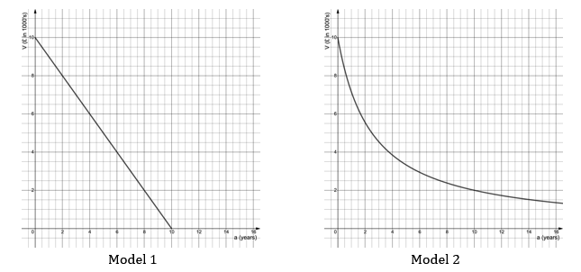
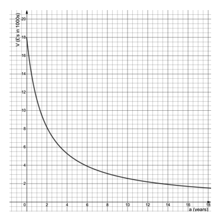

# Exam Questions — Modelling with Functions
**Algebra & Functions** · Cambridge (CIE) AS maths (9709)
> Source: [https://www.savemyexams.com/as/maths/cie/20/pure-1/topic-questions/](https://www.savemyexams.com/as/maths/cie/20/pure-1/topic-questions/) · 26 questions across 1 sets

## Exam Questions (26 questions)

### Q1 — easy — 6 marks

**Q1** [6 marks]

A patient takes a new medication at midday. The amount of drug, $D$ mg, remaining in their bloodstream $h$ hours after midday is modelled by

`D\left(h\right) = 1 + 6h - h^{2} \qquad 0 \leq h \leq 6`

(i) Evaluate `D\left(0\right)` and hence state the amount of drug in the patient's bloodstream before they take any medication.

(ii) Find the amount of drug in the patient's bloodstream at 2 pm.

(iii) Show that by 6 pm the amount of drug in the patient's bloodstream has returned to its starting amount.

### Q2 — easy — 4 marks

**Q2** [4 marks]

The number of cases of an unknown virus is modelled by

`V = \dfrac{2700}{\left(d - 30\right)^{2}} \qquad 0 \leq d < 30`

where $d$ is the number of days after the virus was first discovered and $V$ is the total number of cases recorded to date.

(i) Find the number of cases recorded when the virus was first discovered.

(ii) Sketch the graph of $V$ against $d$, stating the coordinates of the point where the graph meets the $V$-axis.

### Q3 — easy — 6 marks

**Q3** [3 marks]

The revenue (money received before expenses, tax, etc.) that Modx makes from selling maths t-shirts is found by multiplying the selling price by the number of items sold. Last year the company sold 8000 t-shirts at a price of £12 each, giving a revenue of £96 000.

This year, to maximise their revenue, Modx intend to increase the t-shirt price by £$x$. Each price increase of £1 is expected to reduce the number of items sold by 400.

The expected revenue for this year is modelled by

$R = 96  000 + 3200 x - 400 x^{2}$

where £$x$ is the increase in price per item.

By factorising $3200 x - 400 x^{2}$ and completing the square, show that the expected revenue can be written as `R = 102\,400 - 400\left(x - 4\right)^{2}`.

**Q3** [3 marks]

(i) Write down the maximum revenue the company should expect this year.

(ii) Find the price the company should charge per t-shirt this year in order to maximise revenue.

### Q4 — easy — 7 marks

**Q4** [1 mark]

The number of toys, $P$, produced by a machine in one hour is modelled by

`P\left(T\right) = \left(20 - T\right)\left(T - 40\right) \qquad 20 \leq T \leq 40`

where the temperature of the machine is $T$ °C.

Find the number of toys produced in one hour when the temperature of the machine is 25 °C.

**Q4** [6 marks]

(i) Show that `P\left(T\right) = 60T - T^{2} - 800`.

(ii) By completing the square, show that `P\left(T\right) = 100 - \left(T - 30\right)^{2}`.

(iii) Hence find the temperature at which the machine is most productive, and the number of toys it produces in one hour at this temperature.

### Q5 — very_hard — 6 marks

**Q5** [6 marks]

The revenue a company makes from selling an item is the selling price multiplied by the number of items sold. Last year Toys-were-Us sold 3 million computer games at a price of £50 each.

This year Toys-were-Us wish to maximise their revenue, but a change in price will change the number of games sold: for every £2 increase in price, sales fall by 500 000; and for every £2 decrease in price, sales rise by 500 000.

Find the price at which Toys-were-Us should sell computer games this year in order to maximise revenue, and state the expected number of games sold and the expected revenue.

### Q6 — hard — 6 marks

**Q6** [1 mark]

The graphs below show two suggested models for estimating the value of a brand-new car costing £10 000. Here $a$ is the car's age in years and £$V$ is the car's value in thousands of pounds.

Other than when brand new, at what age do the two models predict the same value for the car?

**Q6** [1 mark]

At what age does Model 1 predict the car will become worthless?

**Q6** [1 mark]

State a problem with using Model 1 for older cars.

**Q6** [1 mark]

State a problem with using Model 2 for very old cars.

**Q6** [2 marks]

Compare the two models for estimating a car's value at 8 years old and above. Suggest which model you think is more realistic, justifying your answer.

### Q7 — hard — 7 marks

**Q7** [4 marks]

A skydiver jumps from a moving aircraft at an altitude of 10 000 feet, directly above a fixed point $O$ on the ground. The trajectory of the skydiver is then modelled by

`h\left(x\right) = 3048 - 0.5x^{2}`

where $h$ m is the height of the skydiver above the ground and $x$ m is the horizontal distance along the ground from $O$.

(i) Explain why the value 10 000 does not appear in the model.

(ii) Find the height of the skydiver when they have covered a ground distance of 60 m.

(iii) Find how much ground the skydiver has covered when they land, giving your answer correct to 3 significant figures.

**Q7** [3 marks]

(i) Using a straight line between the start and end points of the skydive, find an approximation for the distance travelled by the skydiver.

(ii) Given that the skydive took 84 seconds, find an approximation for the average speed of the skydiver, and state whether this is an underestimate or an overestimate.

### Q8 — hard — 5 marks

**Q8** [2 marks]

A fountain is designed so that water is projected over a walkway. The path of the water is modelled by

`y = x\left(5 - x\right) , 0 \leq x \leq 5`

where $x$ is the horizontal distance in metres from the base of the fountain at ground level and $y$ is the height of the water in metres.

Sketch the graph of the model, labelling any intersections with the coordinate axes.

**Q8** [3 marks]

The average person is 1.7 m tall and needs a ground width of 1.2 m in order to walk comfortably.

Work out the maximum number of average-sized people who can comfortably walk under the fountain side by side without getting wet.

### Q9 — hard — 6 marks

**Q9** [1 mark]

Last year, a company sold 12 000 copies of a book at a price of £15 each. This year the company wants to increase the price, and predicts that for every £2 increase in price, annual sales will drop by 400 books. The number of books sold annually is modelled by $N = a + b c$, where $N$ is the number of books sold, $c$ is the selling price in pounds and $a$ and $b$ are constants.

Using the company's prediction, write down a second equation connecting $N$, $a$, $b$ and $c$.

**Q9** [2 marks]

Find the values of $a$ and $b$.

**Q9** [1 mark]

Hence write down the model used for the number of books sold annually.

**Q9** [2 marks]

The income £$I$ the company generates from sales is given by `I = c\left(a + bc\right)`, where $a$ and $b$ take the values from part (b). Find the price the company should charge per book in order to maximise its income.

### Q10 — hard — 3 marks

**Q10** [1 mark]

A machine produces toys at a rate that depends on the machine's temperature; the more extreme the temperature, the less productive it is. The productivity is modelled by

`P\left(T\right) = 0.015T\left(22 - T\right)\left(T - 75\right), \quad 22 \leq T \leq 75`

where $P$ is the number of toys produced per hour and the temperature of the machine is $T$ °C.

Suggest a reason why the machine only operates between 22 °C and 75 °C.

**Q10** [2 marks]

The temperature of the machine rises by 7 °C for every hour it is in constant use. To prevent a breakdown, the machine is switched off once its temperature exceeds 60.5 °C. Assuming the machine is at 22 °C when it is switched on, find the number of hours it can run continuously before being switched off.

### Q11 — hard — 6 marks

**Q11** [2 marks]

The leakage rate of water from a pipe, $L$ litres per second, is directly proportional to the square root of the flow rate $s$ m s⁻¹, which is the speed of the water flowing through the pipe. It is observed that the leakage rate is 0.72 litres per second when the flow rate is 0.64 m s⁻¹.

Write down an equation connecting $L$ and $s$.

**Q11** [2 marks]

Find the flow rate when the leakage rate is 0.49 litres per second.

**Q11** [2 marks]

An alternative model for the leakage rate is $L = 0 . 5 s$. Other than when there is no leak, find a flow rate and a leakage rate for which both models predict the same result.

### Q12 — hard — 9 marks

**Q12** [6 marks]

The Blue Blades Aerobatic Display Team use white and blue smoke trails in their flying display. At the start of the display, each aeroplane holds a tank containing 360 litres of white smoke fluid and a separate tank of blue smoke fluid.

The amount of white smoke fluid remaining, $w$ litres, after $t$ seconds of use is modelled by

$w = \frac{k}{t+p} - q$

where $k$, $p$ and $q$ are positive constants.

(i) Given that $q = 90$ and that it takes 50 seconds for the amount of white smoke fluid to halve, find the values of $k$ and $p$.

(ii) Hence find the number of minutes of use that a tank of 360 litres of white smoke fluid will last.

**Q12** [3 marks]

A similar model for the blue smoke fluid is $b = \frac{8400}{t+40} - 30$. Find the initial amount of blue smoke fluid in the tank, and determine how many minutes of use the blue smoke fluid will last.

### Q13 — hard — 5 marks

**Q13** [2 marks]

It has often been said that, to avoid relegation from football's Premier League, a team should aim to score at least 40 points in a season. Each team plays 38 games; a win is rewarded with 3 points and a draw with 1 point. No points are awarded for a loss.

Using $W$ and $D$ as the number of wins and draws respectively, write down two inequalities: one relating to the number of points a team needs to avoid relegation, and one relating to the number of games played.

**Q13** [1 mark]

Explain why $W \geq 0$ and $D \geq 0$ must also be conditions.

**Q13** [2 marks]

A team has won 4 games and drawn 4 after playing 17 games. Write down two updated inequalities for the number of wins and draws required during the remainder of the season in order to avoid relegation.

### Q14 — hard — 10 marks

**Q14** [1 mark]

A soft ball is thrown upwards from the top of a building. The height, $h$ m, of the ball above the ground after $t$ seconds is modelled by

`h\left(t\right) = 15 + 8.4t - 4.9t^{2} , t > 0`

What is the significance of the constant 15 in the model?

**Q14** [2 marks]

At what time is the ball at the same height as when it was thrown?

**Q14** [3 marks]

Find the time at which the ball is at its maximum height, and the value of this maximum height.

**Q14** [2 marks]

How long does it take for the ball to first hit the ground?

**Q14** [2 marks]

Given that the ball first hits the ground at a distance of 20 m from the base of the building, find the shortest distance between this landing point and the point from which the ball was thrown.

### Q15 — medium — 6 marks

**Q15** [2 marks]

The leakage rate of water from a pipe, $L$ litres per second, is directly proportional to the flow rate $s$ m s⁻¹, which is the speed of the water flowing through the pipe. It is observed that the leakage rate is 0.3 litres per second when the flow rate is 0.6 m s⁻¹.

Show that the constant of proportionality is 0.5, and hence write down an equation connecting $L$ and $s$.

**Q15** [2 marks]

Find the leakage rate when the flow rate is 1.8 m s⁻¹.

**Q15** [2 marks]

The flow rate is reduced if the leakage rate exceeds 0.8 litres per second. Find the maximum possible flow rate before it is reduced.

### Q16 — medium — 6 marks

**Q16** [2 marks]

It has often been said that, to avoid relegation from football's Premier League, a team should aim to score at least 40 points in a season. Each team plays 38 games; a win is rewarded with 3 points and a draw with 1 point. No points are awarded for a loss.

Using $W$ and $D$ as the number of wins and draws respectively, write down an inequality describing the number of points a team should aim for to avoid relegation.

**Q16** [2 marks]

Another condition on $W$ and $D$ is $W + D \leq 38$.

(i) Briefly explain why this second condition arises.

(ii) Explain why $W \geq 0$ and $D \geq 0$ must also be conditions.

**Q16** [2 marks]

A team has won 3 games and drawn 5 after playing 19 games. Write down an updated inequality for the number of points required during the remainder of the season in order to avoid relegation.

### Q17 — medium — 6 marks

**Q17** [1 mark]

A patient takes a new medication at midday. The amount of drug, $D$ mg, remaining in their bloodstream $h$ hours after midday is modelled by

$D = 0 . 04 + 0 . 16 h - 0 . 04 h^{2} ,  0 \leq h \leq 4$

State the amount of drug already occurring naturally in the patient's bloodstream before any medication is taken.

**Q17** [2 marks]

Without doing any calculations, explain how you can tell that the drug reaches its highest level 2 hours after midday, at 2 pm.

**Q17** [2 marks]

It is safe for the patient to take more medication once the amount of drug in their bloodstream falls below 0.16 mg. Find the earliest time at which the patient can take a second dose.

**Q17** [1 mark]

Find the time at which the amount of drug in the bloodstream returns to its natural level.

### Q18 — medium — 7 marks

**Q18** [2 marks]

A machine produces toys at a rate that depends on the machine's temperature; the more extreme the temperature, the less productive it is. The productivity is modelled by

`P\left(T\right) = 0.02T\left(5 - T\right)\left(T - 60\right), \quad 5 \leq T \leq 60`

where $P$ is the number of toys produced per hour and the temperature of the machine is $T$ °C.

Find the number of toys produced per hour when the temperature of the machine is 36 °C.

**Q18** [2 marks]

Show that `P\left(T\right) = 1.3T^{2} - 0.02T^{3} - 6T`.

**Q18** [2 marks]

Productivity is at its peak when the temperature of the machine is 41 °C. Find the number of toys produced per hour at this temperature.

**Q18** [1 mark]

Suggest a reason why the machine cannot operate below 5 °C.

### Q19 — medium — 9 marks

**Q19** [2 marks]

Last year, a company sold 10 000 books at a price of £20 each. The previous year, the company sold 10 250 books at a price of £19 each.

The company wants to increase the price again this year and models the number of books sold annually by $N = a + b c$, where $N$ is the number of books sold, $c$ is the selling price in pounds and $a$ and $b$ are constants.

Write down two equations for the sales in the past two years, and hence find the constants $a$ and $b$.

**Q19** [1 mark]

Write down the model for the number of books sold annually.

**Q19** [2 marks]

This year the company intends to raise the price of the book by £2.

(i) How many books should the company expect to sell this year?

(ii) Calculate the income the company should expect from book sales this year.

**Q19** [2 marks]

Work out the book-sale income for last year and the year before.

**Q19** [2 marks]

Briefly comment on the relationship between the number of books sold and the income over this three-year period.

### Q20 — medium — 7 marks

**Q20** [3 marks]

The White Blades Aerobatic Display Team use white smoke trails in their flying display. At the start of the display, each aeroplane holds a tank containing 180 litres of white smoke fluid. The amount of white smoke fluid, $W$ litres, remaining in a tank is inversely proportional to the total time, $t$ seconds, for which white smoke has been produced, plus 25 seconds.

Find an equation modelling the relationship between $W$ and $t$.

**Q20** [3 marks]

The smoke-producing mechanism becomes unreliable once the amount of white smoke fluid remaining drops below 7% of the initial amount. Find the maximum whole number of minutes for which each aeroplane can reliably produce white smoke.

**Q20** [1 mark]

State a problem with the model for large values of $t$.

### Q21 — medium — 5 marks

**Q21** [2 marks]

The number of cases of an unknown virus is modelled by

`V = \dfrac{225}{\left(d - 15\right)^{2}} \qquad 0 \leq d < 15`

where $d$ is the number of days after the first case was discovered and $V$ is the total number of cases to date.

Find the number of cases after 10 days.

**Q21** [2 marks]

Sketch the graph of $V$ against $d$, stating the coordinates of the point where the graph meets the $V$-axis.

**Q21** [1 mark]

A politician says that after 5 days there were 2.25 cases of the virus. Comment on the politician's statement.

### Q22 — easy — 4 marks

**Q22** [1 mark]

The graph below shows a suggested model for estimating the value of a brand-new car costing £18 000. Here $a$ is the car's age in years and £$V$ is the car's value in thousands of pounds.

Use the model to predict a car's value after 5 years.

**Q22** [1 mark]

A car of the same make and model is advertised for sale at £3250. How old would you expect the car to be?

**Q22** [1 mark]

In terms of its value, what does the model suggest is a disadvantage of buying a brand-new car?

**Q22** [1 mark]

A 16-year-old car was scrapped and the owner received £200 for spare parts. State a problem with using this model for very old cars.

### Q23 — medium — 8 marks

**Q23** [3 marks]

The revenue a company makes from selling an item is the selling price multiplied by the number of items sold. Last year BuoysToys sold 6000 remote-controlled boats at a price of £40 each, giving a revenue of £40 × 6000 = £240 000.

This year they wish to increase the price to maximise revenue, but expect that 200 fewer boats will be sold for every £2 increase in the price.

Show that the expected revenue this year, £$R$, is $R = 240  000 + 4000 x - 400 x^{2}$, where $x$ is the number of £2 increases made to the price.

**Q23** [3 marks]

By completing the square, show that `R = 250\,000 - 400\left(x - 5\right)^{2}`.

**Q23** [2 marks]

Hence find the price at which BuoysToys should sell the boat this year to maximise revenue, and state the revenue expected.

### Q24 — medium — 7 marks

**Q24** [1 mark]

A soft ball is thrown upwards from the top of a 10 m tall building. The height, $h$ m, of the ball above the ground $t$ seconds after it is thrown is modelled by

`h\left(t\right) = H + 7.8t - 4.9t^{2}, \quad t > 0`

Write down the value of $H$.

**Q24** [2 marks]

Find the height of the ball after 2 seconds.

**Q24** [2 marks]

Find the time at which the ball is again at the height from which it was thrown, giving your answer correct to 3 significant figures.

**Q24** [2 marks]

Find the time taken for the ball to first hit the ground, giving your answer correct to 3 significant figures.

### Q25 — medium — 7 marks

**Q25** [7 marks]

A skydiver jumps from a moving aircraft at a point directly above a fixed point $O$ on the ground. The trajectory of the skydiver is then modelled by

`h\left(x\right) = 3200 - 0.5x^{2}`

where $h$ m is the height of the skydiver above the ground and $x$ m is the horizontal distance along the ground from $O$.

(i) Explain the significance of the value 3200 in the model.

(ii) Find how much ground the skydiver has covered when they land.

(iii) Sketch the graph of $h$ against $x$.

(iv) Explain why the model is not suitable for values of $x$ greater than 80 m.

### Q26 — medium — 6 marks

**Q26** [1 mark]

A fountain is designed so that water is projected over a walkway. The path of the water is modelled by

`y = x\left(4 - x\right), \quad 0 \leq x \leq 4`

where $x$ is the horizontal distance in metres from the base of the fountain at ground level and $y$ is the height of the water in metres.

Sketch the graph of the model, labelling any intersections with the coordinate axes.

**Q26** [2 marks]

Find the height of the water at a horizontal distance of 1.3 m.

**Q26** [2 marks]

The average person is 1.7 m tall and needs a ground width of 1.2 m in order to walk comfortably. Find the distance at ground level between the two points where the water height is 1.7 m.

**Q26** [1 mark]

Use your answer to part (c) to find the maximum number of average-sized people who can comfortably walk side by side under the fountain without getting wet.
