# Mark Schemes — Quadratics
**Algebra & Functions** · Cambridge (CIE) AS maths (9709)

## Exam Questions (45 questions)

### Q1
Halve the coefficient of $x$, square it inside the bracket and subtract it back

$x^{2} + 10 x + 24 = ( x + 5 )^{2} - 25 + 24$

**[M1]**

$( x + 5 )^{2} - 1$

**[A1]**

> **[mark-scheme]**
> **M1**: Correct method to complete the square, reaching $( x + 5 )^{2} + \dots$ (the constant need not yet be simplified).
> 
> **A1**: Fully correct $( x + 5 )^{2} - 1$, i.e. $a = 5$ and $b = - 1$.
Using the completed-square form $( x + 5 )^{2} - 1$, the minimum occurs when the bracket is zero, at $x = - 5$

$( - 5 , - 1 )$

**[B1]**

> **[mark-scheme]**
> **B1**: Correct minimum point $( - 5 , - 1 )$, read directly from the completed-square form in part (a). A square bracket is never negative, so its smallest value is $0$, giving $y = - 1$ at $x = - 5$.

### Q2
The discriminant is $b^{2} - 4 a c$

(i)

Here $a = 1$, $b = - 3$ and $c = 4$

$b^{2} - 4 a c = ( - 3 )^{2} - 4 ( 1 ) ( 4 ) = 9 - 16$

$- 7$

**[B1]**

(ii)

Rearrange into $a x^{2} + b x + c$ form first: $- 2 x^{2} + 4 x + 3$, so $a = - 2$, $b = 4$ and $c = 3$

$b^{2} - 4 a c = ( 4 )^{2} - 4 ( - 2 ) ( 3 ) = 16 + 24$

$40$

**[B1]**

(iii)

Rearrange into $a x^{2} + b x + c$ form first: $2 x^{2} - 8 x + 5$, so $a = 2$, $b = - 8$ and $c = 5$

$b^{2} - 4 a c = ( - 8 )^{2} - 4 ( 2 ) ( 5 ) = 64 - 40$

$24$

**[B1]**

> **[mark-scheme]**
> **B1**: Correct discriminant $- 7$.
> 
> **B1**: Correct discriminant $40$. You must rearrange to $- 2 x^{2} + 4 x + 3$ first so that $a = - 2$; using $a = 2$ gives the wrong sign.
> 
> **B1**: Correct discriminant $24$. Rearrange to $2 x^{2} - 8 x + 5$ first to read off $a$, $b$ and $c$ correctly.

### Q3
No real roots means the discriminant is negative

$b^{2} - 4 a c < 0$

Substitute $a = 1$, $b = k$ and $c = 3$

$k^{2} - 4 ( 1 ) ( 3 ) < 0$

**[M1]**

Rearrange into the required form

$k^{2} - 12 < 0$

**Final answer:** $k^{2} < 12$** as required**

**[A1]**

> **[mark-scheme]**
> **M1**: Correct use of the discriminant condition for no real roots, $b^{2} - 4 a c < 0$, with $a = 1$, $b = k$ and $c = 3$.
> 
> **A1**: Correct rearrangement to the printed result $k^{2} < 12$. The inequality must be strict throughout, since "no real roots" excludes equality (a repeated root).

### Q4
(i)

The roots are where $\text{g} ( x ) = 0$; rearrange into standard form first

$12 + 4 x - x^{2} = 0$

$x^{2} - 4 x - 12 = 0$

$( x - 6 ) ( x + 2 ) = 0$

**[M1]**

**Final answer:** $x = 6$** or **$x = - 2$

**[A1]**

(ii)

The $y$-axis intercept is the value of $\text{g} ( x )$ when $x = 0$

$\text{g} ( 0 ) = 12 + 4 ( 0 ) - ( 0 )^{2} = 12$

$( 0 , 12 )$

**[B1]**

> **[mark-scheme]**
> **M1**: Correct rearrangement to $x^{2} - 4 x - 12 = 0$ and a valid attempt to factorise (or use of the quadratic formula).
> 
> **A1**: Both correct roots $x = 6$ and $x = - 2$.
> 
> **B1**: Correct $y$-axis intercept $( 0 , 12 )$.
(i)

Factor $- 1$ from the $x$ terms, then complete the square inside the bracket

$12 + 4 x - x^{2} = 12 - ( x^{2} - 4 x )$

`= 12 - \left[(x - 2)^2 - 4\right]`

**[M1]**

$16 - ( x - 2 )^{2}$

**[A1]**

(ii)

The turning point is where the bracket is zero, at $x = 2$. The coefficient of $x^{2}$ is negative, so this is a maximum

$( 2 , 16 )$

**[B1]**

> **[mark-scheme]**
> **M1**: Correct method to complete the square after factoring $- 1$ from the $x$ terms, reaching `12 - \left[(x - 2)^2 - 4\right]` or equivalent.
> 
> **A1**: Fully correct $16 - ( x - 2 )^{2}$, i.e. $a = 16$ and $b = 2$.
> 
> **B1**: Correct turning point $( 2 , 16 )$, read from the completed-square form. It is a maximum because the coefficient of $x^{2}$ is negative.
The coefficient of $x^{2}$ is negative, so the graph is a parabola opening downwards, with maximum $( 2 , 16 )$ from part (b)

**[B1]**

From parts (a) and (b), the graph passes through $( - 2 , 0 )$, $( 6 , 0 )$ and $( 0 , 12 )$

**[B1]**

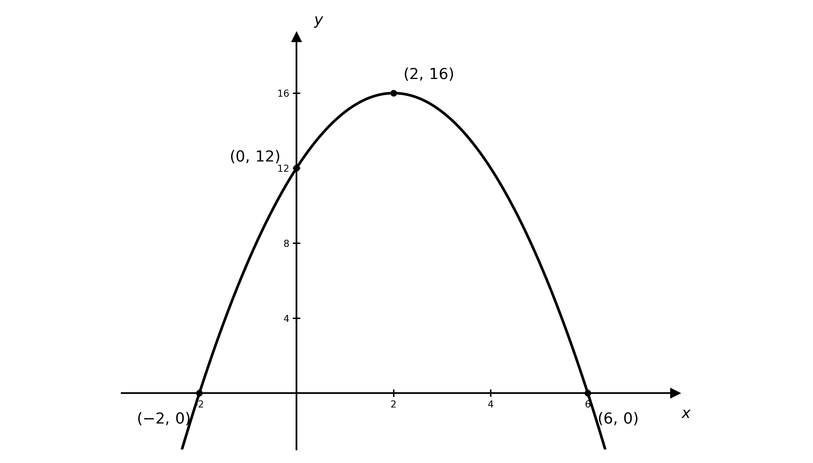

> **[mark-scheme]**
> **B1**: Correct shape — a parabola opening downwards (negative quadratic) — with the maximum $( 2 , 16 )$ labelled.
> 
> **B1**: All axis crossings labelled: $( - 2 , 0 )$, $( 6 , 0 )$ and $( 0 , 12 )$.

### Q5
(i)

Factorise and set each factor equal to zero

$( x + 9 ) ( x - 1 ) = 0$

**Final answer:** $x = - 9$** or **$x = 1$

**[B1]**

(ii)

Factorise and set each factor equal to zero

$( 3 x - 1 ) ( x - 4 ) = 0$

**Final answer:** $x = \frac{1}{3}$** or **$x = 4$

**[B1]**

(iii)

This does not factorise, so use the quadratic formula with $a = 4$, $b = - 6$, $c = - 5$

$x = \frac{-(-6)\pm\sqrt{(-6)^{2}-4(4)(-5)}}{2(4)} = \frac{6\pm\sqrt{116}}{8}$

Simplify the surd using $\sqrt{116} = 2 \sqrt{29}$

**Final answer:** $x = \frac{3+\sqrt{29}}{4} \approx 2 . 10$** or **$x = \frac{3-\sqrt{29}}{4} \approx - 0 . 596$

**[B1]**

> **[mark-scheme]**
> **B1**: Both correct solutions $x = - 9$ and $x = 1$.
> 
> **B1**: Both correct solutions $x = \frac{1}{3}$ and $x = 4$.
> 
> **B1**: Both correct solutions from the quadratic formula. Accept the exact form $\frac{3\pm\sqrt{29}}{4}$ or answers which round to $2 . 10$ and $- 0 . 596$ to 3 significant figures.

### Q6
Two distinct real roots means the discriminant is positive

$b^{2} - 4 a c > 0$

Substitute $a = k$, $b = 2 k$ and $c = - 3$

$( 2 k )^{2} - 4 ( k ) ( - 3 ) > 0$

**[M1]**

Simplify and factorise

$4 k^{2} + 12 k > 0$

**Final answer:** $4 k ( k + 3 ) > 0$** as required**

**[A1]**

> **[mark-scheme]**
> **M1**: Correct use of the discriminant condition for two distinct real roots, $b^{2} - 4 a c > 0$, with $a = k$, $b = 2 k$ and $c = - 3$.
> 
> **A1**: Correct simplification and factorisation to the printed result $4 k ( k + 3 ) > 0$. The inequality is strict because the roots are distinct.

### Q7
(i)

Multiply out the brackets and collect like terms

$( x + 4 ) ( 2 x - 3 ) = 2 x^{2} - 3 x + 8 x - 12$

$2 x^{2} + 5 x - 12$

**[B1]**

(ii)

This is a difference of two squares

$( 3 x - 4 ) ( 3 x + 4 ) = 9 x^{2} + 12 x - 12 x - 16$

$9 x^{2} - 16$

**[B1]**

(iii)

Square the bracket by writing it as a product

$( 2 x + 1 )^{2} = ( 2 x + 1 ) ( 2 x + 1 ) = 4 x^{2} + 2 x + 2 x + 1$

$4 x^{2} + 4 x + 1$

**[B1]**

> **[mark-scheme]**
> **B1**: Correct expansion of $( x + 4 ) ( 2 x - 3 )$ to give $2 x^{2} + 5 x - 12$.
> 
> **B1**: Correct expansion of $( 3 x - 4 ) ( 3 x + 4 )$ to give $9 x^{2} - 16$. You can write this down directly using the difference of two squares.
> 
> **B1**: Correct expansion of $( 2 x + 1 )^{2}$ to give $4 x^{2} + 4 x + 1$. A common error is to write $4 x^{2} + 1$, forgetting the middle term.

### Q8
(i)

The $y$-axis intercept is the value of $y$ when $x = 0$

$y = 2 ( 0 )^{2} + 5 ( 0 ) - 3 = - 3$

$( 0 , - 3 )$

**[B1]**

(ii)

The roots are where $y = 0$, so factorise and solve

$2 x^{2} + 5 x - 3 = 0$

$( 2 x - 1 ) ( x + 3 ) = 0$

**[M1]**

**Final answer:** $x = \frac{1}{2}$** or **$x = - 3$

**[A1]**

> **[mark-scheme]**
> **B1**: Correct $y$-axis intercept $( 0 , - 3 )$ (or $y = - 3$).
> 
> **M1**: Correct attempt to factorise $2 x^{2} + 5 x - 3$, or correct use of the quadratic formula.
> 
> **A1**: Both correct roots $x = \frac{1}{2}$ and $x = - 3$.
The coefficient of $x^{2}$ is positive, so the graph is a parabola opening upwards

**[B1]**

From part (a), the graph crosses the $x$-axis at `\left(\dfrac{1}{2}, 0\right)` and $( - 3 , 0 )$

**[B1]**

and crosses the $y$-axis at $( 0 , - 3 )$

**[B1]**

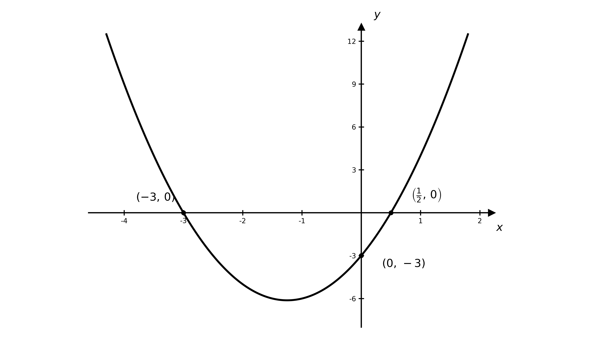

> **[mark-scheme]**
> **B1**: Correct shape — a parabola opening upwards (positive quadratic).
> 
> **B1**: Both $x$-axis crossings labelled, `\left(\dfrac{1}{2}, 0\right)` and $( - 3 , 0 )$.
> 
> **B1**: $y$-axis crossing labelled, $( 0 , - 3 )$.

### Q9
(i)

Halve the coefficient of $x$, square it inside the bracket and subtract it back

$x^{2} + 8 x - 4 = ( x + 4 )^{2} - 16 - 4$

$( x + 4 )^{2} - 20$

**[B1]**

(ii)

Factor the coefficient of $x^{2}$ out of the first two terms

$2 x^{2} + 12 x - 5 = 2 ( x^{2} + 6 x ) - 5$

`= 2\left[(x + 3)^2 - 9\right] - 5`

$2 ( x + 3 )^{2} - 23$

**[B1]**

(iii)

Factor the $5$ out of the first two terms, then complete the square inside the bracket

`5x^2 - 3x + 2 = 5\left(x^2 - \dfrac{3}{5}x\right) + 2`

`= 5\left[\left(x - \dfrac{3}{10}\right)^2 - \dfrac{9}{100}\right] + 2`

`5\left(x - \dfrac{3}{10}\right)^2 + \dfrac{31}{20}`

**[B1]**

> **[mark-scheme]**
> **B1**: Correct completed-square form $( x + 4 )^{2} - 20$.
> 
> **B1**: Correct completed-square form $2 ( x + 3 )^{2} - 23$. You must factor the $2$ out of the first two terms before completing the square.
> 
> **B1**: Correct completed-square form `5\left(x - \dfrac{3}{10}\right)^2 + \dfrac{31}{20}`. Equivalent exact forms such as `5\left(x - 0.3\right)^2 + 1.55` are accepted.

### Q10
The coefficient of $x^{2}$ is positive, so the graph is a parabola opening upwards

**[B1]**

Because the expression is a perfect square, the graph touches the $x$-axis (a repeated root) where $2 x - 5 = 0$, at `\left(\dfrac{5}{2}, 0\right)`

**[B1]**

The $y$-axis intercept is at $x = 0$

$y = ( 2 ( 0 ) - 5 )^{2} = 25$

$( 0 , 25 )$

**[B1]**

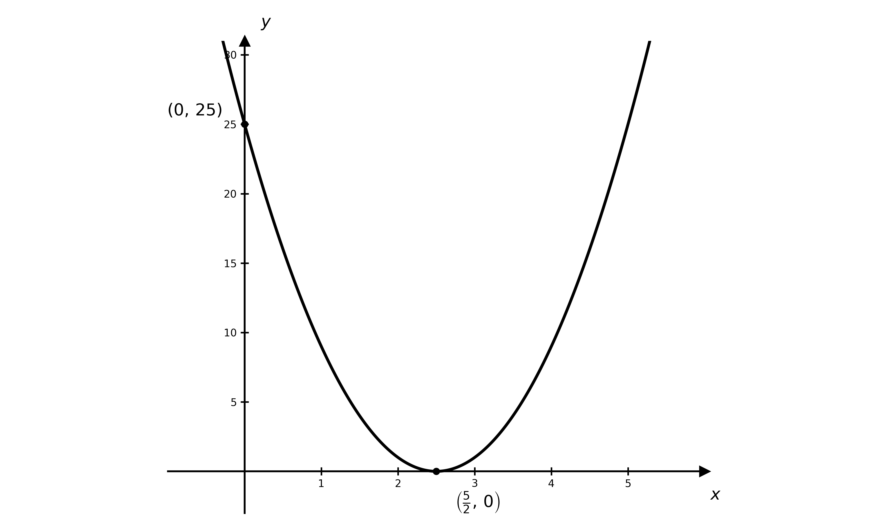

> **[mark-scheme]**
> **B1**: Correct shape — a parabola opening upwards.
> 
> **B1**: Graph touches the $x$-axis at `\left(\dfrac{5}{2}, 0\right)`. Because this is a repeated root, the curve must touch rather than cross the axis here.
> 
> **B1**: $y$-axis intercept labelled $( 0 , 25 )$.

### Q11
$\text{f} ( x )$ is a perfect square, so it has a repeated root — think about what that means for the graph and for the discriminant

**Final answer:** **The function is a perfect square, **$( a x - b )^{2}$**, which is zero only at the single repeated value **$x = \frac{b}{a}$**. A repeated root means the graph touches the **$x$**-axis at one point rather than crossing it, and a repeated root corresponds to a discriminant of zero**

**[B1]**

> **[mark-scheme]**
> **B1**: A correct explanation that $( a x - b )^{2}$ is a perfect square with a single repeated root, so the graph touches the $x$-axis once and the discriminant is therefore zero. Accept any clear equivalent reasoning, for example "it has one repeated factor, so there is only one (repeated) root."

### Q12
(i)

Find two numbers that multiply to $- 14$ and add to $5$, namely $7$ and $- 2$

$( x + 7 ) ( x - 2 )$

**[B1]**

(ii)

This is a difference of two squares, $( 5 x )^{2} - 6^{2}$

$( 5 x - 6 ) ( 5 x + 6 )$

**[B1]**

(iii)

Split the middle term using $2 \times 9 = 18$, with $6$ and $3$

$2 x^{2} + 6 x + 3 x + 9 = 2 x ( x + 3 ) + 3 ( x + 3 )$

$( 2 x + 3 ) ( x + 3 )$

**[B1]**

> **[mark-scheme]**
> **B1**: Correct factorisation $( x + 7 ) ( x - 2 )$.
> 
> **B1**: Correct factorisation $( 5 x - 6 ) ( 5 x + 6 )$. You can write this down directly using the difference of two squares.
> 
> **B1**: Correct factorisation $( 2 x + 3 ) ( x + 3 )$. You can check by expanding to recover $2 x^{2} + 9 x + 9$.

### Q13
No real roots means the discriminant is negative

$b^{2} - 4 a c < 0$

Substitute $a = 1$, $b = p$ and $c = q$

$p^{2} - 4 q < 0$

**Final answer:** $p^{2} < 4 q$** as required**

**[M1]**

**Final answer:** **Since **$p^{2} \geq 0$** for all real values of **$p$**, it follows that **$4 q > p^{2} \geq 0$**, so **$4 q$** is positive**

**Final answer:** **Therefore **$q > 0$

**[A1]**

> **[mark-scheme]**
> **M1**: Correct use of the discriminant condition for no real roots, $b^{2} - 4 a c < 0$, leading to $p^{2} < 4 q$.
> 
> **A1**: Correct explanation that $q > 0$, using $p^{2} \geq 0$ so that $4 q > p^{2} \geq 0$.
Completing the square gives `y = \left(x + \dfrac{p}{2}\right)^2 + q - \dfrac{p^2}{4}`, with minimum at $x = - \frac{p}{2}$

The $x$-coordinate of the minimum is $3$

$- \frac{p}{2} = 3 \text{, so} p = - 6$

**[M1]**

The minimum value is $1$, so $q - \frac{p^{2}}{4} = 1$

$q - \frac{(-6)^{2}}{4} = 1 \text{, so} q - 9 = 1$

**Final answer:** $p = - 6$** and **$q = 10$

**[A1]**

> **[mark-scheme]**
> **M1**: Uses the $x$-coordinate of the minimum, $- \frac{p}{2} = 3$, to find $p = - 6$ (or differentiates and sets the gradient to zero).
> 
> **A1**: Both correct values $p = - 6$ and $q = 10$ (using the minimum value $1$).

### Q14
Complete the square

$\text{f} ( x ) = x^{2} + 8 x + c = ( x + 4 )^{2} - 16 + c$

**[M1]**

The smallest value of $( x + 4 )^{2}$ is $0$, so the minimum value of $\text{f} ( x )$ is

$c - 16$

**[A1]**

> **[mark-scheme]**
> **M1**: Correct method to find the minimum — completing the square to reach $( x + 4 )^{2} + \dots$, or differentiating and setting $2 x + 8 = 0$.
> 
> **A1**: Correct minimum value $c - 16$ (occurring at $x = - 4$).
No real roots means the discriminant is negative

$b^{2} - 4 a c < 0$

$8^{2} - 4 ( 1 ) ( c ) < 0$

$64 - 4 c < 0$

**[M1]**

Solve the inequality for $c$

$c > 16$

**[A1]**

> **[mark-scheme]**
> **M1**: Correct use of the discriminant condition $b^{2} - 4 a c < 0$ (or, using part (a), the minimum value $c - 16 > 0$).
> 
> **A1**: Correct final answer $c > 16$. The inequality is strict, since equality would give a repeated (real) root.

### Q15
This is a perfect square, since $9 = 3^{2}$ and $6 = 2 \times 3$

$( x + 3 )^{2}$

**[B1]**

> **[mark-scheme]**
> **B1**: Correct factorisation $( x + 3 )^{2}$.
This has the same perfect-square pattern as part (a), with $3$ replaced by $3 y$, since $9 y^{2} = ( 3 y )^{2}$ and $6 x y = 2 \times x \times 3 y$

$x^{2} + 6 x y + 9 y^{2} = ( x + 3 y )^{2}$

**[M1]**

$( x + 3 y )^{2}$

**[A1]**

> **[mark-scheme]**
> **M1**: Recognises the perfect-square structure (or attempts $( x + a y ) ( x + b y )$ with $a + b = 6$ and $a b = 9$).
> 
> **A1**: Correct factorisation $( x + 3 y )^{2}$.
Using the factorisation from part (b)

$( x + 3 y )^{2} = 0$

A squared term is zero only when its base is zero

$x + 3 y = 0$

**[M1]**

$x = - 3 y$

**[A1]**

> **[mark-scheme]**
> **M1**: Sets the factorised form $( x + 3 y )^{2} = 0$ and deduces $x + 3 y = 0$.
> 
> **A1**: Correct relationship $x = - 3 y$ (or equivalently $x + 3 y = 0$ or an equivalent).

### Q16
Factor $- 6$ out of the first two terms, then complete the square inside the bracket

`y = -6x^2 + 8x - 5 = -6\left(x^2 - \dfrac{4}{3}x\right) - 5`

`= -6\left[\left(x - \dfrac{2}{3}\right)^2 - \dfrac{4}{9}\right] - 5 = -6\left(x - \dfrac{2}{3}\right)^2 + \dfrac{8}{3} - 5`

**[M1]**

`y = -\dfrac{7}{3} - 6\left(x - \dfrac{2}{3}\right)^2`

**[A1]**

> **[mark-scheme]**
> **M1**: Correct method to complete the square after factoring $- 6$ from the first two terms.
> 
> **A1**: Fully correct form, i.e. $a = - \frac{7}{3}$, $b = 6$ and $c = - \frac{2}{3}$.
From the form `-\dfrac{7}{3} - 6\left(x - \dfrac{2}{3}\right)^2`, the maximum occurs when the bracket is zero, at $x = \frac{2}{3}$

`\left(\dfrac{2}{3}, -\dfrac{7}{3}\right)`

**[B1]**

> **[mark-scheme]**
> **B1**: Correct maximum point `\left(\dfrac{2}{3}, -\dfrac{7}{3}\right)`, read from the completed-square form in part (a).
The coefficient of $x^{2}$ is negative, so the graph is a parabola opening downwards, with maximum `\left(\dfrac{2}{3}, -\dfrac{7}{3}\right)` from part (b)

**[B1]**

The maximum value $- \frac{7}{3}$ is negative, so the entire curve lies below the $x$-axis — there are no $x$-axis crossings

**[B1]**

The $y$-axis crossing is at

$( 0 , - 5 )$

**[B1]**

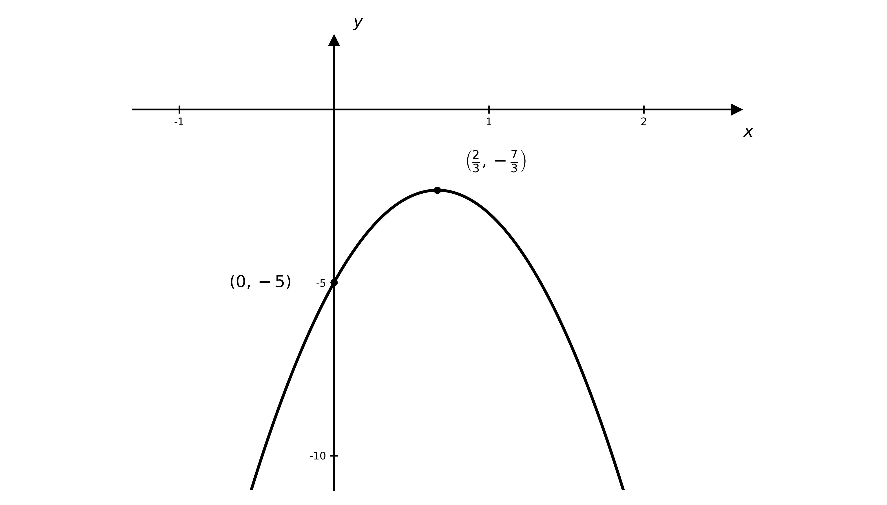

> **[mark-scheme]**
> **B1**: Correct shape — a parabola opening downwards.
> 
> **B1**: Maximum point `\left(\dfrac{2}{3}, -\dfrac{7}{3}\right)` labelled, with the curve entirely below the $x$-axis (no $x$-axis crossings).
> 
> **B1**: $y$-axis crossing labelled, $( 0 , - 5 )$.

### Q17
At its peak the water level is at $y = 0 . 5$, so the bridge spans the river where $\text{f} ( x ) = 0 . 5$

$4 - \frac{x^{2}}{8} = 0 . 5$

$\frac{x^{2}}{8} = 3 . 5 \text{, so} x^{2} = 28$

**[M1]**

$x = \pm \sqrt{28} = \pm 2 \sqrt{7}$

**Final answer:** **Since the width **$4 \sqrt{7} \approx 10 . 58 < 11$**, the bridge is not wide enough**

**[A1]**

> **[mark-scheme]**
> **M1**: Sets $\text{f} ( x ) = 0 . 5$ and makes a valid attempt to solve, reaching $x^{2} = 28$.
> 
> **A1**: Correct conclusion that the bridge is **not** wide enough, supported by the width $4 \sqrt{7} \approx 10 . 58$ m being less than $11$ m.
The barge is $6$ m wide, so check the height of the arch at $x = \pm 3$ (the edges of the barge). The barge is $2 . 5$ m tall

$\text{f} ( 3 ) = 4 - \frac{3^{2}}{8} = 4 - \frac{9}{8} = 2 . 875$

**[M1]**

**Final answer:** **Since the arch height **$2 . 875 > 2 . 5$**, the barge fits underneath**

**[A1]**

> **[mark-scheme]**
> **M1**: Evaluates the arch height at the edge of the barge, $\text{f} ( 3 ) = 2 . 875$ (or finds the bridge width at height $2 . 5$ m).
> 
> **A1**: Correct conclusion that the barge fits, supported by the arch height $2 . 875$ m being greater than $2 . 5$ m.
The base of the arch is $2 . 5$ m below the water level, where $\text{f} ( x ) = - 2 . 5$

$4 - \frac{x^{2}}{8} = - 2 . 5$

$\frac{x^{2}}{8} = 6 . 5 \text{, so} x^{2} = 52$

**[M1]**

$x = \pm \sqrt{52} = \pm 2 \sqrt{13}$

The exact distance between the two bases is

$2 \times 2 \sqrt{13} = 4 \sqrt{13} \text{m}$

**[A1]**

> **[mark-scheme]**
> **M1**: Sets $\text{f} ( x ) = - 2 . 5$ (the arch continues $2 . 5$ m below water level) and makes a valid attempt to solve, reaching $x^{2} = 52$. Setting $\text{f} ( x ) = + 2 . 5$ scores no marks.
> 
> **A1**: Correct exact distance $4 \sqrt{13}$ m. The question asks for the exact value, so a decimal such as $14 . 4$ m on its own does not earn this mark.

### Q18
The cliff height is the height of the stone at the moment it is thrown, $t = 0$

$h ( 0 ) = 52 + 3 ( 0 ) - 0 . 5 ( 0 )^{2} = 52$

**Final answer:** $52$** metres**

**[B1]**

> **[mark-scheme]**
> **B1**: Correct cliff height of $52$ metres, read as $h ( 0 )$ (the constant term).
The maximum is the vertex of the parabola. Complete the square

$h ( t ) = - 0 . 5 t^{2} + 3 t + 52 = - 0 . 5 ( t^{2} - 6 t ) + 52$

`= -0.5\left[(t - 3)^2 - 9\right] + 52 = -0.5(t - 3)^2 + 56.5`

**[M1]**

The maximum occurs at $t = 3$, giving

**Final answer:** $56 . 5$** metres**

**[A1]**

> **[mark-scheme]**
> **M1**: Valid method to find the maximum — completing the square, or differentiating and setting $\frac{\text{d}h}{\text{d}t} = 3 - t = 0$ to get $t = 3$.
> 
> **A1**: Correct maximum height of $56 . 5$ metres.
The stone hits the sea when its height above the sea is zero, $h ( t ) = 0$

$52 + 3 t - 0 . 5 t^{2} = 0$

Multiply through by $- 2$ to clear the fraction

$t^{2} - 6 t - 104 = 0$

**[M1]**

This does not factorise, so use the quadratic formula

$t = \frac{6\pm\sqrt{(-6)^{2}-4(1)(-104)}}{2} = \frac{6\pm\sqrt{452}}{2} = 3 \pm \sqrt{113}$

Since $t \geq 0$, take the positive root

**Final answer:** $t = 3 + \sqrt{113} \approx 13 . 6$** seconds**

**[A1]**

> **[mark-scheme]**
> **M1**: Sets $h ( t ) = 0$ and makes a valid attempt to solve the three-term quadratic $t^{2} - 6 t - 104 = 0$ (by formula or completing the square — it does not factorise).
> 
> **A1**: Correct time $t = 3 + \sqrt{113}$ (answers which round to $13 . 6$) seconds. The negative root must be rejected.
The starting height is the cliff height, $52$ m. The stone is above this when $h ( t ) > 52$

$52 + 3 t - 0 . 5 t^{2} > 52$

$3 t - 0 . 5 t^{2} > 0 \text{, so} t ( 3 - 0 . 5 t ) > 0$

**[M1]**

This holds for $0 < t < 6$, so the stone is above its starting height for

**Final answer:** $6$** seconds**

**[A1]**

> **[mark-scheme]**
> **M1**: Sets $h ( t ) > 52$ (or $h ( t ) = 52$) and makes a valid attempt to solve, reaching $t ( 3 - 0 . 5 t ) > 0$ (or the roots $t = 0$ and $t = 6$).
> 
> **A1**: Correct length of time, $6$ seconds.

### Q19
Let $u = \sqrt{x}$, so $x = u^{2}$ (and $u \geq 0$)

$8 u = 48 - u^{2}$

$u^{2} + 8 u - 48 = 0$

**[M1]**

Factorise and solve for $u$

$( u + 12 ) ( u - 4 ) = 0$

$u = - 12$* or *$u = 4$

Since $u = \sqrt{x} \geq 0$, reject $u = - 12$

**[A1]**

So $\sqrt{x} = 4$

$x = 16$

**[A1]**

> **[mark-scheme]**
> **M1**: Correct use of the substitution $u = \sqrt{x}$ to form the quadratic $u^{2} + 8 u - 48 = 0$.
> 
> **A1**: Correct value $u = 4$ (with $u = - 12$ rejected, since $\sqrt{x} \geq 0$).
> 
> **A1**: Correct solution $x = 16$.
Note that `2^{4x} = \left(2^{2x}\right)^2`, so let $u = 2^{2x}$

$u^{2} + 64 = 20 u$

$u^{2} - 20 u + 64 = 0$

**[M1]**

Factorise and solve for $u$

$( u - 4 ) ( u - 16 ) = 0$

$u = 4$* or *$u = 16$

**[A1]**

Substitute back $u = 2^{2x}$: $2^{2x} = 4 = 2^{2}$ gives $2 x = 2$; $2^{2x} = 16 = 2^{4}$ gives $2 x = 4$

**Final answer:** $x = 1$** or **$x = 2$

**[A1]**

> **[mark-scheme]**
> **M1**: Correct use of the substitution $u = 2^{2x}$ to form the quadratic $u^{2} - 20 u + 64 = 0$.
> 
> **A1**: Both correct values $u = 4$ and $u = 16$.
> 
> **A1**: Both correct solutions $x = 1$ and $x = 2$.

### Q20
The coefficient of $x^{2}$ is negative, so the graph is a parabola opening downwards. Its two roots are positive, so it crosses the positive $x$-axis at $α$ and $β$, with the vertex above the $x$-axis between them

**[B1]**

The $y$-axis crossing is at $y = 4 k$, which is below the $x$-axis since $k$ is negative

**[B1]**

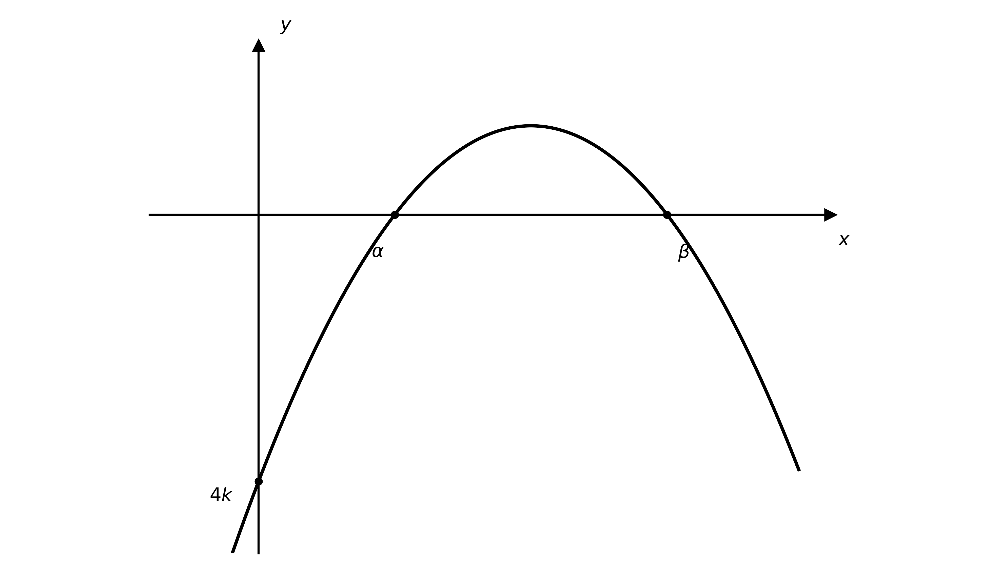

> **[mark-scheme]**
> **B1**: Correct shape — a downward parabola with its vertex above the $x$-axis.
> 
> **B1**: Both $x$-axis crossings labelled $α$ and $β$ on the positive $x$-axis (with $α < β$), and the $y$-axis crossing labelled $4 k$ below the $x$-axis.
Multiplying by $- 1$, the equation is $x^{2} + 6 k x - 4 k = 0$. For two distinct real roots the discriminant is positive, with $a = 1$, $b = 6 k$, $c = - 4 k$

$( 6 k )^{2} - 4 ( 1 ) ( - 4 k ) > 0$

**[M1]**

Simplify and factorise

$36 k^{2} + 16 k > 0 \text{, so} 4 k ( 9 k + 4 ) > 0$

This positive parabola in $k$ is positive when $k < - \frac{4}{9}$ or $k > 0$. Since $k$ is a negative constant

**[M1]**

$k < - \frac{4}{9}$

**[A1]**

> **[mark-scheme]**
> **M1**: Correct use of the discriminant condition for two distinct roots, $b^{2} - 4 a c > 0$, leading to $36 k^{2} + 16 k > 0$.
> 
> **M1**: Solves the quadratic inequality to the critical values $k = 0$ and $k = - \frac{4}{9}$, giving $k < - \frac{4}{9}$ or $k > 0$.
> 
> **A1**: Correct final answer $k < - \frac{4}{9}$ (the $k > 0$ region is rejected because $k$ is negative; the inequality is strict).

### Q21
Rearrange into the form $a x^{2} + b x + c = 0$

$k^{2} x^{2} - 4 x + ( 5 - k^{2} ) = 0$

For two distinct real roots the discriminant is positive (and $k \neq 0$, so that the equation is a quadratic). Substitute $a = k^{2}$, $b = - 4$, $c = 5 - k^{2}$

$( - 4 )^{2} - 4 ( k^{2} ) ( 5 - k^{2} ) > 0$

**[M1]**

Expand and factorise as a quadratic in $k^{2}$

$4 k^{4} - 20 k^{2} + 16 > 0 \text{, so} ( k^{2} - 1 ) ( k^{2} - 4 ) > 0$

This holds when $k^{2} < 1$ or $k^{2} > 4$. Excluding $k = 0$

**Final answer:** $k < - 2$**, **$- 1 < k < 0$**, **$0 < k < 1$**, **$k > 2$

**[A1]**

> **[mark-scheme]**
> **M1**: Rearranges to a three-term quadratic and uses $b^{2} - 4 a c > 0$ with $a = k^{2}$, $b = - 4$, $c = 5 - k^{2}$.
> 
> **A1**: Correct set of values. The inequalities must be strict; $k = 0$ must be excluded (the equation must be a quadratic for two roots); and the regions are joined with commas or "or", never "and".

### Q22
$y = \text{f} ( x ) + 6$ is a translation of $y = \text{f} ( x )$ by $6$ units in the positive $y$-direction (upwards). Add $6$ to every $y$-coordinate; the $x$-coordinate of the turning point is unchanged

The turning point moves from $( 1 . 5 , 6 . 25 )$ to

$( 1 . 5 , 12 . 25 )$

**[B1]**

The $y$-axis intercept moves from $( 0 , 4 )$ to

$( 0 , 10 )$

**[B1]**

The curve is still symmetrical about $x = 1 . 5$. The given new $x$-intercept $( - 2 , 0 )$ is $3 . 5$ units to the left of $x = 1 . 5$, so the other is $3 . 5$ units to the right, at $x = 5$

**Final answer:** $( - 2 , 0 )$** and **$( 5 , 0 )$

**[B1]**

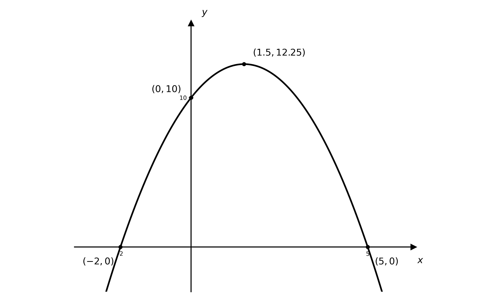

> **[mark-scheme]**
> **B1**: Correct turning point of the translated graph, $(1.5,12.25)$, with the correct shape (a parabola opening downwards).
> 
> **B1**: Correct $y$-axis intercept $( 0 , 10 )$.
> 
> **B1**: Both $x$-axis intercepts stated, $( - 2 , 0 )$ (given) and $( 5 , 0 )$.

### Q23
At the intersection $\text{f} ( x ) = \text{g} ( x )$. Set the expressions equal — the $( k - 1 ) x^{2}$ terms cancel, leaving a linear equation

$( k - 1 ) x^{2} - ( k - 2 ) x - 2 k = ( k - 1 ) x^{2} - 3 k x + k + 1$

$- ( k - 2 ) x - 2 k = - 3 k x + k + 1$

**[M1]**

Gather the $x$ terms on one side and the constants on the other

$- ( k - 2 ) x + 3 k x = 3 k + 1$

$( 2 k + 2 ) x = 3 k + 1$

**[M1]**

Divide by $2 k + 2$

$x = \frac{3k+1}{2(k+1)}$

**[A1]**

> **[mark-scheme]**
> **M1**: Equates $\text{f} ( x )$ and $\text{g} ( x )$ and cancels the $( k - 1 ) x^{2}$ terms to reach a linear equation in $x$.
> 
> **M1**: Gathers the $x$ terms and constants onto opposite sides and factorises out $x$, reaching $( 2 k + 2 ) x = 3 k + 1$.
> 
> **A1**: Correct expression $x = \frac{3k+1}{2(k+1)}$ (or equivalent, e.g. $\frac{3k+1}{2k+2}$).
Substitute $k = 3$ into the answer to part (a)

$x = \frac{3(3)+1}{2(3+1)} = \frac{10}{8} = \frac{5}{4}$

**[M1]**

With $k = 3$, $\text{f} ( x ) = 2 x^{2} - x - 6$. Substitute $x = \frac{5}{4}$

`y = 2\left(\dfrac{5}{4}\right)^2 - \dfrac{5}{4} - 6 = \dfrac{25}{8} - \dfrac{10}{8} - \dfrac{48}{8} = -\dfrac{33}{8}`

`\left(\dfrac{5}{4}, -\dfrac{33}{8}\right)`

**[A1]**

> **[mark-scheme]**
> **M1**: Substitutes $k = 3$ to find $x = \frac{5}{4}$ and makes a valid attempt to substitute back into $\text{f} ( x )$ (or $\text{g} ( x )$) to find $y$.
> 
> **A1**: Correct coordinates `\left(\dfrac{5}{4}, -\dfrac{33}{8}\right)` (or $( 1 . 25 , - 4 . 125 )$).

### Q24
Complete the square. Factor $a$ out of the first two terms

`ax^2 + bx + c = a\left(x^2 + \dfrac{b}{a}x\right) + c`

`= a\left[\left(x + \dfrac{b}{2a}\right)^2 - \dfrac{b^2}{4a^2}\right] + c`

**[M1]**

Multiply the $a$ through and combine the constant terms over a common denominator

`= a\left(x + \dfrac{b}{2a}\right)^2 - \dfrac{b^2}{4a} + c = a\left(x + \dfrac{b}{2a}\right)^2 - \dfrac{b^2 - 4ac}{4a}`

**Final answer:** `a\left(x + \dfrac{b}{2a}\right)^2 - \dfrac{b^2 - 4ac}{4a} = 0`** as required**

**[A1]**

> **[mark-scheme]**
> **M1**: Correct method to complete the square, factoring $a$ out of the first two terms to reach `a\left[\left(x + \dfrac{b}{2a}\right)^2 - \dfrac{b^2}{4a^2}\right] + c`.
> 
> **A1**: Correctly combines the constants to the printed form, showing $- \frac{b^{2}}{4a} + c = - \frac{b^{2}-4ac}{4a}$.
Rearrange the result from part (a), then divide by $a$

`a\left(x + \dfrac{b}{2a}\right)^2 = \dfrac{b^2 - 4ac}{4a}`

`\left(x + \dfrac{b}{2a}\right)^2 = \dfrac{b^2 - 4ac}{4a^2}`

**[M1]**

Take the square root of both sides (note $\sqrt{4a^{2}} = 2 a$), then make $x$ the subject

$x + \frac{b}{2a} = \pm \frac{\sqrt{b^{2}-4ac}}{2a}$

$x = - \frac{b}{2a} \pm \frac{\sqrt{b^{2}-4ac}}{2a}$

**Final answer:** $x = \frac{-b\pm\sqrt{b^{2}-4ac}}{2a}$** as required**

**[A1]**

> **[mark-scheme]**
> **M1**: Correctly rearranges and divides by $a$ to isolate `\left(x + \dfrac{b}{2a}\right)^2 = \dfrac{b^2 - 4ac}{4a^2}`.
> 
> **A1**: Takes the square root (with $\pm$) and rearranges to the printed quadratic formula.

### Q25
$y = \text{f} ( x + 3 )$ is a translation of $y = \text{f} ( x )$ by $3$ units in the negative $x$-direction (to the left), since $\text{f} ( x + a )$ shifts the graph left by $a$

Apply this to each labelled point: subtract $3$ from every $x$-coordinate and leave the $y$-coordinates unchanged

The $x$-axis intercepts move from $( - 1 , 0 )$ and $( 4 , 0 )$ to

**Final answer:** $( - 4 , 0 )$** and **$( 1 , 0 )$

**[B1]**

The turning point moves from $( 1 . 5 , 6 . 25 )$ to

$( - 1 . 5 , 6 . 25 )$

**[B1]**

The new $y$-axis intercept is the value of the curve at $x = 0$, i.e. $\text{f} ( 3 )$. By the symmetry of the original graph about $x = 1 . 5$, $\text{f} ( 3 ) = \text{f} ( 0 ) = 4$

$( 0 , 4 )$

**[B1]**

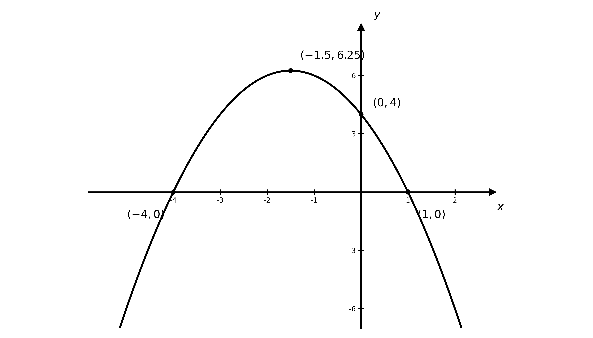

> **[mark-scheme]**
> **B1**: Correct $x$-axis intercepts of the translated graph, $( - 4 , 0 )$ and $( 1 , 0 )$.
> 
> **B1**: Correct turning point of the translated graph, $( - 1 . 5 , 6 . 25 )$, with the correct shape (a parabola opening downwards).
> 
> **B1**: Correct $y$-axis intercept $( 0 , 4 )$.

### Q26
At any intersection the $y$-values are equal, so set the equations equal

$x^{2} - 3 x + 2 = 3 x - 7$

$x^{2} - 6 x + 9 = 0$

**[M1]**

Factorise — this is a perfect square, giving a repeated root, so the line is a tangent to the curve

$( x - 3 )^{2} = 0$

$x = 3$

**[A1]**

Substitute $x = 3$ into $y = 3 x - 7$ to find the $y$-coordinate

$y = 3 ( 3 ) - 7 = 2$

$( 3 , 2 )$

**[A1]**

> **[mark-scheme]**
> **M1**: Sets $C = l$ and rearranges to the three-term quadratic $x^{2} - 6 x + 9 = 0$.
> 
> **A1**: Correct repeated root $x = 3$ (recognising the line is a tangent).
> 
> **A1**: Correct single point of intersection $( 3 , 2 )$.
$C$ is a parabola opening upwards. It crosses the $x$-axis at $( 1 , 0 )$ and $( 2 , 0 )$, crosses the $y$-axis at $( 0 , 2 )$, and has minimum point `\left(\dfrac{3}{2}, -\dfrac{1}{4}\right)`

**[B1]**

$l$ is a straight line. It crosses the $x$-axis at `\left(\dfrac{7}{3}, 0\right)` and the $y$-axis at $( 0 , - 7 )$

**[B1]**

From part (a), the line touches the curve at the single point $( 3 , 2 )$

**[B1]**

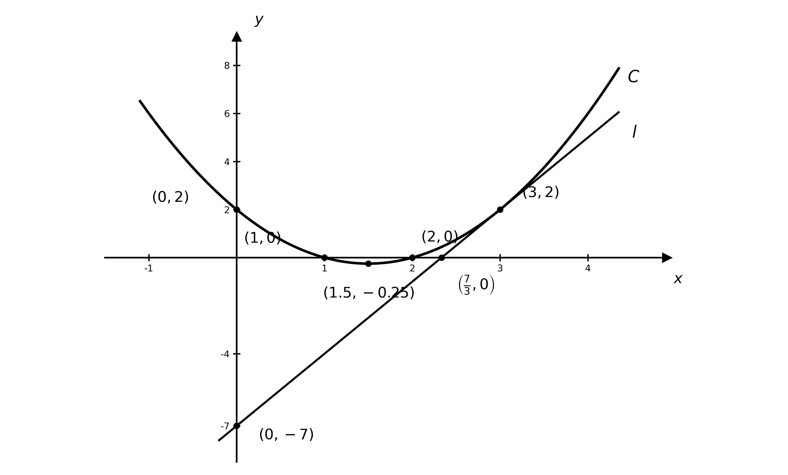

> **[mark-scheme]**
> **B1**: Correct curve $C$ — a parabola opening upwards with its $x$-intercepts $( 1 , 0 )$ and $( 2 , 0 )$, $y$-intercept $( 0 , 2 )$ and minimum `\left(\dfrac{3}{2}, -\dfrac{1}{4}\right)` labelled.
> 
> **B1**: Correct line $l$ with its intercepts `\left(\dfrac{7}{3}, 0\right)` and $( 0 , - 7 )$ labelled.
> 
> **B1**: The line shown touching the curve at $( 3 , 2 )$ (a tangent, not crossing).

### Q27
The coefficient of $x^{2}$ is positive, so the graph is a parabola opening upwards

**[B1]**

Find the $x$-axis crossings by factorising

$12 x^{2} - 5 x - 72 = ( 3 x - 8 ) ( 4 x + 9 ) = 0$

**Final answer:** `\left(\frac{8}{3} , 0\right)`** and **`\left(- \frac{9}{4} , 0\right)`

**[B1]**

The $y$-axis crossing is at

$( 0 , - 72 )$

**[B1]**

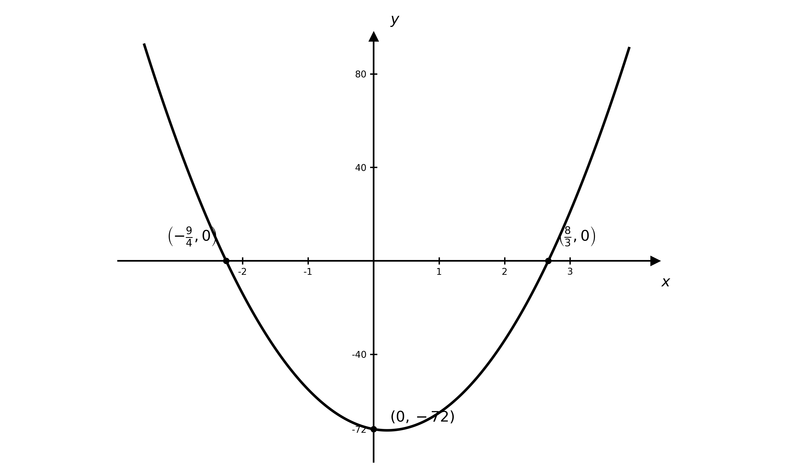

> **[mark-scheme]**
> **B1**: Correct shape — a parabola opening upwards (positive quadratic).
> 
> **B1**: Both $x$-axis crossings labelled, `\left(\frac{8}{3} , 0\right)` and `\left(- \frac{9}{4} , 0\right)`.
> 
> **B1**: $y$-axis crossing labelled, $( 0 , - 72 )$.

### Q28
Two distinct real roots means the discriminant is positive. Reading off $a = - 1$, $b = - 3 k$ and $c = 2 k$

$b^{2} - 4 a c > 0$

$( - 3 k )^{2} - 4 ( - 1 ) ( 2 k ) > 0$

**[M1]**

Simplify and factorise

$9 k^{2} + 8 k > 0$

$k ( 9 k + 8 ) > 0$

The graph of $k ( 9 k + 8 )$ is a positive parabola with roots $k = - \frac{8}{9}$ and $k = 0$, so it is positive when $k < - \frac{8}{9}$ or $k > 0$. Since $k$ is a negative constant, take

$k < - \frac{8}{9}$

**[A1]**

> **[mark-scheme]**
> **M1**: Correct use of the discriminant condition for two distinct roots, $b^{2} - 4 a c > 0$, with $a = - 1$, $b = - 3 k$ and $c = 2 k$ (giving $9 k^{2} + 8 k > 0$).
> 
> **A1**: Correct final answer $k < - \frac{8}{9}$. The $k > 0$ region is discarded because $k$ is negative, and the inequality must be strict ($<$, not $\leq$) since the roots are distinct.
Substitute $k = - 1$

$y = 2 ( - 1 ) - 3 ( - 1 ) x - x^{2} = - x^{2} + 3 x - 2$

The coefficient of $x^{2}$ is negative, so the graph is a parabola opening downwards

**[B1]**

Find the $x$-axis crossings

$- x^{2} + 3 x - 2 = 0 \text{, so} x^{2} - 3 x + 2 = 0$

$( x - 1 ) ( x - 2 ) = 0$

**Final answer:** $( 1 , 0 )$** and **$( 2 , 0 )$

**[B1]**

The $y$-axis crossing is at

$( 0 , - 2 )$

**[B1]**

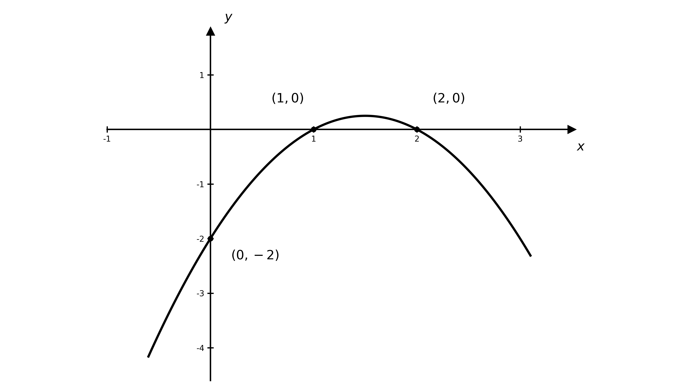

> **[mark-scheme]**
> **B1**: Correct shape — a parabola opening downwards (negative quadratic).
> 
> **B1**: Both $x$-axis crossings labelled, $( 1 , 0 )$ and $( 2 , 0 )$.
> 
> **B1**: $y$-axis crossing labelled, $( 0 , - 2 )$.

### Q29
The maximum height is the $y$-value of the vertex. The curve $\text{f} ( x ) = 5 - \frac{x^{2}}{6}$ has its greatest value when $x = 0$

$\text{f} ( 0 ) = 5 - \frac{0^{2}}{6} = 5$

**Final answer:** $5$** metres**

**[B1]**

> **[mark-scheme]**
> **B1**: Correct maximum height of $5$ metres, read from the vertex at $x = 0$.
The bridge meets the water level where $\text{f} ( x ) = 0$, so solve for $x$

$5 - \frac{x^{2}}{6} = 0 \text{, so} x^{2} = 30$

**[M1]**

The width of the arch at water level is the distance between the two roots

$x = \pm \sqrt{30}$

**Final answer:** **Since the width **$2 \sqrt{30} \approx 10 . 95 < 11$**, the bridge is not wide enough**

**[A1]**

> **[mark-scheme]**
> **M1**: Sets $\text{f} ( x ) = 0$ and makes a valid attempt to solve for $x$ (reaching $x^{2} = 30$ or equivalent).
> 
> **A1**: Correct conclusion that the bridge is **not** wide enough, supported by the arch width $2 \sqrt{30} \approx 10 . 95$ m being less than $11$ m.
The base of the arch is $2$ m below the water level, so it is where $\text{f} ( x ) = - 2$

$4 - \frac{x^{2}}{8} = - 2$

$\frac{x^{2}}{8} = 6 \text{, so} x^{2} = 48$

**[M1]**

$x = \pm \sqrt{48} = \pm 4 \sqrt{3}$

The distance between the two bases is

$2 \times 4 \sqrt{3} = 8 \sqrt{3} \approx 13 . 9 \text{m}$

**[A1]**

> **[mark-scheme]**
> **M1**: Sets $\text{f} ( x ) = - 2$ (the arch continues $2$ m below water level) and makes a valid attempt to solve, reaching $x^{2} = 48$. Setting $\text{f} ( x ) = + 2$ scores no marks.
> 
> **A1**: Correct distance $8 \sqrt{3}$ m (answers which round to $13 . 9$ m).

### Q30
No real roots means the discriminant is negative

$b^{2} - 4 a c < 0$

Substitute $a = 3$, $b = 2 p$ and $c = 4 q$

$( 2 p )^{2} - 4 ( 3 ) ( 4 q ) < 0$

**[M1]**

Simplify, then divide by $4$

$4 p^{2} - 48 q < 0$

**Final answer:** $p^{2} < 12 q$** as required**

**[A1]**

> **[mark-scheme]**
> **M1**: Correct use of the discriminant condition for no real roots, $b^{2} - 4 a c < 0$, with $a = 3$, $b = 2 p$ and $c = 4 q$.
> 
> **A1**: Correct simplification to the printed result $p^{2} < 12 q$. You must show the intermediate step $4 p^{2} - 48 q < 0$ (before dividing by $4$), and keep the inequality strict throughout.
Substitute the point $( - 2 , 6 )$ into $y = 3 x^{2} + 2 p x + 4 q$

$12 - 4 p + 4 q = 6$

$- 4 p + 4 q = - 6$

Substitute the point $( 2 , 6 )$

$12 + 4 p + 4 q = 6$

$4 p + 4 q = - 6$

**[M1]**

Add the two equations to eliminate $p$

$8 q = - 12 \text{, so} q = - \frac{3}{2}$

Substitute back to find $p$

`4p + 4\left(-\dfrac{3}{2}\right) = -6 \text{, so } p = 0`

**[M1]**

**Final answer:** $p = 0$** and **$q = - \frac{3}{2}$

**[A1]**

> **[mark-scheme]**
> **M1**: Substitutes at least one of the given points into the equation to form a linear equation in $p$ and $q$.
> 
> **M1**: Substitutes both points and makes a valid attempt to solve the pair of simultaneous equations.
> 
> **A1**: Correct values $p = 0$ and $q = - \frac{3}{2}$.

### Q31
Complete the square

$\text{f} ( x ) = x^{2} + 4 x + c = ( x + 2 )^{2} - 4 + c$

**[M1]**

The smallest value of $( x + 2 )^{2}$ is $0$, so the minimum value of $\text{f} ( x )$ is

$c - 4$

**[A1]**

> **[mark-scheme]**
> **M1**: Correct method to find the minimum — completing the square to reach $( x + 2 )^{2} + \dots$, or differentiating and setting $2 x + 4 = 0$.
> 
> **A1**: Correct minimum value $c - 4$ (occurring at $x = - 2$).
Using the minimum value from part (a) with $c = 5$

$\text{minimum value} = c - 4 = 5 - 4 = 1$

**[M1]**

**Final answer:** **The minimum value **$1$** is positive, so the graph lies entirely above the **$x$**-axis and never meets it**

**Final answer:** **Therefore **$\text{f} ( x ) = 0$** has no real roots**

**[A1]**

> **[mark-scheme]**
> **M1**: Uses the minimum value from part (a) with $c = 5$ to obtain $1$ (and notes it is positive), or "otherwise" computes the discriminant $b^{2} - 4 a c = 4^{2} - 4 ( 1 ) ( 5 ) = - 4 < 0$.
> 
> **A1**: Correct conclusion that the equation has no real roots, justified by the minimum value being positive (the curve lies above the $x$-axis), or by the negative discriminant.

### Q32
Let $u = \sqrt{x}$, so $x = u^{2}$ (and $u \geq 0$)

$5 u + 3 = 2 u^{2}$

$2 u^{2} - 5 u - 3 = 0$

**[M1]**

Factorise and solve for $u$

$( 2 u + 1 ) ( u - 3 ) = 0$

$u = - \frac{1}{2}$* or *$u = 3$

Since $u = \sqrt{x} \geq 0$, reject $u = - \frac{1}{2}$

**[A1]**

So $\sqrt{x} = 3$

$x = 9$

**[A1]**

> **[mark-scheme]**
> **M1**: Correct use of the substitution $u = \sqrt{x}$ to form the quadratic $2 u^{2} - 5 u - 3 = 0$.
> 
> **A1**: Correct values $u = 3$ (and $u = - \frac{1}{2}$ rejected, since $\sqrt{x} \geq 0$).
> 
> **A1**: Correct solution $x = 9$. Reject any solution coming from a negative value of $\sqrt{x}$.
Note that `x^{\frac{2}{3}} = \left(x^{\frac{1}{3}}\right)^2`, so let $u = x^{\frac{1}{3}}$

$u^{2} + 2 u - 8 = 0$

**[M1]**

Factorise and solve for $u$

$( u + 4 ) ( u - 2 ) = 0$

$u = - 4$* or *$u = 2$

**[A1]**

Substitute back $u = x^{\frac{1}{3}}$, so $x = u^{3}$

**Final answer:** $x = - 64$** or **$x = 8$

**[A1]**

> **[mark-scheme]**
> **M1**: Correct use of the substitution $u = x^{\frac{1}{3}}$ to reduce the equation to a quadratic.
> 
> **A1**: Both correct values $u = - 4$ and $u = 2$.
> 
> **A1**: Both correct solutions $x = - 64$ and $x = 8$. Both are valid, since a real cube root of a negative number exists.
Note that `2^{2x} = \left(2^x\right)^2`, so let $u = 2^{x}$

$u^{2} + 64 = 20 u$

$u^{2} - 20 u + 64 = 0$

**[M1]**

Factorise and solve for $u$

$( u - 4 ) ( u - 16 ) = 0$

$u = 4$* or *$u = 16$

**[A1]**

Substitute back $u = 2^{x}$ and solve each (recognising $4 = 2^{2}$ and $16 = 2^{4}$)

**Final answer:** $x = 2$** or **$x = 4$

**[A1]**

> **[mark-scheme]**
> **M1**: Correct use of the substitution $u = 2^{x}$ to form the quadratic $u^{2} - 20 u + 64 = 0$.
> 
> **A1**: Both correct values $u = 4$ and $u = 16$.
> 
> **A1**: Both correct solutions $x = 2$ and $x = 4$.

### Q33
The cliff height is the height of the stone at the moment it is thrown, $t = 0$

$h ( 0 ) = 24 + 2 ( 0 ) - 0 . 5 ( 0 )^{2} = 24$

**Final answer:** $24$** metres**

**[B1]**

> **[mark-scheme]**
> **B1**: Correct cliff height of $24$ metres, read as $h ( 0 )$ (the constant term).
The maximum height is the vertex of the parabola. Complete the square

$h ( t ) = - 0 . 5 t^{2} + 2 t + 24 = - 0 . 5 ( t^{2} - 4 t ) + 24$

`= -0.5\left[(t - 2)^2 - 4\right] + 24 = -0.5(t - 2)^2 + 26`

**[M1]**

The maximum occurs at $t = 2$, giving

**Final answer:** $26$** metres**

**[A1]**

> **[mark-scheme]**
> **M1**: Valid method to find the maximum — completing the square, or differentiating and setting $\frac{\text{d}h}{\text{d}t} = 2 - t = 0$ to get $t = 2$.
> 
> **A1**: Correct maximum height of $26$ metres.
The stone hits the sea when its height above the sea is zero, $h ( t ) = 0$

$24 + 2 t - 0 . 5 t^{2} = 0$

Multiply through by $- 2$ to clear the fraction

$t^{2} - 4 t - 48 = 0$

**[M1]**

This does not factorise, so use the quadratic formula

$t = \frac{4\pm\sqrt{(-4)^{2}-4(1)(-48)}}{2} = \frac{4\pm\sqrt{208}}{2} = 2 \pm 2 \sqrt{13}$

Since $t \geq 0$, take the positive root

**Final answer:** $t = 2 + 2 \sqrt{13} \approx 9 . 21$** seconds**

**[A1]**

> **[mark-scheme]**
> **M1**: Sets $h ( t ) = 0$ and makes a valid attempt to solve the three-term quadratic $t^{2} - 4 t - 48 = 0$ (by formula or completing the square — it does not factorise).
> 
> **A1**: Correct time $t = 2 + 2 \sqrt{13}$ (answers which round to $9 . 21$) seconds. The negative root must be rejected since $t \geq 0$.

### Q34
Factor the coefficient of $x^{2}$ out of the first two terms, then complete the square inside the bracket

$y = 4 x^{2} + 8 x - 5 = 4 ( x^{2} + 2 x ) - 5$

`= 4\left[(x + 1)^2 - 1\right] - 5`

**[M1]**

$y = 4 ( x + 1 )^{2} - 9$

**[A1]**

> **[mark-scheme]**
> **M1**: Correct method to complete the square after factoring the $4$ out of the first two terms.
> 
> **A1**: Fully correct $y = 4 ( x + 1 )^{2} - 9$, i.e. $a = 4$, $b = 1$ and $c = - 9$.
Using the completed-square form $4 ( x + 1 )^{2} - 9$, the minimum occurs when the bracket is zero, at $x = - 1$

$( - 1 , - 9 )$

**[B1]**

> **[mark-scheme]**
> **B1**: Correct minimum point $( - 1 , - 9 )$, read directly from the completed-square form in part (a).
The coefficient of $x^{2}$ is positive, so the graph is a parabola opening upwards, with minimum point $( - 1 , - 9 )$ from part (b)

**[B1]**

Find the $x$-axis crossings by factorising

$4 x^{2} + 8 x - 5 = ( 2 x + 5 ) ( 2 x - 1 ) = 0$

**Final answer:** `\left(-\dfrac{5}{2}, 0\right)`** and **`\left(\dfrac{1}{2}, 0\right)`

**[B1]**

The $y$-axis crossing is at

$( 0 , - 5 )$

**[B1]**

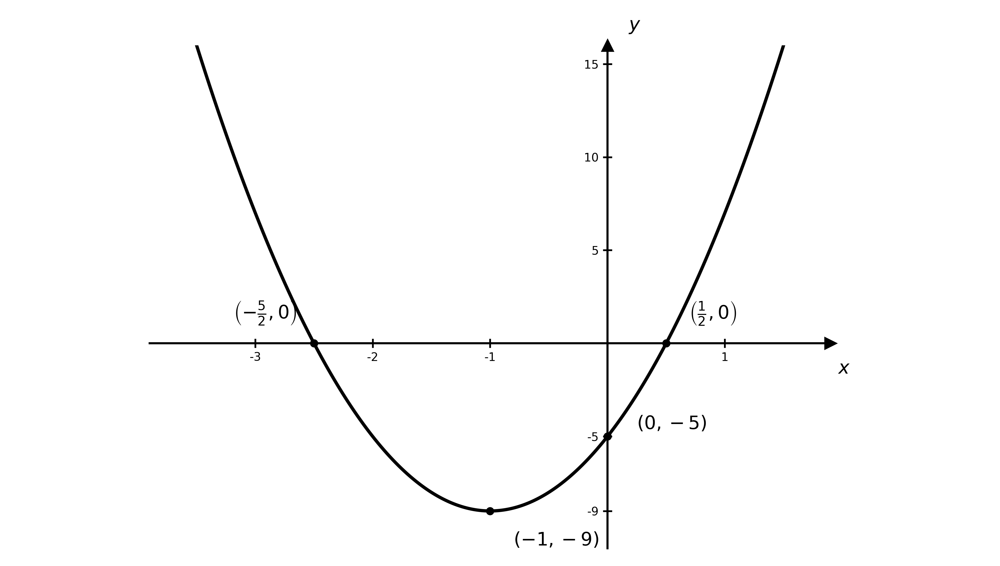

> **[mark-scheme]**
> **B1**: Correct shape — a parabola opening upwards — with the minimum point $( - 1 , - 9 )$ labelled.
> 
> **B1**: Both $x$-axis crossings labelled, `\left(-\dfrac{5}{2}, 0\right)` and `\left(\dfrac{1}{2}, 0\right)`.
> 
> **B1**: $y$-axis crossing labelled, $( 0 , - 5 )$.

### Q35
For $\text{f} ( x ) = 0$ to have two distinct real roots, its discriminant is positive

$( 2 k )^{2} - 4 ( k ) ( - 3 ) > 0$

$4 k^{2} + 12 k > 0 \text{, so} 4 k ( k + 3 ) > 0$

**[M1]**

This positive parabola in $k$ is positive when $k < - 3$ or $k > 0$

For $\text{g} ( x ) = 0$ to have no real roots, its discriminant is negative

$( 4 k )^{2} - 4 ( k ) ( - 16 ) < 0$

$16 k^{2} + 64 k < 0 \text{, so} 16 k ( k + 4 ) < 0$

This positive parabola in $k$ is negative when $- 4 < k < 0$

**[M1]**

Both conditions must hold, so take the overlap of $k < - 3 \text{or} k > 0$ with $- 4 < k < 0$

$- 4 < k < - 3$

**[A1]**

> **[mark-scheme]**
> **M1**: Correct discriminant condition for $\text{f}$, $b^{2} - 4 a c > 0$, leading to $4 k ( k + 3 ) > 0$ and the range $k < - 3$ or $k > 0$.
> 
> **M1**: Correct discriminant condition for $\text{g}$, $b^{2} - 4 a c < 0$, leading to $16 k ( k + 4 ) < 0$ and the range $- 4 < k < 0$.
> 
> **A1**: Correct combined answer $- 4 < k < - 3$ (the intersection of the two ranges). The inequalities are strict.

### Q36
Factorise and set each factor equal to zero

$( 2 x - 3 ) ( x + 2 ) = 0$

**[M1]**

**Final answer:** $x = \frac{3}{2}$** or **$x = - 2$

**[A1]**

> **[mark-scheme]**
> **M1**: Correct attempt to factorise $2 x^{2} + x - 6$, or correct use of the quadratic formula.
> 
> **A1**: Both correct solutions $x = \frac{3}{2}$ and $x = - 2$.
Complete the square. Factor the $2$ out of the first two terms

`2x^2 + x - 6 = 2\left(x^2 + \dfrac{1}{2}x\right) - 6`

`= 2\left[\left(x + \dfrac{1}{4}\right)^2 - \dfrac{1}{16}\right] - 6`

**[M1]**

`= 2\left(x + \dfrac{1}{4}\right)^2 - \dfrac{49}{8}`

The turning point is where the squared bracket is zero

`\left(-\dfrac{1}{4}, -\dfrac{49}{8}\right)`

**[A1 A1]**

> **[mark-scheme]**
> **M1**: Correct method to find the turning point — completing the square (factoring the $2$ out first), or differentiating and setting $\frac{\text{d}y}{\text{d}x} = 4 x + 1 = 0$.
> 
> **A1**: Correct $x$-coordinate $- \frac{1}{4}$.
> 
> **A1**: Correct $y$-coordinate $- \frac{49}{8}$. Accept the decimal form `\left(-0.25, -6.125\right)`.
The coefficient of $x^{2}$ is positive, so the graph is a parabola opening upwards, with turning point `\left(-\dfrac{1}{4}, -\dfrac{49}{8}\right)` from part (b)

**[B1]**

From part (a) the graph crosses the $x$-axis at `\left(\dfrac{3}{2}, 0\right)` and $( - 2 , 0 )$, and the $y$-axis at $( 0 , - 6 )$

**[B1]**

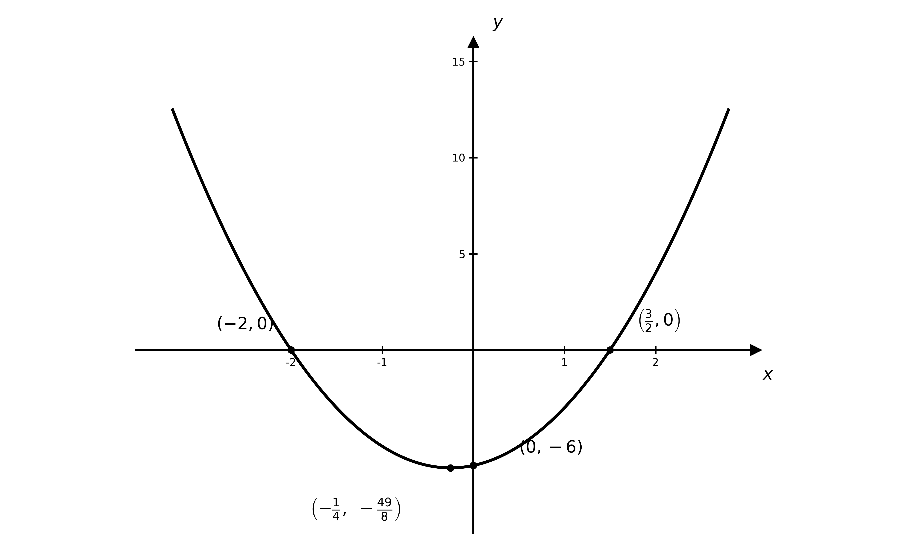

> **[mark-scheme]**
> **B1**: Correct shape — a parabola opening upwards — with the turning point `\left(-\dfrac{1}{4}, -\dfrac{49}{8}\right)` labelled.
> 
> **B1**: All crossings labelled: $x$-axis at `\left(\dfrac{3}{2}, 0\right)` and $( - 2 , 0 )$, $y$-axis at $( 0 , - 6 )$.

### Q37
Complete the square

$\text{f} ( x ) = x^{2} + 4 x + 5 = ( x + 2 )^{2} - 4 + 5$

**[M1]**

$\text{f} ( x ) = ( x + 2 )^{2} + 1$

**[A1]**

The smallest value of $( x + 2 )^{2}$ is $0$, so the minimum value of $\text{f} ( x )$ is

$1$

**[A1]**

> **[mark-scheme]**
> **M1**: Correct method to complete the square, reaching $( x + 2 )^{2} + \dots$
> 
> **A1**: Fully correct $( x + 2 )^{2} + 1$.
> 
> **A1**: Correct minimum value $1$ (occurring at $x = - 2$).
Use the completed-square form from part (a). Since a squared term is never negative

$\text{f} ( x ) = ( x + 2 )^{2} + 1 \geq 1$

**[M1]**

**Final answer:** **The minimum value is **$1$**, which is positive, so the graph lies entirely above the **$x$**-axis and never meets it**

**Final answer:** **Therefore **$\text{f} ( x )$** has no real roots**

**[A1]**

> **[mark-scheme]**
> **M1**: Uses the minimum value from part (a) being positive (the graph lies above the $x$-axis), or "otherwise" computes the discriminant $b^{2} - 4 a c = 4^{2} - 4 ( 1 ) ( 5 ) = - 4 < 0$.
> 
> **A1**: Correct conclusion that there are no real roots, justified by the curve being always positive (or by the negative discriminant).

### Q38
For two distinct real roots, the discriminant condition is strict

$b^{2} - 4 a c > 0$

Substitute $a = k$, $b = 2 k$ and $c = - 3$

`\left(2k\right)^{2} - 4\left(k\right)\left(-3\right) > 0`

**[M1]**

Simplify and factorise

$4 k^{2} + 12 k > 0$

`4k\left(k + 3\right) > 0`

**[M1]**

The expression $4 k ( k + 3 )$ equals zero at the critical values $k = - 3$ and $k = 0$

The graph of $y = 4 k ( k + 3 )$ is a positive parabola with roots at $- 3$ and $0$, so $4 k ( k + 3 ) > 0$ when $k$ lies outside the roots

**Final answer:** $k < - 3$** or **$k > 0$** as required**

**[A1]**

> **[mark-scheme]**
> **M1**: Correct setup of the discriminant condition with the strict inequality $b^{2} - 4 a c > 0$. The non-strict version $b^{2} - 4 a c \geq 0$ does not earn this mark, since equality would give a repeated root, not two distinct ones.
> 
> **M1**: Correctly simplifying and factorising to obtain $4 k ( k + 3 ) > 0$ or an equivalent factorised form.
> 
> **A1**: Correct final answer of $k < - 3$ or $k > 0$. Note that the critical values $k = - 3$ and $k = 0$ must be excluded from the solution, since at these values the discriminant equals zero (giving a repeated root, not two distinct roots).

### Q39
Note that `x^{\frac{2}{5}} = \left(x^{\frac{1}{5}}\right)^2`, so let $u = x^{\frac{1}{5}}$

$u^{2} + u - 6 = 0$

**[M1]**

Factorise and solve for $u$

$( u + 3 ) ( u - 2 ) = 0$

$u = - 3$* or *$u = 2$

**[A1]**

Substitute back $u = x^{\frac{1}{5}}$, so $x = u^{5}$

$x = ( - 3 )^{5}$* or *$x = 2^{5}$

**[M1]**

**Final answer:** $x = - 243$** or **$x = 32$

**[A1]**

> **[mark-scheme]**
> **M1**: Correct use of the substitution $u = x^{\frac{1}{5}}$ to reduce the equation to a quadratic.
> 
> **A1**: Both correct values $u = - 3$ and $u = 2$.
> 
> **M1**: Correct method to undo the substitution by raising to the fifth power, $x = u^{5}$.
> 
> **A1**: Both correct solutions $x = - 243$ and $x = 32$. The value $u = - 3$ is valid because a real fifth root of a negative number exists.

### Q40
This is a quadratic in $x^{2}$. Let $u = x^{2}$

$u^{2} - 13 u + 36 = 0$

**[M1]**

Factorise and solve for $u$

$( u - 4 ) ( u - 9 ) = 0$

$u = 4$* or *$u = 9$

**[A1]**

Substitute back $u = x^{2}$ and take both square roots

$x^{2} = 4$* or *$x^{2} = 9$

**Final answer:** $x = \pm 2$** or **$x = \pm 3$

**[A1]**

> **[mark-scheme]**
> **M1**: Correct use of a substitution (e.g. $u = x^{2}$) to reduce the equation to a quadratic, or recognising it as a quadratic in $x^{2}$.
> 
> **A1**: Correct values $u = 4$ and $u = 9$ (or correct factorisation in terms of $x^{2}$).
> 
> **A1**: All four correct solutions $x = \pm 2$ and $x = \pm 3$. You must include the negative roots.

### Q41
The coefficient of $x^{2}$ is $1$, so complete the square directly

$y = x^{2} + 8 x - 9 = ( x + 4 )^{2} - 16 - 9$

**[M1]**

$y = ( x + 4 )^{2} - 25$

**[A1]**

> **[mark-scheme]**
> **M1**: Correct method to complete the square, reaching $( x + 4 )^{2} + \dots$
> 
> **A1**: Fully correct $y = ( x + 4 )^{2} - 25$, i.e. $a = 1$, $b = 4$ and $c = - 25$.
Using the completed-square form $( x + 4 )^{2} - 25$, the minimum occurs when the bracket is zero, at $x = - 4$

$( - 4 , - 25 )$

**[B1]**

> **[mark-scheme]**
> **B1**: Correct minimum point $( - 4 , - 25 )$, read directly from the completed-square form in part (a).
The coefficient of $x^{2}$ is positive, so the graph is a parabola opening upwards, with minimum point $( - 4 , - 25 )$ from part (b)

**[B1]**

Find the $x$-axis crossings by factorising

$x^{2} + 8 x - 9 = ( x + 9 ) ( x - 1 ) = 0$

**Final answer:** $( - 9 , 0 )$** and **$( 1 , 0 )$

**[B1]**

The $y$-axis crossing is at

$( 0 , - 9 )$

**[B1]**

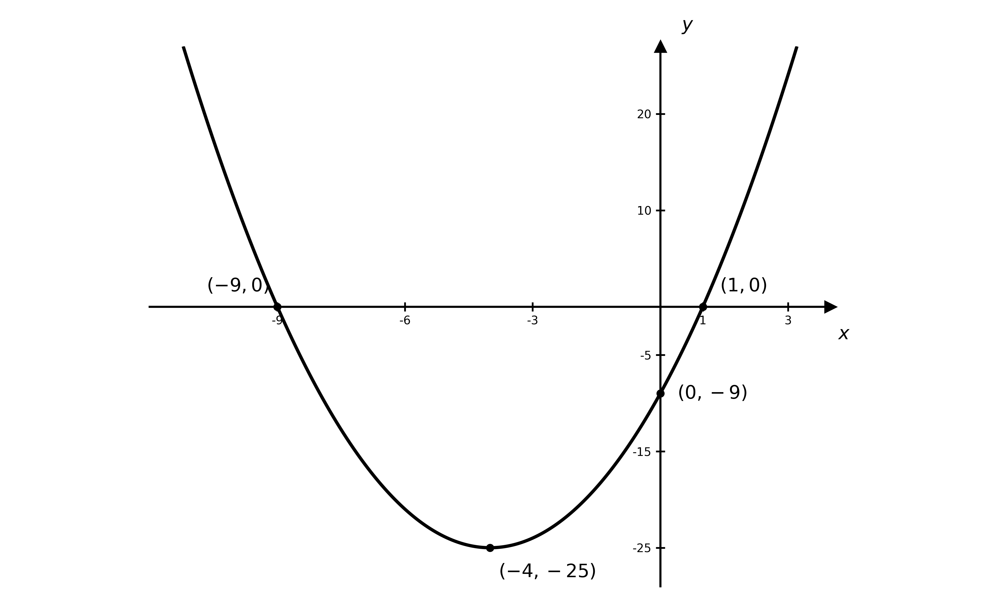

> **[mark-scheme]**
> **B1**: Correct shape — a parabola opening upwards — with the minimum point $( - 4 , - 25 )$ labelled.
> 
> **B1**: Both $x$-axis crossings labelled, $( - 9 , 0 )$ and $( 1 , 0 )$.
> 
> **B1**: $y$-axis crossing labelled, $( 0 , - 9 )$.

### Q42
No real roots means the discriminant is negative

$b^{2} - 4 a c < 0$

Substitute $a = 1$, $b = p$ and $c = q$

$p^{2} - 4 ( 1 ) ( q ) < 0$

**[M1]**

Rearrange into the required form

**Final answer:** $p^{2} < 4 q$** as required**

**[A1]**

> **[mark-scheme]**
> **M1**: Correct use of the discriminant condition for no real roots, $b^{2} - 4 a c < 0$, with $a = 1$, $b = p$ and $c = q$.
> 
> **A1**: Correct rearrangement to the printed result $p^{2} < 4 q$. The inequality must be strict throughout, since "no real roots" excludes equality.

### Q43
$y = \text{f} ( x + 2 )$ is a translation of $y = \text{f} ( x )$ by $2$ units in the negative $x$-direction (to the left), since $\text{f} ( x + a )$ shifts the graph left by $a$

Apply this to each labelled point: subtract $2$ from every $x$-coordinate and leave the $y$-coordinates unchanged

The $x$-axis intercepts move from $( - 1 , 0 )$ and $( 4 , 0 )$ to

**Final answer:** $( - 3 , 0 )$** and **$( 2 , 0 )$

**[B1]**

The turning point moves from $( 1 . 5 , 6 . 25 )$ to

$( - 0 . 5 , 6 . 25 )$

**[B1]**

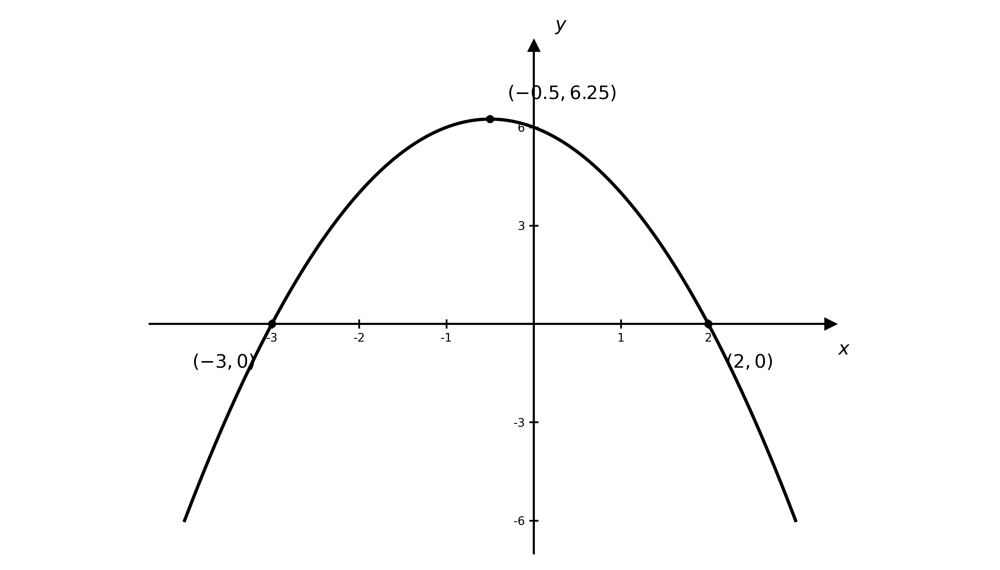

**[B1]**

> **[mark-scheme]**
> **B1**: Correct $x$-axis intercepts of the translated graph, $( - 3 , 0 )$ and $( 2 , 0 )$.
> 
> **B1**: Correct turning point of the translated graph, $( - 0 . 5 , 6 . 25 )$.
> 
> **B1**: Correct shape — the same parabola opening downwards, translated $2$ to the left.

### Q44
The curve crosses the $y$-axis where $x = 0$

$y = ( 0 )^{2} - 3 ( 0 ) + 2 = 2$

$( 0 , 2 )$

**[B1]**

It crosses the $x$-axis where $y = 0$, so factorise and solve

$x^{2} - 3 x + 2 = 0$

$( x - 1 ) ( x - 2 ) = 0$

**[M1]**

**Final answer:** $( 1 , 0 )$** and **$( 2 , 0 )$

**[A1]**

> **[mark-scheme]**
> **B1**: Correct $y$-axis intercept $( 0 , 2 )$.
> 
> **M1**: Correct attempt to factorise $x^{2} - 3 x + 2$, or correct use of the quadratic formula.
> 
> **A1**: Both correct $x$-axis intercepts $( 1 , 0 )$ and $( 2 , 0 )$.
The coefficient of $x^{2}$ is positive, so the graph is a parabola opening upwards

**[B1]**

From part (a), the graph crosses the $x$-axis at $( 1 , 0 )$ and $( 2 , 0 )$

**[B1]**

and crosses the $y$-axis at $( 0 , 2 )$

**[B1]**

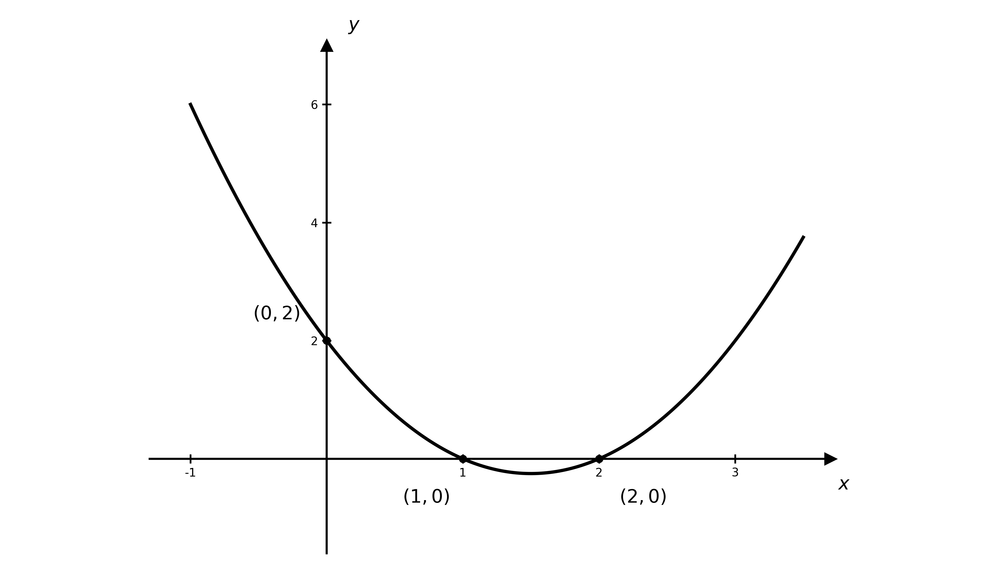

> **[mark-scheme]**
> **B1**: Correct shape — a parabola opening upwards (positive quadratic).
> 
> **B1**: Both $x$-axis crossings labelled, $( 1 , 0 )$ and $( 2 , 0 )$.
> 
> **B1**: $y$-axis crossing labelled, $( 0 , 2 )$.

### Q45
For real roots the discriminant must be greater than or equal to zero (equal to zero gives a repeated root, which still counts as real)

$b^{2} - 4 a c \geq 0$

Substitute $a = 2$, $b = - 4$ and $c = 3 - 2 k$

$( - 4 )^{2} - 4 ( 2 ) ( 3 - 2 k ) \geq 0$

**[M1]**

Expand and simplify

$16 - 8 ( 3 - 2 k ) \geq 0$

$16 - 24 + 16 k \geq 0$

$16 k - 8 \geq 0$

**[M1]**

Solve the linear inequality for $k$

$k \geq \frac{1}{2}$

**[A1]**

> **[mark-scheme]**
> **M1**: Correct substitution of $a = 2$, $b = - 4$ and $c = 3 - 2 k$ into the discriminant $b^{2} - 4 a c$. You can condone a missing $\geq 0$ at this stage.
> 
> **M1**: Sets the discriminant $\geq 0$ and makes a valid attempt to solve the resulting linear inequality for $k$.
> 
> **A1**: Correct final answer $k \geq \frac{1}{2}$. The inequality must be non-strict: "real roots" includes the repeated-root case ($k = \frac{1}{2}$), so $k > \frac{1}{2}$ is not accepted.
