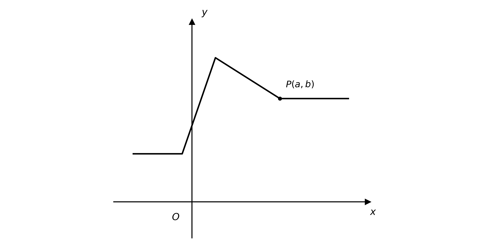
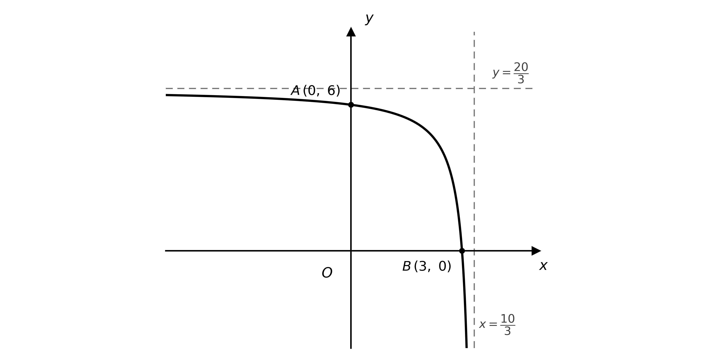
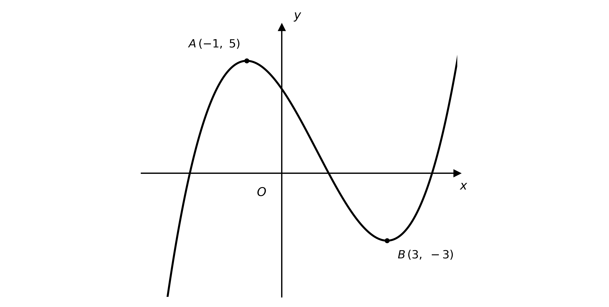
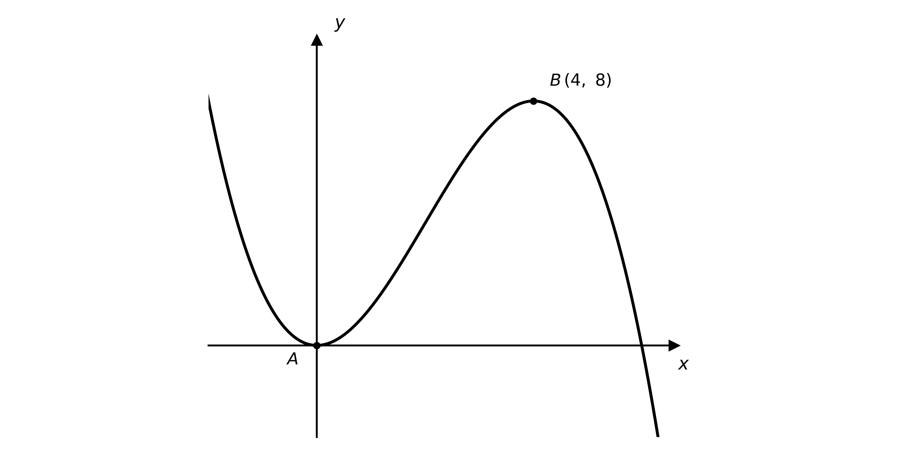

# Exam Questions — Transformations of Functions
**Algebra & Functions** · Cambridge (CIE) AS maths (9709)
> Source: [https://www.savemyexams.com/as/maths/cie/20/pure-1/topic-questions/](https://www.savemyexams.com/as/maths/cie/20/pure-1/topic-questions/) · 32 questions across 1 sets

## Exam Questions (32 questions)

### Q1 — easy — 3 marks

**Q1** [3 marks]

The diagram shows the graph of $y = \text{f} ( x )$. The point $P$ has coordinates `\left( a, b \right)`, where $a , b > 0$.

In terms of $a$ and $b$, write down the coordinates of the image of $P$ under each of the following transformations:

(i) $y = \text{f} ( 2 x )$

(ii) $y = - \text{f} ( x )$

(iii) $y = a  \text{f} ( x )$

### Q2 — easy — 7 marks

**Q2** [3 marks]

The function $\text{f}$ is defined by

$\text{f} ( x ) = ( x - 2 ) ( x - 6 )$

Sketch the graph of $y = \text{f} ( x )$, showing clearly the coordinates of the points where the graph meets the coordinate axes and the coordinates of the turning point.

**Q2** [4 marks]

On separate diagrams sketch the graphs of:

(i) $y = \text{f} ( x - 4 )$

(ii) $y = \text{f} ( - x )$

In each case show clearly the coordinates of the points where the graph meets the coordinate axes and the coordinates of the turning point.

### Q3 — easy — 3 marks

**Q3** [3 marks]

The point `P \left( 2, 6 \right)` lies on the curve with equation $y = \text{f} ( x )$.

State the coordinates of the image of $P$ on each of the following curves:

(i) $y = \text{f} ( x ) + 1$

(ii) $y = - \text{f} ( x )$

(iii) `y = \text{f}\left( \tfrac{1}{4}x \right)`

### Q4 — easy — 4 marks

**Q4** [4 marks]

A curve has equation $y = \text{f} ( x )$.

Describe fully the single transformation that maps the graph of $y = \text{f} ( x )$ onto the graph of each of the following:

(i) $y = \text{f} ( x ) + 2$

(ii) $y = \text{f} ( x - 2 )$

(iii) $y = 3 \text{f} ( x )$

(iv) $y = \text{f} ( 2 x )$

### Q5 — easy — 3 marks

**Q5** [3 marks]

A point `P \left( -2, 8 \right)` on the graph of $y = \text{f} ( x )$ is mapped to the point $P '$ under a single transformation.

For each of the following coordinates of $P '$, describe a transformation that could have produced it:

(i) `P' \left( -2, 3 \right)`

(ii) `P' \left( -4, 8 \right)`

(iii) `P' \left( -2, -8 \right)`

### Q6 — easy — 3 marks

**Q6** [3 marks]

The point `P \left( 3, -4 \right)` lies on the curve with equation $y = \text{f} ( x )$.

Find the value of $a$ in each of the following cases:

(i) on the graph of $y = \text{f} ( x + a )$, the point $P$ is mapped to `\left( -3, -4 \right)`

(ii) on the graph of $y = a  \text{f} ( x )$, the point $P$ is mapped to `\left( 3, -12 \right)`

(iii) on the graph of $y = \text{f} ( a x )$, the point $P$ is mapped to `\left( -3, -4 \right)`

### Q7 — easy — 4 marks

**Q7** [4 marks]

A curve has equation $y = \text{f} ( x )$.

Write down, in terms of $\text{f}$, the equation of the curve obtained by each of the following transformations of $y = \text{f} ( x )$:

(i) a translation by `\begin{pmatrix} 3 \\ 0 \end{pmatrix}`

(ii) a stretch parallel to the $x$-axis with scale factor $2$

(iii) a stretch parallel to the $y$-axis with scale factor $\frac{1}{3}$

(iv) a reflection in the $y$-axis

### Q8 — hard — 4 marks

**Q8** [4 marks]

The curve with equation $y = \text{f} ( x )$ has two asymptotes, with equations $y = 5$ and $x = - 4$.

Give the equations of the asymptotes of each of the following curves:

(i) $\frac{1}{3} y = \text{f} ( x )$

(ii) `y = \text{f}\left( \tfrac{1}{3}x \right)`

### Q9 — very_hard — 6 marks

**Q9** [4 marks]

The diagram shows the graph of $y = \text{f} ( x )$. The marked points are `A \left( -1, 5 \right)` and `B \left( 3, -3 \right)`.

On separate diagrams, sketch the following curves, giving the coordinates of the images of $A$ and $B$ on each:

(i) `y = \text{f}\left( \tfrac{1}{3}x \right)`

(ii) $5 y = \text{f} ( x )$

**Q9** [2 marks]

On the graph of $y = \text{f} ( a x )$ the image of one of the two marked points has an $x$-coordinate of $\frac{5}{3}$. Given that $a > 0$, find the value of $a$.

### Q10 — very_hard — 8 marks

**Q10** [6 marks]

The diagram shows the graph of $y = \text{f} ( x )$. The graph meets the coordinate axes at the marked points `A \left( 0, 6 \right)` and `B \left( 3, 0 \right)`, and has asymptotes with equations $y = \frac{20}{3}$ and $x = \frac{10}{3}$.

On separate diagrams, sketch the following curves, giving the coordinates of the images of $A$ and $B$ and the equations of the transformed asymptotes:

(i) `y = \text{f}\left( \tfrac{20}{3}x \right)`

(ii) $5 y = 4 \text{f} ( x )$

**Q10** [2 marks]

The graph of $y = \text{f} ( a x )$ has an asymptote with equation $x = k$, where $1 < k < 100$. Find the range of possible values of $a$.

### Q11 — hard — 4 marks

**Q11** [4 marks]

The curve with equation $y = \text{f} ( x )$ has two asymptotes, with equations $y = - 1$ and $x = - 2$.

Give the equations of the asymptotes of each of the following curves:

(i) $y = \text{f} ( - x )$

(ii) $- y = \text{f} ( x )$

### Q12 — very_hard — 8 marks

**Q12** [6 marks]

The function $\text{f}$ is defined by

$\text{f} ( x ) = 9 - \frac{16}{(x-2)^{2}}$

Sketch the graph of $y = \text{f} ( x )$, showing clearly the points where the curve crosses the coordinate axes and stating the equations of the asymptotes.

**Q12** [2 marks]

The graph of $y = \text{f} ( x + a )$ is such that, for all points `P \left( x, y \right)` that lie on the graph, if the $y$-coordinate is less than $5$ then the $x$-coordinate is less than zero. Find the range of possible values of $a$.

### Q13 — hard — 4 marks

**Q13** [4 marks]

The curve with equation $y = \text{f} ( x )$ has two asymptotes, with equations $y = - 3$ and $x = 2$.

Give the equations of the asymptotes of each of the following curves:

(i) $y + 3 = \text{f} ( x )$

(ii) $y = \text{f} ( x - 2 )$

### Q14 — hard — 5 marks

**Q14** [5 marks]

The diagram shows the graph of $y = \text{f} ( x )$. The marked point `B \left( 4, 8 \right)` lies on the graph, and the graph meets the origin at the marked point $A$.

Consider the three transformations of the graph

$y = \text{f} ( - x )$

$y = \text{f} ( a x )$

$y = \text{f} ( x ) + b$

where $a$ and $b$ are constants and $a > 0$.

State which of the transformations satisfies each of the following conditions, determining the range of possible values of $a$ or $b$ where relevant:

(i) the images of the two marked points lie on opposite sides of the $x$-axis;

(ii) the image of point $B$ has coordinates `\left( x, y \right)`, where $- 6 < x < - 3$;

(iii) the image of point $B$ has coordinates `\left( x, y \right)`, where $0 < x < 3$.

### Q15 — very_hard — 9 marks

**Q15** [6 marks]

The function $\text{f}$ is defined by

$\text{f} ( x ) = x^{3} - 2 \sqrt{3}  x^{2} + 3 x$

Sketch the graph of $y = \text{f} ( x )$, showing clearly the coordinates of the points where the curve crosses or touches the coordinate axes.

**Q15** [3 marks]

The functions $\text{g}$ and $\text{h}$ are defined by

$\text{g} ( x ) = \text{f} ( - x )$

$\text{h} ( x ) = \text{g} ( x + a )$

The graph of $y = \text{h} ( x )$ touches the $x$-axis at the point `\left( 5, 0 \right)`. Find the exact value of $a$.

### Q16 — hard — 4 marks

**Q16** [2 marks]

The point `P \left( -12, -9 \right)` lies on the curve with equation $y = x^{2} + 15 x + 27$.

The graph is translated so that $P$ is mapped to the point `\left( -12, 3 \right)`. Write down the equation of the transformed curve.

**Q16** [2 marks]

The graph is translated so that $P$ is mapped to the point `\left( -10, -9 \right)`. Write down the equation of the transformed curve in the form

$y = ( x + a )^{2} + 15 ( x + a ) + 27$

where $a$ is a constant to be found.

### Q17 — medium — 4 marks

**Q17** [4 marks]

The point `P \left( -3, -2 \right)` lies on the curve with equation $y = \text{f} ( x )$.

State the coordinates of the image of $P$ on each of the following curves:

(i) $y - 2 = \text{f} ( x ) - 6$

(ii) $y = \text{f} ( x - 3 )$

(iii) $2 y = \text{f} ( x )$

(iv) `y = \text{f}\left( \tfrac{1}{2}x \right)`

### Q18 — medium — 2 marks

**Q18** [2 marks]

The point `P \left( 0, 5 \right)` lies on the curve with equation $y = \text{f} ( x )$.

State the coordinates of the image of $P$ on each of the following curves:

(i) $y = \text{f} ( - x )$

(ii) $- y = \text{f} ( x )$

### Q19 — hard — 7 marks

**Q19** [4 marks]

The diagram shows the graph of $y = \text{f} ( x )$. The marked points are `A \left( -1, 5 \right)` and `B \left( 3, -3 \right)`.

On separate diagrams, sketch the following curves, giving the coordinates of the images of $A$ and $B$ on each:

(i) $y = \text{f} ( - x )$

(ii) $- y = \text{f} ( x )$

**Q19** [3 marks]

On the graph of $y = \text{f} ( x + a )$ the images of the two marked points both lie on the same side of the $y$-axis. Find the range of possible values of $a$.

### Q20 — hard — 7 marks

**Q20** [6 marks]

The diagram shows the graph of $y = \text{f} ( x )$. The graph meets the coordinate axes at the marked points `A \left( 0, 6 \right)` and `B \left( 3, 0 \right)`, and has asymptotes with equations $y = \frac{20}{3}$ and $x = \frac{10}{3}$.

On separate diagrams, sketch the following curves, giving the coordinates of the images of $A$ and $B$ and the equations of the transformed asymptotes:

(i) $y = \text{f} ( 5 x )$

(ii) $y = - \text{f} ( x )$

**Q20** [1 mark]

The graph of $y = a  \text{f} ( x )$ has an asymptote with equation $y = 2$. Find the value of $a$.

### Q21 — hard — 6 marks

**Q21** [4 marks]

Sketch the graph of $y = 2 - \frac{8}{x^{2}}$, showing clearly the points where the curve crosses the coordinate axes and stating the equations of the asymptotes.

**Q21** [2 marks]

The graph of $y = 2 - \frac{8}{(x+a)^{2}}$ passes through the origin. Find the two possible values of $a$.

### Q22 — hard — 5 marks

**Q22** [3 marks]

Given that

$x^{3} - 8 x^{2} + 16 x = x ( x - 4 )^{2}$

sketch the graph of $y = x^{3} - 8 x^{2} + 16 x + 3$, showing clearly the coordinates of the point where the curve crosses the $y$-axis and the coordinates of any minimum points.

The curve crosses the $x$-axis once; show this crossing in the correct position, but you are not required to find its coordinates.

(You do not need to state the coordinates of any maximum points.)

**Q22** [2 marks]

The graph with equation $y + a = x^{3} - 8 x^{2} + 16 x$ crosses the $x$-axis three times. Find the range of possible values of $a$.

### Q23 — hard — 4 marks

**Q23** [2 marks]

The point `P \left( 3, -12 \right)` lies on the curve with equation $y = x^{2} - 12 x + 15$.

The graph is stretched so that $P$ is mapped to the point `\left( 3, -4 \right)`. Write down the equation of the transformed curve in the form $y = a x^{2} + b x + c$, where $a$, $b$ and $c$ are constants to be found.

**Q23** [2 marks]

The graph is stretched so that $P$ is mapped to the point `\left( 1, -12 \right)`. Write down the equation of the transformed curve in the form

$y = ( d x )^{2} - 12 ( d x ) + 15$

where $d$ is a constant to be found.

### Q24 — hard — 4 marks

**Q24** [4 marks]

The diagram shows the graph of $y = \text{f} ( x )$. The marked point `B \left( 4, 8 \right)` lies on the graph, and the graph meets the origin at the marked point $A$.

On separate diagrams, sketch the following curves, giving the coordinates of the images of $A$ and $B$ on each:

(i) `y = \text{f}\left( \tfrac{1}{3}x \right)`

(ii) $6 y = \text{f} ( x )$

### Q25 — medium — 5 marks

**Q25** [4 marks]

Sketch the graph of $y = \frac{1}{x} + 3$, showing clearly the points where the curve crosses the coordinate axes and stating the equations of the asymptotes.

**Q25** [1 mark]

The graph of $y = \frac{1}{x+a} + 3$ passes through the origin. Find the value of $a$.

### Q26 — medium — 4 marks

**Q26** [4 marks]

The point `P \left( 3, 2 \right)` lies on the curve with equation $y = \text{f} ( x )$.

Determine the value of the constant in each of the following cases:

(i) on the graph of $y = \text{f} ( x ) + a$, the point $P$ is mapped to `\left( 3, -5 \right)`

(ii) on the graph of $y = \text{f} ( x + b )$, the point $P$ is mapped to `\left( -1, 2 \right)`

(iii) on the graph of $y = c  \text{f} ( x )$, the point $P$ is mapped to `\left( 3, 1 \right)`

(iv) on the graph of $y = \text{f} ( d x )$, the point $P$ is mapped to `\left( 1, 2 \right)`

### Q27 — medium — 8 marks

**Q27** [6 marks]

The diagram shows the graph of $y = \text{f} ( x )$. The graph meets the coordinate axes at the marked points `A \left( 0, 6 \right)` and `B \left( 3, 0 \right)`, and has asymptotes with equations $y = \frac{20}{3}$ and $x = \frac{10}{3}$.

On separate diagrams, sketch the following curves, giving the coordinates of the images of $A$ and $B$ and the equations of the transformed asymptotes:

(i) $y = \text{f} ( x ) - 6$

(ii) $y = \text{f} ( - x )$

**Q27** [2 marks]

On the graph of $y = \text{f} ( x + a )$ one of the asymptotes lies on a coordinate axis. Find the value of $a$.

### Q28 — medium — 4 marks

**Q28** [4 marks]

The point `P \left( -1, 4 \right)` lies on the curve with equation $y = \text{f} ( x )$.

State the coordinates of the image of $P$ on each of the following curves:

(i) $y = \text{f} ( x ) + 3$

(ii) $y = \text{f} ( x + 3 )$

(iii) $y = 3 \text{f} ( x )$

(iv) $y = \text{f} ( 3 x )$

### Q29 — medium — 2 marks

**Q29** [2 marks]

The point `P \left( -3, -4 \right)` lies on the curve with equation $y = \text{f} ( x )$.

State the coordinates of the image of $P$ on each of the following curves:

(i) $y = \text{f} ( - x )$

(ii) $y = - \text{f} ( x )$

### Q30 — medium — 6 marks

**Q30** [4 marks]

Given that

$x^{3} - 10 x^{2} - 24 x = x ( x + 2 ) ( x - 12 )$

sketch the graph of $y = x^{3} - 10 x^{2} - 24 x$, showing clearly the coordinates of the points where the curve crosses the coordinate axes.

**Q30** [2 marks]

The graph with equation $y = ( x + a )^{3} - 10 ( x + a )^{2} - 24 ( x + a )$ passes through the point $( - 2 , 0 )$. Find the three possible values of $a$.

### Q31 — medium — 6 marks

**Q31** [4 marks]

The diagram shows the graph of $y = \text{f} ( x )$. The marked points are `A \left( -1, 5 \right)` and `B \left( 3, -3 \right)`.

On separate diagrams, sketch the following curves, giving the coordinates of the images of $A$ and $B$ on each:

(i) $y = \text{f} ( x - 1 )$

(ii) $y = \text{f} ( x ) + 3$

**Q31** [2 marks]

On the graph of $y = \text{f} ( x + a )$ the image of one of the two marked points has an $x$-coordinate of $2$. Find the two possible values of $a$.

### Q32 — medium — 6 marks

**Q32** [4 marks]

The diagram shows the graph of $y = \text{f} ( x )$. The marked point `B \left( 4, 8 \right)` lies on the graph, and the graph meets the origin at the marked point $A$.

On separate diagrams, sketch the following curves, giving the coordinates of the images of $A$ and $B$ on each:

(i) $y = - \text{f} ( x )$

(ii) $y = \text{f} ( 4 x )$

**Q32** [2 marks]

On the graph of $y = a  \text{f} ( x )$ the image of one of the two marked points has a $y$-coordinate of $4$. Find the value of $a$.
